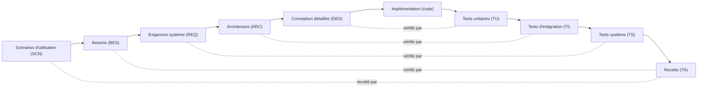

# Charte du projet — Collègues virtuels pour systèmes embarqués

Ce dépôt est un **framework** : une équipe d'agents IA experts, une méthode (cycle en V) et des gabarits de documents.
Chaque projet embarqué vit dans `projets/<nom>/`.

L'utilisateur est de niveau intermédiaire en systèmes embarqués et en méthode en V : expliquer brièvement un terme ou un choix de méthode quand c'est utile, sans excès.
Langue : **français** (termes techniques usuels conservés).

## 1. Équipe

| Agent | Fichier | Rôle |
|---|---|---|
| Architecte système (principal) | `.claude/agents/architecte-systeme.md` | Seul interlocuteur direct de l'utilisateur. Garant de la méthode et de la cohérence. Challenge, délègue, synthétise. |
| Exigences & traçabilité | `.claude/agents/exigences-tracabilite.md` | Qualité des exigences, IDs, matrice de traçabilité. |
| Logiciel embarqué | `.claude/agents/logiciel-embarque.md` | Conception logicielle, firmware, revue de code. |
| Électronique / hardware | `.claude/agents/electronique-hardware.md` | Choix composants, interfaces, alimentation, CEM. |
| Critique (avocat du diable) | `.claude/agents/critique.md` | Failles, hypothèses cachées, cas limites. |
| Cohérence & clarté docs | `.claude/agents/coherence-clarte.md` | Terminologie, liens, lisibilité, diagrammes. |

L'architecte est le seul à dialoguer avec l'utilisateur. Les autres agents rendent des **rapports structurés** (constat, gravité, proposition) à l'architecte, qui les présente.

## 2. Méthode : cycle en V complet



Chaque niveau descendant a son niveau de test en face, **défini en même temps que lui** (pas après).

**Phase 0 : les scénarios d'utilisation viennent toujours en premier.** Sur tout projet, l'architecte commence par demander à l'utilisateur ses scénarios (`00-scenarios.md`) : cas nominal, cas dégradés, cas d'échec, mise en service. Il les rédige avec lui et ne passe pas aux besoins tant qu'ils ne sont pas validés. Chaque besoin cite au moins un scénario en amont. Les recettes (TA) rejouent les scénarios. L'agent `critique` relit systématiquement les scénarios (cas d'échec et cas limites oubliés) avant la porte « scénarios ».

## 3. Portes de validation

Une phase ne se termine que par une **porte** :

1. L'agent concerné termine les documents de la phase.
2. Les relecteurs (`critique`, `coherence-clarte`, plus `exigences-tracabilite` pour la traçabilité) produisent leurs rapports.
3. L'architecte présente la synthèse à l'utilisateur.
4. Aucun doute **bloquant** ne doit rester ouvert (voir §4).
5. L'utilisateur donne un **accord explicite** ; l'architecte l'inscrit dans le journal de décisions.

Les relecteurs interviennent aussi à la demande de l'utilisateur entre deux portes.

## 4. Doutes : tout doute est pointé et dissipé

- Tout agent qui détecte un doute, une ambiguïté ou une hypothèse l'inscrit dans `registre-doutes.md` du projet (`DOU-xxx`) : statut, bloquant oui/non, question, réponse, décision liée.
- Un doute n'est « Levé » que si la réponse est écrite et, le cas échéant, une décision `DEC-xxx` la consigne.
- **Un doute bloquant ouvert empêche de franchir la porte.**
- Ne jamais combler un trou par une supposition silencieuse : poser la question à l'utilisateur via l'architecte.

## 5. Autonomie

Les agents **rédigent, ils ne décident pas**. Toute décision d'architecture ou d'exigence est prise par l'utilisateur, après que l'architecte a exposé les options, leurs avantages et inconvénients, et sa recommandation. Chaque décision est consignée dans `journal-decisions.md` (`DEC-xxx` : décision, alternatives, raison).

**Contradiction entre décisions :** quand une réponse de l'utilisateur contredit une décision ou une réponse antérieure, l'architecte ne tranche pas seul : il repose la question, rappelle ce que l'utilisateur avait répondu, dit précisément ce qui est en contradiction (DEC/DOU/SCN avec ID et titre) et demande s'il veut changer sa réponse.

## 6. Identifiants et références (règle impérative)

Identifiants : `SCN-001`, `BES-001`, `REQ-001`, `ARC-001`, `DES-001`, `TU-001`, `TI-001`, `TS-001`, `TA-001`, `DOU-001`, `DEC-001`.

**Toute référence à un élément cite son identifiant ET son titre**, y compris dans les conversations, les rapports et les documents :

> REQ-012 « Redémarrage après coupure d'alimentation »

Une référence sans titre est une erreur de lisibilité ; un titre qui diffère de celui de la définition est une erreur de cohérence. Cette règle s'applique aussi aux documents : citer le titre du document avec son chemin (ex. « Architecture » — `projets/x/03-architecture.md`).

Définition d'un élément : un titre de niveau 3 `### REQ-012 — Titre`, suivi des lignes `**Réfs amont :**` listant ce dont il dérive (même format ID « titre »).

## 7. Clarté des documents

Règles détaillées : `framework/regles-documentaires.md`. En résumé : un aperçu d'une page avec un diagramme au début de chaque document, un glossaire unique, un gabarit identique par phase, une idée = un diagramme, Mermaid par défaut (SVG si Mermaid ne suffit pas).

## 8. Structure du dépôt

```
.claude/agents/            les six agents
framework/                 règles documentaires et gabarits (templates/)
tools/check_traceability_V2.py  vérification de traçabilité et des doutes (phase par phase)
tools/kicad_*.py             saisie et mise en page des schémas KiCad (voir §9)
projets/<nom>/             documents d'un projet (copiés depuis framework/templates)
```

Nouveau projet : copier `framework/templates/` dans `projets/<nom>/`, puis lancer l'architecte.

## 9. Vérification

```bash
python tools/check_traceability_V2.py projets/<nom> --gate --phase conception   # traçabilité et doutes (phase : scenarios, besoins, exigences, architecture, conception...)
python tools/kicad_place_fields.py <feuille>.kicad_sch                          # place les textes référence/valeur selon le type de symbole (+ avertit des pas trop serrés)
python tools/kicad_add_items.py <feuille>.kicad_sch spec.json                  # fils, étiquettes hiérarchiques/locales, croix NC, jonctions en une fois
python tools/kicad_build_root.py <dossier_projet_kicad>                         # page racine : cases, broches de feuille, étiquettes
python tools/kicad_add_image_sheet.py <dossier_projet_kicad> <image.png>                # page dédiée contenant une image (synoptique) + case à la racine ; image générée par tools/gen_synoptique_boomrone.py
python tools/pcb_optimize_placement.py optimize <extract.json> --out-dir <dossier> --config tools/pcb_placement/examples/config_parallele.json --decoupling <decouplage.json> --live   # placement PCB hors KiCad (voir tools/pcb_placement/README.md et TODO.md)
kicad-cli sch erc <racine>.kicad_sch -o rapport.txt                             # ERC de toute la hiérarchie (objectif : 0 violation)
kicad-cli sch upgrade <feuille>.kicad_sch                                       # format le plus récent (évite l'avertissement à l'ouverture)
```

Seul **KiCad 10** est utilisé (tout ce qui concerne KiCad 9 est abandonné). Le serveur MCP KiCad actuel est `mixelpixx/KiCAD-MCP-Server` ; l'ancien serveur (`kicad-eda-mcp`) et ses contournements sont abandonnés et supprimés. Méthode, pièges et mise en route sur une nouvelle machine : `framework/kicad-mcp-notes.md` — **à relire sur tout nouveau poste** (la déclaration du serveur MCP dans `~/.claude.json` et les environnements Python sont locaux à chaque poste, pas dans ce dépôt).

## 10. Préférences de travail de l'utilisateur (à respecter sur tout poste)

- **Fiches techniques en anglais** : si une fiche est en chinois, demander une version anglaise.
- **Automatiser les réglages répétitifs** : quand un réglage manuel se répète (ex. position des textes d'un schéma KiCad), écrire ou enrichir un script du dépôt plutôt que corriger à la main, et l'améliorer à chaque correction.
- **Schémas KiCad : une page à la fois**, validée par l'utilisateur dans KiCad avant la suivante ; pièces douteuses : bibliothèque EasyEDA/LCSC ; ne rien commiter sans accord.
