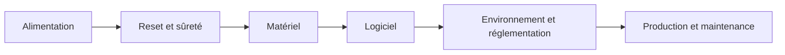

# Liste de contrôle « système embarqué »

> **Aperçu** : sujets que tout projet embarqué doit avoir traités, ou exclus par une décision de l'utilisateur. Le `critique` l'applique aux portes « exigences », « architecture » et « conception détaillée » ; les sections qui ne concernent pas le projet (ex. « Batterie » pour un appareil alimenté par USB) sont notées « sans objet » dans le rapport, avec la raison.

## Alimentation
- Source(s), plage de tension, courant de crête et moyen ; bilan avec marge.
- Protections : inversion de polarité, surtension à la connexion, surintensité, décharge profonde (batterie).
- Comportement à la mise sous tension (ordre des rails, appel de courant) et à la coupure brutale.
- Batterie (si présente) : chimie, charge (où, comment), protection, transport et stockage.

## Reset et sûreté
- État de chaque sortie de puissance au reset, au brown-out et sans logiciel : sûr par construction ?
- Chien de garde : qui le rafraîchit, que se passe-t-il s'il expire ?
- Seuil de brown-out cohérent avec la tension minimale des composants alimentés.
- **AMDEC des fonctions de sûreté** (si le projet en a), tableau : fonction · mode de défaillance · effet · détection · parade · gravité. Une défaillance de gravité élevée sans parade = doute bloquant ou risque accepté par l'utilisateur.

## Matériel
- Chaque composant actif : fiche technique en anglais présente, valeurs relues aux maximales, découplage selon la fiche.
- Entrées exposées (connecteurs, boutons, USB) : protection ESD et niveaux maximaux.
- Niveaux logiques compatibles entre circuits, rappels (pull-up/pull-down) définis, broches non utilisées traitées.
- Horloges : source, précision nécessaire (liaison série, USB, radio).
- Thermique : dissipation de chaque composant de puissance, température de jonction au pire cas.
- CEM : boucles de courant courtes, retour de masse, découplage, séparation puissance/signal ; antenne dégagée.
- Points de test et accès de programmation/débogage.

## Logiciel
- Cible, chaîne de compilation et méthode de programmation fixées (`projet.md`).
- Démarrage : ordre d'initialisation, attente des composants (temps de la fiche), échec d'initialisation défini.
- Ordonnancement : temps d'exécution au pire cas de chaque tâche, marge de cycle, priorités d'interruption.
- Concurrence : données partagées entre interruptions et boucle principale protégées.
- Mémoire : budget flash et RAM avec marge, taille de pile mesurée ou estimée, pas d'allocation dynamique non bornée.
- Erreurs : bus (NACK, blocage), débordements, valeurs hors bornes, fautes du processeur ; chaque cas a un comportement écrit.
- Données persistantes : écriture interrompue par une coupure, usure de la mémoire, valeurs par défaut.
- Mise à jour du logiciel : comment, et ce qui se passe si elle est interrompue.

## Environnement et réglementation
- Plage de température, humidité, vibrations, chocs de l'usage prévu.
- Réglementation applicable (ex. marquage, émission radio, sécurité électrique, transport des batteries) : traitée ou explicitement hors périmètre par décision de l'utilisateur.

## Production et maintenance
- Disponibilité des composants et solution de repli pour les pièces critiques.
- Procédure de mise en route de la première carte (bring-up) : ordre des vérifications, mesures attendues.
- Test de fin de fabrication : ce qu'on vérifie sur chaque carte.
- Réparation, remplacement des pièces d'usure, fin de vie.
