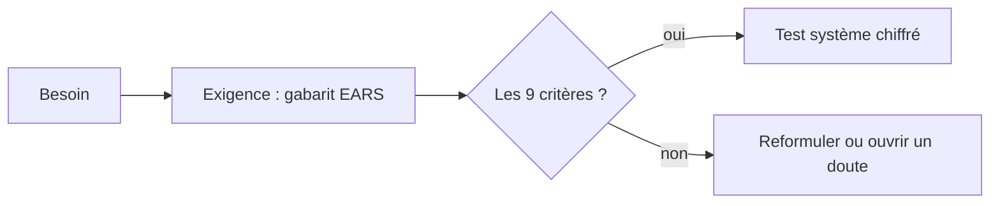

# Liste de contrôle des exigences

> **Aperçu** : critères de qualité d'une exigence (inspirés du guide de rédaction des exigences de l'INCOSE) et tournures de phrase normalisées (gabarits EARS). Utilisée par `exigences-tracabilite` pour rédiger et relire, et par `critique` à la porte « exigences ».

## Les 9 critères d'une bonne exigence

| Critère | Question à se poser |
|---|---|
| Nécessaire | Que perd-on si on la retire ? Rien → la supprimer. |
| Au bon niveau | Dit-elle *quoi* faire, sans imposer *comment* (pas de composant, pas de structure logicielle) ? |
| Non ambiguë | Deux lecteurs en tirent-ils le même test ? Pas de « rapide », « robuste », « environ », « si possible », « etc. », « adapté », « suffisant ». |
| Complète | Condition, action, valeur, tolérance et unité sont-elles toutes écrites ? |
| Atomique | Un seul « doit » ; pas de « et » qui cache deux exigences ; une liste de causes = une exigence par cause si elles se testent séparément. |
| Faisable | Est-elle atteignable avec les moyens, le budget et les composants envisagés ? Sinon : doute bloquant. |
| Vérifiable | Existe-t-il un essai, une mesure, une inspection ou une analyse qui dit oui ou non ? |
| Correcte | Traduit-elle fidèlement le besoin cité en amont ? |
| Conforme | Suit-elle le gabarit et les règles documentaires (ID, titre, Réfs amont, priorité, vérification, statut) ? |

## Tournures normalisées (EARS)

| Type | Tournure | Exemple |
|---|---|---|
| Permanente | Le système doit `<réponse>`. | Le système doit peser au plus 100 g (±2 g). |
| Sur événement | Quand `<déclencheur>`, le système doit `<réponse>`. | Quand le bouton est maintenu 2,0 s (±0,1 s), le système doit donner l'effet Prêt. |
| Dans un état | Pendant `<état>`, le système doit `<réponse>`. | Pendant le vol, le système doit mesurer la tension de la batterie toutes les 10 ms. |
| Situation indésirable | Si `<condition indésirable>`, alors le système doit `<réponse>`. | Si la tension reste sous 3,3 V pendant 100 ms, alors le système doit couper les moteurs en 250 ms au plus. |
| Option | Là où `<option présente>`, le système doit `<réponse>`. | Là où le module radio est monté, le système doit émettre son état deux fois par seconde. |

Les tournures se combinent (« Pendant `<état>`, quand `<déclencheur>`, le système doit… »).

## Contrôles de traçabilité
- Chaque exigence cite au moins un besoin ; sa priorité est la plus haute de ses besoins.
- Chaque exigence cite son test système dans « Vérification », et ce test cite l'exigence dans ses « Réfs amont ».
- Toute valeur non décidée par l'utilisateur est « provisoire », avec un doute qui a une échéance.
