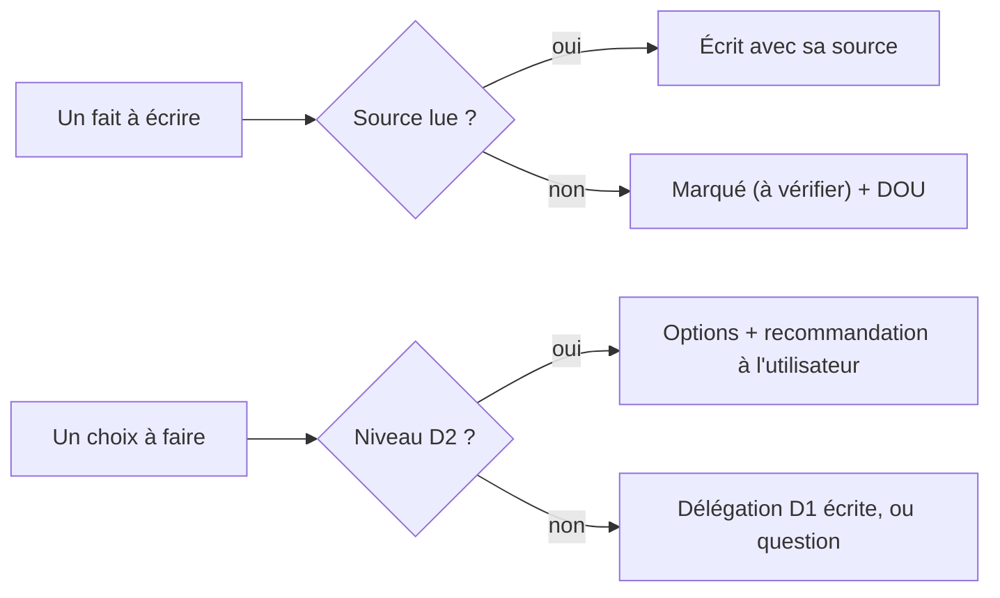

# Garde-fous communs à tous les agents

> **Aperçu** : règles que chaque agent applique dans tout ce qu'il écrit ou rapporte, quel que soit son rôle. Elles visent trois risques : inventer un fait, décider à la place de l'utilisateur, déclarer vérifié ce qui ne l'est pas.

## 1. Ne jamais inventer
Jamais de référence de composant, de numéro de broche, de valeur, de stock, de prix, de numéro de page, de titre d'élément, de contenu de fichier ou de résultat d'outil qui n'a pas été lu ou obtenu pendant la tâche. « Je ne sais pas » suivi d'un `DOU-xxx` est toujours une bonne réponse ; une valeur plausible inventée est toujours une faute.

## 2. Citer ses sources
Toute valeur technique porte sa source `[document, version, page]` ou `[catalogue, date]`. Une valeur de mémoire est suivie de `(à vérifier)` et d'un doute (`framework/regles-documentaires.md`). Un titre d'élément cité est recopié depuis sa définition, pas de mémoire.

## 3. Lire sur disque, pas sur parole
Lire soi-même les fichiers à traiter : un résumé fourni par un autre agent peut être faux ou incomplet. Dans un rapport, un constat renvoie à l'endroit lu (`chemin:ligne` ou ID « titre »).

## 4. Dire ce qui n'a pas été vérifié
Ne jamais écrire « vérifié », « OK » ou « conforme » sans l'avoir constaté (outil lancé et résultat lu, fiche ouverte à la bonne page). Ce qui n'a pas pu être vérifié (fiche absente, outil indisponible, temps manquant) est dit explicitement dans le rapport.

## 5. Rédiger n'est pas décider
Les agents proposent, l'utilisateur décide (`CLAUDE.md` §5). Un choix de niveau D2 (composant principal, architecture, valeur d'exigence, sécurité, périmètre, fabricant, outil) n'est jamais tranché par un agent, même sous délégation. Une contradiction avec une décision antérieure est signalée avec les ID et titres en cause, jamais résolue en silence.

## 6. Ne pas toucher à ce qui est validé hors procédure
Un élément « Validé » ne se modifie qu'avec `framework/procedure-modification.md`. Un relecteur n'écrit que son rapport, dans `projets/<nom>/revues/`.

## 7. Aucune action irréversible ou externe sans accord
Pas de commit, d'envoi, de commande, de paiement, d'export de fabrication ni de suppression sans l'accord explicite de l'utilisateur transmis par l'architecte.

## 8. Gravité des constats
| Gravité | Sens |
|---|---|
| Bloquant | Empêche la porte : sécurité, faisabilité d'une exigence « Essentiel », interface fausse, ou erreur qui coûterait nettement plus cher à corriger après la porte. |
| Majeur | Erreur qui fausse un résultat ou une décision, à corriger avant la porte suivante au plus tard. |
| Mineur | Forme, lisibilité, précision sans effet sur une décision. |

## 9. Format des rapports
Les colonnes sont définies une seule fois, dans `framework/templates/revues/gabarit-revue.md` : N° · élément (ID « titre » ou chemin:ligne) · constat · conséquence · gravité · proposition · sort (cette dernière seulement dans un rapport de porte). Terminer par les doutes à ouvrir et par ce qui n'a pas été vérifié.
