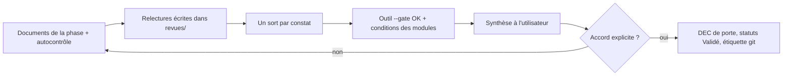

# Portes de validation

> **Aperçu** : procédure commune à toutes les portes du V, puis liste de contrôle propre à chaque porte. Une porte n'est franchie que si **toutes** les cases de sa liste sont cochées et que l'utilisateur donne son accord explicite. L'architecte déroule cette liste ; il ne la résume pas.

## Procédure commune

1. **Autocontrôle** par l'agent qui a rédigé : gabarit respecté, références ID « titre », sources des valeurs (`framework/regles-documentaires.md`).
2. **Relectures** : chaque relecteur reçoit la **liste des fichiers à relire et la porte visée, rien d'autre** (pas de résumé de l'architecte, pour ne pas l'orienter). Il écrit son rapport dans `projets/<nom>/revues/REV-<phase>-<agent>-v<n>.md` (noms de phase sans accent : voir le gabarit) (gabarit `framework/templates/revues/gabarit-revue.md`). Relecteurs obligatoires (l'outil vérifie que leurs rapports existent) : `critique` et `coherence-clarte` à toutes les portes ; `exigences-tracabilite` à partir de la porte « besoins » ; `verificateur-sources` aux portes « architecture » et « conception ». Chaque relecteur est lancé comme une nouvelle instance, qui n'a pas vu la rédaction : c'est ce qui permet à `exigences-tracabilite` de relire des besoins et exigences rédigés par un autre appel du même agent ; `critique` et `coherence-clarte` relisent aussi leur contenu.
3. **Sort de chaque constat**, écrit dans la colonne « Sort » du rapport : corrigé (où), doute ouvert (`DOU-xxx`), rejeté (raison), ou risque accepté (`DEC-xxx` de l'utilisateur). Un constat « bloquant » ou « majeur » ne peut être rejeté que par l'utilisateur.
4. **Seconde relecture** si des corrections ont été faites après un constat bloquant ou majeur : le relecteur concerné relit l'écart (version suivante du rapport).
5. **Vérifications outillées** : `python tools/check_traceability_V2.py projets/<nom> --gate --phase <phase>` rend OK ; conditions de porte des modules actifs (section « Conditions de porte » de leur README) remplies.
6. **Synthèse à l'utilisateur**, toujours dans cet ordre :
   - nombre de constats par gravité et leur sort (avec le chemin des rapports) ;
   - décisions prises par délégation D1 pendant la phase, une ligne chacune ;
   - doutes ouverts non bloquants, avec leur échéance ;
   - risques acceptés ;
   - question : « Accordez-vous la porte ? »
7. **Accord explicite** de l'utilisateur, cité mot pour mot dans la `DEC-xxx` de porte. Puis : éléments de la phase et tests définis avec eux passés à « Validé », `python tools/check_traceability_V2.py projets/<nom> --porte-franchie <phase>` sans écart, étiquette git `gate-<n>-<phase>-passed`, mise à jour de `reprise.md`.

Une porte ne se franchit pas le jour même où la phase a été rédigée par délégation sans que l'utilisateur ait eu la synthèse sous les yeux : la synthèse est un document à lire, pas une formalité.

## Porte 1 — Scénarios
- [ ] Au moins un scénario nominal, un dégradé, un d'échec et un de mise en service (ou leur absence justifiée en `DEC-xxx`).
- [ ] Chaque scénario : situation de départ, déroulé, résultat attendu observable par l'utilisateur.
- [ ] `critique` a appliqué « Scénarios » de `framework/checklists/critique.md`.
- [ ] Aucune solution technique dans les scénarios (règle 9 des règles documentaires).
- [ ] Nom et but renseignés dans `projet.md`.

## Porte 2 — Besoins
- [ ] Chaque besoin cite au moins un scénario ; chaque scénario est couvert par au moins un besoin.
- [ ] Chaque besoin a sa recette (TA), définie en même temps que lui ; chaque scénario est rejoué par au moins une recette.
- [ ] Chaque besoin est exprimé sans solution technique et porte une priorité.
- [ ] Section « Contraintes du projet » de `01-besoins.md` remplie (coût, délai, fabrication, réglementation applicable ou hors périmètre décidé par l'utilisateur).

## Porte 3 — Exigences
- [ ] Chaque exigence suit `framework/checklists/exigences.md` (unique, atomique, mesurable, testable, sourcée).
- [ ] Chaque exigence a son test système (TS) défini, avec un résultat attendu chiffré.
- [ ] Toute valeur non décidée par l'utilisateur est marquée « provisoire » avec un doute et une échéance.
- [ ] Exigences de sûreté, d'alimentation et d'environnement présentes ou exclues par décision (liste de `framework/checklists/embarque.md`).

## Porte 4 — Architecture
- [ ] Chaque exigence est couverte par au moins un élément d'architecture ; chaque élément a son test d'intégration (TI).
- [ ] Composants principaux : alternatives comparées, fiche technique présente dans `Datasheets/`, disponibilité vérifiée (et conditions du module de fabrication actif).
- [ ] **Budgets** (`framework/templates/budgets.md`) : chaque budget limité par une exigence a sa marge ; les autres lignes du gabarit sont « sans objet » avec leur raison. Un budget sans marge est un doute bloquant ou un risque accepté par l'utilisateur.
- [ ] Analyse des modes de défaillance des fonctions de sûreté (tableau AMDEC de `framework/checklists/embarque.md`) si le projet a une fonction de sûreté.
- [ ] `projet.md` : cible, chaîne d'outils, carte, outil de CAO, fabricant et modules actifs fixés (ou « sans objet »).
- [ ] Rapport de `verificateur-sources` sur les valeurs citées.

## Porte 5 — Conception détaillée
- [ ] Chaque élément d'architecture est réalisé par au moins un élément de conception ; chaque élément de conception a son test unitaire (TU), au sens de `framework/templates/05-plans-de-test.md`.
- [ ] **Aucune valeur `(à vérifier)`** dans un DES passé à « Validé » ; rapport de `verificateur-sources` sans écart ouvert.
- [ ] Interfaces matériel/logiciel relues ensemble par `electronique-hardware` et `logiciel-embarque` (brochage, niveaux, temps), rapport `revues/REV-conception-interfaces-v1.md` (si le projet a les deux domaines).
- [ ] Listes de contrôle « Matériel » et « Logiciel » de `framework/checklists/embarque.md` appliquées par `critique`.
- [ ] Conditions de porte des modules actifs (ex. bilan de bibliothèque de l'outil de CAO).

## Portes suivantes (implémentation, intégration, système, recette)
- [ ] Les tests du niveau sont exécutés ; chaque résultat est consigné (« Exécuté OK » ou « Exécuté KO » avec la mesure). L'outil le contrôle avec `--phase implementation`, `integration`, `systeme` ou `recette`.
- [ ] Un test KO ouvre un doute ou une modification (`framework/procedure-modification.md`), jamais une retouche silencieuse du résultat attendu.
