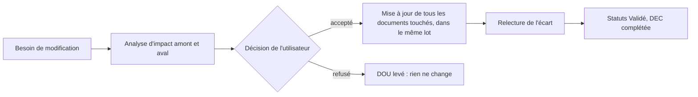

# Procédure de modification d'un élément validé

> **Aperçu** : comment modifier un élément déjà « Validé » (SCN, BES, REQ, ARC, DES ou test) sans laisser d'incohérence entre les niveaux du V. S'applique aussi quand un problème découvert en aval (fiche technique, indisponibilité d'un composant, test KO) remet en cause un niveau amont. L'architecte la déroule avec la skill `/modification <ID>`.

## Étapes

1. **Ouvrir un doute** (`DOU-xxx`) qui décrit le problème et sa cause (ex. « composant refusé par l'assembleur », « fiche contredit la valeur »).
2. **Analyse d'impact** : lister les éléments touchés, en suivant les liens « Réfs amont » dans les deux sens (vers l'amont : ce dont l'élément dérive ; vers l'aval : ce qui en dérive et les tests qui le vérifient). Ne pas oublier les décisions qui citent l'élément et les documents hors V (consignes, risques acceptés, schémas).
3. **Présenter à l'utilisateur** : le problème, les éléments touchés, les options et la recommandation. Une modification d'un élément de niveau D2 (voir `CLAUDE.md` §5) n'est jamais déléguée.
4. **Décision** (`DEC-xxx`) avec la ligne `**Modifie :**` qui liste chaque élément touché (ID « titre »).
5. **Mise à jour dans le même lot** : tous les éléments listés sont corrigés ensemble (même commit). Pendant la mise à jour, leur statut est « Modifié ». Aucune note « périmé », « à reporter à la prochaine révision » ou « tel document prévaut » : le texte est corrigé là où il est faux.
6. **Relecture de l'écart** par `critique`, `coherence-clarte` et `exigences-tracabilite` (liens amont et aval), plus `verificateur-sources` si des valeurs ont changé, rapport dans `revues/`, un sort par constat.
7. **Retour à « Validé »** sur accord de l'utilisateur ; le doute est levé ; `check_traceability_V2.py --gate` rend OK pour la phase atteinte.

## Cas fréquents

| Situation | Niveau le plus haut touché, en général |
|---|---|
| Composant indisponible ou refusé par l'assembleur | ARC (choix du composant), puis DES et TI/TU |
| Fiche technique contredisant une valeur | DES ; ARC si la valeur conditionnait un choix ou un budget |
| Test KO | Le niveau vérifié par ce test ; parfois l'exigence elle-même |
| Simplification décidée en aval | Le niveau où la fonction a été définie (souvent SCN ou BES) |
