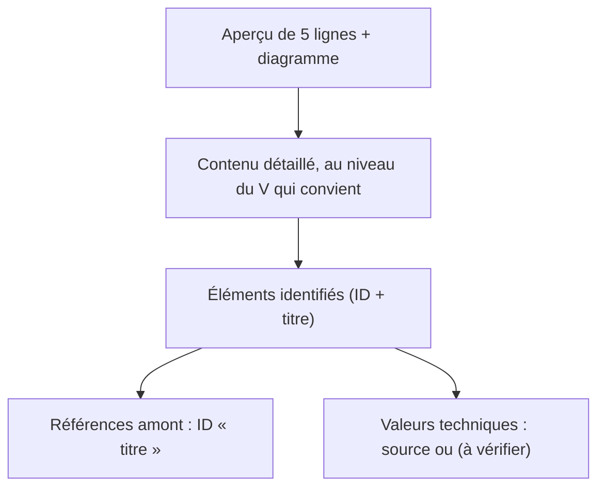
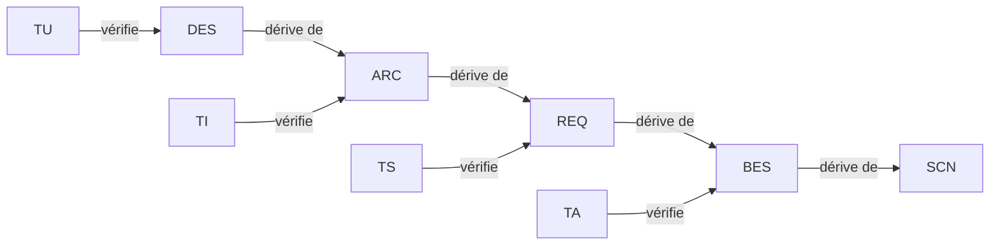

# Règles documentaires

Objectif : des documents **clairs, faciles à suivre, vérifiables**, avec des graphiques.

## Aperçu

## Les 12 règles

1. **Aperçu d'abord** : chaque document commence par un résumé de 5 lignes maximum (but, périmètre, état) et un diagramme de vue d'ensemble. En sont dispensés : les registres (glossaire, journal, registre de doutes), les rapports de relecture, la charte et les README d'entrée, et les notes de travail (fichiers « à faire », relevés bruts) si leur première ligne le dit.
2. **Un gabarit par phase**, toujours identique (`framework/templates/`).
3. **Référence = ID + titre**, partout : `REQ-012 « Titre »`. Le titre doit être identique à celui de la définition et ne doit pas contenir de guillemets « ».
4. **Définition d'un élément** : `### REQ-012 — Titre`, puis `**Réfs amont :**`, puis le contenu. Les exemples dans un bloc de code ne sont pas analysés.
5. **Un glossaire unique** (`00-glossaire.md`) ; un terme = un sens ; pas de synonymes.
6. **Une idée = un diagramme.** Mermaid par défaut (flowchart, sequenceDiagram, stateDiagram-v2, classDiagram, gantt). SVG seulement quand Mermaid ne suffit pas (schéma de carte, chronogramme précis). Toujours un titre et, si utile, une légende.
7. **Phrases courtes**, un sujet par phrase, pas de jargon non défini. Comparaisons en tableaux.
8. **Aucun doute caché** : tout doute est dans `registre-doutes.md` (`DOU-xxx`), toute décision dans `journal-decisions.md` (`DEC-xxx`).
9. **Chaque niveau du V ne contient que ce qui lui revient** (tableau ci-dessous). Un détail d'un niveau inférieur écrit trop tôt est déplacé, pas recopié : une information n'est écrite qu'à un seul endroit, les autres la citent.
10. **Sources des valeurs techniques** (section ci-dessous) : une valeur sans source est marquée `(à vérifier)` et liée à un doute. Une valeur d'exigence que l'utilisateur n'a pas décidée est marquée `(provisoire)`, et le doute qui la confirmera est cité sur la ligne « Doutes liés » de l'exigence.
11. **Citer une décision là où elle fonde l'élément, pas partout.** Les décisions d'un élément vont sur sa ligne `**Décisions liées :**` ; le texte ne les répète pas. Pas de liste « décisions citées » en tête de section : elle double la ligne de l'élément.
12. **Taille** : la description d'un élément tient en 15 lignes environ ; au-delà, découper en plusieurs éléments ou renvoyer le détail au niveau inférieur. Une décision (`DEC-xxx`) tient en 10 lignes environ : décision, alternatives, raison.

## Contenu permis par niveau du V

| Niveau | Contient | Ne contient pas |
|---|---|---|
| Scénarios (SCN) | Ce que l'utilisateur fait et observe, dans quelle situation ; cas nominal, dégradés, d'échec, mise en service | Valeur technique non perçue par l'utilisateur, composant, solution |
| Besoins (BES) | Ce dont l'utilisateur a besoin, en langage métier, avec sa priorité | Valeur chiffrée (sauf si l'utilisateur la donne), solution technique |
| Exigences (REQ) | Ce que le système doit faire, mesurable et testable, valeurs avec tolérance | Choix de composant, brochage, structure du logiciel |
| Architecture (ARC) | Découpage en blocs matériels et logiciels, interfaces entre blocs, choix des composants principaux et leurs alternatives, budgets (masse, énergie, temps, mémoire, coût) | Brochage détaillé, valeurs de registres, valeurs des composants passifs |
| Conception détaillée (DES) | Brochage, schéma, valeurs des composants, registres, structures de données, machines à états, calculs de dimensionnement avec leurs sources | Nouvelles exigences (une exigence manquante remonte au niveau REQ par la procédure de modification) |

## Sources des valeurs techniques

- Formats : `[document, version, page]` (ex. `[DS12589 rév. 6, p. 51]`) ; `[catalogue, date du relevé]` ; `[page web, adresse, date de consultation]` (documentation sans version ni page, ex. carte du commerce) ; `[mesure, date, instrument, conditions]`.
- Les fiches techniques sont rangées dans `projets/<nom>/Datasheets/` (en anglais) ; une fiche absente est un `DOU-xxx`.
- Une valeur écrite de mémoire, estimée ou déduite sans document est suivie de `(à vérifier)` et d'un `DOU-xxx`. Une hypothèse de calcul est écrite comme telle (« hypothèse : … »), avec sa justification et un doute qui a une échéance : elle sera remplacée par une source ou une mesure.
- À la porte « conception détaillée », aucun DES ne contient plus de mention `(à vérifier)`, `(à confirmer)` ou `(… de mémoire …)` : chaque valeur a été confrontée à sa source (rapport de `verificateur-sources`). L'outil le contrôle.

## Champs obligatoires

Contrôlés par `tools/check_traceability_V2.py` (constante `REQUIRED`) ; les autres champs des gabarits sont recommandés.

| Élément | Champs obligatoires |
|---|---|
| SCN | Réfs amont, Type, Situation de départ, Déroulé, Résultat attendu, Statut |
| BES | Réfs amont, Énoncé, Priorité, Statut |
| REQ | Réfs amont, Énoncé, Priorité, Vérification, Statut |
| ARC, DES | Réfs amont, Description, Statut |
| TU, TI, TS | Réfs amont, Résultat attendu, Statut |
| TA | Réfs amont, Scénario rejoué, Résultat attendu, Statut |
| DOU | Statut, Bloquant, Question ; Échéance si « Bloquant : Non » et ouvert ; Réponse si levé |
| DEC | Date, Décidé par, Décision, Raison |

## Statuts

| Élément | Statuts permis |
|---|---|
| SCN, BES, REQ, ARC, DES | Proposé, Validé, Modifié (en cours de modification après validation), Abandonné |
| TU, TI, TS, TA | À écrire, Écrit, Validé (après la porte du niveau vérifié), Modifié (en cours de modification), Exécuté OK, Exécuté KO, Abandonné |
| DOU | Ouvert, Levé |

## Identifiants

| Préfixe | Élément | Phase |
|---|---|---|
| SCN | Scénario d'utilisation | Scénarios |
| BES | Besoin | Besoins |
| REQ | Exigence système | Exigences |
| ARC | Élément d'architecture | Architecture |
| DES | Élément de conception détaillée | Conception détaillée |
| TU | Test unitaire (vérifie un DES) | Implémentation |
| TI | Test d'intégration (vérifie un ARC) | Intégration |
| TS | Test système (vérifie un REQ) | Système |
| TA | Test de recette (vérifie un BES) | Recette |
| DOU | Doute | Toutes |
| DEC | Décision | Toutes |

Numérotation à 3 chiffres, jamais réutilisée. Un élément supprimé reste listé avec le statut « Abandonné ».

## Chaîne de traçabilité

Le lien s'écrit dans la ligne `**Réfs amont :**` de l'élément du bas (ex. dans `ARC-003`, on cite le `REQ` dont il dérive ; dans `TS-005`, le `REQ` vérifié). Une décision n'est jamais dans les « Réfs amont » d'un REQ, ARC, DES ou test : elle va dans « Décisions liées ».

## Chemins de documents

Citer un document : « Architecture » — `projets/<nom>/03-architecture.md`.
