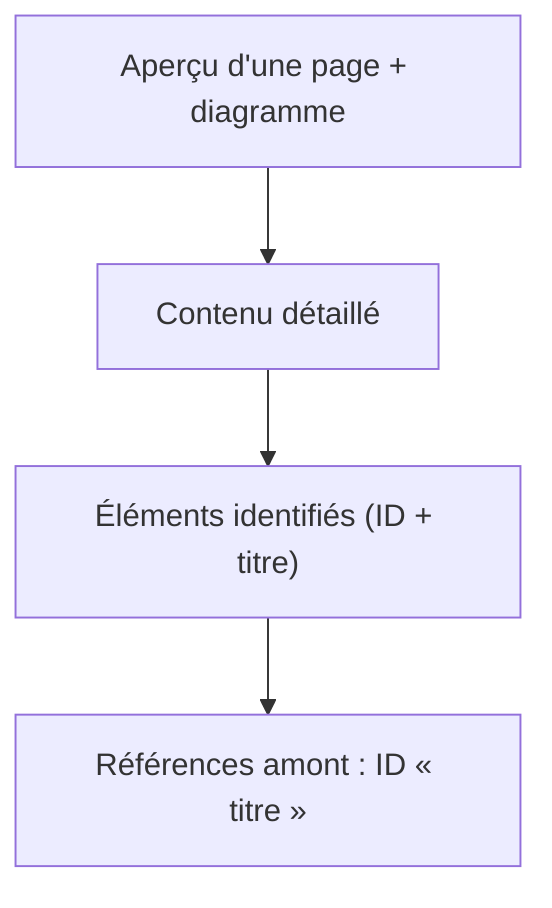
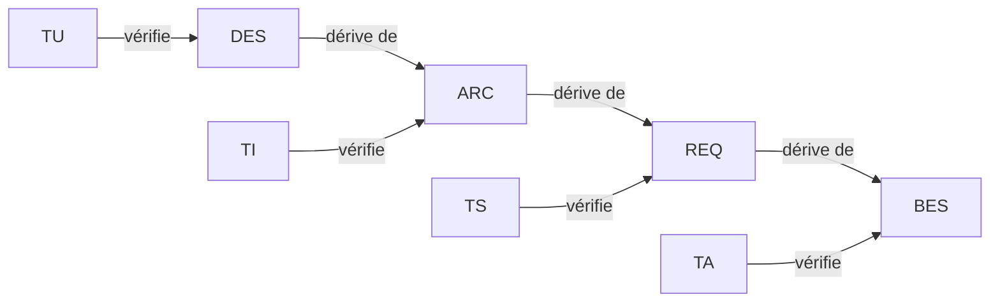

# Règles documentaires

Objectif : des documents **clairs, faciles à suivre**, avec des graphiques.

## Aperçu

## Les 8 règles

1. **Aperçu d'abord** : chaque document commence par un résumé de 5 lignes maximum (but, périmètre, état) et un diagramme de vue d'ensemble.
2. **Un gabarit par phase**, toujours identique (`framework/templates/`).
3. **Référence = ID + titre**, partout : `REQ-012 « Titre »`. Le titre doit être identique à celui de la définition et ne doit pas contenir de guillemets « ».
4. **Définition d'un élément** : `### REQ-012 — Titre`, puis `**Réfs amont :**`, puis le contenu. Les exemples dans un bloc de code ne sont pas analysés.
5. **Un glossaire unique** (`00-glossaire.md`) ; un terme = un sens ; pas de synonymes.
6. **Une idée = un diagramme.** Mermaid par défaut (flowchart, sequenceDiagram, stateDiagram-v2, classDiagram, gantt). SVG seulement quand Mermaid ne suffit pas (schéma de carte, chronogramme précis). Toujours un titre et, si utile, une légende.
7. **Phrases courtes**, un sujet par phrase, pas de jargon non défini. Comparaisons en tableaux.
8. **Aucun doute caché** : tout doute est dans `registre-doutes.md` (`DOU-xxx`), toute décision dans `journal-decisions.md` (`DEC-xxx`).

## Identifiants

| Préfixe | Élément | Phase |
|---|---|---|
| BES | Besoin | Besoins |
| REQ | Exigence système | Exigences |
| ARC | Élément d'architecture | Architecture |
| DES | Élément de conception détaillée | Conception détaillée |
| TU | Test unitaire (vérifie un DES) | Implémentation |
| TI | Test d'intégration (vérifie un ARC) | Intégration |
| TS | Test système (vérifie un REQ) | Système |
| TA | Test de recette (vérifie un BES) | Recette |
| DOU | Doute | Toutes |
| DEC | Décision | Toutes |

Numérotation à 3 chiffres, jamais réutilisée. Un élément supprimé reste listé avec le statut « Abandonné ».

## Chaîne de traçabilité

Le lien s'écrit dans la ligne `**Réfs amont :**` de l'élément du bas (ex. dans `ARC-003`, on cite le `REQ` dont il dérive ; dans `TS-005`, le `REQ` vérifié).

## Chemins de documents

Citer un document : « Architecture » — `projets/<nom>/03-architecture.md`.
