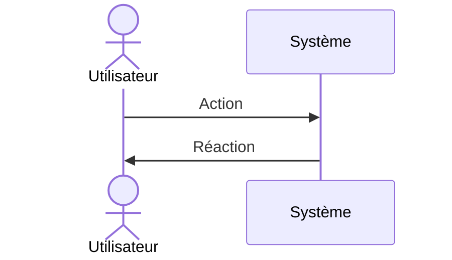

# Scénarios d'utilisation

> **Aperçu** (5 lignes max) : qui utilise le système, dans quels contextes, quels scénarios (nominaux, dégradés, d'échec), état de la phase.

## Vue d'ensemble



*(Remplacer par le scénario nominal principal.)*

## Scénarios

Les scénarios viennent de l'utilisateur (le client) et **précèdent les besoins** : chaque besoin en dérive. L'architecte les rédige avec lui, en demandant systématiquement, pour chaque fonction, le cas nominal, les cas dégradés et les cas d'échec. Un scénario décrit ce que l'utilisateur fait et observe, sans solution technique ni valeur qu'il ne perçoit pas (`framework/regles-documentaires.md`, règle 9).

Format d'un scénario (exemple, non analysé) :

```
### SCN-001 — Titre court du scénario
(diagramme de séquence Mermaid : acteurs, messages, signaux)
**Réfs amont :** Utilisateur (description initiale, entretien du jj/mm)
**Décisions liées :** DEC-001 « Titre de la décision » (seulement celles qui fondent le scénario)
**Type :** Nominal | Dégradé | Échec | Mise en service / maintenance
**Acteurs :** qui intervient.
**Situation de départ :** état du système et de l'environnement.
**Déroulé :** 1. … 2. … 3. …
**Résultat attendu :** ce que l'utilisateur observe à la fin.
**Statut :** Proposé | Validé | Modifié | Abandonné
```

<!-- Ajouter les scénarios ci-dessous, au même format, en dehors des blocs de code. -->
