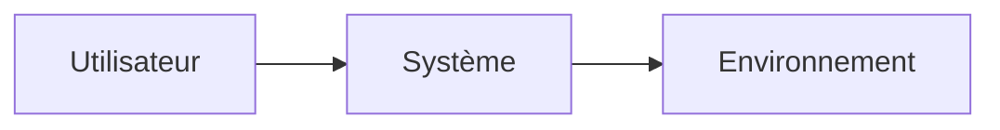

# Besoins

> **Aperçu** (5 lignes max) : contexte, utilisateurs, périmètre, état de la phase.

## Vue d'ensemble



*(Remplacer par le contexte réel : acteurs, système, interfaces externes.)*

## Besoins

Format d'un besoin (exemple, non analysé) :

```
### BES-001 — Titre court du besoin
**Réfs amont :** SCN-001 « Titre du scénario » (au moins un scénario ; on peut y ajouter décisions, normes, documents)
**Énoncé :** Ce dont l'utilisateur a besoin, en langage métier.
**Priorité :** Essentiel | Important | Souhaitable
**Statut :** Proposé | Validé | Abandonné
```

<!-- Ajouter les besoins ci-dessous, au même format, en dehors des blocs de code. -->
