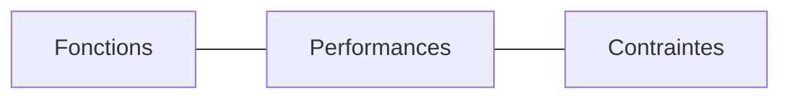

# Exigences système

> **Aperçu** (5 lignes max) : ce que le système doit faire, états, état de la phase.

## Vue d'ensemble



*(Remplacer par un diagramme de contexte ou de cas d'usage.)*

## Exigences

Chaque exigence est unique, atomique, non ambiguë et testable.

Format d'une exigence (exemple, non analysé) :

```
### REQ-001 — Titre court de l'exigence
**Réfs amont :** BES-001 « Titre du besoin »
**Énoncé :** Le système doit … (verbe d'action, valeur mesurable, condition).
**Critère de vérification :** comment on prouve qu'elle est satisfaite.
**Statut :** Proposé | Validé | Abandonné
```

<!-- Ajouter les exigences ci-dessous, au même format, en dehors des blocs de code. -->
