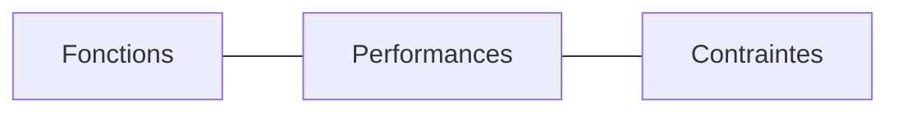

# Exigences système

> **Aperçu** (5 lignes max) : ce que le système doit faire, états, état de la phase.

## Vue d'ensemble



*(Remplacer par un diagramme de contexte ou de cas d'usage.)*

## Exigences

Chaque exigence suit « Liste de contrôle des exigences » — `framework/checklists/exigences.md` (9 critères, tournures EARS).

Format d'une exigence (exemple, non analysé) :

```
### REQ-001 — Titre court de l'exigence
**Réfs amont :** BES-001 « Titre du besoin »
**Décisions liées :** DEC-001 « Titre de la décision » (jamais dans les Réfs amont)
**Doutes liés :** DOU-001 « Titre du doute » (optionnel, hors de l'énoncé)
**Énoncé :** Le système doit … (verbe d'action, valeur mesurable, condition ; toute valeur non décidée par l'utilisateur est marquée « provisoire »).
**Priorité :** Essentiel | Important | Souhaitable (la plus haute des priorités des besoins cités)
**Vérification :** méthode (essai, mesure, inspection), test système TS-001 « Titre du test », moyen.
**Statut :** Proposé | Validé | Modifié | Abandonné (renvoi vers l'exigence qui la remplace)
```

<!-- Ajouter les exigences ci-dessous, au même format, en dehors des blocs de code. -->
