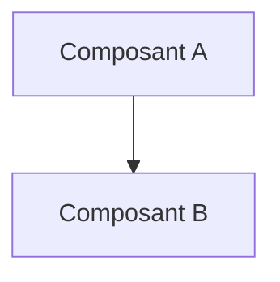

# Architecture

> **Aperçu** (5 lignes max) : découpage du système, choix structurants, état de la phase.

## Vue d'ensemble



*(Remplacer par le schéma de blocs réel, hardware et software.)*

Les budgets (masse, énergie, temps, mémoire, coût) sont tenus dans « Budgets » — `projets/<nom>/budgets.md`. Une architecture ne contient ni brochage détaillé, ni valeurs de registres, ni valeurs des composants passifs : ils vont en conception détaillée (`framework/regles-documentaires.md`, règle 9).

## Éléments d'architecture

Format (exemple, non analysé) :

```
### ARC-001 — Titre du composant ou de la décision d'architecture
**Réfs amont :** REQ-001 « Titre de l'exigence »
**Décisions liées :** DEC-001 « Titre de la décision » (jamais dans les Réfs amont)
**Description :** rôle, interfaces avec les autres blocs, contraintes (15 lignes environ au plus).
**Composant retenu :** référence, fiche [document, version, page], disponibilité [catalogue, date] (pour un élément matériel).
**Alternatives étudiées :** option A (raison de l'écart), option B (raison de l'écart).
**Statut :** Proposé | Validé | Modifié | Abandonné
```

<!-- Ajouter les éléments ci-dessous, au même format, en dehors des blocs de code. -->
