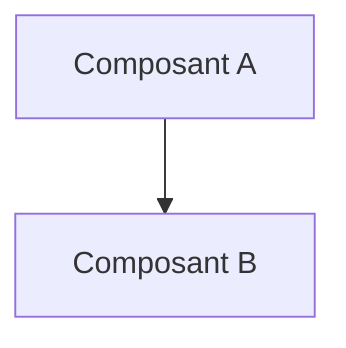

# Architecture

> **Aperçu** (5 lignes max) : découpage du système, choix structurants, état de la phase.

## Vue d'ensemble



*(Remplacer par le schéma de blocs réel, hardware et software.)*

## Éléments d'architecture

Format (exemple, non analysé) :

```
### ARC-001 — Titre du composant ou de la décision d'architecture
**Réfs amont :** REQ-001 « Titre de l'exigence »
**Description :** rôle, interfaces, contraintes.
**Alternatives étudiées :** voir DEC-001 « Titre de la décision »
**Statut :** Proposé | Validé | Abandonné
```

<!-- Ajouter les éléments ci-dessous, au même format, en dehors des blocs de code. -->
