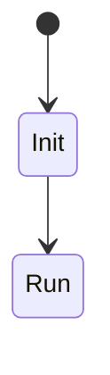

# Conception détaillée

> **Aperçu** (5 lignes max) : modules, interfaces, état de la phase.

## Vue d'ensemble



*(Remplacer par machines à états, séquences, schémas de modules.)*

## Éléments de conception

Format (exemple, non analysé) :

```
### DES-001 — Titre du module ou du circuit
**Réfs amont :** ARC-001 « Titre de l'élément d'architecture »
**Description :** structures, algorithmes, brochage, budgets.
**Réalisé par :** fichier source ou schéma (chemin)
**Statut :** Proposé | Validé | Abandonné
```

<!-- Ajouter les éléments ci-dessous, au même format, en dehors des blocs de code. -->
