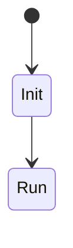

# Conception détaillée

> **Aperçu** (5 lignes max) : modules, interfaces, état de la phase.

## Vue d'ensemble



*(Remplacer par machines à états, séquences, schémas de modules.)*

Chaque valeur technique cite sa source `[document, version, page]` ; une valeur de mémoire est marquée `(à vérifier)` avec un doute, et aucune ne doit rester dans un élément « Validé » (`framework/regles-documentaires.md`).

## Éléments de conception

Format (exemple, non analysé) :

```
### DES-001 — Titre du module ou du circuit
**Réfs amont :** ARC-001 « Titre de l'élément d'architecture »
**Décisions liées :** DEC-001 « Titre de la décision »
**Description :** structures, algorithmes, brochage, valeurs des composants, calculs de dimensionnement (valeurs maximales de la fiche).
**Sources :** [document, version, page] pour chaque composant et chaque valeur reprise.
**Règles d'implantation :** (élément matériel) découplage, réseaux sensibles, boucles de courant, éléments à éloigner ou en bord de carte, avec leur source.
**Réalisé par :** fichier source ou schéma (chemin)
**Statut :** Proposé | Validé | Modifié | Abandonné
```

<!-- Ajouter les éléments ci-dessous, au même format, en dehors des blocs de code. -->
