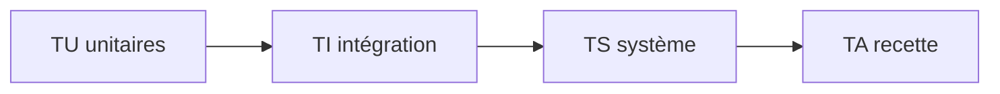

# Plans de test

> **Aperçu** (5 lignes max) : stratégie de test par niveau du V, moyens, état.

## Vue d'ensemble



Chaque test est défini **en même temps que l'élément qu'il vérifie**.

| Niveau | Vérifie | Préfixe |
|---|---|---|
| Unitaire | Conception détaillée | TU |
| Intégration | Architecture | TI |
| Système | Exigences | TS |
| Recette | Besoins | TA |

**Ce qu'est un test unitaire selon la nature du DES :**
- DES logiciel : test exécutable (sur PC ou sur la cible) qui appelle le module et compare le résultat à une valeur attendue.
- DES matériel : mesure au banc sur la carte (valeur, instrument, tolérance) ou, avant fabrication, revue du schéma sur liste de contrôle (brochage contre la fiche, découplage, niveaux). Refaire le calcul écrit dans le DES ne prouve rien : ce n'est pas un test.

Un résultat attendu est chiffré, avec sa tolérance, et vient de l'élément vérifié. Un test exécuté KO ne se corrige jamais en changeant le résultat attendu : il ouvre un doute ou une modification (`framework/procedure-modification.md`).

## Tests

Format (exemple, non analysé) :

```
### TS-001 — Titre du test
**Réfs amont :** REQ-001 « Titre de l'exigence »
**Préconditions :** état initial, moyens (instruments, banc, logiciel).
**Procédure :** étapes.
**Résultat attendu :** valeur mesurable avec tolérance (celle de l'exigence), y compris dans le cas le plus défavorable de l'exigence.
**Statut :** À écrire | Écrit | Exécuté OK | Exécuté KO | Abandonné

### TA-001 — Titre de la recette
**Réfs amont :** BES-001 « Titre du besoin » (jamais un scénario ni une décision : l'outil n'accepte que des besoins)
**Scénario rejoué :** SCN-001 « Titre du scénario » (champ texte ; « aucun, inspection » pour un besoin sans scénario propre)
**Préconditions :** état initial, moyens.
**Procédure :** étapes du scénario.
**Résultat attendu :** observations attendues.
**Statut :** À écrire | Écrit | Exécuté OK | Exécuté KO | Abandonné
```

<!-- Ajouter les tests ci-dessous, au même format, en dehors des blocs de code. -->
