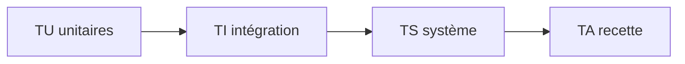

# Plans de test

> **Aperçu** (5 lignes max) : stratégie de test par niveau du V, moyens, état.

## Vue d'ensemble



Chaque test est défini **en même temps que l'élément qu'il vérifie**.

| Niveau | Vérifie | Préfixe |
|---|---|---|
| Unitaire | Conception détaillée | TU |
| Intégration | Architecture | TI |
| Système | Exigences | TS |
| Recette | Besoins | TA |

## Tests

Format (exemple, non analysé) :

```
### TS-001 — Titre du test
**Réfs amont :** REQ-001 « Titre de l'exigence »
**Préconditions :** état initial, moyens.
**Procédure :** étapes.
**Résultat attendu :** valeur mesurable (celle de l'exigence).
**Statut :** À écrire | Écrit | Exécuté OK | Exécuté KO

### TA-001 — Titre de la recette
**Réfs amont :** BES-001 « Titre du besoin » (jamais un scénario ni une décision : l'outil n'accepte que des besoins)
**Scénario rejoué :** SCN-001 « Titre du scénario » (champ texte ; « aucun, inspection » pour un besoin sans scénario propre)
**Préconditions :** état initial, moyens.
**Procédure :** étapes du scénario.
**Résultat attendu :** observations attendues.
**Statut :** À écrire | Écrit | Exécuté OK | Exécuté KO
```

<!-- Ajouter les tests ci-dessous, au même format, en dehors des blocs de code. -->
