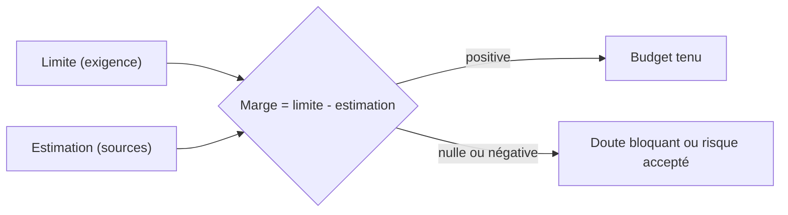

# Budgets

> **Aperçu** (5 lignes max) : budgets du système (masse, énergie, temps, mémoire, coût…), avec pour chacun la limite, l'estimation, la marge et la source des chiffres. Rempli en architecture, mis à jour en conception détaillée puis avec les mesures. Une marge négative ou nulle est un doute bloquant, ou un risque accepté par l'utilisateur.

Chaque budget limité par une exigence est rempli ; une ligne qui ne concerne pas le projet est notée « sans objet » avec sa raison (ex. masse d'un appareil fixe) ; ajouter les budgets propres au projet (ex. surface de carte, débit radio). Chaque ligne d'estimation cite sa source `[document, version, page]`, une mesure, ou est marquée `(à vérifier)`.

| Budget | Limite (exigence) | Estimation | Marge | Sources et hypothèses | Doute ou décision |
|---|---|---|---|---|---|
| Masse | | | | | |
| Consommation et autonomie | | | | | |
| Courant de crête | | | | | |
| Temps (cycle, latence) | | | | | |
| Mémoire flash | | | | | |
| Mémoire RAM | | | | | |
| Coût unitaire | | | | | |

## Détail des estimations

*(Un tableau par budget : poste, valeur, source.)*
