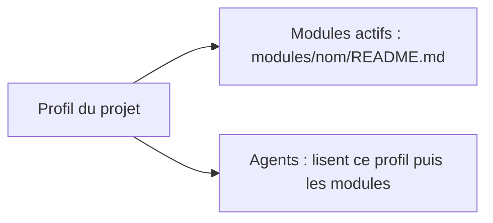

# Profil du projet

> **Aperçu** : identité du projet, domaines techniques, cible, chaîne d'outils et modules actifs du framework. Lu par tous les agents avant d'agir. Chaque choix renvoie à la décision qui l'a fixé ; un choix pas encore fait reste « à déterminer » avec son doute.

| Rubrique | Valeur | Décision ou doute |
|---|---|---|
| Nom | | |
| But en une phrase | | |
| Domaines | Électronique / Logiciel / Mécanique (garder ceux qui s'appliquent) | |
| Cible matérielle (MCU, SoC) | à déterminer | |
| Carte électronique | à déterminer : carte conçue pour le projet / carte du commerce / sans objet | |
| Langage et chaîne de compilation | à déterminer | |
| Outil de CAO électronique | à déterminer (sans objet si aucune carte n'est conçue) | |
| Fabrication et assemblage de la carte | à déterminer (sans objet si aucune carte n'est conçue) | |
| Modules actifs | aucun | |
| Dossiers propres au projet | `revues/` (rapports de relecture), `Datasheets/` (fiches techniques en anglais), puis `hardware/`, `firmware/`, `tools/` (scripts du projet) selon les domaines | |

Remplissage :
- Le nom et le but dès la phase « scénarios » ; les autres rubriques quand la décision est prise (le plus souvent en architecture), par une `DEC-xxx` citée dans la dernière colonne.
- « Sans objet » : la rubrique ne concerne pas ce projet (ex. firmware sur une carte du commerce : pas d'outil de CAO ni de fabricant). Elle est fixée par une `DEC-xxx` comme les autres.
- « À déterminer » : le choix reste à faire. Il n'ouvre pas de doute avant la phase « architecture » ; à la porte « architecture », toute rubrique encore « à déterminer » qui conditionne la conception est un `DOU-xxx` bloquant.
- Activer un module = l'ajouter à « Modules actifs » (liste : `modules/README.md`).
