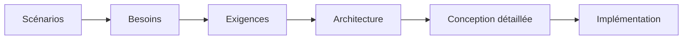

# Reprise du projet — état au AAAA-MM-JJ

> **Aperçu** : où en est le projet, pour reprendre le travail après une pause ou sur un autre poste. Tenu à jour par l'architecte à chaque porte et à chaque changement important ; une page au plus, le détail reste dans les documents cités.

*(Colorer ou annoter les phases : franchie, en cours, à venir.)*

## Portes
| Porte | État | Décision |
|---|---|---|
| Scénarios | à venir / en cours / franchie | DEC-nnn « titre » |

## En cours
*(La tâche en cours et la prochaine action, avec les ID et titres concernés.)*

## Doutes à surveiller
*(Doutes bloquants, et doutes non bloquants dont l'échéance est la prochaine porte.)*

## Vérification
`python tools/check_traceability_V2.py projets/<nom> --phase <phase atteinte>` : résultat du dernier passage (date, nombre d'erreurs, d'écarts, d'avertissements).

## Reprendre sur un autre poste
*(Ce qui n'est pas dans le dépôt : fiches techniques, outils à installer, prérequis des modules actifs.)*
