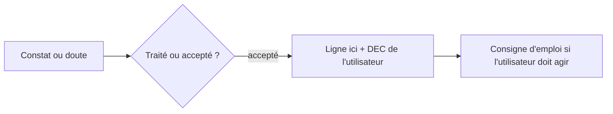

# Risques acceptés

> **Aperçu** (5 lignes max) : risques que l'utilisateur a choisi d'accepter plutôt que de les traiter, chacun avec la décision qui l'accepte et la consigne d'emploi qui en découle. Aucun risque n'est accepté sans décision explicite de l'utilisateur.

| N° | Risque | Conséquence possible | Gravité | Décision qui l'accepte | Consigne d'emploi |
|---|---|---|---|---|---|
| 1 | | | élevée / moyenne / faible | DEC-xxx « titre » | |
