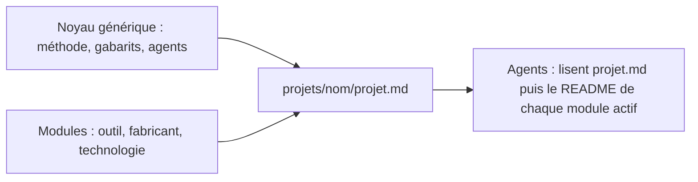

# Modules

> **Aperçu** : un module regroupe le savoir-faire propre à un outil (CAO), à un fabricant ou à une technologie. Le noyau du framework (`framework/`, `tools/`, `.claude/agents/`, `CLAUDE.md`) reste générique ; un projet active les modules dont il a besoin dans `projets/<nom>/projet.md`.

## Modules disponibles

| Module | Pour quoi | README |
|---|---|---|
| `kicad` | Schéma et implantation de carte avec KiCad 10 (serveur MCP, scripts, moteur de placement) | `modules/kicad/README.md` |
| `fabrication-jlcpcb` | Carte fabriquée et assemblée par JLCPCB avec des composants LCSC | `modules/fabrication-jlcpcb/README.md` |

## Activer un module
Ajouter son nom à la ligne « Modules actifs » de `projets/<nom>/projet.md`, par une décision `DEC-xxx` (le choix d'un outil ou d'un fabricant est une décision de l'utilisateur).

## Créer un module
Un module est créé quand un savoir-faire servira à plusieurs projets. Il contient :
- `README.md` avec les sections : **Quand l'activer**, **À lire avant d'agir**, **Règles** ou **Méthode**, **Conditions de porte** (ce que le module exige à chaque porte du V ; l'architecte les ajoute à la liste de contrôle de la porte), **Vérifications**, **Scripts** (s'il en a), **Prérequis du poste** (ou un renvoi vers les notes qui les donnent) ;
- ses scripts dans `modules/<module>/tools/` ;
- ses notes de retour d'expérience (bugs, contournements), pour qu'elles survivent au changement de machine.

Règle : un module ne contient **aucune donnée d'un projet** (références de composants, dimensions, tables écrites en dur). Un exemple tiré d'un projet est marqué comme exemple. Ce qui ne sert qu'à un projet va dans `projets/<nom>/`.
