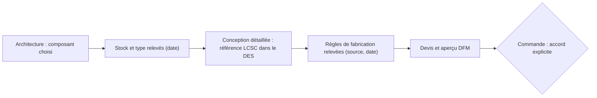

# Module `fabrication-jlcpcb` — carte fabriquée et assemblée par JLCPCB

> **Aperçu** : règles à suivre quand la carte est fabriquée et assemblée par JLCPCB avec des composants du catalogue LCSC. Utilisé par `architecte-systeme` et `electronique-hardware` quand `projet.md` active ce module.

## Quand l'activer
La carte est commandée chez JLCPCB, assemblage compris, avec des composants du catalogue LCSC.

## À lire avant d'agir
Le site du fabricant (capacités de fabrication et d'assemblage, catalogue des pièces) le jour du relevé ; aucune note de module pour l'instant.

## Prérequis du poste
Aucun outil local imposé ; l'import de bibliothèques passe par le module de CAO (voir la règle 4).

## Règles
1. **Disponibilité vérifiée avant la porte « architecture »** : pour chaque composant actif retenu, référence LCSC (`Cxxxxx`), stock et type (« basic » ou « extended », ce dernier ajoutant des frais), relevés avec leur date. Un composant peut être refusé par l'assemblage alors qu'il est au catalogue : la confirmation se fait au devis. Un composant sans stock ou refusé = `DOU-xxx` bloquant pour le DES qui l'utilise.
2. **Référence LCSC dans le DES** de chaque composant posé, avec la date du relevé ; à relire le jour de la commande.
3. **Règles de fabrication** (jeu minimal, largeur de piste, perçages, empilage, finition) : relevées sur le site du fabricant, avec la source et la date. Aucune valeur supposée : une règle non relevée = `DOU-xxx`.
4. **Bibliothèque** : si le module `kicad` est actif, une pièce absente des bibliothèques standard peut être importée depuis EasyEDA/LCSC (`easyeda2kicad --lcsc_id Cxxxxx --full`, dans un environnement Python jetable), puis nettoyée (ASCII, types de broches, chemins 3D en `${KIPRJMOD}`). Le brochage importé est comparé à la fiche technique, sauf décision explicite de l'utilisateur de faire confiance à l'import (consignée en `DEC-xxx`).
5. **Pièces posées à la main** (connecteurs traversants, pièces hors catalogue) : listées dans le DES avec leur raison.
6. **Devis et commande** : export des fichiers de fabrication, devis et aperçu DFM sur accord explicite de l'utilisateur. Le paiement est fait par l'utilisateur lui-même ; aucun agent ne passe de commande.

## Conditions de porte
- Porte « architecture » : chaque composant actif de la nomenclature a sa référence LCSC, son stock, son type et la date du relevé.

## Vérifications
- Avant la commande : stocks relus le jour même, règles de fabrication respectées par le contrôle de conception (DRC) de l'outil de CAO, aperçu DFM du fabricant sans anomalie non traitée.
