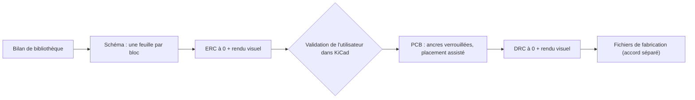

# Module `kicad` — saisie de schéma et implantation de carte avec KiCad 10

> **Aperçu** : méthode, scripts et pièges pour concevoir une carte avec KiCad 10 piloté par le serveur MCP `mixelpixx/KiCAD-MCP-Server`. Appliqué par l'agent du module, `cao-kicad`, quand `projet.md` active ce module ; `electronique-hardware` fournit la conception détaillée et relit le résultat.



## Agent du module
`cao-kicad` (`.claude/agents/cao-kicad.md`) : saisie du schéma et implantation de la carte, avec une liste blanche d'outils `mcp__kicad__*` qui exclut les exports de fabrication. Il part des DES validés, s'arrête sur toute valeur manquante, et rend la main après chaque feuille ou bloc pour validation de l'utilisateur et relecture par `electronique-hardware`.

## Quand l'activer
La carte du projet est dessinée avec **KiCad 10** (seule version prise en charge : tout ce qui concernait KiCad 9 et l'ancien serveur `kicad-eda-mcp` est abandonné).

## À lire avant d'agir
- `modules/kicad/kicad-mcp-notes.md` : bugs connus du serveur MCP, méthode de câblage lisible, vérification visuelle, **mise en route sur une nouvelle machine** (la déclaration du serveur dans `~/.claude.json` et les environnements Python sont locaux à chaque poste).
- `modules/kicad/kicad-mcp-bug-report.md` : comparaison des serveurs MCP KiCad (historique du choix du serveur).
- Les notes propres au projet, s'il en a (ex. `projets/<nom>/hardware/kicad/`).

## Prérequis du poste
KiCad 10, le serveur MCP `mixelpixx/KiCAD-MCP-Server` déclaré dans `~/.claude.json`, un Python avec `pypdfium2` pour le rendu des pages : installation pas à pas dans `modules/kicad/kicad-mcp-notes.md` (« Mise en route sur une nouvelle machine »).

## Emplacement dans un projet
`projets/<nom>/hardware/kicad/proj_<nom>/` : racine `proj_<nom>.kicad_sch`, une feuille `des-0xx-*.kicad_sch` par bloc matériel, bibliothèque locale `lib_<nom>` (symboles, empreintes, modèles 3D) référencée par `${KIPRJMOD}`. Toujours ouvrir le projet par son `.kicad_pro`.

## Méthode de saisie du schéma
1. **Bilan de bibliothèque avant tout schéma** : un symbole ET une empreinte par composant (bibliothèques standard KiCad, sinon `lib_<nom>`). Pièces absentes ou douteuses : bibliothèque du fabricant si un module de fabrication l'indique (ex. import EasyEDA/LCSC du module `fabrication-jlcpcb`), puis nettoyage ASCII et correction des types de broches. Tout en ASCII (le serveur casse les accents).
2. **Un bloc = une feuille hiérarchique** (`create_hierarchical_subsheet` ; A4 paysage, A3 si besoin : `(paper "A3")` dans le fichier de la sous-feuille), titre en haut (ancre décalée, jamais `justify: center`), schéma grossièrement centré, énergie en haut et masse en bas, symboles de puissance pour les rails, fils horizontaux/verticaux, étiquettes hiérarchiques pour ce qui sort du bloc.
3. Poser les composants avec `batch_add_components` (`auto_position_fields: false`), relever les broches (`get_schematic_pin_locations`), puis fils, étiquettes, croix NC et jonctions en une fois : `python modules/kicad/tools/kicad_add_items.py <feuille> spec.json`.
4. Placer les textes : `python modules/kicad/tools/kicad_place_fields.py <feuille>` (règles par type de symbole, contrôle des collisions et du pas entre composants : 12,7 mm entre condensateurs verticaux voisins, 10,16 mm entre résistances horizontales en colonne). **À chaque placement manuel nécessaire, améliorer ce script plutôt que corriger à la main.**
5. Page racine : `python modules/kicad/tools/kicad_build_root.py <dossier_projet_kicad>` (une case par feuille, broches déduites des étiquettes hiérarchiques).
6. Fin de session : `kicad-cli sch upgrade` sur chaque feuille (évite l'avertissement « version plus ancienne de KiCad »).
7. **Une page à la fois**, validée par l'utilisateur dans KiCad avant la suivante.

## Méthode d'implantation (PCB)
- **Outils MCP différés** : au début de toute tâche PCB, charger les outils `mcp__kicad__*` nécessaires avec `ToolSearch` (`select:<liste>`) avant le premier appel.
- **Import** : depuis la racine du schéma **validé par l'utilisateur** (ERC à 0) seulement : `create_board_from_schematic`, ou `sync_schematic_to_board` si le PCB existe (bug connu et contournement : `kicad-mcp-notes.md`).
- **Règles physiques avant le placement** : classes de réseaux (`create_netclass`, `assign_net_to_class` ; au moins puissance et signal), largeurs et jeux (`set_design_rules`), avec les valeurs du module du fabricant actif.
- **Images de suivi** : rangées dans le dossier KiCad du projet (ex. `projets/<nom>/hardware/kicad/proj_<nom>/suivi/`), numérotées par étape.
- **Choix de l'outil de placement** : `suggest_placement` (dans la session KiCad) est l'outil par défaut ; le moteur hors KiCad décrit plus bas est une alternative pour une carte dense ou quand on veut comparer de nombreuses stratégies. Le projet dit lequel il utilise (`DEC-xxx`) ; dans les deux cas, jamais de placement composant par composant par défaut.
- **Placement avec `suggest_placement`** :
  1. placer à la main les composants à contrainte mécanique dure et les passer en `locked` ;
  2. `suggest_placement` en `apply: false` sur le bloc (`bounds` + `refs`), `locked` = les ancres, `power_nets` = les réseaux réels du projet ;
  3. valider avec `check_courtyard_overlaps(positions=proposals)` ;
  4. seulement si le score est bon, rejouer en `apply: true` ;
  5. vérification visuelle (`get_board_2d_view` ou `export_pcb_svg` + lecture de l'image) et validation de l'utilisateur avant le bloc suivant.
- **Moteur de placement hors KiCad** (optionnel, `modules/kicad/tools/pcb_placement/`, doc dans son `README.md`) :
  ```bash
  python modules/kicad/tools/pcb_optimize_placement.py extract <proj.kicad_pcb> --out-dir <dossier> --kicad-python <python_de_kicad>
  python modules/kicad/tools/pcb_optimize_placement.py optimize <dossier>/extract.json --out-dir <dossier> --config modules/kicad/tools/pcb_placement/examples/config_parallele.json --decoupling <decouplage.json> --live
  python modules/kicad/tools/pcb_optimize_placement.py apply <proj.kicad_pcb> <dossier>/best_solution.json <copie.kicad_pcb> --kicad-python <python_de_kicad>
  ```
  `extract` et `apply` relancent le script concerné avec le Python embarqué de KiCad (`--kicad-python` ou variable `KICAD_PYTHON`), seul à savoir importer `pcbnew`.
  L'extraction déduit le bloc de chaque composant des feuilles `.kicad_sch` voisines du PCB (option `--sheet-map` pour corriger). Les fichiers de règles (`decouplage.json`, règles de placement, contraintes mécaniques) sont des données du projet : ils vivent dans le dossier KiCad du projet, produits par `electronique-hardware` avec leurs sources.
- **Routage** : `check_freerouting` (Java + JAR Freerouting) avant de compter sur `autoroute` ; sinon routage manuel ; repli `export_dsn` → Freerouting externe → `import_ses`. Nettoyer les pistes en l'air (`query_traces` + `delete_trace`).
- **Masse** : `add_zone`/`add_copper_pour`, `add_gnd_stitching_vias` pour relier les zones des deux faces.

## Vérifications
```bash
kicad-cli sch erc <racine>.kicad_sch -o rapport.txt          # ERC de toute la hiérarchie : 0 violation
kicad-cli sch export netlist --format kicadxml <racine>.kicad_sch
kicad-cli sch export pdf <racine>.kicad_sch                   # puis rendu d'une page en image (pypdfium2) et lecture
kicad-cli pcb export svg --exclude-drawing-sheet --page-size-mode 2 --mode-single <proj>.kicad_pcb
```
Violation ERC « entrée d'alimentation non pilotée » sur un réseau alimenté seulement à travers un composant passif (ferrite, résistance) : poser un symbole `PWR_FLAG` sur ce réseau, ce n'est pas une erreur de conception.

PCB : `run_drc`/`get_drc_violations` jusqu'à 0, `check_clearance`, `check_courtyard_overlaps`, `check_placement_clearance`, puis vérification visuelle (un DRC à 0 peut cacher une sérigraphie sur un connecteur).

## Conditions de porte
- Porte « conception détaillée » : bilan de bibliothèque fait (symbole et empreinte pour chaque composant, vérifiés contre la fiche) ; si le schéma est saisi pendant cette phase, ERC à 0 et chaque feuille validée par l'utilisateur.
- Avant les fichiers de fabrication : DRC à 0, contrôles de chevauchement, rendu visuel relu.

## Scripts du module (`modules/kicad/tools/`)
| Script | Rôle |
|---|---|
| `kicad_add_items.py` | Fils, étiquettes hiérarchiques/locales, croix NC, jonctions d'une feuille en une fois |
| `kicad_place_fields.py` | Place les textes Référence/Valeur selon le type de symbole, avertit des pas trop serrés |
| `kicad_build_root.py` | Page racine : cases, broches de feuille, étiquettes ; disposition des cases lue dans `root_layout.json` du dossier KiCad du projet s'il existe |
| `kicad_add_image_sheet.py` | Page dédiée contenant une image (synoptique) + case à la racine |
| `kicad_tetris_extract.py` | Extraction de la géométrie du PCB (Python de KiCad, lecture seule) |
| `kicad_apply_placement.py` | Applique une solution de placement sur une copie du PCB (Python de KiCad) |
| `pcb_optimize_placement.py` + `pcb_placement/` | Moteur de placement hors KiCad (extract / optimize / apply) |

Un script écrit pour un seul projet (ex. le dessin d'un synoptique) va dans `projets/<nom>/tools/`, pas ici.
