# Scénarios d'utilisation

> **Aperçu** : Boomrone est un drone de poche pour adultes, lancé à la main dans un appartement (gymnase et jardin en essais complémentaires) ; il se stabilise, reste 10 s en stationnaire, atterrit doucement et informe l'utilisateur à chaque étape.
> - **État** : douze scénarios (SCN-001 « Vol nominal : de la batterie au posé » à SCN-012 « Dégradé : sous-tension de la batterie »), statut Proposé, porte « scénarios » à franchir ; 0 doute bloquant, 25 non bloquants (recompte du 2026-10-29 : 19 plus DOU-115 « Contenu et interruption de la réécriture de la zone des réglages par la reprogrammation » à DOU-120 « Écriture en mémoire sous tension basse ou pendant une phase de vol », hors le modèle du registre) ; valeurs provisoires et jalon : `reprise.md` ; risques acceptés : « Risques acceptés » — `projets/boomrone/risques-acceptes.md`.
> - **Hors périmètre** : la charge, le remplacement et le stockage de la batterie et les cas d'échec de la programmation sont des limites d'emploi, pas des scénarios (DEC-111 « Batterie et programmation : hors périmètre des scénarios, limites d'emploi à documenter ») ; la protection de sous-tension, y compris pour un drone laissé allumé, est dans le périmètre (SCN-012 « Dégradé : sous-tension de la batterie », DEC-126 « Protection de sous-tension de la batterie : scénario court, coupure sans signal propre », DEC-133 « SCN-012 inclut le drone laissé allumé en attente d'un appui : sous-tension dans le périmètre »).
> - **Nature** : les scénarios décrivent l'intention, sans solution technique (DEC-053 « Solutions techniques déplacées en propositions d'architecture, seule l'intention reste décidée »).
> - **Détail** des décisions du 2026-10-28 et des doutes ouverts : `reprise.md` et `registre-doutes.md`.

## Vue d'ensemble

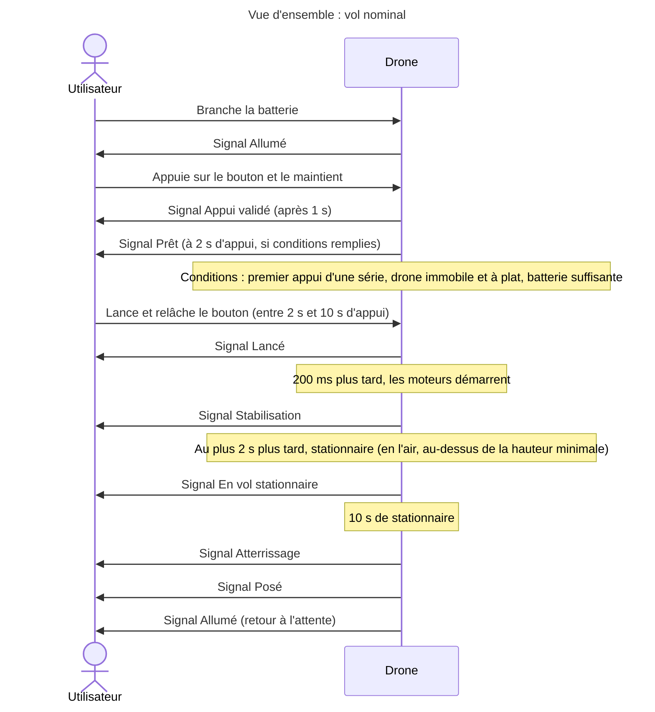

Décisions citées (dont l'effet figure dans ce diagramme ou sa légende) :
- DEC-009 « Stationnaire atteint en 2 secondes maximum après le démarrage des moteurs »
- DEC-049 « Stationnaire déclaré seulement en l'air, au-dessus d'une hauteur minimale »
- DEC-070 « Appui validé : bouton maintenu 1 seconde, rien en dessous, plus de signal Appui trop court »
- DEC-072 « Armement à 2 secondes d'appui : signal Prêt, ou signal unique Armement refusé selon l'état du drone »
- DEC-073 « Armé entre 2 et 10 secondes d'appui : le relâchement donne le signal Lancé, les moteurs démarrent 200 ms plus tard »
- DEC-076 « Armement possible seulement depuis le premier appui d'une série, sans effet du maintien pendant la série »
- DEC-118 « Signal Allumé au retour à l'attente après un posé, un refus ou un désarmement »

Ce premier diagramme montre le vol nominal. Les trois suivants montrent les états du drone et chaque signal donné à l'utilisateur, y compris pour les échecs et les cas dégradés, en une idée par diagramme : (a) mise sous tension, appuis, armement, lancer et vol normal jusqu'au posé ; (b) coupures des moteurs et d'alimentation en vol, arrêts d'urgence, verrouillage et retours à l'attente ; (c) mode réglage et vol de réglage. La sous-tension de la batterie (SCN-012 « Dégradé : sous-tension de la batterie ») n'a pas de signal propre : elle mène à « Éteint » comme toute coupure d'alimentation (l'état exact après une coupure faite par le logiciel est un doute : DOU-109 « Batterie déjà déchargée : redémarrages répétés, décharge profonde et état après une coupure logicielle »). Les hexagones en pointillés sont des renvois vers un autre diagramme, de même nom des deux côtés (« Vers » d'un côté, « Depuis » de l'autre). Chaque transition indique l'événement, puis le signal donné ; quand l'événement est long, il figure dans la légende.

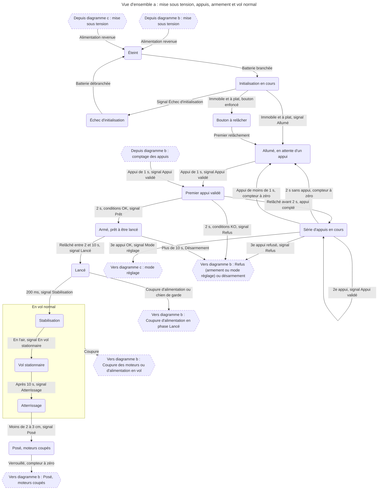

Légende du diagramme a :
- Un 2e appui validé reste dans « Série d'appuis en cours » ; le maintenir au-delà de 2 s ne fait rien.
- L'armement n'est possible que depuis « Premier appui validé » (premier appui d'une série).
- Le 3e appui entre en mode réglage si le drone est immobile et à plat, non armé ; un bouton encore enfoncé à l'entrée est ignoré jusqu'au premier relâchement (DEC-115 « Troisième appui encore maintenu à l'entrée en mode réglage : maintien ignoré jusqu'au premier relâchement ») ; sinon signal « Refus », retour à l'attente, puis signal « Allumé » (DEC-118 « Signal Allumé au retour à l'attente après un posé, un refus ou un désarmement »).
- Un appui de moins de 1 s au milieu d'une série remet le compteur à zéro.
- « Vol stationnaire » exige d'être en l'air, au-dessus de la hauteur minimale.
- Après « Posé », le signal « Allumé » est donné au retour à l'attente (diagramme b).
- La sous-tension de la batterie (SCN-012 « Dégradé : sous-tension de la batterie ») mène à « Éteint » depuis tout état sous tension (« Initialisation en cours », « Allumé », appuis, « Armé », « Lancé », vol normal) ; seules les flèches de coupure d'alimentation sont dessinées, pour ne pas surcharger le diagramme.
- Le chien de garde couvre aussi « Lancé », qui a une durée maximale ; coupure d'alimentation (dont la sous-tension de la batterie : SCN-012 « Dégradé : sous-tension de la batterie »), logiciel bloqué ou durée dépassée mènent à « Éteint » (diagramme b).
- Après un redémarrage, « Allumé » seulement si le drone est immobile et à plat, sinon « Échec d'initialisation », définitif jusqu'au débranchement ; le bouton y est ignoré pour toujours après le premier relâchement, sans effet ni signal (DEC-117 « Bouton en échec d'initialisation : ignoré pour toujours après le premier relâchement, aucun effet ni signal »).
- Le bouton encore enfoncé après un refus, un désarmement ou un posé est traité dans le diagramme b.
- Sauvegarder n'est pas acceptée à partir de l'appui validé ; une écriture déjà commencée reste un risque accepté (DEC-136 « Écriture de réglages commencée à l'état Allumé et encore en cours au relâchement du lancer : risque accepté »). Elle est ignorée aux états « Série d'appuis en cours » (DEC-128 « Sauvegarder ignorée aussi à l'état Série d'appuis en cours »), « Premier appui validé » et « Armé, prêt à être lancé » (« Modifier » reste acceptée), et en vol (DEC-131 « Sauvegarder ignorée en vol : confirmation du tableau des commandes »).
- Si le bouton est encore enfoncé à la fin de l'initialisation, il est ignoré jusqu'au premier relâchement (DEC-059 « Bouton déjà enfoncé : ignoré jusqu'au premier relâchement ») ; le signal « Allumé » à ce moment n'est pas décidé (DOU-112 « Bouton enfoncé jusqu'à la fin de l'initialisation : état et signal »).
- À l'état « Échec d'initialisation », Sauvegarder reste acceptée : un tiers à portée peut écraser les réglages enregistrés, risque accepté (DEC-127 « Sauvegarder acceptée à l'état Échec d'initialisation : écrasement des réglages par un tiers, risque accepté »).
- « Décoller » et « Arrêt » (commandes sans fil) sont ignorées pendant « Initialisation en cours » et à « Échec d'initialisation » (DEC-105 « Initialisation en cours et échec d'initialisation : Modifier et Sauvegarder acceptées, Décoller et Arrêt ignorées »).
- Pendant « Initialisation en cours », Sauvegarder est ignorée (réglages enregistrés pas encore chargés) et Modifier reste acceptée (DEC-120 « Sauvegarder ignorée pendant l'initialisation en cours, Modifier acceptée ; cas de l'échec d'initialisation non tranché »).

Décisions citées (dont l'effet figure dans ce diagramme ou sa légende) :
- DEC-022 « Moteurs coupés à moins de 2 à 3 cm du sol »
- DEC-049 « Stationnaire déclaré seulement en l'air, au-dessus d'une hauteur minimale »
- DEC-054 « Chrono de 10 secondes compté depuis l'appui initial »
- DEC-059 « Bouton déjà enfoncé : ignoré jusqu'au premier relâchement »
- DEC-067 « Démarrage à plat exigé, sinon échec de l'initialisation avec signal »
- DEC-070 « Appui validé : bouton maintenu 1 seconde, rien en dessous, plus de signal Appui trop court »
- DEC-071 « Appuis validés d'affilée : trois appuis entrent en mode réglage sans armer, le bouton n'arme jamais en mode réglage »
- DEC-072 « Armement à 2 secondes d'appui : signal Prêt, ou signal unique Armement refusé selon l'état du drone »
- DEC-073 « Armé entre 2 et 10 secondes d'appui : le relâchement donne le signal Lancé, les moteurs démarrent 200 ms plus tard »
- DEC-075 « Initialisation en échec : définitive jusqu'au débranchement de la batterie »
- DEC-076 « Armement possible seulement depuis le premier appui d'une série, sans effet du maintien pendant la série »
- DEC-085 « Entrée en mode réglage : drone immobile et à plat, non armé, sans condition de posé »
- DEC-089 « Appui de moins de 1 s au milieu d'une série d'appuis : compteur remis à zéro »
- DEC-090 « Troisième appui validé sur un drone non immobile ou pas à plat : mode réglage refusé avec le signal Refus »
- DEC-091 « Un seul signal Refus pour tout refus, armement ou mode réglage »
- DEC-096 « Chien de garde sur tout état où les moteurs peuvent être alimentés, phase Lancé de durée maximale »
- DEC-097 « Redémarrage ou chute de tension, même en phase Lancé : moteurs arrêtés, drone verrouillé »
- DEC-098 « Redémarrage après une coupure en vol : Allumé seulement si immobile et à plat, sinon échec d'initialisation »
- DEC-103 « Phase Lancé trop longue : coupure et redémarrage par le chien de garde, sans nouvel état ni signal »
- DEC-105 « Initialisation en cours et échec d'initialisation : Modifier et Sauvegarder acceptées, Décoller et Arrêt ignorées »
- DEC-112 « Sauvegarder ignorée à l'état armé, avant le lancer »
- DEC-115 « Troisième appui encore maintenu à l'entrée en mode réglage : maintien ignoré jusqu'au premier relâchement »
- DEC-117 « Bouton en échec d'initialisation : ignoré pour toujours après le premier relâchement, aucun effet ni signal »
- DEC-118 « Signal Allumé au retour à l'attente après un posé, un refus ou un désarmement »
- DEC-120 « Sauvegarder ignorée pendant l'initialisation en cours, Modifier acceptée ; cas de l'échec d'initialisation non tranché »
- DEC-123 « Sauvegarder ignorée aussi à l'état Premier appui validé »
- DEC-126 « Protection de sous-tension de la batterie : scénario court, coupure sans signal propre »
- DEC-127 « Sauvegarder acceptée à l'état Échec d'initialisation : écrasement des réglages par un tiers, risque accepté »
- DEC-128 « Sauvegarder ignorée aussi à l'état Série d'appuis en cours »
- DEC-131 « Sauvegarder ignorée en vol : confirmation du tableau des commandes »
- DEC-136 « Écriture de réglages commencée à l'état Allumé et encore en cours au relâchement du lancer : risque accepté »

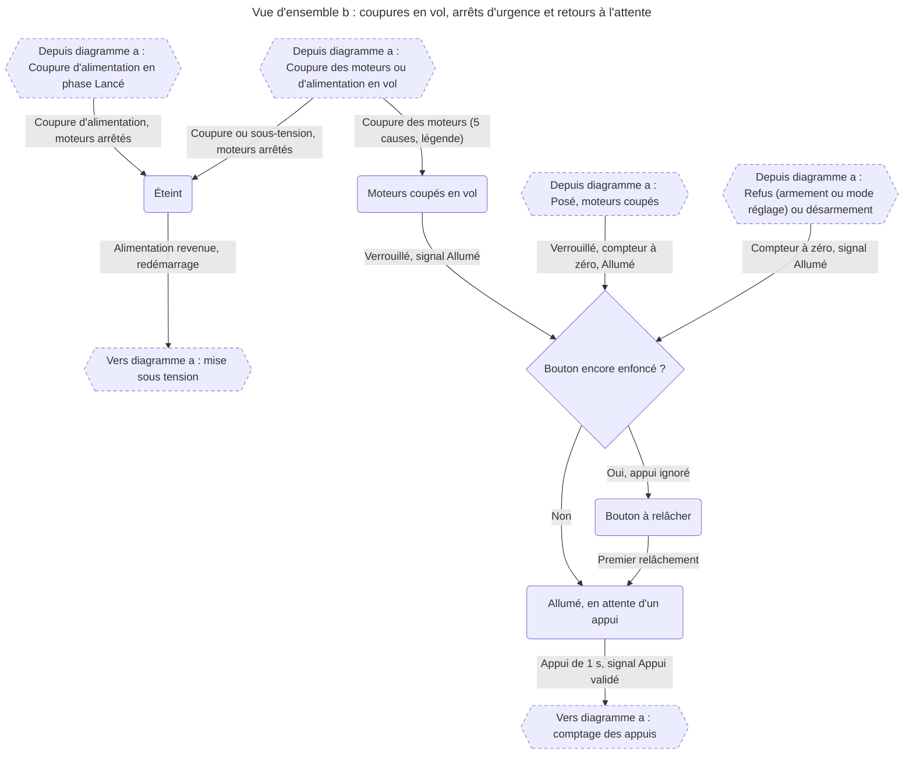

Légende du diagramme b :
- Cinq causes de coupure des moteurs en vol, chacune avec son signal : Échec de stabilisation, Arrêt par le bouton, Arrêt sans fil, Basculement, Délai de descente dépassé.
- Arrêt par le bouton : bouton appuyé après la garde du bouton qui suit le lancer, ou encore enfoncé à la fin de la garde ; anti-rebond de quelques millisecondes seulement.
- Coupure d'alimentation, chute de tension, sous-tension de la batterie (SCN-012 « Dégradé : sous-tension de la batterie »), logiciel bloqué ou phase « Lancé » trop longue : moteurs arrêtés, drone verrouillé, redémarrage (diagramme a pour la suite) ; la sous-tension n'a pas de signal propre.
- « Verrouillé » est le même état que « Allumé, en attente d'un appui » ; un nouvel appui de 2 s réarme, seulement depuis le premier appui d'une série.
- Après une coupure des moteurs en vol, le drone signale la coupure, puis « Allumé » prend le relais tout de suite, sans durée minimale d'effet de la cause ; la cause se lit sur le statut sans fil, un utilisateur sans appareil de suivi ne la connaît pas (risque accepté).
- Bouton encore enfoncé au retour à l'attente : ignoré jusqu'au premier relâchement ; l'appui long n'est pas compté.
- Après un posé, un refus ou un désarmement, le signal de l'événement (« Posé », « Refus », « Désarmement ») est suivi du signal « Allumé » au retour à l'attente, même si le bouton est encore enfoncé (DEC-118 « Signal Allumé au retour à l'attente après un posé, un refus ou un désarmement »).
- Le refus du mode réglage au 3e appui revient à l'attente comme un refus d'armement.

Décisions citées (dont l'effet figure dans ce diagramme ou sa légende) :
- DEC-002 « Couper les moteurs si le stationnaire n'est pas atteint dans le délai »
- DEC-012 « Couper les moteurs si le drone bascule après le stationnaire »
- DEC-023 « Après le posé ou une coupure : drone verrouillé, nouvel appui pour revoler »
- DEC-031 « Arrêt du drone lancé : bouton et commande d'arrêt sans fil »
- DEC-033 « Signal Arrêt sans fil distinct du signal Arrêt par le bouton »
- DEC-046 « Délai de descente dépassé : signal distinct, moteurs coupés, drone verrouillé »
- DEC-047 « L'état verrouillé est le même que l'état allumé, en attente d'un appui »
- DEC-050 « Appui en cours lors d'une coupure des moteurs ignoré jusqu'au relâchement »
- DEC-055 « Bouton ignoré pendant une courte garde après le lancer »
- DEC-065 « Logiciel bloqué en vol : coupure des moteurs par un chien de garde »
- DEC-080 « Armement refusé ou désarmement : retour à l'attente, compteur à zéro, l'appui long n'est pas compté »
- DEC-081 « Bouton encore enfoncé après un refus ou un désarmement : ignoré jusqu'au premier relâchement, puis nouvel appui possible tout de suite »
- DEC-082 « Retours à l'attente après le posé ou une coupure des moteurs : compteur à zéro, appui en cours ni pris en compte ni compté »
- DEC-087 « Arrêt d'urgence par le bouton en vol : anti-rebond très court seulement, arrêt quasi immédiat »
- DEC-092 « Garde du bouton après le lancer : fronts ignorés, niveau pris en compte, démarrage au relâchement »
- DEC-093 « Mode réglage refusé : retour à l'attente, compteur à zéro, bouton encore enfoncé ignoré »
- DEC-096 « Chien de garde sur tout état où les moteurs peuvent être alimentés, phase Lancé de durée maximale »
- DEC-097 « Redémarrage ou chute de tension, même en phase Lancé : moteurs arrêtés, drone verrouillé »
- DEC-103 « Phase Lancé trop longue : coupure et redémarrage par le chien de garde, sans nouvel état ni signal »
- DEC-104 « Cause d'une coupure en vol : signal local non conservé, Allumé prend le relais, cause conservée sur le statut sans fil »
- DEC-113 « Cause d'une coupure en vol : confirmation, Allumé tout de suite, aucune durée minimale, risque accepté »
- DEC-118 « Signal Allumé au retour à l'attente après un posé, un refus ou un désarmement »
- DEC-126 « Protection de sous-tension de la batterie : scénario court, coupure sans signal propre »

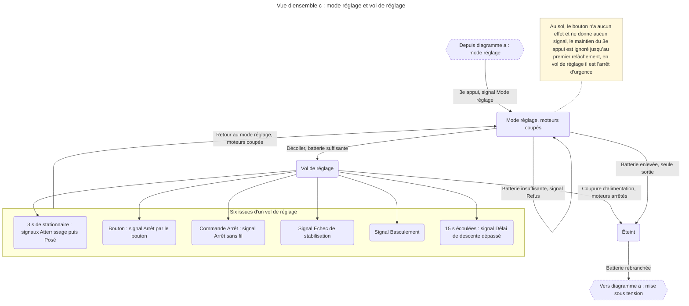

Légende du diagramme c :
- Entrée : 3e appui validé, drone immobile et à plat, non armé ; le bouton n'arme jamais en mode réglage ; un bouton encore enfoncé à l'entrée est ignoré jusqu'au premier relâchement (DEC-115 « Troisième appui encore maintenu à l'entrée en mode réglage : maintien ignoré jusqu'au premier relâchement »).
- Au sol, en « Mode réglage, moteurs coupés », le bouton n'a aucun effet et ne donne aucun signal (pas de signal « Appui validé », pas de 4e appui compté) ; il ne sert qu'en vol de réglage (DEC-116 « Bouton en mode réglage, moteurs coupés : aucun effet et aucun signal, il ne sert qu'en vol de réglage »).
- Sortie : seulement en enlevant la batterie.
- Six issues d'un vol de réglage, chacune avec le signal du vol normal de même nom ; le drone revient en « Mode réglage, moteurs coupés », sans verrouillage, prêt à redécoller.
- Décoller ne vérifie que la batterie ; refusée, elle donne le signal « Refus », cause précise sur le statut sans fil, lisible jusqu'à la commande suivante, et le drone reste en « Mode réglage, moteurs coupés ».
- Les phases du vol de réglage donnent les signaux du vol normal ; la pose passe par l'atterrissage : signal « Atterrissage », puis signal « Posé » (DEC-107 « Vol de réglage : signaux des phases du vol normal, acquittement des commandes par le statut sans fil seulement »).
- Les moteurs sont coupés au plus 15 s après le décollage.
- La sous-tension de la batterie (SCN-012 « Dégradé : sous-tension de la batterie ») mène à « Éteint » depuis « Mode réglage, moteurs coupés » comme depuis le vol de réglage ; seule la flèche du vol de réglage est dessinée.
- Le bouton appuyé en vol de réglage est un arrêt d'urgence, pris en compte tout de suite, sans garde.
- Un lien sans fil perdu n'a aucun effet : le vol de réglage suit son cours, sans état ni signal propre.
- Une coupure d'alimentation ou un logiciel bloqué arrête les moteurs et mène à « Éteint ».
- Depuis tout état sous tension, la sous-tension de la batterie mène aussi à « Éteint » (SCN-012 « Dégradé : sous-tension de la batterie » ; DEC-133 « SCN-012 inclut le drone laissé allumé en attente d'un appui : sous-tension dans le périmètre »), sans flèche dédiée pour ne pas surcharger le diagramme.
- Depuis tout état sous tension, la sous-tension de la batterie mène aussi à « Éteint » (SCN-012 « Dégradé : sous-tension de la batterie » ; DEC-133 « SCN-012 inclut le drone laissé allumé en attente d'un appui : sous-tension dans le périmètre »), sans flèche dédiée pour ne pas surcharger le diagramme.

Décisions citées (dont l'effet figure dans ce diagramme ou sa légende) :
- DEC-028 « Mode réglage : décollage depuis le sol sur commande sans fil »
- DEC-029 « Vol de réglage : stationnaire de 3 secondes, atterrissage sur place si le lien est perdu » (titre sur le lien perdu obsolète, voir DEC-106 « Lien sans fil perdu en vol de réglage : aucune action particulière »)
- DEC-044 « Mode réglage persistant : retour au mode réglage après un vol de réglage, sans verrouillage »
- DEC-071 « Appuis validés d'affilée : trois appuis entrent en mode réglage sans armer, le bouton n'arme jamais en mode réglage »
- DEC-074 « Décollage en mode réglage : la batterie est vérifiée, rien d'autre »
- DEC-077 « Bouton appuyé en vol de réglage : arrêt d'urgence, moteurs coupés, le drone reste en mode réglage »
- DEC-079 « Sortie du mode réglage : uniquement en enlevant la batterie »
- DEC-085 « Entrée en mode réglage : drone immobile et à plat, non armé, sans condition de posé »
- DEC-086 « Décollage de réglage : batterie seulement, risque cumulé avec les décisions sans appairage et sans verrouillage accepté »
- DEC-091 « Un seul signal Refus pour tout refus, armement ou mode réglage »
- DEC-094 « Bouton appuyé après un décollage de réglage : pris en compte tout de suite, sans garde »
- DEC-097 « Redémarrage ou chute de tension, même en phase Lancé : moteurs arrêtés, drone verrouillé »
- DEC-100 « Issues du vol de réglage : signaux du vol normal réutilisés, signal du lien perdu à définir »
- DEC-101 « Statut sans fil d'un refus : cause précise, liste exacte à fixer en architecture »
- DEC-102 « Décollage de réglage refusé : signal Refus, statut de refus lisible jusqu'à la commande suivante »
- DEC-106 « Lien sans fil perdu en vol de réglage : aucune action particulière »
- DEC-107 « Vol de réglage : signaux des phases du vol normal, acquittement des commandes par le statut sans fil seulement »
- DEC-115 « Troisième appui encore maintenu à l'entrée en mode réglage : maintien ignoré jusqu'au premier relâchement »
- DEC-116 « Bouton en mode réglage, moteurs coupés : aucun effet et aucun signal, il ne sert qu'en vol de réglage »

### Règles complémentaires

Règles qui ne figurent pas dans les légendes ; le détail et les alternatives sont dans `journal-decisions.md`.

| Règle | Décision | Scénario |
|---|---|---|
| Le chrono de 10 s du désarmement compte depuis l'appui initial | DEC-054 « Chrono de 10 secondes compté depuis l'appui initial » | SCN-005 « Dégradé : bouton maintenu plus de 10 secondes » |
| Appui validé à 1 s ; appuis d'affilée (écart d'environ 2 s) ; à 2 s signal Prêt ou Refus ; au relâchement signal Lancé, moteurs 200 ms plus tard | DEC-070 « Appui validé : bouton maintenu 1 seconde, rien en dessous, plus de signal Appui trop court » ; DEC-071 « Appuis validés d'affilée : trois appuis entrent en mode réglage sans armer, le bouton n'arme jamais en mode réglage » ; DEC-072 « Armement à 2 secondes d'appui : signal Prêt, ou signal unique Armement refusé selon l'état du drone » ; DEC-073 « Armé entre 2 et 10 secondes d'appui : le relâchement donne le signal Lancé, les moteurs démarrent 200 ms plus tard » | SCN-001 « Vol nominal : de la batterie au posé » ; SCN-004 « Appui normal : bouton relâché avant 2 secondes » |
| Armement : drone immobile et à plat, au sol ou dans la main, sans autotest | DEC-056 « Armement : drone immobile, sans autotest » | SCN-001 « Vol nominal : de la batterie au posé » |
| Garde du bouton après le lancer (de l'ordre de 0,5 s) : fronts ignorés, niveau pris en compte | DEC-055 « Bouton ignoré pendant une courte garde après le lancer » ; DEC-092 « Garde du bouton après le lancer : fronts ignorés, niveau pris en compte, démarrage au relâchement » ; DEC-119 « Appui bref pendant la garde du bouton, relâché avant la fin : risque accepté et documenté » (appui bref relâché avant la fin : sans effet, risque accepté) | SCN-002 « Échec : stationnaire non atteint dans le délai » ; SCN-007 « Dégradé : arrêt d'urgence par le bouton en vol » |
| Bouton déjà enfoncé à la mise sous tension, pendant l'initialisation ou au 3e appui d'entrée en mode réglage : ignoré jusqu'au premier relâchement ; en échec d'initialisation, ignoré pour toujours, sans effet ni signal | DEC-059 « Bouton déjà enfoncé : ignoré jusqu'au premier relâchement » ; DEC-115 « Troisième appui encore maintenu à l'entrée en mode réglage : maintien ignoré jusqu'au premier relâchement » ; DEC-117 « Bouton en échec d'initialisation : ignoré pour toujours après le premier relâchement, aucun effet ni signal » | SCN-009 « Réglage et suivi du drone par le sans fil » ; SCN-010 « Échec : initialisation impossible au démarrage » |
| Phase « Lancé » : arrêt et commandes sans fil ignorés | DEC-062 « Arrêt ignoré pendant la phase Lancé, avant le démarrage des moteurs » ; DEC-069 « Commandes sans fil reçues pendant la phase Lancé : ignorées » | SCN-001 « Vol nominal : de la batterie au posé » ; SCN-007 « Dégradé : arrêt d'urgence par le bouton en vol » |
| Logiciel bloqué : coupure par le chien de garde, qui couvre tout état où les moteurs peuvent être alimentés | DEC-065 « Logiciel bloqué en vol : coupure des moteurs par un chien de garde » ; DEC-096 « Chien de garde sur tout état où les moteurs peuvent être alimentés, phase Lancé de durée maximale » | SCN-011 « Dégradé : coupure d'alimentation en vol » |
| Démarrage à plat exigé ; échec d'initialisation définitif jusqu'au débranchement | DEC-067 « Démarrage à plat exigé, sinon échec de l'initialisation avec signal » ; DEC-075 « Initialisation en échec : définitive jusqu'au débranchement de la batterie » | SCN-010 « Échec : initialisation impossible au démarrage » |
| Redémarrage immobile et à plat : allumé, jamais armé | DEC-061 « Redémarrage immobile au sol : allumé mais jamais armé » ; DEC-098 « Redémarrage après une coupure en vol : Allumé seulement si immobile et à plat, sinon échec d'initialisation » | SCN-011 « Dégradé : coupure d'alimentation en vol » |
| Retour à l'attente après un refus ou un désarmement : compteur à zéro, appui long non compté, bouton ignoré jusqu'au relâchement | DEC-080 « Armement refusé ou désarmement : retour à l'attente, compteur à zéro, l'appui long n'est pas compté » ; DEC-081 « Bouton encore enfoncé après un refus ou un désarmement : ignoré jusqu'au premier relâchement, puis nouvel appui possible tout de suite » ; DEC-093 « Mode réglage refusé : retour à l'attente, compteur à zéro, bouton encore enfoncé ignoré » | SCN-003 « Échec : batterie faible à l'armement » ; SCN-005 « Dégradé : bouton maintenu plus de 10 secondes » |
| Retour à l'attente après un posé ou une coupure : verrouillé, compteur à zéro, appui en cours ignoré | DEC-023 « Après le posé ou une coupure : drone verrouillé, nouvel appui pour revoler » ; DEC-047 « L'état verrouillé est le même que l'état allumé, en attente d'un appui » ; DEC-050 « Appui en cours lors d'une coupure des moteurs ignoré jusqu'au relâchement » ; DEC-082 « Retours à l'attente après le posé ou une coupure des moteurs : compteur à zéro, appui en cours ni pris en compte ni compté » | SCN-001 « Vol nominal : de la batterie au posé » ; SCN-007 « Dégradé : arrêt d'urgence par le bouton en vol » |
| Annulation d'un armement : seul le maintien jusqu'à 10 s | DEC-083 « Annulation d'un armement : le maintien jusqu'au désarmement à 10 s reste la seule annulation » | SCN-005 « Dégradé : bouton maintenu plus de 10 secondes » |
| Appui ignoré dans une série : aucun signal | DEC-084 « Appui ignoré pendant une série d'appuis : aucun signal, risque accepté et documenté » | SCN-004 « Appui normal : bouton relâché avant 2 secondes » |
| Bouton en vol de réglage : arrêt d'urgence sans garde | DEC-077 « Bouton appuyé en vol de réglage : arrêt d'urgence, moteurs coupés, le drone reste en mode réglage » ; DEC-078 « Garde du bouton après le lancer : attachée au lancer au relâchement, pas décidée pour le décollage de réglage » ; DEC-094 « Bouton appuyé après un décollage de réglage : pris en compte tout de suite, sans garde » | SCN-007 « Dégradé : arrêt d'urgence par le bouton en vol » ; SCN-009 « Réglage et suivi du drone par le sans fil » |
| Décollage de réglage : batterie seulement, risque cumulé accepté | DEC-074 « Décollage en mode réglage : la batterie est vérifiée, rien d'autre » ; DEC-086 « Décollage de réglage : batterie seulement, risque cumulé avec les décisions sans appairage et sans verrouillage accepté » | SCN-009 « Réglage et suivi du drone par le sans fil » |
| Commande Sauvegarder ignorée aux états Série d'appuis en cours, Premier appui validé, armé, pendant l'initialisation en cours et en vol ; acceptée aux états d'attente, d'échec d'initialisation (risque accepté) et de mode réglage, moteurs coupés ; Sauvegarder n'est pas acceptée à partir de l'appui validé ; une écriture déjà commencée reste un risque accepté (DEC-136 « Écriture de réglages commencée à l'état Allumé et encore en cours au relâchement du lancer : risque accepté ») | DEC-136 « Écriture de réglages commencée à l'état Allumé et encore en cours au relâchement du lancer : risque accepté » ; DEC-132 « Revue d'ensemble de Sauvegarder : états acceptés confirmés, aucun acquittement ni contrôle d'intégrité ajoutés » ; DEC-128 « Sauvegarder ignorée aussi à l'état Série d'appuis en cours » (étend DEC-123 « Sauvegarder ignorée aussi à l'état Premier appui validé » et DEC-112 « Sauvegarder ignorée à l'état armé, avant le lancer ») ; DEC-127 « Sauvegarder acceptée à l'état Échec d'initialisation : écrasement des réglages par un tiers, risque accepté » ; DEC-131 « Sauvegarder ignorée en vol : confirmation du tableau des commandes » ; DEC-123 « Sauvegarder ignorée aussi à l'état Premier appui validé » (étend DEC-112 « Sauvegarder ignorée à l'état armé, avant le lancer ») ; DEC-120 « Sauvegarder ignorée pendant l'initialisation en cours, Modifier acceptée ; cas de l'échec d'initialisation non tranché » (modifie DEC-105 « Initialisation en cours et échec d'initialisation : Modifier et Sauvegarder acceptées, Décoller et Arrêt ignorées ») ; DEC-112 « Sauvegarder ignorée à l'état armé, avant le lancer » (modifie DEC-095 « Commande Sauvegarder à l'état armé : acceptée, retard possible du lancer accepté comme risque » et DEC-043 « Commandes sans fil acceptées selon l'état du drone ») | SCN-009 « Réglage et suivi du drone par le sans fil » ; SCN-010 « Échec : initialisation impossible au démarrage » |
| Bouton en vol : anti-rebond de quelques millisecondes seulement | DEC-087 « Arrêt d'urgence par le bouton en vol : anti-rebond très court seulement, arrêt quasi immédiat » | SCN-007 « Dégradé : arrêt d'urgence par le bouton en vol » |
| Bouton coincé au démarrage : statut sans fil seulement | DEC-088 « Bouton coincé ou maintenu en permanence au démarrage : statut sans fil seulement, aucun signal local » | SCN-010 « Échec : initialisation impossible au démarrage » |
| Cause précise d'un refus sur le statut sans fil | DEC-101 « Statut sans fil d'un refus : cause précise, liste exacte à fixer en architecture » ; DEC-102 « Décollage de réglage refusé : signal Refus, statut de refus lisible jusqu'à la commande suivante » ; DEC-110 « Armement refusé à 2 secondes d'appui : tous les tests faits, un seul signal Refus, sans attente de l'immobilité » | SCN-003 « Échec : batterie faible à l'armement » ; SCN-009 « Réglage et suivi du drone par le sans fil » |
| Cause d'une coupure en vol : « Allumé » tout de suite, aucune durée minimale, cause lisible sur le statut sans fil, risque accepté | DEC-113 « Cause d'une coupure en vol : confirmation, Allumé tout de suite, aucune durée minimale, risque accepté » (confirme DEC-104 « Cause d'une coupure en vol : signal local non conservé, Allumé prend le relais, cause conservée sur le statut sans fil ») | SCN-002 « Échec : stationnaire non atteint dans le délai » ; SCN-006 « Échec : inclinaison excessive après le stationnaire » ; SCN-007 « Dégradé : arrêt d'urgence par le bouton en vol » |
| Batterie et programmation hors périmètre : limites d'emploi, aucun besoin sur la charge, le remplacement ou le stockage ; la sous-tension, y compris d'un drone laissé allumé, est dans le périmètre | DEC-111 « Batterie et programmation : hors périmètre des scénarios, limites d'emploi à documenter » (modifiée par DEC-126 « Protection de sous-tension de la batterie : scénario court, coupure sans signal propre » et DEC-133 « SCN-012 inclut le drone laissé allumé en attente d'un appui : sous-tension dans le périmètre ») | SCN-008 « Mise en service : programmation du drone » ; SCN-012 « Dégradé : sous-tension de la batterie » |
| Plage de lancer et stationnaire de 2 s provisoires, faisabilité validée par essais sur prototype (jalon « avant les besoins » abandonné par DEC-137 « Faisabilité du stationnaire en 2 secondes depuis 1,5 m : jalon déplacé aux essais, plage de lancer inchangée ») | DEC-137 « Faisabilité du stationnaire en 2 secondes depuis 1,5 m : jalon déplacé aux essais, plage de lancer inchangée » ; DEC-114 « Faisabilité du stationnaire en 2 secondes depuis 1,5 m : analyse avant les besoins, plage de lancer à revoir » | SCN-001 « Vol nominal : de la batterie au posé » ; SCN-002 « Échec : stationnaire non atteint dans le délai » |
| Bouton en mode réglage, moteurs coupés : aucun effet, aucun signal, il ne sert qu'en vol de réglage | DEC-116 « Bouton en mode réglage, moteurs coupés : aucun effet et aucun signal, il ne sert qu'en vol de réglage » | SCN-009 « Réglage et suivi du drone par le sans fil » |
| Signal « Allumé » au retour à l'attente après un posé, un refus ou un désarmement | DEC-118 « Signal Allumé au retour à l'attente après un posé, un refus ou un désarmement » | SCN-001 « Vol nominal : de la batterie au posé » ; SCN-003 « Échec : batterie faible à l'armement » ; SCN-005 « Dégradé : bouton maintenu plus de 10 secondes » |
| Paramètres de vol aberrants envoyés et sauvegardés par un tiers : risque accepté, seule la reprogrammation rétablit les valeurs | DEC-121 « Paramètres de vol aberrants envoyés et sauvegardés par un tiers : risque accepté, reprogrammation seule » | SCN-009 « Réglage et suivi du drone par le sans fil » |
| Sous-tension de la batterie : coupure des moteurs assumée par le logiciel, sans signal propre, risque de chute accepté | DEC-126 « Protection de sous-tension de la batterie : scénario court, coupure sans signal propre » ; DEC-134 « Coupure sur sous-tension en vol assumée par le logiciel : le drone surveille la tension » (modifie DEC-013 « Pas de contrôle de la batterie en vol ») ; DEC-135 « Chute en vol sur sous-tension, sans signal, avec des personnes dessous : risque accepté » | SCN-012 « Dégradé : sous-tension de la batterie » |
| Risques acceptés consolidés dans un fichier dédié ; limites d'emploi informées par une notice écrite à la phase besoins | DEC-124 « Registre consolidé des risques acceptés dans un fichier dédié » ; DEC-125 « Limites d'emploi informées par une notice écrite à la phase besoins, le drone n'affiche rien » | SCN-001 « Vol nominal : de la batterie au posé » |

Dix-sept signaux. Un signal est un événement distinct annoncé à l'utilisateur, avec un statut sans fil distinct ; les effets locaux (lumière, son) peuvent être regroupés par catégorie, leur liste et leur forme étant à définir en architecture (DEC-099 « Un statut sans fil distinct par état, effets locaux regroupables par catégorie » ; précise DEC-005 « Un signal distinct pour chaque information »).

| N° | Signal | Déclencheur | Scénario |
|---|---|---|---|
| 1 | Allumé | Batterie branchée, drone en attente d'un appui ; relais immédiat au retour à l'attente après un posé, un refus ou un désarmement (DEC-118 « Signal Allumé au retour à l'attente après un posé, un refus ou un désarmement ») ; relais immédiat après une coupure en vol, hors vol de réglage (en vol de réglage, le drone revient à « Mode réglage, moteurs coupés »), sans durée minimale d'effet de la cause (DEC-104 « Cause d'une coupure en vol : signal local non conservé, Allumé prend le relais, cause conservée sur le statut sans fil » ; DEC-113 « Cause d'une coupure en vol : confirmation, Allumé tout de suite, aucune durée minimale, risque accepté ») | SCN-001 « Vol nominal : de la batterie au posé » ; SCN-002 « Échec : stationnaire non atteint dans le délai » ; SCN-003 « Échec : batterie faible à l'armement » ; SCN-005 « Dégradé : bouton maintenu plus de 10 secondes » ; SCN-006 « Échec : inclinaison excessive après le stationnaire » ; SCN-007 « Dégradé : arrêt d'urgence par le bouton en vol » ; SCN-008 « Mise en service : programmation du drone » ; SCN-009 « Réglage et suivi du drone par le sans fil » ; SCN-011 « Dégradé : coupure d'alimentation en vol » ; SCN-012 « Dégradé : sous-tension de la batterie » |
| 2 | Échec d'initialisation | Drone en mouvement ou trop incliné au démarrage ou au redémarrage (DEC-067 « Démarrage à plat exigé, sinon échec de l'initialisation avec signal ») | SCN-010 « Échec : initialisation impossible au démarrage » ; SCN-011 « Dégradé : coupure d'alimentation en vol » ; SCN-012 « Dégradé : sous-tension de la batterie » |
| 3 | Appui validé | Bouton maintenu 1 seconde, aux 1er et 2e appuis d'une série (DEC-070 « Appui validé : bouton maintenu 1 seconde, rien en dessous, plus de signal Appui trop court ») | SCN-004 « Appui normal : bouton relâché avant 2 secondes » |
| 4 | Mode réglage | 3e appui validé d'affilée, drone immobile et à plat, non armé (DEC-071 « Appuis validés d'affilée : trois appuis entrent en mode réglage sans armer, le bouton n'arme jamais en mode réglage » ; DEC-085 « Entrée en mode réglage : drone immobile et à plat, non armé, sans condition de posé ») | SCN-009 « Réglage et suivi du drone par le sans fil » |
| 5 | Refus | Un seul signal pour tous les refus (DEC-091 « Un seul signal Refus pour tout refus, armement ou mode réglage »), cause précise sur le statut sans fil (DEC-101 « Statut sans fil d'un refus : cause précise, liste exacte à fixer en architecture ») :<br>- premier appui d'une série maintenu 2 s, batterie faible, drone en mouvement ou pas à plat (DEC-072 « Armement à 2 secondes d'appui : signal Prêt, ou signal unique Armement refusé selon l'état du drone ») ;<br>- 3e appui validé sur un drone en mouvement ou pas à plat (DEC-090 « Troisième appui validé sur un drone non immobile ou pas à plat : mode réglage refusé avec le signal Refus ») ;<br>- commande Décoller refusée en mode réglage, batterie insuffisante (DEC-102 « Décollage de réglage refusé : signal Refus, statut de refus lisible jusqu'à la commande suivante ») | SCN-003 « Échec : batterie faible à l'armement » ; SCN-004 « Appui normal : bouton relâché avant 2 secondes » ; SCN-009 « Réglage et suivi du drone par le sans fil » |
| 6 | Prêt | Premier appui d'une série maintenu 2 s, batterie suffisante, drone immobile et à plat : drone armé (DEC-076 « Armement possible seulement depuis le premier appui d'une série, sans effet du maintien pendant la série ») | SCN-001 « Vol nominal : de la batterie au posé » |
| 7 | Désarmement | Bouton appuyé plus de 10 s depuis l'appui initial (DEC-054 « Chrono de 10 secondes compté depuis l'appui initial ») | SCN-005 « Dégradé : bouton maintenu plus de 10 secondes » |
| 8 | Lancé | Bouton relâché entre 2 s et 10 s d'appui, drone armé (DEC-073 « Armé entre 2 et 10 secondes d'appui : le relâchement donne le signal Lancé, les moteurs démarrent 200 ms plus tard ») | SCN-001 « Vol nominal : de la batterie au posé » |
| 9 | Stabilisation | Moteurs démarrés | SCN-001 « Vol nominal : de la batterie au posé » |
| 10 | En vol stationnaire | Stationnaire atteint | SCN-001 « Vol nominal : de la batterie au posé » |
| 11 | Atterrissage | 10 secondes de stationnaire écoulées | SCN-001 « Vol nominal : de la batterie au posé » |
| 12 | Posé | Moins de 2 à 3 cm du sol | SCN-001 « Vol nominal : de la batterie au posé » |
| 13 | Échec de stabilisation | Stationnaire non atteint dans le délai | SCN-002 « Échec : stationnaire non atteint dans le délai » |
| 14 | Arrêt par le bouton | Bouton appuyé en vol :<br>- après la garde qui suit le lancer (DEC-055 « Bouton ignoré pendant une courte garde après le lancer ») ;<br>- ou encore enfoncé à la fin de cette garde (DEC-092 « Garde du bouton après le lancer : fronts ignorés, niveau pris en compte, démarrage au relâchement ») ;<br>- ou en vol de réglage (DEC-077 « Bouton appuyé en vol de réglage : arrêt d'urgence, moteurs coupés, le drone reste en mode réglage ») | SCN-007 « Dégradé : arrêt d'urgence par le bouton en vol » |
| 15 | Basculement | Drone très incliné ou retourné après le stationnaire | SCN-006 « Échec : inclinaison excessive après le stationnaire » |
| 16 | Arrêt sans fil | Commande d'arrêt reçue de l'appareil de suivi en vol | SCN-007 « Dégradé : arrêt d'urgence par le bouton en vol » |
| 17 | Délai de descente dépassé | 15 secondes d'atterrissage écoulées sans passage à moins de 2 à 3 cm du sol ; en vol de réglage, 15 secondes après le décollage | SCN-001 « Vol nominal : de la batterie au posé » |

Le signal 1 (Allumé) est aussi donné, hors vol de réglage, au retour à l'attente après les signaux 12 (Posé), 5 (Refus, sauf un décollage de réglage refusé, qui laisse le drone en « Mode réglage, moteurs coupés ») et 7 (Désarmement) (DEC-118 « Signal Allumé au retour à l'attente après un posé, un refus ou un désarmement ») ; la sous-tension de la batterie n'a pas de signal propre (DEC-126 « Protection de sous-tension de la batterie : scénario court, coupure sans signal propre »). Les issues d'un vol de réglage réutilisent les signaux 12 à 17 (DEC-100 « Issues du vol de réglage : signaux du vol normal réutilisés, signal du lien perdu à définir ») et ses phases ceux du vol normal (DEC-107 « Vol de réglage : signaux des phases du vol normal, acquittement des commandes par le statut sans fil seulement ») ; le signal 8 (Lancé) n'a pas d'équivalent. Un lien sans fil perdu n'a pas de signal (DEC-106 « Lien sans fil perdu en vol de réglage : aucune action particulière »). Les signaux 13 à 17 qui signalent la cause d'une coupure en vol sont donnés à la coupure ; hors vol de réglage, « Allumé » prend ensuite le relais tout de suite (en vol de réglage, le drone revient à « Mode réglage, moteurs coupés »), sans durée minimale, et la cause ne se lit plus que sur le statut sans fil (DEC-113 « Cause d'une coupure en vol : confirmation, Allumé tout de suite, aucune durée minimale, risque accepté ») : un utilisateur sans appareil de suivi n'est pas informé de la cause, risque accepté.

### Commandes sans fil acceptées selon l'état du drone

Table décidée par DEC-043 « Commandes sans fil acceptées selon l'état du drone », dont les états où Sauvegarder est acceptée sont confirmés par DEC-132 « Revue d'ensemble de Sauvegarder : états acceptés confirmés, aucun acquittement ni contrôle d'intégrité ajoutés », complétée par DEC-105 « Initialisation en cours et échec d'initialisation : Modifier et Sauvegarder acceptées, Décoller et Arrêt ignorées » (deux premières lignes), modifiée par DEC-120 « Sauvegarder ignorée pendant l'initialisation en cours, Modifier acceptée ; cas de l'échec d'initialisation non tranché » (ligne « Initialisation en cours »), par DEC-112 « Sauvegarder ignorée à l'état armé, avant le lancer » (ligne « Armé, avant le lancer ») étendue par DEC-123 « Sauvegarder ignorée aussi à l'état Premier appui validé » (ligne « Premier appui validé ») et par DEC-128 « Sauvegarder ignorée aussi à l'état Série d'appuis en cours » (ligne « Série d'appuis en cours »), confirmée en vol par DEC-131 « Sauvegarder ignorée en vol : confirmation du tableau des commandes » et pour l'échec d'initialisation par DEC-127 « Sauvegarder acceptée à l'état Échec d'initialisation : écrasement des réglages par un tiers, risque accepté » : une commande ignorée n'a aucun effet.

| État du drone | Décoller | Arrêt | Modifier | Sauvegarder |
|---|---|---|---|---|
| Initialisation en cours (DEC-120 « Sauvegarder ignorée pendant l'initialisation en cours, Modifier acceptée ; cas de l'échec d'initialisation non tranché ») | Ignorée | Ignorée | Acceptée | Ignorée |
| Échec d'initialisation, définitif jusqu'au débranchement (DEC-075 « Initialisation en échec : définitive jusqu'au débranchement de la batterie ») | Ignorée | Ignorée | Acceptée | Acceptée, risque accepté (DEC-127 « Sauvegarder acceptée à l'état Échec d'initialisation : écrasement des réglages par un tiers, risque accepté ») |
| Allumé, en attente d'un appui (avant un appui validé, ou après le retour à l'attente, compteur à zéro), y compris après un posé ou une coupure : état dit « verrouillé » (DEC-047 « L'état verrouillé est le même que l'état allumé, en attente d'un appui ») | Ignorée | Ignorée | Acceptée | Acceptée |
| Série d'appuis en cours (DEC-128 « Sauvegarder ignorée aussi à l'état Série d'appuis en cours ») | Ignorée | Ignorée | Acceptée | Ignorée |
| Premier appui validé (DEC-123 « Sauvegarder ignorée aussi à l'état Premier appui validé ») | Ignorée | Ignorée | Acceptée | Ignorée |
| Armé, avant le lancer (DEC-112 « Sauvegarder ignorée à l'état armé, avant le lancer ») | Ignorée | Ignorée | Acceptée | Ignorée |
| Lancé, avant le démarrage des moteurs (DEC-062 « Arrêt ignoré pendant la phase Lancé, avant le démarrage des moteurs » ; DEC-069 « Commandes sans fil reçues pendant la phase Lancé : ignorées ») | Ignorée | Ignorée | Ignorée | Ignorée |
| En vol (vol normal) (DEC-131 « Sauvegarder ignorée en vol : confirmation du tableau des commandes ») | Ignorée | Coupe les moteurs | Acceptée | Ignorée |
| Mode réglage, moteurs coupés (état de retour après un vol de réglage, un arrêt ou un échec : DEC-044 « Mode réglage persistant : retour au mode réglage après un vol de réglage, sans verrouillage ») | Acceptée | Ignorée | Acceptée | Acceptée |
| Vol de réglage | Ignorée | Coupe les moteurs | Acceptée | Ignorée |

Légende : « Coupe les moteurs » = arrêt d'urgence sans fil, signal Arrêt sans fil. Sans appairage, tout appareil de suivi à portée peut envoyer ces commandes. L'état « Mode réglage, moteurs coupés » désigne le drone au sol, moteurs coupés, après un vol de réglage : il ne détecte pas qu'il est posé (DEC-057 « Pas de détection dédiée d'un drone attrapé ou posé sur un obstacle »). Sauvegarder est ignorée aux états « Série d'appuis en cours » (DEC-128 « Sauvegarder ignorée aussi à l'état Série d'appuis en cours ») et « Premier appui validé » (DEC-123 « Sauvegarder ignorée aussi à l'état Premier appui validé »), pendant « Initialisation en cours » (DEC-120 « Sauvegarder ignorée pendant l'initialisation en cours, Modifier acceptée ; cas de l'échec d'initialisation non tranché ») et à l'état armé (DEC-112 « Sauvegarder ignorée à l'état armé, avant le lancer », qui modifie DEC-095 « Commande Sauvegarder à l'état armé : acceptée, retard possible du lancer accepté comme risque » et DEC-043 « Commandes sans fil acceptées selon l'état du drone ») ; elle n'a pas de signal local, l'acquittement se lit sur le statut sans fil. Sauvegarder n'est pas acceptée à partir de l'appui validé ; une écriture déjà commencée reste un risque accepté (DEC-136 « Écriture de réglages commencée à l'état Allumé et encore en cours au relâchement du lancer : risque accepté »). Risque accepté de Modifier ou Sauvegarder sur un drone en échec d'initialisation (DEC-105 « Initialisation en cours et échec d'initialisation : Modifier et Sauvegarder acceptées, Décoller et Arrêt ignorées » ; DEC-127 « Sauvegarder acceptée à l'état Échec d'initialisation : écrasement des réglages par un tiers, risque accepté ») : voir « Risques acceptés » — `projets/boomrone/risques-acceptes.md`.

## Scénarios

Les scénarios viennent de l'utilisateur (le client) et **précèdent les besoins** : chaque besoin en dérive. L'architecte les rédige avec lui, en demandant systématiquement, pour chaque fonction, le cas nominal, les cas dégradés et les cas d'échec.

Format d'un scénario (exemple, non analysé) :

```
### SCN-001 — Titre court du scénario
(diagramme de séquence Mermaid : acteurs, messages, signaux)
**Réfs amont :** Utilisateur (description initiale, entretien du jj/mm)
**Type :** Nominal | Dégradé | Échec | Mise en service / maintenance
**Acteurs :** qui intervient.
**Situation de départ :** état du système et de l'environnement.
**Déroulé :** 1. … 2. … 3. …
**Résultat attendu :** ce que l'utilisateur observe à la fin.
**Statut :** Proposé | Validé | Abandonné
```

### SCN-001 — Vol nominal : de la batterie au posé

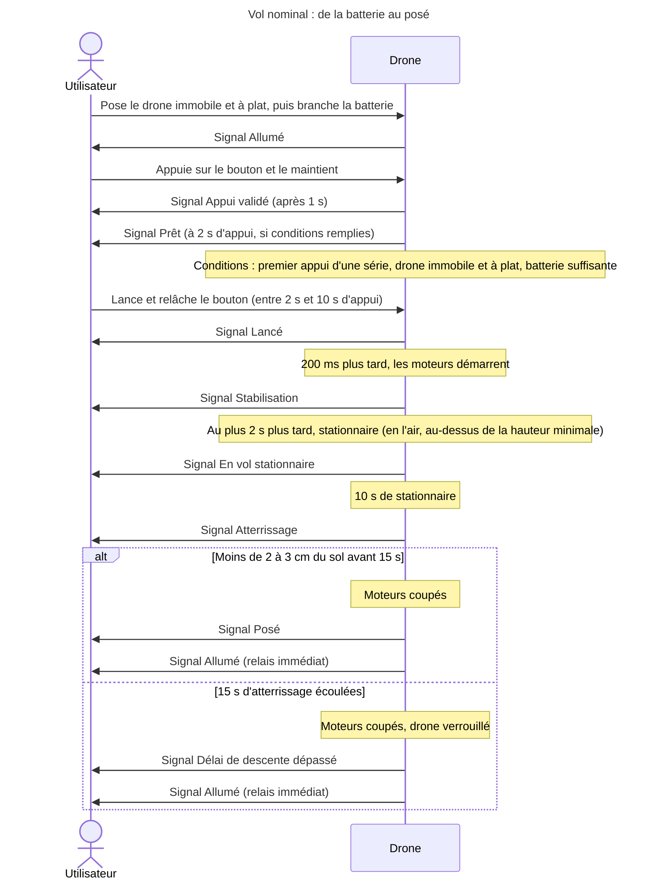

Décisions citées (dont l'effet figure dans ce diagramme ou sa légende) :
- DEC-009 « Stationnaire atteint en 2 secondes maximum après le démarrage des moteurs »
- DEC-021 « Atterrissage lent, 15 secondes maximum, puis coupure des moteurs »
- DEC-022 « Moteurs coupés à moins de 2 à 3 cm du sol »
- DEC-030 « Drone posé immobile à la mise sous tension ; refus de s'armer si l'initialisation échoue »
- DEC-046 « Délai de descente dépassé : signal distinct, moteurs coupés, drone verrouillé »
- DEC-049 « Stationnaire déclaré seulement en l'air, au-dessus d'une hauteur minimale »
- DEC-070 « Appui validé : bouton maintenu 1 seconde, rien en dessous, plus de signal Appui trop court »
- DEC-072 « Armement à 2 secondes d'appui : signal Prêt, ou signal unique Armement refusé selon l'état du drone »
- DEC-073 « Armé entre 2 et 10 secondes d'appui : le relâchement donne le signal Lancé, les moteurs démarrent 200 ms plus tard »
- DEC-076 « Armement possible seulement depuis le premier appui d'une série, sans effet du maintien pendant la série »
- DEC-104 « Cause d'une coupure en vol : signal local non conservé, Allumé prend le relais, cause conservée sur le statut sans fil »
- DEC-113 « Cause d'une coupure en vol : confirmation, Allumé tout de suite, aucune durée minimale, risque accepté »
- DEC-118 « Signal Allumé au retour à l'attente après un posé, un refus ou un désarmement »

**Réfs amont :**
- Source : Utilisateur (description initiale, entretien du 2026-10-27).
- Information : DEC-001 « Information de l'utilisateur par signaux lumineux, sonores et suivi sur un autre appareil » ; DEC-005 « Un signal distinct pour chaque information » ; DEC-016 « Public adulte, protège-hélices obligatoires » ; DEC-032 « Vol libre : le drone vole sans appareil de suivi ».
- Périmètre : DEC-040 « Périmètre d'emploi visé : l'appartement ; gymnase et jardin en essais complémentaires » ; DEC-042 « Plage de lancer inchangée, aucune zone libre ni distance aux personnes, le drone ne connaît pas le lieu » ; DEC-010 « Plage de lancer : toute orientation, 0,5 à 4 m/s, au moins 1,5 m du sol » ; DEC-052 « Valeurs provisoires retenues pour les scénarios, à confirmer avant les exigences » ; DEC-114 « Faisabilité du stationnaire en 2 secondes depuis 1,5 m : analyse avant les besoins, plage de lancer à revoir ».
- Mise sous tension et réglages : DEC-030 « Drone posé immobile à la mise sous tension ; refus de s'armer si l'initialisation échoue » ; DEC-034 « Réglages envoyés par le sans fil, sauvegarde sur commande, chargement au démarrage » ; DEC-067 « Démarrage à plat exigé, sinon échec de l'initialisation avec signal » ; DEC-088 « Bouton coincé ou maintenu en permanence au démarrage : statut sans fil seulement, aucun signal local ».
- Bouton, armement, lancer : DEC-006 « Le relâchement du bouton armé suffit à démarrer les moteurs » ; DEC-055 « Bouton ignoré pendant une courte garde après le lancer » ; DEC-056 « Armement : drone immobile, sans autotest » ; DEC-062 « Arrêt ignoré pendant la phase Lancé, avant le démarrage des moteurs » ; DEC-070 « Appui validé : bouton maintenu 1 seconde, rien en dessous, plus de signal Appui trop court » ; DEC-072 « Armement à 2 secondes d'appui : signal Prêt, ou signal unique Armement refusé selon l'état du drone » ; DEC-073 « Armé entre 2 et 10 secondes d'appui : le relâchement donne le signal Lancé, les moteurs démarrent 200 ms plus tard » ; DEC-076 « Armement possible seulement depuis le premier appui d'une série, sans effet du maintien pendant la série » ; DEC-083 « Annulation d'un armement : le maintien jusqu'au désarmement à 10 s reste la seule annulation » ; DEC-091 « Un seul signal Refus pour tout refus, armement ou mode réglage » ; DEC-110 « Armement refusé à 2 secondes d'appui : tous les tests faits, un seul signal Refus, sans attente de l'immobilité ».
- Mesures et objectifs : DEC-011 « Dérive de 30 cm sur 10 s en objectif à valider par essais » ; DEC-019 « Hauteur au-dessus du sol mesurée en vol ».
- Vol et atterrissage : DEC-009 « Stationnaire atteint en 2 secondes maximum après le démarrage des moteurs » ; DEC-012 « Couper les moteurs si le drone bascule après le stationnaire » ; DEC-020 « Atterrissage sur place » ; DEC-021 « Atterrissage lent, 15 secondes maximum, puis coupure des moteurs » ; DEC-022 « Moteurs coupés à moins de 2 à 3 cm du sol » ; DEC-049 « Stationnaire déclaré seulement en l'air, au-dessus d'une hauteur minimale » ; DEC-046 « Délai de descente dépassé : signal distinct, moteurs coupés, drone verrouillé ».
- Après le vol : DEC-023 « Après le posé ou une coupure : drone verrouillé, nouvel appui pour revoler » ; DEC-047 « L'état verrouillé est le même que l'état allumé, en attente d'un appui » ; DEC-104 « Cause d'une coupure en vol : signal local non conservé, Allumé prend le relais, cause conservée sur le statut sans fil » ; DEC-113 « Cause d'une coupure en vol : confirmation, Allumé tout de suite, aucune durée minimale, risque accepté » ; DEC-118 « Signal Allumé au retour à l'attente après un posé, un refus ou un désarmement ».
- Limites volontaires : DEC-017 « Pas de protection supplémentaire contre les hélices en rotation sans lancer » ; DEC-057 « Pas de détection dédiée d'un drone attrapé ou posé sur un obstacle » ; DEC-060 « Défaillance d'un capteur ou d'un moteur en vol : hors périmètre » ; DEC-063 « Choc contre un obstacle ou un plafond : aucune réaction dédiée ».

**Type :** Nominal
**Acteurs :** Utilisateur. Un appareil de suivi peut être relié au drone, mais n'est pas nécessaire (DEC-032 « Vol libre : le drone vole sans appareil de suivi »).
**Situation de départ :**
- Drone hors tension, muni de ses protège-hélices, batterie chargée (sa charge, son remplacement et son stockage sont hors périmètre : DEC-111 « Batterie et programmation : hors périmètre des scénarios, limites d'emploi à documenter » ; sa protection de sous-tension est décrite par SCN-012 « Dégradé : sous-tension de la batterie »), dans un appartement, sans vent, avec ou sans appareil de suivi ; gymnase et jardin en essais complémentaires, non garantis (DEC-040 « Périmètre d'emploi visé : l'appartement ; gymnase et jardin en essais complémentaires »).
- Le drone ne connaît pas le lieu : un lieu trop petit pour la plage de lancer relève de l'utilisateur (DEC-042 « Plage de lancer inchangée, aucune zone libre ni distance aux personnes, le drone ne connaît pas le lieu »).
- Valeurs provisoires (2 s pour le stationnaire, lancer de 0,5 à 4 m/s depuis au moins 1,5 m du sol, angle limite de 60°) : à confirmer avant la porte « exigences » (DEC-052 « Valeurs provisoires retenues pour les scénarios, à confirmer avant les exigences ») ; la plage de lancer et le stationnaire de 2 s sont à valider par essais sur prototype, plage de lancer inchangée (DOU-050 « Mesure de vitesse horizontale et faisabilité du stationnaire en 2 s depuis 1,5 m » ; DEC-137 « Faisabilité du stationnaire en 2 secondes depuis 1,5 m : jalon déplacé aux essais, plage de lancer inchangée », qui modifie DEC-114 « Faisabilité du stationnaire en 2 secondes depuis 1,5 m : analyse avant les besoins, plage de lancer à revoir »).
**Déroulé :**
1. Mise sous tension.
   - L'utilisateur pose le drone immobile et à plat, branche la batterie et n'y touche pas pendant quelques secondes (DEC-030 « Drone posé immobile à la mise sous tension ; refus de s'armer si l'initialisation échoue »).
   - Un drone trop incliné ne s'initialise pas : voir SCN-010 « Échec : initialisation impossible au démarrage ».
2. Démarrage.
   - Le drone charge ses derniers réglages enregistrés, sans échange sans fil (DEC-034 « Réglages envoyés par le sans fil, sauvegarde sur commande, chargement au démarrage »), puis signale qu'il est allumé et en attente d'un appui.
3. Appui validé.
   - L'utilisateur prend le drone et maintient le bouton ; à 1 s, le drone donne le signal « Appui validé » (DEC-070 « Appui validé : bouton maintenu 1 seconde, rien en dessous, plus de signal Appui trop court »).
4. Armement.
   - À 2 s d'appui, premier appui d'une série, batterie suffisante, drone immobile et à plat : le drone est armé et donne le signal « Prêt » (DEC-072 « Armement à 2 secondes d'appui : signal Prêt, ou signal unique Armement refusé selon l'état du drone »).
   - Sinon il donne le signal « Refus » : voir SCN-003 « Échec : batterie faible à l'armement ».
5. Lancer.
   - L'utilisateur lance le drone vers le haut et l'avant, dans n'importe quelle orientation (DEC-010 « Plage de lancer : toute orientation, 0,5 à 4 m/s, au moins 1,5 m du sol »), et relâche le bouton entre 2 s et 10 s d'appui ; le drone donne le signal « Lancé ».
   - Une courte garde ignore les appuis parasites qui suivent : voir SCN-002 « Échec : stationnaire non atteint dans le délai ».
6. Démarrage des moteurs.
   - 200 ms après le relâchement, les moteurs démarrent, même sans vrai lancer (risque accepté), et le drone donne le signal « Stabilisation » (DEC-073 « Armé entre 2 et 10 secondes d'appui : le relâchement donne le signal Lancé, les moteurs démarrent 200 ms plus tard »).
   - Dans cet intervalle, l'arrêt et les commandes sans fil sont ignorés.
7. Stationnaire.
   - Au plus 2 s plus tard, le drone est en vol stationnaire : immobile en l'air et à plat, au-dessus d'une hauteur minimale (DEC-009 « Stationnaire atteint en 2 secondes maximum après le démarrage des moteurs »). Il dérive d'au plus 30 cm sur 10 s (objectif à valider par essais). Un drone posé ou tenu en main n'est jamais déclaré en stationnaire.
   - Signal « En vol stationnaire ».
8. Atterrissage.
   - Après 10 s de stationnaire, le drone se pose sur place, à 0,5 m/s au plus au contact du sol, en 15 s au plus (DEC-021 « Atterrissage lent, 15 secondes maximum, puis coupure des moteurs ») ; signal « Atterrissage ».
9. Fin du vol.
   - À moins de 2 à 3 cm du sol, le drone coupe les moteurs et donne le signal « Posé » (DEC-022 « Moteurs coupés à moins de 2 à 3 cm du sol »), puis le signal « Allumé » prend le relais au retour à l'attente (DEC-118 « Signal Allumé au retour à l'attente après un posé, un refus ou un désarmement »).
   - Si les 15 s s'écoulent avant, il coupe aussi les moteurs, donne le signal « Délai de descente dépassé » et est verrouillé (DEC-046 « Délai de descente dépassé : signal distinct, moteurs coupés, drone verrouillé ») ; « Allumé » prend ensuite le relais tout de suite (DEC-104 « Cause d'une coupure en vol : signal local non conservé, Allumé prend le relais, cause conservée sur le statut sans fil »).
**Résultat attendu :**
- Cas nominal : drone posé (moins de 2 à 3 cm du sol), moteurs arrêtés, intact ; l'utilisateur a été informé à chaque étape (moyen d'information : voir DOU-001 « Comment le drone informe-t-il l'utilisateur ? »).
- Si les 15 s d'atterrissage sont écoulées, le drone n'est pas déclaré posé et il est verrouillé : un nouvel appui de 2 s est nécessaire pour revoler (DEC-023 « Après le posé ou une coupure : drone verrouillé, nouvel appui pour revoler »).
- Limites volontaires, risques acceptés : aucun autotest avant l'armement (DEC-056 « Armement : drone immobile, sans autotest »), aucune détection d'une main, d'une table ou d'un obstacle sous le drone (DEC-057 « Pas de détection dédiée d'un drone attrapé ou posé sur un obstacle »), aucune détection de défaillance d'un capteur ou d'un moteur en vol (DEC-060 « Défaillance d'un capteur ou d'un moteur en vol : hors périmètre »), aucune réaction dédiée à un choc (DEC-063 « Choc contre un obstacle ou un plafond : aucune réaction dédiée »).
- À reporter dans les limites d'emploi (DEC-125 « Limites d'emploi informées par une notice écrite à la phase besoins, le drone n'affiche rien ») : relâcher le bouton armé démarre les moteurs 200 ms plus tard, y compris dans la main, et la seule annulation est de rester appuyé jusqu'au désarmement à 10 s, soit environ 8 s après le signal « Prêt » (DEC-083 « Annulation d'un armement : le maintien jusqu'au désarmement à 10 s reste la seule annulation »).
- À reporter dans les limites d'emploi : un bouton coincé ou maintenu au démarrage n'est signalé que par le statut sans fil (« bouton maintenu »), sans signal local, et le drone ne s'arme pas (DEC-088 « Bouton coincé ou maintenu en permanence au démarrage : statut sans fil seulement, aucun signal local »).
**Statut :** Proposé

### SCN-002 — Échec : stationnaire non atteint dans le délai

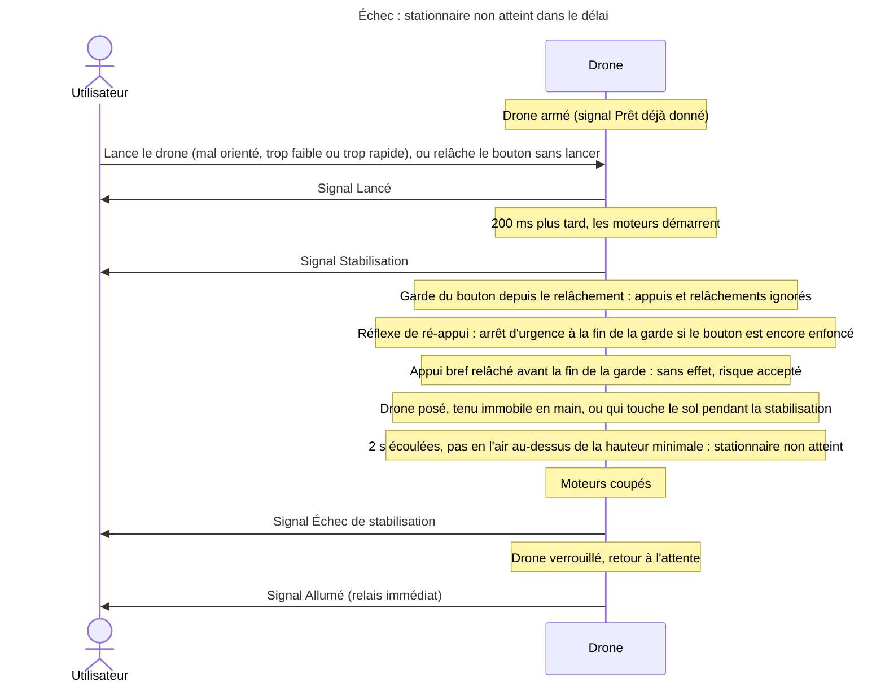

Décisions citées (dont l'effet figure dans ce diagramme ou sa légende) :
- DEC-009 « Stationnaire atteint en 2 secondes maximum après le démarrage des moteurs »
- DEC-017 « Pas de protection supplémentaire contre les hélices en rotation sans lancer »
- DEC-049 « Stationnaire déclaré seulement en l'air, au-dessus d'une hauteur minimale »
- DEC-073 « Armé entre 2 et 10 secondes d'appui : le relâchement donne le signal Lancé, les moteurs démarrent 200 ms plus tard »
- DEC-092 « Garde du bouton après le lancer : fronts ignorés, niveau pris en compte, démarrage au relâchement »
- DEC-104 « Cause d'une coupure en vol : signal local non conservé, Allumé prend le relais, cause conservée sur le statut sans fil »
- DEC-109 « Lancer hors plage ou hauteur non mesurable : échec de stabilisation, limite d'emploi »
- DEC-113 « Cause d'une coupure en vol : confirmation, Allumé tout de suite, aucune durée minimale, risque accepté »
- DEC-119 « Appui bref pendant la garde du bouton, relâché avant la fin : risque accepté et documenté »

**Réfs amont :**
- Source : Utilisateur (entretien du 2026-10-27).
- Échec et délai : DEC-002 « Couper les moteurs si le stationnaire n'est pas atteint dans le délai » ; DEC-003 « Drone retourné ou très incliné : normal tant que la stabilisation n'est pas finie » ; DEC-009 « Stationnaire atteint en 2 secondes maximum après le démarrage des moteurs » ; DEC-049 « Stationnaire déclaré seulement en l'air, au-dessus d'une hauteur minimale » ; DEC-051 « Seuils de sécurité réglables dans des bornes fixées par le logiciel ».
- Information et signaux : DEC-005 « Un signal distinct pour chaque information » ; DEC-104 « Cause d'une coupure en vol : signal local non conservé, Allumé prend le relais, cause conservée sur le statut sans fil » ; DEC-113 « Cause d'une coupure en vol : confirmation, Allumé tout de suite, aucune durée minimale, risque accepté ».
- Bouton et lancer : DEC-017 « Pas de protection supplémentaire contre les hélices en rotation sans lancer » ; DEC-055 « Bouton ignoré pendant une courte garde après le lancer » ; DEC-092 « Garde du bouton après le lancer : fronts ignorés, niveau pris en compte, démarrage au relâchement » ; DEC-119 « Appui bref pendant la garde du bouton, relâché avant la fin : risque accepté et documenté ».
- Plage de lancer : DEC-010 « Plage de lancer : toute orientation, 0,5 à 4 m/s, au moins 1,5 m du sol » ; DEC-109 « Lancer hors plage ou hauteur non mesurable : échec de stabilisation, limite d'emploi » ; DEC-114 « Faisabilité du stationnaire en 2 secondes depuis 1,5 m : analyse avant les besoins, plage de lancer à revoir », modifiée par DEC-137 « Faisabilité du stationnaire en 2 secondes depuis 1,5 m : jalon déplacé aux essais, plage de lancer inchangée ».
- Après la coupure : DEC-023 « Après le posé ou une coupure : drone verrouillé, nouvel appui pour revoler ».

**Type :** Échec
**Acteurs :** Utilisateur.
**Situation de départ :** drone armé, puis lancé comme dans SCN-001 « Vol nominal : de la batterie au posé » (étape 5), ou bouton relâché sans lancer, drone posé ou tenu immobile en main ; moteurs démarrés, en cours de stabilisation. Le lancer peut être mal orienté, trop faible ou trop rapide, et le drone peut toucher le sol pendant la stabilisation (DEC-049 « Stationnaire déclaré seulement en l'air, au-dessus d'une hauteur minimale »). Les valeurs de la plage de lancer restent provisoires : analyse de faisabilité avant les besoins (DOU-050 « Mesure de vitesse horizontale et faisabilité du stationnaire en 2 s depuis 1,5 m » ; DEC-114 « Faisabilité du stationnaire en 2 secondes depuis 1,5 m : analyse avant les besoins, plage de lancer à revoir »).
**Déroulé :**
1. Le drone cherche à se stabiliser ; être retourné ou très incliné est normal à ce stade.
2. Le délai maximal s'écoule sans que le stationnaire soit atteint (2 secondes après le démarrage des moteurs : DEC-009 « Stationnaire atteint en 2 secondes maximum après le démarrage des moteurs »).
3. Le drone coupe ses moteurs et informe l'utilisateur avec un signal d'échec distinct des autres. Les seuils de cette coupure sont réglables dans des bornes fixées par le logiciel (DEC-051 « Seuils de sécurité réglables dans des bornes fixées par le logiciel ») : aucune valeur réglable ne supprime la coupure. Même comportement si le drone est relâché sans lancer, posé ou tenu immobile en main, ou s'il touche le sol pendant la stabilisation : faute d'être en l'air au-dessus de la hauteur minimale, il n'atteint pas le stationnaire et coupe ses moteurs au bout du délai (DEC-049 « Stationnaire déclaré seulement en l'air, au-dessus d'une hauteur minimale »). Même signal et même coupure pour un lancer hors plage (DEC-010 « Plage de lancer : toute orientation, 0,5 à 4 m/s, au moins 1,5 m du sol ») ou une hauteur impossible à mesurer (sol non réfléchissant, vitre, escalier) : le drone ne les distingue pas d'un défaut du drone et n'a ni signal ni comportement propre ; limite d'emploi à documenter (DEC-109 « Lancer hors plage ou hauteur non mesurable : échec de stabilisation, limite d'emploi » ; DEC-125 « Limites d'emploi informées par une notice écrite à la phase besoins, le drone n'affiche rien »).
4. Cas du bouton relâché sans lancer, drone en main : l'utilisateur qui ré-appuie par réflexe sur le bouton pour arrêter les hélices voit son appui ignoré pendant la garde, qui commence au relâchement (de l'ordre de 0,5 s, à fixer en architecture). La garde ignore les appuis et relâchements mais pas le niveau : si le bouton est encore enfoncé à la fin de la garde, c'est un arrêt d'urgence à ce moment. Le réflexe reste donc efficace, avec au plus la durée de la garde de retard ; un appui bref relâché avant la fin de la garde n'a aucun effet et les hélices continuent de tourner : risque accepté et documenté, DEC-092 « Garde du bouton après le lancer : fronts ignorés, niveau pris en compte, démarrage au relâchement » restant inchangée ; limite d'emploi : tenir le bouton jusqu'à la fin de la garde (DEC-119 « Appui bref pendant la garde du bouton, relâché avant la fin : risque accepté et documenté » ; DEC-092 « Garde du bouton après le lancer : fronts ignorés, niveau pris en compte, démarrage au relâchement » ; DEC-017 « Pas de protection supplémentaire contre les hélices en rotation sans lancer »).
**Résultat attendu :** moteurs arrêtés au bout du délai ; le drone tombe s'il est en l'air, ou reste où il est s'il est posé, tenu en main ou au contact du sol ; le drone signale la coupure (signal « Échec de stabilisation ») ; « Allumé » prend ensuite le relais tout de suite, sans durée minimale, et la cause se lit sur le statut sans fil ; un utilisateur sans appareil de suivi n'en connaît pas la cause, risque accepté (DEC-104 « Cause d'une coupure en vol : signal local non conservé, Allumé prend le relais, cause conservée sur le statut sans fil » ; DEC-113 « Cause d'une coupure en vol : confirmation, Allumé tout de suite, aucune durée minimale, risque accepté »). Le drone est alors verrouillé : un nouvel appui de 2 secondes est nécessaire pour revoler (DEC-023 « Après le posé ou une coupure : drone verrouillé, nouvel appui pour revoler »).
**Statut :** Proposé

### SCN-003 — Échec : batterie faible à l'armement

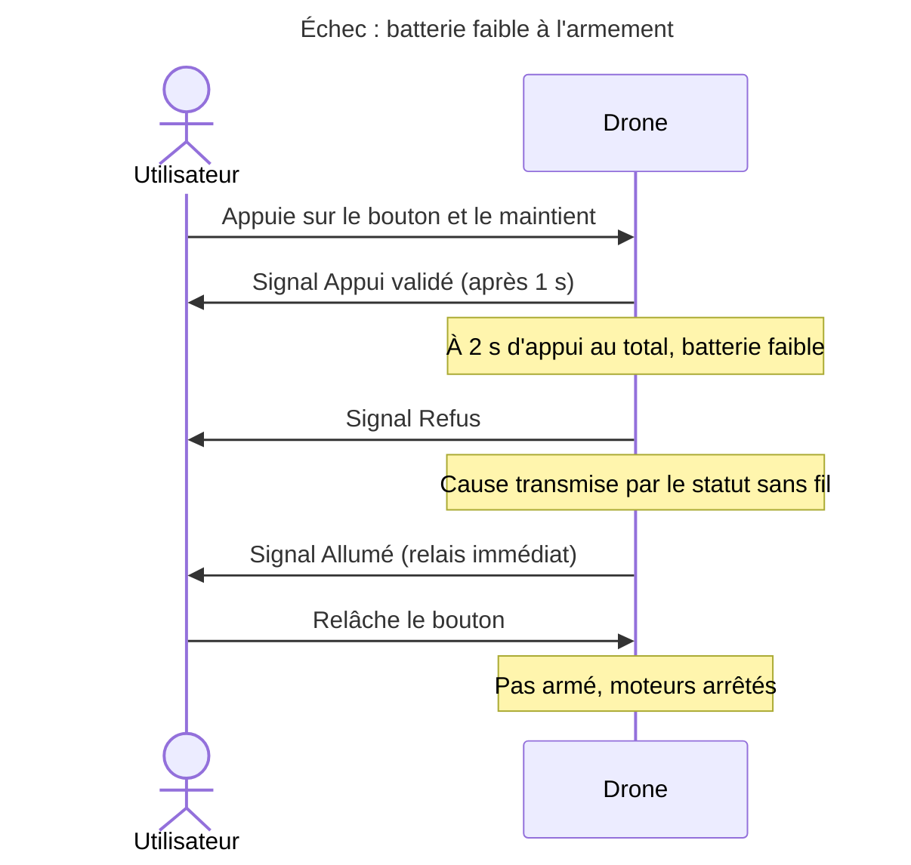

Décisions citées (dont l'effet figure dans ce diagramme ou sa légende) :
- DEC-070 « Appui validé : bouton maintenu 1 seconde, rien en dessous, plus de signal Appui trop court »
- DEC-072 « Armement à 2 secondes d'appui : signal Prêt, ou signal unique Armement refusé selon l'état du drone »
- DEC-091 « Un seul signal Refus pour tout refus, armement ou mode réglage »
- DEC-101 « Statut sans fil d'un refus : cause précise, liste exacte à fixer en architecture »
- DEC-110 « Armement refusé à 2 secondes d'appui : tous les tests faits, un seul signal Refus, sans attente de l'immobilité »
- DEC-118 « Signal Allumé au retour à l'attente après un posé, un refus ou un désarmement »

**Réfs amont :**
- Source : Utilisateur (entretien du 2026-10-27).
- Batterie et information : DEC-004 « Batterie vérifiée à l'armement : pas d'armement si batterie faible » ; DEC-005 « Un signal distinct pour chaque information ».
- Appui et signaux : DEC-070 « Appui validé : bouton maintenu 1 seconde, rien en dessous, plus de signal Appui trop court » ; DEC-072 « Armement à 2 secondes d'appui : signal Prêt, ou signal unique Armement refusé selon l'état du drone » ; DEC-091 « Un seul signal Refus pour tout refus, armement ou mode réglage » ; DEC-110 « Armement refusé à 2 secondes d'appui : tous les tests faits, un seul signal Refus, sans attente de l'immobilité » ; DEC-118 « Signal Allumé au retour à l'attente après un posé, un refus ou un désarmement ».
- Retour à l'attente : DEC-080 « Armement refusé ou désarmement : retour à l'attente, compteur à zéro, l'appui long n'est pas compté » ; DEC-081 « Bouton encore enfoncé après un refus ou un désarmement : ignoré jusqu'au premier relâchement, puis nouvel appui possible tout de suite ».
**Type :** Échec
**Acteurs :** Utilisateur.
**Situation de départ :** drone allumé et en attente d'un appui (étape 2 de SCN-001 « Vol nominal : de la batterie au posé »), batterie en dessous du seuil.
**Déroulé :**
1. L'utilisateur appuie sur le bouton et le maintient ; à 1 s, le drone donne le signal « Appui validé ».
2. Après 2 secondes d'appui au total, le drone constate que la batterie est faible. Tous les tests (batterie, immobilité, mise à plat) sont faits à ce moment, sans attente de l'immobilité ; l'ordre des tests n'importe pas à l'utilisateur et le statut sans fil liste les causes constatées (DEC-110 « Armement refusé à 2 secondes d'appui : tous les tests faits, un seul signal Refus, sans attente de l'immobilité »).
3. Il ne s'arme pas et donne le signal « Refus » (DEC-091 « Un seul signal Refus pour tout refus, armement ou mode réglage » ; DEC-072 « Armement à 2 secondes d'appui : signal Prêt, ou signal unique Armement refusé selon l'état du drone »), le même signal que pour un drone en mouvement ou pas à plat ; la cause (batterie faible) est transmise par le statut sans fil (liste exacte à fixer en architecture : DEC-101 « Statut sans fil d'un refus : cause précise, liste exacte à fixer en architecture »). Sans appareil de suivi, l'utilisateur ne connaît pas la cause. Le drone revient à l'état « Allumé, en attente d'un appui » et donne le signal « Allumé », qui prend le relais après le signal « Refus » (DEC-118 « Signal Allumé au retour à l'attente après un posé, un refus ou un désarmement »), compteur à zéro, l'appui long n'est pas compté ; le bouton encore enfoncé est ignoré jusqu'au premier relâchement, et un nouvel appui peut armer immédiatement après ce relâchement (DEC-080 « Armement refusé ou désarmement : retour à l'attente, compteur à zéro, l'appui long n'est pas compté » ; DEC-081 « Bouton encore enfoncé après un refus ou un désarmement : ignoré jusqu'au premier relâchement, puis nouvel appui possible tout de suite »).
**Résultat attendu :** le drone n'est pas armé ; relâcher le bouton ne démarre pas les moteurs ; le signal « Refus » est observé, suivi du signal « Allumé » ; avec un appareil de suivi, le statut sans fil indique la batterie faible comme cause.
**Statut :** Proposé

### SCN-004 — Appui normal : bouton relâché avant 2 secondes

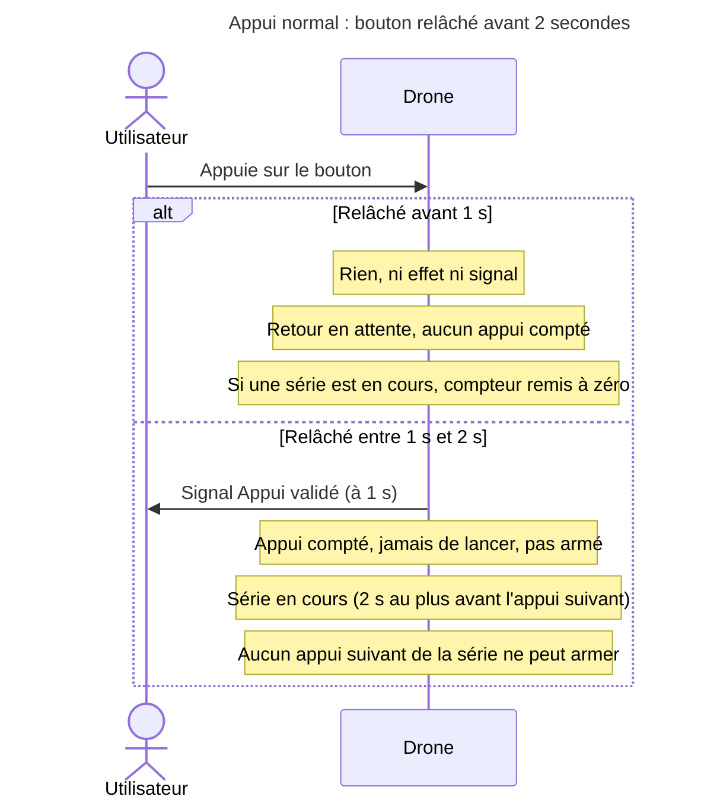

Décisions citées (dont l'effet figure dans ce diagramme ou sa légende) :
- DEC-070 « Appui validé : bouton maintenu 1 seconde, rien en dessous, plus de signal Appui trop court »
- DEC-071 « Appuis validés d'affilée : trois appuis entrent en mode réglage sans armer, le bouton n'arme jamais en mode réglage »
- DEC-076 « Armement possible seulement depuis le premier appui d'une série, sans effet du maintien pendant la série »
- DEC-089 « Appui de moins de 1 s au milieu d'une série d'appuis : compteur remis à zéro »

**Réfs amont :**
- Source : Utilisateur (entretien du 2026-10-27, refonte du bouton du 2026-10-28).
- Information : DEC-005 « Un signal distinct pour chaque information ».
- Appui validé et série d'appuis : DEC-070 « Appui validé : bouton maintenu 1 seconde, rien en dessous, plus de signal Appui trop court » ; DEC-071 « Appuis validés d'affilée : trois appuis entrent en mode réglage sans armer, le bouton n'arme jamais en mode réglage » ; DEC-076 « Armement possible seulement depuis le premier appui d'une série, sans effet du maintien pendant la série » ; DEC-089 « Appui de moins de 1 s au milieu d'une série d'appuis : compteur remis à zéro ».
- Mode réglage : DEC-085 « Entrée en mode réglage : drone immobile et à plat, non armé, sans condition de posé » ; DEC-090 « Troisième appui validé sur un drone non immobile ou pas à plat : mode réglage refusé avec le signal Refus » ; DEC-115 « Troisième appui encore maintenu à l'entrée en mode réglage : maintien ignoré jusqu'au premier relâchement ».
- Retour à l'attente et appuis ignorés : DEC-080 « Armement refusé ou désarmement : retour à l'attente, compteur à zéro, l'appui long n'est pas compté » ; DEC-084 « Appui ignoré pendant une série d'appuis : aucun signal, risque accepté et documenté » ; DEC-118 « Signal Allumé au retour à l'attente après un posé, un refus ou un désarmement ».

**Type :** Nominal
**Acteurs :** Utilisateur.
**Situation de départ :** drone allumé et en attente d'un appui, tenu en main ou posé.
**Déroulé :**
1. L'utilisateur appuie sur le bouton.
2. Il le relâche avant 1 s : rien ne se passe, ni effet ni signal (DEC-070 « Appui validé : bouton maintenu 1 seconde, rien en dessous, plus de signal Appui trop court »).
3. Ou il le relâche entre 1 s et 2 s : le drone donne le signal « Appui validé » à 1 s, l'appui est compté, et le drone n'arme ni ne lance jamais.
   - Les appuis validés comptent d'affilée si l'écart entre deux est d'environ 2 s au plus ; trois appuis validés, drone immobile et à plat, non armé, entrent en mode réglage (DEC-071 « Appuis validés d'affilée : trois appuis entrent en mode réglage sans armer, le bouton n'arme jamais en mode réglage » ; DEC-085 « Entrée en mode réglage : drone immobile et à plat, non armé, sans condition de posé » ; SCN-009 « Réglage et suivi du drone par le sans fil »).
   - Tant que la série n'est pas retombée à zéro, aucun appui suivant ne peut armer, et maintenir le 2e appui au-delà de 2 s ne fait ni armement, ni signal, ni annulation ; si 2 s s'écoulent sans nouvel appui, le compteur repart à zéro et l'armement redevient possible (DEC-076 « Armement possible seulement depuis le premier appui d'une série, sans effet du maintien pendant la série »).
   - Un appui long (2 s ou plus) relâché après un refus d'armement ou un désarmement n'est pas compté dans la série (DEC-080 « Armement refusé ou désarmement : retour à l'attente, compteur à zéro, l'appui long n'est pas compté »).
   - Un appui de moins de 1 s au milieu d'une série n'est pas compté et remet le compteur à zéro (DEC-089 « Appui de moins de 1 s au milieu d'une série d'appuis : compteur remis à zéro »).
   - Si le 3e appui validé arrive sur un drone en mouvement ou pas à plat, le mode réglage est refusé avec le signal « Refus », puis retour à l'attente avec le signal « Allumé », compteur à zéro (DEC-090 « Troisième appui validé sur un drone non immobile ou pas à plat : mode réglage refusé avec le signal Refus » ; DEC-093 « Mode réglage refusé : retour à l'attente, compteur à zéro, bouton encore enfoncé ignoré » ; DEC-118 « Signal Allumé au retour à l'attente après un posé, un refus ou un désarmement »).
   - Si le 3e appui est encore maintenu à l'entrée en mode réglage, ce maintien est ignoré jusqu'au premier relâchement (DEC-115 « Troisième appui encore maintenu à l'entrée en mode réglage : maintien ignoré jusqu'au premier relâchement »).
   - Les seuils de 1 s et 2 s et le délai entre appuis sont provisoires (DOU-080 « Seuils de temps du bouton : 1 s, 2 s, 10 s et délai entre appuis »).
**Résultat attendu :** le drone n'est pas armé, les moteurs ne démarrent pas ; un nouvel appui est possible, mais il ne peut pas armer tant que la série n'est pas retombée à zéro. Risque accepté, à reporter dans les limites d'emploi (DEC-125 « Limites d'emploi informées par une notice écrite à la phase besoins, le drone n'affiche rien ») : un appui maintenu au-delà de 2 s pendant une série ne donne aucun signal, l'utilisateur peut ne pas comprendre pourquoi rien ne se passe et retaper jusqu'à entrer en mode réglage par erreur, dont la seule sortie est d'enlever la batterie (DEC-084 « Appui ignoré pendant une série d'appuis : aucun signal, risque accepté et documenté »).
**Statut :** Proposé

### SCN-005 — Dégradé : bouton maintenu plus de 10 secondes

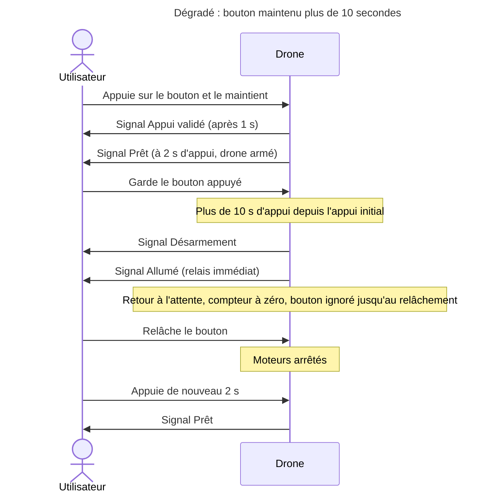

Décisions citées (dont l'effet figure dans ce diagramme ou sa légende) :
- DEC-054 « Chrono de 10 secondes compté depuis l'appui initial »
- DEC-072 « Armement à 2 secondes d'appui : signal Prêt, ou signal unique Armement refusé selon l'état du drone »
- DEC-076 « Armement possible seulement depuis le premier appui d'une série, sans effet du maintien pendant la série »
- DEC-080 « Armement refusé ou désarmement : retour à l'attente, compteur à zéro, l'appui long n'est pas compté »
- DEC-081 « Bouton encore enfoncé après un refus ou un désarmement : ignoré jusqu'au premier relâchement, puis nouvel appui possible tout de suite »
- DEC-118 « Signal Allumé au retour à l'attente après un posé, un refus ou un désarmement »

**Réfs amont :**
- Source : Utilisateur (entretien du 2026-10-27).
- Désarmement : DEC-008 « Désarmement si le bouton reste appuyé plus de 10 secondes » ; DEC-054 « Chrono de 10 secondes compté depuis l'appui initial » ; DEC-073 « Armé entre 2 et 10 secondes d'appui : le relâchement donne le signal Lancé, les moteurs démarrent 200 ms plus tard » ; DEC-076 « Armement possible seulement depuis le premier appui d'une série, sans effet du maintien pendant la série ».
- Information : DEC-005 « Un signal distinct pour chaque information ».
- Bouton et retour à l'attente : DEC-059 « Bouton déjà enfoncé : ignoré jusqu'au premier relâchement » ; DEC-080 « Armement refusé ou désarmement : retour à l'attente, compteur à zéro, l'appui long n'est pas compté » ; DEC-081 « Bouton encore enfoncé après un refus ou un désarmement : ignoré jusqu'au premier relâchement, puis nouvel appui possible tout de suite » ; DEC-083 « Annulation d'un armement : le maintien jusqu'au désarmement à 10 s reste la seule annulation » ; DEC-118 « Signal Allumé au retour à l'attente après un posé, un refus ou un désarmement ».

**Type :** Dégradé
**Acteurs :** Utilisateur.
**Situation de départ :** drone armé depuis le premier appui d'une série (bouton appuyé depuis 2 à 10 secondes, DEC-073 « Armé entre 2 et 10 secondes d'appui : le relâchement donne le signal Lancé, les moteurs démarrent 200 ms plus tard »), pas encore lancé.
**Déroulé :**
1. L'utilisateur garde le bouton appuyé au-delà de 10 secondes, comptées depuis l'appui initial (DEC-054 « Chrono de 10 secondes compté depuis l'appui initial »).
2. Le drone se désarme et le signale avec un signal distinct. Il revient à l'état « Allumé, en attente d'un appui » et donne le signal « Allumé », qui prend le relais après le signal « Désarmement » (DEC-118 « Signal Allumé au retour à l'attente après un posé, un refus ou un désarmement »), compteur à zéro ; cet appui long ne compte pas comme appui de la série (DEC-080 « Armement refusé ou désarmement : retour à l'attente, compteur à zéro, l'appui long n'est pas compté »).
3. L'utilisateur relâche le bouton : les moteurs ne démarrent pas. Si l'appui se prolonge après le désarmement, il est ignoré jusqu'au relâchement (DEC-081 « Bouton encore enfoncé après un refus ou un désarmement : ignoré jusqu'au premier relâchement, puis nouvel appui possible tout de suite »). De même, un bouton déjà enfoncé à la mise sous tension, pendant l'initialisation ou après un désarmement est ignoré tant qu'il n'a pas été relâché une fois (DEC-059 « Bouton déjà enfoncé : ignoré jusqu'au premier relâchement »).
4. Après ce relâchement, un nouvel appui peut armer immédiatement. Pour réarmer, il appuie de nouveau 2 secondes (l'armement n'est possible que depuis le premier appui d'une série : DEC-076 « Armement possible seulement depuis le premier appui d'une série, sans effet du maintien pendant la série ») et le drone informe qu'il est prêt (signal Prêt).
**Résultat attendu :** le drone n'est plus armé ; le relâchement du bouton ne démarre pas les moteurs. Risque accepté, à reporter dans les limites d'emploi (DEC-125 « Limites d'emploi informées par une notice écrite à la phase besoins, le drone n'affiche rien ») : renoncer à un armement demande de rester appuyé jusqu'à ce désarmement, environ 8 s après le signal « Prêt » ; relâcher plus tôt démarre les moteurs, y compris dans la main (DEC-083 « Annulation d'un armement : le maintien jusqu'au désarmement à 10 s reste la seule annulation »).
**Statut :** Proposé

### SCN-006 — Échec : inclinaison excessive après le stationnaire

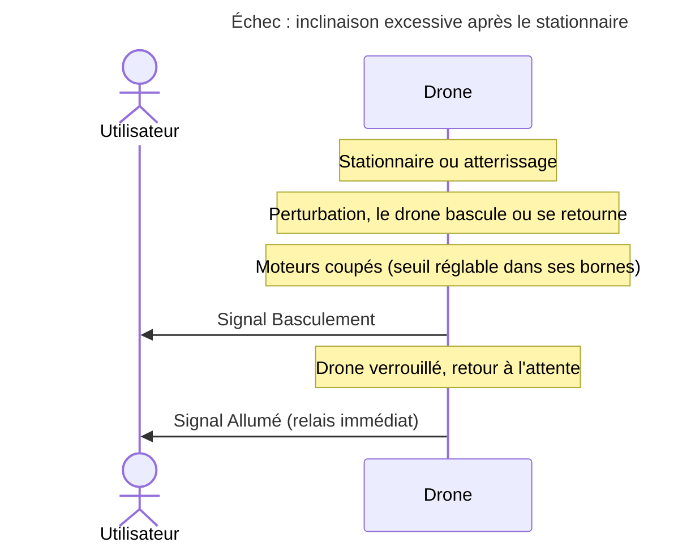

Décisions citées (dont l'effet figure dans ce diagramme ou sa légende) :
- DEC-012 « Couper les moteurs si le drone bascule après le stationnaire »
- DEC-051 « Seuils de sécurité réglables dans des bornes fixées par le logiciel »
- DEC-104 « Cause d'une coupure en vol : signal local non conservé, Allumé prend le relais, cause conservée sur le statut sans fil »
- DEC-113 « Cause d'une coupure en vol : confirmation, Allumé tout de suite, aucune durée minimale, risque accepté »

**Réfs amont :**
- Source : Utilisateur (entretien du 2026-10-27).
- Coupure : DEC-012 « Couper les moteurs si le drone bascule après le stationnaire » ; DEC-051 « Seuils de sécurité réglables dans des bornes fixées par le logiciel ».
- Information et signaux : DEC-005 « Un signal distinct pour chaque information » ; DEC-104 « Cause d'une coupure en vol : signal local non conservé, Allumé prend le relais, cause conservée sur le statut sans fil » ; DEC-113 « Cause d'une coupure en vol : confirmation, Allumé tout de suite, aucune durée minimale, risque accepté ».
- Après la coupure : DEC-023 « Après le posé ou une coupure : drone verrouillé, nouvel appui pour revoler ».

**Type :** Échec
**Acteurs :** Utilisateur.
**Situation de départ :** drone en vol stationnaire ou en atterrissage (SCN-001 « Vol nominal : de la batterie au posé », étapes 7 à 8).
**Déroulé :**
1. Une perturbation fait basculer le drone fortement, ou le retourne.
2. Le drone coupe ses moteurs et informe l'utilisateur avec un signal distinct. Les seuils de cette coupure sont réglables dans des bornes fixées par le logiciel (DEC-051 « Seuils de sécurité réglables dans des bornes fixées par le logiciel ») : aucune valeur réglable ne supprime la coupure.
**Résultat attendu :** moteurs arrêtés ; le drone tombe ; le drone signale la coupure (signal « Basculement ») ; « Allumé » prend ensuite le relais tout de suite, sans durée minimale, et la cause se lit sur le statut sans fil ; un utilisateur sans appareil de suivi n'en connaît pas la cause, risque accepté (DEC-104 « Cause d'une coupure en vol : signal local non conservé, Allumé prend le relais, cause conservée sur le statut sans fil » ; DEC-113 « Cause d'une coupure en vol : confirmation, Allumé tout de suite, aucune durée minimale, risque accepté »). Le drone est alors verrouillé : un nouvel appui de 2 secondes est nécessaire pour revoler (DEC-023 « Après le posé ou une coupure : drone verrouillé, nouvel appui pour revoler »).
**Statut :** Proposé

### SCN-007 — Dégradé : arrêt d'urgence par le bouton en vol

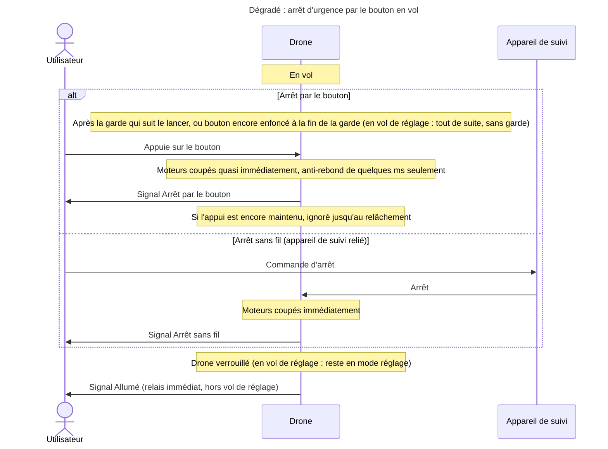

Décisions citées (dont l'effet figure dans ce diagramme ou sa légende) :
- DEC-031 « Arrêt du drone lancé : bouton et commande d'arrêt sans fil »
- DEC-033 « Signal Arrêt sans fil distinct du signal Arrêt par le bouton »
- DEC-044 « Mode réglage persistant : retour au mode réglage après un vol de réglage, sans verrouillage »
- DEC-050 « Appui en cours lors d'une coupure des moteurs ignoré jusqu'au relâchement »
- DEC-055 « Bouton ignoré pendant une courte garde après le lancer »
- DEC-077 « Bouton appuyé en vol de réglage : arrêt d'urgence, moteurs coupés, le drone reste en mode réglage »
- DEC-087 « Arrêt d'urgence par le bouton en vol : anti-rebond très court seulement, arrêt quasi immédiat »
- DEC-092 « Garde du bouton après le lancer : fronts ignorés, niveau pris en compte, démarrage au relâchement »
- DEC-094 « Bouton appuyé après un décollage de réglage : pris en compte tout de suite, sans garde »
- DEC-104 « Cause d'une coupure en vol : signal local non conservé, Allumé prend le relais, cause conservée sur le statut sans fil »
- DEC-113 « Cause d'une coupure en vol : confirmation, Allumé tout de suite, aucune durée minimale, risque accepté »

**Réfs amont :**
- Source : Utilisateur (entretien du 2026-10-27).
- Arrêt et signaux : DEC-015 « Bouton appuyé en vol : arrêt d'urgence » ; DEC-031 « Arrêt du drone lancé : bouton et commande d'arrêt sans fil » ; DEC-033 « Signal Arrêt sans fil distinct du signal Arrêt par le bouton » ; DEC-005 « Un signal distinct pour chaque information » ; DEC-043 « Commandes sans fil acceptées selon l'état du drone » ; DEC-087 « Arrêt d'urgence par le bouton en vol : anti-rebond très court seulement, arrêt quasi immédiat ».
- Bouton et garde : DEC-050 « Appui en cours lors d'une coupure des moteurs ignoré jusqu'au relâchement » ; DEC-055 « Bouton ignoré pendant une courte garde après le lancer » ; DEC-062 « Arrêt ignoré pendant la phase Lancé, avant le démarrage des moteurs » ; DEC-078 « Garde du bouton après le lancer : attachée au lancer au relâchement, pas décidée pour le décollage de réglage » ; DEC-082 « Retours à l'attente après le posé ou une coupure des moteurs : compteur à zéro, appui en cours ni pris en compte ni compté » ; DEC-092 « Garde du bouton après le lancer : fronts ignorés, niveau pris en compte, démarrage au relâchement » ; DEC-094 « Bouton appuyé après un décollage de réglage : pris en compte tout de suite, sans garde ».
- Vol de réglage : DEC-044 « Mode réglage persistant : retour au mode réglage après un vol de réglage, sans verrouillage » ; DEC-077 « Bouton appuyé en vol de réglage : arrêt d'urgence, moteurs coupés, le drone reste en mode réglage » ; DEC-100 « Issues du vol de réglage : signaux du vol normal réutilisés, signal du lien perdu à définir ».
- Après la coupure : DEC-023 « Après le posé ou une coupure : drone verrouillé, nouvel appui pour revoler » ; DEC-104 « Cause d'une coupure en vol : signal local non conservé, Allumé prend le relais, cause conservée sur le statut sans fil ».
- Sans fil et logiciel : DEC-032 « Vol libre : le drone vole sans appareil de suivi » ; DEC-037 « Pas d'appairage : le drone obéit à tout appareil de suivi à portée » ; DEC-065 « Logiciel bloqué en vol : coupure des moteurs par un chien de garde » ; DEC-096 « Chien de garde sur tout état où les moteurs peuvent être alimentés, phase Lancé de durée maximale » ; DEC-103 « Phase Lancé trop longue : coupure et redémarrage par le chien de garde, sans nouvel état ni signal ».

**Type :** Dégradé
**Acteurs :** Utilisateur, appareil de suivi (pour l'arrêt sans fil).
**Situation de départ :** drone en vol (stabilisation, stationnaire ou atterrissage), en vol normal ou en vol de réglage.
**Déroulé :**
1. Choix du moyen d'arrêt.
   - L'utilisateur appuie sur le bouton, ou envoie la commande d'arrêt depuis l'appareil de suivi s'il est relié ; la commande n'agit qu'en vol (DEC-031 « Arrêt du drone lancé : bouton et commande d'arrêt sans fil »).
   - Le bouton est ignoré pendant la garde qui suit le lancer (de l'ordre de 0,5 s, à fixer en architecture) ; un bouton encore enfoncé à sa fin est un arrêt d'urgence (DEC-092 « Garde du bouton après le lancer : fronts ignorés, niveau pris en compte, démarrage au relâchement »).
   - Pendant la phase « Lancé », ni le bouton ni l'arrêt sans fil n'agissent (DEC-062 « Arrêt ignoré pendant la phase Lancé, avant le démarrage des moteurs »).
   - Le bouton et l'arrêt sans fil ont le même effet : aucune priorité à définir entre eux.
2. Coupure des moteurs.
   - Les moteurs sont coupés quasi immédiatement ; le bouton n'est filtré que par un anti-rebond de quelques millisecondes (valeur à fixer en architecture), sans validation de 1 s (DEC-087 « Arrêt d'urgence par le bouton en vol : anti-rebond très court seulement, arrêt quasi immédiat »).
   - Le signal dépend du moyen : « Arrêt par le bouton » ou « Arrêt sans fil » (DEC-033 « Signal Arrêt sans fil distinct du signal Arrêt par le bouton »).
   - Un appui encore maintenu est ignoré jusqu'au relâchement : il ne réarme pas le drone (DEC-050 « Appui en cours lors d'une coupure des moteurs ignoré jusqu'au relâchement »).
3. Après la coupure.
   - Hors vol de réglage, le drone est verrouillé et « Allumé » prend le relais tout de suite ; la cause se lit sur le statut sans fil (DEC-104 « Cause d'une coupure en vol : signal local non conservé, Allumé prend le relais, cause conservée sur le statut sans fil » ; DEC-113 « Cause d'une coupure en vol : confirmation, Allumé tout de suite, aucune durée minimale, risque accepté »).
   - En vol de réglage, le drone reste en mode réglage, moteurs coupés, sans verrouillage, prêt à redécoller sur commande sans fil (DEC-044 « Mode réglage persistant : retour au mode réglage après un vol de réglage, sans verrouillage »).
4. Vol de réglage.
   - Le bouton appuyé y est un arrêt d'urgence, pris en compte tout de suite, sans garde ; une main proche du bouton peut couper les moteurs sans le vouloir (DEC-094 « Bouton appuyé après un décollage de réglage : pris en compte tout de suite, sans garde »).
   - Le signal est « Arrêt par le bouton », comme en vol normal (DEC-100 « Issues du vol de réglage : signaux du vol normal réutilisés, signal du lien perdu à définir »).
5. Sans appareil de suivi, sans appairage, logiciel bloqué.
   - Sans appareil relié, seul le bouton arrête le drone, risque accepté (DEC-032 « Vol libre : le drone vole sans appareil de suivi ») ; sans appairage, tout appareil à portée peut envoyer l'arrêt (DEC-037 « Pas d'appairage : le drone obéit à tout appareil de suivi à portée »).
   - Si le logiciel se bloque, un mécanisme indépendant coupe les moteurs, y compris en phase « Lancé » (DEC-065 « Logiciel bloqué en vol : coupure des moteurs par un chien de garde ») ; durée maximale de « Lancé » dépassée : coupure et redémarrage (DEC-103 « Phase Lancé trop longue : coupure et redémarrage par le chien de garde, sans nouvel état ni signal ») ; voir SCN-011 « Dégradé : coupure d'alimentation en vol ».
**Résultat attendu :**
- Moteurs arrêtés ; le drone tombe ; le drone signale la coupure (« Arrêt par le bouton » ou « Arrêt sans fil ») ; la cause se lit ensuite sur le statut sans fil.
- Hors vol de réglage, « Allumé » prend ensuite le relais tout de suite, sans durée minimale, et la cause se lit sur le statut sans fil ; un utilisateur sans appareil de suivi n'en connaît pas la cause, risque accepté (DEC-104 « Cause d'une coupure en vol : signal local non conservé, Allumé prend le relais, cause conservée sur le statut sans fil » ; DEC-113 « Cause d'une coupure en vol : confirmation, Allumé tout de suite, aucune durée minimale, risque accepté »).
- Le drone est verrouillé (en vol de réglage, il reste en mode réglage) : un nouvel appui de 2 s est nécessaire pour revoler (DEC-023 « Après le posé ou une coupure : drone verrouillé, nouvel appui pour revoler »).
- Risque connu, à reporter dans les limites d'emploi (DEC-125 « Limites d'emploi informées par une notice écrite à la phase besoins, le drone n'affiche rien ») : un parasite plus long que l'anti-rebond peut couper les moteurs en vol (DEC-087 « Arrêt d'urgence par le bouton en vol : anti-rebond très court seulement, arrêt quasi immédiat »).
**Statut :** Proposé

### SCN-008 — Mise en service : programmation du drone

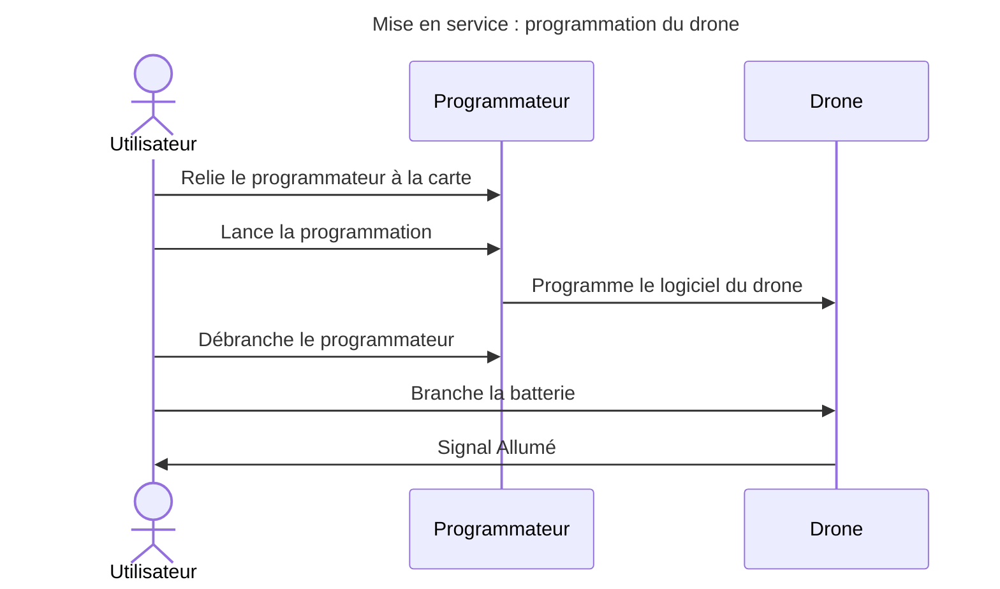

Décisions citées (dont l'effet figure dans ce diagramme ou sa légende) :
- DEC-024 « Mise en service par programmation avec un programmateur ST-LINK »

**Réfs amont :**
- Source : Utilisateur (entretien du 2026-10-27).
- Programmation et mise en service : DEC-024 « Mise en service par programmation avec un programmateur ST-LINK » ; DEC-026 « Mise en service : calibrage éventuel renvoyé à l'architecture, réglage du vol par un scénario dédié » ; DEC-053 « Solutions techniques déplacées en propositions d'architecture, seule l'intention reste décidée ».
- Périmètre : DEC-111 « Batterie et programmation : hors périmètre des scénarios, limites d'emploi à documenter ».

**Type :** Mise en service / maintenance
**Acteurs :** Utilisateur, programmateur (outil choisi en architecture ; proposition : voir DEC-053 « Solutions techniques déplacées en propositions d'architecture, seule l'intention reste décidée »).
**Situation de départ :** carte neuve, jamais programmée, batterie chargée ; l'utilisateur dispose d'un ordinateur et d'un programmateur adapté au drone. Hors périmètre, limites d'emploi à documenter (DEC-111 « Batterie et programmation : hors périmètre des scénarios, limites d'emploi à documenter » ; DEC-125 « Limites d'emploi informées par une notice écrite à la phase besoins, le drone n'affiche rien ») : charge, remplacement et stockage de la batterie, hélices démontées pendant la programmation, programmation interrompue, essai des moteurs avant le premier vol. Le drone laissé allumé n'en fait plus partie : sa sous-tension est décrite par SCN-012 « Dégradé : sous-tension de la batterie » (DEC-133 « SCN-012 inclut le drone laissé allumé en attente d'un appui : sous-tension dans le périmètre »).
**Déroulé :**
1. L'utilisateur relie le programmateur à la carte du drone.
2. Il programme le logiciel du drone depuis l'ordinateur.
3. Il débranche le programmateur.
4. Il branche la batterie : le drone démarre et informe qu'il est allumé et en attente d'un appui (étape 2 de SCN-001 « Vol nominal : de la batterie au posé »).
**Résultat attendu :** le drone est programmé et se comporte comme au début de SCN-001 « Vol nominal : de la batterie au posé ». La programmation réécrit la zone des réglages avec les valeurs d'origine du logiciel : les réglages sauvegardés auparavant sont perdus (DEC-139 « Reprogrammation : réécriture de la zone des réglages avec les valeurs d'origine » ; DEC-141 « Reprogrammation : propagation de DEC-139 aux scénarios et au registre des risques »). Le vol se règle ensuite avec SCN-009 « Réglage et suivi du drone par le sans fil » ; un éventuel calibrage est renvoyé à l'architecture (DEC-026 « Mise en service : calibrage éventuel renvoyé à l'architecture, réglage du vol par un scénario dédié »).
**Statut :** Proposé

### SCN-009 — Réglage et suivi du drone par le sans fil

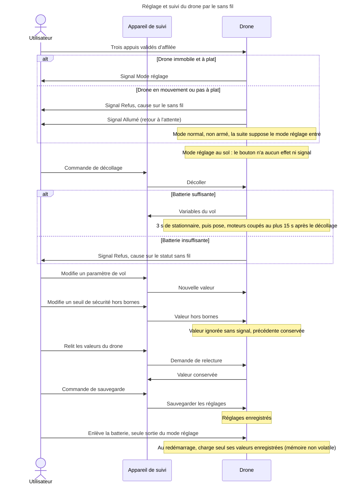

Décisions citées (dont l'effet figure dans ce diagramme ou sa légende) :
- DEC-029 « Vol de réglage : stationnaire de 3 secondes, atterrissage sur place si le lien est perdu » (titre sur le lien perdu obsolète, voir DEC-106 « Lien sans fil perdu en vol de réglage : aucune action particulière »)
- DEC-034 « Réglages envoyés par le sans fil, sauvegarde sur commande, chargement au démarrage »
- DEC-051 « Seuils de sécurité réglables dans des bornes fixées par le logiciel »
- DEC-068 « Seuil hors bornes : refus silencieux, valeur relue sur l'appareil de suivi »
- DEC-071 « Appuis validés d'affilée : trois appuis entrent en mode réglage sans armer, le bouton n'arme jamais en mode réglage »
- DEC-074 « Décollage en mode réglage : la batterie est vérifiée, rien d'autre »
- DEC-079 « Sortie du mode réglage : uniquement en enlevant la batterie »
- DEC-085 « Entrée en mode réglage : drone immobile et à plat, non armé, sans condition de posé »
- DEC-090 « Troisième appui validé sur un drone non immobile ou pas à plat : mode réglage refusé avec le signal Refus »
- DEC-091 « Un seul signal Refus pour tout refus, armement ou mode réglage »
- DEC-101 « Statut sans fil d'un refus : cause précise, liste exacte à fixer en architecture »
- DEC-102 « Décollage de réglage refusé : signal Refus, statut de refus lisible jusqu'à la commande suivante »
- DEC-116 « Bouton en mode réglage, moteurs coupés : aucun effet et aucun signal, il ne sert qu'en vol de réglage »
- DEC-118 « Signal Allumé au retour à l'attente après un posé, un refus ou un désarmement »

**Réfs amont :**
- Source : Utilisateur (entretien du 2026-10-27).
- Suivi et réglage : DEC-025 « Suivi et réglage du drone par le sans fil, y compris en vol » ; DEC-034 « Réglages envoyés par le sans fil, sauvegarde sur commande, chargement au démarrage » ; DEC-035 « Pas de retour aux valeurs d'origine ; mémoire corrompue non traitée » ; DEC-036 « Drone neuf : valeurs d'origine fixes du logiciel, sans signal » ; DEC-039 « Réglages : coupures valables en vol de réglage, aucune borne, modifiables aussi en vol normal » ; DEC-051 « Seuils de sécurité réglables dans des bornes fixées par le logiciel » ; DEC-066 « Commande sans fil corrompue : aucun contrôle d'intégrité » ; DEC-068 « Seuil hors bornes : refus silencieux, valeur relue sur l'appareil de suivi » ; DEC-121 « Paramètres de vol aberrants envoyés et sauvegardés par un tiers : risque accepté, reprogrammation seule ».
- Entrée et sortie du mode réglage : DEC-027 « Mode réglage : trois appuis sur le bouton au sol, sortie par coupure de la batterie » ; DEC-071 « Appuis validés d'affilée : trois appuis entrent en mode réglage sans armer, le bouton n'arme jamais en mode réglage » ; DEC-076 « Armement possible seulement depuis le premier appui d'une série, sans effet du maintien pendant la série » ; DEC-079 « Sortie du mode réglage : uniquement en enlevant la batterie » ; DEC-085 « Entrée en mode réglage : drone immobile et à plat, non armé, sans condition de posé » ; DEC-090 « Troisième appui validé sur un drone non immobile ou pas à plat : mode réglage refusé avec le signal Refus » ; DEC-091 « Un seul signal Refus pour tout refus, armement ou mode réglage » ; DEC-093 « Mode réglage refusé : retour à l'attente, compteur à zéro, bouton encore enfoncé ignoré » ; DEC-115 « Troisième appui encore maintenu à l'entrée en mode réglage : maintien ignoré jusqu'au premier relâchement » ; DEC-116 « Bouton en mode réglage, moteurs coupés : aucun effet et aucun signal, il ne sert qu'en vol de réglage » ; DEC-118 « Signal Allumé au retour à l'attente après un posé, un refus ou un désarmement ».
- Vol de réglage : DEC-028 « Mode réglage : décollage depuis le sol sur commande sans fil » ; DEC-029 « Vol de réglage : stationnaire de 3 secondes, atterrissage sur place si le lien est perdu » ; DEC-038 « Mode réglage : décollage sans protection supplémentaire » ; DEC-044 « Mode réglage persistant : retour au mode réglage après un vol de réglage, sans verrouillage » ; DEC-074 « Décollage en mode réglage : la batterie est vérifiée, rien d'autre » ; DEC-086 « Décollage de réglage : batterie seulement, risque cumulé avec les décisions sans appairage et sans verrouillage accepté » ; DEC-064 « Main près des hélices en mode réglage : risque accepté et documenté » ; DEC-108 « Vols de réglage répétés : aucune limite de nombre ni contrôle de chauffe, risque accepté ».
- Arrêt et bouton : DEC-015 « Bouton appuyé en vol : arrêt d'urgence » ; DEC-031 « Arrêt du drone lancé : bouton et commande d'arrêt sans fil » ; DEC-077 « Bouton appuyé en vol de réglage : arrêt d'urgence, moteurs coupés, le drone reste en mode réglage » ; DEC-094 « Bouton appuyé après un décollage de réglage : pris en compte tout de suite, sans garde ».
- Signaux et statut sans fil : DEC-005 « Un signal distinct pour chaque information » ; DEC-100 « Issues du vol de réglage : signaux du vol normal réutilisés, signal du lien perdu à définir » ; DEC-101 « Statut sans fil d'un refus : cause précise, liste exacte à fixer en architecture » ; DEC-102 « Décollage de réglage refusé : signal Refus, statut de refus lisible jusqu'à la commande suivante » ; DEC-106 « Lien sans fil perdu en vol de réglage : aucune action particulière » ; DEC-107 « Vol de réglage : signaux des phases du vol normal, acquittement des commandes par le statut sans fil seulement ».
- Commandes et sans fil : DEC-037 « Pas d'appairage : le drone obéit à tout appareil de suivi à portée » ; DEC-043 « Commandes sans fil acceptées selon l'état du drone » ; DEC-069 « Commandes sans fil reçues pendant la phase Lancé : ignorées » ; DEC-095 « Commande Sauvegarder à l'état armé : acceptée, retard possible du lancer accepté comme risque » ; DEC-112 « Sauvegarder ignorée à l'état armé, avant le lancer » ; DEC-105 « Initialisation en cours et échec d'initialisation : Modifier et Sauvegarder acceptées, Décoller et Arrêt ignorées » ; DEC-120 « Sauvegarder ignorée pendant l'initialisation en cours, Modifier acceptée ; cas de l'échec d'initialisation non tranché » ; DEC-123 « Sauvegarder ignorée aussi à l'état Premier appui validé » ; DEC-127 « Sauvegarder acceptée à l'état Échec d'initialisation : écrasement des réglages par un tiers, risque accepté » ; DEC-128 « Sauvegarder ignorée aussi à l'état Série d'appuis en cours » ; DEC-129 « Coupure de la batterie pendant l'écriture des réglages : risque accepté, traité en architecture » ; DEC-130 « Mémoire jamais écrite : aucune détection, valeurs d'origine fixes du logiciel, risque accepté » ; DEC-131 « Sauvegarder ignorée en vol : confirmation du tableau des commandes » ; DEC-132 « Revue d'ensemble de Sauvegarder : états acceptés confirmés, aucun acquittement ni contrôle d'intégrité ajoutés » ; DEC-136 « Écriture de réglages commencée à l'état Allumé et encore en cours au relâchement du lancer : risque accepté ».

**Type :** Mise en service / maintenance
**Acteurs :** Utilisateur, appareil de suivi.
**Situation de départ :** drone programmé (SCN-008 « Mise en service : programmation du drone »), batterie branchée, posé sur un sol plat et dégagé, protège-hélices en place, appareil de suivi relié au drone sans fil.
**Déroulé :**
1. Entrée en mode réglage.
   - L'utilisateur fait trois appuis validés d'affilée (chacun maintenu 1 s, écart d'environ 2 s au plus, durée exacte à fixer en architecture), drone immobile, à plat et non armé (DEC-085 « Entrée en mode réglage : drone immobile et à plat, non armé, sans condition de posé »).
   - Chacun des deux premiers appuis donne le signal « Appui validé ».
2. Signal d'entrée.
   - Dès la 3e validation, le drone donne le signal « Mode réglage », sans s'armer même si le 3e appui est maintenu : ce maintien est ignoré jusqu'au premier relâchement et ne peut ni armer ni couper les moteurs après un Décoller (DEC-115 « Troisième appui encore maintenu à l'entrée en mode réglage : maintien ignoré jusqu'au premier relâchement ») ; en mode réglage, le bouton n'arme jamais (DEC-071 « Appuis validés d'affilée : trois appuis entrent en mode réglage sans armer, le bouton n'arme jamais en mode réglage »).
   - Si le drone n'est pas immobile et à plat, le mode réglage est refusé : signal « Refus », cause sur le statut sans fil, retour à l'attente avec le signal « Allumé », compteur à zéro (DEC-090 « Troisième appui validé sur un drone non immobile ou pas à plat : mode réglage refusé avec le signal Refus » ; DEC-118 « Signal Allumé au retour à l'attente après un posé, un refus ou un désarmement »).
   - Au sol, en « Mode réglage, moteurs coupés », le bouton n'a aucun effet et ne donne aucun signal (pas d'« Appui validé », pas de 4e appui compté) ; il ne sert qu'en vol de réglage, comme arrêt d'urgence (DEC-116 « Bouton en mode réglage, moteurs coupés : aucun effet et aucun signal, il ne sert qu'en vol de réglage »).
3. Vols de réglage.
   - À chaque commande Décoller, le drone décolle du sol, reste 3 s en stationnaire, se pose, et coupe ses moteurs 15 s au plus après le décollage (DEC-029 « Vol de réglage : stationnaire de 3 secondes, atterrissage sur place si le lien est perdu »).
   - Après chaque vol, le drone revient en « Mode réglage, moteurs coupés », sans verrouillage, prêt à redécoller (DEC-044 « Mode réglage persistant : retour au mode réglage après un vol de réglage, sans verrouillage »).
   - La commande ne vérifie que la batterie ; insuffisante, elle donne le signal « Refus », le drone reste en mode réglage et le statut sans fil donne la cause jusqu'à la commande suivante (DEC-102 « Décollage de réglage refusé : signal Refus, statut de refus lisible jusqu'à la commande suivante »).
   - Les coupures sur stationnaire non atteint et sur basculement valent aussi en vol de réglage, pour toute valeur de seuil dans les bornes (DEC-051 « Seuils de sécurité réglables dans des bornes fixées par le logiciel »).
   - Aucune limite du nombre de vols ni contrôle de chauffe, batterie vérifiée à chaque décollage, risque accepté (DEC-108 « Vols de réglage répétés : aucune limite de nombre ni contrôle de chauffe, risque accepté ») ; les signaux des phases sont ceux du vol normal (DEC-107 « Vol de réglage : signaux des phases du vol normal, acquittement des commandes par le statut sans fil seulement »).
   - Le risque pour une main proche des hélices est accepté : le drone est immobile et à plat pour entrer en mode réglage (DEC-085 « Entrée en mode réglage : drone immobile et à plat, non armé, sans condition de posé »), il peut être tenu en main ; la main près des hélices n'est pas écartée par la condition d'entrée, le drone porte ses protège-hélices et la consigne de sécurité est à écrire dans les limites d'emploi (DEC-064 « Main près des hélices en mode réglage : risque accepté et documenté » ; DEC-125 « Limites d'emploi informées par une notice écrite à la phase besoins, le drone n'affiche rien »).
4. Variables du vol.
   - Pendant ces vols, le drone envoie à l'appareil de suivi les variables du vol : commandes des moteurs, hauteur, autres données de position.
5. Modification des paramètres.
   - L'utilisateur modifie les paramètres depuis l'appareil de suivi, y compris en vol, aussi en vol normal (DEC-039 « Réglages : coupures valables en vol de réglage, aucune borne, modifiables aussi en vol normal »).
   - Les seuils de sécurité restent dans leurs bornes ; une valeur hors bornes est refusée sans signal, le drone garde sa valeur et l'appareil de suivi la relit (DEC-068 « Seuil hors bornes : refus silencieux, valeur relue sur l'appareil de suivi »).
   - Sans appairage, un tiers à portée peut modifier ou sauvegarder, sans supprimer une coupure ; aucun contrôle d'intégrité des commandes (DEC-066 « Commande sans fil corrompue : aucun contrôle d'intégrité »).
   - Des paramètres de vol aberrants sauvegardés par un tiers sont rechargés à chaque démarrage : risque accepté, seule la reprogrammation (SCN-008 « Mise en service : programmation du drone ») rétablit les valeurs (DEC-121 « Paramètres de vol aberrants envoyés et sauvegardés par un tiers : risque accepté, reprogrammation seule »).
6. Acquittement.
   - Le drone applique les nouvelles valeurs et acquitte les commandes (Décoller, Arrêt, Modifier, Sauvegarder) par le statut sans fil seulement (DEC-107 « Vol de réglage : signaux des phases du vol normal, acquittement des commandes par le statut sans fil seulement »).
7. Sauvegarde.
   - Sur commande « Sauvegarder », le drone enregistre les réglages ; une valeur non sauvegardée ne survit pas à la coupure de la batterie (DEC-034 « Réglages envoyés par le sans fil, sauvegarde sur commande, chargement au démarrage »).
   - Sauvegarder n'est pas acceptée à partir de l'appui validé ; une écriture déjà commencée reste un risque accepté (DEC-136 « Écriture de réglages commencée à l'état Allumé et encore en cours au relâchement du lancer : risque accepté »). Elle est ignorée à l'état « Série d'appuis en cours » (DEC-128 « Sauvegarder ignorée aussi à l'état Série d'appuis en cours »), à l'état « Premier appui validé » (DEC-123 « Sauvegarder ignorée aussi à l'état Premier appui validé »), à l'état armé, pendant « Initialisation en cours » (DEC-120 « Sauvegarder ignorée pendant l'initialisation en cours, Modifier acceptée ; cas de l'échec d'initialisation non tranché ») et en vol (DEC-131 « Sauvegarder ignorée en vol : confirmation du tableau des commandes »), sans signal local, l'acquittement se lit sur le statut sans fil (DEC-112 « Sauvegarder ignorée à l'état armé, avant le lancer », qui modifie DEC-095 « Commande Sauvegarder à l'état armé : acceptée, retard possible du lancer accepté comme risque » et DEC-043 « Commandes sans fil acceptées selon l'état du drone »). Les états où elle est acceptée sont confirmés par DEC-132 « Revue d'ensemble de Sauvegarder : états acceptés confirmés, aucun acquittement ni contrôle d'intégrité ajoutés ».
   - Une coupure de la batterie pendant l'écriture laisse une mémoire possiblement corrompue, sans contrôle d'intégrité : risque accepté, à traiter en architecture (DEC-129 « Coupure de la batterie pendant l'écriture des réglages : risque accepté, traité en architecture ») ; une mémoire jamais écrite n'est pas détectée, le drone utilise les valeurs d'origine fixes du logiciel : risque accepté (DEC-130 « Mémoire jamais écrite : aucune détection, valeurs d'origine fixes du logiciel, risque accepté »).
8. Sortie.
   - L'utilisateur enlève la batterie, seule façon de sortir du mode réglage (DEC-079 « Sortie du mode réglage : uniquement en enlevant la batterie ») ; au redémarrage, le drone est en mode normal et charge seul ses dernières valeurs enregistrées.
9. Cas particuliers.
   - Lien sans fil perdu en vol de réglage : aucune action, le vol suit son cours ; l'arrêt sans fil n'atteint plus le drone, seul le bouton l'arrête (DEC-106 « Lien sans fil perdu en vol de réglage : aucune action particulière », qui modifie DEC-029 « Vol de réglage : stationnaire de 3 secondes, atterrissage sur place si le lien est perdu »).
   - Commandes acceptées ou ignorées selon l'état : voir le tableau de DEC-043 « Commandes sans fil acceptées selon l'état du drone » ; elles sont toutes ignorées en phase « Lancé » (DEC-069 « Commandes sans fil reçues pendant la phase Lancé : ignorées »).
   - Initialisation en cours : Modifier acceptée, Sauvegarder ignorée (DEC-120 « Sauvegarder ignorée pendant l'initialisation en cours, Modifier acceptée ; cas de l'échec d'initialisation non tranché ») ; échec d'initialisation : Modifier et Sauvegarder acceptées (DEC-127 « Sauvegarder acceptée à l'état Échec d'initialisation : écrasement des réglages par un tiers, risque accepté »), Décoller et Arrêt ignorées ; risque d'écrire sur un drone dont les réglages ne sont pas chargés (DEC-105 « Initialisation en cours et échec d'initialisation : Modifier et Sauvegarder acceptées, Décoller et Arrêt ignorées »).
   - Bouton appuyé en vol : arrêt d'urgence, pris en compte tout de suite après un décollage de réglage (DEC-094 « Bouton appuyé après un décollage de réglage : pris en compte tout de suite, sans garde ») ; voir SCN-007 « Dégradé : arrêt d'urgence par le bouton en vol ».
**Résultat attendu :**
- Les paramètres de vol sont réglés et le drone se comporte comme dans SCN-001 « Vol nominal : de la batterie au posé ».
- Les réglages sauvegardés sont rechargés à chaque démarrage (DEC-034 « Réglages envoyés par le sans fil, sauvegarde sur commande, chargement au démarrage ») ; pas de retour aux valeurs d'origine ni de traitement de la mémoire corrompue (DEC-035 « Pas de retour aux valeurs d'origine ; mémoire corrompue non traitée ») ; drone neuf : valeurs d'origine fixes du logiciel (DEC-036 « Drone neuf : valeurs d'origine fixes du logiciel, sans signal »).
- Risques acceptés, à reporter dans les limites d'emploi (DEC-125 « Limites d'emploi informées par une notice écrite à la phase besoins, le drone n'affiche rien ») :
  - sans appairage, tout appareil de suivi à portée peut commander le drone, une commande pouvant atteindre plusieurs drones (DEC-037 « Pas d'appairage : le drone obéit à tout appareil de suivi à portée ») ;
  - la commande Décoller ne vérifie que la batterie et l'entrée en mode réglage n'exige qu'un drone immobile et à plat : un drone retourné ou tenu en main peut décoller, hélices contre le sol ou dans une main (DEC-086 « Décollage de réglage : batterie seulement, risque cumulé avec les décisions sans appairage et sans verrouillage accepté ») ;
  - écriture de réglages après un échec d'initialisation, y compris l'écrasement des réglages enregistrés par un tiers à portée (DEC-105 « Initialisation en cours et échec d'initialisation : Modifier et Sauvegarder acceptées, Décoller et Arrêt ignorées » ; DEC-127 « Sauvegarder acceptée à l'état Échec d'initialisation : écrasement des réglages par un tiers, risque accepté ») ;
  - écriture commencée à l'état Allumé et encore en cours au relâchement du lancer (chien de garde) : DEC-136 « Écriture de réglages commencée à l'état Allumé et encore en cours au relâchement du lancer : risque accepté » ;
  - coupure de la batterie pendant l'écriture des réglages (DEC-129 « Coupure de la batterie pendant l'écriture des réglages : risque accepté, traité en architecture ») et mémoire jamais écrite non détectée (DEC-130 « Mémoire jamais écrite : aucune détection, valeurs d'origine fixes du logiciel, risque accepté ») ;
  - paramètres de vol aberrants envoyés et sauvegardés par un tiers : seule la reprogrammation rétablit les valeurs (DEC-121 « Paramètres de vol aberrants envoyés et sauvegardés par un tiers : risque accepté, reprogrammation seule ») ;
  - pas de limite du nombre de vols de réglage ni de contrôle de chauffe (DEC-108 « Vols de réglage répétés : aucune limite de nombre ni contrôle de chauffe, risque accepté ») ;
  - pas d'action particulière si le lien est perdu en vol de réglage (DEC-106 « Lien sans fil perdu en vol de réglage : aucune action particulière »).
**Statut :** Proposé

### SCN-010 — Échec : initialisation impossible au démarrage

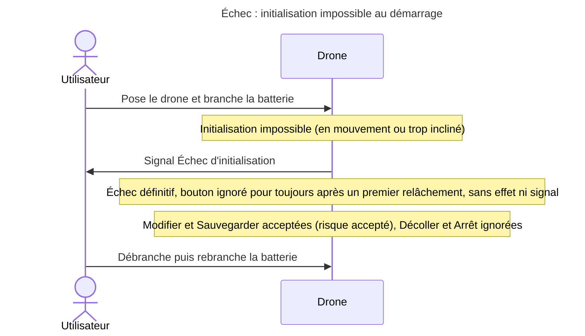

Décisions citées (dont l'effet figure dans ce diagramme ou sa légende) :
- DEC-067 « Démarrage à plat exigé, sinon échec de l'initialisation avec signal »
- DEC-075 « Initialisation en échec : définitive jusqu'au débranchement de la batterie »
- DEC-105 « Initialisation en cours et échec d'initialisation : Modifier et Sauvegarder acceptées, Décoller et Arrêt ignorées »
- DEC-117 « Bouton en échec d'initialisation : ignoré pour toujours après le premier relâchement, aucun effet ni signal »
- DEC-127 « Sauvegarder acceptée à l'état Échec d'initialisation : écrasement des réglages par un tiers, risque accepté »

**Réfs amont :**
- Source : Utilisateur (entretien du 2026-10-27).
- Initialisation : DEC-030 « Drone posé immobile à la mise sous tension ; refus de s'armer si l'initialisation échoue » ; DEC-067 « Démarrage à plat exigé, sinon échec de l'initialisation avec signal » ; DEC-075 « Initialisation en échec : définitive jusqu'au débranchement de la batterie ».
- Information : DEC-005 « Un signal distinct pour chaque information ».
- Bouton : DEC-059 « Bouton déjà enfoncé : ignoré jusqu'au premier relâchement » ; DEC-088 « Bouton coincé ou maintenu en permanence au démarrage : statut sans fil seulement, aucun signal local » ; DEC-117 « Bouton en échec d'initialisation : ignoré pour toujours après le premier relâchement, aucun effet ni signal ».
- Sans fil : DEC-105 « Initialisation en cours et échec d'initialisation : Modifier et Sauvegarder acceptées, Décoller et Arrêt ignorées » ; DEC-120 « Sauvegarder ignorée pendant l'initialisation en cours, Modifier acceptée ; cas de l'échec d'initialisation non tranché » ; DEC-127 « Sauvegarder acceptée à l'état Échec d'initialisation : écrasement des réglages par un tiers, risque accepté » ; DEC-132 « Revue d'ensemble de Sauvegarder : états acceptés confirmés, aucun acquittement ni contrôle d'intégrité ajoutés ».
- Doutes : DOU-112 « Bouton enfoncé jusqu'à la fin de l'initialisation : état et signal ».

**Type :** Échec
**Acteurs :** Utilisateur.
**Situation de départ :** drone hors tension, batterie chargée ; le drone est déplacé pendant son démarrage, posé sur une surface trop inclinée (inclinaison limite à chiffrer en exigences : DEC-067 « Démarrage à plat exigé, sinon échec de l'initialisation avec signal »), ou n'est pas en état de voler.
**Déroulé :**
1. L'utilisateur branche la batterie.
2. Le drone n'arrive pas à s'initialiser.
3. Il ne se déclare pas « allumé, en attente d'un appui », ignore le bouton, qui reste sans effet et sans signal pour toujours après un premier relâchement (DEC-117 « Bouton en échec d'initialisation : ignoré pour toujours après le premier relâchement, aucun effet ni signal »), et informe l'utilisateur avec un signal d'échec d'initialisation distinct des autres. Un bouton enfoncé pendant l'initialisation est ignoré jusqu'à son premier relâchement (DEC-059 « Bouton déjà enfoncé : ignoré jusqu'au premier relâchement »). Si le bouton est coincé ou maintenu en permanence au démarrage, seul le statut sans fil l'indique (l'appareil de suivi affiche « bouton maintenu ») : aucun signal local n'est ajouté et le drone reste silencieux au bouton ; l'utilisateur sans appareil de suivi n'en connaît pas la cause, risque accepté à reporter dans les limites d'emploi (DEC-088 « Bouton coincé ou maintenu en permanence au démarrage : statut sans fil seulement, aucun signal local » ; DEC-125 « Limites d'emploi informées par une notice écrite à la phase besoins, le drone n'affiche rien »).
4. L'échec est définitif jusqu'au débranchement de la batterie, même si le drone se pose ensuite immobile (DEC-075 « Initialisation en échec : définitive jusqu'au débranchement de la batterie »). L'utilisateur débranche puis rebranche la batterie, drone posé immobile et à plat. Un redémarrage après une coupure d'alimentation en vol suit la même règle : « Allumé » seulement si le drone est immobile et à plat (DEC-098 « Redémarrage après une coupure en vol : Allumé seulement si immobile et à plat, sinon échec d'initialisation »). Pendant l'initialisation en cours, Sauvegarder est ignorée (réglages enregistrés pas encore chargés) et Modifier acceptée (DEC-120 « Sauvegarder ignorée pendant l'initialisation en cours, Modifier acceptée ; cas de l'échec d'initialisation non tranché ») ; après un échec d'initialisation, Modifier et Sauvegarder restent acceptées et Décoller et Arrêt sont ignorées (DEC-105 « Initialisation en cours et échec d'initialisation : Modifier et Sauvegarder acceptées, Décoller et Arrêt ignorées ») ; Sauvegarder après un échec est acceptée, un tiers à portée pouvant écraser les réglages enregistrés par des valeurs non chargées : risque accepté (DEC-127 « Sauvegarder acceptée à l'état Échec d'initialisation : écrasement des réglages par un tiers, risque accepté »), à documenter dans les limites d'emploi (DEC-125 « Limites d'emploi informées par une notice écrite à la phase besoins, le drone n'affiche rien »).
**Résultat attendu :** le drone ne peut pas être armé tant que l'initialisation échoue ; le signal « Échec d'initialisation » est observé ; un nouveau démarrage est possible après le débranchement de la batterie.
**Statut :** Proposé

### SCN-011 — Dégradé : coupure d'alimentation en vol

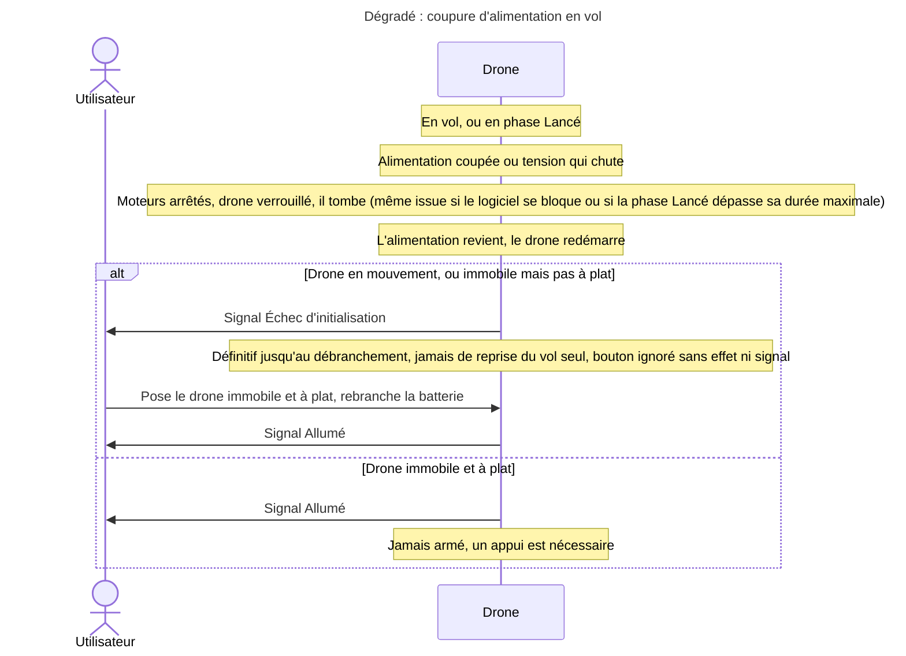

Décisions citées (dont l'effet figure dans ce diagramme ou sa légende) :
- DEC-061 « Redémarrage immobile au sol : allumé mais jamais armé »
- DEC-065 « Logiciel bloqué en vol : coupure des moteurs par un chien de garde »
- DEC-075 « Initialisation en échec : définitive jusqu'au débranchement de la batterie »
- DEC-096 « Chien de garde sur tout état où les moteurs peuvent être alimentés, phase Lancé de durée maximale »
- DEC-097 « Redémarrage ou chute de tension, même en phase Lancé : moteurs arrêtés, drone verrouillé »
- DEC-098 « Redémarrage après une coupure en vol : Allumé seulement si immobile et à plat, sinon échec d'initialisation »
- DEC-103 « Phase Lancé trop longue : coupure et redémarrage par le chien de garde, sans nouvel état ni signal »
- DEC-117 « Bouton en échec d'initialisation : ignoré pour toujours après le premier relâchement, aucun effet ni signal »

**Réfs amont :**
- Source : Utilisateur (entretien du 2026-10-27).
- Redémarrage et initialisation : DEC-018 « Jamais de réarmement automatique ; batterie mesurée à vide à l'armement » ; DEC-030 « Drone posé immobile à la mise sous tension ; refus de s'armer si l'initialisation échoue » ; DEC-061 « Redémarrage immobile au sol : allumé mais jamais armé » ; DEC-067 « Démarrage à plat exigé, sinon échec de l'initialisation avec signal » ; DEC-075 « Initialisation en échec : définitive jusqu'au débranchement de la batterie » ; DEC-098 « Redémarrage après une coupure en vol : Allumé seulement si immobile et à plat, sinon échec d'initialisation ».
- Coupure et chien de garde : DEC-065 « Logiciel bloqué en vol : coupure des moteurs par un chien de garde » ; DEC-096 « Chien de garde sur tout état où les moteurs peuvent être alimentés, phase Lancé de durée maximale » ; DEC-097 « Redémarrage ou chute de tension, même en phase Lancé : moteurs arrêtés, drone verrouillé » ; DEC-103 « Phase Lancé trop longue : coupure et redémarrage par le chien de garde, sans nouvel état ni signal ».
- Après la coupure : DEC-023 « Après le posé ou une coupure : drone verrouillé, nouvel appui pour revoler ».
- Information : DEC-005 « Un signal distinct pour chaque information ».
- Sous-tension : DEC-126 « Protection de sous-tension de la batterie : scénario court, coupure sans signal propre ».

**Type :** Dégradé
**Acteurs :** Utilisateur.
**Situation de départ :** drone en vol (stabilisation, stationnaire ou atterrissage), ou en phase « Lancé » avant le démarrage des moteurs. Un lancer vigoureux, un choc ou une batterie trop faible coupent l'alimentation ou la font chuter ; la sous-tension de la batterie a son propre scénario : SCN-012 « Dégradé : sous-tension de la batterie » (DEC-126 « Protection de sous-tension de la batterie : scénario court, coupure sans signal propre »). Le logiciel peut aussi se bloquer en vol (DEC-065 « Logiciel bloqué en vol : coupure des moteurs par un chien de garde »).
**Déroulé :**
1. L'alimentation du drone est coupée ou sa tension chute, y compris en phase « Lancé » : les moteurs s'arrêtent, le drone est verrouillé (même état que « Allumé, en attente d'un appui » : DEC-047 « L'état verrouillé est le même que l'état allumé, en attente d'un appui ») et il tombe s'il est en l'air (DEC-097 « Redémarrage ou chute de tension, même en phase Lancé : moteurs arrêtés, drone verrouillé »). Hypothèse à valider par l'architecture matérielle : l'alimentation des moteurs garantit leur arrêt.
2. Si l'alimentation revient, le drone redémarre. Il ne reprend jamais le vol seul, même si le bouton est appuyé. Un logiciel bloqué est traité de la même façon : un mécanisme indépendant du logiciel coupe les moteurs, puis le drone redémarre (DEC-065 « Logiciel bloqué en vol : coupure des moteurs par un chien de garde »). Il en va de même si la phase « Lancé » dépasse sa durée maximale sans démarrage des moteurs : le chien de garde coupe et redémarre le drone, sans nouvel état ni signal (DEC-103 « Phase Lancé trop longue : coupure et redémarrage par le chien de garde, sans nouvel état ni signal »).
3. S'il est en mouvement, ou immobile mais pas à plat (tombé sur la tranche, retourné), il ne peut pas s'initialiser (DEC-030 « Drone posé immobile à la mise sous tension ; refus de s'armer si l'initialisation échoue » ; DEC-067 « Démarrage à plat exigé, sinon échec de l'initialisation avec signal ») : il donne le signal d'échec d'initialisation et ignore le bouton, sans effet ni signal après un premier relâchement (DEC-117 « Bouton en échec d'initialisation : ignoré pour toujours après le premier relâchement, aucun effet ni signal ») ; cet échec est définitif jusqu'au débranchement de la batterie (DEC-075 « Initialisation en échec : définitive jusqu'au débranchement de la batterie »). S'il revient immobile et à plat, l'initialisation réussit : il donne le signal « Allumé », n'est pas armé, et il n'est pas nécessaire de débrancher la batterie (DEC-061 « Redémarrage immobile au sol : allumé mais jamais armé » ; DEC-098 « Redémarrage après une coupure en vol : Allumé seulement si immobile et à plat, sinon échec d'initialisation »).
4. L'utilisateur pose le drone immobile et à plat et rebranche la batterie ; le drone est alors allumé et en attente d'un appui, et un appui de 2 secondes est nécessaire pour l'armer.
**Résultat attendu :** moteurs arrêtés ; le drone n'a jamais repris le vol seul ; après le retour de l'alimentation, le signal observé est « Allumé » si le drone est immobile et à plat, « Échec d'initialisation » sinon (le drone doit alors être redémarré posé, immobile et à plat).
**Statut :** Proposé

### SCN-012 — Dégradé : sous-tension de la batterie

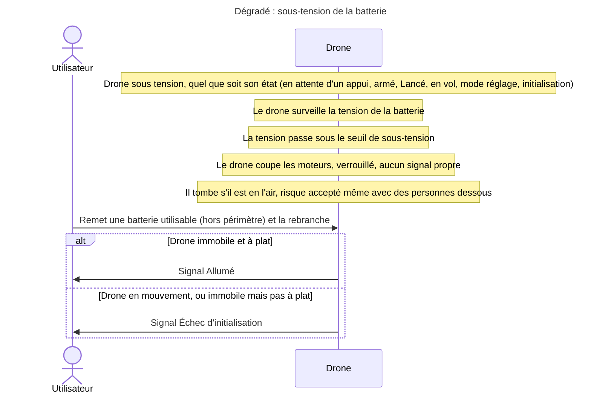

Décisions citées (dont l'effet figure dans ce diagramme ou sa légende) :
- DEC-075 « Initialisation en échec : définitive jusqu'au débranchement de la batterie »
- DEC-097 « Redémarrage ou chute de tension, même en phase Lancé : moteurs arrêtés, drone verrouillé »
- DEC-098 « Redémarrage après une coupure en vol : Allumé seulement si immobile et à plat, sinon échec d'initialisation »
- DEC-111 « Batterie et programmation : hors périmètre des scénarios, limites d'emploi à documenter »
- DEC-126 « Protection de sous-tension de la batterie : scénario court, coupure sans signal propre »
- DEC-133 « SCN-012 inclut le drone laissé allumé en attente d'un appui : sous-tension dans le périmètre »
- DEC-134 « Coupure sur sous-tension en vol assumée par le logiciel : le drone surveille la tension »
- DEC-135 « Chute en vol sur sous-tension, sans signal, avec des personnes dessous : risque accepté »

**Réfs amont :**
- Source : Utilisateur (entretien du 2026-10-28).
- Sous-tension : DEC-126 « Protection de sous-tension de la batterie : scénario court, coupure sans signal propre » ; DEC-111 « Batterie et programmation : hors périmètre des scénarios, limites d'emploi à documenter » (modifiée par DEC-126 « Protection de sous-tension de la batterie : scénario court, coupure sans signal propre » pour la protection de sous-tension, puis par DEC-133 « SCN-012 inclut le drone laissé allumé en attente d'un appui : sous-tension dans le périmètre » pour le drone laissé allumé) ; DEC-133 « SCN-012 inclut le drone laissé allumé en attente d'un appui : sous-tension dans le périmètre » ; DEC-134 « Coupure sur sous-tension en vol assumée par le logiciel : le drone surveille la tension » ; DEC-135 « Chute en vol sur sous-tension, sans signal, avec des personnes dessous : risque accepté ».
- Coupure et redémarrage : DEC-097 « Redémarrage ou chute de tension, même en phase Lancé : moteurs arrêtés, drone verrouillé » ; DEC-098 « Redémarrage après une coupure en vol : Allumé seulement si immobile et à plat, sinon échec d'initialisation » ; DEC-075 « Initialisation en échec : définitive jusqu'au débranchement de la batterie » ; DEC-023 « Après le posé ou une coupure : drone verrouillé, nouvel appui pour revoler » ; DEC-079 « Sortie du mode réglage : uniquement en enlevant la batterie ».
- Batterie : DEC-004 « Batterie vérifiée à l'armement : pas d'armement si batterie faible » ; DEC-013 « Pas de contrôle de la batterie en vol » (modifiée par DEC-134 « Coupure sur sous-tension en vol assumée par le logiciel : le drone surveille la tension »).
- Information : DEC-005 « Un signal distinct pour chaque information ».
- Doutes ouverts liés : DOU-058 « Valeurs d'origine, bornes numériques, tolérance d'immobile et durées à fixer en architecture » ; DOU-108 « Rapport entre le seuil d'armement et le seuil de sous-tension, affaissement de tension au démarrage des moteurs » ; DOU-109 « Batterie déjà déchargée : redémarrages répétés, décharge profonde et état après une coupure logicielle » ; DOU-013 « Quelle durée de vol garantit-on après un armement accepté ? ».

**Type :** Dégradé
**Acteurs :** Utilisateur.
**Situation de départ :**
- Drone sous tension, dont la batterie se décharge jusqu'au seuil de sous-tension, dans l'un des états suivants (DEC-133 « SCN-012 inclut le drone laissé allumé en attente d'un appui : sous-tension dans le périmètre ») : en attente d'un appui (drone laissé allumé), série d'appuis en cours, premier appui validé, armé, phase « Lancé », en vol (stabilisation, stationnaire ou atterrissage), vol de réglage, mode réglage, initialisation.
- Le seuil de sous-tension est une valeur à fixer en architecture (DOU-058 « Valeurs d'origine, bornes numériques, tolérance d'immobile et durées à fixer en architecture »).
- Hors de ce scénario : la charge, le remplacement et le stockage de la batterie (DEC-111 « Batterie et programmation : hors périmètre des scénarios, limites d'emploi à documenter ») ; la surintensité, l'inversion de polarité, la surchauffe de la batterie et la CEM, non couvertes, à voir en architecture (DEC-126 « Protection de sous-tension de la batterie : scénario court, coupure sans signal propre »).
**Déroulé :**
1. La tension de la batterie passe sous le seuil de sous-tension (décharge profonde) ; le drone la surveille.
2. Le drone coupe ses moteurs : la coupure est assumée par le logiciel (DEC-134 « Coupure sur sous-tension en vol assumée par le logiciel : le drone surveille la tension »). Il est verrouillé, jamais armé tout seul, et il tombe s'il est en l'air, y compris si la tension passe sous le seuil pendant le lancer, moteurs non encore démarrés. Aucun signal propre, aucun nouveau signal (DEC-126 « Protection de sous-tension de la batterie : scénario court, coupure sans signal propre » ; DEC-097 « Redémarrage ou chute de tension, même en phase Lancé : moteurs arrêtés, drone verrouillé »). Le mode réglage, s'il était entré, est perdu au redémarrage (DEC-079 « Sortie du mode réglage : uniquement en enlevant la batterie »).
3. Si l'alimentation revient (batterie remplacée ou rechargée par l'utilisateur, hors périmètre), le drone redémarre selon DEC-098 « Redémarrage après une coupure en vol : Allumé seulement si immobile et à plat, sinon échec d'initialisation » : « Allumé » s'il est immobile et à plat, sinon « Échec d'initialisation », définitif jusqu'au débranchement (DEC-075 « Initialisation en échec : définitive jusqu'au débranchement de la batterie »). Il ne reprend jamais le vol seul.
**Résultat attendu :**
- Moteurs arrêtés, aucun signal propre, drone verrouillé et jamais armé tout seul.
- Après le retour de l'alimentation, le signal observé est « Allumé » si le drone est immobile et à plat, « Échec d'initialisation » sinon (DEC-098 « Redémarrage après une coupure en vol : Allumé seulement si immobile et à plat, sinon échec d'initialisation »).
- Risque accepté, à reporter dans les limites d'emploi (DEC-125 « Limites d'emploi informées par une notice écrite à la phase besoins, le drone n'affiche rien ») : un drone en vol chute sur sous-tension, sans signal, avec des personnes dessous, y compris pendant le lancer (DEC-135 « Chute en vol sur sous-tension, sans signal, avec des personnes dessous : risque accepté ») ; la protection d'un drone laissé allumé contre la décharge profonde n'est pas garantie suffisante. Voir « Risques acceptés » — `projets/boomrone/risques-acceptes.md` (lignes 17, 32 et 35).
**Statut :** Proposé

<!-- Ajouter les scénarios ci-dessous, au même format, en dehors des blocs de code. -->
