# Scénarios d'utilisation

> **Aperçu** : Boomrone est un drone de poche pour adultes, lancé à la main dans un appartement (gymnase et jardin en essais complémentaires) ; il se stabilise, reste 10 s en stationnaire, atterrit doucement et informe l'utilisateur à chaque étape.
> - **État** : SCN-001 « Vol nominal : de la batterie au posé » à SCN-011 « Dégradé : coupure d'alimentation en vol », statut Proposé, porte « scénarios » à franchir ; 0 doute bloquant ouvert, 27 non bloquants (voir `registre-doutes.md`).
> - **Valeurs provisoires** : seuils du bouton, délai de 2 s du stationnaire, plage de lancer, angle limite de 60° ; à confirmer avant la porte « exigences » (DEC-052 « Valeurs provisoires retenues pour les scénarios, à confirmer avant les exigences » ; DOU-080 « Seuils de temps du bouton : 1 s, 2 s, 10 s et délai entre appuis » ; DOU-058 « Valeurs d'origine et bornes numériques à fixer en architecture »).
> - **Nature** : les scénarios décrivent l'intention, sans solution technique (DEC-053 « Solutions techniques déplacées en propositions d'architecture, seule l'intention reste décidée »).
> - **Détail** des décisions du 2026-10-28, de DEC-054 « Chrono de 10 secondes compté depuis l'appui initial » à DEC-092 « Garde du bouton après le lancer : fronts ignorés, niveau pris en compte, démarrage au relâchement » : voir `reprise.md`.

## Vue d'ensemble

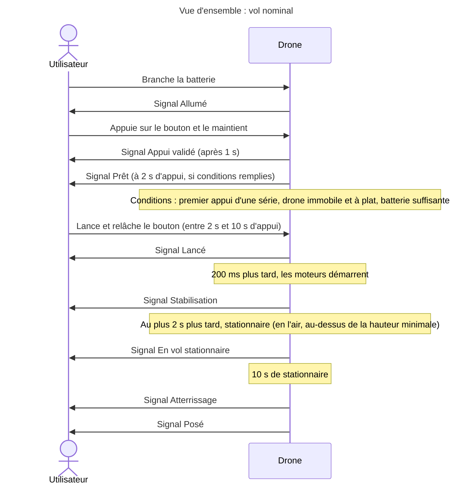

Décisions citées :
- DEC-009 « Stationnaire atteint en 2 secondes maximum après le démarrage des moteurs »
- DEC-049 « Stationnaire déclaré seulement en l'air, au-dessus d'une hauteur minimale »
- DEC-052 « Valeurs provisoires retenues pour les scénarios, à confirmer avant les exigences »
- DEC-070 « Appui validé : bouton maintenu 1 seconde, rien en dessous, plus de signal Appui trop court »
- DEC-072 « Armement à 2 secondes d'appui : signal Prêt, ou signal unique Armement refusé selon l'état du drone »
- DEC-073 « Armé entre 2 et 10 secondes d'appui : le relâchement donne le signal Lancé, les moteurs démarrent 200 ms plus tard »

Ce premier diagramme montre le vol nominal. Les trois suivants montrent les états du drone et chaque signal donné à l'utilisateur, y compris pour les échecs et les cas dégradés, en une idée par diagramme : (a) mise sous tension, appuis, armement, lancer et vol normal jusqu'au posé ; (b) coupures en vol, arrêts d'urgence, verrouillage et retours à l'attente ; (c) mode réglage et vol de réglage. Les hexagones en pointillés sont des renvois vers un autre diagramme.

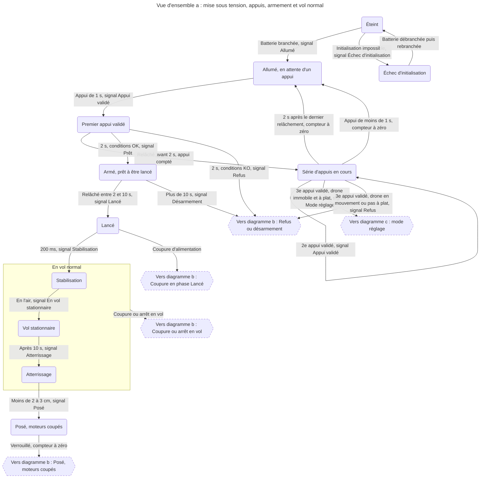

Légende du diagramme a : chaque transition indique l'événement puis le signal donné à l'utilisateur. Le 2e appui validé d'une série donne le signal « Appui validé » et reste dans « Série d'appuis en cours » ; le maintenir au-delà de 2 s ne fait rien. Le bouton encore enfoncé après un refus, un désarmement ou un posé est traité dans le diagramme b. Le 3e appui validé n'entre en mode réglage que si le drone est immobile et à plat, non armé (DEC-085 « Entrée en mode réglage : drone immobile et à plat, non armé, sans condition de posé ») ; sinon le mode réglage est refusé avec le signal « Refus » et le drone reste en mode normal, non armé (DEC-090 « Troisième appui validé sur un drone non immobile ou pas à plat : mode réglage refusé avec le signal Refus »). Le retour à l'attente, compteur à zéro, qui suit ce refus a été confirmé par l'utilisateur le 2026-10-28 (DOU-091 « Compteur d'appuis après un mode réglage refusé : retour à l'attente, compteur à zéro ? » ; DEC-093 « Mode réglage refusé : retour à l'attente, compteur à zéro, bouton encore enfoncé ignoré »). Un appui de moins de 1 s au milieu d'une série remet le compteur à zéro (DEC-089 « Appui de moins de 1 s au milieu d'une série d'appuis : compteur remis à zéro »). Pendant « Lancé », avant le démarrage des moteurs, l'arrêt et les commandes sans fil sont ignorés. « Vol stationnaire » exige d'être en l'air, au-dessus de la hauteur minimale. La coupure d'alimentation en phase « Lancé » reste à définir (renvoi « Coupure en phase Lancé » vers le diagramme b).

Décisions citées :
- DEC-049 « Stationnaire déclaré seulement en l'air, au-dessus d'une hauteur minimale »
- DEC-052 « Valeurs provisoires retenues pour les scénarios, à confirmer avant les exigences »
- DEC-054 « Chrono de 10 secondes compté depuis l'appui initial »
- DEC-062 « Arrêt ignoré pendant la phase Lancé, avant le démarrage des moteurs »
- DEC-067 « Démarrage à plat exigé, sinon échec de l'initialisation avec signal »
- DEC-069 « Commandes sans fil reçues pendant la phase Lancé : ignorées »
- DEC-070 « Appui validé : bouton maintenu 1 seconde, rien en dessous, plus de signal Appui trop court »
- DEC-071 « Appuis validés d'affilée : trois appuis entrent en mode réglage sans armer, le bouton n'arme jamais en mode réglage »
- DEC-072 « Armement à 2 secondes d'appui : signal Prêt, ou signal unique Armement refusé selon l'état du drone »
- DEC-073 « Armé entre 2 et 10 secondes d'appui : le relâchement donne le signal Lancé, les moteurs démarrent 200 ms plus tard »
- DEC-075 « Initialisation en échec : définitive jusqu'au débranchement de la batterie »
- DEC-076 « Armement possible seulement depuis le premier appui d'une série, sans effet du maintien pendant la série »
- DEC-085 « Entrée en mode réglage : drone immobile et à plat, non armé, sans condition de posé »
- DEC-083 « Annulation d'un armement : le maintien jusqu'au désarmement à 10 s reste la seule annulation »
- DEC-089 « Appui de moins de 1 s au milieu d'une série d'appuis : compteur remis à zéro »
- DEC-090 « Troisième appui validé sur un drone non immobile ou pas à plat : mode réglage refusé avec le signal Refus »
- DEC-091 « Un seul signal Refus pour tout refus, armement ou mode réglage »
- DOU-091 « Compteur d'appuis après un mode réglage refusé : retour à l'attente, compteur à zéro ? »
- DEC-093 « Mode réglage refusé : retour à l'attente, compteur à zéro, bouton encore enfoncé ignoré »
- DEC-021 « Atterrissage lent, 15 secondes maximum, puis coupure des moteurs »
- DEC-022 « Moteurs coupés à moins de 2 à 3 cm du sol »
- DOU-075 « Le chien de garde couvre-t-il la phase Lancé, et cette phase a-t-elle une durée maximale ? »

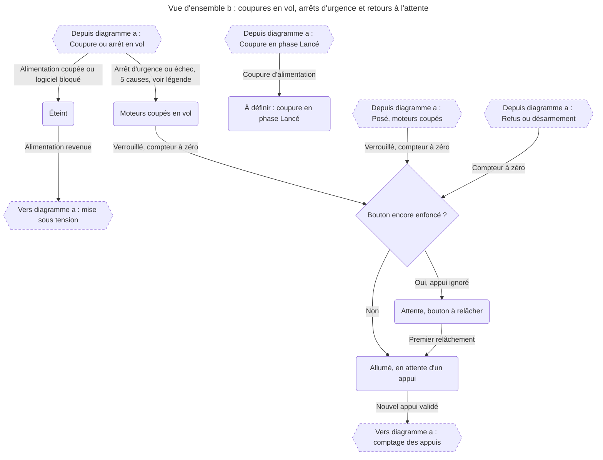

Légende du diagramme b : les noms des renvois sont les mêmes dans les diagrammes a et b. Les sorties de « Posé » et de « Moteurs coupés en vol » vont vers « Allumé, en attente d'un appui », car l'état verrouillé est le même ; un nouvel appui de 2 secondes réarme le drone, mais seul le premier appui d'une série arme (DEC-076 « Armement possible seulement depuis le premier appui d'une série, sans effet du maintien pendant la série »). Les cinq coupures en vol ont chacune leur signal : stationnaire non atteint à temps (Échec de stabilisation) ; bouton appuyé après la garde du lancer, ou encore enfoncé à la fin de cette garde (Arrêt par le bouton ; filtré par un anti-rebond de quelques millisecondes seulement : DEC-087 « Arrêt d'urgence par le bouton en vol : anti-rebond très court seulement, arrêt quasi immédiat » ; garde au niveau : DEC-092 « Garde du bouton après le lancer : fronts ignorés, niveau pris en compte, démarrage au relâchement ») ; commande d'arrêt sans fil (Arrêt sans fil) ; drone très incliné ou retourné après le stationnaire (Basculement) ; 15 s d'atterrissage écoulées sans passage sous 2 à 3 cm du sol (Délai de descente dépassé). Après une coupure d'alimentation ou un logiciel bloqué, le drone redémarre : immobile au sol, il est « Allumé » et jamais armé ; en mouvement, il passe en « Échec d'initialisation », définitif jusqu'au débranchement (diagramme a). Le bouton encore enfoncé est ignoré jusqu'à son premier relâchement ; l'appui long n'est pas compté ; ensuite un nouvel appui peut armer tout de suite. La coupure d'alimentation en phase « Lancé » (avant le démarrage des moteurs) est à définir. Après un mode réglage refusé au 3e appui (signal « Refus »), le retour à l'attente suit la même logique que le refus d'armement (« Refus ou désarmement ») , confirmé par l'utilisateur le 2026-10-28 (DOU-091 « Compteur d'appuis après un mode réglage refusé : retour à l'attente, compteur à zéro ? » ; DEC-093 « Mode réglage refusé : retour à l'attente, compteur à zéro, bouton encore enfoncé ignoré »).

Décisions citées :
- DEC-002 « Couper les moteurs si le stationnaire n'est pas atteint dans le délai »
- DEC-012 « Couper les moteurs si le drone bascule après le stationnaire »
- DEC-023 « Après le posé ou une coupure : drone verrouillé, nouvel appui pour revoler »
- DEC-031 « Arrêt du drone lancé : bouton et commande d'arrêt sans fil »
- DEC-046 « Délai de descente dépassé : signal distinct, moteurs coupés, drone verrouillé »
- DEC-047 « L'état verrouillé est le même que l'état allumé, en attente d'un appui »
- DEC-050 « Appui en cours lors d'une coupure des moteurs ignoré jusqu'au relâchement »
- DEC-055 « Bouton ignoré pendant une courte garde après le lancer »
- DEC-059 « Bouton déjà enfoncé : ignoré jusqu'au premier relâchement »
- DEC-061 « Redémarrage immobile au sol : allumé mais jamais armé »
- DEC-065 « Logiciel bloqué en vol : coupure des moteurs par un chien de garde »
- DEC-075 « Initialisation en échec : définitive jusqu'au débranchement de la batterie »
- DEC-080 « Armement refusé ou désarmement : retour à l'attente, compteur à zéro, l'appui long n'est pas compté »
- DEC-081 « Bouton encore enfoncé après un refus ou un désarmement : ignoré jusqu'au premier relâchement, puis nouvel appui possible tout de suite »
- DEC-076 « Armement possible seulement depuis le premier appui d'une série, sans effet du maintien pendant la série »
- DEC-082 « Retours à l'attente après le posé ou une coupure des moteurs : compteur à zéro, appui en cours ni pris en compte ni compté »
- DEC-087 « Arrêt d'urgence par le bouton en vol : anti-rebond très court seulement, arrêt quasi immédiat »
- DEC-092 « Garde du bouton après le lancer : fronts ignorés, niveau pris en compte, démarrage au relâchement »
- DOU-091 « Compteur d'appuis après un mode réglage refusé : retour à l'attente, compteur à zéro ? »
- DEC-093 « Mode réglage refusé : retour à l'attente, compteur à zéro, bouton encore enfoncé ignoré »
- DOU-075 « Le chien de garde couvre-t-il la phase Lancé, et cette phase a-t-elle une durée maximale ? »

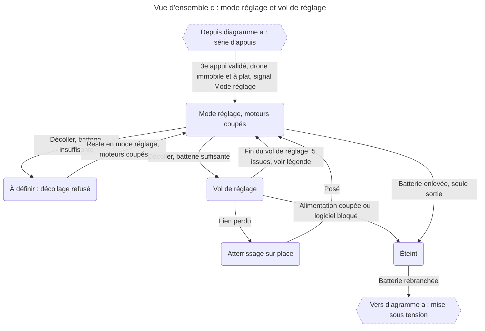

Légende du diagramme c : l'entrée en mode réglage exige un drone immobile et à plat, non armé (DEC-085 « Entrée en mode réglage : drone immobile et à plat, non armé, sans condition de posé ») ; en mode réglage le bouton n'arme jamais ; la seule sortie est d'enlever la batterie. Les cinq issues d'un vol de réglage sont : posé après 3 s de stationnaire ; arrêt par le bouton ou sans fil ; échec de stabilisation ; basculement ; délai de 15 s après le décollage. Après un vol de réglage, quelle qu'en soit l'issue, le drone revient en mode réglage, moteurs coupés, sans verrouillage, prêt à redécoller sur commande sans fil. La commande Décoller ne vérifie que la batterie, sans condition de position : un appareil à portée peut faire décoller un drone retourné ou tenu en main, risque accepté (DEC-086 « Décollage de réglage : batterie seulement, risque cumulé avec les décisions sans appairage et sans verrouillage accepté »). Les moteurs sont coupés au plus 15 s après le décollage. Le bouton appuyé en vol de réglage est un arrêt d'urgence, filtré par un anti-rebond de quelques millisecondes seulement (DEC-087 « Arrêt d'urgence par le bouton en vol : anti-rebond très court seulement, arrêt quasi immédiat »). Un 3e appui validé sur un drone en mouvement ou pas à plat n'entre pas en mode réglage : signal « Refus » (DEC-090 « Troisième appui validé sur un drone non immobile ou pas à plat : mode réglage refusé avec le signal Refus », diagramme a). Les signaux de chaque transition du vol de réglage (posé, bouton, arrêt sans fil, échec, basculement, lien perdu) et le délai de perte du lien sont à définir ou à confirmer ; le signal de refus de décollage et le contenu du statut sans fil sont à définir ; l'existence d'une garde du bouton après le décollage de réglage n'est pas décidée ; la relation entre l'atterrissage sur lien perdu et le délai de 15 s n'est pas précisée.

Décisions citées :
- DEC-028 « Mode réglage : décollage depuis le sol sur commande sans fil »
- DEC-029 « Vol de réglage : stationnaire de 3 secondes, atterrissage sur place si le lien est perdu »
- DEC-039 « Réglages : coupures valables en vol de réglage, aucune borne, modifiables aussi en vol normal »
- DEC-043 « Commandes sans fil acceptées selon l'état du drone »
- DEC-044 « Mode réglage persistant : retour au mode réglage après un vol de réglage, sans verrouillage »
- DEC-065 « Logiciel bloqué en vol : coupure des moteurs par un chien de garde »
- DEC-071 « Appuis validés d'affilée : trois appuis entrent en mode réglage sans armer, le bouton n'arme jamais en mode réglage »
- DEC-074 « Décollage en mode réglage : la batterie est vérifiée, rien d'autre »
- DEC-077 « Bouton appuyé en vol de réglage : arrêt d'urgence, moteurs coupés, le drone reste en mode réglage »
- DEC-078 « Garde du bouton après le lancer : attachée au lancer au relâchement, pas décidée pour le décollage de réglage »
- DEC-079 « Sortie du mode réglage : uniquement en enlevant la batterie »
- DEC-085 « Entrée en mode réglage : drone immobile et à plat, non armé, sans condition de posé »
- DEC-086 « Décollage de réglage : batterie seulement, risque cumulé avec les décisions sans appairage et sans verrouillage accepté »
- DEC-087 « Arrêt d'urgence par le bouton en vol : anti-rebond très court seulement, arrêt quasi immédiat »
- DEC-090 « Troisième appui validé sur un drone non immobile ou pas à plat : mode réglage refusé avec le signal Refus »
- DEC-091 « Un seul signal Refus pour tout refus, armement ou mode réglage »
- DEC-064 « Main près des hélices en mode réglage : risque accepté et documenté »
- DEC-037 « Pas d'appairage : le drone obéit à tout appareil de suivi à portée »
- DOU-036 « Après quel délai le lien sans fil est-il considéré comme perdu ? »
- DOU-053 « Quels signaux pour les vols de réglage et pour le lien perdu ? »
- DOU-083 « Contenu du statut sans fil d'un armement ou d'un décollage refusé »
- DOU-084 « Garde du bouton après le décollage de réglage ? »

Complément aux légendes des diagrammes d'états a, b et c : chaque transition indique l'événement puis le signal donné à l'utilisateur. Les sorties de « Posé » et de « Moteurs coupés en vol » vont vers « Allumé, en attente d'un appui », car l'état verrouillé est le même (DEC-047 « L'état verrouillé est le même que l'état allumé, en attente d'un appui ») ; un nouvel appui de 2 secondes réarme le drone (DEC-023 « Après le posé ou une coupure : drone verrouillé, nouvel appui pour revoler »). Un appui sur le bouton déjà en cours au moment de la coupure des moteurs est ignoré jusqu'au relâchement : seul un nouvel appui distinct arme le drone (DEC-050 « Appui en cours lors d'une coupure des moteurs ignoré jusqu'au relâchement »). Le drone ne s'arme que depuis l'état « Premier appui validé » : une fois le premier appui relâché avant 2 s, aucun appui de la série ne peut armer, et maintenir le 2e appui au-delà de 2 s ne fait rien (DEC-076 « Armement possible seulement depuis le premier appui d'une série, sans effet du maintien pendant la série »). Après un armement refusé ou un désarmement, le drone revient à l'attente avec le compteur à zéro, l'appui long n'est pas compté, le bouton encore enfoncé est ignoré jusqu'au premier relâchement, puis un nouvel appui peut armer tout de suite (DEC-080 « Armement refusé ou désarmement : retour à l'attente, compteur à zéro, l'appui long n'est pas compté » ; DEC-081 « Bouton encore enfoncé après un refus ou un désarmement : ignoré jusqu'au premier relâchement, puis nouvel appui possible tout de suite ») ; même logique après le posé ou une coupure des moteurs (DEC-082 « Retours à l'attente après le posé ou une coupure des moteurs : compteur à zéro, appui en cours ni pris en compte ni compté »). Un bouton appuyé en vol de réglage est un arrêt d'urgence : moteurs coupés, le drone reste en mode réglage ; le signal donné reste à confirmer (DEC-077 « Bouton appuyé en vol de réglage : arrêt d'urgence, moteurs coupés, le drone reste en mode réglage » ; DOU-053 « Quels signaux pour les vols de réglage et pour le lien perdu ? »). Les commandes sans fil acceptées dans chaque état sont décrites dans le tableau ci-dessous (DEC-043 « Commandes sans fil acceptées selon l'état du drone »). Après un vol de réglage, le drone revient en mode réglage, posé, sans verrouillage (DEC-044 « Mode réglage persistant : retour au mode réglage après un vol de réglage, sans verrouillage ») ; il en va de même après un arrêt, un échec ou un basculement en vol de réglage : le drone est prêt à redécoller tout de suite sur commande sans fil (confirmé par l'utilisateur le 2026-10-27, DEC-044 « Mode réglage persistant : retour au mode réglage après un vol de réglage, sans verrouillage »).

Précisions des décisions du 2026-10-28 (DEC-054 « Chrono de 10 secondes compté depuis l'appui initial » à DEC-092 « Garde du bouton après le lancer : fronts ignorés, niveau pris en compte, démarrage au relâchement ») :

- Le chrono de 10 secondes du désarmement compte depuis l'appui initial (DEC-054 « Chrono de 10 secondes compté depuis l'appui initial »).
- Après le lancer, tout appui ou relâchement du bouton est ignoré pendant une courte garde (DEC-055 « Bouton ignoré pendant une courte garde après le lancer »). La garde commence au relâchement du bouton, ignore les fronts mais pas le niveau : un bouton encore enfoncé à sa fin est un arrêt d'urgence (DEC-092 « Garde du bouton après le lancer : fronts ignorés, niveau pris en compte, démarrage au relâchement »).
- L'armement exige un drone immobile et à plat, au sol ou dans la main, sans autotest (DEC-056 « Armement : drone immobile, sans autotest » ; DEC-072 « Armement à 2 secondes d'appui : signal Prêt, ou signal unique Armement refusé selon l'état du drone »).
- Un bouton déjà enfoncé à la mise sous tension, pendant l'initialisation ou après le désarmement est ignoré jusqu'au premier relâchement (DEC-059 « Bouton déjà enfoncé : ignoré jusqu'au premier relâchement »).
- Un drone qui redémarre immobile au sol après une coupure en vol est « Allumé », jamais armé (DEC-061 « Redémarrage immobile au sol : allumé mais jamais armé »).
- Pendant la phase « Lancé », avant le démarrage des moteurs, l'arrêt et toutes les commandes sans fil sont ignorés (DEC-062 « Arrêt ignoré pendant la phase Lancé, avant le démarrage des moteurs » ; DEC-069 « Commandes sans fil reçues pendant la phase Lancé : ignorées »).
- Un logiciel bloqué en vol est coupé par un mécanisme indépendant, puis le drone redémarre (DEC-065 « Logiciel bloqué en vol : coupure des moteurs par un chien de garde »).
- Le démarrage exige un drone à plat (DEC-067 « Démarrage à plat exigé, sinon échec de l'initialisation avec signal »), et une initialisation en échec est définitive jusqu'au débranchement de la batterie (DEC-075 « Initialisation en échec : définitive jusqu'au débranchement de la batterie »).
- L'armement n'est possible que depuis le premier appui d'une série (compteur à 1) : premier appui relâché avant 2 s, plus aucun appui de la série n'arme ; 2e appui maintenu au-delà de 2 s, ni armement, ni signal, ni annulation ; 2 s sans nouvel appui, compteur à zéro et armement de nouveau possible (DEC-076 « Armement possible seulement depuis le premier appui d'une série, sans effet du maintien pendant la série »).
- Après un armement refusé ou un désarmement (plus de 10 s) : retour à « Allumé, en attente d'un appui », compteur à zéro, l'appui long n'est pas compté ; le bouton encore enfoncé est ignoré jusqu'au premier relâchement, puis un nouvel appui peut armer immédiatement (DEC-080 « Armement refusé ou désarmement : retour à l'attente, compteur à zéro, l'appui long n'est pas compté » ; DEC-081 « Bouton encore enfoncé après un refus ou un désarmement : ignoré jusqu'au premier relâchement, puis nouvel appui possible tout de suite »). Même logique après le posé ou une coupure des moteurs (DEC-082 « Retours à l'attente après le posé ou une coupure des moteurs : compteur à zéro, appui en cours ni pris en compte ni compté »).
- Bouton appuyé en vol de réglage : arrêt d'urgence, le drone reste en mode réglage (DEC-077 « Bouton appuyé en vol de réglage : arrêt d'urgence, moteurs coupés, le drone reste en mode réglage »). La garde de DEC-055 « Bouton ignoré pendant une courte garde après le lancer » ne vaut qu'après un lancer au relâchement ; pour le décollage de réglage, voir DOU-084 « Garde du bouton après le décollage de réglage ? » (DEC-078 « Garde du bouton après le lancer : attachée au lancer au relâchement, pas décidée pour le décollage de réglage »). Sortie du mode réglage uniquement en enlevant la batterie (DEC-079 « Sortie du mode réglage : uniquement en enlevant la batterie »).
- Modèle du bouton (décisions du 2026-10-28) : un appui maintenu 1 s est un appui validé, avec son signal, et moins de 1 s ne fait rien (DEC-070 « Appui validé : bouton maintenu 1 seconde, rien en dessous, plus de signal Appui trop court ») ; les appuis validés comptent d'affilée si l'écart entre deux est d'environ 2 s au plus, et trois appuis entrent en mode réglage sans armer (DEC-071 « Appuis validés d'affilée : trois appuis entrent en mode réglage sans armer, le bouton n'arme jamais en mode réglage ») ; à 2 s d'appui au total, le drone s'arme (signal Prêt) ou refuse (signal Refus) (DEC-072 « Armement à 2 secondes d'appui : signal Prêt, ou signal unique Armement refusé selon l'état du drone ») ; relâché entre 2 s et 10 s, le drone donne le signal Lancé, puis les moteurs démarrent 200 ms plus tard, même sans vrai lancer (DEC-073 « Armé entre 2 et 10 secondes d'appui : le relâchement donne le signal Lancé, les moteurs démarrent 200 ms plus tard »).
- Réponses de l'utilisateur du 2026-10-28 sur les risques du bouton : la seule annulation d'un armement est de rester appuyé jusqu'au désarmement à 10 s (DEC-083 « Annulation d'un armement : le maintien jusqu'au désarmement à 10 s reste la seule annulation ») ; un appui ignoré pendant une série ne donne aucun signal (DEC-084 « Appui ignoré pendant une série d'appuis : aucun signal, risque accepté et documenté ») ; l'entrée en mode réglage exige un drone immobile et à plat, non armé, le mot « posé » n'étant plus une condition (DEC-085 « Entrée en mode réglage : drone immobile et à plat, non armé, sans condition de posé »). Dans le tableau des commandes, l'état « Mode réglage, posé » désigne seulement le drone au sol, moteurs coupés, après un vol de réglage : le drone ne détecte pas qu'il est posé (DEC-057 « Pas de détection dédiée d'un drone attrapé ou posé sur un obstacle »).
- Décollage de réglage : la commande Décoller ne vérifie que la batterie ; le risque cumulé de l'absence d'appairage, du retour immédiat en mode réglage et de cette absence de condition est accepté (DEC-086 « Décollage de réglage : batterie seulement, risque cumulé avec les décisions sans appairage et sans verrouillage accepté »).
- Réponses de l'utilisateur du 2026-10-28 sur l'arrêt d'urgence, le bouton coincé et les refus : en vol, le bouton n'est filtré que par un anti-rebond de quelques millisecondes (DEC-087 « Arrêt d'urgence par le bouton en vol : anti-rebond très court seulement, arrêt quasi immédiat ») ; un bouton coincé ou maintenu au démarrage n'est signalé que par le statut sans fil (DEC-088 « Bouton coincé ou maintenu en permanence au démarrage : statut sans fil seulement, aucun signal local ») ; un appui de moins de 1 s au milieu d'une série remet le compteur à zéro (DEC-089 « Appui de moins de 1 s au milieu d'une série d'appuis : compteur remis à zéro ») ; un 3e appui validé sur un drone en mouvement ou pas à plat est refusé avec le signal « Refus » (DEC-090 « Troisième appui validé sur un drone non immobile ou pas à plat : mode réglage refusé avec le signal Refus ») ; ce signal est unique pour tout refus (DEC-091 « Un seul signal Refus pour tout refus, armement ou mode réglage ») ; la garde du lancer ignore les fronts, pas le niveau (DEC-092 « Garde du bouton après le lancer : fronts ignorés, niveau pris en compte, démarrage au relâchement »). Risques à reporter dans les limites d'emploi (DOU-062 « Où l'utilisateur est-il informé des limites d'emploi ? ») : parasite plus long que l'anti-rebond (coupure des moteurs en vol) ; bouton coincé sans appareil de suivi (drone qui ne s'arme pas, sans explication).

Dix-sept signaux, après la refonte du bouton : signal « Appui trop court » supprimé, signal « Batterie faible » remplacé par « Refus » (ex « Armement refusé », renommé par DEC-091 « Un seul signal Refus pour tout refus, armement ou mode réglage »), signal « Appui validé » ajouté (référence unique ; leur forme, lumière, son ou suivi, reste à définir : voir DOU-027 « Un signal distinct par information, ou par catégorie ? ») :

| N° | Signal | Déclencheur | Scénario |
|---|---|---|---|
| 1 | Allumé | Batterie branchée, drone en attente d'un appui | SCN-001 « Vol nominal : de la batterie au posé » |
| 2 | Échec d'initialisation | Le drone n'est pas en état de voler au démarrage (en mouvement, trop incliné : DEC-067 « Démarrage à plat exigé, sinon échec de l'initialisation avec signal ») | SCN-010 « Échec : initialisation impossible au démarrage » |
| 3 | Appui validé | Bouton maintenu 1 seconde, donné à la validation de chaque appui, y compris les deux premiers d'une série de trois (DEC-070 « Appui validé : bouton maintenu 1 seconde, rien en dessous, plus de signal Appui trop court ») | SCN-004 « Appui normal : bouton relâché avant 2 secondes » |
| 4 | Mode réglage | Troisième appui validé d'affilée, drone immobile et à plat, non armé, sans armement (DEC-071 « Appuis validés d'affilée : trois appuis entrent en mode réglage sans armer, le bouton n'arme jamais en mode réglage » ; DEC-085 « Entrée en mode réglage : drone immobile et à plat, non armé, sans condition de posé ») | SCN-009 « Réglage et suivi du drone par le sans fil » |
| 5 | Refus | Premier appui d'une série maintenu 2 secondes, batterie faible, drone en mouvement ou pas à plat, ou 3e appui validé d'une série sur un drone en mouvement ou pas à plat (DEC-090 « Troisième appui validé sur un drone non immobile ou pas à plat : mode réglage refusé avec le signal Refus ») : un seul signal pour tous les refus et toutes les causes (DEC-091 « Un seul signal Refus pour tout refus, armement ou mode réglage »), la cause étant transmise par l'état envoyé sur le sans fil (DEC-072 « Armement à 2 secondes d'appui : signal Prêt, ou signal unique Armement refusé selon l'état du drone ») | SCN-003 « Échec : batterie faible à l'armement » et SCN-009 « Réglage et suivi du drone par le sans fil » |
| 6 | Prêt | Premier appui d'une série maintenu 2 secondes (DEC-076 « Armement possible seulement depuis le premier appui d'une série, sans effet du maintien pendant la série »), batterie suffisante, drone immobile et à plat : drone armé | SCN-001 « Vol nominal : de la batterie au posé » |
| 7 | Désarmement | Bouton appuyé plus de 10 secondes depuis l'appui initial (DEC-054 « Chrono de 10 secondes compté depuis l'appui initial ») | SCN-005 « Dégradé : bouton maintenu plus de 10 secondes » |
| 8 | Lancé | Bouton relâché entre 2 s et 10 s d'appui, drone armé (DEC-073 « Armé entre 2 et 10 secondes d'appui : le relâchement donne le signal Lancé, les moteurs démarrent 200 ms plus tard ») | SCN-001 « Vol nominal : de la batterie au posé » |
| 9 | Stabilisation | Moteurs démarrés | SCN-001 « Vol nominal : de la batterie au posé » |
| 10 | En vol stationnaire | Stationnaire atteint | SCN-001 « Vol nominal : de la batterie au posé » |
| 11 | Atterrissage | 10 secondes de stationnaire écoulées | SCN-001 « Vol nominal : de la batterie au posé » |
| 12 | Posé | Moins de 2 à 3 cm du sol | SCN-001 « Vol nominal : de la batterie au posé » |
| 13 | Échec de stabilisation | Stationnaire non atteint dans le délai | SCN-002 « Échec : stationnaire non atteint dans le délai » |
| 14 | Arrêt par le bouton | Bouton appuyé en vol, après la garde qui suit le lancer (DEC-055 « Bouton ignoré pendant une courte garde après le lancer »), ou encore enfoncé à la fin de cette garde (DEC-092 « Garde du bouton après le lancer : fronts ignorés, niveau pris en compte, démarrage au relâchement »), filtré par un anti-rebond de quelques millisecondes seulement (DEC-087 « Arrêt d'urgence par le bouton en vol : anti-rebond très court seulement, arrêt quasi immédiat »), ou bouton appuyé en vol de réglage (DEC-077 « Bouton appuyé en vol de réglage : arrêt d'urgence, moteurs coupés, le drone reste en mode réglage » ; signal à confirmer : DOU-053 « Quels signaux pour les vols de réglage et pour le lien perdu ? ») | SCN-007 « Dégradé : arrêt d'urgence par le bouton en vol » |
| 15 | Basculement | Drone très incliné ou retourné après le stationnaire | SCN-006 « Échec : inclinaison excessive après le stationnaire » |
| 16 | Arrêt sans fil | Commande d'arrêt reçue de l'appareil de suivi en vol | SCN-007 « Dégradé : arrêt d'urgence par le bouton en vol » |
| 17 | Délai de descente dépassé | 15 secondes d'atterrissage écoulées sans passage à moins de 2 à 3 cm du sol | SCN-001 « Vol nominal : de la batterie au posé » |

### Commandes sans fil acceptées selon l'état du drone

Table décidée par DEC-043 « Commandes sans fil acceptées selon l'état du drone » : une commande ignorée n'a aucun effet.

| État du drone | Décoller | Arrêt | Modifier | Sauvegarder |
|---|---|---|---|---|
| Allumé, en attente d'un appui (au sol, mode normal), y compris après un posé ou une coupure des moteurs, état dit « verrouillé » (DEC-047 « L'état verrouillé est le même que l'état allumé, en attente d'un appui ») | Ignorée | Ignorée | Acceptée | Acceptée |
| Armé, avant le lancer | Ignorée | Ignorée | Acceptée | Acceptée |
| Lancé, avant le démarrage des moteurs (DEC-062 « Arrêt ignoré pendant la phase Lancé, avant le démarrage des moteurs » ; DEC-069 « Commandes sans fil reçues pendant la phase Lancé : ignorées ») | Ignorée | Ignorée | Ignorée | Ignorée |
| En vol (vol normal) | Ignorée | Coupe les moteurs | Acceptée | Ignorée |
| Mode réglage, posé (état de retour après un vol de réglage, un arrêt ou un échec : DEC-044 « Mode réglage persistant : retour au mode réglage après un vol de réglage, sans verrouillage » , confirmé par l'utilisateur le 2026-10-27) | Acceptée | Ignorée | Acceptée | Acceptée |
| Vol de réglage | Ignorée | Coupe les moteurs | Acceptée | Ignorée |

Légende : « Coupe les moteurs » = arrêt d'urgence sans fil avec le signal Arrêt sans fil. Sans appairage, tout appareil de suivi à portée peut envoyer ces commandes. Après un vol de réglage, le drone revient en mode réglage, posé (DEC-044 « Mode réglage persistant : retour au mode réglage après un vol de réglage, sans verrouillage »).

## Scénarios

Les scénarios viennent de l'utilisateur (le client) et **précèdent les besoins** : chaque besoin en dérive. L'architecte les rédige avec lui, en demandant systématiquement, pour chaque fonction, le cas nominal, les cas dégradés et les cas d'échec.

Format d'un scénario (exemple, non analysé) :

```
### SCN-001 — Titre court du scénario
(diagramme de séquence Mermaid : acteurs, messages, signaux)
**Réfs amont :** Utilisateur (description initiale, entretien du jj/mm)
**Type :** Nominal | Dégradé | Échec | Mise en service / maintenance
**Acteurs :** qui intervient.
**Situation de départ :** état du système et de l'environnement.
**Déroulé :** 1. … 2. … 3. …
**Résultat attendu :** ce que l'utilisateur observe à la fin.
**Statut :** Proposé | Validé | Abandonné
```

### SCN-001 — Vol nominal : de la batterie au posé

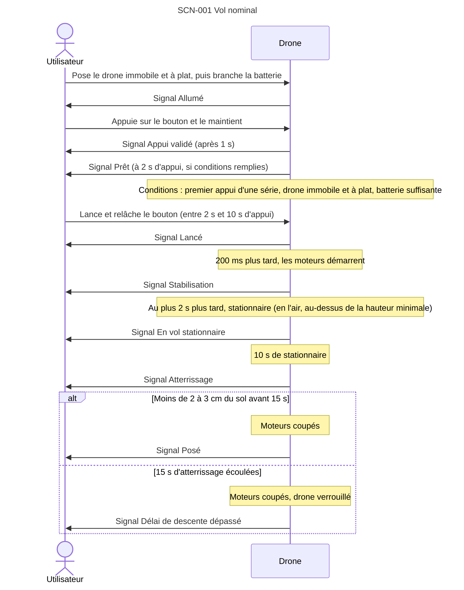

Décisions citées :
- DEC-009 « Stationnaire atteint en 2 secondes maximum après le démarrage des moteurs »
- DEC-010 « Plage de lancer : toute orientation, 0,5 à 4 m/s, au moins 1,5 m du sol »
- DEC-021 « Atterrissage lent, 15 secondes maximum, puis coupure des moteurs »
- DEC-022 « Moteurs coupés à moins de 2 à 3 cm du sol »
- DEC-046 « Délai de descente dépassé : signal distinct, moteurs coupés, drone verrouillé »
- DEC-049 « Stationnaire déclaré seulement en l'air, au-dessus d'une hauteur minimale »
- DEC-052 « Valeurs provisoires retenues pour les scénarios, à confirmer avant les exigences »
- DEC-070 « Appui validé : bouton maintenu 1 seconde, rien en dessous, plus de signal Appui trop court »
- DEC-072 « Armement à 2 secondes d'appui : signal Prêt, ou signal unique Armement refusé selon l'état du drone »
- DEC-073 « Armé entre 2 et 10 secondes d'appui : le relâchement donne le signal Lancé, les moteurs démarrent 200 ms plus tard »
- DEC-088 « Bouton coincé ou maintenu en permanence au démarrage : statut sans fil seulement, aucun signal local »
- DEC-091 « Un seul signal Refus pour tout refus, armement ou mode réglage »

**Réfs amont :** Utilisateur (description initiale, entretien du 2026-10-27), DEC-016 « Public adulte, protège-hélices obligatoires », DEC-001 « Information de l'utilisateur par signaux lumineux, sonores et suivi sur un autre appareil », DEC-005 « Un signal distinct pour chaque information », DEC-030 « Drone posé immobile à la mise sous tension ; refus de s'armer si l'initialisation échoue », DEC-032 « Vol libre : le drone vole sans appareil de suivi », DEC-040 « Périmètre d'emploi visé : l'appartement ; gymnase et jardin en essais complémentaires », DEC-042 « Plage de lancer inchangée, aucune zone libre ni distance aux personnes, le drone ne connaît pas le lieu », DEC-034 « Réglages envoyés par le sans fil, sauvegarde sur commande, chargement au démarrage », DEC-010 « Plage de lancer : toute orientation, 0,5 à 4 m/s, au moins 1,5 m du sol », DEC-006 « Le relâchement du bouton armé suffit à démarrer les moteurs », DEC-009 « Stationnaire atteint en 2 secondes maximum après le démarrage des moteurs », DEC-020 « Atterrissage sur place », DEC-021 « Atterrissage lent, 15 secondes maximum, puis coupure des moteurs », DEC-022 « Moteurs coupés à moins de 2 à 3 cm du sol », DEC-023 « Après le posé ou une coupure : drone verrouillé, nouvel appui pour revoler », DEC-017 « Pas de protection supplémentaire contre les hélices en rotation sans lancer », DEC-046 « Délai de descente dépassé : signal distinct, moteurs coupés, drone verrouillé », DEC-047 « L'état verrouillé est le même que l'état allumé, en attente d'un appui », DEC-049 « Stationnaire déclaré seulement en l'air, au-dessus d'une hauteur minimale », DEC-012 « Couper les moteurs si le drone bascule après le stationnaire », DEC-052 « Valeurs provisoires retenues pour les scénarios, à confirmer avant les exigences », DEC-055 « Bouton ignoré pendant une courte garde après le lancer », DEC-056 « Armement : drone immobile, sans autotest », DEC-057 « Pas de détection dédiée d'un drone attrapé ou posé sur un obstacle », DEC-060 « Défaillance d'un capteur ou d'un moteur en vol : hors périmètre », DEC-062 « Arrêt ignoré pendant la phase Lancé, avant le démarrage des moteurs », DEC-063 « Choc contre un obstacle ou un plafond : aucune réaction dédiée », DEC-067 « Démarrage à plat exigé, sinon échec de l'initialisation avec signal », DEC-070 « Appui validé : bouton maintenu 1 seconde, rien en dessous, plus de signal Appui trop court », DEC-072 « Armement à 2 secondes d'appui : signal Prêt, ou signal unique Armement refusé selon l'état du drone », DEC-073 « Armé entre 2 et 10 secondes d'appui : le relâchement donne le signal Lancé, les moteurs démarrent 200 ms plus tard », DEC-076 « Armement possible seulement depuis le premier appui d'une série, sans effet du maintien pendant la série », DEC-083 « Annulation d'un armement : le maintien jusqu'au désarmement à 10 s reste la seule annulation », DEC-088 « Bouton coincé ou maintenu en permanence au démarrage : statut sans fil seulement, aucun signal local », DEC-091 « Un seul signal Refus pour tout refus, armement ou mode réglage »
**Type :** Nominal
**Acteurs :** Utilisateur. Un appareil de suivi peut être relié au drone, mais n'est pas nécessaire (DEC-032 « Vol libre : le drone vole sans appareil de suivi »).
**Situation de départ :** drone hors tension, muni de ses protège-hélices, batterie chargée, dans un appartement (périmètre visé : DEC-040 « Périmètre d'emploi visé : l'appartement ; gymnase et jardin en essais complémentaires »), sans vent, avec ou sans appareil de suivi. Gymnase et jardin : essais complémentaires, non garantis. Le drone ne connaît pas le lieu ; un lieu trop petit pour la plage de lancer relève de l'utilisateur (DEC-042 « Plage de lancer inchangée, aucune zone libre ni distance aux personnes, le drone ne connaît pas le lieu »). Valeurs provisoires : le délai de 2 s pour atteindre le stationnaire (DEC-009 « Stationnaire atteint en 2 secondes maximum après le démarrage des moteurs »), la plage de lancer de 0,5 à 4 m/s depuis au moins 1,5 m du sol, limites de la plage comprises (DEC-010 « Plage de lancer : toute orientation, 0,5 à 4 m/s, au moins 1,5 m du sol »), et l'angle limite de 60° (DEC-012 « Couper les moteurs si le drone bascule après le stationnaire ») valent pour la porte « scénarios » ; ils sont à confirmer par analyse ou par essais avant la porte « exigences » (DEC-052 « Valeurs provisoires retenues pour les scénarios, à confirmer avant les exigences »).
**Déroulé :**
1. L'utilisateur pose le drone immobile et à plat, et branche la batterie, sans y toucher pendant quelques secondes (DEC-030 « Drone posé immobile à la mise sous tension ; refus de s'armer si l'initialisation échoue »). Un drone trop incliné ne s'initialise pas : voir SCN-010 « Échec : initialisation impossible au démarrage » et DEC-067 « Démarrage à plat exigé, sinon échec de l'initialisation avec signal ».
2. Le drone démarre en chargeant ses derniers réglages enregistrés depuis sa mémoire non volatile, sans aucun échange sans fil (DEC-034 « Réglages envoyés par le sans fil, sauvegarde sur commande, chargement au démarrage »), puis informe l'utilisateur qu'il est allumé et en attente d'un appui sur le bouton.
3. L'utilisateur prend le drone et appuie sur le bouton, qu'il maintient. Après 1 s d'appui, le drone donne le signal « Appui validé » (DEC-070 « Appui validé : bouton maintenu 1 seconde, rien en dessous, plus de signal Appui trop court »).
4. Après 2 secondes d'appui au total depuis l'appui initial (premier appui d'une série : voir DEC-076 « Armement possible seulement depuis le premier appui d'une série, sans effet du maintien pendant la série »), si la batterie est suffisante et le drone immobile et à plat, au sol ou dans la main, sans autotest, le drone informe qu'il est prêt à être lancé : il est armé (DEC-072 « Armement à 2 secondes d'appui : signal Prêt, ou signal unique Armement refusé selon l'état du drone » ; DEC-056 « Armement : drone immobile, sans autotest »). Sinon, il donne le signal « Refus » (SCN-003 « Échec : batterie faible à l'armement » ; DEC-091 « Un seul signal Refus pour tout refus, armement ou mode réglage »).
5. L'utilisateur lance le drone à la main, vers le haut et vers l'avant, dans n'importe quelle orientation, à 0,5 à 4 m/s et depuis au moins 1,5 m du sol (DEC-010 « Plage de lancer : toute orientation, 0,5 à 4 m/s, au moins 1,5 m du sol »), et arrête d'appuyer sur le bouton, entre 2 s et 10 s d'appui (DEC-073 « Armé entre 2 et 10 secondes d'appui : le relâchement donne le signal Lancé, les moteurs démarrent 200 ms plus tard »). Le drone informe qu'il est lancé. Tout appui ou relâchement parasite du bouton est ignoré pendant une courte garde qui suit le lancer (DEC-055 « Bouton ignoré pendant une courte garde après le lancer »).
6. 200 ms après le relâchement (DEC-006 « Le relâchement du bouton armé suffit à démarrer les moteurs »), le drone démarre ses moteurs, même si le drone n'a pas été réellement lancé (risque accepté) et cherche à se stabiliser. Pendant cet intervalle, avant le démarrage des moteurs, l'arrêt et les commandes sans fil sont ignorés (DEC-062 « Arrêt ignoré pendant la phase Lancé, avant le démarrage des moteurs »). Il informe qu'il est dans cette phase de stabilisation.
7. 2 secondes plus tard au plus (DEC-009 « Stationnaire atteint en 2 secondes maximum après le démarrage des moteurs »), le drone est en vol stationnaire : il maintient son altitude et dérive horizontalement d'au plus 30 cm sur 10 s (objectif à valider par essais, non garanti). Il est alors immobile en l'air et à plat, au-dessus d'une hauteur minimale mesurée sous lui (valeur à fixer en architecture) : un drone posé ou tenu immobile en main n'est jamais déclaré en vol stationnaire (DEC-049 « Stationnaire déclaré seulement en l'air, au-dessus d'une hauteur minimale »). Il informe qu'il est en vol stationnaire.
8. Après 10 secondes de vol stationnaire, le drone atterrit : il se pose à l'endroit où il est (DEC-020 « Atterrissage sur place »), à 0,5 m/s au plus au contact du sol, en 15 secondes au plus (DEC-021 « Atterrissage lent, 15 secondes maximum, puis coupure des moteurs »). Il informe qu'il atterrit.
9. Dès qu'il est à moins de 2 à 3 cm du sol (DEC-022 « Moteurs coupés à moins de 2 à 3 cm du sol »), le drone coupe les moteurs et informe qu'il est posé. Si les 15 secondes d'atterrissage s'écoulent avant, il coupe aussi les moteurs, ne donne pas le signal « Posé » mais le signal « Délai de descente dépassé », et est verrouillé (DEC-046 « Délai de descente dépassé : signal distinct, moteurs coupés, drone verrouillé »).
**Résultat attendu :** dans le cas nominal, le drone est posé (moins de 2 à 3 cm du sol), moteurs arrêtés, intact, et l'utilisateur a été informé à chaque étape ; si les 15 secondes d'atterrissage sont écoulées, le drone n'est pas déclaré posé : voir DEC-046 « Délai de descente dépassé : signal distinct, moteurs coupés, drone verrouillé ». Le drone est alors verrouillé : un nouvel appui de 2 secondes est nécessaire pour revoler (DEC-023 « Après le posé ou une coupure : drone verrouillé, nouvel appui pour revoler »). Limites volontaires, risques acceptés : aucun autotest avant l'armement (DEC-056 « Armement : drone immobile, sans autotest »), aucune détection d'une main, d'une table ou d'un obstacle sous le drone (DEC-057 « Pas de détection dédiée d'un drone attrapé ou posé sur un obstacle »), aucune détection de défaillance d'un capteur ou d'un moteur en vol (DEC-060 « Défaillance d'un capteur ou d'un moteur en vol : hors périmètre »), aucune réaction dédiée à un choc (DEC-063 « Choc contre un obstacle ou un plafond : aucune réaction dédiée »). (Moyen d'information : voir DOU-001 « Comment le drone informe-t-il l'utilisateur ? ».) Risque accepté, à reporter dans les limites d'emploi (DOU-062 « Où l'utilisateur est-il informé des limites d'emploi ? ») : relâcher le bouton armé démarre les moteurs 200 ms plus tard, y compris dans la main ; la seule annulation d'un armement est de rester appuyé jusqu'au désarmement à 10 s, soit environ 8 s après le signal « Prêt » (DEC-083 « Annulation d'un armement : le maintien jusqu'au désarmement à 10 s reste la seule annulation »). Risque accepté, à reporter dans les limites d'emploi : un bouton coincé ou maintenu en permanence au démarrage n'est signalé que par le statut sans fil (« bouton maintenu »), sans signal local, et le drone ne s'arme pas (DEC-088 « Bouton coincé ou maintenu en permanence au démarrage : statut sans fil seulement, aucun signal local »).
**Statut :** Proposé

### SCN-002 — Échec : stationnaire non atteint dans le délai

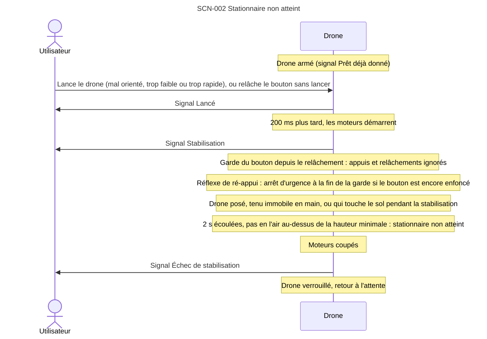

Décisions citées :
- DEC-009 « Stationnaire atteint en 2 secondes maximum après le démarrage des moteurs »
- DEC-049 « Stationnaire déclaré seulement en l'air, au-dessus d'une hauteur minimale »
- DEC-052 « Valeurs provisoires retenues pour les scénarios, à confirmer avant les exigences »
- DEC-073 « Armé entre 2 et 10 secondes d'appui : le relâchement donne le signal Lancé, les moteurs démarrent 200 ms plus tard »
- DEC-017 « Pas de protection supplémentaire contre les hélices en rotation sans lancer »
- DEC-092 « Garde du bouton après le lancer : fronts ignorés, niveau pris en compte, démarrage au relâchement »

**Réfs amont :** Utilisateur (entretien du 2026-10-27), DEC-002 « Couper les moteurs si le stationnaire n'est pas atteint dans le délai », DEC-003 « Drone retourné ou très incliné : normal tant que la stabilisation n'est pas finie », DEC-005 « Un signal distinct pour chaque information », DEC-009 « Stationnaire atteint en 2 secondes maximum après le démarrage des moteurs », DEC-023 « Après le posé ou une coupure : drone verrouillé, nouvel appui pour revoler », DEC-017 « Pas de protection supplémentaire contre les hélices en rotation sans lancer », DEC-051 « Seuils de sécurité réglables dans des bornes fixées par le logiciel », DEC-049 « Stationnaire déclaré seulement en l'air, au-dessus d'une hauteur minimale », DEC-055 « Bouton ignoré pendant une courte garde après le lancer », DEC-092 « Garde du bouton après le lancer : fronts ignorés, niveau pris en compte, démarrage au relâchement »
**Type :** Échec
**Acteurs :** Utilisateur.
**Situation de départ :** drone armé, puis lancé comme dans SCN-001 « Vol nominal : de la batterie au posé » (étape 5), ou bouton relâché sans lancer, drone posé ou tenu immobile en main ; moteurs démarrés, en cours de stabilisation. Le lancer peut être mal orienté, trop faible ou trop rapide, et le drone peut toucher le sol pendant la stabilisation (DEC-049 « Stationnaire déclaré seulement en l'air, au-dessus d'une hauteur minimale »).
**Déroulé :**
1. Le drone cherche à se stabiliser ; être retourné ou très incliné est normal à ce stade.
2. Le délai maximal s'écoule sans que le stationnaire soit atteint (2 secondes après le démarrage des moteurs : DEC-009 « Stationnaire atteint en 2 secondes maximum après le démarrage des moteurs »).
3. Le drone coupe ses moteurs et informe l'utilisateur avec un signal d'échec distinct des autres. Les seuils de cette coupure sont réglables dans des bornes fixées par le logiciel (DEC-051 « Seuils de sécurité réglables dans des bornes fixées par le logiciel ») : aucune valeur réglable ne supprime la coupure. Même comportement si le drone est relâché sans lancer, posé ou tenu immobile en main, ou s'il touche le sol pendant la stabilisation : faute d'être en l'air au-dessus de la hauteur minimale, il n'atteint pas le stationnaire et coupe ses moteurs au bout du délai (DEC-049 « Stationnaire déclaré seulement en l'air, au-dessus d'une hauteur minimale »).
4. Cas du bouton relâché sans lancer, drone en main : l'utilisateur qui ré-appuie par réflexe sur le bouton pour arrêter les hélices voit son appui ignoré pendant la garde, qui commence au relâchement (de l'ordre de 0,5 s, à fixer en architecture). La garde ignore les appuis et relâchements mais pas le niveau : si le bouton est encore enfoncé à la fin de la garde, c'est un arrêt d'urgence à ce moment. Le réflexe reste donc efficace, avec au plus la durée de la garde de retard ; un appui relâché avant la fin de la garde n'a aucun effet (DEC-092 « Garde du bouton après le lancer : fronts ignorés, niveau pris en compte, démarrage au relâchement » ; DEC-017 « Pas de protection supplémentaire contre les hélices en rotation sans lancer »).
**Résultat attendu :** moteurs arrêtés au bout du délai ; le drone tombe s'il est en l'air, ou reste où il est s'il est posé, tenu en main ou au contact du sol ; l'utilisateur sait qu'il s'agit d'un échec de stabilisation. Le drone est alors verrouillé : un nouvel appui de 2 secondes est nécessaire pour revoler (DEC-023 « Après le posé ou une coupure : drone verrouillé, nouvel appui pour revoler »).
**Statut :** Proposé

### SCN-003 — Échec : batterie faible à l'armement

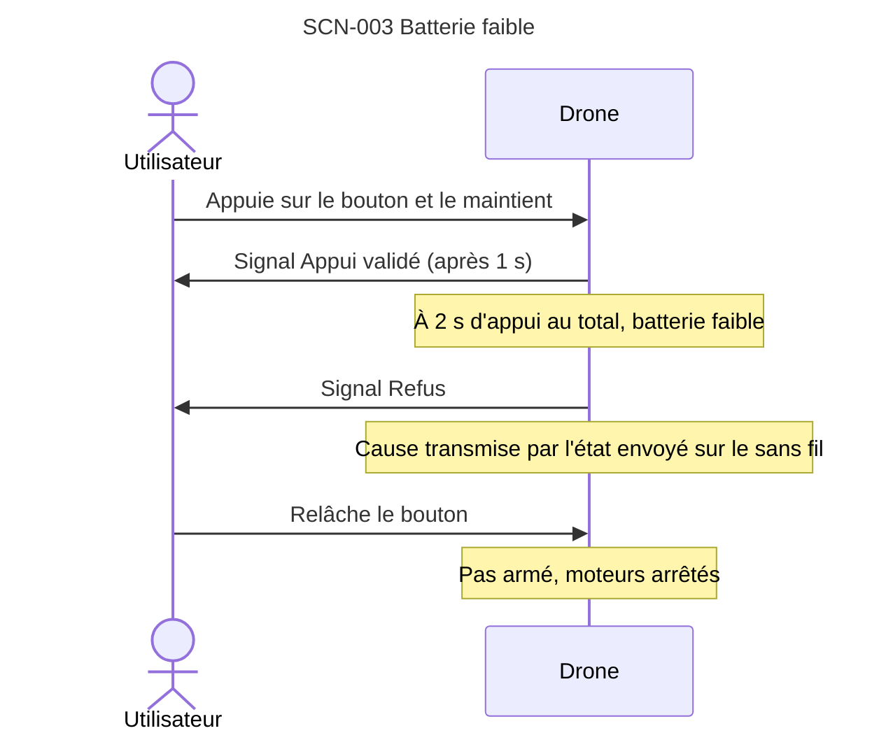

Décisions citées :
- DEC-070 « Appui validé : bouton maintenu 1 seconde, rien en dessous, plus de signal Appui trop court »
- DEC-072 « Armement à 2 secondes d'appui : signal Prêt, ou signal unique Armement refusé selon l'état du drone »
- DEC-080 « Armement refusé ou désarmement : retour à l'attente, compteur à zéro, l'appui long n'est pas compté »
- DEC-091 « Un seul signal Refus pour tout refus, armement ou mode réglage »

**Réfs amont :** Utilisateur (entretien du 2026-10-27), DEC-004 « Batterie vérifiée à l'armement : pas d'armement si batterie faible », DEC-005 « Un signal distinct pour chaque information », DEC-070 « Appui validé : bouton maintenu 1 seconde, rien en dessous, plus de signal Appui trop court », DEC-072 « Armement à 2 secondes d'appui : signal Prêt, ou signal unique Armement refusé selon l'état du drone », DEC-080 « Armement refusé ou désarmement : retour à l'attente, compteur à zéro, l'appui long n'est pas compté », DEC-081 « Bouton encore enfoncé après un refus ou un désarmement : ignoré jusqu'au premier relâchement, puis nouvel appui possible tout de suite », DEC-091 « Un seul signal Refus pour tout refus, armement ou mode réglage »
**Type :** Échec
**Acteurs :** Utilisateur.
**Situation de départ :** drone allumé et en attente d'un appui (étape 2 de SCN-001 « Vol nominal : de la batterie au posé »), batterie en dessous du seuil.
**Déroulé :**
1. L'utilisateur appuie sur le bouton et le maintient ; à 1 s, le drone donne le signal « Appui validé ».
2. Après 2 secondes d'appui au total, le drone constate que la batterie est faible.
3. Il ne s'arme pas et donne le signal « Refus » (DEC-091 « Un seul signal Refus pour tout refus, armement ou mode réglage » ; DEC-072 « Armement à 2 secondes d'appui : signal Prêt, ou signal unique Armement refusé selon l'état du drone »), le même signal que pour un drone en mouvement ou pas à plat ; la cause (batterie faible) est transmise par l'état envoyé sur le sans fil (contenu à définir : DOU-083 « Contenu du statut sans fil d'un armement ou d'un décollage refusé »). Sans appareil de suivi, l'utilisateur ne connaît pas la cause. Le drone revient à l'état « Allumé, en attente d'un appui », compteur à zéro, l'appui long n'est pas compté ; le bouton encore enfoncé est ignoré jusqu'au premier relâchement, et un nouvel appui peut armer immédiatement après ce relâchement (DEC-080 « Armement refusé ou désarmement : retour à l'attente, compteur à zéro, l'appui long n'est pas compté » ; DEC-081 « Bouton encore enfoncé après un refus ou un désarmement : ignoré jusqu'au premier relâchement, puis nouvel appui possible tout de suite »).
**Résultat attendu :** le drone n'est pas armé ; relâcher le bouton ne démarre pas les moteurs ; l'utilisateur sait que l'armement est refusé et, avec un appareil de suivi, que la batterie est faible et doit être changée ou rechargée.
**Statut :** Proposé

### SCN-004 — Appui normal : bouton relâché avant 2 secondes


Décisions citées :
- DEC-052 « Valeurs provisoires retenues pour les scénarios, à confirmer avant les exigences »
- DEC-070 « Appui validé : bouton maintenu 1 seconde, rien en dessous, plus de signal Appui trop court »
- DEC-071 « Appuis validés d'affilée : trois appuis entrent en mode réglage sans armer, le bouton n'arme jamais en mode réglage »
- DEC-072 « Armement à 2 secondes d'appui : signal Prêt, ou signal unique Armement refusé selon l'état du drone »
- DEC-076 « Armement possible seulement depuis le premier appui d'une série, sans effet du maintien pendant la série »
- DEC-089 « Appui de moins de 1 s au milieu d'une série d'appuis : compteur remis à zéro »
- DEC-090 « Troisième appui validé sur un drone non immobile ou pas à plat : mode réglage refusé avec le signal Refus »
- DOU-091 « Compteur d'appuis après un mode réglage refusé : retour à l'attente, compteur à zéro ? »
- DEC-093 « Mode réglage refusé : retour à l'attente, compteur à zéro, bouton encore enfoncé ignoré »

**Réfs amont :** Utilisateur (entretien du 2026-10-27, refonte du bouton du 2026-10-28), DEC-005 « Un signal distinct pour chaque information », DEC-070 « Appui validé : bouton maintenu 1 seconde, rien en dessous, plus de signal Appui trop court », DEC-071 « Appuis validés d'affilée : trois appuis entrent en mode réglage sans armer, le bouton n'arme jamais en mode réglage », DEC-076 « Armement possible seulement depuis le premier appui d'une série, sans effet du maintien pendant la série », DEC-080 « Armement refusé ou désarmement : retour à l'attente, compteur à zéro, l'appui long n'est pas compté », DEC-084 « Appui ignoré pendant une série d'appuis : aucun signal, risque accepté et documenté », DEC-085 « Entrée en mode réglage : drone immobile et à plat, non armé, sans condition de posé », DEC-089 « Appui de moins de 1 s au milieu d'une série d'appuis : compteur remis à zéro », DEC-090 « Troisième appui validé sur un drone non immobile ou pas à plat : mode réglage refusé avec le signal Refus »
**Type :** Nominal
**Acteurs :** Utilisateur.
**Situation de départ :** drone allumé et en attente d'un appui, tenu en main ou posé.
**Déroulé :**
1. L'utilisateur appuie sur le bouton.
2. Il le relâche avant 1 s : rien ne se passe, ni effet ni signal (DEC-070 « Appui validé : bouton maintenu 1 seconde, rien en dessous, plus de signal Appui trop court »).
3. Ou il le relâche entre 1 s et 2 s : le drone donne le signal « Appui validé » à 1 s, l'appui est compté, et le drone n'arme ni ne lance jamais. Les appuis validés comptent d'affilée si l'écart entre deux est d'environ 2 s au plus ; trois appuis validés d'affilée, drone immobile et à plat, non armé, entrent en mode réglage (DEC-071 « Appuis validés d'affilée : trois appuis entrent en mode réglage sans armer, le bouton n'arme jamais en mode réglage » ; DEC-085 « Entrée en mode réglage : drone immobile et à plat, non armé, sans condition de posé » ; SCN-009 « Réglage et suivi du drone par le sans fil »). Tant que la série n'est pas retombée à zéro, le drone ne peut plus armer : un appui relâché entre 1 s et 2 s fait entrer le drone dans la série, aucun appui suivant ne peut armer, et maintenir le 2e appui au-delà de 2 s ne fait ni armement, ni signal, ni annulation de la série (l'appui reste compté à 1 s) ; si 2 s s'écoulent sans nouvel appui, le compteur repart à zéro et l'armement redevient possible au prochain appui (DEC-076 « Armement possible seulement depuis le premier appui d'une série, sans effet du maintien pendant la série »). Un appui long (2 s ou plus) relâché après un armement refusé ou un désarmement n'est pas compté dans la série (DEC-080 « Armement refusé ou désarmement : retour à l'attente, compteur à zéro, l'appui long n'est pas compté »). Un appui de moins de 1 s au milieu d'une série n'est pas compté et remet le compteur à zéro (DEC-089 « Appui de moins de 1 s au milieu d'une série d'appuis : compteur remis à zéro »). Si le 3e appui validé arrive sur un drone en mouvement ou pas à plat, le mode réglage est refusé avec le signal « Refus » (DEC-090 « Troisième appui validé sur un drone non immobile ou pas à plat : mode réglage refusé avec le signal Refus ») ; le retour à l'attente, compteur à zéro, qui suit ce refus a été confirmé par l'utilisateur le 2026-10-28 (DOU-091 « Compteur d'appuis après un mode réglage refusé : retour à l'attente, compteur à zéro ? » ; DEC-093 « Mode réglage refusé : retour à l'attente, compteur à zéro, bouton encore enfoncé ignoré »). Les seuils de 1 s et 2 s et le délai entre appuis sont provisoires (DOU-080 « Seuils de temps du bouton : 1 s, 2 s, 10 s et délai entre appuis »).
**Résultat attendu :** le drone n'est pas armé, les moteurs ne démarrent pas ; un nouvel appui est possible, mais il ne peut pas armer tant que la série n'est pas retombée à zéro. Risque accepté, à reporter dans les limites d'emploi (DOU-062 « Où l'utilisateur est-il informé des limites d'emploi ? ») : un appui maintenu au-delà de 2 s pendant une série ne donne aucun signal, l'utilisateur peut ne pas comprendre pourquoi rien ne se passe et retaper jusqu'à entrer en mode réglage par erreur, dont la seule sortie est d'enlever la batterie (DEC-084 « Appui ignoré pendant une série d'appuis : aucun signal, risque accepté et documenté »).
**Statut :** Proposé

### SCN-005 — Dégradé : bouton maintenu plus de 10 secondes

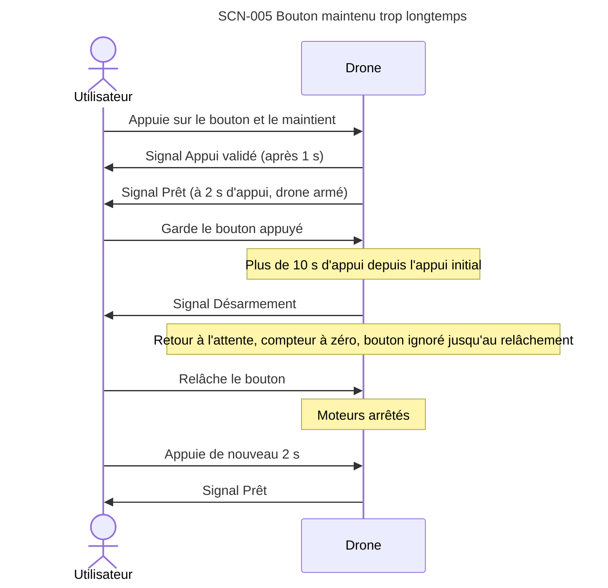

Décisions citées :
- DEC-054 « Chrono de 10 secondes compté depuis l'appui initial »
- DEC-081 « Bouton encore enfoncé après un refus ou un désarmement : ignoré jusqu'au premier relâchement, puis nouvel appui possible tout de suite »

**Réfs amont :** Utilisateur (entretien du 2026-10-27), DEC-008 « Désarmement si le bouton reste appuyé plus de 10 secondes », DEC-005 « Un signal distinct pour chaque information », DEC-054 « Chrono de 10 secondes compté depuis l'appui initial », DEC-059 « Bouton déjà enfoncé : ignoré jusqu'au premier relâchement », DEC-073 « Armé entre 2 et 10 secondes d'appui : le relâchement donne le signal Lancé, les moteurs démarrent 200 ms plus tard », DEC-076 « Armement possible seulement depuis le premier appui d'une série, sans effet du maintien pendant la série », DEC-080 « Armement refusé ou désarmement : retour à l'attente, compteur à zéro, l'appui long n'est pas compté », DEC-081 « Bouton encore enfoncé après un refus ou un désarmement : ignoré jusqu'au premier relâchement, puis nouvel appui possible tout de suite », DEC-083 « Annulation d'un armement : le maintien jusqu'au désarmement à 10 s reste la seule annulation »
**Type :** Dégradé
**Acteurs :** Utilisateur.
**Situation de départ :** drone armé depuis le premier appui d'une série (bouton appuyé depuis 2 à 10 secondes, DEC-073 « Armé entre 2 et 10 secondes d'appui : le relâchement donne le signal Lancé, les moteurs démarrent 200 ms plus tard »), pas encore lancé.
**Déroulé :**
1. L'utilisateur garde le bouton appuyé au-delà de 10 secondes, comptées depuis l'appui initial (DEC-054 « Chrono de 10 secondes compté depuis l'appui initial »).
2. Le drone se désarme et le signale avec un signal distinct. Il revient à l'état « Allumé, en attente d'un appui », compteur à zéro ; cet appui long ne compte pas comme appui de la série (DEC-080 « Armement refusé ou désarmement : retour à l'attente, compteur à zéro, l'appui long n'est pas compté »).
3. L'utilisateur relâche le bouton : les moteurs ne démarrent pas. Si l'appui se prolonge après le désarmement, il est ignoré jusqu'au relâchement (DEC-081 « Bouton encore enfoncé après un refus ou un désarmement : ignoré jusqu'au premier relâchement, puis nouvel appui possible tout de suite »). De même, un bouton déjà enfoncé à la mise sous tension, pendant l'initialisation ou après un désarmement est ignoré tant qu'il n'a pas été relâché une fois (DEC-059 « Bouton déjà enfoncé : ignoré jusqu'au premier relâchement »).
4. Après ce relâchement, un nouvel appui peut armer immédiatement. Pour réarmer, il appuie de nouveau 2 secondes (l'armement n'est possible que depuis le premier appui d'une série : DEC-076 « Armement possible seulement depuis le premier appui d'une série, sans effet du maintien pendant la série ») et le drone informe qu'il est prêt (signal Prêt).
**Résultat attendu :** le drone n'est plus armé ; le relâchement du bouton ne démarre pas les moteurs. Risque accepté, à reporter dans les limites d'emploi (DOU-062 « Où l'utilisateur est-il informé des limites d'emploi ? ») : renoncer à un armement demande de rester appuyé jusqu'à ce désarmement, environ 8 s après le signal « Prêt » ; relâcher plus tôt démarre les moteurs, y compris dans la main (DEC-083 « Annulation d'un armement : le maintien jusqu'au désarmement à 10 s reste la seule annulation »).
**Statut :** Proposé

### SCN-006 — Échec : inclinaison excessive après le stationnaire

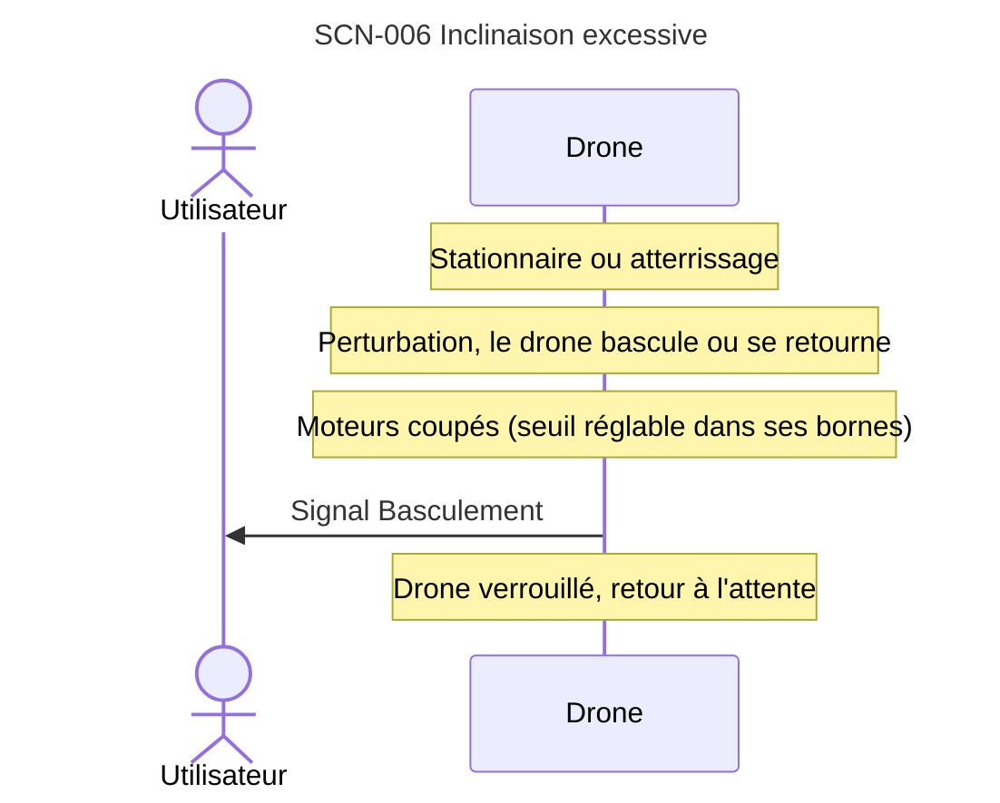

Décisions citées :
- DEC-051 « Seuils de sécurité réglables dans des bornes fixées par le logiciel »

**Réfs amont :** Utilisateur (entretien du 2026-10-27), DEC-012 « Couper les moteurs si le drone bascule après le stationnaire », DEC-005 « Un signal distinct pour chaque information », DEC-023 « Après le posé ou une coupure : drone verrouillé, nouvel appui pour revoler », DEC-051 « Seuils de sécurité réglables dans des bornes fixées par le logiciel »
**Type :** Échec
**Acteurs :** Utilisateur.
**Situation de départ :** drone en vol stationnaire ou en atterrissage (SCN-001 « Vol nominal : de la batterie au posé », étapes 7 à 8).
**Déroulé :**
1. Une perturbation fait basculer le drone fortement, ou le retourne.
2. Le drone coupe ses moteurs et informe l'utilisateur avec un signal distinct. Les seuils de cette coupure sont réglables dans des bornes fixées par le logiciel (DEC-051 « Seuils de sécurité réglables dans des bornes fixées par le logiciel ») : aucune valeur réglable ne supprime la coupure.
**Résultat attendu :** moteurs arrêtés ; le drone tombe ; l'utilisateur sait que la cause est un basculement. Le drone est alors verrouillé : un nouvel appui de 2 secondes est nécessaire pour revoler (DEC-023 « Après le posé ou une coupure : drone verrouillé, nouvel appui pour revoler »).
**Statut :** Proposé

### SCN-007 — Dégradé : arrêt d'urgence par le bouton en vol

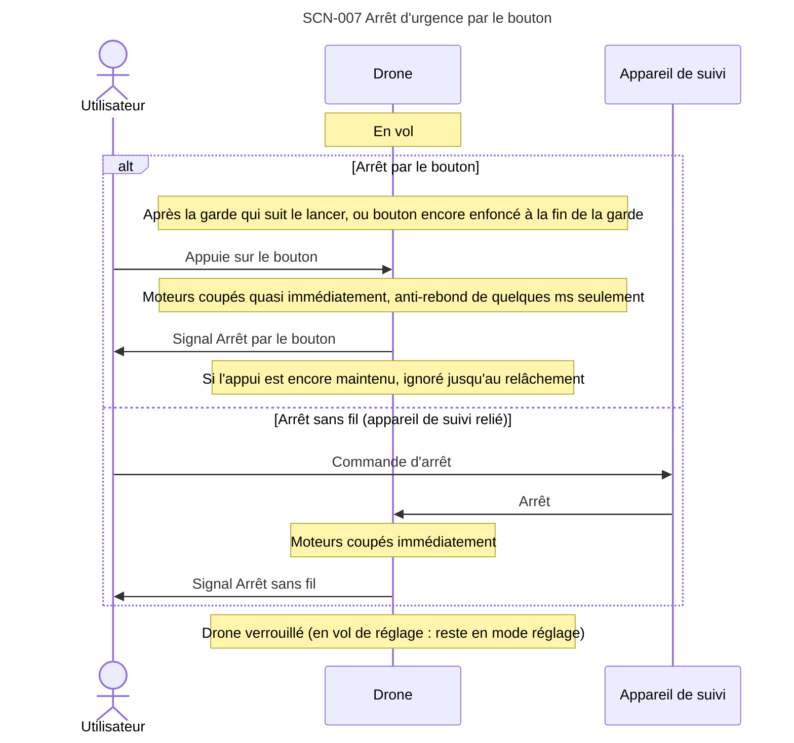

Décisions citées :
- DEC-050 « Appui en cours lors d'une coupure des moteurs ignoré jusqu'au relâchement »
- DEC-055 « Bouton ignoré pendant une courte garde après le lancer »
- DEC-087 « Arrêt d'urgence par le bouton en vol : anti-rebond très court seulement, arrêt quasi immédiat »
- DEC-092 « Garde du bouton après le lancer : fronts ignorés, niveau pris en compte, démarrage au relâchement »

**Réfs amont :** Utilisateur (entretien du 2026-10-27), DEC-015 « Bouton appuyé en vol : arrêt d'urgence », DEC-031 « Arrêt du drone lancé : bouton et commande d'arrêt sans fil », DEC-005 « Un signal distinct pour chaque information », DEC-032 « Vol libre : le drone vole sans appareil de suivi », DEC-037 « Pas d'appairage : le drone obéit à tout appareil de suivi à portée », DEC-033 « Signal Arrêt sans fil distinct du signal Arrêt par le bouton », DEC-023 « Après le posé ou une coupure : drone verrouillé, nouvel appui pour revoler », DEC-043 « Commandes sans fil acceptées selon l'état du drone », DEC-044 « Mode réglage persistant : retour au mode réglage après un vol de réglage, sans verrouillage », DEC-050 « Appui en cours lors d'une coupure des moteurs ignoré jusqu'au relâchement », DEC-055 « Bouton ignoré pendant une courte garde après le lancer », DEC-062 « Arrêt ignoré pendant la phase Lancé, avant le démarrage des moteurs », DEC-065 « Logiciel bloqué en vol : coupure des moteurs par un chien de garde », DEC-077 « Bouton appuyé en vol de réglage : arrêt d'urgence, moteurs coupés, le drone reste en mode réglage », DEC-078 « Garde du bouton après le lancer : attachée au lancer au relâchement, pas décidée pour le décollage de réglage », DEC-082 « Retours à l'attente après le posé ou une coupure des moteurs : compteur à zéro, appui en cours ni pris en compte ni compté », DEC-087 « Arrêt d'urgence par le bouton en vol : anti-rebond très court seulement, arrêt quasi immédiat », DEC-092 « Garde du bouton après le lancer : fronts ignorés, niveau pris en compte, démarrage au relâchement »
**Type :** Dégradé
**Acteurs :** Utilisateur, appareil de suivi (pour l'arrêt sans fil).
**Situation de départ :** drone en vol (stabilisation, stationnaire ou atterrissage), en vol normal ou en vol de réglage.
**Déroulé :**
1. L'utilisateur arrête le drone par l'un des deux moyens (la commande d'arrêt sans fil n'agit qu'en vol, et est ignorée au sol : DEC-043 « Commandes sans fil acceptées selon l'état du drone ») : il appuie sur le bouton, ou il envoie la commande d'arrêt depuis l'appareil de suivi s'il est relié au drone (DEC-031 « Arrêt du drone lancé : bouton et commande d'arrêt sans fil »). Le bouton est ignoré pendant la courte garde qui suit le lancer (DEC-055 « Bouton ignoré pendant une courte garde après le lancer »). Cette garde commence au relâchement du bouton, ignore les appuis et relâchements mais pas le niveau : un bouton encore enfoncé à la fin de la garde (de l'ordre de 0,5 s, à fixer en architecture) est un arrêt d'urgence à ce moment (DEC-092 « Garde du bouton après le lancer : fronts ignorés, niveau pris en compte, démarrage au relâchement »). Par ailleurs, l'arrêt, par le bouton comme par le sans fil, est ignoré pendant la phase « Lancé » avant le démarrage des moteurs (DEC-062 « Arrêt ignoré pendant la phase Lancé, avant le démarrage des moteurs »). Le bouton et l'arrêt sans fil ont le même effet : aucune priorité n'est à définir entre eux.
2. Le drone coupe ses moteurs quasi immédiatement : le bouton n'est filtré que par un anti-rebond de quelques millisecondes (valeur à fixer en architecture), sans durée minimale d'appui ni validation de 1 s, qui ne valent qu'au sol (DEC-087 « Arrêt d'urgence par le bouton en vol : anti-rebond très court seulement, arrêt quasi immédiat »). Il informe l'utilisateur avec un signal distinct selon le moyen utilisé. Si l'appui sur le bouton qui a arrêté le drone est encore maintenu, il est ignoré jusqu'au relâchement : il ne peut pas réarmer le drone, et seul un nouvel appui distinct l'arme (DEC-050 « Appui en cours lors d'une coupure des moteurs ignoré jusqu'au relâchement »).
3. En vol de réglage, le drone reste ensuite en mode réglage, posé, sans verrouillage (DEC-044 « Mode réglage persistant : retour au mode réglage après un vol de réglage, sans verrouillage », confirmé par l'utilisateur le 2026-10-27 : prêt à redécoller tout de suite sur commande sans fil). Pendant un vol de réglage, le bouton appuyé est un arrêt d'urgence : les moteurs sont coupés et le drone reste en mode réglage (DEC-077 « Bouton appuyé en vol de réglage : arrêt d'urgence, moteurs coupés, le drone reste en mode réglage »). La garde de DEC-055 « Bouton ignoré pendant une courte garde après le lancer » ne vaut qu'après un lancer au relâchement ; son existence après un décollage de réglage n'est pas décidée (DEC-078 « Garde du bouton après le lancer : attachée au lancer au relâchement, pas décidée pour le décollage de réglage » ; DOU-084 « Garde du bouton après le décollage de réglage ? »). Le signal donné reste à confirmer (DOU-053 « Quels signaux pour les vols de réglage et pour le lien perdu ? »). Sans appareil de suivi relié, seul le bouton arrête le drone (risque accepté ; DEC-032 « Vol libre : le drone vole sans appareil de suivi »). Sans appairage, tout appareil de suivi à portée peut envoyer l'arrêt, et une commande peut atteindre plusieurs drones (DEC-037 « Pas d'appairage : le drone obéit à tout appareil de suivi à portée »). Le signal « Arrêt sans fil » est distinct du signal « Arrêt par le bouton » (DEC-033 « Signal Arrêt sans fil distinct du signal Arrêt par le bouton »). Si le logiciel se bloque, ces deux moyens n'ont plus d'effet : un mécanisme indépendant du logiciel coupe les moteurs (SCN-011 « Dégradé : coupure d'alimentation en vol », DEC-065 « Logiciel bloqué en vol : coupure des moteurs par un chien de garde »).
**Résultat attendu :** moteurs arrêtés ; le drone tombe ; l'utilisateur sait que l'arrêt vient du bouton ou de la commande sans fil. Le drone est alors verrouillé (sauf en vol de réglage, où il reste en mode réglage : DEC-044 « Mode réglage persistant : retour au mode réglage après un vol de réglage, sans verrouillage ») : un nouvel appui de 2 secondes est nécessaire pour revoler (DEC-023 « Après le posé ou une coupure : drone verrouillé, nouvel appui pour revoler »). Risque connu, à reporter dans les limites d'emploi (DOU-062 « Où l'utilisateur est-il informé des limites d'emploi ? ») : un parasite plus long que l'anti-rebond peut couper les moteurs en vol (DEC-087 « Arrêt d'urgence par le bouton en vol : anti-rebond très court seulement, arrêt quasi immédiat »).
**Statut :** Proposé

### SCN-008 — Mise en service : programmation du drone

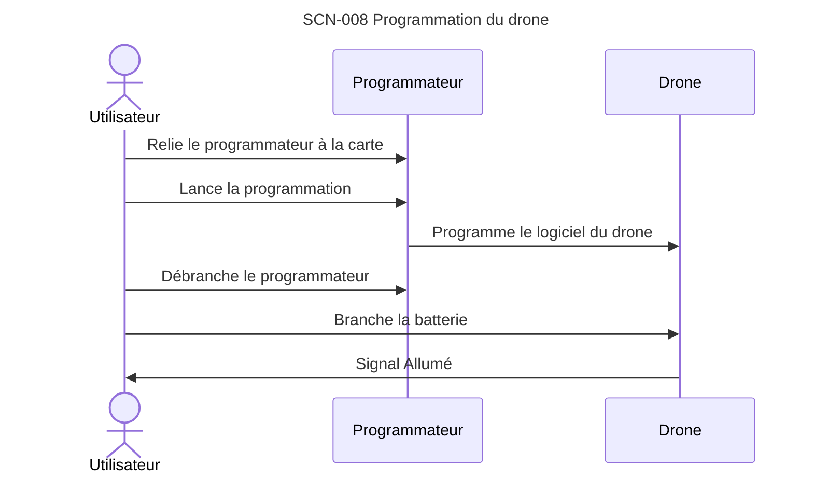

Décisions citées :
- DEC-024 « Mise en service par programmation avec un programmateur ST-LINK »

**Réfs amont :** Utilisateur (entretien du 2026-10-27), DEC-024 « Mise en service par programmation avec un programmateur ST-LINK », DEC-026 « Mise en service : calibrage éventuel renvoyé à l'architecture, réglage du vol par un scénario dédié », DEC-053 « Solutions techniques déplacées en propositions d'architecture, seule l'intention reste décidée »
**Type :** Mise en service / maintenance
**Acteurs :** Utilisateur, programmateur (outil choisi en architecture ; proposition : voir DEC-053 « Solutions techniques déplacées en propositions d'architecture, seule l'intention reste décidée »).
**Situation de départ :** carte neuve, jamais programmée, batterie chargée ; l'utilisateur dispose d'un ordinateur et d'un programmateur adapté au drone.
**Déroulé :**
1. L'utilisateur relie le programmateur à la carte du drone.
2. Il programme le logiciel du drone depuis l'ordinateur.
3. Il débranche le programmateur.
4. Il branche la batterie : le drone démarre et informe qu'il est allumé et en attente d'un appui (étape 2 de SCN-001 « Vol nominal : de la batterie au posé »).
**Résultat attendu :** le drone est programmé et se comporte comme au début de SCN-001 « Vol nominal : de la batterie au posé ». Le vol se règle ensuite avec SCN-009 « Réglage et suivi du drone par le sans fil » ; un éventuel calibrage est renvoyé à l'architecture (DEC-026 « Mise en service : calibrage éventuel renvoyé à l'architecture, réglage du vol par un scénario dédié »).
**Statut :** Proposé

### SCN-009 — Réglage et suivi du drone par le sans fil

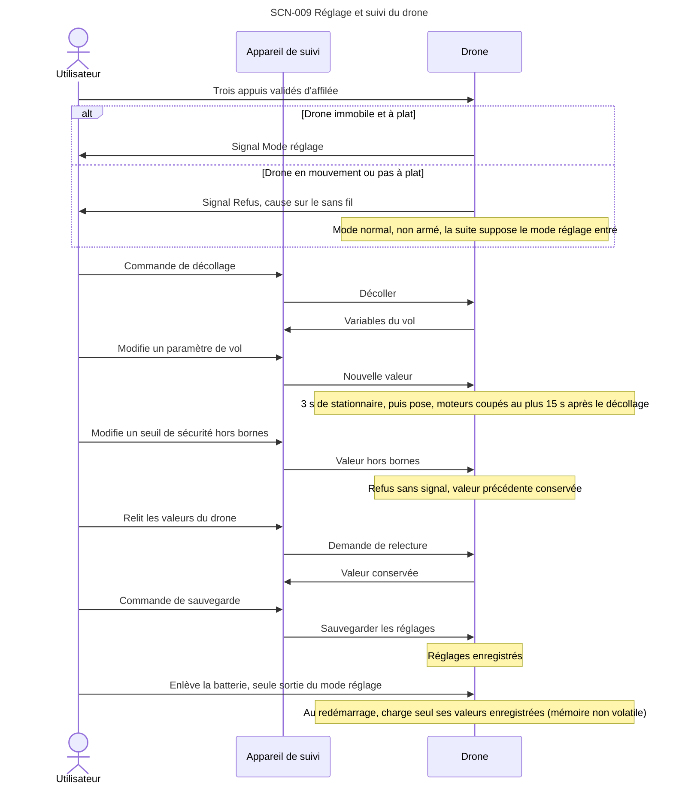

Décisions citées :
- DEC-068 « Seuil hors bornes : refus silencieux, valeur relue sur l'appareil de suivi »
- DEC-079 « Sortie du mode réglage : uniquement en enlevant la batterie »
- DEC-090 « Troisième appui validé sur un drone non immobile ou pas à plat : mode réglage refusé avec le signal Refus »
- DEC-091 « Un seul signal Refus pour tout refus, armement ou mode réglage »
- DOU-091 « Compteur d'appuis après un mode réglage refusé : retour à l'attente, compteur à zéro ? »
- DEC-093 « Mode réglage refusé : retour à l'attente, compteur à zéro, bouton encore enfoncé ignoré »

**Réfs amont :** Utilisateur (entretien du 2026-10-27), DEC-025 « Suivi et réglage du drone par le sans fil, y compris en vol », DEC-028 « Mode réglage : décollage depuis le sol sur commande sans fil », DEC-029 « Vol de réglage : stationnaire de 3 secondes, atterrissage sur place si le lien est perdu », DEC-027 « Mode réglage : trois appuis sur le bouton au sol, sortie par coupure de la batterie », DEC-015 « Bouton appuyé en vol : arrêt d'urgence », DEC-038 « Mode réglage : décollage sans protection supplémentaire », DEC-039 « Réglages : coupures valables en vol de réglage, aucune borne, modifiables aussi en vol normal », DEC-034 « Réglages envoyés par le sans fil, sauvegarde sur commande, chargement au démarrage », DEC-031 « Arrêt du drone lancé : bouton et commande d'arrêt sans fil », DEC-037 « Pas d'appairage : le drone obéit à tout appareil de suivi à portée », DEC-035 « Pas de retour aux valeurs d'origine ; mémoire corrompue non traitée », DEC-036 « Drone neuf : valeurs d'origine fixes du logiciel, sans signal », DEC-005 « Un signal distinct pour chaque information », DEC-043 « Commandes sans fil acceptées selon l'état du drone », DEC-044 « Mode réglage persistant : retour au mode réglage après un vol de réglage, sans verrouillage », DEC-051 « Seuils de sécurité réglables dans des bornes fixées par le logiciel », DEC-071 « Appuis validés d'affilée : trois appuis entrent en mode réglage sans armer, le bouton n'arme jamais en mode réglage », DEC-076 « Armement possible seulement depuis le premier appui d'une série, sans effet du maintien pendant la série », DEC-074 « Décollage en mode réglage : la batterie est vérifiée, rien d'autre », DEC-064 « Main près des hélices en mode réglage : risque accepté et documenté », DEC-066 « Commande sans fil corrompue : aucun contrôle d'intégrité », DEC-068 « Seuil hors bornes : refus silencieux, valeur relue sur l'appareil de suivi », DEC-069 « Commandes sans fil reçues pendant la phase Lancé : ignorées », DEC-077 « Bouton appuyé en vol de réglage : arrêt d'urgence, moteurs coupés, le drone reste en mode réglage », DEC-079 « Sortie du mode réglage : uniquement en enlevant la batterie », DEC-085 « Entrée en mode réglage : drone immobile et à plat, non armé, sans condition de posé », DEC-086 « Décollage de réglage : batterie seulement, risque cumulé avec les décisions sans appairage et sans verrouillage accepté », DEC-090 « Troisième appui validé sur un drone non immobile ou pas à plat : mode réglage refusé avec le signal Refus », DEC-091 « Un seul signal Refus pour tout refus, armement ou mode réglage »
**Type :** Mise en service / maintenance
**Acteurs :** Utilisateur, appareil de suivi.
**Situation de départ :** drone programmé (SCN-008 « Mise en service : programmation du drone »), batterie branchée, posé sur un sol plat et dégagé, protège-hélices en place, appareil de suivi relié au drone sans fil.
**Déroulé :**
1. L'utilisateur fait trois appuis validés d'affilée sur le bouton (chacun maintenu 1 s, avec un écart d'environ 2 s au plus entre deux, durée exacte à fixer en architecture), drone immobile, à plat et non armé, et non pas seulement « posé » (DEC-085 « Entrée en mode réglage : drone immobile et à plat, non armé, sans condition de posé » ; DEC-027 « Mode réglage : trois appuis sur le bouton au sol, sortie par coupure de la batterie » ; DEC-071 « Appuis validés d'affilée : trois appuis entrent en mode réglage sans armer, le bouton n'arme jamais en mode réglage »). Chacun des deux premiers appuis donne le signal « Appui validé ».
2. Dès la 3e validation, le drone informe qu'il est en mode réglage, sans s'armer même si le 3e appui est maintenu (aucun appui de la série ne peut armer : DEC-076 « Armement possible seulement depuis le premier appui d'une série, sans effet du maintien pendant la série »). En mode réglage, le bouton n'arme jamais. Si le drone n'est pas immobile et à plat à la 3e validation, le mode réglage est refusé : le drone donne le signal « Refus » (cause sur le statut sans fil), reste en mode normal et non armé (DEC-090 « Troisième appui validé sur un drone non immobile ou pas à plat : mode réglage refusé avec le signal Refus » ; DEC-091 « Un seul signal Refus pour tout refus, armement ou mode réglage »). Le retour à l'attente, compteur à zéro, qui suit ce refus a été confirmé par l'utilisateur le 2026-10-28 (DOU-091 « Compteur d'appuis après un mode réglage refusé : retour à l'attente, compteur à zéro ? » ; DEC-093 « Mode réglage refusé : retour à l'attente, compteur à zéro, bouton encore enfoncé ignoré »).
3. À chaque commande sans fil de l'utilisateur, le drone décolle depuis le sol, se stabilise, reste 3 secondes en stationnaire, puis se pose ; il coupe ses moteurs 15 secondes au plus après le décollage (DEC-029 « Vol de réglage : stationnaire de 3 secondes, atterrissage sur place si le lien est perdu »). L'utilisateur peut recommencer autant de fois que nécessaire : après chaque vol, le drone reste en mode réglage, posé, prêt à une nouvelle commande « Décoller », sans verrouillage, le bouton n'armant pas en mode réglage (DEC-044 « Mode réglage persistant : retour au mode réglage après un vol de réglage, sans verrouillage »). La commande de décollage n'a aucune protection supplémentaire, sauf la vérification de la batterie (DEC-074 « Décollage en mode réglage : la batterie est vérifiée, rien d'autre » ; DEC-038 « Mode réglage : décollage sans protection supplémentaire »). Le risque pour une main proche des hélices est accepté : le drone doit être posé pour entrer en mode réglage et porte ses protège-hélices, et la consigne de sécurité est à écrire dans les limites d'emploi (DEC-064 « Main près des hélices en mode réglage : risque accepté et documenté » ; DOU-062 « Où l'utilisateur est-il informé des limites d'emploi ? »). Les coupures sur stationnaire non atteint et sur basculement valent aussi en vol de réglage, pour toute valeur de leurs seuils dans les bornes fixées par le logiciel (DEC-051 « Seuils de sécurité réglables dans des bornes fixées par le logiciel » ; DEC-039 « Réglages : coupures valables en vol de réglage, aucune borne, modifiables aussi en vol normal »).
4. Pendant ces vols, le drone envoie à l'appareil de suivi les variables du vol : commandes des moteurs, hauteur, autres données de position.
5. L'utilisateur modifie les paramètres de vol depuis l'appareil de suivi, y compris pendant un vol, sans fil. Les paramètres sont modifiables aussi en vol normal, sans entrer dans le mode réglage ; les seuils de sécurité restent dans leurs bornes fixées par le logiciel, une valeur hors bornes est refusée (DEC-051 « Seuils de sécurité réglables dans des bornes fixées par le logiciel »), les autres paramètres sont sans borne ; sans appairage, un tiers à portée peut aussi les modifier ou les sauvegarder, sans pouvoir supprimer une coupure (DEC-039 « Réglages : coupures valables en vol de réglage, aucune borne, modifiables aussi en vol normal »). Une valeur de seuil hors bornes est refusée sans signal, le drone garde sa valeur précédente, et l'appareil de suivi, en relisant la valeur détenue par le drone, montre qu'elle n'a pas été prise en compte (DEC-068 « Seuil hors bornes : refus silencieux, valeur relue sur l'appareil de suivi »). Le drone ne contrôle pas l'intégrité des commandes reçues : une trame corrompue peut fixer une valeur aberrante, risque accepté, limité pour les seuils de sécurité par leurs bornes (DEC-066 « Commande sans fil corrompue : aucun contrôle d'intégrité »).
6. Le drone applique les nouvelles valeurs.
7. Quand les valeurs conviennent, l'utilisateur envoie une commande spécifique de sauvegarde : le drone enregistre les réglages (DEC-034 « Réglages envoyés par le sans fil, sauvegarde sur commande, chargement au démarrage »). Une valeur envoyée mais non sauvegardée ne survit pas à la coupure de la batterie.
8. L'utilisateur quitte le mode réglage en enlevant la batterie, seule façon d'en sortir : ni le bouton, ni le sans fil ne le font (DEC-079 « Sortie du mode réglage : uniquement en enlevant la batterie ») ; au redémarrage, le drone est en mode normal (hors mode réglage) et charge seul les dernières valeurs enregistrées depuis sa mémoire non volatile, sans que l'appareil de suivi lui envoie de configuration.
9. Si le lien sans fil est perdu pendant un vol de réglage, le drone atterrit doucement sur place (DEC-029 « Vol de réglage : stationnaire de 3 secondes, atterrissage sur place si le lien est perdu ») ; en vol normal, la perte du lien ne change rien (DEC-032 « Vol libre : le drone vole sans appareil de suivi »). Les commandes sans fil sont acceptées ou ignorées selon l'état du drone (DEC-043 « Commandes sans fil acceptées selon l'état du drone » : par exemple « Décoller » seulement en mode réglage posé, « Sauvegarder » ignorée en vol, et toutes ignorées pendant la phase « Lancé » avant le démarrage des moteurs : DEC-069 « Commandes sans fil reçues pendant la phase Lancé : ignorées »). Si le bouton est appuyé pendant un vol, y compris un vol de réglage où le drone reste ensuite en mode réglage (DEC-077 « Bouton appuyé en vol de réglage : arrêt d'urgence, moteurs coupés, le drone reste en mode réglage »), ou si la commande d'arrêt sans fil est envoyée, le drone coupe ses moteurs immédiatement (SCN-007 « Dégradé : arrêt d'urgence par le bouton en vol », DEC-031 « Arrêt du drone lancé : bouton et commande d'arrêt sans fil »).
**Résultat attendu :** les paramètres de vol sont réglés et le drone se comporte comme décrit dans SCN-001 « Vol nominal : de la batterie au posé ». Sans appairage (DEC-037 « Pas d'appairage : le drone obéit à tout appareil de suivi à portée »), tout appareil de suivi à portée peut commander le drone, et une commande peut atteindre plusieurs drones : risque accepté. Les réglages sauvegardés sont rechargés à chaque démarrage (DEC-034 « Réglages envoyés par le sans fil, sauvegarde sur commande, chargement au démarrage »). Pas de retour aux valeurs d'origine ni de traitement de la mémoire corrompue (DEC-035 « Pas de retour aux valeurs d'origine ; mémoire corrompue non traitée »). Drone neuf : valeurs d'origine fixes du logiciel (DEC-036 « Drone neuf : valeurs d'origine fixes du logiciel, sans signal »). Risque accepté, à reporter dans les limites d'emploi (DOU-062 « Où l'utilisateur est-il informé des limites d'emploi ? ») : la commande Décoller ne vérifie que la batterie, et l'entrée en mode réglage n'exige qu'un drone immobile et à plat ; un appareil à portée peut donc faire décoller un drone retourné ou tenu en main en mode réglage, hélices contre le sol ou dans une main (DEC-086 « Décollage de réglage : batterie seulement, risque cumulé avec les décisions sans appairage et sans verrouillage accepté » ; DEC-085 « Entrée en mode réglage : drone immobile et à plat, non armé, sans condition de posé » ; DEC-064 « Main près des hélices en mode réglage : risque accepté et documenté »).
**Statut :** Proposé

### SCN-010 — Échec : initialisation impossible au démarrage

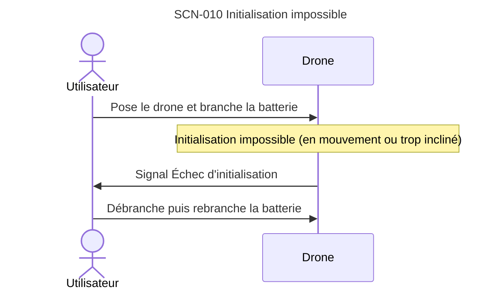

Décisions citées :
- DEC-067 « Démarrage à plat exigé, sinon échec de l'initialisation avec signal »
- DEC-088 « Bouton coincé ou maintenu en permanence au démarrage : statut sans fil seulement, aucun signal local »
- DOU-062 « Où l'utilisateur est-il informé des limites d'emploi ? »

**Réfs amont :** Utilisateur (entretien du 2026-10-27), DEC-030 « Drone posé immobile à la mise sous tension ; refus de s'armer si l'initialisation échoue », DEC-005 « Un signal distinct pour chaque information », DEC-059 « Bouton déjà enfoncé : ignoré jusqu'au premier relâchement », DEC-067 « Démarrage à plat exigé, sinon échec de l'initialisation avec signal », DEC-075 « Initialisation en échec : définitive jusqu'au débranchement de la batterie », DEC-088 « Bouton coincé ou maintenu en permanence au démarrage : statut sans fil seulement, aucun signal local »
**Type :** Échec
**Acteurs :** Utilisateur.
**Situation de départ :** drone hors tension, batterie chargée ; le drone est déplacé pendant son démarrage, posé sur une surface trop inclinée (inclinaison limite à chiffrer en exigences : DEC-067 « Démarrage à plat exigé, sinon échec de l'initialisation avec signal »), ou n'est pas en état de voler.
**Déroulé :**
1. L'utilisateur branche la batterie.
2. Le drone n'arrive pas à s'initialiser.
3. Il ne se déclare pas « allumé, en attente d'un appui », ignore le bouton et informe l'utilisateur avec un signal d'échec d'initialisation distinct des autres. Un bouton enfoncé pendant l'initialisation est ignoré jusqu'à son premier relâchement (DEC-059 « Bouton déjà enfoncé : ignoré jusqu'au premier relâchement »). Si le bouton est coincé ou maintenu en permanence au démarrage, seul le statut sans fil l'indique (l'appareil de suivi affiche « bouton maintenu ») : aucun signal local n'est ajouté et le drone reste silencieux au bouton ; l'utilisateur sans appareil de suivi n'en connaît pas la cause, risque accepté à reporter dans les limites d'emploi (DEC-088 « Bouton coincé ou maintenu en permanence au démarrage : statut sans fil seulement, aucun signal local » ; DOU-062 « Où l'utilisateur est-il informé des limites d'emploi ? »).
4. L'échec est définitif jusqu'au débranchement de la batterie, même si le drone se pose ensuite immobile (DEC-075 « Initialisation en échec : définitive jusqu'au débranchement de la batterie »). L'utilisateur débranche puis rebranche la batterie, drone posé immobile et à plat.
**Résultat attendu :** le drone ne peut pas être armé tant que l'initialisation échoue ; l'utilisateur sait qu'il s'agit d'un échec d'initialisation ; un nouveau démarrage est possible.
**Statut :** Proposé

### SCN-011 — Dégradé : coupure d'alimentation en vol

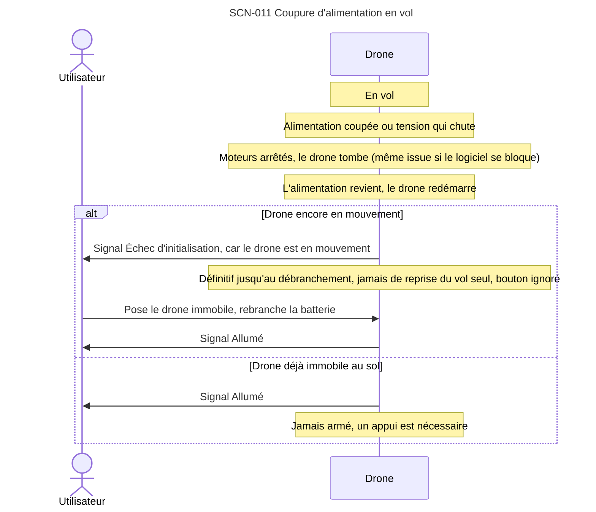

Décisions citées :
- DEC-061 « Redémarrage immobile au sol : allumé mais jamais armé »
- DEC-065 « Logiciel bloqué en vol : coupure des moteurs par un chien de garde »
- DEC-075 « Initialisation en échec : définitive jusqu'au débranchement de la batterie »

**Réfs amont :** Utilisateur (entretien du 2026-10-27), DEC-018 « Jamais de réarmement automatique ; batterie mesurée à vide à l'armement », DEC-030 « Drone posé immobile à la mise sous tension ; refus de s'armer si l'initialisation échoue », DEC-061 « Redémarrage immobile au sol : allumé mais jamais armé », DEC-065 « Logiciel bloqué en vol : coupure des moteurs par un chien de garde », DEC-075 « Initialisation en échec : définitive jusqu'au débranchement de la batterie », DEC-023 « Après le posé ou une coupure : drone verrouillé, nouvel appui pour revoler », DEC-005 « Un signal distinct pour chaque information »
**Type :** Dégradé
**Acteurs :** Utilisateur.
**Situation de départ :** drone en vol (stabilisation, stationnaire ou atterrissage). Un lancer vigoureux, un choc ou une batterie trop faible coupent l'alimentation ou la font chuter. Le logiciel peut aussi se bloquer en vol (DEC-065 « Logiciel bloqué en vol : coupure des moteurs par un chien de garde »).
**Déroulé :**
1. L'alimentation du drone est coupée ou sa tension chute : les moteurs s'arrêtent et le drone tombe.
2. Si l'alimentation revient, le drone redémarre. Il ne reprend jamais le vol seul, même si le bouton est appuyé. Un logiciel bloqué est traité de la même façon : un mécanisme indépendant du logiciel coupe les moteurs, puis le drone redémarre (DEC-065 « Logiciel bloqué en vol : coupure des moteurs par un chien de garde »).
3. Comme il est en mouvement, il ne peut pas s'initialiser (DEC-030 « Drone posé immobile à la mise sous tension ; refus de s'armer si l'initialisation échoue ») : il donne le signal d'échec d'initialisation et ignore le bouton ; cet échec est définitif jusqu'au débranchement de la batterie (DEC-075 « Initialisation en échec : définitive jusqu'au débranchement de la batterie »). S'il revient immobile au sol, l'initialisation réussit : il donne le signal « Allumé », n'est pas armé, et il n'est pas nécessaire de débrancher la batterie (DEC-061 « Redémarrage immobile au sol : allumé mais jamais armé »).
4. L'utilisateur pose le drone immobile et rebranche la batterie ; le drone est alors allumé et en attente d'un appui, et un appui de 2 secondes est nécessaire pour l'armer.
**Résultat attendu :** moteurs arrêtés ; le drone n'a jamais repris le vol seul ; l'utilisateur sait que le drone doit être redémarré posé et immobile, ou, s'il a redémarré immobile au sol, qu'il est simplement allumé.
**Statut :** Proposé

<!-- Ajouter les scénarios ci-dessous, au même format, en dehors des blocs de code. -->
