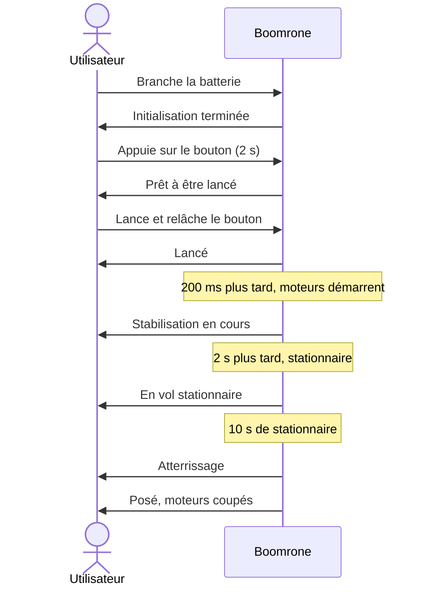

# Scénarios d'utilisation

> **Aperçu** : Boomrone est un drone de poche, un jouet qu'on lance à la main vers le haut et vers l'avant, dans une pièce d'appartement, un gymnase ou un jardin sans vent. Il se stabilise seul en vol stationnaire, attend 10 secondes, puis atterrit doucement. À chaque étape il informe l'utilisateur.
> **État de la phase** : SCN-001 « Vol nominal : de la batterie au posé », SCN-002 « Échec : stationnaire non atteint dans le délai » et SCN-003 « Échec : batterie faible à l'armement » proposés, ainsi que SCN-004 « Dégradé : bouton relâché avant 2 secondes » et SCN-005 « Dégradé : bouton maintenu plus de 10 secondes », à valider. SCN-006 « Échec : inclinaison excessive après le stationnaire » et SCN-007 « Dégradé : arrêt d'urgence par le bouton en vol » sont proposés aussi. Mise en service : pas encore écrite (questions en attente, voir `registre-doutes.md`).

## Vue d'ensemble



## Scénarios

Les scénarios viennent de l'utilisateur (le client) et **précèdent les besoins** : chaque besoin en dérive. L'architecte les rédige avec lui, en demandant systématiquement, pour chaque fonction, le cas nominal, les cas dégradés et les cas d'échec.

Format d'un scénario (exemple, non analysé) :

```
### SCN-001 — Titre court du scénario
**Réfs amont :** Utilisateur (description initiale, entretien du jj/mm)
**Type :** Nominal | Dégradé | Échec | Mise en service / maintenance
**Acteurs :** qui intervient.
**Situation de départ :** état du système et de l'environnement.
**Déroulé :** 1. … 2. … 3. …
**Résultat attendu :** ce que l'utilisateur observe à la fin.
**Statut :** Proposé | Validé | Abandonné
```

### SCN-001 — Vol nominal : de la batterie au posé
**Réfs amont :** Utilisateur (description initiale, entretien du 2026-10-27)
**Type :** Nominal
**Acteurs :** Utilisateur.
**Situation de départ :** drone hors tension, batterie chargée, dans une pièce d'appartement, un gymnase ou un jardin, sans vent.
**Déroulé :**
1. L'utilisateur branche la batterie.
2. Le drone s'initialise, puis informe l'utilisateur que l'initialisation est terminée.
3. L'utilisateur prend le drone et appuie sur le bouton.
4. Après 2 secondes d'appui, le drone informe qu'il est prêt à être lancé.
5. L'utilisateur lance le drone à la main, vers le haut et vers l'avant, dans n'importe quelle orientation, à 0,5 à 4 m/s et depuis au moins 1,5 m du sol (DEC-010 « Plage de lancer : toute orientation, 0,5 à 4 m/s, au moins 1,5 m du sol »), et arrête d'appuyer sur le bouton. Le drone informe qu'il est lancé.
6. 200 ms plus tard, le drone démarre ses moteurs et cherche à se stabiliser. Il informe qu'il est dans cette phase de stabilisation.
7. 2 secondes plus tard au plus (DEC-009 « Stationnaire atteint en 2 secondes maximum après le démarrage des moteurs »), le drone est en vol stationnaire : il maintient son altitude et dérive horizontalement d'au plus 30 cm sur 10 s, objectif à valider par essais (DEC-011 « Centrale inertielle seule, dérive de 30 cm sur 10 s en objectif à valider par essais »). Le stationnaire est atteint quand la vitesse est < 0,3 m/s et l'inclinaison < 10°, tenues 0,5 s. Il informe qu'il est en vol stationnaire.
8. Après 10 secondes de vol stationnaire, le drone atterrit doucement et informe qu'il atterrit.
9. Une fois posé, le drone coupe les moteurs et informe qu'il est posé.
**Résultat attendu :** le drone est posé, moteurs arrêtés, intact, et l'utilisateur a été informé à chaque étape. (Moyen d'information : voir DOU-001 « Comment le drone informe-t-il l'utilisateur ? ».)
**Statut :** Proposé

### SCN-002 — Échec : stationnaire non atteint dans le délai
**Réfs amont :** Utilisateur (entretien du 2026-10-27), DEC-002 « Couper les moteurs si le stationnaire n'est pas atteint dans le délai », DEC-003 « Drone retourné ou très incliné : normal tant que la stabilisation n'est pas finie », DEC-005 « Un signal distinct pour chaque information »
**Type :** Échec
**Acteurs :** Utilisateur.
**Situation de départ :** drone lancé comme dans SCN-001 « Vol nominal : de la batterie au posé » (étape 5), moteurs démarrés, en cours de stabilisation. Le lancer peut être mal orienté, trop faible ou trop rapide.
**Déroulé :**
1. Le drone cherche à se stabiliser ; être retourné ou très incliné est normal à ce stade.
2. Le délai maximal s'écoule sans que le stationnaire soit atteint (2 secondes après le démarrage des moteurs : DEC-009 « Stationnaire atteint en 2 secondes maximum après le démarrage des moteurs »).
3. Le drone coupe ses moteurs et informe l'utilisateur avec un signal d'échec distinct des autres.
**Résultat attendu :** moteurs arrêtés ; le drone tombe ; l'utilisateur sait qu'il s'agit d'un échec de stabilisation.
**Statut :** Proposé

### SCN-003 — Échec : batterie faible à l'armement
**Réfs amont :** Utilisateur (entretien du 2026-10-27), DEC-004 « Batterie vérifiée à l'armement : pas d'armement si batterie faible », DEC-005 « Un signal distinct pour chaque information »
**Type :** Échec
**Acteurs :** Utilisateur.
**Situation de départ :** drone initialisé (étape 2 de SCN-001 « Vol nominal : de la batterie au posé »), batterie en dessous du seuil.
**Déroulé :**
1. L'utilisateur appuie sur le bouton.
2. Après 2 secondes, le drone constate que la batterie est faible.
3. Il ne s'arme pas et informe l'utilisateur avec un signal « batterie faible » distinct des autres.
**Résultat attendu :** le drone n'est pas armé ; relâcher le bouton ne démarre pas les moteurs ; l'utilisateur sait qu'il doit changer ou recharger la batterie.
**Statut :** Proposé

### SCN-004 — Dégradé : bouton relâché avant 2 secondes
**Réfs amont :** Utilisateur (entretien du 2026-10-27), DEC-007 « Bouton relâché avant 2 secondes : retour en attente », DEC-005 « Un signal distinct pour chaque information »
**Type :** Dégradé
**Acteurs :** Utilisateur.
**Situation de départ :** drone initialisé, tenu en main ou posé.
**Déroulé :**
1. L'utilisateur appuie sur le bouton.
2. Il le relâche avant 2 secondes.
3. Le drone n'est pas armé, revient à l'état initialisé et signale l'appui trop court avec un signal distinct.
**Résultat attendu :** les moteurs ne démarrent pas ; un nouvel appui est possible.
**Statut :** Proposé

### SCN-005 — Dégradé : bouton maintenu plus de 10 secondes
**Réfs amont :** Utilisateur (entretien du 2026-10-27), DEC-008 « Désarmement si le bouton reste appuyé plus de 10 secondes », DEC-005 « Un signal distinct pour chaque information »
**Type :** Dégradé
**Acteurs :** Utilisateur.
**Situation de départ :** drone armé (bouton appuyé depuis plus de 2 secondes), pas encore lancé.
**Déroulé :**
1. L'utilisateur garde le bouton appuyé au-delà de 10 secondes.
2. Le drone se désarme et le signale avec un signal distinct.
3. L'utilisateur relâche le bouton : les moteurs ne démarrent pas.
4. Pour réarmer, il appuie de nouveau 2 secondes.
**Résultat attendu :** le drone n'est plus armé ; le relâchement du bouton ne démarre pas les moteurs.
**Statut :** Proposé

### SCN-006 — Échec : inclinaison excessive après le stationnaire
**Réfs amont :** Utilisateur (entretien du 2026-10-27), DEC-012 « Couper les moteurs si le drone bascule après le stationnaire », DEC-005 « Un signal distinct pour chaque information »
**Type :** Échec
**Acteurs :** Utilisateur.
**Situation de départ :** drone en vol stationnaire ou en descente (SCN-001 « Vol nominal : de la batterie au posé », étapes 7 à 8).
**Déroulé :**
1. Une perturbation fait basculer le drone au-delà de l'angle limite, ou le retourne.
2. Le drone coupe ses moteurs et informe l'utilisateur avec un signal distinct.
**Résultat attendu :** moteurs arrêtés ; le drone tombe ; l'utilisateur sait que la cause est un basculement.
**Statut :** Proposé

### SCN-007 — Dégradé : arrêt d'urgence par le bouton en vol
**Réfs amont :** Utilisateur (entretien du 2026-10-27), DEC-015 « Bouton appuyé en vol : arrêt d'urgence », DEC-005 « Un signal distinct pour chaque information »
**Type :** Dégradé
**Acteurs :** Utilisateur.
**Situation de départ :** drone en vol (stabilisation, stationnaire ou descente).
**Déroulé :**
1. L'utilisateur appuie sur le bouton.
2. Le drone coupe ses moteurs immédiatement et informe l'utilisateur avec un signal distinct.
**Résultat attendu :** moteurs arrêtés ; le drone tombe ; l'utilisateur sait que l'arrêt vient du bouton.
**Statut :** Proposé

<!-- Ajouter les scénarios ci-dessous, au même format, en dehors des blocs de code. -->
