# Scénarios d'utilisation

> **Aperçu** : Boomrone est un drone de poche pour adultes, lancé à la main dans un appartement (gymnase et jardin en essais complémentaires) ; il se stabilise, reste 10 s en stationnaire, atterrit doucement et informe l'utilisateur à chaque étape.
> **État de la phase** :
> - SCN-001 « Vol nominal : de la batterie au posé » à SCN-011 « Dégradé : coupure d'alimentation en vol » : statut Proposé, à valider à la porte « scénarios ».
> - 0 doute bloquant ouvert, 35 non bloquants (voir `registre-doutes.md`).
> - Valeurs chiffrées provisoires (délai de 2 s, plage de lancer, angle limite de 60°) : à confirmer avant la porte « exigences », voir DEC-052 « Valeurs provisoires retenues pour les scénarios, à confirmer avant les exigences ».
> - Les scénarios décrivent l'intention, sans solution technique : les solutions évoquées sont des propositions d'architecture, voir DEC-053 « Solutions techniques déplacées en propositions d'architecture, seule l'intention reste décidée ».
> - Valeurs d'origine et bornes numériques des réglages : à fixer en architecture, voir DOU-058 « Valeurs d'origine et bornes numériques à fixer en architecture ».

## Vue d'ensemble

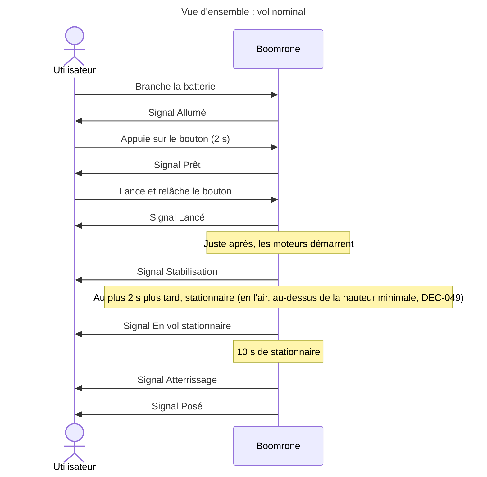

Ce premier diagramme montre le vol nominal. Le suivant montre tous les états du drone et chaque signal donné à l'utilisateur, y compris pour les échecs et les cas dégradés.

```mermaid
---
title: "Vue d'ensemble : états du drone et signaux"
---
stateDiagram-v2
    state "Éteint" as Eteint
    state "Échec d'initialisation" as EchecInit
    state "Mode réglage" as Reglage
    state "Allumé, en attente d'un appui" as Attente
    state "Armé, prêt à être lancé" as Arme
    state "Lancé" as Lance
    state "Moteurs coupés en vol" as Coupe
    state "Posé, moteurs coupés" as Pose
    state "Vol de réglage" as VolReg
    state "En vol" as Vol {
        state "Stabilisation" as Stab
        state "Vol stationnaire" as Stat
        state "Atterrissage" as Atterr
        [*] --> Stab
        Stab --> Stat : En l'air, au-dessus de la hauteur minimale (DEC-049) - Signal En vol stationnaire
        Stat --> Atterr : Après 10 s - Signal Atterrissage
    }
    [*] --> Eteint
    Eteint --> Attente : Batterie branchée - Signal Allumé
    Eteint --> EchecInit : Initialisation impossible - Signal Échec d'initialisation
    EchecInit --> Eteint : Batterie débranchée puis rebranchée
    Attente --> Reglage : Trois appuis - Signal Mode réglage
    Reglage --> Eteint : Batterie coupée
    Attente --> Attente : Appui de moins de 2 s - Signal Appui trop court
    Attente --> Attente : Batterie faible - Signal Batterie faible
    Attente --> Arme : Appui de 2 s - Signal Prêt
    Arme --> Attente : Appui de plus de 10 s - Signal Désarmement
    Arme --> Lance : Lancer et relâchement - Signal Lancé
    Lance --> Vol : Moteurs démarrent - Signal Stabilisation
    Atterr --> Pose : Moins de 2 à 3 cm du sol - Signal Posé
    Stab --> Coupe : Stationnaire non atteint à temps - Signal Échec de stabilisation
    Vol --> Coupe : Bouton appuyé - Signal Arrêt par le bouton
    Vol --> Coupe : Commande d'arrêt sans fil - Signal Arrêt sans fil
    Stat --> Coupe : Basculement - Signal Basculement
    Atterr --> Coupe : Basculement - Signal Basculement
    Atterr --> Coupe : 15 s de descente écoulées - Signal Délai de descente dépassé
    Vol --> Eteint : Coupure d'alimentation - moteurs arrêtés
    Pose --> Attente : Verrouillé, même état (DEC-047) ; appui déjà en cours ignoré jusqu'au relâchement (DEC-050)
    Coupe --> Attente : Verrouillé, même état (DEC-047) ; appui déjà en cours ignoré jusqu'au relâchement (DEC-050)
    Reglage --> VolReg : Commande Décoller par le sans fil - signaux à définir (DOU-053)
    VolReg --> Reglage : Posé après 3 s de stationnaire - signaux à définir (DOU-053)
    VolReg --> Reglage : Bouton, arrêt sans fil, échec ou basculement - moteurs coupés, pas de verrouillage
    VolReg --> Eteint : Coupure d'alimentation - moteurs arrêtés
```

Légende du diagramme d'états : chaque transition indique l'événement puis le signal donné à l'utilisateur. Les sorties de « Posé » et de « Moteurs coupés en vol » vont vers « Allumé, en attente d'un appui », car l'état verrouillé est le même (DEC-047 « L'état verrouillé est le même que l'état allumé, en attente d'un appui ») ; un nouvel appui de 2 secondes réarme le drone (DEC-023 « Après le posé ou une coupure : drone verrouillé, nouvel appui pour revoler »). Un appui sur le bouton déjà en cours au moment de la coupure des moteurs est ignoré jusqu'au relâchement : seul un nouvel appui distinct arme le drone (DEC-050 « Appui en cours lors d'une coupure des moteurs ignoré jusqu'au relâchement »). Les commandes sans fil acceptées dans chaque état sont décrites dans le tableau ci-dessous (DEC-043 « Commandes sans fil acceptées selon l'état du drone »). Après un vol de réglage, le drone revient en mode réglage, posé, sans verrouillage (DEC-044 « Mode réglage persistant : retour au mode réglage après un vol de réglage, sans verrouillage ») ; il en va de même après un arrêt, un échec ou un basculement en vol de réglage : le drone est prêt à redécoller tout de suite sur commande sans fil (confirmé par l'utilisateur le 2026-10-27, DEC-044 « Mode réglage persistant : retour au mode réglage après un vol de réglage, sans verrouillage »).

Dix-sept signaux (référence unique ; leur forme, lumière, son ou suivi, reste à définir : voir DOU-027 « Un signal distinct par information, ou par catégorie ? ») :

| N° | Signal | Déclencheur | Scénario |
|---|---|---|---|
| 1 | Allumé | Batterie branchée, drone en attente d'un appui | SCN-001 « Vol nominal : de la batterie au posé » |
| 2 | Échec d'initialisation | Le drone n'est pas en état de voler au démarrage | SCN-010 « Échec : initialisation impossible au démarrage » |
| 3 | Mode réglage | Trois appuis sur le bouton au sol | SCN-009 « Réglage et suivi du drone par le sans fil » |
| 4 | Appui trop court | Bouton relâché avant 2 secondes | SCN-004 « Dégradé : bouton relâché avant 2 secondes » |
| 5 | Batterie faible | Batterie sous le seuil à l'armement | SCN-003 « Échec : batterie faible à l'armement » |
| 6 | Prêt | Bouton appuyé 2 secondes, drone armé | SCN-001 « Vol nominal : de la batterie au posé » |
| 7 | Désarmement | Bouton appuyé plus de 10 secondes | SCN-005 « Dégradé : bouton maintenu plus de 10 secondes » |
| 8 | Lancé | Bouton relâché après armement | SCN-001 « Vol nominal : de la batterie au posé » |
| 9 | Stabilisation | Moteurs démarrés | SCN-001 « Vol nominal : de la batterie au posé » |
| 10 | En vol stationnaire | Stationnaire atteint | SCN-001 « Vol nominal : de la batterie au posé » |
| 11 | Atterrissage | 10 secondes de stationnaire écoulées | SCN-001 « Vol nominal : de la batterie au posé » |
| 12 | Posé | Moins de 2 à 3 cm du sol | SCN-001 « Vol nominal : de la batterie au posé » |
| 13 | Échec de stabilisation | Stationnaire non atteint dans le délai | SCN-002 « Échec : stationnaire non atteint dans le délai » |
| 14 | Arrêt par le bouton | Bouton appuyé en vol | SCN-007 « Dégradé : arrêt d'urgence par le bouton en vol » |
| 15 | Basculement | Drone très incliné ou retourné après le stationnaire | SCN-006 « Échec : inclinaison excessive après le stationnaire » |
| 16 | Arrêt sans fil | Commande d'arrêt reçue de l'appareil de suivi en vol | SCN-007 « Dégradé : arrêt d'urgence par le bouton en vol » |
| 17 | Délai de descente dépassé | 15 secondes de descente écoulées sans passage à moins de 2 à 3 cm du sol | SCN-001 « Vol nominal : de la batterie au posé » |

### Commandes sans fil acceptées selon l'état du drone

Table décidée par DEC-043 « Commandes sans fil acceptées selon l'état du drone » : une commande ignorée n'a aucun effet.

| État du drone | Décoller | Arrêt | Modifier | Sauvegarder |
|---|---|---|---|---|
| Allumé, en attente d'un appui (au sol, mode normal) | Ignorée | Ignorée | Acceptée | Acceptée |
| Armé, avant le lancer | Ignorée | Ignorée | Acceptée | Acceptée |
| En vol (vol normal) | Ignorée | Coupe les moteurs | Acceptée | Ignorée |
| Mode réglage, posé (état de retour après un vol de réglage, un arrêt ou un échec : DEC-044 « Mode réglage persistant : retour au mode réglage après un vol de réglage, sans verrouillage » , confirmé par l'utilisateur le 2026-10-27) | Acceptée | Ignorée | Acceptée | Acceptée |
| Vol de réglage | Ignorée | Coupe les moteurs | Acceptée | Ignorée |
| Posé ou moteurs coupés, verrouillé | Ignorée | Ignorée | Acceptée | Acceptée |

Légende : « Coupe les moteurs » = arrêt d'urgence sans fil avec le signal Arrêt sans fil. Sans appairage, tout appareil de suivi à portée peut envoyer ces commandes. Après un vol de réglage, le drone revient en mode réglage, posé (DEC-044 « Mode réglage persistant : retour au mode réglage après un vol de réglage, sans verrouillage »).

## Scénarios

Les scénarios viennent de l'utilisateur (le client) et **précèdent les besoins** : chaque besoin en dérive. L'architecte les rédige avec lui, en demandant systématiquement, pour chaque fonction, le cas nominal, les cas dégradés et les cas d'échec.

Format d'un scénario (exemple, non analysé) :

```
### SCN-001 — Titre court du scénario
(diagramme de séquence Mermaid : acteurs, messages, signaux)
**Réfs amont :** Utilisateur (description initiale, entretien du jj/mm)
**Type :** Nominal | Dégradé | Échec | Mise en service / maintenance
**Acteurs :** qui intervient.
**Situation de départ :** état du système et de l'environnement.
**Déroulé :** 1. … 2. … 3. …
**Résultat attendu :** ce que l'utilisateur observe à la fin.
**Statut :** Proposé | Validé | Abandonné
```

### SCN-001 — Vol nominal : de la batterie au posé

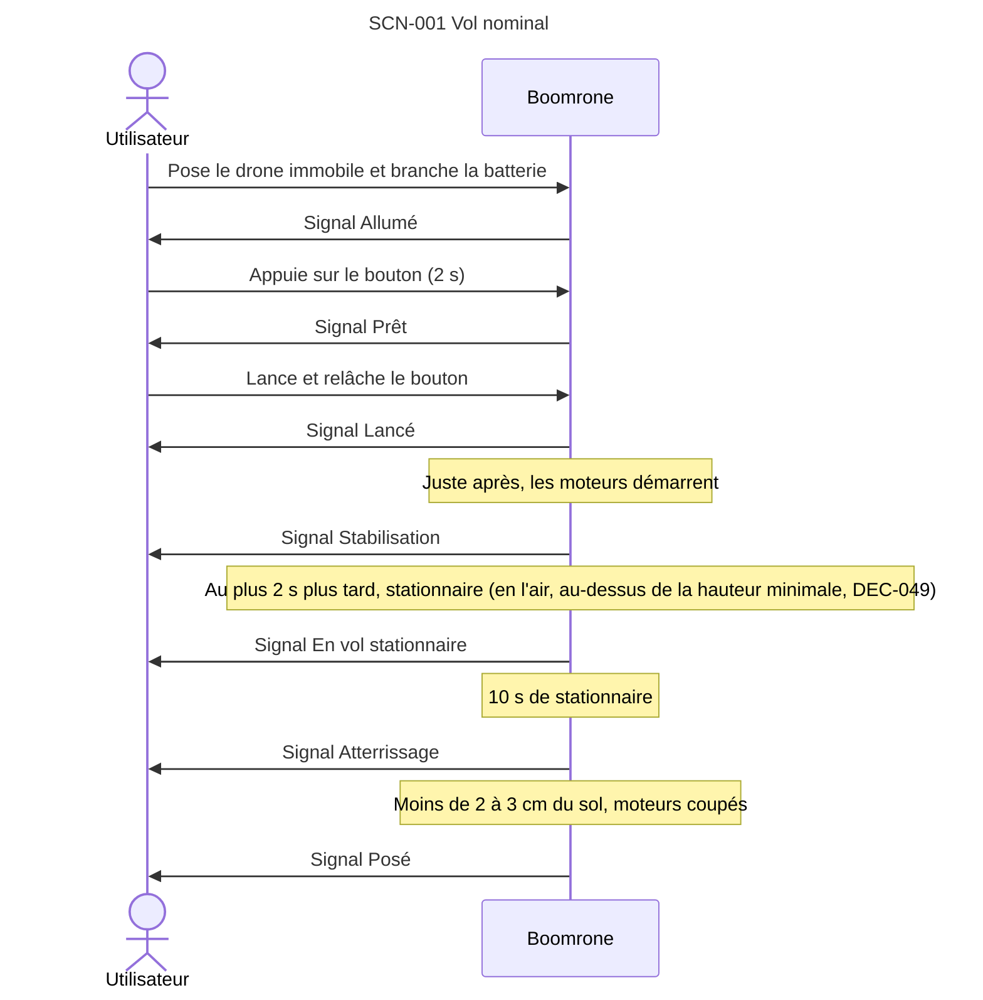

**Réfs amont :** Utilisateur (description initiale, entretien du 2026-10-27), DEC-016 « Public adulte, protège-hélices obligatoires », DEC-001 « Information de l'utilisateur par signaux lumineux, sonores et suivi sur un autre appareil », DEC-005 « Un signal distinct pour chaque information », DEC-030 « Drone posé immobile à la mise sous tension ; refus de s'armer si l'initialisation échoue », DEC-032 « Vol libre : le drone vole sans appareil de suivi », DEC-040 « Périmètre d'emploi visé : l'appartement ; gymnase et jardin en essais complémentaires », DEC-042 « Plage de lancer inchangée, aucune zone libre ni distance aux personnes, le drone ne connaît pas le lieu », DEC-034 « Réglages envoyés par le sans fil, sauvegarde sur commande, chargement au démarrage », DEC-010 « Plage de lancer : toute orientation, 0,5 à 4 m/s, au moins 1,5 m du sol », DEC-006 « Le relâchement du bouton armé suffit à démarrer les moteurs », DEC-009 « Stationnaire atteint en 2 secondes maximum après le démarrage des moteurs », DEC-020 « Atterrissage sur place », DEC-021 « Atterrissage lent, 15 secondes maximum, puis coupure des moteurs », DEC-022 « Moteurs coupés à moins de 2 à 3 cm du sol », DEC-023 « Après le posé ou une coupure : drone verrouillé, nouvel appui pour revoler », DEC-017 « Pas de protection supplémentaire contre les hélices en rotation sans lancer », DEC-046 « Délai de descente dépassé : signal distinct, moteurs coupés, drone verrouillé », DEC-047 « L'état verrouillé est le même que l'état allumé, en attente d'un appui », DEC-049 « Stationnaire déclaré seulement en l'air, au-dessus d'une hauteur minimale », DEC-012 « Couper les moteurs si le drone bascule après le stationnaire », DEC-052 « Valeurs provisoires retenues pour les scénarios, à confirmer avant les exigences »
**Type :** Nominal
**Acteurs :** Utilisateur. Un appareil de suivi peut être relié au drone, mais n'est pas nécessaire (DEC-032 « Vol libre : le drone vole sans appareil de suivi »).
**Situation de départ :** drone hors tension, muni de ses protège-hélices, batterie chargée, dans un appartement (périmètre visé : DEC-040 « Périmètre d'emploi visé : l'appartement ; gymnase et jardin en essais complémentaires »), sans vent, avec ou sans appareil de suivi. Gymnase et jardin : essais complémentaires, non garantis. Le drone ne connaît pas le lieu ; un lieu trop petit pour la plage de lancer relève de l'utilisateur (DEC-042 « Plage de lancer inchangée, aucune zone libre ni distance aux personnes, le drone ne connaît pas le lieu »). Valeurs provisoires : le délai de 2 s pour atteindre le stationnaire (DEC-009 « Stationnaire atteint en 2 secondes maximum après le démarrage des moteurs »), la plage de lancer de 0,5 à 4 m/s depuis au moins 1,5 m du sol, limites de la plage comprises (DEC-010 « Plage de lancer : toute orientation, 0,5 à 4 m/s, au moins 1,5 m du sol »), et l'angle limite de 60° (DEC-012 « Couper les moteurs si le drone bascule après le stationnaire ») valent pour la porte « scénarios » ; ils sont à confirmer par analyse ou par essais avant la porte « exigences » (DEC-052 « Valeurs provisoires retenues pour les scénarios, à confirmer avant les exigences »).
**Déroulé :**
1. L'utilisateur pose le drone immobile et branche la batterie, sans y toucher pendant quelques secondes (DEC-030 « Drone posé immobile à la mise sous tension ; refus de s'armer si l'initialisation échoue »).
2. Le drone démarre en chargeant ses derniers réglages enregistrés depuis sa mémoire non volatile, sans aucun échange sans fil (DEC-034 « Réglages envoyés par le sans fil, sauvegarde sur commande, chargement au démarrage »), puis informe l'utilisateur qu'il est allumé et en attente d'un appui sur le bouton.
3. L'utilisateur prend le drone et appuie sur le bouton.
4. Après 2 secondes d'appui, le drone informe qu'il est prêt à être lancé.
5. L'utilisateur lance le drone à la main, vers le haut et vers l'avant, dans n'importe quelle orientation, à 0,5 à 4 m/s et depuis au moins 1,5 m du sol (DEC-010 « Plage de lancer : toute orientation, 0,5 à 4 m/s, au moins 1,5 m du sol »), et arrête d'appuyer sur le bouton. Le drone informe qu'il est lancé.
6. Juste après (DEC-006 « Le relâchement du bouton armé suffit à démarrer les moteurs »), le drone démarre ses moteurs et cherche à se stabiliser. Il informe qu'il est dans cette phase de stabilisation.
7. 2 secondes plus tard au plus (DEC-009 « Stationnaire atteint en 2 secondes maximum après le démarrage des moteurs »), le drone est en vol stationnaire : il maintient son altitude et dérive horizontalement d'au plus 30 cm sur 10 s (objectif à valider par essais, non garanti). Il est alors immobile en l'air et à plat, au-dessus d'une hauteur minimale mesurée sous lui (valeur à fixer en architecture) : un drone posé ou tenu immobile en main n'est jamais déclaré en vol stationnaire (DEC-049 « Stationnaire déclaré seulement en l'air, au-dessus d'une hauteur minimale »). Il informe qu'il est en vol stationnaire.
8. Après 10 secondes de vol stationnaire, le drone descend et se pose à l'endroit où il est (DEC-020 « Atterrissage sur place »), à 0,5 m/s au plus au contact du sol, en 15 secondes au plus (DEC-021 « Atterrissage lent, 15 secondes maximum, puis coupure des moteurs »). Il informe qu'il atterrit.
9. Dès qu'il est à moins de 2 à 3 cm du sol (DEC-022 « Moteurs coupés à moins de 2 à 3 cm du sol »), le drone coupe les moteurs et informe qu'il est posé. Si les 15 secondes de descente s'écoulent avant, il coupe aussi les moteurs, ne donne pas le signal « Posé » mais le signal « Délai de descente dépassé », et est verrouillé (DEC-046 « Délai de descente dépassé : signal distinct, moteurs coupés, drone verrouillé »).
**Résultat attendu :** dans le cas nominal, le drone est posé (moins de 2 à 3 cm du sol), moteurs arrêtés, intact, et l'utilisateur a été informé à chaque étape ; si le délai de descente est dépassé, le drone n'est pas déclaré posé : voir DEC-046 « Délai de descente dépassé : signal distinct, moteurs coupés, drone verrouillé ». Le drone est alors verrouillé : un nouvel appui de 2 secondes est nécessaire pour revoler (DEC-023 « Après le posé ou une coupure : drone verrouillé, nouvel appui pour revoler »). (Moyen d'information : voir DOU-001 « Comment le drone informe-t-il l'utilisateur ? ».)
**Statut :** Proposé

### SCN-002 — Échec : stationnaire non atteint dans le délai

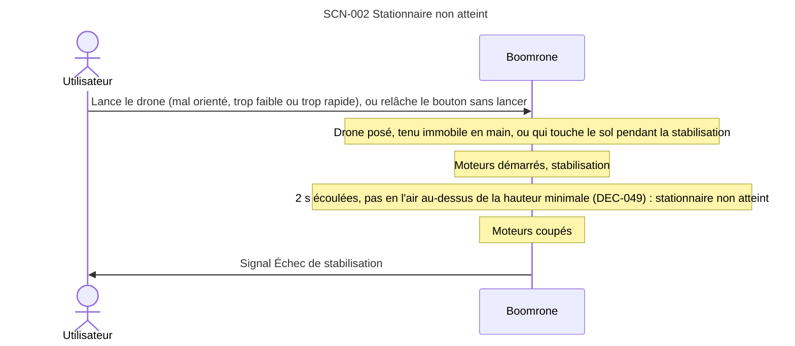

**Réfs amont :** Utilisateur (entretien du 2026-10-27), DEC-002 « Couper les moteurs si le stationnaire n'est pas atteint dans le délai », DEC-003 « Drone retourné ou très incliné : normal tant que la stabilisation n'est pas finie », DEC-005 « Un signal distinct pour chaque information », DEC-009 « Stationnaire atteint en 2 secondes maximum après le démarrage des moteurs », DEC-023 « Après le posé ou une coupure : drone verrouillé, nouvel appui pour revoler », DEC-017 « Pas de protection supplémentaire contre les hélices en rotation sans lancer », DEC-051 « Seuils de sécurité réglables dans des bornes fixées par le logiciel », DEC-049 « Stationnaire déclaré seulement en l'air, au-dessus d'une hauteur minimale »
**Type :** Échec
**Acteurs :** Utilisateur.
**Situation de départ :** drone armé, puis lancé comme dans SCN-001 « Vol nominal : de la batterie au posé » (étape 5), ou bouton relâché sans lancer, drone posé ou tenu immobile en main ; moteurs démarrés, en cours de stabilisation. Le lancer peut être mal orienté, trop faible ou trop rapide, et le drone peut toucher le sol pendant la stabilisation (DEC-049 « Stationnaire déclaré seulement en l'air, au-dessus d'une hauteur minimale »).
**Déroulé :**
1. Le drone cherche à se stabiliser ; être retourné ou très incliné est normal à ce stade.
2. Le délai maximal s'écoule sans que le stationnaire soit atteint (2 secondes après le démarrage des moteurs : DEC-009 « Stationnaire atteint en 2 secondes maximum après le démarrage des moteurs »).
3. Le drone coupe ses moteurs et informe l'utilisateur avec un signal d'échec distinct des autres. Les seuils de cette coupure sont réglables dans des bornes fixées par le logiciel (DEC-051 « Seuils de sécurité réglables dans des bornes fixées par le logiciel ») : aucune valeur réglable ne supprime la coupure. Même comportement si le drone est relâché sans lancer, posé ou tenu immobile en main, ou s'il touche le sol pendant la stabilisation : faute d'être en l'air au-dessus de la hauteur minimale, il n'atteint pas le stationnaire et coupe ses moteurs au bout du délai (DEC-049 « Stationnaire déclaré seulement en l'air, au-dessus d'une hauteur minimale »).
**Résultat attendu :** moteurs arrêtés au bout du délai ; le drone tombe s'il est en l'air, ou reste où il est s'il est posé, tenu en main ou au contact du sol ; l'utilisateur sait qu'il s'agit d'un échec de stabilisation. Le drone est alors verrouillé : un nouvel appui de 2 secondes est nécessaire pour revoler (DEC-023 « Après le posé ou une coupure : drone verrouillé, nouvel appui pour revoler »).
**Statut :** Proposé

### SCN-003 — Échec : batterie faible à l'armement

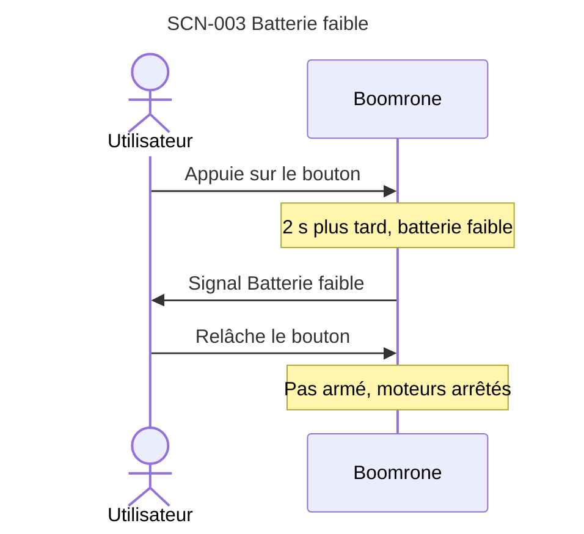

**Réfs amont :** Utilisateur (entretien du 2026-10-27), DEC-004 « Batterie vérifiée à l'armement : pas d'armement si batterie faible », DEC-005 « Un signal distinct pour chaque information »
**Type :** Échec
**Acteurs :** Utilisateur.
**Situation de départ :** drone allumé et en attente d'un appui (étape 2 de SCN-001 « Vol nominal : de la batterie au posé »), batterie en dessous du seuil.
**Déroulé :**
1. L'utilisateur appuie sur le bouton.
2. Après 2 secondes, le drone constate que la batterie est faible.
3. Il ne s'arme pas et informe l'utilisateur avec un signal « batterie faible » distinct des autres.
**Résultat attendu :** le drone n'est pas armé ; relâcher le bouton ne démarre pas les moteurs ; l'utilisateur sait qu'il doit changer ou recharger la batterie.
**Statut :** Proposé

### SCN-004 — Dégradé : bouton relâché avant 2 secondes

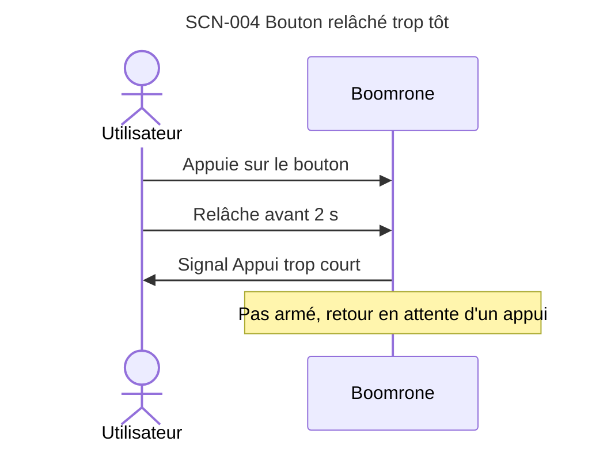

**Réfs amont :** Utilisateur (entretien du 2026-10-27), DEC-007 « Bouton relâché avant 2 secondes : retour en attente », DEC-005 « Un signal distinct pour chaque information »
**Type :** Dégradé
**Acteurs :** Utilisateur.
**Situation de départ :** drone allumé et en attente d'un appui, tenu en main ou posé.
**Déroulé :**
1. L'utilisateur appuie sur le bouton.
2. Il le relâche avant 2 secondes.
3. Le drone n'est pas armé, revient en attente d'un appui et signale l'appui trop court avec un signal distinct.
**Résultat attendu :** les moteurs ne démarrent pas ; un nouvel appui est possible.
**Statut :** Proposé

### SCN-005 — Dégradé : bouton maintenu plus de 10 secondes

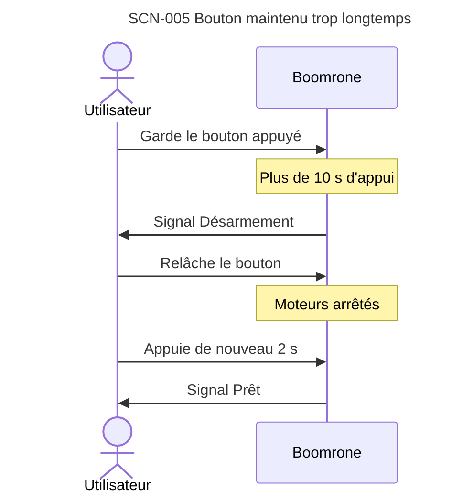

**Réfs amont :** Utilisateur (entretien du 2026-10-27), DEC-008 « Désarmement si le bouton reste appuyé plus de 10 secondes », DEC-005 « Un signal distinct pour chaque information »
**Type :** Dégradé
**Acteurs :** Utilisateur.
**Situation de départ :** drone armé (bouton appuyé depuis plus de 2 secondes), pas encore lancé.
**Déroulé :**
1. L'utilisateur garde le bouton appuyé au-delà de 10 secondes.
2. Le drone se désarme et le signale avec un signal distinct.
3. L'utilisateur relâche le bouton : les moteurs ne démarrent pas.
4. Pour réarmer, il appuie de nouveau 2 secondes et le drone informe qu'il est prêt (signal Prêt).
**Résultat attendu :** le drone n'est plus armé ; le relâchement du bouton ne démarre pas les moteurs.
**Statut :** Proposé

### SCN-006 — Échec : inclinaison excessive après le stationnaire

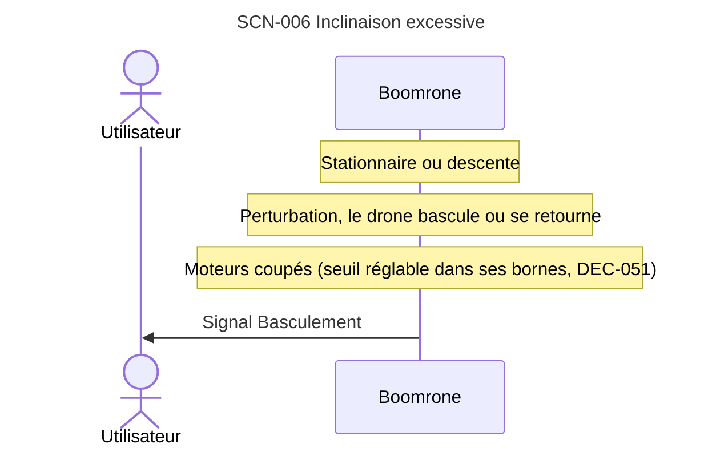

**Réfs amont :** Utilisateur (entretien du 2026-10-27), DEC-012 « Couper les moteurs si le drone bascule après le stationnaire », DEC-005 « Un signal distinct pour chaque information », DEC-023 « Après le posé ou une coupure : drone verrouillé, nouvel appui pour revoler », DEC-051 « Seuils de sécurité réglables dans des bornes fixées par le logiciel »
**Type :** Échec
**Acteurs :** Utilisateur.
**Situation de départ :** drone en vol stationnaire ou en descente (SCN-001 « Vol nominal : de la batterie au posé », étapes 7 à 8).
**Déroulé :**
1. Une perturbation fait basculer le drone fortement, ou le retourne.
2. Le drone coupe ses moteurs et informe l'utilisateur avec un signal distinct. Les seuils de cette coupure sont réglables dans des bornes fixées par le logiciel (DEC-051 « Seuils de sécurité réglables dans des bornes fixées par le logiciel ») : aucune valeur réglable ne supprime la coupure.
**Résultat attendu :** moteurs arrêtés ; le drone tombe ; l'utilisateur sait que la cause est un basculement. Le drone est alors verrouillé : un nouvel appui de 2 secondes est nécessaire pour revoler (DEC-023 « Après le posé ou une coupure : drone verrouillé, nouvel appui pour revoler »).
**Statut :** Proposé

### SCN-007 — Dégradé : arrêt d'urgence par le bouton en vol

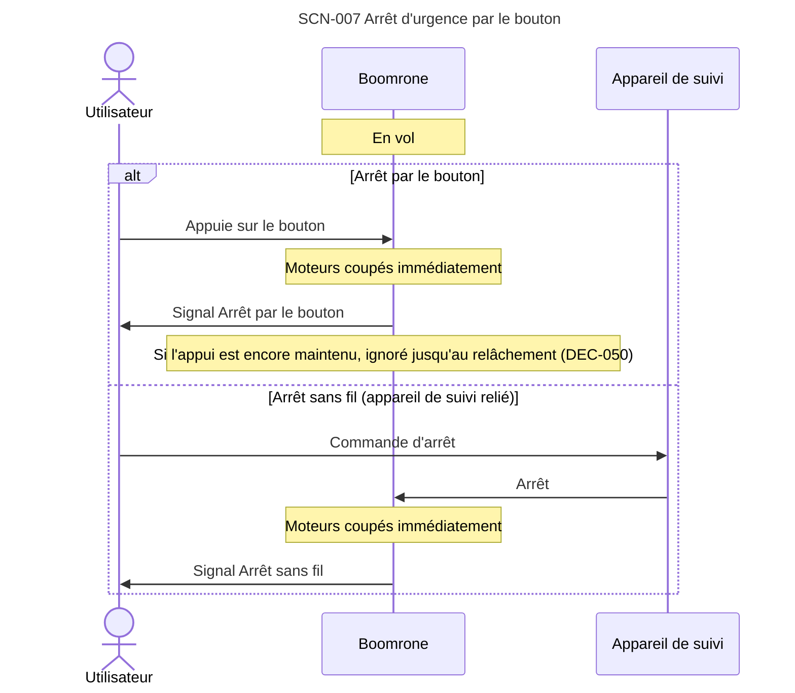

**Réfs amont :** Utilisateur (entretien du 2026-10-27), DEC-015 « Bouton appuyé en vol : arrêt d'urgence », DEC-031 « Arrêt du drone lancé : bouton et commande d'arrêt sans fil », DEC-005 « Un signal distinct pour chaque information », DEC-032 « Vol libre : le drone vole sans appareil de suivi », DEC-037 « Pas d'appairage : le drone obéit à tout appareil de suivi à portée », DEC-033 « Signal Arrêt sans fil distinct du signal Arrêt par le bouton », DEC-023 « Après le posé ou une coupure : drone verrouillé, nouvel appui pour revoler », DEC-043 « Commandes sans fil acceptées selon l'état du drone », DEC-044 « Mode réglage persistant : retour au mode réglage après un vol de réglage, sans verrouillage », DEC-050 « Appui en cours lors d'une coupure des moteurs ignoré jusqu'au relâchement »
**Type :** Dégradé
**Acteurs :** Utilisateur, appareil de suivi (pour l'arrêt sans fil).
**Situation de départ :** drone en vol (stabilisation, stationnaire ou descente), en vol normal ou en vol de réglage.
**Déroulé :**
1. L'utilisateur arrête le drone par l'un des deux moyens (la commande d'arrêt sans fil n'agit qu'en vol, et est ignorée au sol : DEC-043 « Commandes sans fil acceptées selon l'état du drone ») : il appuie sur le bouton, ou il envoie la commande d'arrêt depuis l'appareil de suivi s'il est relié au drone (DEC-031 « Arrêt du drone lancé : bouton et commande d'arrêt sans fil »).
2. Le drone coupe ses moteurs immédiatement et informe l'utilisateur avec un signal distinct selon le moyen utilisé. Si l'appui sur le bouton qui a arrêté le drone est encore maintenu, il est ignoré jusqu'au relâchement : il ne peut pas réarmer le drone, et seul un nouvel appui distinct l'arme (DEC-050 « Appui en cours lors d'une coupure des moteurs ignoré jusqu'au relâchement »).
3. En vol de réglage, le drone reste ensuite en mode réglage, posé, sans verrouillage (DEC-044 « Mode réglage persistant : retour au mode réglage après un vol de réglage, sans verrouillage », confirmé par l'utilisateur le 2026-10-27 : prêt à redécoller tout de suite sur commande sans fil). Sans appareil de suivi relié, seul le bouton arrête le drone (risque accepté ; DEC-032 « Vol libre : le drone vole sans appareil de suivi »). Sans appairage, tout appareil de suivi à portée peut envoyer l'arrêt, et une commande peut atteindre plusieurs drones (DEC-037 « Pas d'appairage : le drone obéit à tout appareil de suivi à portée »). Le signal « Arrêt sans fil » est distinct du signal « Arrêt par le bouton » (DEC-033 « Signal Arrêt sans fil distinct du signal Arrêt par le bouton »).
**Résultat attendu :** moteurs arrêtés ; le drone tombe ; l'utilisateur sait que l'arrêt vient du bouton ou de la commande sans fil. Le drone est alors verrouillé (sauf en vol de réglage, où il reste en mode réglage : DEC-044 « Mode réglage persistant : retour au mode réglage après un vol de réglage, sans verrouillage ») : un nouvel appui de 2 secondes est nécessaire pour revoler (DEC-023 « Après le posé ou une coupure : drone verrouillé, nouvel appui pour revoler »).
**Statut :** Proposé

### SCN-008 — Mise en service : programmation du drone

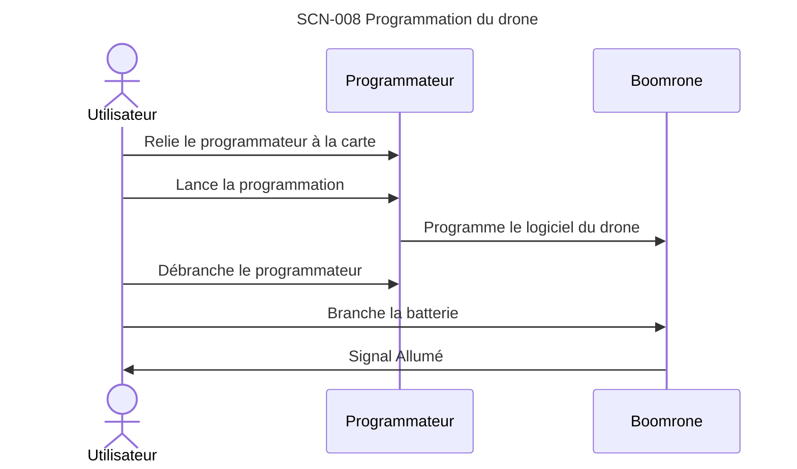

**Réfs amont :** Utilisateur (entretien du 2026-10-27), DEC-024 « Mise en service par programmation avec un programmateur ST-LINK », DEC-026 « Mise en service : calibrage éventuel renvoyé à l'architecture, réglage du vol par un scénario dédié », DEC-053 « Solutions techniques déplacées en propositions d'architecture, seule l'intention reste décidée »
**Type :** Mise en service / maintenance
**Acteurs :** Utilisateur, programmateur (outil choisi en architecture ; proposition : voir DEC-053 « Solutions techniques déplacées en propositions d'architecture, seule l'intention reste décidée »).
**Situation de départ :** carte neuve, jamais programmée, batterie chargée ; l'utilisateur dispose d'un ordinateur et d'un programmateur adapté au drone.
**Déroulé :**
1. L'utilisateur relie le programmateur à la carte du drone.
2. Il programme le logiciel du drone depuis l'ordinateur.
3. Il débranche le programmateur.
4. Il branche la batterie : le drone démarre et informe qu'il est allumé et en attente d'un appui (étape 2 de SCN-001 « Vol nominal : de la batterie au posé »).
**Résultat attendu :** le drone est programmé et se comporte comme au début de SCN-001 « Vol nominal : de la batterie au posé ». Le vol se règle ensuite avec SCN-009 « Réglage et suivi du drone par le sans fil » ; un éventuel calibrage est renvoyé à l'architecture (DEC-026 « Mise en service : calibrage éventuel renvoyé à l'architecture, réglage du vol par un scénario dédié »).
**Statut :** Proposé

### SCN-009 — Réglage et suivi du drone par le sans fil

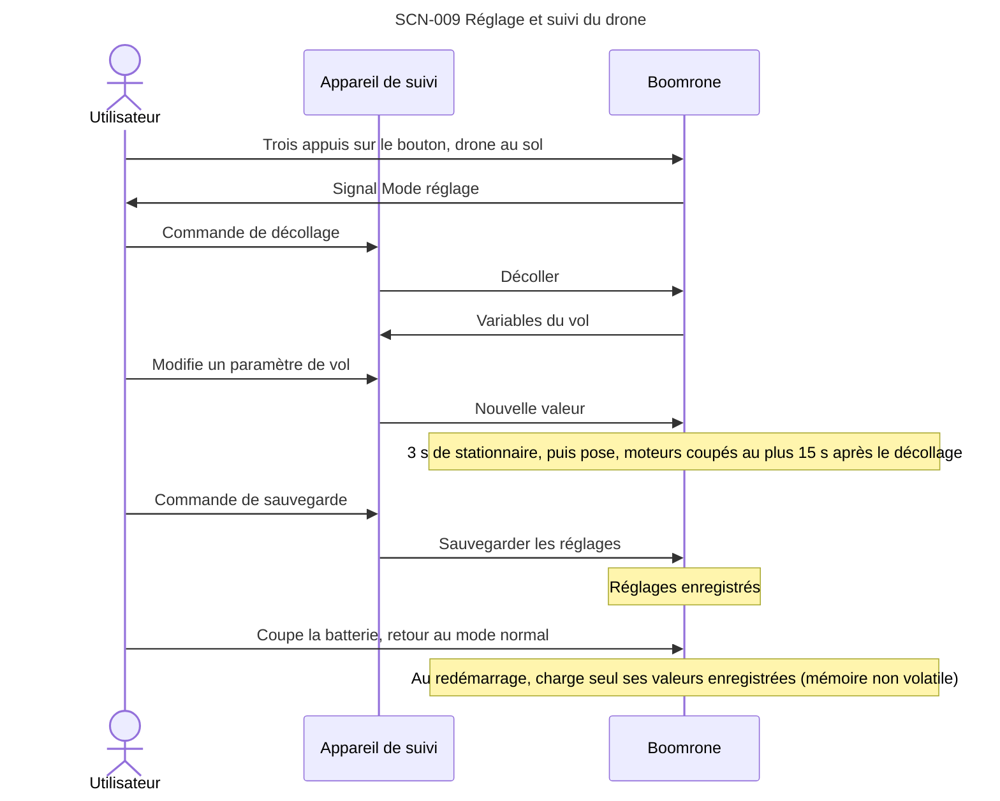

**Réfs amont :** Utilisateur (entretien du 2026-10-27), DEC-025 « Suivi et réglage du drone par le sans fil, y compris en vol », DEC-028 « Mode réglage : décollage depuis le sol sur commande sans fil », DEC-029 « Vol de réglage : stationnaire de 3 secondes, atterrissage sur place si le lien est perdu », DEC-027 « Mode réglage : trois appuis sur le bouton au sol, sortie par coupure de la batterie », DEC-015 « Bouton appuyé en vol : arrêt d'urgence », DEC-038 « Mode réglage : décollage sans protection supplémentaire », DEC-039 « Réglages : coupures valables en vol de réglage, aucune borne, modifiables aussi en vol normal », DEC-034 « Réglages envoyés par le sans fil, sauvegarde sur commande, chargement au démarrage », DEC-031 « Arrêt du drone lancé : bouton et commande d'arrêt sans fil », DEC-037 « Pas d'appairage : le drone obéit à tout appareil de suivi à portée », DEC-035 « Pas de retour aux valeurs d'origine ; mémoire corrompue non traitée », DEC-036 « Drone neuf : valeurs d'origine fixes du logiciel, sans signal », DEC-005 « Un signal distinct pour chaque information », DEC-043 « Commandes sans fil acceptées selon l'état du drone », DEC-044 « Mode réglage persistant : retour au mode réglage après un vol de réglage, sans verrouillage », DEC-051 « Seuils de sécurité réglables dans des bornes fixées par le logiciel »
**Type :** Mise en service / maintenance
**Acteurs :** Utilisateur, appareil de suivi.
**Situation de départ :** drone programmé (SCN-008 « Mise en service : programmation du drone »), batterie branchée, posé sur un sol plat et dégagé, protège-hélices en place, appareil de suivi relié au drone sans fil.
**Déroulé :**
1. L'utilisateur appuie trois fois sur le bouton, drone posé et non armé (DEC-027 « Mode réglage : trois appuis sur le bouton au sol, sortie par coupure de la batterie »).
2. Le drone informe qu'il est en mode réglage.
3. À chaque commande sans fil de l'utilisateur, le drone décolle depuis le sol, se stabilise, reste 3 secondes en stationnaire, puis se pose ; il coupe ses moteurs 15 secondes au plus après le décollage (DEC-029 « Vol de réglage : stationnaire de 3 secondes, atterrissage sur place si le lien est perdu »). L'utilisateur peut recommencer autant de fois que nécessaire : après chaque vol, le drone reste en mode réglage, posé, prêt à une nouvelle commande « Décoller », sans verrouillage, le bouton n'armant pas en mode réglage (DEC-044 « Mode réglage persistant : retour au mode réglage après un vol de réglage, sans verrouillage »). La commande de décollage n'a aucune protection supplémentaire (DEC-038 « Mode réglage : décollage sans protection supplémentaire »). Les coupures sur stationnaire non atteint et sur basculement valent aussi en vol de réglage, pour toute valeur de leurs seuils dans les bornes fixées par le logiciel (DEC-051 « Seuils de sécurité réglables dans des bornes fixées par le logiciel » ; DEC-039 « Réglages : coupures valables en vol de réglage, aucune borne, modifiables aussi en vol normal »).
4. Pendant ces vols, le drone envoie à l'appareil de suivi les variables du vol : commandes des moteurs, hauteur, autres données de position.
5. L'utilisateur modifie les paramètres de vol depuis l'appareil de suivi, y compris pendant un vol, sans fil. Les paramètres sont modifiables aussi en vol normal, sans entrer dans le mode réglage ; les seuils de sécurité restent dans leurs bornes fixées par le logiciel, une valeur hors bornes est refusée (DEC-051 « Seuils de sécurité réglables dans des bornes fixées par le logiciel »), les autres paramètres sont sans borne ; sans appairage, un tiers à portée peut aussi les modifier ou les sauvegarder, sans pouvoir supprimer une coupure (DEC-039 « Réglages : coupures valables en vol de réglage, aucune borne, modifiables aussi en vol normal »).
6. Le drone applique les nouvelles valeurs.
7. Quand les valeurs conviennent, l'utilisateur envoie une commande spécifique de sauvegarde : le drone enregistre les réglages (DEC-034 « Réglages envoyés par le sans fil, sauvegarde sur commande, chargement au démarrage »). Une valeur envoyée mais non sauvegardée ne survit pas à la coupure de la batterie.
8. L'utilisateur quitte le mode réglage en coupant la batterie ; au redémarrage, le drone est en mode normal et charge seul les dernières valeurs enregistrées depuis sa mémoire non volatile, sans que l'appareil de suivi lui envoie de configuration.
9. Si le lien sans fil est perdu pendant un vol de réglage, le drone atterrit doucement sur place (DEC-029 « Vol de réglage : stationnaire de 3 secondes, atterrissage sur place si le lien est perdu ») ; en vol normal, la perte du lien ne change rien (DEC-032 « Vol libre : le drone vole sans appareil de suivi »). Les commandes sans fil sont acceptées ou ignorées selon l'état du drone (DEC-043 « Commandes sans fil acceptées selon l'état du drone » : par exemple « Décoller » seulement en mode réglage posé, « Sauvegarder » ignorée en vol). Si le bouton est appuyé pendant un vol, ou si la commande d'arrêt sans fil est envoyée, le drone coupe ses moteurs immédiatement (SCN-007 « Dégradé : arrêt d'urgence par le bouton en vol », DEC-031 « Arrêt du drone lancé : bouton et commande d'arrêt sans fil »).
**Résultat attendu :** les paramètres de vol sont réglés et le drone se comporte comme décrit dans SCN-001 « Vol nominal : de la batterie au posé ». Sans appairage (DEC-037 « Pas d'appairage : le drone obéit à tout appareil de suivi à portée »), tout appareil de suivi à portée peut commander le drone, et une commande peut atteindre plusieurs drones : risque accepté. Les réglages sauvegardés sont rechargés à chaque démarrage (DEC-034 « Réglages envoyés par le sans fil, sauvegarde sur commande, chargement au démarrage »). Pas de retour aux valeurs d'origine ni de traitement de la mémoire corrompue (DEC-035 « Pas de retour aux valeurs d'origine ; mémoire corrompue non traitée »). Drone neuf : valeurs d'origine fixes du logiciel (DEC-036 « Drone neuf : valeurs d'origine fixes du logiciel, sans signal »).
**Statut :** Proposé

### SCN-010 — Échec : initialisation impossible au démarrage

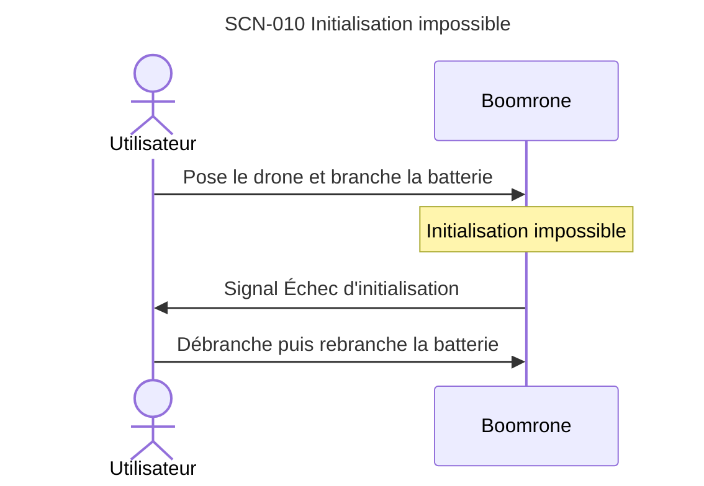

**Réfs amont :** Utilisateur (entretien du 2026-10-27), DEC-030 « Drone posé immobile à la mise sous tension ; refus de s'armer si l'initialisation échoue », DEC-005 « Un signal distinct pour chaque information »
**Type :** Échec
**Acteurs :** Utilisateur.
**Situation de départ :** drone hors tension, batterie chargée ; le drone est déplacé pendant son démarrage, ou n'est pas en état de voler.
**Déroulé :**
1. L'utilisateur branche la batterie.
2. Le drone n'arrive pas à s'initialiser.
3. Il ne se déclare pas « allumé, en attente d'un appui », ignore le bouton et informe l'utilisateur avec un signal d'échec d'initialisation distinct des autres.
4. L'utilisateur débranche puis rebranche la batterie, drone posé immobile.
**Résultat attendu :** le drone ne peut pas être armé tant que l'initialisation échoue ; l'utilisateur sait qu'il s'agit d'un échec d'initialisation ; un nouveau démarrage est possible.
**Statut :** Proposé

### SCN-011 — Dégradé : coupure d'alimentation en vol

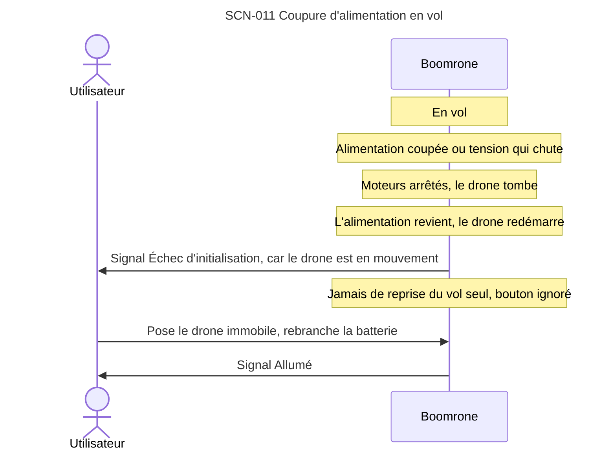

**Réfs amont :** Utilisateur (entretien du 2026-10-27), DEC-018 « Jamais de réarmement automatique ; batterie mesurée à vide à l'armement », DEC-030 « Drone posé immobile à la mise sous tension ; refus de s'armer si l'initialisation échoue », DEC-023 « Après le posé ou une coupure : drone verrouillé, nouvel appui pour revoler », DEC-005 « Un signal distinct pour chaque information »
**Type :** Dégradé
**Acteurs :** Utilisateur.
**Situation de départ :** drone en vol (stabilisation, stationnaire ou descente). Un lancer vigoureux, un choc ou une batterie trop faible coupent l'alimentation ou la font chuter.
**Déroulé :**
1. L'alimentation du drone est coupée ou sa tension chute : les moteurs s'arrêtent et le drone tombe.
2. Si l'alimentation revient, le drone redémarre. Il ne reprend jamais le vol seul, même si le bouton est appuyé.
3. Comme il est en mouvement, il ne peut pas s'initialiser (DEC-030 « Drone posé immobile à la mise sous tension ; refus de s'armer si l'initialisation échoue ») : il donne le signal d'échec d'initialisation et ignore le bouton.
4. L'utilisateur pose le drone immobile et rebranche la batterie ; le drone est alors allumé et en attente d'un appui, et un appui de 2 secondes est nécessaire pour l'armer.
**Résultat attendu :** moteurs arrêtés ; le drone n'a jamais repris le vol seul ; l'utilisateur sait que le drone doit être redémarré posé et immobile.
**Statut :** Proposé

<!-- Ajouter les scénarios ci-dessous, au même format, en dehors des blocs de code. -->
