# Scénarios d'utilisation

> **Aperçu** : Boomrone est un drone de poche, destiné aux adultes, qu'on lance à la main vers le haut et vers l'avant, dans une pièce d'appartement, un gymnase ou un jardin sans vent. Il se stabilise seul en vol stationnaire, attend 10 secondes, puis atterrit doucement. À chaque étape il informe l'utilisateur.
> **État de la phase** : SCN-001 « Vol nominal : de la batterie au posé », SCN-002 « Échec : stationnaire non atteint dans le délai » et SCN-003 « Échec : batterie faible à l'armement » proposés, ainsi que SCN-004 « Dégradé : bouton relâché avant 2 secondes » et SCN-005 « Dégradé : bouton maintenu plus de 10 secondes », à valider. SCN-006 « Échec : inclinaison excessive après le stationnaire » et SCN-007 « Dégradé : arrêt d'urgence par le bouton en vol » sont proposés aussi. SCN-008 « Mise en service : programmation du drone », SCN-009 « Réglage : réglage du vol par le sans fil », SCN-010 « Échec : initialisation impossible au démarrage » et SCN-011 « Dégradé : coupure d'alimentation en vol » proposés ; SCN-009 « Réglage : réglage du vol par le sans fil » reste à compléter (DOU-034 « Comment revenir à des réglages sûrs, et les réglages sont-ils conservés ? » ouvert).

## Vue d'ensemble

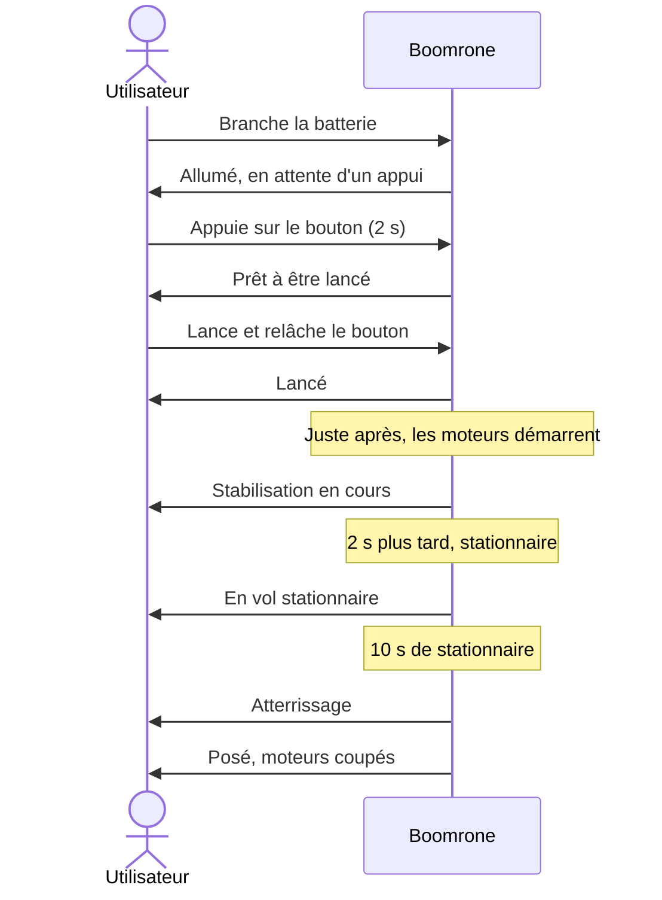

Ce premier diagramme montre le vol nominal. Le suivant montre tous les états du drone et chaque signal donné à l'utilisateur, y compris pour les échecs et les cas dégradés.

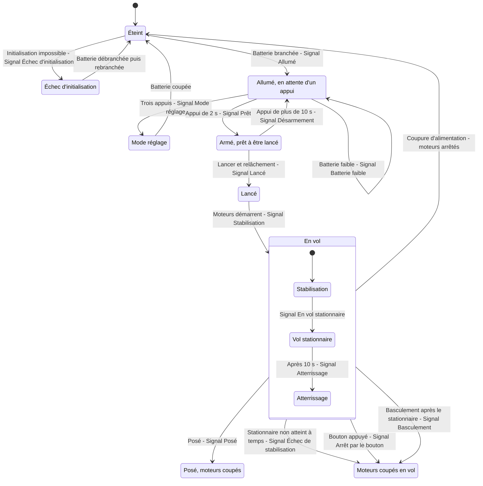

Quinze signaux : Allumé, Échec d'initialisation, Mode réglage, Appui trop court, Batterie faible, Prêt, Désarmement, Lancé, Stabilisation, En vol stationnaire, Atterrissage, Posé, Échec de stabilisation, Arrêt par le bouton, Basculement. Leur forme (lumière, son, suivi) reste à définir : voir DOU-027 « Un signal distinct par information, ou par catégorie ? ».

## Scénarios

Les scénarios viennent de l'utilisateur (le client) et **précèdent les besoins** : chaque besoin en dérive. L'architecte les rédige avec lui, en demandant systématiquement, pour chaque fonction, le cas nominal, les cas dégradés et les cas d'échec.

Format d'un scénario (exemple, non analysé) :

```
### SCN-001 — Titre court du scénario
(diagramme de séquence Mermaid : acteurs, messages, signaux)
**Réfs amont :** Utilisateur (description initiale, entretien du jj/mm)
**Type :** Nominal | Dégradé | Échec | Mise en service / maintenance
**Acteurs :** qui intervient.
**Situation de départ :** état du système et de l'environnement.
**Déroulé :** 1. … 2. … 3. …
**Résultat attendu :** ce que l'utilisateur observe à la fin.
**Statut :** Proposé | Validé | Abandonné
```

### SCN-001 — Vol nominal : de la batterie au posé

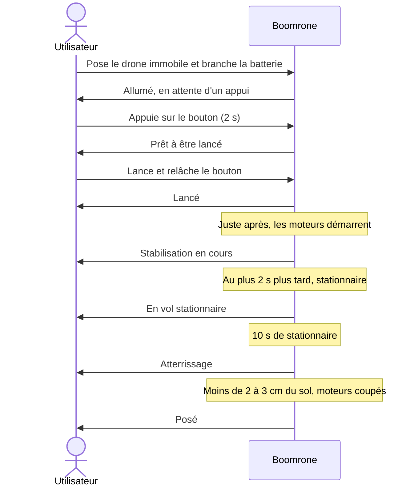

**Réfs amont :** Utilisateur (description initiale, entretien du 2026-10-27), DEC-016 « Public adulte, protège-hélices obligatoires », DEC-030 « Drone posé immobile à la mise sous tension ; refus de s'armer si l'initialisation échoue »
**Type :** Nominal
**Acteurs :** Utilisateur.
**Situation de départ :** drone hors tension, muni de ses protège-hélices, batterie chargée, dans une pièce d'appartement, un gymnase ou un jardin, sans vent.
**Déroulé :**
1. L'utilisateur pose le drone immobile et branche la batterie, sans y toucher pendant quelques secondes (DEC-030 « Drone posé immobile à la mise sous tension ; refus de s'armer si l'initialisation échoue »).
2. Le drone démarre, puis informe l'utilisateur qu'il est allumé et en attente d'un appui sur le bouton.
3. L'utilisateur prend le drone et appuie sur le bouton.
4. Après 2 secondes d'appui, le drone informe qu'il est prêt à être lancé.
5. L'utilisateur lance le drone à la main, vers le haut et vers l'avant, dans n'importe quelle orientation, à 0,5 à 4 m/s et depuis au moins 1,5 m du sol (DEC-010 « Plage de lancer : toute orientation, 0,5 à 4 m/s, au moins 1,5 m du sol »), et arrête d'appuyer sur le bouton. Le drone informe qu'il est lancé.
6. Juste après (DEC-006 « Le relâchement du bouton armé suffit à démarrer les moteurs »), le drone démarre ses moteurs et cherche à se stabiliser. Il informe qu'il est dans cette phase de stabilisation.
7. 2 secondes plus tard au plus (DEC-009 « Stationnaire atteint en 2 secondes maximum après le démarrage des moteurs »), le drone est en vol stationnaire : il maintient son altitude et dérive horizontalement d'au plus 30 cm sur 10 s (objectif à valider par essais, non garanti). Il est alors immobile en l'air et à plat. Il informe qu'il est en vol stationnaire.
8. Après 10 secondes de vol stationnaire, le drone descend et se pose à l'endroit où il est (DEC-020 « Atterrissage sur place »), à 0,5 m/s au plus au contact du sol, en 15 secondes au plus (DEC-021 « Atterrissage lent, 15 secondes maximum, puis coupure des moteurs »). Il informe qu'il atterrit.
9. Dès qu'il est à moins de 2 à 3 cm du sol (DEC-022 « Moteurs coupés à moins de 2 à 3 cm du sol »), ou au bout de 15 secondes de descente, le drone coupe les moteurs. Posé, il informe qu'il est posé.
**Résultat attendu :** le drone est posé, moteurs arrêtés, intact, et l'utilisateur a été informé à chaque étape. Le drone est alors verrouillé : un nouvel appui de 2 secondes est nécessaire pour revoler (DEC-023 « Après le posé ou une coupure : drone verrouillé, nouvel appui pour revoler »). (Moyen d'information : voir DOU-001 « Comment le drone informe-t-il l'utilisateur ? ».)
**Statut :** Proposé

### SCN-002 — Échec : stationnaire non atteint dans le délai

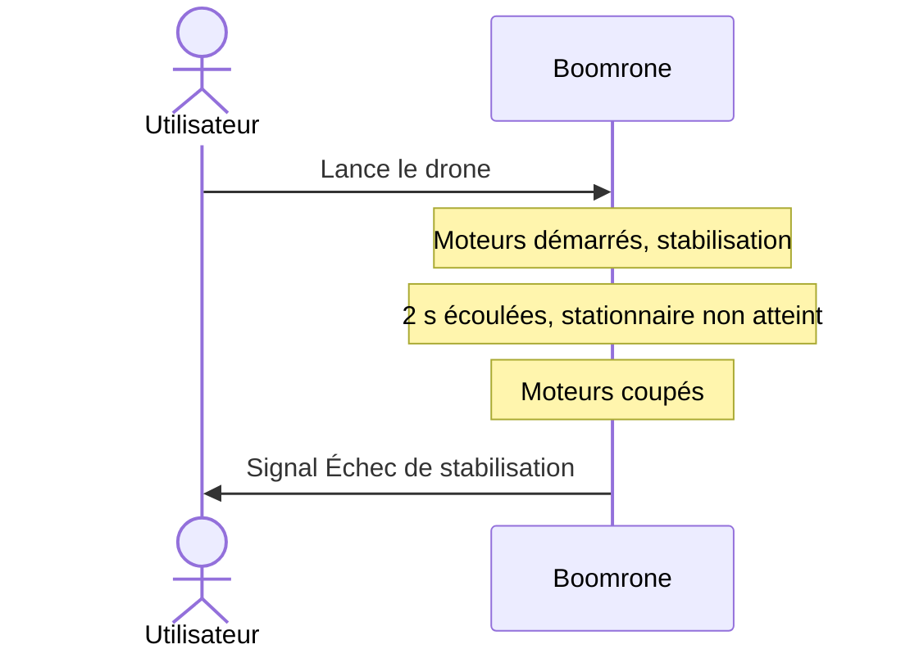

**Réfs amont :** Utilisateur (entretien du 2026-10-27), DEC-002 « Couper les moteurs si le stationnaire n'est pas atteint dans le délai », DEC-003 « Drone retourné ou très incliné : normal tant que la stabilisation n'est pas finie », DEC-005 « Un signal distinct pour chaque information »
**Type :** Échec
**Acteurs :** Utilisateur.
**Situation de départ :** drone lancé comme dans SCN-001 « Vol nominal : de la batterie au posé » (étape 5), moteurs démarrés, en cours de stabilisation. Le lancer peut être mal orienté, trop faible ou trop rapide.
**Déroulé :**
1. Le drone cherche à se stabiliser ; être retourné ou très incliné est normal à ce stade.
2. Le délai maximal s'écoule sans que le stationnaire soit atteint (2 secondes après le démarrage des moteurs : DEC-009 « Stationnaire atteint en 2 secondes maximum après le démarrage des moteurs »).
3. Le drone coupe ses moteurs et informe l'utilisateur avec un signal d'échec distinct des autres.
**Résultat attendu :** moteurs arrêtés ; le drone tombe ; l'utilisateur sait qu'il s'agit d'un échec de stabilisation. Le drone est alors verrouillé : un nouvel appui de 2 secondes est nécessaire pour revoler (DEC-023 « Après le posé ou une coupure : drone verrouillé, nouvel appui pour revoler »).
**Statut :** Proposé

### SCN-003 — Échec : batterie faible à l'armement

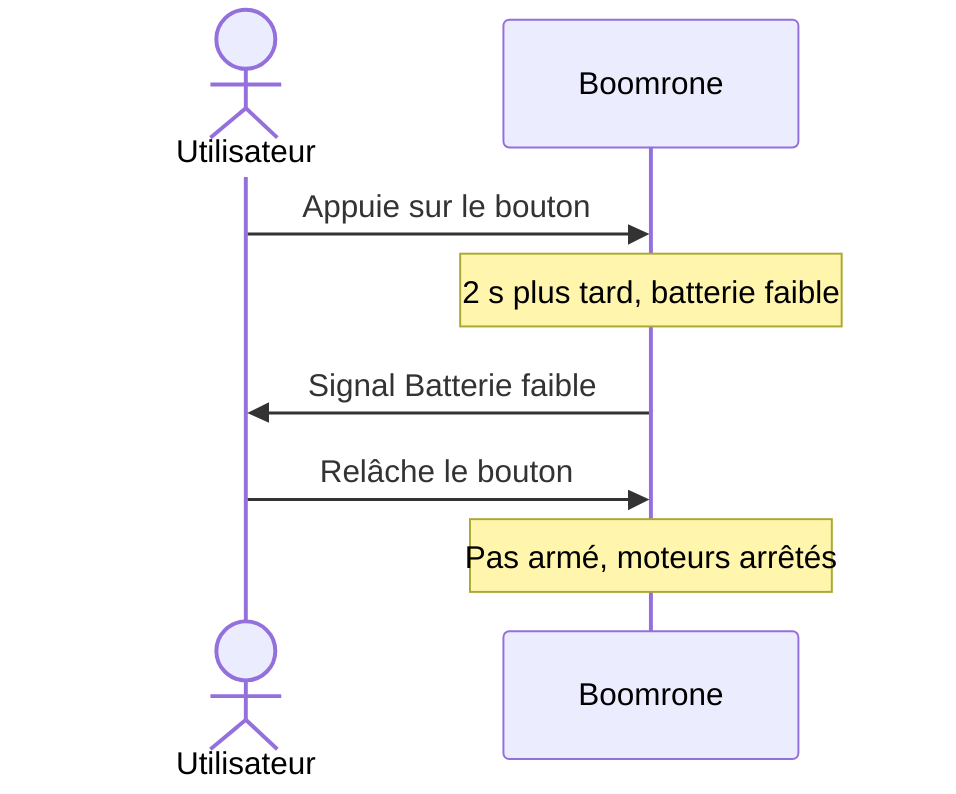

**Réfs amont :** Utilisateur (entretien du 2026-10-27), DEC-004 « Batterie vérifiée à l'armement : pas d'armement si batterie faible », DEC-005 « Un signal distinct pour chaque information »
**Type :** Échec
**Acteurs :** Utilisateur.
**Situation de départ :** drone allumé et en attente d'un appui (étape 2 de SCN-001 « Vol nominal : de la batterie au posé »), batterie en dessous du seuil.
**Déroulé :**
1. L'utilisateur appuie sur le bouton.
2. Après 2 secondes, le drone constate que la batterie est faible.
3. Il ne s'arme pas et informe l'utilisateur avec un signal « batterie faible » distinct des autres.
**Résultat attendu :** le drone n'est pas armé ; relâcher le bouton ne démarre pas les moteurs ; l'utilisateur sait qu'il doit changer ou recharger la batterie.
**Statut :** Proposé

### SCN-004 — Dégradé : bouton relâché avant 2 secondes

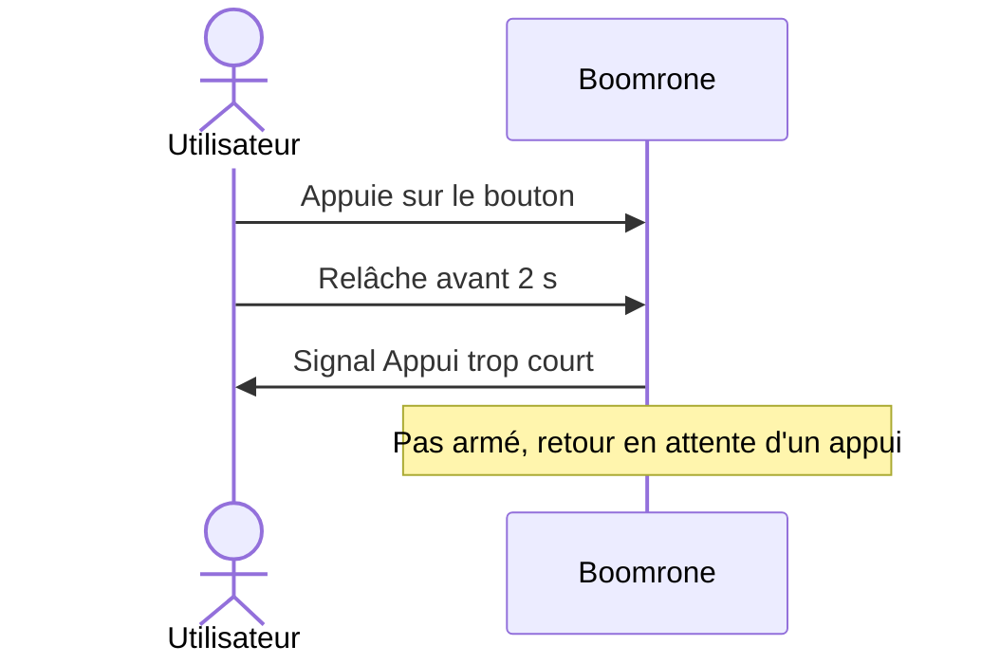

**Réfs amont :** Utilisateur (entretien du 2026-10-27), DEC-007 « Bouton relâché avant 2 secondes : retour en attente », DEC-005 « Un signal distinct pour chaque information »
**Type :** Dégradé
**Acteurs :** Utilisateur.
**Situation de départ :** drone allumé et en attente d'un appui, tenu en main ou posé.
**Déroulé :**
1. L'utilisateur appuie sur le bouton.
2. Il le relâche avant 2 secondes.
3. Le drone n'est pas armé, revient en attente d'un appui et signale l'appui trop court avec un signal distinct.
**Résultat attendu :** les moteurs ne démarrent pas ; un nouvel appui est possible.
**Statut :** Proposé

### SCN-005 — Dégradé : bouton maintenu plus de 10 secondes

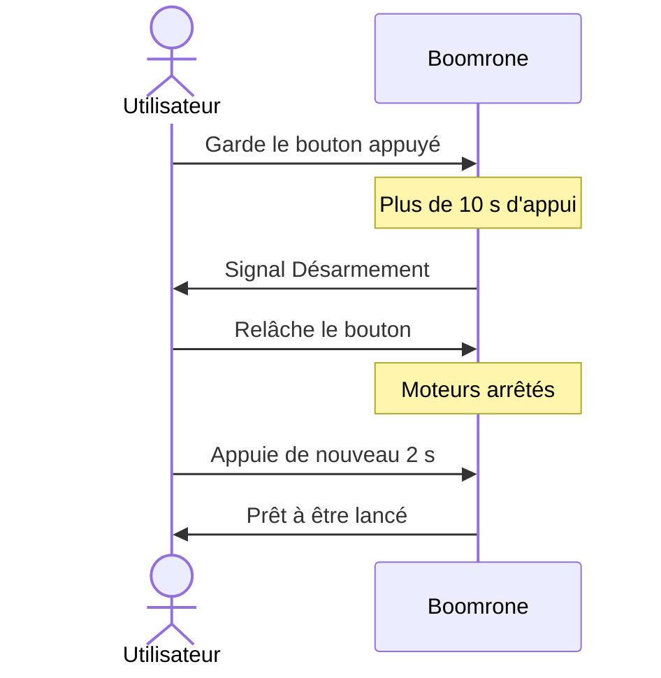

**Réfs amont :** Utilisateur (entretien du 2026-10-27), DEC-008 « Désarmement si le bouton reste appuyé plus de 10 secondes », DEC-005 « Un signal distinct pour chaque information »
**Type :** Dégradé
**Acteurs :** Utilisateur.
**Situation de départ :** drone armé (bouton appuyé depuis plus de 2 secondes), pas encore lancé.
**Déroulé :**
1. L'utilisateur garde le bouton appuyé au-delà de 10 secondes.
2. Le drone se désarme et le signale avec un signal distinct.
3. L'utilisateur relâche le bouton : les moteurs ne démarrent pas.
4. Pour réarmer, il appuie de nouveau 2 secondes.
**Résultat attendu :** le drone n'est plus armé ; le relâchement du bouton ne démarre pas les moteurs.
**Statut :** Proposé

### SCN-006 — Échec : inclinaison excessive après le stationnaire

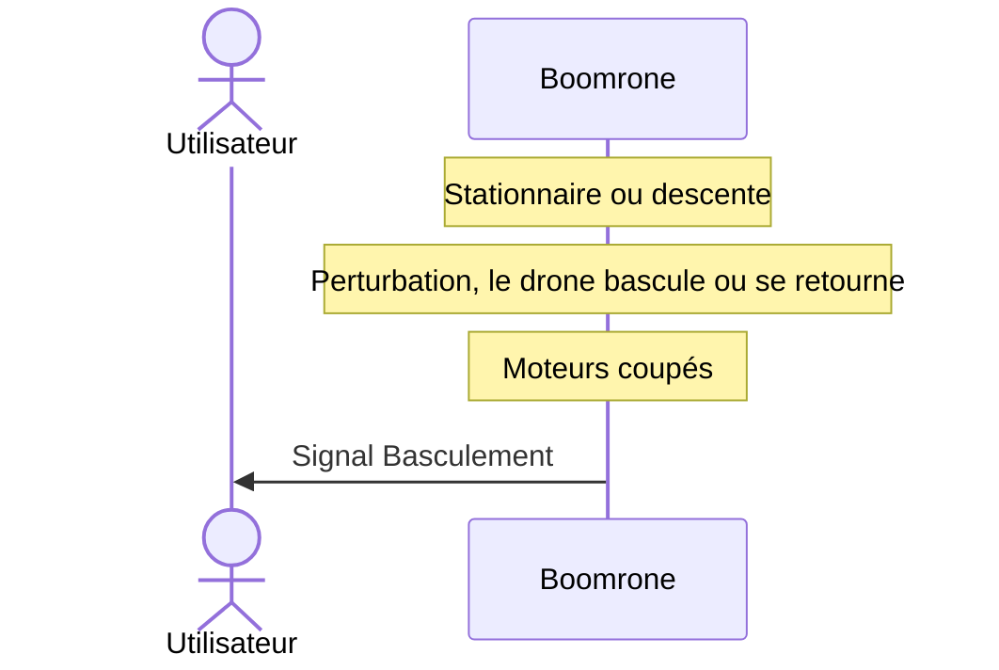

**Réfs amont :** Utilisateur (entretien du 2026-10-27), DEC-012 « Couper les moteurs si le drone bascule après le stationnaire », DEC-005 « Un signal distinct pour chaque information »
**Type :** Échec
**Acteurs :** Utilisateur.
**Situation de départ :** drone en vol stationnaire ou en descente (SCN-001 « Vol nominal : de la batterie au posé », étapes 7 à 8).
**Déroulé :**
1. Une perturbation fait basculer le drone fortement, ou le retourne.
2. Le drone coupe ses moteurs et informe l'utilisateur avec un signal distinct.
**Résultat attendu :** moteurs arrêtés ; le drone tombe ; l'utilisateur sait que la cause est un basculement. Le drone est alors verrouillé : un nouvel appui de 2 secondes est nécessaire pour revoler (DEC-023 « Après le posé ou une coupure : drone verrouillé, nouvel appui pour revoler »).
**Statut :** Proposé

### SCN-007 — Dégradé : arrêt d'urgence par le bouton en vol

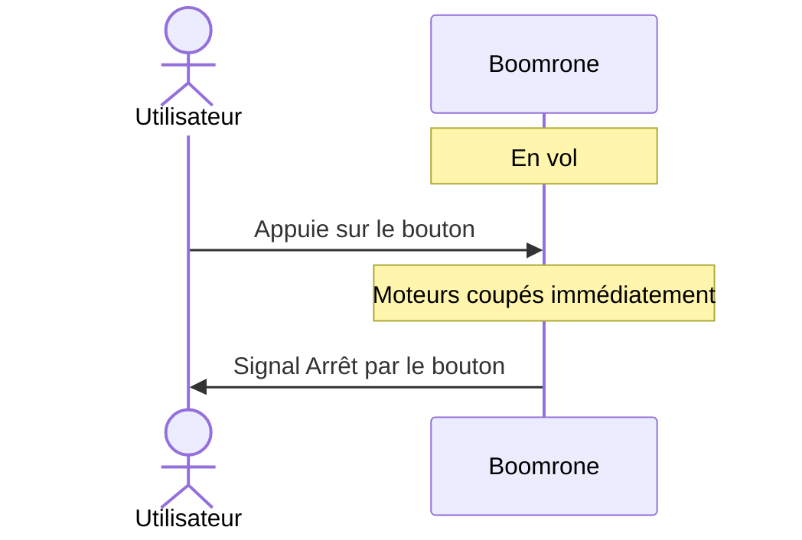

**Réfs amont :** Utilisateur (entretien du 2026-10-27), DEC-015 « Bouton appuyé en vol : arrêt d'urgence », DEC-005 « Un signal distinct pour chaque information »
**Type :** Dégradé
**Acteurs :** Utilisateur.
**Situation de départ :** drone en vol (stabilisation, stationnaire ou descente).
**Déroulé :**
1. L'utilisateur appuie sur le bouton.
2. Le drone coupe ses moteurs immédiatement et informe l'utilisateur avec un signal distinct.
**Résultat attendu :** moteurs arrêtés ; le drone tombe ; l'utilisateur sait que l'arrêt vient du bouton. Le drone est alors verrouillé : un nouvel appui de 2 secondes est nécessaire pour revoler (DEC-023 « Après le posé ou une coupure : drone verrouillé, nouvel appui pour revoler »).
**Statut :** Proposé

### SCN-008 — Mise en service : programmation du drone

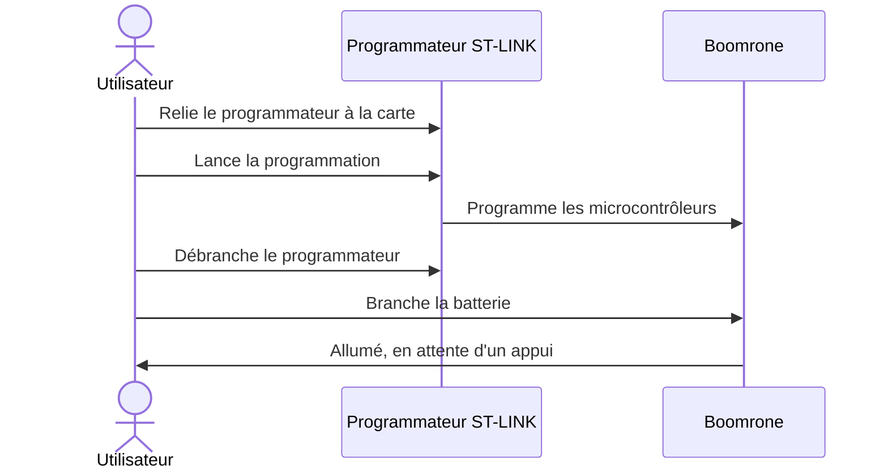

**Réfs amont :** Utilisateur (entretien du 2026-10-27), DEC-024 « Mise en service par programmation avec un programmateur ST-LINK », DEC-026 « Mise en service : calibrage éventuel renvoyé à l'architecture, réglage du vol par un scénario dédié »
**Type :** Mise en service / maintenance
**Acteurs :** Utilisateur.
**Situation de départ :** carte neuve, jamais programmée, batterie chargée ; l'utilisateur dispose d'un ordinateur et d'un programmateur ST-LINK (seul outil de programmation).
**Déroulé :**
1. L'utilisateur relie le programmateur à la carte du drone.
2. Il programme le ou les microcontrôleurs du drone depuis l'ordinateur.
3. Il débranche le programmateur.
4. Il branche la batterie : le drone démarre et informe qu'il est allumé et en attente d'un appui (étape 2 de SCN-001 « Vol nominal : de la batterie au posé »).
**Résultat attendu :** le drone est programmé et se comporte comme au début de SCN-001 « Vol nominal : de la batterie au posé ». Le vol se règle ensuite avec SCN-009 « Réglage : réglage du vol par le sans fil » ; un éventuel calibrage est renvoyé à l'architecture (DEC-026 « Mise en service : calibrage éventuel renvoyé à l'architecture, réglage du vol par un scénario dédié »).
**Statut :** Proposé

### SCN-009 — Réglage : réglage du vol par le sans fil

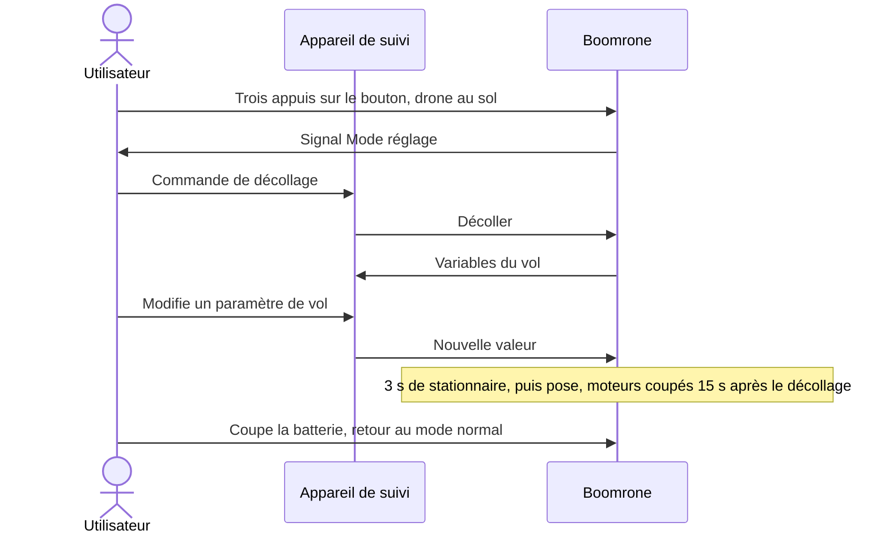

**Réfs amont :** Utilisateur (entretien du 2026-10-27), DEC-025 « Suivi et réglage du drone par le sans fil, y compris en vol », DEC-028 « Mode réglage : décollage depuis le sol sur commande sans fil », DEC-029 « Vol de réglage : stationnaire de 3 secondes, atterrissage sur place si le lien est perdu », DEC-027 « Mode réglage : trois appuis sur le bouton au sol, sortie par coupure de la batterie »
**Type :** Mise en service / maintenance
**Acteurs :** Utilisateur, appareil de suivi.
**Situation de départ :** drone programmé (SCN-008 « Mise en service : programmation du drone »), batterie branchée, posé sur un sol plat et dégagé, protège-hélices en place, appareil de suivi relié au drone sans fil.
**Déroulé :**
1. L'utilisateur appuie trois fois sur le bouton, drone posé et non armé (DEC-027 « Mode réglage : trois appuis sur le bouton au sol, sortie par coupure de la batterie »).
2. Le drone informe qu'il est en mode réglage.
3. À chaque commande sans fil de l'utilisateur, le drone décolle depuis le sol, se stabilise, reste 3 secondes en stationnaire, puis se pose ; il coupe ses moteurs 15 secondes au plus après le décollage (DEC-029 « Vol de réglage : stationnaire de 3 secondes, atterrissage sur place si le lien est perdu »). L'utilisateur peut recommencer autant de fois que nécessaire.
4. Pendant ces vols, le drone envoie à l'appareil de suivi les variables du vol : commandes des moteurs, hauteur, autres données de position.
5. L'utilisateur modifie les paramètres de vol depuis l'appareil de suivi, y compris pendant un vol, sans fil.
6. Le drone applique les nouvelles valeurs.
7. L'utilisateur quitte le mode réglage en coupant la batterie ; au redémarrage, le drone est en mode normal.
8. Si le lien sans fil est perdu pendant un vol, le drone atterrit doucement sur place. Si le bouton est appuyé pendant un vol, le drone coupe ses moteurs immédiatement (SCN-007 « Dégradé : arrêt d'urgence par le bouton en vol »).
**Résultat attendu :** les paramètres de vol sont réglés et le drone se comporte comme décrit dans SCN-001 « Vol nominal : de la batterie au posé ». Retour à des réglages sûrs et conservation des réglages : voir DOU-034 « Comment revenir à des réglages sûrs, et les réglages sont-ils conservés ? ».
**Statut :** Proposé

### SCN-010 — Échec : initialisation impossible au démarrage

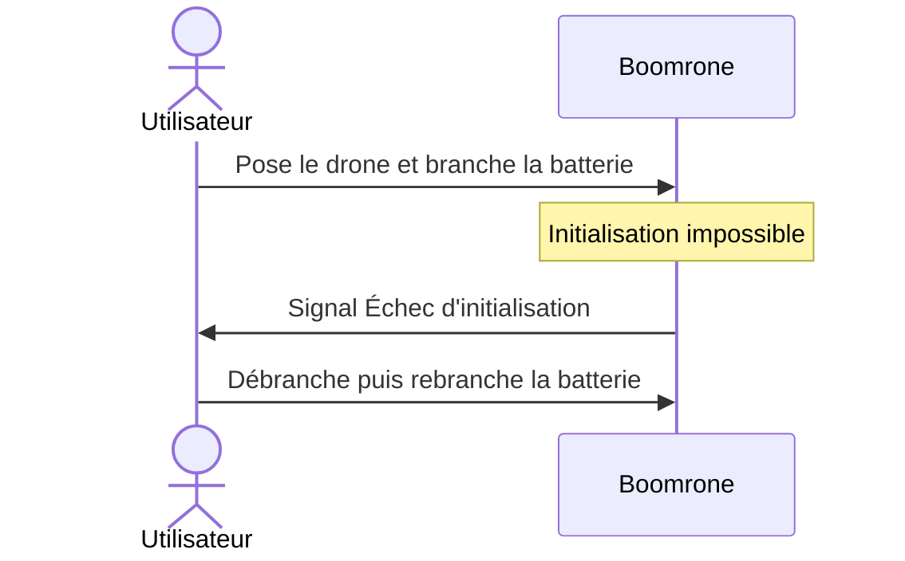

**Réfs amont :** Utilisateur (entretien du 2026-10-27), DEC-030 « Drone posé immobile à la mise sous tension ; refus de s'armer si l'initialisation échoue »
**Type :** Échec
**Acteurs :** Utilisateur.
**Situation de départ :** drone hors tension, batterie chargée ; le drone est déplacé pendant son démarrage, ou n'est pas en état de voler.
**Déroulé :**
1. L'utilisateur branche la batterie.
2. Le drone n'arrive pas à s'initialiser.
3. Il ne se déclare pas « allumé, en attente d'un appui », ignore le bouton et informe l'utilisateur avec un signal d'échec d'initialisation distinct des autres.
4. L'utilisateur débranche puis rebranche la batterie, drone posé immobile.
**Résultat attendu :** le drone ne peut pas être armé tant que l'initialisation échoue ; l'utilisateur sait qu'il s'agit d'un échec d'initialisation ; un nouveau démarrage est possible.
**Statut :** Proposé

### SCN-011 — Dégradé : coupure d'alimentation en vol

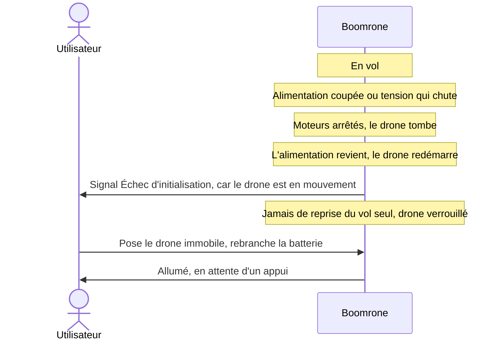

**Réfs amont :** Utilisateur (entretien du 2026-10-27), DEC-018 « Jamais de réarmement automatique ; batterie mesurée à vide à l'armement », DEC-030 « Drone posé immobile à la mise sous tension ; refus de s'armer si l'initialisation échoue »
**Type :** Dégradé
**Acteurs :** Utilisateur.
**Situation de départ :** drone en vol (stabilisation, stationnaire ou descente). Un lancer vigoureux, un choc ou une batterie trop faible coupent l'alimentation ou la font chuter.
**Déroulé :**
1. L'alimentation du drone est coupée ou sa tension chute : les moteurs s'arrêtent et le drone tombe.
2. Si l'alimentation revient, le drone redémarre. Il ne reprend jamais le vol seul, même si le bouton est appuyé.
3. Comme il est en mouvement, il ne peut pas s'initialiser (DEC-030 « Drone posé immobile à la mise sous tension ; refus de s'armer si l'initialisation échoue ») : il donne le signal d'échec d'initialisation et ignore le bouton.
4. L'utilisateur pose le drone immobile et rebranche la batterie ; le drone est alors allumé et en attente d'un appui, et un appui de 2 secondes est nécessaire pour l'armer.
**Résultat attendu :** moteurs arrêtés ; le drone n'a jamais repris le vol seul ; l'utilisateur sait que le drone doit être redémarré posé et immobile.
**Statut :** Proposé

<!-- Ajouter les scénarios ci-dessous, au même format, en dehors des blocs de code. -->
