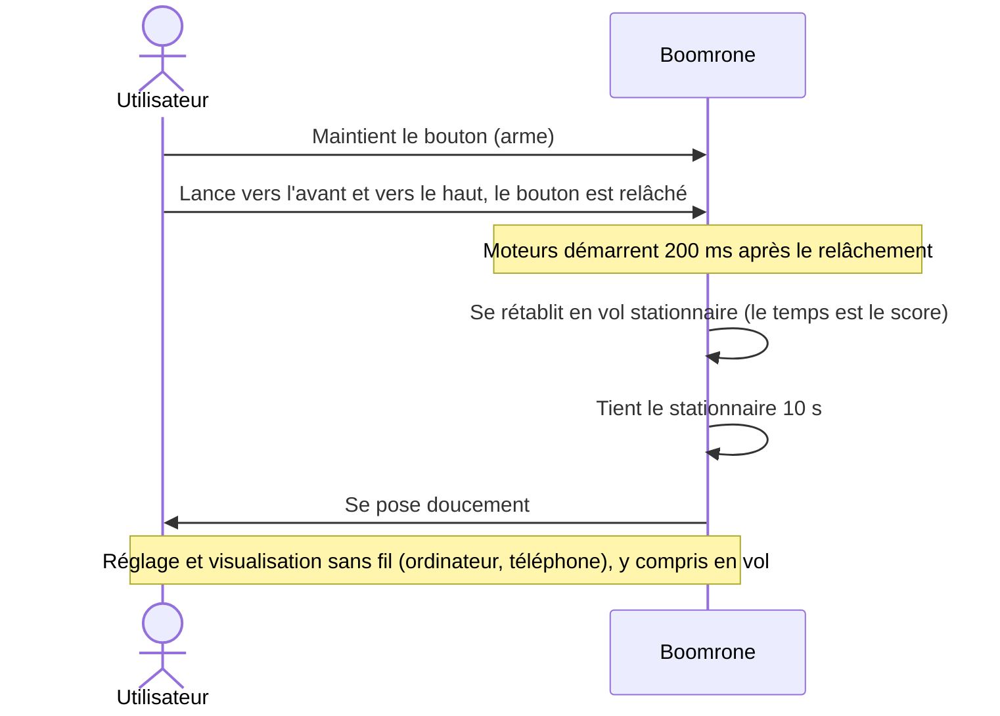

# Besoins — Boomrone

> **Aperçu** : Boomrone est un quadricoptère-jouet de moins de 100 g pour adultes. L'utilisateur arme le drone avec un bouton, le lance à la main vers l'avant et vers le haut ; le drone se rétablit au plus vite en vol stationnaire (le temps est le score du jeu), tient 10 secondes, puis se pose doucement. Réglable et observable sans fil, programmable par câble avec l'outillage STMicroelectronics (STM32).
> **État de la phase** : besoins **proposés**, à valider ; 2 doutes bloquants ouverts (DOU-007 « Que fait le drone si ça se passe mal ? » et DOU-012 « Que se passe-t-il si le bouton est relâché sans vrai lancer ? », dans `registre-doutes.md`).

## Vue d'ensemble

## Contexte et contraintes générales

- Environnement : espace sans vent (gymnase, ou jardin par temps calme).
- Public : adultes seulement.
- Achetés tout faits : moteurs, batterie, hélices. Le reste est conçu.
- Fabrication et assemblage de la carte : JLCPCB, composants **en stock**.
- Prototypes, quelques exemplaires. Aucun matériel n'existe encore ; inspiration possible des mini-drones existants.

## Besoins

### BES-001 — Lancer à la main
**Réfs amont :** Utilisateur (description initiale), DEC-005 « Armement par bouton-poussoir maintenu, lancer détecté au relâchement », DEC-012 « Armement par maintien du bouton de 2 à 10 secondes »
**Énoncé :** L'utilisateur arme le drone en maintenant un bouton-poussoir appuyé 2 secondes, puis le lance à la main vers l'avant et vers le haut. Le relâchement du bouton signale le lancer ; les moteurs démarrent 200 ms plus tard. Si le bouton reste appuyé plus de 10 secondes, le drone se désarme.
**Priorité :** Essentiel
**Statut :** Proposé

### BES-002 — Se rétablir rapidement en vol stationnaire
**Réfs amont :** Utilisateur (description initiale), DEC-001 « Critère de rétablissement : vitesse et inclinaison », DEC-002 « La rapidité de rétablissement sert de score de jeu »
**Énoncé :** Après le lancer, le drone passe de la trajectoire de lancer au vol stationnaire (vitesse et inclinaison sous des seuils) le plus vite possible. Le temps de rétablissement est le score du jeu.
**Priorité :** Essentiel
**Statut :** Proposé

### BES-003 — Tenir le vol stationnaire 10 secondes
**Réfs amont :** Utilisateur (description initiale), DEC-003 « Stationnaire à l'altitude atteinte »
**Énoncé :** Une fois rétabli, le drone maintient le vol stationnaire pendant 10 secondes, à l'altitude atteinte au rétablissement.
**Priorité :** Essentiel
**Statut :** Proposé

### BES-004 — Se poser doucement
**Réfs amont :** Utilisateur (description initiale), DEC-004 « Atterrissage doux : vitesse maximale au contact »
**Énoncé :** Après le stationnaire, le drone descend de façon contrôlée et touche le sol à faible vitesse verticale, puis coupe les moteurs.
**Priorité :** Essentiel
**Statut :** Proposé

### BES-005 — Régler le drone sans fil
**Réfs amont :** Utilisateur (description initiale), DEC-008 « Réglage et visualisation sans fil, y compris en vol, temps réel »
**Énoncé :** L'utilisateur modifie les paramètres de réglage du drone (par exemple les gains PID) sans fil, depuis un ordinateur et/ou un téléphone, y compris pendant le vol.
**Priorité :** Essentiel
**Statut :** Proposé

### BES-006 — Communiquer les paramètres sans fil
**Réfs amont :** Utilisateur (description initiale), DEC-008 « Réglage et visualisation sans fil, y compris en vol, temps réel »
**Énoncé :** Le drone transmet sans fil ses paramètres et ses variables internes, pour visualisation en temps réel sur ordinateur et/ou téléphone, y compris pendant le vol.
**Priorité :** Essentiel
**Statut :** Proposé

### BES-007 — Programmer le drone par câble avec l'outillage STMicroelectronics
**Réfs amont :** Utilisateur (description initiale), DEC-010 « ST-LINK disponible, microcontrôleur libre »
**Énoncé :** Le micrologiciel se programme par liaison filaire avec le matériel de STMicroelectronics (ST-LINK, famille STM32).
**Priorité :** Essentiel
**Statut :** Proposé

### BES-008 — Fonctionner dans un espace sans vent
**Réfs amont :** Utilisateur (description initiale)
**Énoncé :** Le drone est prévu pour un usage en espace sans vent (gymnase, jardin par temps calme).
**Priorité :** Essentiel
**Statut :** Proposé

### BES-009 — Utiliser moteurs, batterie et hélices du commerce
**Réfs amont :** Utilisateur (description initiale)
**Énoncé :** Les moteurs, la batterie et les hélices sont achetés ; ils ne sont pas conçus dans le projet.
**Priorité :** Essentiel
**Statut :** Proposé

### BES-010 — Fabriquer avec JLCPCB en composants en stock
**Réfs amont :** Utilisateur (description initiale), DEC-011 « Prototypes, quelques exemplaires »
**Énoncé :** La carte est fabriquée par JLCPCB en quelques exemplaires ; tous les composants doivent être disponibles en stock chez eux.
**Priorité :** Essentiel
**Statut :** Proposé

### BES-011 — Couper les moteurs en cas d'échec
**Réfs amont :** DEC-007 « En cas d'échec, couper les moteurs », DEC-006 « Public : adultes seulement », DEC-013 « Cas de coupure des moteurs »
**Énoncé :** Le drone coupe ses moteurs si le rétablissement n'est pas obtenu dans un délai maximal et si la batterie est faible. Les autres scénarios sont à définir (DOU-007 « Que fait le drone si ça se passe mal ? », dans le registre).
**Priorité :** Essentiel
**Statut :** Proposé

### BES-012 — Rester sous 100 g
**Réfs amont :** DEC-009 « Quadricoptère de moins de 100 g »
**Énoncé :** Le drone est un quadricoptère de masse totale inférieure à 100 g, batterie comprise.
**Priorité :** Essentiel
**Statut :** Proposé
