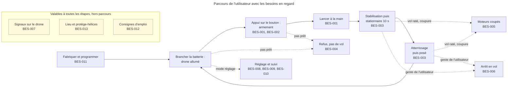
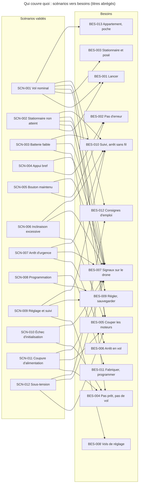

# Besoins

> **Aperçu**
> - Treize besoins qualitatifs, statut « Proposé », rédigés par délégation (DEC-143 « Délégation de la phase besoins à l'architecte ») selon la ligne « simplicité » (DEC-144 « Ligne directrice : simplicité, un seul utilisateur qui accepte les risques »).
> - Les douze scénarios sont couverts (vérifié à la main). Priorités : 7 essentiels, 3 importants, 3 souhaitables. « Souhaitable » ne veut pas dire facultatif : le besoin est prévu et conservé (le sans fil est gardé), mais livré après les autres.
> - À décider par l'utilisateur : six simplifications recommandées (n°2 à n°7 de l'annexe B), DOU-126 « Simplifications possibles des scénarios : choix de l'utilisateur » ; la n°1 (retirer le sans fil) est écartée (DEC-163 « Communication sans fil conservée : simplification n°1 écartée »).
> - Dossier définitif, prêt pour la porte « besoins » : 0 doute bloquant, 29 non bloquants ouverts. Reste l'accord explicite de l'utilisateur (porte et choix sur DOU-126 « Simplifications possibles des scénarios : choix de l'utilisateur »).

## Parcours de l'utilisateur

*Légende : trait plein = vol normal ; pointillé = écart (refus, coupure, arrêt) ou autre mode (réglage) ; encadré jaune = besoin qui vaut pour toutes les étapes, sans flèche. ID seuls dans le schéma, titres dans le tableau ci-dessous.*

## Tableau récapitulatif

Priorités : **Essentiel** = sans lui le drone ne vole pas ou n'est pas utilisable ; **Important** = prévu et attendu ; **Souhaitable** = prévu et conservé (le sans fil est gardé), livré après les autres.

| Besoin | Priorité | Scénarios |
|---|---|---|
| BES-001 « Lancer le drone à la main » | Essentiel | SCN-001 « Vol nominal : de la batterie au posé » ; SCN-002 « Échec : stationnaire non atteint dans le délai » |
| BES-002 « Ne pas armer ni lancer par erreur » | Important | SCN-004 « Appui normal : bouton relâché avant 2 secondes » ; SCN-005 « Dégradé : bouton maintenu plus de 10 secondes » |
| BES-003 « Rester en vol stationnaire 10 s puis atterrir doucement » | Essentiel | SCN-001 « Vol nominal : de la batterie au posé » |
| BES-004 « Ne pas voler quand le drone n'est pas prêt » | Essentiel | SCN-003 « Échec : batterie faible à l'armement » ; SCN-010 « Échec : initialisation impossible au démarrage » ; SCN-011 « Dégradé : coupure d'alimentation en vol » |
| BES-005 « Couper les moteurs quand le vol ne peut pas continuer » | Essentiel | SCN-001 « Vol nominal : de la batterie au posé » ; SCN-002 « Échec : stationnaire non atteint dans le délai » ; SCN-006 « Échec : inclinaison excessive après le stationnaire » ; SCN-011 « Dégradé : coupure d'alimentation en vol » ; SCN-012 « Dégradé : sous-tension de la batterie » |
| BES-006 « Arrêter le drone en vol d'un geste » | Essentiel | SCN-007 « Dégradé : arrêt d'urgence par le bouton en vol » |
| BES-007 « Savoir où en est le drone sans autre appareil » | Essentiel | SCN-001 « Vol nominal : de la batterie au posé » ; SCN-002 « Échec : stationnaire non atteint dans le délai » ; SCN-003 « Échec : batterie faible à l'armement » ; SCN-004 « Appui normal : bouton relâché avant 2 secondes » ; SCN-005 « Dégradé : bouton maintenu plus de 10 secondes » ; SCN-006 « Échec : inclinaison excessive après le stationnaire » ; SCN-007 « Dégradé : arrêt d'urgence par le bouton en vol » ; SCN-010 « Échec : initialisation impossible au démarrage » ; SCN-011 « Dégradé : coupure d'alimentation en vol » ; SCN-012 « Dégradé : sous-tension de la batterie » |
| BES-008 « Entrer en mode réglage et faire des vols de réglage » | Souhaitable | SCN-009 « Réglage et suivi du drone par le sans fil » |
| BES-009 « Régler et sauvegarder les paramètres de vol » | Souhaitable | SCN-009 « Réglage et suivi du drone par le sans fil » ; SCN-008 « Mise en service : programmation du drone » ; SCN-002 « Échec : stationnaire non atteint dans le délai » |
| BES-010 « Suivre le drone sur un appareil de suivi » | Souhaitable | SCN-009 « Réglage et suivi du drone par le sans fil » ; SCN-002 « Échec : stationnaire non atteint dans le délai » ; SCN-003 « Échec : batterie faible à l'armement » ; SCN-006 « Échec : inclinaison excessive après le stationnaire » ; SCN-007 « Dégradé : arrêt d'urgence par le bouton en vol » |
| BES-011 « Fabriquer et programmer le drone soi-même » | Essentiel | SCN-008 « Mise en service : programmation du drone » |
| BES-012 « Disposer d'une page de consignes d'emploi » | Important | SCN-001 « Vol nominal : de la batterie au posé » ; SCN-012 « Dégradé : sous-tension de la batterie » |
| BES-013 « Voler en appartement avec un drone de poche protégé » | Important | SCN-001 « Vol nominal : de la batterie au posé » |

Sept besoins essentiels, trois importants, trois souhaitables : le vol sûr d'abord, le réglage et le suivi ensuite, tous trois subordonnés à BES-010 « Suivre le drone sur un appareil de suivi » (DEC-147 « Priorités des besoins : le vol sûr d'abord, le réglage et le suivi ensuite », modifiée par DEC-159 « Réglage et suivi alignés en Souhaitable, subordonnés au suivi »).

## Besoins

Les besoins nomment quelques choix déjà décidés aux scénarios (le bouton, le mode réglage, l'appareil de suivi) mais ne décrivent aucune solution technique ; les valeurs chiffrées viennent aux exigences, sauf les 10 s de stationnaire.

### BES-001 — Lancer le drone à la main
**Réfs amont :** SCN-001 « Vol nominal : de la batterie au posé » ; SCN-002 « Échec : stationnaire non atteint dans le délai » ; DEC-032 « Vol libre : le drone vole sans appareil de suivi »
**Énoncé :** L'utilisateur prépare le drone avec son bouton, puis le lance à la main, sans viser une orientation précise : les moteurs démarrent au relâchement du bouton armé.
**Note essais :** la plage d'orientation et de vitesse de lancer dépend des essais sur prototype, échéance « essais » (DOU-050 « Mesure de vitesse horizontale et faisabilité du stationnaire en 2 s depuis 1,5 m » ; DOU-101 « Tolérance d'immobile à l'armement sur un drone tenu en main : faisabilité du cas nominal » ; DEC-137 « Faisabilité du stationnaire en 2 secondes depuis 1,5 m : jalon déplacé aux essais, plage de lancer inchangée »).
**Priorité :** Essentiel
**Statut :** Proposé

### BES-002 — Ne pas armer ni lancer par erreur
**Réfs amont :** SCN-004 « Appui normal : bouton relâché avant 2 secondes » ; SCN-005 « Dégradé : bouton maintenu plus de 10 secondes » ; DEC-083 « Annulation d'un armement : le maintien jusqu'au désarmement à 10 s reste la seule annulation » ; DEC-073 « Armé entre 2 et 10 secondes d'appui : le relâchement donne le signal Lancé, les moteurs démarrent 200 ms plus tard »
**Énoncé :** Un appui bref (sous le seuil d'armement) ne fait ni armer ni lancer. Une fois armé, le seul moyen de renoncer est de maintenir le bouton jusqu'au désarmement ; relâcher plus tôt démarre les moteurs (risque accepté).
**Priorité :** Important
**Statut :** Proposé

### BES-003 — Rester en vol stationnaire 10 s puis atterrir doucement
**Réfs amont :** SCN-001 « Vol nominal : de la batterie au posé » ; DEC-023 « Après le posé ou une coupure : drone verrouillé, nouvel appui pour revoler » ; DEC-011 « Dérive de 30 cm sur 10 s en objectif à valider par essais »
**Énoncé :** Après le lancer, le drone se stabilise seul et reste en vol stationnaire 10 s, sans s'éloigner de façon sensible. Il se pose ensuite sans choc violent et coupe ses moteurs. Après le posé, il attend un nouvel appui. Les critères viennent aux exigences (DEC-011 « Dérive de 30 cm sur 10 s en objectif à valider par essais »).
**Priorité :** Essentiel
**Statut :** Proposé

### BES-004 — Ne pas voler quand le drone n'est pas prêt
**Réfs amont :** SCN-003 « Échec : batterie faible à l'armement » ; SCN-010 « Échec : initialisation impossible au démarrage » ; SCN-011 « Dégradé : coupure d'alimentation en vol » ; DEC-098 « Redémarrage après une coupure en vol : Allumé seulement si immobile et à plat, sinon échec d'initialisation »
**Énoncé :** Le drone refuse le départ (l'armement) quand les conditions de départ ne sont pas réunies ou après un échec d'initialisation, tant que l'utilisateur n'a pas remis le drone en état de départ. Il refuse notamment de s'armer sous un seuil de batterie ; la durée de vol garantie reste à fixer (DOU-013 « Quelle durée de vol garantit-on après un armement accepté ? » ; DOU-108 « Rapport entre le seuil d'armement et le seuil de sous-tension, affaissement de tension au démarrage des moteurs »). Un drone « prêt » est défini au glossaire.
**Priorité :** Essentiel
**Statut :** Proposé

### BES-005 — Couper les moteurs quand le vol ne peut pas continuer
**Réfs amont :** SCN-001 « Vol nominal : de la batterie au posé » ; SCN-002 « Échec : stationnaire non atteint dans le délai » ; SCN-006 « Échec : inclinaison excessive après le stationnaire » ; SCN-011 « Dégradé : coupure d'alimentation en vol » ; SCN-012 « Dégradé : sous-tension de la batterie » ; DEC-023 « Après le posé ou une coupure : drone verrouillé, nouvel appui pour revoler » ; DEC-060 « Défaillance d'un capteur ou d'un moteur en vol : hors périmètre »
**Énoncé :** Quand le vol ne peut pas continuer, les moteurs sont coupés. Causes :
- stationnaire non atteint ;
- basculement ;
- atterrissage trop long ;
- batterie trop basse ;
- logiciel bloqué ou alimentation coupée.

Au retour de l'alimentation, le drone reste coupé et redémarre comme à une mise sous tension. Les pannes de moteur ou de capteur ne sont pas détectées. La sous-tension d'un drone laissé allumé au sol relève de SCN-012 « Dégradé : sous-tension de la batterie » et du même effet : moteurs coupés, drone verrouillé.
**Priorité :** Essentiel
**Statut :** Proposé

### BES-006 — Arrêter le drone en vol d'un geste
**Réfs amont :** SCN-007 « Dégradé : arrêt d'urgence par le bouton en vol » ; DEC-031 « Arrêt du drone lancé : bouton et commande d'arrêt sans fil » ; DEC-087 « Arrêt d'urgence par le bouton en vol : anti-rebond très court seulement, arrêt quasi immédiat »
**Énoncé :** Une fois le lancer terminé, l'utilisateur peut couper les moteurs en vol d'un geste : après la garde qui suit le lancer, un appui qui franchit l'anti-rebond (durée aux exigences) coupe les moteurs rapidement. Le bouton est sur le drone : l'arrêt en vol par le bouton demande de le toucher (DOU-130 « Arrêt d'un drone en vol par le bouton sans le toucher »). La durée de la garde et le délai de coupure viennent aux exigences. L'arrêt sans fil relève de BES-010 « Suivre le drone sur un appareil de suivi ».
**Priorité :** Essentiel
**Statut :** Proposé

### BES-007 — Savoir où en est le drone sans autre appareil
**Réfs amont :** SCN-001 « Vol nominal : de la batterie au posé » ; SCN-002 « Échec : stationnaire non atteint dans le délai » ; SCN-003 « Échec : batterie faible à l'armement » ; SCN-004 « Appui normal : bouton relâché avant 2 secondes » ; SCN-005 « Dégradé : bouton maintenu plus de 10 secondes » ; SCN-006 « Échec : inclinaison excessive après le stationnaire » ; SCN-007 « Dégradé : arrêt d'urgence par le bouton en vol » ; SCN-010 « Échec : initialisation impossible au démarrage » ; SCN-011 « Dégradé : coupure d'alimentation en vol » ; SCN-012 « Dégradé : sous-tension de la batterie » ; DEC-001 « Information de l'utilisateur par signaux lumineux, sonores et suivi sur un autre appareil »
**Énoncé :** Le drone informe l'utilisateur, sur lui-même, de l'état de départ, du lancer, des refus, des échecs de vol et du posé. Il distingue au moins les situations suivantes : appui validé, prêt, désarmement, lancé, refus, échec, coupure des moteurs en vol, posé, mode réglage. Chaque signal est perceptible par l'utilisateur (durée minimale aux exigences : DOU-128 « Durée minimale perceptible des signaux »). Exceptions, dites ici : un bouton coincé au démarrage n'a pas de signal local (DEC-088 « Bouton coincé ou maintenu en permanence au démarrage : statut sans fil seulement, aucun signal local ») ; après une coupure d'alimentation ou une sous-tension, aucun signal propre (DEC-126 « Protection de sous-tension de la batterie : scénario court, coupure sans signal propre ») ; la cause d'une coupure en vol n'est pas conservée localement (DEC-113 « Cause d'une coupure en vol : confirmation, Allumé tout de suite, aucune durée minimale, risque accepté »). Le signal « mode réglage » n'existe que si le mode réglage est livré (BES-008 « Entrer en mode réglage et faire des vols de réglage », Souhaitable). Le nombre exact de signaux vient aux exigences.
**Priorité :** Essentiel
**Statut :** Proposé

### BES-008 — Entrer en mode réglage et faire des vols de réglage
**Réfs amont :** SCN-009 « Réglage et suivi du drone par le sans fil » ; DEC-027 « Mode réglage : trois appuis sur le bouton au sol, sortie par coupure de la batterie » ; DEC-090 « Troisième appui validé sur un drone non immobile ou pas à plat : mode réglage refusé avec le signal Refus » ; DEC-102 « Décollage de réglage refusé : signal Refus, statut de refus lisible jusqu'à la commande suivante » ; DEC-106 « Lien sans fil perdu en vol de réglage : aucune action particulière »
**Énoncé :** L'utilisateur peut essayer ses réglages en vol : depuis le sol, il passe le drone en mode réglage, puis le fait décoller brièvement depuis l'appareil de suivi. Le drone refuse d'entrer en mode réglage et de décoller en réglage quand les conditions de départ ne sont pas réunies (BES-004 « Ne pas voler quand le drone n'est pas prêt »). Si le lien sans fil est perdu en vol de réglage, le vol suit son cours et seul le bouton arrête le drone (risque accepté). Le drone revient en mode normal à la remise sous tension. Ce besoin est subordonné à BES-010 « Suivre le drone sur un appareil de suivi » (lien sans fil).
**Priorité :** Souhaitable
**Statut :** Proposé

### BES-009 — Régler et sauvegarder les paramètres de vol
**Réfs amont :** SCN-009 « Réglage et suivi du drone par le sans fil » ; SCN-008 « Mise en service : programmation du drone » ; SCN-002 « Échec : stationnaire non atteint dans le délai » ; DEC-034 « Réglages envoyés par le sans fil, sauvegarde sur commande, chargement au démarrage » ; DEC-051 « Seuils de sécurité réglables dans des bornes fixées par le logiciel » ; DEC-068 « Seuil hors bornes : refus silencieux, valeur relue sur l'appareil de suivi »
**Énoncé :** L'utilisateur modifie les paramètres de vol depuis l'appareil de suivi et les enregistre ; le drone les retrouve à chaque mise sous tension. Aucun réglage ne désactive les coupures de sécurité : leurs bornes sont fixes dans le logiciel. Un drone neuf ou reprogrammé démarre avec les valeurs d'origine du logiciel (BES-011 « Fabriquer et programmer le drone soi-même »). Ce besoin est subordonné à BES-010 « Suivre le drone sur un appareil de suivi ».
**Priorité :** Souhaitable
**Statut :** Proposé

### BES-010 — Suivre le drone sur un appareil de suivi
**Réfs amont :** SCN-009 « Réglage et suivi du drone par le sans fil » ; SCN-002 « Échec : stationnaire non atteint dans le délai » ; SCN-003 « Échec : batterie faible à l'armement » ; SCN-006 « Échec : inclinaison excessive après le stationnaire » ; SCN-007 « Dégradé : arrêt d'urgence par le bouton en vol » ; DEC-025 « Suivi et réglage du drone par le sans fil, y compris en vol » ; DEC-031 « Arrêt du drone lancé : bouton et commande d'arrêt sans fil »
**Énoncé :** Le drone fournit la liaison sans fil avec l'appareil de suivi. Elle permet le suivi (état, causes de refus et de coupure, variables du vol) et la commande d'arrêt sans fil en vol, en plus du bouton de BES-006 « Arrêter le drone en vol d'un geste ». C'est aussi le moyen du réglage : BES-008 « Entrer en mode réglage et faire des vols de réglage » et BES-009 « Régler et sauvegarder les paramètres de vol » lui sont subordonnés. Les signaux sur le drone relèvent de BES-007 « Savoir où en est le drone sans autre appareil ».
**Priorité :** Souhaitable
**Statut :** Proposé

### BES-011 — Fabriquer et programmer le drone soi-même
**Réfs amont :** SCN-008 « Mise en service : programmation du drone » ; DEC-144 « Ligne directrice : simplicité, un seul utilisateur qui accepte les risques » ; DEC-024 « Mise en service par programmation avec un programmateur ST-LINK »
**Énoncé :** L'utilisateur assemble l'électronique du drone à la main, avec des composants accessibles, et programme le drone depuis son ordinateur. Le drone démarre ensuite normalement. Ce besoin est le parent des exigences de fabrication.
**Priorité :** Essentiel
**Statut :** Proposé

### BES-012 — Disposer d'une page de consignes d'emploi
**Réfs amont :** SCN-001 « Vol nominal : de la batterie au posé » ; SCN-012 « Dégradé : sous-tension de la batterie » ; DEC-125 « Limites d'emploi informées par une notice écrite à la phase besoins, le drone n'affiche rien » ; « Risques acceptés » — `projets/boomrone/risques-acceptes.md` ; « Consignes d'emploi » — `projets/boomrone/consignes-emploi.md`
**Énoncé :** L'utilisateur dispose d'une page de consignes qui rappelle les risques majeurs et ceux qui demandent un geste de sa part. Le drone n'affiche rien de plus. Vérification : inspection de la page, en contrôle croisé avec la liste « Risques acceptés » ; la page n'a pas à reprendre chaque ligne de la liste.
**Priorité :** Important
**Statut :** Proposé

### BES-013 — Voler en appartement avec un drone de poche protégé
**Réfs amont :** SCN-001 « Vol nominal : de la batterie au posé » ; DEC-016 « Public adulte, protège-hélices obligatoires » (cité pour les seuls protège-hélices) ; DEC-040 « Périmètre d'emploi visé : l'appartement ; gymnase et jardin en essais complémentaires »
**Énoncé :** Le drone vole dans un appartement, tient dans une poche et porte ses protège-hélices. La taille vient aux exigences. Le gymnase et le jardin sont des essais complémentaires, non garantis. La compatibilité de la plage de lancer avec la hauteur d'un appartement reste à vérifier (DOU-129 « Plage de lancer et hauteur d'un appartement (plafond) »).
**Priorité :** Important
**Statut :** Proposé

## Contraintes du projet

- Fabrication et programmation par l'utilisateur : voir BES-011 « Fabriquer et programmer le drone soi-même ».
- Un seul utilisateur, qui accepte les risques (DEC-144 « Ligne directrice : simplicité, un seul utilisateur qui accepte les risques »).
- Le drone vole et informe l'utilisateur sans appareil de suivi (DEC-032 « Vol libre : le drone vole sans appareil de suivi »), sauf pour BES-008 « Entrer en mode réglage et faire des vols de réglage », BES-009 « Régler et sauvegarder les paramètres de vol » et BES-010 « Suivre le drone sur un appareil de suivi », qui supposent l'appareil de suivi.
- Réglages aberrants ou perdus (tiers à portée, mémoire corrompue) : le seul recours est de reprogrammer le drone (DEC-035 « Pas de retour aux valeurs d'origine ; mémoire corrompue non traitée » ; DEC-121 « Paramètres de vol aberrants envoyés et sauvegardés par un tiers : risque accepté, reprogrammation seule »). À rappeler dans les consignes d'emploi.
- Hors besoins : sécurité des tiers, public, conformité, protection contre un tiers malveillant, durée de vie, gestion de la batterie (charge, remplacement, stockage). Ces points ne sont pas des besoins (DEC-153 « Pas de besoin de sécurité des tiers, de conformité, de durée de vie ni de gestion de la batterie »).

## Annexe A — Couverture des scénarios

Chaque scénario est repris par au moins un besoin ; 13 besoins sur 13 se rattachent à au moins un scénario. Le détail par besoin est dans le tableau récapitulatif.

*Légende : une flèche = « le scénario est repris par le besoin ». Titres abrégés ; titres complets dans le tableau récapitulatif.*

## Annexe B — Simplifications possibles

Les scénarios sont validés et restent inchangés (DEC-155 « Scénarios inchangés : les complexités inutiles sont notées en simplifications possibles »). La n°1 (retirer le sans fil de réglage et de suivi) était la seule à retirer un scénario ; elle est écartée par l'utilisateur (DEC-163 « Communication sans fil conservée : simplification n°1 écartée »). Les n°2 à n°7 modifient des détails de scénarios validés : elles ne seraient reprises qu'avec l'accord de l'utilisateur, par une décision et une modification explicite du scénario concerné (DOU-126 « Simplifications possibles des scénarios : choix de l'utilisateur »).

| N° | Simplification (scénario concerné) | Gain et coût | Recommandation |
|---|---|---|---|
| 2 | Entrer en mode réglage par un seul geste (par exemple bouton tenu à la mise sous tension) au lieu de trois appuis (SCN-004 « Appui normal : bouton relâché avant 2 secondes » ; SCN-009 « Réglage et suivi du drone par le sans fil ») | Plus de série d'appuis, de compteur ni d'appui ignoré, au prix de deux scénarios à modifier. | Recommandée |
| 3 | Regrouper les dix-sept signaux en quelques effets locaux, un statut sans fil par état (SCN-001 « Vol nominal : de la batterie au posé ») | Moins de motifs lumière et son à écrire, au prix de signaux moins distincts. | Recommandée (se décide aux exigences) |
| 4 | N'accepter Sauvegarder qu'en mode réglage, moteurs coupés (SCN-009 « Réglage et suivi du drone par le sans fil ») | Tableau des commandes réduit et trois risques acceptés en moins, au prix d'un scénario à modifier. | Recommandée |
| 5 | Après un échec d'initialisation, ignorer toutes les commandes sans fil (SCN-010 « Échec : initialisation impossible au démarrage ») | Moins de cas et un risque accepté en moins, au prix d'un scénario à modifier. | Recommandée |
| 6 | Un code d'état simple sur le sans fil, la cause précise restant lisible en essais (SCN-009 « Réglage et suivi du drone par le sans fil ») | Moins de cas à coder et à tester, au prix d'une cause moins précise pour l'utilisateur. | Recommandée |
| 7 | Valeurs de sécurité fixes dans le logiciel, seuls les autres paramètres réglables (SCN-009 « Réglage et suivi du drone par le sans fil ») | Plus de bornes à définir ni de refus silencieux, au prix de seuils modifiables seulement par reprogrammation. | Recommandée |

## Annexe C — Doutes liés à cette phase

- Tranchés par délégation : DOU-121 « Le suivi sans fil est-il un besoin à part entière ? », DOU-122 « Faut-il un besoin sur le lieu d'emploi et les protège-hélices ? », DOU-123 « Quelle forme donner à la page de consignes d'emploi ? », DOU-124 « Les refus d'initialisation et de mode réglage entrent-ils dans le besoin de refus d'armement ? », DOU-125 « Faut-il des besoins sur la sécurité des tiers, la conformité, la durée de vie ou la gestion de la batterie ? », DOU-127 « Couverture ligne à ligne des risques acceptés par les consignes d'emploi ».
- Choix de l'utilisateur, non bloquant : DOU-126 « Simplifications possibles des scénarios : choix de l'utilisateur » (échéance : avant la porte « exigences »).
- Promesse de BES-001 « Lancer le drone à la main » après essais : déjà couverte par DOU-050 « Mesure de vitesse horizontale et faisabilité du stationnaire en 2 s depuis 1,5 m », DOU-101 « Tolérance d'immobile à l'armement sur un drone tenu en main : faisabilité du cas nominal » et DOU-116 « Échéance et circularité du report aux essais, comportement de SCN-002 sur la partie infaisable de la plage ».
- Durée de vol de BES-004 « Ne pas voler quand le drone n'est pas prêt » : déjà couverte par DOU-013 « Quelle durée de vol garantit-on après un armement accepté ? » et DOU-108 « Rapport entre le seuil d'armement et le seuil de sous-tension, affaissement de tension au démarrage des moteurs ».
- Ouverts à la suite de la seconde relecture, non bloquants : DOU-128 « Durée minimale perceptible des signaux » (BES-007 « Savoir où en est le drone sans autre appareil », échéance exigences) ; DOU-129 « Plage de lancer et hauteur d'un appartement (plafond) » (BES-013 « Voler en appartement avec un drone de poche protégé », échéance exigences et essais).
- Ouvert non bloquant : DOU-130 « Arrêt d'un drone en vol par le bouton sans le toucher » (BES-006 « Arrêter le drone en vol d'un geste » et consignes d'emploi ; échéance exigences : option d'arrêt sans fil via BES-010 « Suivre le drone sur un appareil de suivi »).
- Restent ouverts, non bloquants : les doutes de valeurs, d'architecture et d'essais du `registre-doutes.md`.

## Annexe D — Écarts affichés par l'outil de porte

`python tools/check_traceability.py projets/boomrone --gate` affiche ÉCHEC pour deux raisons connues, qui ne sont pas des erreurs de ce dossier :
- 12 « SCN sans BES » : l'outil ne compte pas le lien du besoin vers le scénario (défaut connu, outil laissé tel quel ; couverture vérifiée à la main dans l'annexe A : DEC-156 « Couverture des scénarios vérifiée à la main, outil de traçabilité inchangé »).
- « BES sans REQ » et « BES sans TA » : normaux, les exigences et les recettes sont des phases suivantes.

Sans `--gate`, l'outil ne donne aucune erreur de titre ni de référence.
