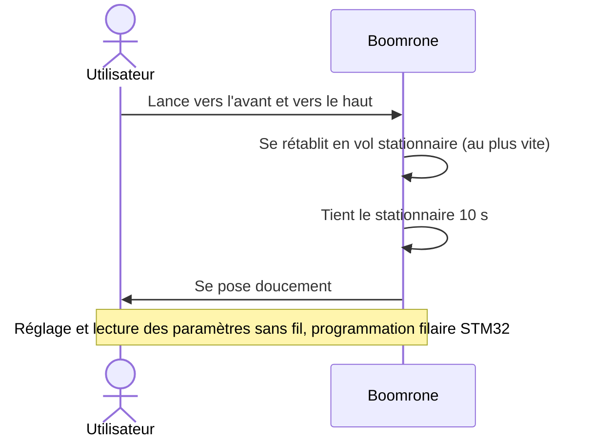

# Besoins — Boomrone

> **Aperçu** : Boomrone est un petit drone-jouet. L'utilisateur le lance à la main vers l'avant et vers le haut ; le drone doit se rétablir au plus vite en vol stationnaire, tenir 10 secondes, puis se poser doucement. Réglable et observable sans fil, programmable par câble avec l'outillage STMicroelectronics (STM32).
> **État de la phase** : besoins **proposés**, à valider ; plusieurs doutes bloquants ouverts (voir « Registre de doutes » — `registre-doutes.md`).

## Vue d'ensemble

## Contexte et contraintes générales

- Environnement : espace sans vent (gymnase, ou jardin par temps calme).
- Achetés tout faits : moteurs, batterie, hélices. Le reste est conçu.
- Fabrication et assemblage de la carte : JLCPCB, composants **en stock**.
- Aucun matériel n'existe encore ; inspiration possible des mini-drones existants.

## Besoins

### BES-001 — Lancer à la main
**Réfs amont :** Utilisateur (description initiale du projet)
**Énoncé :** L'utilisateur lance le drone à la main, vers l'avant et vers le haut.
**Priorité :** Essentiel
**Statut :** Proposé

### BES-002 — Se rétablir rapidement en vol stationnaire
**Réfs amont :** Utilisateur (description initiale du projet)
**Énoncé :** Après le lancer, le drone passe de la trajectoire de lancer au vol stationnaire le plus vite possible.
**Priorité :** Essentiel
**Statut :** Proposé

### BES-003 — Tenir le vol stationnaire 10 secondes
**Réfs amont :** Utilisateur (description initiale du projet)
**Énoncé :** Une fois rétabli, le drone maintient le vol stationnaire pendant 10 secondes.
**Priorité :** Essentiel
**Statut :** Proposé

### BES-004 — Se poser doucement
**Réfs amont :** Utilisateur (description initiale du projet)
**Énoncé :** Après le stationnaire, le drone se pose doucement.
**Priorité :** Essentiel
**Statut :** Proposé

### BES-005 — Régler le drone sans fil
**Réfs amont :** Utilisateur (description initiale du projet)
**Énoncé :** L'utilisateur modifie les paramètres de réglage du drone sans fil.
**Priorité :** Essentiel
**Statut :** Proposé

### BES-006 — Communiquer les paramètres sans fil
**Réfs amont :** Utilisateur (description initiale du projet)
**Énoncé :** Le drone transmet ses paramètres sans fil.
**Priorité :** Essentiel
**Statut :** Proposé

### BES-007 — Programmer le drone par câble avec l'outillage STMicroelectronics
**Réfs amont :** Utilisateur (description initiale du projet)
**Énoncé :** Le micrologiciel se programme par liaison filaire avec le matériel de STMicroelectronics (famille STM32).
**Priorité :** Essentiel
**Statut :** Proposé

### BES-008 — Fonctionner dans un espace sans vent
**Réfs amont :** Utilisateur (description initiale du projet)
**Énoncé :** Le drone est prévu pour un usage en espace sans vent (gymnase, jardin par temps calme).
**Priorité :** Essentiel
**Statut :** Proposé

### BES-009 — Utiliser moteurs, batterie et hélices du commerce
**Réfs amont :** Utilisateur (description initiale du projet)
**Énoncé :** Les moteurs, la batterie et les hélices sont achetés ; ils ne sont pas conçus dans le projet.
**Priorité :** Essentiel
**Statut :** Proposé

### BES-010 — Fabriquer avec JLCPCB en composants en stock
**Réfs amont :** Utilisateur (description initiale du projet)
**Énoncé :** La carte est fabriquée par JLCPCB ; tous les composants doivent être disponibles en stock chez eux.
**Priorité :** Essentiel
**Statut :** Proposé
