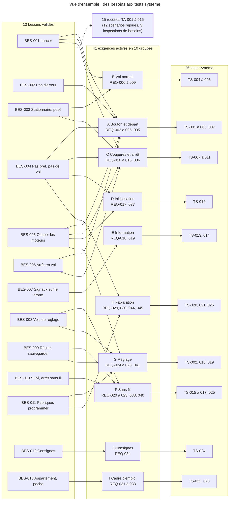
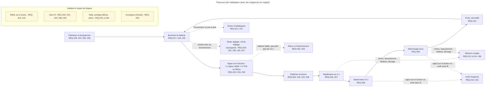
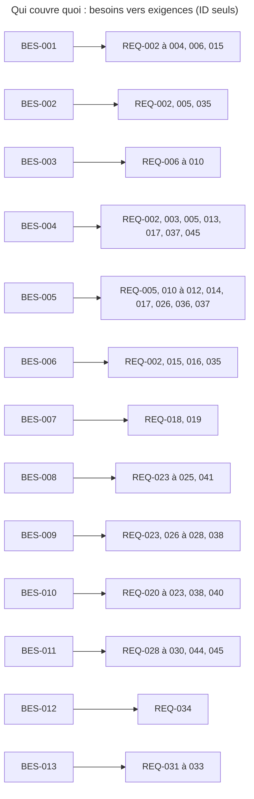

# Exigences système

> **Aperçu**
> - 41 exigences système actives pour les 13 besoins validés (45 numéros, dont quatre exigences fusionnées et abandonnées, listées sous le tableau récapitulatif : DEC-216 « Fusions de simplicité et sous-tension en échec d'initialisation : retouches finales de la porte exigences »), chiffrées (valeur, tolérance, méthode) ou binaires (fait ou pas fait) et sans solution technique ; statut « Validé », porte « exigences » franchie sur accord explicite de l'utilisateur (DEC-217 « Porte exigences franchie : accord explicite de l'utilisateur »).
> - Rédigées par délégation (DEC-172 « Délégation de la phase exigences à l'architecte ») selon la ligne « simplicité » (DEC-173 « Ligne directrice de la phase exigences : simplicité, valeurs chiffrées, aucune solution ») ; six simplifications de scénarios adoptées (DEC-181 « Simplifications de l'annexe B tranchées : DOU-126 levé ») ; dix effets locaux au lieu de dix-sept signaux (DEC-176 « Simplification n°3 adoptée : dix effets locaux au lieu de dix-sept signaux ») ; corrigées après les relectures de la porte (DEC-195 « Relecture de porte exigences : corrections décidées par délégation, identifiants conservés »), puis simplifiées par quatre fusions (DEC-216 « Fusions de simplicité et sous-tension en échec d'initialisation : retouches finales de la porte exigences »).
> - Chaque exigence active a au moins un test système (26 TS) dans « Plans de test » — `projets/boomrone/05-plans-de-test.md` ; les valeurs provisoires sont à valider aux essais sur prototype (annexe B).
> - Lecture : vue d'ensemble, parcours, tableau récapitulatif, puis les exigences par groupe (A à J).
> - État : 0 doute bloquant, 12 doutes non bloquants ouverts (annexe D).

## Vue d'ensemble

*Légende : une flèche pleine = « le besoin est repris par le groupe d'exigences » puis « le groupe est vérifié par ces tests système » ; le pointillé = les recettes vérifient les besoins. Titres des besoins abrégés ; titres complets dans le tableau récapitulatif.*

## Parcours de l'utilisateur avec les exigences

*Légende : trait plein = vol normal ; pointillé = refus, coupure, arrêt ou autre mode ; encadré jaune = exigences valables à toutes les étapes. ID seuls dans le schéma, titres dans le tableau récapitulatif.*

## Tableau récapitulatif

Priorité = la plus haute des priorités des besoins cités par l'exigence (Essentiel, Important, Souhaitable : voir « Glossaire » — `projets/boomrone/00-glossaire.md`). « BES » = besoin principal ; les autres besoins sont dans chaque exigence. « prov. » = valeur ou tolérance provisoire, à valider aux essais (annexe B) ; une valeur sans « prov. » vient d'une décision de l'utilisateur.

| Exigence | Priorité | Valeur clé | BES | TS |
|---|---|---|---|---|
| REQ-002 « Chronologie d'un appui sur le bouton » | Essentiel | 1 s, 2 s, 10 s ; anti-rebond 10 ms ±2 ms et tolérances (prov.) | BES-002 « Ne pas armer ni lancer par erreur » | TS-001 « Anti-rebond et chronologie d'un appui » |
| REQ-003 « Conditions de départ du drone » | Essentiel | 30 °/s ; ±0,5 m/s² ; 15° ; 3,7 V par élément (prov.) | BES-004 « Ne pas voler quand le drone n'est pas prêt » | TS-002 « Conditions de départ et refus d'armement » |
| REQ-004 « Démarrage des moteurs 200 ms après le relâchement » | Essentiel | 200 ms ±50 ms ; effet à 50 ms (prov.) | BES-001 « Lancer le drone à la main » | TS-003 « Démarrage des moteurs : délai et geste volontaire » |
| REQ-005 « Démarrage des moteurs sur geste volontaire seulement » | Essentiel | 2 cas de démarrage, 0 autre sur 31 | BES-004 « Ne pas voler quand le drone n'est pas prêt » | TS-003 « Démarrage des moteurs : délai et geste volontaire » |
| REQ-035 « Appui en cours à un changement d'état » | Essentiel | appui en cours ignoré jusqu'au relâchement | BES-002 « Ne pas armer ni lancer par erreur » | TS-007 « Verrouillage après un posé, une coupure ou un redémarrage » |
| REQ-006 « Stabilisation après le lancer » | Essentiel | 2,0 s ; 90 % de 20 lancers (prov.) | BES-001 « Lancer le drone à la main » | TS-004 « Stabilisation après le lancer » |
| REQ-007 « Critère de vol stationnaire » | Essentiel | 15° ; 0,3 m/s ; 0,3 m (prov.) | BES-003 « Rester en vol stationnaire 10 s puis atterrir doucement » | TS-005 « Critère et tenue du vol stationnaire » |
| REQ-008 « Tenue du vol stationnaire » | Essentiel | 10 s ; 1,0 m (0,8 à 1,2 m) ; dérive 0,5 m (prov.) | BES-003 « Rester en vol stationnaire 10 s puis atterrir doucement » | TS-005 « Critère et tenue du vol stationnaire » |
| REQ-009 « Atterrissage doux » | Essentiel | 0,5 m/s (prov.) ; coupure à 2 à 3 cm | BES-003 « Rester en vol stationnaire 10 s puis atterrir doucement » | TS-006 « Atterrissage doux » |
| REQ-010 « Verrouillage après un posé, une coupure ou un redémarrage » | Essentiel | 0 redémarrage seul | BES-005 « Couper les moteurs quand le vol ne peut pas continuer » | TS-007 « Verrouillage après un posé, une coupure ou un redémarrage » |
| REQ-011 « Coupures automatiques en vol » | Essentiel | 2,0 s ; 15,0 s ; 60° pendant 0,1 s, 100 ms et tolérances (prov.) | BES-005 « Couper les moteurs quand le vol ne peut pas continuer » | TS-008 « Coupures automatiques en vol » |
| REQ-012 « Coupure sur sous-tension de la batterie » | Essentiel | 3,3 V par élément, 100 ms ±20 ms, 80 ms, 250 ms (prov.) | BES-005 « Couper les moteurs quand le vol ne peut pas continuer » | TS-009 « Coupure sur sous-tension et marge de batterie » |
| REQ-013 « Marge de batterie pour un vol complet » | Essentiel | vol de 30 s depuis 3,7 V par élément (prov.) | BES-004 « Ne pas voler quand le drone n'est pas prêt » | TS-009 « Coupure sur sous-tension et marge de batterie » |
| REQ-014 « Coupure sur logiciel bloqué » | Essentiel | 200 ms (prov.) | BES-005 « Couper les moteurs quand le vol ne peut pas continuer » | TS-010 « Coupure sur logiciel bloqué ou phase Lancé trop longue » |
| REQ-036 « Coupure sur phase Lancé trop longue » | Essentiel | 500 ms ; 200 ms (prov.) | BES-005 « Couper les moteurs quand le vol ne peut pas continuer » | TS-010 « Coupure sur logiciel bloqué ou phase Lancé trop longue » |
| REQ-015 « Garde du bouton après le lancer » | Essentiel | 0,5 s ±0,1 s (prov.) | BES-006 « Arrêter le drone en vol d'un geste » | TS-011 « Garde et arrêt d'urgence par le bouton » |
| REQ-016 « Arrêt d'urgence par le bouton » | Essentiel | 50 ms (prov.) | BES-006 « Arrêter le drone en vol d'un geste » | TS-011 « Garde et arrêt d'urgence par le bouton » |
| REQ-017 « Initialisation en 3 secondes » | Essentiel | 3 s (prov.) | BES-004 « Ne pas voler quand le drone n'est pas prêt » | TS-012 « Initialisation et échec d'initialisation » |
| REQ-037 « Comportement en échec d'initialisation » | Essentiel | échec définitif, 0 moteur | BES-004 « Ne pas voler quand le drone n'est pas prêt » | TS-012 « Initialisation et échec d'initialisation » |
| REQ-018 « Effets locaux par situation » | Essentiel | 10 effets locaux distincts | BES-007 « Savoir où en est le drone sans autre appareil » | TS-013 « Effets locaux par situation » |
| REQ-019 « Perceptibilité et distinction des effets » | Essentiel | 1,0 m ; 0,5 s ; 300 lux ; 10 sur 10 (prov.) | BES-007 « Savoir où en est le drone sans autre appareil » | TS-014 « Perceptibilité et distinction des effets » |
| REQ-020 « Statut sans fil » | Souhaitable | 17 codes d'état ; 2 par seconde ; 5 m (prov.) | BES-010 « Suivre le drone sur un appareil de suivi » | TS-015 « Statut sans fil et variables du vol » |
| REQ-038 « Causes et paramètres dans le statut sans fil » | Souhaitable | 2 dernières causes ; paramètres relus | BES-010 « Suivre le drone sur un appareil de suivi » | TS-015 « Statut sans fil et variables du vol » |
| REQ-021 « Variables du vol » | Souhaitable | 10 fois par seconde (prov.) | BES-010 « Suivre le drone sur un appareil de suivi » | TS-015 « Statut sans fil et variables du vol » |
| REQ-022 « Arrêt sans fil » | Souhaitable | 200 ms (prov.) | BES-010 « Suivre le drone sur un appareil de suivi » | TS-016 « Arrêt sans fil » |
| REQ-023 « Commandes sans fil selon l'état du drone » | Souhaitable | 4 commandes, 4 lignes, 16 cases | BES-010 « Suivre le drone sur un appareil de suivi » | TS-017 « Commandes sans fil selon l'état » |
| REQ-040 « Appareil de suivi » | Souhaitable | ordinateur ou téléphone + logiciel d'essai | BES-010 « Suivre le drone sur un appareil de suivi » | TS-025 « Appareil de suivi et logiciel d'essai » |
| REQ-024 « Entrée en mode réglage par le bouton » | Souhaitable | bouton tenu au branchement | BES-008 « Entrer en mode réglage et faire des vols de réglage » | TS-018 « Mode réglage et vol de réglage » |
| REQ-041 « Conditions d'acceptation de la commande Décoller » | Souhaitable | batterie suffisante ; bouton relâché | BES-008 « Entrer en mode réglage et faire des vols de réglage » | TS-002 « Conditions de départ et refus d'armement » ; TS-018 « Mode réglage et vol de réglage » |
| REQ-025 « Vol de réglage » | Souhaitable | 3,0 s ; tolérance ±0,5 s (prov.) ; lien perdu sans effet sur le vol | BES-008 « Entrer en mode réglage et faire des vols de réglage » | TS-018 « Mode réglage et vol de réglage » |
| REQ-026 « Paramètres de vol réglables » | Essentiel | 4 paramètres ; 29 valeurs fixes ; 100 ms (prov.) | BES-009 « Régler et sauvegarder les paramètres de vol » | TS-019 « Paramètres, sauvegarde et valeurs d'origine » |
| REQ-027 « Sauvegarde et chargement des réglages » | Souhaitable | 1 s (prov.) | BES-009 « Régler et sauvegarder les paramètres de vol » | TS-019 « Paramètres, sauvegarde et valeurs d'origine » |
| REQ-028 « Valeurs d'origine après la programmation » | Essentiel | valeurs d'origine | BES-011 « Fabriquer et programmer le drone soi-même » | TS-019 « Paramètres, sauvegarde et valeurs d'origine » |
| REQ-029 « Composants disponibles à l'unité » | Essentiel | 1 revendeur grand public, sans minimum | BES-011 « Fabriquer et programmer le drone soi-même » | TS-020 « Fabrication à la main » |
| REQ-044 « Assemblage à la main » | Essentiel | pas ≥ 0,5 mm ; pas de BGA | BES-011 « Fabriquer et programmer le drone soi-même » | TS-020 « Fabrication à la main » |
| REQ-030 « Programmation depuis l'ordinateur » | Essentiel | 5 min (prov.) | BES-011 « Fabriquer et programmer le drone soi-même » | TS-021 « Programmation depuis l'ordinateur » |
| REQ-045 « Batterie débranchable à la main » | Essentiel | 10 s, sans outil (prov.) | BES-004 « Ne pas voler quand le drone n'est pas prêt » | TS-026 « Batterie débranchable à la main » |
| REQ-031 « Drone de poche » | Important | 100 × 100 × 50 mm ; 100 g (prov.) | BES-013 « Voler en appartement avec un drone de poche protégé » | TS-022 « Dimensions, masse et protège-hélices » |
| REQ-032 « Protège-hélices » | Important | calibre de 12 mm sur les côtés | BES-013 « Voler en appartement avec un drone de poche protégé » | TS-022 « Dimensions, masse et protège-hélices » |
| REQ-033 « Vol dans une pièce d'appartement » | Important | pièce 4 × 4 × 2,5 m ; 1 m/s ; 9 vols sur 10 (prov.) | BES-013 « Voler en appartement avec un drone de poche protégé » | TS-023 « Vol dans une pièce d'appartement » |
| REQ-034 « Page de consignes d'emploi » | Important | 1 face A4 ; 60 lignes ; 15 mots par ligne (prov.) | BES-012 « Disposer d'une page de consignes d'emploi » | TS-024 « Page de consignes d'emploi » |

Décompte : 27 Essentielles, 10 Souhaitables, 4 Importantes (total 41 exigences actives).

Exigences abandonnées (fusionnées, identifiants jamais réutilisés ; DEC-216 « Fusions de simplicité et sous-tension en échec d'initialisation : retouches finales de la porte exigences ») : REQ-001 « Anti-rebond du bouton » dans REQ-002 « Chronologie d'un appui sur le bouton » ; REQ-039 « Cadence et portée du statut sans fil » dans REQ-020 « Statut sans fil » ; REQ-042 « Vol de réglage indépendant du lien sans fil » dans REQ-025 « Vol de réglage » ; REQ-043 « Valeurs de sécurité fixes » dans REQ-026 « Paramètres de vol réglables ».

## A. Bouton et départ

### REQ-001 — Anti-rebond du bouton
**Réfs amont :** BES-006 « Arrêter le drone en vol d'un geste » ; BES-002 « Ne pas armer ni lancer par erreur »
**Statut :** Abandonné, fusionnée dans REQ-002 « Chronologie d'un appui sur le bouton » (DEC-216 « Fusions de simplicité et sous-tension en échec d'initialisation : retouches finales de la porte exigences »).

### REQ-002 — Chronologie d'un appui sur le bouton
**Réfs amont :** BES-002 « Ne pas armer ni lancer par erreur » ; BES-001 « Lancer le drone à la main » ; BES-004 « Ne pas voler quand le drone n'est pas prêt » ; BES-006 « Arrêter le drone en vol d'un geste »
**Décisions liées :** DEC-087 « Arrêt d'urgence par le bouton en vol : anti-rebond très court seulement, arrêt quasi immédiat » ; DEC-216 « Fusions de simplicité et sous-tension en échec d'initialisation : retouches finales de la porte exigences » ; DEC-072 « Armement à 2 secondes d'appui : signal Prêt, ou signal unique Armement refusé selon l'état du drone » ; DEC-054 « Chrono de 10 secondes compté depuis l'appui initial » ; DEC-182 « Valeurs du bouton : 1 s, 2 s, 10 s, anti-rebond, garde, délai des moteurs »
**Énoncé :** Le drone doit ignorer tout changement d'état du bouton qui dure moins de 10 ms et prendre en compte tout changement qui dure 10 ms ou plus (anti-rebond ; tolérance ±2 ms, valeurs provisoires). Le drone en attente d'un appui doit réagir à un appui continu sur le bouton selon le tableau suivant, durées comptées depuis l'appui initial (les seuils de 1 s, 2 s et 10 s sont décidés par l'utilisateur ; les tolérances sont provisoires).

| Événement | Comportement du drone |
|---|---|
| Appui de moins de 1 s, puis relâchement | aucun effet |
| Appui maintenu 1,0 s (±0,1 s) | effet Appui validé |
| Relâchement entre 1 s et 2 s | aucun autre effet, retour à l'attente |
| Appui maintenu 2,0 s (±0,1 s), drone prêt (REQ-003 « Conditions de départ du drone ») | drone armé, effet Prêt |
| Appui maintenu 2,0 s (±0,1 s), drone non prêt | effet Refus, retour à l'attente |
| Relâchement entre 2 s et 10 s, drone armé | lancer (REQ-004 « Démarrage des moteurs 200 ms après le relâchement ») |
| Appui maintenu plus de 10,0 s (±0,2 s), drone armé | effet Désarmement, retour à l'attente, moteurs non démarrés |

Au retour à l'attente après un Refus ou un Désarmement, l'appui en cours suit la règle de REQ-035 « Appui en cours à un changement d'état ».
**Priorité :** Essentiel
**Vérification :** Essai (TS-001 « Anti-rebond et chronologie d'un appui ») : impulsions de 6 ms puis de 14 ms sur le bouton ; appuis de 0,5 s, 1,5 s, 2,5 s et 11 s au chronomètre ; un drone non prêt (batterie basse) pour le Refus.
**Statut :** Validé

### REQ-003 — Conditions de départ du drone
**Réfs amont :** BES-004 « Ne pas voler quand le drone n'est pas prêt » ; BES-001 « Lancer le drone à la main »
**Décisions liées :** DEC-056 « Armement : drone immobile, sans autotest » ; DEC-183 « Valeurs de départ : immobile, à plat, batterie à l'armement » ; DEC-186 « Valeurs de batterie : seuils par élément, confirmation, vol complet » ; DEC-206 « Conditions de départ : immobilité mesurée en relatif, cas Décoller séparé »
**Doutes liés :** DOU-101 « Tolérance d'immobile à l'armement sur un drone tenu en main : faisabilité du cas nominal »
**Énoncé :** Le drone ne doit être « prêt » que si, au moment du contrôle (2,0 s d'appui), les trois conditions suivantes sont vraies en même temps (valeurs provisoires) :
- immobile : vitesse de rotation d'au plus 30 °/s, et norme de l'accélération mesurée qui ne s'écarte pas de plus de ±0,5 m/s² de sa moyenne pendant les 0,5 s précédentes (mesure relative, indépendante du calibrage) ;
- à plat : inclinaison d'au plus 15° ;
- batterie suffisante : tension à vide d'au moins 3,7 V par élément (±0,05 V).

Le cas de la commande Décoller est traité par REQ-041 « Conditions d'acceptation de la commande Décoller ».
**Priorité :** Essentiel
**Vérification :** Essai (TS-002 « Conditions de départ et refus d'armement ») : cas chiffrés de rotation, de secousse, d'inclinaison et de tension (voir le test).
**Statut :** Validé

### REQ-004 — Démarrage des moteurs 200 ms après le relâchement
**Réfs amont :** BES-001 « Lancer le drone à la main »
**Décisions liées :** DEC-073 « Armé entre 2 et 10 secondes d'appui : le relâchement donne le signal Lancé, les moteurs démarrent 200 ms plus tard » ; DEC-006 « Le relâchement du bouton armé suffit à démarrer les moteurs » ; DEC-182 « Valeurs du bouton : 1 s, 2 s, 10 s, anti-rebond, garde, délai des moteurs » ; DEC-197 « Effet Lancé et vol : pas d'onzième effet »
**Énoncé :** Le drone armé doit, quand le bouton est relâché après 2 s à 10 s d'appui, donner l'effet Lancé et vol au plus 50 ms après le relâchement, puis démarrer ses moteurs 200 ms après le relâchement (±50 ms), même s'il n'est pas lancé (le délai de 200 ms est décidé par l'utilisateur ; 50 ms et ±50 ms sont provisoires).
**Priorité :** Essentiel
**Vérification :** Essai (TS-003 « Démarrage des moteurs : délai et geste volontaire ») : oscilloscope ou analyseur logique sur le bouton et la commande des moteurs.
**Statut :** Validé

### REQ-005 — Démarrage des moteurs sur geste volontaire seulement
**Réfs amont :** BES-004 « Ne pas voler quand le drone n'est pas prêt » ; BES-002 « Ne pas armer ni lancer par erreur » ; BES-005 « Couper les moteurs quand le vol ne peut pas continuer »
**Décisions liées :** DEC-018 « Jamais de réarmement automatique ; batterie mesurée à vide à l'armement » ; DEC-023 « Après le posé ou une coupure : drone verrouillé, nouvel appui pour revoler » ; DEC-097 « Redémarrage ou chute de tension, même en phase Lancé : moteurs arrêtés, drone verrouillé » ; DEC-211 « Initialisation en deux exigences, démarrage des moteurs sans chevauchement »
**Doutes liés :** DOU-136 « Ordre de livraison : exigence essentielle dépendant du mode réglage souhaitable »
**Énoncé :** Le drone ne doit démarrer ses moteurs que dans les deux cas suivants, et dans aucun autre :
- au relâchement du bouton armé (REQ-004 « Démarrage des moteurs 200 ms après le relâchement ») ;
- sur une commande Décoller acceptée en mode réglage (REQ-041 « Conditions d'acceptation de la commande Décoller »).

L'état du drone après une coupure relève de REQ-010 « Verrouillage après un posé, une coupure ou un redémarrage ». Note de livraison : le second cas dépend du mode réglage, livré après (priorité Souhaitable) ; la règle reste vraie avec le seul premier cas.
**Priorité :** Essentiel
**Vérification :** Essai (TS-003 « Démarrage des moteurs : délai et geste volontaire ») : 10 mises sous tension, 10 coupures d'alimentation suivies d'un redémarrage, 10 appuis de moins de 2 s et une commande Décoller hors mode réglage ; moteurs jamais démarrés (0 sur 31).
**Statut :** Validé

### REQ-035 — Appui en cours à un changement d'état
**Réfs amont :** BES-002 « Ne pas armer ni lancer par erreur » ; BES-006 « Arrêter le drone en vol d'un geste »
**Décisions liées :** DEC-188 « Bouton : un appui commencé avant une coupure ou un décollage est ignoré jusqu'au relâchement » ; DEC-205 « Bouton : règle unique de l'appui en cours, garde du lancer, Décoller refusé si le bouton est enfoncé »
**Énoncé :** Si le bouton est déjà enfoncé quand l'un des changements d'état suivants a lieu, le drone doit ignorer cet appui jusqu'à son premier relâchement ; seul un nouvel appui est ensuite pris en compte :
- fin de l'initialisation (REQ-017 « Initialisation en 3 secondes ») ;
- entrée en mode réglage (REQ-024 « Entrée en mode réglage par le bouton ») ;
- retour à l'attente après un Refus ou un Désarmement (REQ-002 « Chronologie d'un appui sur le bouton ») ;
- coupure des moteurs, quelle qu'en soit la cause, et retour à l'attente après un posé (REQ-010 « Verrouillage après un posé, une coupure ou un redémarrage »).

Cette règle est écrite ici seulement. Deux cas ne la suivent pas : la garde qui suit le lancer (REQ-015 « Garde du bouton après le lancer ») et le vol de réglage, sans garde (REQ-016 « Arrêt d'urgence par le bouton »).
**Priorité :** Essentiel
**Vérification :** Essai (TS-007 « Verrouillage après un posé, une coupure ou un redémarrage ») : bouton tenu enfoncé à chaque changement d'état de la liste, puis relâché ; aucun effet avant le relâchement ; le nouvel appui compte.
**Statut :** Validé

## B. Vol normal

### REQ-006 — Stabilisation après le lancer
**Réfs amont :** BES-001 « Lancer le drone à la main » ; BES-003 « Rester en vol stationnaire 10 s puis atterrir doucement »
**Décisions liées :** DEC-009 « Stationnaire atteint en 2 secondes maximum après le démarrage des moteurs » ; DEC-010 « Plage de lancer : toute orientation, 0,5 à 4 m/s, au moins 1,5 m du sol » ; DEC-184 « Valeurs du vol : lancer, stationnaire, hauteur, dérive, atterrissage »
**Doutes liés :** DOU-050 « Mesure de vitesse horizontale et faisabilité du stationnaire en 2 s depuis 1,5 m » ; DOU-116 « Échéance et circularité du report aux essais, comportement de SCN-002 sur la partie infaisable de la plage »
**Énoncé :** Après un lancer dans la plage ci-dessous, le drone doit atteindre le vol stationnaire (REQ-007 « Critère de vol stationnaire ») au plus 2,0 s après le démarrage des moteurs, dans au moins 90 % de 20 lancers (la hauteur de tenue relève de REQ-008 « Tenue du vol stationnaire »).
- Orientation : quelconque.
- Vitesse : 0,5 à 4 m/s.
- Rotation au relâchement : au plus 1 tour par seconde.
- Hauteur au relâchement : au moins 1,5 m au-dessus du sol.

La plage de vitesse, la hauteur de 1,5 m et le délai de 2,0 s sont décidés par l'utilisateur ; la rotation, le taux de 90 % et le nombre de 20 lancers sont provisoires.
**Priorité :** Essentiel
**Vérification :** Essai (TS-004 « Stabilisation après le lancer ») : 20 lancers variés, chronomètre ou caméra ; si l'essai échoue, la plage est à revoir (DEC-137 « Faisabilité du stationnaire en 2 secondes depuis 1,5 m : jalon déplacé aux essais, plage de lancer inchangée »).
**Statut :** Validé

### REQ-007 — Critère de vol stationnaire
**Réfs amont :** BES-003 « Rester en vol stationnaire 10 s puis atterrir doucement »
**Décisions liées :** DEC-049 « Stationnaire déclaré seulement en l'air, au-dessus d'une hauteur minimale » ; DEC-184 « Valeurs du vol : lancer, stationnaire, hauteur, dérive, atterrissage » ; DEC-196 « Drone tenu en main à plus de 0,3 m : limite assumée, DOU-134 levé »
**Énoncé :** Le drone ne doit déclarer le vol stationnaire que lorsque, en même temps, son inclinaison est d'au plus 15°, sa vitesse d'au plus 0,3 m/s et la hauteur mesurée sous lui d'au moins 0,3 m (valeurs provisoires) ; un drone posé (hauteur de moins de 0,3 m) n'est jamais déclaré en vol stationnaire. Limite assumée : un drone tenu en main à plus de 0,3 m, immobile et à plat, remplit ce critère et peut se croire en vol stationnaire (ligne 38 de « Risques acceptés » — `projets/boomrone/risques-acceptes.md`).
**Priorité :** Essentiel
**Vérification :** Essai (TS-005 « Critère et tenue du vol stationnaire ») : drone posé moteurs en marche sur le banc, puis suspendu à 0,2 m et à 0,5 m, immobile et à plat, puis incliné à 20° et déplacé à 0,5 m/s ; relevé du statut sans fil.
**Statut :** Validé

### REQ-008 — Tenue du vol stationnaire
**Réfs amont :** BES-003 « Rester en vol stationnaire 10 s puis atterrir doucement »
**Décisions liées :** DEC-011 « Dérive de 30 cm sur 10 s en objectif à valider par essais » ; DEC-184 « Valeurs du vol : lancer, stationnaire, hauteur, dérive, atterrissage » ; DEC-200 « Hauteur visée 1,0 m, dérive 0,5 m, pièce d'essai 4 m × 4 m × 2,5 m »
**Énoncé :** Avec les valeurs d'origine des paramètres (REQ-026 « Paramètres de vol réglables »), le drone doit rester en vol stationnaire 10,0 s (±0,5 s) à partir de la déclaration du stationnaire. De la 3e à la 10e seconde :
- sa hauteur est comprise entre 0,8 m et 1,2 m (hauteur visée : 1,0 m) ;
- son écart horizontal à la position de la déclaration est d'au plus 0,5 m (objectif de 0,3 m, mesuré et consigné sans valeur d'acceptation).

Les 10 s et l'objectif de 0,3 m sont décidés par l'utilisateur ; la tolérance de 0,5 s, la fenêtre de hauteur et la dérive de 0,5 m sont provisoires.
**Priorité :** Essentiel
**Vérification :** Essai (TS-005 « Critère et tenue du vol stationnaire ») : vidéo devant une règle graduée ou un quadrillage, 5 vols.
**Statut :** Validé

### REQ-009 — Atterrissage doux
**Réfs amont :** BES-003 « Rester en vol stationnaire 10 s puis atterrir doucement »
**Décisions liées :** DEC-020 « Atterrissage sur place » ; DEC-021 « Atterrissage lent, 15 secondes maximum, puis coupure des moteurs » ; DEC-022 « Moteurs coupés à moins de 2 à 3 cm du sol » ; DEC-210 « Délais uniques : atterrissage 15,0 s ±0,5 s, sous-tension 250 ms, vol de réglage scindé »
**Énoncé :** Avec les valeurs d'origine des paramètres (REQ-026 « Paramètres de vol réglables »), à la fin du stationnaire (10 s, ou 3 s en vol de réglage), le drone doit descendre sur place avec une vitesse d'au plus 0,5 m/s au contact du sol (provisoire), couper ses moteurs quand la hauteur mesurée passe à 2 à 3 cm et donner l'effet Posé, avant la coupure sur délai d'atterrissage de REQ-011 « Coupures automatiques en vol ».
**Priorité :** Essentiel
**Vérification :** Essai (TS-006 « Atterrissage doux ») : vidéo à 120 images par seconde, 5 vols ; temps et vitesse de contact relevés.
**Statut :** Validé

## C. Coupures et arrêt

### REQ-010 — Verrouillage après un posé, une coupure ou un redémarrage
**Réfs amont :** BES-005 « Couper les moteurs quand le vol ne peut pas continuer » ; BES-003 « Rester en vol stationnaire 10 s puis atterrir doucement »
**Décisions liées :** DEC-023 « Après le posé ou une coupure : drone verrouillé, nouvel appui pour revoler » ; DEC-047 « L'état verrouillé est le même que l'état allumé, en attente d'un appui » ; DEC-188 « Bouton : un appui commencé avant une coupure ou un décollage est ignoré jusqu'au relâchement » ; DEC-199 « Sous-tension : verrouillage dans tous les états, mode réglage compris »
**Énoncé :** Après un posé, une coupure des moteurs (quelle qu'en soit la cause), une coupure d'alimentation ou un redémarrage, le drone doit rester moteurs arrêtés et ne les redémarrer qu'après un nouvel appui complet (REQ-002 « Chronologie d'un appui sur le bouton », puis le relâchement). L'appui déjà en cours suit la règle de REQ-035 « Appui en cours à un changement d'état ».
- Mode réglage : après un posé ou une coupure autre qu'une sous-tension, le drone revient au mode réglage, moteurs arrêtés, sans verrouillage (REQ-025 « Vol de réglage »).
- Sous-tension (REQ-012 « Coupure sur sous-tension de la batterie ») : dans tous les états, mode réglage compris, le drone encore alimenté reste dans l'état d'échec d'initialisation de REQ-037 « Comportement en échec d'initialisation » : bouton et commandes sans fil sans effet jusqu'à la mise hors tension.
**Priorité :** Essentiel
**Vérification :** Essai (TS-007 « Verrouillage après un posé, une coupure ou un redémarrage ») : après chaque cause de coupure, dont la sous-tension et le logiciel bloqué, moteurs arrêtés jusqu'à un appui complet ; en mode réglage, retour au mode réglage sauf après une sous-tension.
**Statut :** Validé

### REQ-011 — Coupures automatiques en vol
**Réfs amont :** BES-005 « Couper les moteurs quand le vol ne peut pas continuer »
**Décisions liées :** DEC-002 « Couper les moteurs si le stationnaire n'est pas atteint dans le délai » ; DEC-012 « Couper les moteurs si le drone bascule après le stationnaire » ; DEC-185 « Valeurs de coupure : basculement, pas de limite de dérive ni d'altitude » ; DEC-210 « Délais uniques : atterrissage 15,0 s ±0,5 s, sous-tension 250 ms, vol de réglage scindé »
**Énoncé :** Le drone doit couper ses moteurs au plus 100 ms après la détection de l'une des trois causes suivantes et donner l'effet Coupure en vol (valeurs fixes ; 100 ms, tolérances et 60° provisoires ; la cause est portée par le statut : REQ-038 « Causes et paramètres dans le statut sans fil »).

| Cause | Détection |
|---|---|
| Stationnaire non atteint | 2,0 s (±0,1 s) après le démarrage des moteurs, sans déclaration du stationnaire |
| Basculement | après le stationnaire, inclinaison de plus de 60° (±5°) pendant plus de 0,1 s |
| Atterrissage trop long | 15,0 s (±0,5 s) après le début de l'atterrissage (fin du stationnaire) sans posé ; en vol de réglage, 15,0 s (±0,5 s) après le décollage de réglage |

Le seuil de 15,0 s (±0,5 s) est défini ici seulement.
**Priorité :** Essentiel
**Vérification :** Essai (TS-008 « Coupures automatiques en vol ») : drone armé posé sur une table, hélices démontées ; drone retourné puis incliné à 55° et à 65° en stationnaire sur potence ; atterrissage retenu par un obstacle ; chronomètre ou analyseur logique.
**Statut :** Validé

### REQ-012 — Coupure sur sous-tension de la batterie
**Réfs amont :** BES-005 « Couper les moteurs quand le vol ne peut pas continuer »
**Décisions liées :** DEC-134 « Coupure sur sous-tension en vol assumée par le logiciel : le drone surveille la tension » ; DEC-126 « Protection de sous-tension de la batterie : scénario court, coupure sans signal propre » ; DEC-186 « Valeurs de batterie : seuils par élément, confirmation, vol complet » ; DEC-199 « Sous-tension : verrouillage dans tous les états, mode réglage compris » ; DEC-210 « Délais uniques : atterrissage 15,0 s ±0,5 s, sous-tension 250 ms, vol de réglage scindé » ; DEC-216 « Fusions de simplicité et sous-tension en échec d'initialisation : retouches finales de la porte exigences »
**Doutes liés :** DOU-118 « Seuil de protection et consommation résiduelle du drone laissé allumé »
**Énoncé :** Dans tout état où il est sous tension, mode réglage compris, le drone doit couper ses moteurs au plus 250 ms après que la tension de la batterie est passée sous 3,3 V par élément, quand elle y reste 100 ms (±20 ms) ou plus ; un creux de moins de 80 ms ne doit pas provoquer la coupure. Le drone encore alimenté passe alors en échec d'initialisation (REQ-037 « Comportement en échec d'initialisation ») et donne l'effet Échec d'initialisation : il est inutilisable jusqu'à la mise hors tension (bouton sans effet, il faut débrancher la batterie). Valeurs provisoires.
**Priorité :** Essentiel
**Vérification :** Essai (TS-009 « Coupure sur sous-tension et marge de batterie ») : alimentation de laboratoire abaissée lentement puis par un creux de 50 ms et de 150 ms, dans quatre états (attente, armé, vol sur banc, mode réglage) ; après la coupure, effet Échec d'initialisation et bouton sans effet.
**Statut :** Validé

### REQ-013 — Marge de batterie pour un vol complet
**Réfs amont :** BES-004 « Ne pas voler quand le drone n'est pas prêt »
**Décisions liées :** DEC-004 « Batterie vérifiée à l'armement : pas d'armement si batterie faible » ; DEC-013 « Pas de contrôle de la batterie en vol » ; DEC-186 « Valeurs de batterie : seuils par élément, confirmation, vol complet » ; DEC-209 « Batterie de référence choisie à l'architecture, faisabilité conjointe en doute »
**Doutes liés :** DOU-135 « Faisabilité conjointe de la poussée, de la masse de 100 g, du capteur de hauteur, de la fabrication à la main et de la batterie » ; DOU-108 « Rapport entre le seuil d'armement et le seuil de sous-tension, affaissement de tension au démarrage des moteurs »
**Énoncé :** Un drone armé avec une batterie juste acceptée (3,7 V par élément à vide, REQ-003 « Conditions de départ du drone ») doit pouvoir accomplir un vol complet de 30 s moteurs en marche sans que la tension mesurée sous charge reste sous 3,3 V par élément pendant 100 ms (REQ-012 « Coupure sur sous-tension de la batterie »). La batterie de référence est la batterie réellement choisie à l'architecture ; l'essai se fait sur banc. Valeurs provisoires.
**Priorité :** Essentiel
**Vérification :** Essai (TS-009 « Coupure sur sous-tension et marge de batterie ») : batterie choisie amenée à 3,7 V par élément à vide, 30 s de fonctionnement des moteurs sur le banc, tension enregistrée.
**Statut :** Validé

### REQ-014 — Coupure sur logiciel bloqué
**Réfs amont :** BES-005 « Couper les moteurs quand le vol ne peut pas continuer »
**Décisions liées :** DEC-065 « Logiciel bloqué en vol : coupure des moteurs par un chien de garde » ; DEC-096 « Chien de garde sur tout état où les moteurs peuvent être alimentés, phase Lancé de durée maximale » ; DEC-203 « Coupure sur logiciel bloqué et coupure sur phase Lancé : deux exigences »
**Doutes liés :** DOU-120 « Écriture en mémoire sous tension basse ou pendant une phase de vol »
**Énoncé :** Si le logiciel cesse de s'exécuter normalement, le drone doit couper ses moteurs au plus 200 ms après la dernière exécution correcte du logiciel, sans dépendre du logiciel bloqué (valeur provisoire).
**Priorité :** Essentiel
**Vérification :** Essai (TS-010 « Coupure sur logiciel bloqué ou phase Lancé trop longue ») : logiciel d'essai qui se bloque volontairement moteurs en marche sur le banc ; analyseur logique.
**Statut :** Validé

### REQ-036 — Coupure sur phase Lancé trop longue
**Réfs amont :** BES-005 « Couper les moteurs quand le vol ne peut pas continuer »
**Décisions liées :** DEC-096 « Chien de garde sur tout état où les moteurs peuvent être alimentés, phase Lancé de durée maximale » ; DEC-103 « Phase Lancé trop longue : coupure et redémarrage par le chien de garde, sans nouvel état ni signal » ; DEC-203 « Coupure sur logiciel bloqué et coupure sur phase Lancé : deux exigences »
**Énoncé :** Si la phase Lancé (REQ-004 « Démarrage des moteurs 200 ms après le relâchement ») dure plus de 500 ms sans démarrage des moteurs, le drone doit garder ses moteurs arrêtés et se verrouiller (REQ-010 « Verrouillage après un posé, une coupure ou un redémarrage ») au plus 200 ms plus tard, sans dépendre du logiciel bloqué (valeurs provisoires).
**Priorité :** Essentiel
**Vérification :** Essai (TS-010 « Coupure sur logiciel bloqué ou phase Lancé trop longue ») : logiciel d'essai qui retarde le démarrage des moteurs de plus de 500 ms après le relâchement ; analyseur logique.
**Statut :** Validé

### REQ-015 — Garde du bouton après le lancer
**Réfs amont :** BES-006 « Arrêter le drone en vol d'un geste » ; BES-001 « Lancer le drone à la main »
**Décisions liées :** DEC-055 « Bouton ignoré pendant une courte garde après le lancer » ; DEC-092 « Garde du bouton après le lancer : fronts ignorés, niveau pris en compte, démarrage au relâchement » ; DEC-182 « Valeurs du bouton : 1 s, 2 s, 10 s, anti-rebond, garde, délai des moteurs » ; DEC-205 « Bouton : règle unique de l'appui en cours, garde du lancer, Décoller refusé si le bouton est enfoncé »
**Énoncé :** Pendant 0,5 s (±0,1 s) à partir du relâchement du bouton armé, le drone doit ignorer tout changement d'état du bouton ; un appui encore enfoncé à la fin de cette garde doit arrêter les moteurs au plus 50 ms après la fin de la garde (délai de REQ-016 « Arrêt d'urgence par le bouton ») (valeurs provisoires).
**Priorité :** Essentiel
**Vérification :** Essai (TS-011 « Garde et arrêt d'urgence par le bouton ») : appuis brefs pendant la garde (sans effet), appui maintenu jusqu'à la fin de la garde (arrêt, délai de 50 ms mesuré).
**Statut :** Validé

### REQ-016 — Arrêt d'urgence par le bouton
**Réfs amont :** BES-006 « Arrêter le drone en vol d'un geste »
**Décisions liées :** DEC-087 « Arrêt d'urgence par le bouton en vol : anti-rebond très court seulement, arrêt quasi immédiat » ; DEC-094 « Bouton appuyé après un décollage de réglage : pris en compte tout de suite, sans garde » ; DEC-205 « Bouton : règle unique de l'appui en cours, garde du lancer, Décoller refusé si le bouton est enfoncé »
**Énoncé :** Moteurs en marche et hors garde (REQ-015 « Garde du bouton après le lancer »), le drone doit couper ses moteurs au plus 50 ms après qu'un appui franchit l'anti-rebond (REQ-002 « Chronologie d'un appui sur le bouton ») et donner l'effet Coupure en vol (50 ms provisoire). En vol de réglage, il n'y a pas de garde : un appui après le décollage de réglage (REQ-041 « Conditions d'acceptation de la commande Décoller ») coupe aussitôt.
**Priorité :** Essentiel
**Vérification :** Essai (TS-011 « Garde et arrêt d'urgence par le bouton ») : appuis en vol normal et en vol de réglage sur le banc, oscilloscope ou caméra à 240 images par seconde.
**Statut :** Validé

## D. Initialisation

### REQ-017 — Initialisation en 3 secondes
**Réfs amont :** BES-004 « Ne pas voler quand le drone n'est pas prêt » ; BES-005 « Couper les moteurs quand le vol ne peut pas continuer »
**Décisions liées :** DEC-067 « Démarrage à plat exigé, sinon échec de l'initialisation avec signal » ; DEC-211 « Initialisation en deux exigences, démarrage des moteurs sans chevauchement » ; DEC-188 « Bouton : un appui commencé avant une coupure ou un décollage est ignoré jusqu'au relâchement »
**Énoncé :** À chaque mise sous tension et à chaque redémarrage, le drone doit terminer son initialisation en 3 s au plus (valeur provisoire), puis donner :
- l'effet Mode réglage, si le bouton est tenu depuis la mise sous tension (REQ-024 « Entrée en mode réglage par le bouton ») ;
- l'effet Échec d'initialisation, s'il est en mouvement ou pas à plat (mêmes critères d'immobilité et d'inclinaison que REQ-003 « Conditions de départ du drone » ; suite : REQ-037 « Comportement en échec d'initialisation ») ;
- sinon l'effet Allumé.

Un appui commencé pendant l'initialisation et encore enfoncé à la fin suit la règle de REQ-035 « Appui en cours à un changement d'état ». La batterie n'est pas contrôlée à l'initialisation, seulement à l'armement (REQ-003 « Conditions de départ du drone »).
**Priorité :** Essentiel
**Vérification :** Essai (TS-012 « Initialisation et échec d'initialisation ») : mise sous tension à plat, secouée, inclinée à 20° ; redémarrage après coupure d'alimentation drone posé puis en mouvement ; appui commencé pendant l'initialisation.
**Statut :** Validé

### REQ-037 — Comportement en échec d'initialisation
**Réfs amont :** BES-004 « Ne pas voler quand le drone n'est pas prêt » ; BES-005 « Couper les moteurs quand le vol ne peut pas continuer »
**Décisions liées :** DEC-075 « Initialisation en échec : définitive jusqu'au débranchement de la batterie » ; DEC-178 « Simplification n°5 adoptée : échec d'initialisation, toutes les commandes sans fil ignorées » ; DEC-211 « Initialisation en deux exigences, démarrage des moteurs sans chevauchement » ; DEC-216 « Fusions de simplicité et sous-tension en échec d'initialisation : retouches finales de la porte exigences »
**Énoncé :** Le drone en échec d'initialisation ne doit jamais démarrer ses moteurs et doit ignorer le bouton et toutes les commandes sans fil, jusqu'au débranchement de la batterie. Après une coupure sur sous-tension (REQ-012 « Coupure sur sous-tension de la batterie »), le drone encore alimenté est dans le même état, avec le même effet.
**Priorité :** Essentiel
**Vérification :** Essai (TS-012 « Initialisation et échec d'initialisation ») : après un échec, appuis sur le bouton et les quatre commandes sans fil ; moteurs jamais démarrés, aucun effet.
**Statut :** Validé

## E. Information

### REQ-018 — Effets locaux par situation
**Réfs amont :** BES-007 « Savoir où en est le drone sans autre appareil »
**Décisions liées :** DEC-176 « Simplification n°3 adoptée : dix effets locaux au lieu de dix-sept signaux » ; DEC-197 « Effet Lancé et vol : pas d'onzième effet » ; DEC-099 « Un statut sans fil distinct par état, effets locaux regroupables par catégorie » ; DEC-113 « Cause d'une coupure en vol : confirmation, Allumé tout de suite, aucune durée minimale, risque accepté »
**Énoncé :** Le drone doit donner, pour chaque situation du tableau, l'effet local correspondant, les dix effets étant distincts deux à deux. Il ne donne aucun effet propre à une coupure d'alimentation ; après une sous-tension, le drone encore alimenté donne l'effet Échec d'initialisation (REQ-012 « Coupure sur sous-tension de la batterie »). Les dix-sept états restent distincts sur le statut sans fil (REQ-020 « Statut sans fil »).

| N° | Effet | Situations | Nature |
|---|---|---|---|
| 1 | Allumé | mise sous tension réussie ; retour à l'attente après Posé, Refus, Désarmement ou Coupure en vol ; redémarrage réussi | état |
| 2 | Appui validé | bouton maintenu 1 s | événement |
| 3 | Prêt | armement accepté à 2 s | état |
| 4 | Lancé et vol | du relâchement du bouton armé à la fin de l'atterrissage : Lancé, Stabilisation, En vol stationnaire, Atterrissage (vols normal et de réglage) | état |
| 5 | Posé | moteurs coupés à moins de 3 cm du sol | événement |
| 6 | Refus | armement refusé ; Décoller refusé en mode réglage | événement |
| 7 | Désarmement | bouton maintenu plus de 10 s | événement |
| 8 | Coupure en vol | échec de stabilisation, arrêt par le bouton, arrêt sans fil, basculement, délai de descente dépassé | événement |
| 9 | Échec d'initialisation | initialisation impossible ; sous-tension, drone encore alimenté | état |
| 10 | Mode réglage | entrée en mode réglage, puis retour au sol en mode réglage | état |

**Priorité :** Essentiel
**Vérification :** Essai (TS-013 « Effets locaux par situation ») : provoquer chacune des situations sur le banc ou en vol, relever l'effet et le statut sans fil.
**Statut :** Validé

### REQ-019 — Perceptibilité et distinction des effets
**Réfs amont :** BES-007 « Savoir où en est le drone sans autre appareil »
**Décisions liées :** DEC-176 « Simplification n°3 adoptée : dix effets locaux au lieu de dix-sept signaux » ; DEC-113 « Cause d'une coupure en vol : confirmation, Allumé tout de suite, aucune durée minimale, risque accepté » ; DEC-001 « Information de l'utilisateur par signaux lumineux, sonores et suivi sur un autre appareil » ; DEC-212 « Effets locaux : lumière ou son, distinction en une passe »
**Doutes liés :** DOU-133 « Forme des dix effets locaux : lumière, son, distinction mesurable »
**Énoncé :** Chaque effet local (REQ-018 « Effets locaux par situation ») doit être donné par la lumière, par le son ou par les deux (aucun composant imposé) et rester perceptible à 1,0 m :
- lumière : visible dans une pièce éclairée à environ 300 lux ; son : audible moteurs arrêtés ; moteurs en marche, l'effet passe par la lumière ;
- effet d'événement : pendant au moins 0,5 s, même si l'état suivant est déjà atteint ;
- distinction : un observateur identifie les dix effets présentés dans un ordre aléatoire, 10 sur 10 en une passe.

Toutes les valeurs sont provisoires.
**Priorité :** Essentiel
**Vérification :** Essai (TS-014 « Perceptibilité et distinction des effets ») : un observateur, une fiche des dix effets, une passe ; chronomètre pour la durée.
**Statut :** Validé

## F. Sans fil

### REQ-020 — Statut sans fil
**Réfs amont :** BES-010 « Suivre le drone sur un appareil de suivi »
**Décisions liées :** DEC-179 « Simplification n°6 adoptée : statut sans fil par code d'état et dernières causes » ; DEC-099 « Un statut sans fil distinct par état, effets locaux regroupables par catégorie » ; DEC-104 « Cause d'une coupure en vol : signal local non conservé, Allumé prend le relais, cause conservée sur le statut sans fil » ; DEC-202 « Statut sans fil en trois exigences » ; DEC-216 « Fusions de simplicité et sous-tension en échec d'initialisation : retouches finales de la porte exigences »
**Énoncé :** Le drone doit émettre vers l'appareil de suivi (REQ-040 « Appareil de suivi ») un statut qui comprend le code de l'état courant, distinct pour chacun des dix-sept états du tableau. Les états 12 à 17 sont des événements : l'état suivant (Allumé, ou Mode réglage en vol de réglage) est publié aussitôt. Le statut est émis au moins 2 fois par seconde, et une fois de plus à chaque changement d'état, reçu par l'appareil de suivi jusqu'à 5 m en pièce (valeurs provisoires). Causes et paramètres : REQ-038 « Causes et paramètres dans le statut sans fil ».

| N° | État | Situation |
|---|---|---|
| 1 | Allumé | attente d'un appui |
| 2 | Échec d'initialisation | REQ-037 « Comportement en échec d'initialisation », dont après une sous-tension |
| 3 | Appui validé | bouton maintenu 1 s |
| 4 | Mode réglage | mode réglage, moteurs coupés |
| 5 | Refus | armement ou Décoller refusé |
| 6 | Prêt | drone armé |
| 7 | Désarmement | bouton maintenu plus de 10 s |
| 8 | Lancé | du relâchement au démarrage des moteurs |
| 9 | Stabilisation | moteurs en marche, stationnaire pas encore déclaré |
| 10 | En vol stationnaire | stationnaire déclaré |
| 11 | Atterrissage | après le stationnaire |
| 12 | Posé | moteurs coupés près du sol |
| 13 | Échec de stabilisation | coupure : stationnaire non atteint |
| 14 | Arrêt par le bouton | coupure : appui en vol |
| 15 | Basculement | coupure : inclinaison excessive |
| 16 | Arrêt sans fil | coupure : commande Arrêt |
| 17 | Délai de descente dépassé | coupure : atterrissage trop long |

**Priorité :** Souhaitable
**Vérification :** Essai (TS-015 « Statut sans fil et variables du vol ») : provoquer chaque état, lire le code sur l'appareil de suivi ; appareil de suivi à 5 m, comptage des statuts reçus et relevé des changements d'état.
**Statut :** Validé

### REQ-038 — Causes et paramètres dans le statut sans fil
**Réfs amont :** BES-010 « Suivre le drone sur un appareil de suivi » ; BES-009 « Régler et sauvegarder les paramètres de vol »
**Décisions liées :** DEC-179 « Simplification n°6 adoptée : statut sans fil par code d'état et dernières causes » ; DEC-104 « Cause d'une coupure en vol : signal local non conservé, Allumé prend le relais, cause conservée sur le statut sans fil » ; DEC-202 « Statut sans fil en trois exigences » ; DEC-201 « Quatre paramètres de vol réglables, valeurs d'origine provisoires : DOU-132 levé »
**Énoncé :** Le statut sans fil (REQ-020 « Statut sans fil ») doit aussi comprendre :
- la dernière cause de refus : batterie faible, drone en mouvement, drone pas à plat, bouton enfoncé (Décoller) ;
- la dernière cause de coupure en vol : échec de stabilisation, arrêt par le bouton, arrêt sans fil, basculement, délai de descente dépassé, sous-tension (si le drone reste alimenté) ;
- la valeur courante de chacun des quatre paramètres réglables (REQ-026 « Paramètres de vol réglables »), qui sert de relecture et d'acquittement d'une commande Modifier.

Les deux causes sont conservées jusqu'à la mise hors tension.
**Priorité :** Souhaitable
**Vérification :** Essai (TS-015 « Statut sans fil et variables du vol ») : provoquer chaque cause, lire le statut ; modifier un paramètre et relire sa valeur (TS-019 « Paramètres, sauvegarde et valeurs d'origine »).
**Statut :** Validé

### REQ-039 — Cadence et portée du statut sans fil
**Réfs amont :** BES-010 « Suivre le drone sur un appareil de suivi »
**Statut :** Abandonné, fusionnée dans REQ-020 « Statut sans fil » (DEC-216 « Fusions de simplicité et sous-tension en échec d'initialisation : retouches finales de la porte exigences »).

### REQ-021 — Variables du vol
**Réfs amont :** BES-010 « Suivre le drone sur un appareil de suivi »
**Décisions liées :** DEC-025 « Suivi et réglage du drone par le sans fil, y compris en vol » ; DEC-179 « Simplification n°6 adoptée : statut sans fil par code d'état et dernières causes »
**Énoncé :** Pendant tout vol (normal ou de réglage), le drone doit envoyer à l'appareil de suivi, au moins 10 fois par seconde, ses variables du vol : sa hauteur, son inclinaison et la commande de chaque moteur (valeur provisoire).
**Priorité :** Souhaitable
**Vérification :** Essai (TS-015 « Statut sans fil et variables du vol ») : enregistrement de 10 s d'un vol, comptage des valeurs reçues.
**Statut :** Validé

### REQ-022 — Arrêt sans fil
**Réfs amont :** BES-010 « Suivre le drone sur un appareil de suivi »
**Décisions liées :** DEC-031 « Arrêt du drone lancé : bouton et commande d'arrêt sans fil » ; DEC-033 « Signal Arrêt sans fil distinct du signal Arrêt par le bouton » ; DEC-189 « Arrêt d'un drone en vol : bouton ou arrêt sans fil, pas d'autre option »
**Énoncé :** En vol (normal ou de réglage), à la réception de la commande Arrêt, le drone doit couper ses moteurs au plus 200 ms plus tard et donner l'effet Coupure en vol ; la cause « arrêt sans fil » est portée par REQ-038 « Causes et paramètres dans le statut sans fil » (200 ms provisoire).
**Priorité :** Souhaitable
**Vérification :** Essai (TS-016 « Arrêt sans fil ») : commande Arrêt envoyée en vol sur banc, délai mesuré à l'analyseur logique ou à la caméra.
**Statut :** Validé

### REQ-023 — Commandes sans fil selon l'état du drone
**Réfs amont :** BES-010 « Suivre le drone sur un appareil de suivi » ; BES-008 « Entrer en mode réglage et faire des vols de réglage » ; BES-009 « Régler et sauvegarder les paramètres de vol »
**Décisions liées :** DEC-177 « Simplification n°4 adoptée : commandes sans fil acceptées seulement en mode réglage » ; DEC-178 « Simplification n°5 adoptée : échec d'initialisation, toutes les commandes sans fil ignorées » ; DEC-043 « Commandes sans fil acceptées selon l'état du drone » ; DEC-199 « Sous-tension : verrouillage dans tous les états, mode réglage compris » ; DEC-202 « Statut sans fil en trois exigences »
**Énoncé :** Le drone doit traiter les quatre commandes sans fil (Décoller, Arrêt, Modifier, Sauvegarder) selon le tableau suivant ; toute commande ignorée n'a aucun effet. Il n'y a pas de cinquième commande : la relecture d'un paramètre se fait par le statut sans fil (REQ-038 « Causes et paramètres dans le statut sans fil »).

| État du drone | Décoller | Arrêt | Modifier | Sauvegarder |
|---|---|---|---|---|
| Mode réglage, moteurs coupés | acceptée si REQ-041 « Conditions d'acceptation de la commande Décoller » ; ignorée après une sous-tension (échec d'initialisation) | ignorée | acceptée | acceptée |
| Vol de réglage | ignorée | coupe les moteurs | acceptée | ignorée |
| Vol normal (Stabilisation, stationnaire, Atterrissage) | ignorée | coupe les moteurs | ignorée | ignorée |
| Tout autre état (initialisation, échec d'initialisation, Allumé, appui, armé, Lancé) | ignorée | ignorée | ignorée | ignorée |

**Priorité :** Souhaitable
**Vérification :** Essai (TS-017 « Commandes sans fil selon l'état ») : les 16 cases du tableau, une commande par case, effet relevé.
**Statut :** Validé

### REQ-040 — Appareil de suivi
**Réfs amont :** BES-010 « Suivre le drone sur un appareil de suivi »
**Décisions liées :** DEC-025 « Suivi et réglage du drone par le sans fil, y compris en vol » ; DEC-207 « Appareil de suivi et batterie débranchable : deux exigences ajoutées »
**Énoncé :** L'appareil de suivi doit être un ordinateur ou un téléphone relié au drone par la liaison sans fil, avec un logiciel d'essai écrit par l'utilisateur et livré avec le projet. Ce logiciel affiche le statut (REQ-020 « Statut sans fil », REQ-038 « Causes et paramètres dans le statut sans fil ») et les variables du vol (REQ-021 « Variables du vol »), et envoie les quatre commandes de REQ-023 « Commandes sans fil selon l'état du drone ». Le protocole est un choix d'architecture.
**Priorité :** Souhaitable
**Vérification :** Essai (TS-025 « Appareil de suivi et logiciel d'essai ») : logiciel d'essai relié à un drone, lecture du statut, des variables et envoi de chaque commande.
**Statut :** Validé

## G. Réglage

### REQ-024 — Entrée en mode réglage par le bouton
**Réfs amont :** BES-008 « Entrer en mode réglage et faire des vols de réglage »
**Décisions liées :** DEC-175 « Simplification n°2 adoptée : mode réglage par le bouton tenu à la mise sous tension » ; DEC-079 « Sortie du mode réglage : uniquement en enlevant la batterie » ; DEC-116 « Bouton en mode réglage, moteurs coupés : aucun effet et aucun signal, il ne sert qu'en vol de réglage »
**Énoncé :** Si le bouton est maintenu enfoncé depuis la mise sous tension jusqu'à la fin d'une initialisation réussie (REQ-017 « Initialisation en 3 secondes »), le drone doit entrer en mode réglage, moteurs arrêtés, et donner l'effet Mode réglage. Il y reste jusqu'au débranchement de la batterie ; le bouton n'a aucun effet au sol, et l'appui encore en cours à l'entrée suit la règle de REQ-035 « Appui en cours à un changement d'état ».
**Priorité :** Souhaitable
**Vérification :** Essai (TS-018 « Mode réglage et vol de réglage ») : bouton tenu au branchement ; appuis au sol ; un redémarrage sans bouton revient en mode normal.
**Statut :** Validé

### REQ-041 — Conditions d'acceptation de la commande Décoller
**Réfs amont :** BES-008 « Entrer en mode réglage et faire des vols de réglage »
**Décisions liées :** DEC-074 « Décollage en mode réglage : la batterie est vérifiée, rien d'autre » ; DEC-205 « Bouton : règle unique de l'appui en cours, garde du lancer, Décoller refusé si le bouton est enfoncé » ; DEC-206 « Conditions de départ : immobilité mesurée en relatif, cas Décoller séparé »
**Énoncé :** En mode réglage, moteurs coupés, le drone doit accepter la commande Décoller seulement si la batterie est suffisante (REQ-003 « Conditions de départ du drone », condition de batterie seule) et si le bouton n'est pas enfoncé. Sinon il donne l'effet Refus, reste en mode réglage et inscrit la cause dans le statut (REQ-038 « Causes et paramètres dans le statut sans fil »). Une commande acceptée démarre les moteurs : c'est le « décollage de réglage » (REQ-025 « Vol de réglage »).
**Priorité :** Souhaitable
**Vérification :** Essai (TS-002 « Conditions de départ et refus d'armement », TS-018 « Mode réglage et vol de réglage ») : Décoller à 3,6 V puis 3,8 V par élément, avec le bouton enfoncé puis relâché.
**Statut :** Validé

### REQ-025 — Vol de réglage
**Réfs amont :** BES-008 « Entrer en mode réglage et faire des vols de réglage »
**Décisions liées :** DEC-029 « Vol de réglage : stationnaire de 3 secondes, atterrissage sur place si le lien est perdu » ; DEC-106 « Lien sans fil perdu en vol de réglage : aucune action particulière » ; DEC-210 « Délais uniques : atterrissage 15,0 s ±0,5 s, sous-tension 250 ms, vol de réglage scindé » ; DEC-216 « Fusions de simplicité et sous-tension en échec d'initialisation : retouches finales de la porte exigences »
**Énoncé :** Sur une commande Décoller acceptée (REQ-041 « Conditions d'acceptation de la commande Décoller »), le drone doit décoller, rester 3,0 s (±0,5 s) en vol stationnaire, atterrir (REQ-009 « Atterrissage doux »), couper ses moteurs, puis revenir au mode réglage sans verrouillage (REQ-010 « Verrouillage après un posé, une coupure ou un redémarrage »). Les 3 s sont décidées par l'utilisateur, la tolérance est provisoire. La coupure sur délai d'atterrissage de REQ-011 « Coupures automatiques en vol » s'applique. Une perte du lien sans fil pendant le vol de réglage ne l'interrompt pas : il suit son cours jusqu'au posé ; seuls le bouton (REQ-016 « Arrêt d'urgence par le bouton ») et les coupures de REQ-011 « Coupures automatiques en vol » l'arrêtent.
**Priorité :** Souhaitable
**Vérification :** Essai (TS-018 « Mode réglage et vol de réglage ») : vols de réglage successifs, durée du stationnaire chronométrée ; un vol de réglage avec le lien coupé en vol.
**Statut :** Validé

### REQ-042 — Vol de réglage indépendant du lien sans fil
**Réfs amont :** BES-008 « Entrer en mode réglage et faire des vols de réglage »
**Statut :** Abandonné, fusionnée dans REQ-025 « Vol de réglage » (DEC-216 « Fusions de simplicité et sous-tension en échec d'initialisation : retouches finales de la porte exigences »).

### REQ-026 — Paramètres de vol réglables
**Réfs amont :** BES-009 « Régler et sauvegarder les paramètres de vol » ; BES-005 « Couper les moteurs quand le vol ne peut pas continuer »
**Décisions liées :** DEC-180 « Simplification n°7 adoptée : valeurs de sécurité fixes dans le logiciel » ; DEC-051 « Seuils de sécurité réglables dans des bornes fixées par le logiciel » ; DEC-201 « Quatre paramètres de vol réglables, valeurs d'origine provisoires : DOU-132 levé » ; DEC-216 « Fusions de simplicité et sous-tension en échec d'initialisation : retouches finales de la porte exigences »
**Doutes liés :** DOU-136 « Ordre de livraison : exigence essentielle dépendant du mode réglage souhaitable »
**Énoncé :** Seuls quatre paramètres de vol sont modifiables par le sans fil ; tout le reste est fixe, et seule la reprogrammation le change. Sur une commande Modifier acceptée (REQ-023 « Commandes sans fil selon l'état du drone »), le drone doit appliquer la nouvelle valeur d'un des quatre paramètres ci-dessous au plus 100 ms plus tard, et n'accepter aucun autre paramètre ni aucune des 29 valeurs fixes de la liste suivante. Valeurs d'origine et délai provisoires. La valeur courante se relit dans le statut (REQ-038 « Causes et paramètres dans le statut sans fil »).

| Paramètre réglable | Valeur d'origine |
|---|---|
| Gain d'inclinaison | 1,0 (facteur du gain de référence du logiciel) |
| Gain de hauteur | 1,0 (facteur du gain de référence du logiciel) |
| Hauteur visée du stationnaire | 1,0 m |
| Vitesse de descente | 0,2 m/s |

Les 29 valeurs fixes sont listées ici une seule fois ; chacune a la valeur, la tolérance et le marquage provisoire de l'exigence citée.

| Groupe | Valeurs fixes | Exigences | Nombre |
|---|---|---|---|
| Bouton | anti-rebond 10 ms ; appui validé 1 s ; armement 2 s ; désarmement 10 s ; garde 0,5 s ; arrêt d'urgence 50 ms au plus ; démarrage des moteurs 200 ms | REQ-002 « Chronologie d'un appui sur le bouton » ; REQ-015 « Garde du bouton après le lancer » ; REQ-016 « Arrêt d'urgence par le bouton » ; REQ-004 « Démarrage des moteurs 200 ms après le relâchement » | 7 |
| Départ | rotation 30 °/s ; variation d'accélération ±0,5 m/s² ; inclinaison 15° ; seuil d'armement 3,7 V par élément | REQ-003 « Conditions de départ du drone » | 4 |
| Critère de stationnaire | inclinaison 15° ; vitesse 0,3 m/s ; hauteur minimale 0,3 m | REQ-007 « Critère de vol stationnaire » | 3 |
| Coupures en vol | délai de stationnaire 2,0 s ; angle de basculement 60° ; durée de basculement 0,1 s ; délai d'atterrissage 15,0 s ; coupure 100 ms au plus | REQ-011 « Coupures automatiques en vol » | 5 |
| Batterie | seuil de sous-tension 3,3 V par élément ; durée de confirmation 100 ms ; coupure 250 ms au plus | REQ-012 « Coupure sur sous-tension de la batterie » | 3 |
| Blocages | logiciel bloqué 200 ms ; phase Lancé 500 ms | REQ-014 « Coupure sur logiciel bloqué » ; REQ-036 « Coupure sur phase Lancé trop longue » | 2 |
| Vol | stationnaire 10 s ; stationnaire de réglage 3 s ; vitesse au contact 0,5 m/s ; coupure à 2 à 3 cm | REQ-008 « Tenue du vol stationnaire » ; REQ-025 « Vol de réglage » ; REQ-009 « Atterrissage doux » | 4 |
| Initialisation | durée 3 s | REQ-017 « Initialisation en 3 secondes » | 1 |

Total : 7 + 4 + 3 + 5 + 3 + 2 + 4 + 1 = 29 valeurs fixes.
**Priorité :** Essentiel (la fixité des valeurs de sécurité vaut même sans mode réglage ; les quatre réglages sont livrés après, comme le second cas de REQ-005 « Démarrage des moteurs sur geste volontaire seulement »)
**Vérification :** Essai (TS-019 « Paramètres, sauvegarde et valeurs d'origine ») : modifier chaque paramètre et relire la valeur dans le statut ; tenter de modifier un cinquième paramètre et chacune des 29 valeurs fixes par le sans fil : toutes inchangées.
**Statut :** Validé

### REQ-043 — Valeurs de sécurité fixes
**Réfs amont :** BES-009 « Régler et sauvegarder les paramètres de vol » ; BES-005 « Couper les moteurs quand le vol ne peut pas continuer »
**Statut :** Abandonné, fusionnée dans REQ-026 « Paramètres de vol réglables » (DEC-216 « Fusions de simplicité et sous-tension en échec d'initialisation : retouches finales de la porte exigences »).

### REQ-027 — Sauvegarde et chargement des réglages
**Réfs amont :** BES-009 « Régler et sauvegarder les paramètres de vol »
**Décisions liées :** DEC-034 « Réglages envoyés par le sans fil, sauvegarde sur commande, chargement au démarrage » ; DEC-177 « Simplification n°4 adoptée : commandes sans fil acceptées seulement en mode réglage »
**Énoncé :** Sur une commande Sauvegarder acceptée (REQ-023 « Commandes sans fil selon l'état du drone »), le drone doit enregistrer les valeurs courantes des paramètres de vol (REQ-026 « Paramètres de vol réglables ») en mémoire non volatile en 1 s au plus (valeur provisoire), et les charger à chaque initialisation suivante ; une valeur modifiée mais non sauvegardée est perdue au débranchement.
**Priorité :** Souhaitable
**Vérification :** Essai (TS-019 « Paramètres, sauvegarde et valeurs d'origine ») : modifier, sauvegarder, débrancher, rebrancher, relire ; modifier sans sauvegarder, débrancher, rebrancher, relire.
**Statut :** Validé

### REQ-028 — Valeurs d'origine après la programmation
**Réfs amont :** BES-011 « Fabriquer et programmer le drone soi-même » ; BES-009 « Régler et sauvegarder les paramètres de vol »
**Décisions liées :** DEC-139 « Reprogrammation : réécriture de la zone des réglages avec les valeurs d'origine » ; DEC-036 « Drone neuf : valeurs d'origine fixes du logiciel, sans signal » ; DEC-130 « Mémoire jamais écrite : aucune détection, valeurs d'origine fixes du logiciel, risque accepté »
**Énoncé :** Après chaque programmation, le drone doit démarrer avec les valeurs d'origine de ses quatre paramètres de vol (REQ-026 « Paramètres de vol réglables »), les réglages sauvegardés auparavant étant perdus.
**Priorité :** Essentiel
**Vérification :** Essai (TS-019 « Paramètres, sauvegarde et valeurs d'origine ») : sauvegarder des valeurs différentes, reprogrammer, relire : toutes égales aux valeurs d'origine.
**Statut :** Validé

## H. Fabrication

### REQ-029 — Composants disponibles à l'unité
**Réfs amont :** BES-011 « Fabriquer et programmer le drone soi-même »
**Décisions liées :** DEC-144 « Ligne directrice : simplicité, un seul utilisateur qui accepte les risques » ; DEC-166 « BES-011 retitré : fabriquer et programmer le drone soi-même » ; DEC-208 « Fabrication : approvisionnement et assemblage séparés »
**Énoncé :** Chaque composant du drone doit pouvoir s'acheter à l'unité, sans commande minimale, chez au moins un revendeur en ligne grand public.
**Priorité :** Essentiel
**Vérification :** Inspection (TS-020 « Fabrication à la main ») de la nomenclature : chaque ligne avec son revendeur et sa quantité minimale.
**Statut :** Validé

### REQ-044 — Assemblage à la main
**Réfs amont :** BES-011 « Fabriquer et programmer le drone soi-même »
**Décisions liées :** DEC-144 « Ligne directrice : simplicité, un seul utilisateur qui accepte les risques » ; DEC-208 « Fabrication : approvisionnement et assemblage séparés »
**Énoncé :** Le drone doit pouvoir être assemblé à la main avec l'outillage courant d'un amateur (fer à souder, pinces, tournevis) :
- aucun composant n'exige un brasage en four, un boîtier à billes (BGA) ni un pas de broches de moins de 0,5 mm ;
- le câblage sur modules, la carte à trous et le circuit imprimé sur mesure commandé en ligne sont permis.
**Priorité :** Essentiel
**Vérification :** Inspection (TS-020 « Fabrication à la main ») du boîtier de chaque ligne de la nomenclature ; montage d'une carte à la main dans la recette TA-015 « Inspection de la fabrication à la main ».
**Statut :** Validé

### REQ-030 — Programmation depuis l'ordinateur
**Réfs amont :** BES-011 « Fabriquer et programmer le drone soi-même »
**Décisions liées :** DEC-024 « Mise en service par programmation avec un programmateur ST-LINK » ; DEC-026 « Mise en service : calibrage éventuel renvoyé à l'architecture, réglage du vol par un scénario dédié »
**Énoncé :** L'utilisateur doit pouvoir programmer le drone depuis son ordinateur, avec le seul programmateur relié à la carte, en 5 minutes au plus (valeur provisoire) ; à la mise sous tension suivante, le drone doit démarrer normalement (effet Allumé).
**Priorité :** Essentiel
**Vérification :** Essai (TS-021 « Programmation depuis l'ordinateur ») : trois programmations chronométrées sur une carte neuve et sur une carte déjà programmée.
**Statut :** Validé

### REQ-045 — Batterie débranchable à la main
**Réfs amont :** BES-004 « Ne pas voler quand le drone n'est pas prêt » ; BES-011 « Fabriquer et programmer le drone soi-même »
**Décisions liées :** DEC-207 « Appareil de suivi et batterie débranchable : deux exigences ajoutées »
**Énoncé :** Le drone, moteurs arrêtés et protège-hélices montés, doit permettre de débrancher la batterie à la main, sans outil, en 10 s au plus (valeur provisoire), le connecteur restant accessible malgré les protège-hélices.
**Priorité :** Essentiel
**Vérification :** Inspection (TS-026 « Batterie débranchable à la main ») : drone complet, moteurs arrêtés, batterie débranchée à la main et chronométrée.
**Statut :** Validé

## I. Cadre d'emploi

### REQ-031 — Drone de poche
**Réfs amont :** BES-013 « Voler en appartement avec un drone de poche protégé »
**Décisions liées :** DEC-187 « Valeurs du cadre d'emploi : poche, protège-hélices, pièce d'essai » ; DEC-040 « Périmètre d'emploi visé : l'appartement ; gymnase et jardin en essais complémentaires »
**Doutes liés :** DOU-135 « Faisabilité conjointe de la poussée, de la masse de 100 g, du capteur de hauteur, de la fabrication à la main et de la batterie »
**Énoncé :** Le drone, protège-hélices compris, doit tenir dans un volume de 100 mm × 100 mm × 50 mm et peser au plus 100 g, batterie comprise (valeurs provisoires).
**Priorité :** Important
**Vérification :** Mesure (TS-022 « Dimensions, masse et protège-hélices ») : pied à coulisse et balance.
**Statut :** Validé

### REQ-032 — Protège-hélices
**Réfs amont :** BES-013 « Voler en appartement avec un drone de poche protégé »
**Décisions liées :** DEC-016 « Public adulte, protège-hélices obligatoires » ; DEC-017 « Pas de protection supplémentaire contre les hélices en rotation sans lancer » ; DEC-187 « Valeurs du cadre d'emploi : poche, protège-hélices, pièce d'essai » ; DEC-204 « Protège-hélices : calibre sur les côtés, dessus et dessous en limite assumée »
**Énoncé :** Le drone doit voler avec des protège-hélices montés tels qu'un calibre de 12 mm de diamètre, approché de l'extérieur dans le plan des hélices (par les côtés), ne touche aucune hélice. Le dessus et le dessous ne sont pas couverts : limite assumée (ligne 39 de « Risques acceptés » — `projets/boomrone/risques-acceptes.md`).
**Priorité :** Important
**Vérification :** Inspection (TS-022 « Dimensions, masse et protège-hélices ») : calibre de 12 mm sur tout le pourtour du plan des hélices, drone équipé.
**Statut :** Validé

### REQ-033 — Vol dans une pièce d'appartement
**Réfs amont :** BES-013 « Voler en appartement avec un drone de poche protégé »
**Décisions liées :** DEC-185 « Valeurs de coupure : basculement, pas de limite de dérive ni d'altitude » ; DEC-187 « Valeurs du cadre d'emploi : poche, protège-hélices, pièce d'essai » ; DEC-040 « Périmètre d'emploi visé : l'appartement ; gymnase et jardin en essais complémentaires » ; DEC-200 « Hauteur visée 1,0 m, dérive 0,5 m, pièce d'essai 4 m × 4 m × 2,5 m »
**Énoncé :** Lancé à la main à une vitesse horizontale d'au plus 1 m/s depuis le centre d'une pièce de 4 m × 4 m × 2,5 m, le drone doit effectuer son vol complet sans qu'aucune de ses parties ne sorte du volume de la pièce, dans 9 vols sur 10 (valeurs provisoires ; les lancers plus rapides se font dans un lieu plus grand, gymnase ou jardin, non garantis).
**Priorité :** Important
**Vérification :** Essai (TS-023 « Vol dans une pièce d'appartement ») : 10 vols dans une pièce balisée, vidéo.
**Statut :** Validé

## J. Consignes d'emploi

### REQ-034 — Page de consignes d'emploi
**Réfs amont :** BES-012 « Disposer d'une page de consignes d'emploi »
**Décisions liées :** DEC-154 « Notice des limites d'emploi : une page de consignes d'emploi » ; DEC-167 « BES-012 : contrôle croisé, consignes complétées, DOU-127 levé » ; DEC-189 « Arrêt d'un drone en vol : bouton ou arrêt sans fil, pas d'autre option » ; DEC-213 « Valeurs provisoires : règle unique de marquage, annexe B complète, page de 60 lignes »
**Énoncé :** Le projet doit fournir une page unique de consignes d'emploi : au plus une face de format A4, 60 lignes au plus, une consigne à l'infinitif par ligne, 15 mots au plus par ligne (valeurs provisoires). Elle place en tête les quatre réflexes essentiels et rappelle les risques majeurs et ceux qui demandent un geste de l'utilisateur. Le contrôle croisé avec « Risques acceptés » — `projets/boomrone/risques-acceptes.md` ne doit laisser aucun risque majeur non repris sans justification écrite.
**Priorité :** Important
**Vérification :** Inspection (TS-024 « Page de consignes d'emploi ») : lecture de la page, comptage des lignes et des mots, contrôle croisé ligne à ligne avec le registre, liste des écarts justifiés.
**Statut :** Validé

## Annexe A — Couverture des besoins

Les 13 besoins ont au moins une exigence (vérifié par l'outil : aucun « BES sans REQ »).

*Légende : une flèche = « le besoin est repris par ces exigences ». Titres dans le tableau récapitulatif.*

## Annexe B — Valeurs de référence et valeurs provisoires

Règle de marquage : toute valeur ou tolérance qui ne vient pas d'une décision de l'utilisateur est « provisoire », dans l'énoncé et dans le tableau récapitulatif (DEC-213 « Valeurs provisoires : règle unique de marquage, annexe B complète, page de 60 lignes »). Les valeurs de sécurité fixes sont listées une seule fois, dans REQ-026 « Paramètres de vol réglables ». Décidées par l'utilisateur (non provisoires) : 2 s de délai de stationnaire, plage de lancer de 0,5 à 4 m/s à 1,5 m au moins, 10 s de stationnaire, objectif de dérive de 0,3 m, 15 s d'atterrissage, coupure à 2 à 3 cm, 200 ms de délai des moteurs, 1 s, 2 s et 10 s d'appui, 3 s de vol de réglage.

Les valeurs ci-dessous sont provisoires : à valider aux essais sur prototype (DOU-131 « Valeurs provisoires des exigences, à valider aux essais sur prototype »).

| Exigence | Valeurs provisoires | Doute lié |
|---|---|---|
| REQ-002 « Chronologie d'un appui sur le bouton » | anti-rebond 10 ms ±2 ms ; tolérances ±0,1 s (1 s et 2 s) et ±0,2 s (10 s) | DOU-131 « Valeurs provisoires des exigences, à valider aux essais sur prototype » |
| REQ-003 « Conditions de départ du drone » | 30 °/s ; ±0,5 m/s² sur 0,5 s ; 15° ; 3,7 V ±0,05 V par élément | DOU-101 « Tolérance d'immobile à l'armement sur un drone tenu en main : faisabilité du cas nominal » |
| REQ-004 « Démarrage des moteurs 200 ms après le relâchement » | effet à 50 ms ; tolérance ±50 ms | DOU-131 « Valeurs provisoires des exigences, à valider aux essais sur prototype » |
| REQ-006 « Stabilisation après le lancer » | 1 tour/s ; 90 % de 20 lancers | DOU-050 « Mesure de vitesse horizontale et faisabilité du stationnaire en 2 s depuis 1,5 m » ; DOU-116 « Échéance et circularité du report aux essais, comportement de SCN-002 sur la partie infaisable de la plage » ; DOU-135 « Faisabilité conjointe de la poussée, de la masse de 100 g, du capteur de hauteur, de la fabrication à la main et de la batterie » |
| REQ-007 « Critère de vol stationnaire » | 15° ; 0,3 m/s ; 0,3 m | DOU-131 « Valeurs provisoires des exigences, à valider aux essais sur prototype » |
| REQ-008 « Tenue du vol stationnaire » | ±0,5 s ; hauteur de 0,8 à 1,2 m ; dérive de 0,5 m | DOU-131 « Valeurs provisoires des exigences, à valider aux essais sur prototype » |
| REQ-009 « Atterrissage doux » | 0,5 m/s au contact | DOU-131 « Valeurs provisoires des exigences, à valider aux essais sur prototype » |
| REQ-011 « Coupures automatiques en vol » | 100 ms ; ±0,1 s ; 60° ±5° pendant 0,1 s ; 15,0 s ±0,5 s | DOU-131 « Valeurs provisoires des exigences, à valider aux essais sur prototype » |
| REQ-012 « Coupure sur sous-tension de la batterie » | 3,3 V par élément ; 100 ms ±20 ms ; 80 ms ; 250 ms | DOU-131 « Valeurs provisoires des exigences, à valider aux essais sur prototype » |
| REQ-013 « Marge de batterie pour un vol complet » | 30 s ; 3,7 V ; 3,3 V ; 100 ms | DOU-135 « Faisabilité conjointe de la poussée, de la masse de 100 g, du capteur de hauteur, de la fabrication à la main et de la batterie » ; DOU-108 « Rapport entre le seuil d'armement et le seuil de sous-tension, affaissement de tension au démarrage des moteurs » |
| REQ-014 « Coupure sur logiciel bloqué » | 200 ms | DOU-120 « Écriture en mémoire sous tension basse ou pendant une phase de vol » |
| REQ-036 « Coupure sur phase Lancé trop longue » | 500 ms ; 200 ms | DOU-131 « Valeurs provisoires des exigences, à valider aux essais sur prototype » |
| REQ-015 « Garde du bouton après le lancer » | 0,5 s ±0,1 s | DOU-131 « Valeurs provisoires des exigences, à valider aux essais sur prototype » |
| REQ-016 « Arrêt d'urgence par le bouton » | 50 ms | DOU-131 « Valeurs provisoires des exigences, à valider aux essais sur prototype » |
| REQ-017 « Initialisation en 3 secondes » | 3 s | DOU-131 « Valeurs provisoires des exigences, à valider aux essais sur prototype » |
| REQ-019 « Perceptibilité et distinction des effets » | 1,0 m ; 0,5 s ; 300 lux ; 10 sur 10 | DOU-133 « Forme des dix effets locaux : lumière, son, distinction mesurable » |
| REQ-021 « Variables du vol » | 10 par seconde | DOU-131 « Valeurs provisoires des exigences, à valider aux essais sur prototype » |
| REQ-022 « Arrêt sans fil » | 200 ms | DOU-131 « Valeurs provisoires des exigences, à valider aux essais sur prototype » |
| REQ-020 « Statut sans fil » | 2 par seconde ; 5 m | DOU-131 « Valeurs provisoires des exigences, à valider aux essais sur prototype » |
| REQ-025 « Vol de réglage » | tolérance ±0,5 s | DOU-131 « Valeurs provisoires des exigences, à valider aux essais sur prototype » |
| REQ-026 « Paramètres de vol réglables » | valeurs d'origine (1,0 ; 1,0 ; 1,0 m ; 0,2 m/s) ; 100 ms | DOU-131 « Valeurs provisoires des exigences, à valider aux essais sur prototype » |
| REQ-027 « Sauvegarde et chargement des réglages » | 1 s | DOU-131 « Valeurs provisoires des exigences, à valider aux essais sur prototype » |
| REQ-030 « Programmation depuis l'ordinateur » | 5 minutes | DOU-131 « Valeurs provisoires des exigences, à valider aux essais sur prototype » |
| REQ-045 « Batterie débranchable à la main » | 10 s | DOU-131 « Valeurs provisoires des exigences, à valider aux essais sur prototype » |
| REQ-031 « Drone de poche » | 100 × 100 × 50 mm ; 100 g | DOU-135 « Faisabilité conjointe de la poussée, de la masse de 100 g, du capteur de hauteur, de la fabrication à la main et de la batterie » |
| REQ-033 « Vol dans une pièce d'appartement » | 4 × 4 × 2,5 m ; 1 m/s ; 9 vols sur 10 | DOU-131 « Valeurs provisoires des exigences, à valider aux essais sur prototype » |
| REQ-034 « Page de consignes d'emploi » | 60 lignes ; 15 mots par ligne | DOU-131 « Valeurs provisoires des exigences, à valider aux essais sur prototype » |

## Annexe C — Simplifications adoptées

La n°1 (retirer le sans fil) reste écartée (DEC-163 « Communication sans fil conservée : simplification n°1 écartée »). Les n°2 à n°7 de « Besoins » — `projets/boomrone/01-besoins.md` sont adoptées (DEC-181 « Simplifications de l'annexe B tranchées : DOU-126 levé »).

| N° | Simplification | Décision | Scénarios modifiés | Exigences |
|---|---|---|---|---|
| 2 | Mode réglage par le bouton tenu au branchement | DEC-175 « Simplification n°2 adoptée : mode réglage par le bouton tenu à la mise sous tension » | SCN-004 « Appui normal : bouton relâché avant 2 secondes » ; SCN-009 « Réglage et suivi du drone par le sans fil » ; SCN-010 « Échec : initialisation impossible au démarrage » | REQ-024 « Entrée en mode réglage par le bouton » |
| 3 | Dix effets locaux au lieu de dix-sept signaux | DEC-176 « Simplification n°3 adoptée : dix effets locaux au lieu de dix-sept signaux » | SCN-001 « Vol nominal : de la batterie au posé » | REQ-018 « Effets locaux par situation » |
| 4 | Commandes sans fil seulement en mode réglage | DEC-177 « Simplification n°4 adoptée : commandes sans fil acceptées seulement en mode réglage » | SCN-009 « Réglage et suivi du drone par le sans fil » ; SCN-010 « Échec : initialisation impossible au démarrage » | REQ-023 « Commandes sans fil selon l'état du drone » |
| 5 | Échec d'initialisation : commandes ignorées | DEC-178 « Simplification n°5 adoptée : échec d'initialisation, toutes les commandes sans fil ignorées » | SCN-010 « Échec : initialisation impossible au démarrage » | REQ-037 « Comportement en échec d'initialisation » |
| 6 | Statut sans fil : code d'état et dernières causes | DEC-179 « Simplification n°6 adoptée : statut sans fil par code d'état et dernières causes » | SCN-009 « Réglage et suivi du drone par le sans fil » ; SCN-003 « Échec : batterie faible à l'armement » | REQ-020 « Statut sans fil » ; REQ-038 « Causes et paramètres dans le statut sans fil » |
| 7 | Valeurs de sécurité fixes | DEC-180 « Simplification n°7 adoptée : valeurs de sécurité fixes dans le logiciel » | SCN-002 « Échec : stationnaire non atteint dans le délai » ; SCN-006 « Échec : inclinaison excessive après le stationnaire » ; SCN-009 « Réglage et suivi du drone par le sans fil » | REQ-026 « Paramètres de vol réglables » |

## Annexe D — Doutes

- Levés pendant la phase : voir l'archive de « Registre de doutes » — `projets/boomrone/registre-doutes.md`, DEC-194 « Doutes de la phase exigences : levés, conservés et ouverts » (21 doutes) et DEC-215 « Doutes de la relecture de porte : levés, ouverts et déplacés » (DOU-132 « Liste des paramètres de vol réglables et leurs valeurs d'origine » et DOU-134 « Drone tenu en main au-dessus de la hauteur minimale et critère de stationnaire », plus DOU-127 « Couverture ligne à ligne des risques acceptés par les consignes d'emploi » déplacé dans l'archive).
- Ouverts, essais sur prototype (valeur provisoire écrite) : DOU-050 « Mesure de vitesse horizontale et faisabilité du stationnaire en 2 s depuis 1,5 m » ; DOU-101 « Tolérance d'immobile à l'armement sur un drone tenu en main : faisabilité du cas nominal » ; DOU-116 « Échéance et circularité du report aux essais, comportement de SCN-002 sur la partie infaisable de la plage » ; DOU-131 « Valeurs provisoires des exigences, à valider aux essais sur prototype ».
- Ouverts, architecture : DOU-060 « Coupure de la batterie dans chaque état du drone, et alimentation des moteurs à valider en architecture matérielle » ; DOU-109 « Batterie déjà déchargée : redémarrages répétés, décharge profonde et état après une coupure logicielle » ; DOU-115 « Contenu et interruption de la réécriture de la zone des réglages par la reprogrammation » ; DOU-118 « Seuil de protection et consommation résiduelle du drone laissé allumé » ; DOU-120 « Écriture en mémoire sous tension basse ou pendant une phase de vol » ; DOU-133 « Forme des dix effets locaux : lumière, son, distinction mesurable » ; DOU-135 « Faisabilité conjointe de la poussée, de la masse de 100 g, du capteur de hauteur, de la fabrication à la main et de la batterie » ; DOU-136 « Ordre de livraison : exigence essentielle dépendant du mode réglage souhaitable ».
- Aucun doute bloquant.

## Annexe E — Écarts affichés par l'outil

`python tools/check_traceability.py projets/boomrone --gate` affiche ÉCHEC pour deux raisons connues : les 12 « SCN sans BES » (défaut de l'outil, DEC-156 « Couverture des scénarios vérifiée à la main, outil de traçabilité inchangé ») et les « REQ sans ARC » (normal avant l'architecture). Sans `--gate`, aucune erreur de titre ni de référence (DEC-192 « Outil de traçabilité inchangé : TA vers BES, scénario en champ texte, DEC en champ séparé »).
