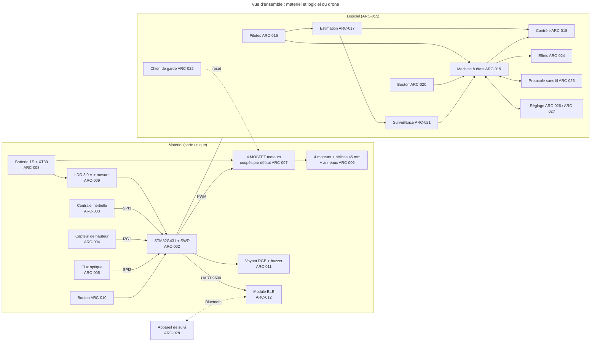
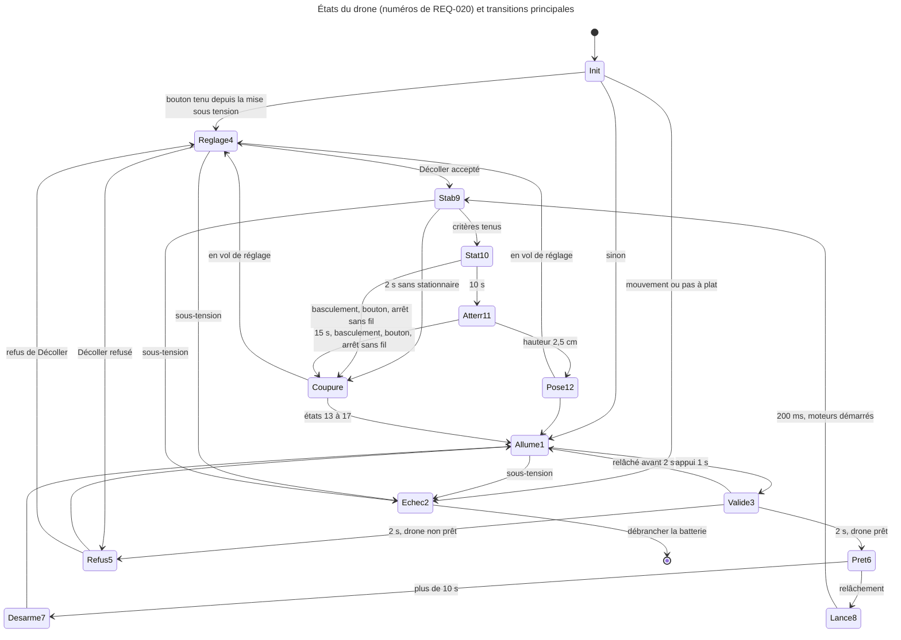
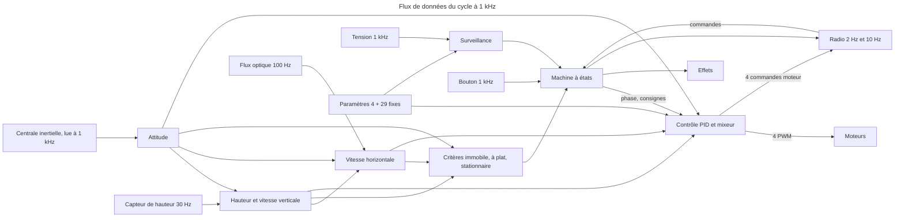

# Architecture

> **Aperçu**
> - 30 éléments d'architecture qui couvrent les 41 exigences actives de « Exigences système » — `projets/boomrone/02-exigences.md` : 14 éléments matériels (dont le bilan de masse, de poussée et d'autonomie), 15 éléments logiciels, une page de consignes ; 27 tests d'intégration (TI) dans « Plans de test » — `projets/boomrone/05-plans-de-test.md`.
> - Choix structurant : une carte maison avec un microcontrôleur STM32G431, une centrale inertielle, un capteur de hauteur à temps de vol et un capteur de flux optique, quatre moteurs à balais coupés par défaut par le matériel, une batterie 1S, un module Bluetooth basse consommation ; logiciel en boucle coopérative à 1 kHz sans système d'exploitation temps réel, une seule machine à états.
> - Toutes les décisions ont été prises par délégation (DEC-218 « Délégation totale de la phase architecture à l'architecte »), la solution la plus simple qui fonctionne. Les valeurs provisoires restent à valider aux essais.
> - État : statut « Proposé », relu par les trois relecteurs de porte (DEC-233 « Relecture de porte architecture : corrections décidées par délégation »).
> - Réserve majeure : la tension de la batterie sous charge est marginale à infaisable avec les seuils actuels, REQ-013 « Marge de batterie pour un vol complet » n'est donc pas établie avant les mesures au banc (DOU-135 « Faisabilité conjointe de la poussée, de la masse de 100 g, du capteur de hauteur, de la fabrication à la main et de la batterie », ouvert, non bloquant).
> - Porte « architecture » non franchie : accord de l'utilisateur attendu.

## Vue d'ensemble

*Légende : trait plein = signal ou donnée, pointillé = lien sans fil ou action de coupure ; un ou deux ARC par boîte (ID seuls dans les schémas, titres dans les éléments plus bas). Absents du schéma : ARC-001 « Structure générale du drone » (structure générale), ARC-013 « Carte électronique, câblage et assemblage à la main » (carte), ARC-014 « Bilan de masse, de poussée et d'autonomie » (bilan), ARC-023 « Initialisation et échec d'initialisation » (initialisation), ARC-029 « Plan de livraison par jalons » (jalons), ARC-030 « Page de consignes d'emploi » (consignes).*

## Machine à états

*Légende : Init = état 0 (hors des 17 codes) ; les états 5, 7, 12 et 13 à 17 sont des événements suivis aussitôt de l'état Allumé ou Mode réglage. Une sous-tension mène à l'état 2 depuis tout état (flèches abrégées) ; le diagramme donne des exemples, le tableau complet des transitions est plus bas (dont le reset du chien de garde en phase Lancé).*

## Flux de données

*Légende : une flèche = « produit une donnée consommée par » ; la fréquence est indiquée sur les sources.*

## Choix des composants et alternatives écartées

| Fonction | Choix | Pourquoi (simplicité) | Alternatives écartées |
|---|---|---|---|
| Microcontrôleur | STM32G431CBT6, LQFP-48 | FPU, chien de garde indépendant, programmable avec le ST-LINK de l'utilisateur, pas 0,5 mm soudable à la main | STM32F103, STM32G0, ESP32 |
| Centrale inertielle | LSM6DSO sur carte, SPI | du même fabricant, rapide et déterministe sur SPI | MPU-6050, ICM-42688-P, BMI270 |
| Hauteur | VL53L1X sur carte, I2C | portée 3 m, un seul composant | VL53L0X, baromètre, ultrason |
| Dérive | PMW3901 sur carte, SPI | sans lui la dérive de 0,5 m en 10 s est hors d'atteinte | centrale seule, PAW3903, caméra |
| Moteurs | 4 coreless à balais 8520, hélices 45 mm | commande par un MOSFET, pas de contrôleur de moteur ; hélices 65 mm trop larges pour 100 mm | brushless 1S/2S, moteurs 7 × 16 |
| Puissance | AO3400A côté bas, rappel 100 kΩ | un reset coupe les moteurs sans logiciel | pilote intégré, MOSFET P |
| Batterie | 1S 850 mAh ≥ 50C, XT30 | une cellule, débranchement à la main | 450 à 600 mAh, 2S, JST-PH |
| Logique | LDO 3,0 V MCP1700, mesure par pont + VREFINT | tient jusqu'à 3,1 V de batterie | 3,3 V |
| Radio | HM-10, UART 9600 | aucune configuration, pas d'appairage, ordinateur et téléphone | RN4871, ESP32, STM32WB |
| Voyant, son | LED RGB via 3 MOSFET, buzzer magnétique actif | audible à 1 m (65 dB), un seul timbre | piézo passif, WS2812 |
| Logiciel | C, boucle coopérative à 1 kHz | pas d'ordonnanceur à comprendre | système temps réel, contrôle en interruption |

## Bilan de masse, de poussée et d'autonomie

Traitement de DOU-135 « Faisabilité conjointe de la poussée, de la masse de 100 g, du capteur de hauteur, de la fabrication à la main et de la batterie ». Aucun chiffre n'est mesuré : poussée par la théorie du disque (rendement hélice 0,5, moteur 0,5 à 0,55) recoupée avec un petit drone connu de 27 g ; résistance interne de la batterie 40 mΩ ±20 mΩ plus 15 mΩ de connecteur, fils et pistes ; tout est à remplacer par trois mesures au banc (poussée, courant, résistance interne : environ 20 à 30 euros de matériel).

| Composant | Masse (g) | Incertitude (±g) |
|---|---|---|
| 4 moteurs 8520 | 20,0 | 2,0 |
| 4 hélices 45 mm | 2,0 | 0,5 |
| Cadre et 4 anneaux imprimés | 9,0 | 3,0 |
| Batterie 850 mAh | 19,0 | 2,0 |
| Connecteur XT30 (paire) | 1,3 | 0,3 |
| Carte assemblée | 4,6 | 1,0 |
| Buzzer magnétique | 1,0 | 0,3 |
| Cartes IMU, ToF, flux | 3,5 | 0,9 |
| Module BLE | 1,5 | 0,5 |
| Câblage et soudure | 3,0 | 1,0 |
| **Total** | **65 (au pire 76,5)** | **±11,5 cumulé, ±4,5 quadratique** |

- Masse : marge d'au moins 23 g sous les 100 g de REQ-031 « Drone de poche ». La masse n'est pas le problème ; la surface d'hélices l'est : des hélices de 65 mm exigent environ 138 mm de côté, des hélices de 45 mm tiennent en 98 × 98 mm, hauteur environ 35 mm.
- Poussée : 22 g ±7 g par moteur, 88 g ±28 g au total, rapport poussée/poids 1,35 (0,8 à 2,2). La vitesse de chute rattrapable depuis 1,5 m est d'environ 2,4 m/s à 1,35 et 3,5 m/s à 2,0 : la plage de lancer jusqu'à 4 m/s de REQ-006 « Stabilisation après le lancer » n'est pas garantie (DOU-050 « Mesure de vitesse horizontale et faisabilité du stationnaire en 2 s depuis 1,5 m », DOU-116 « Échéance et circularité du report aux essais, comportement de SCN-002 sur la partie infaisable de la plage », voir aussi plus bas).
- Courant : stationnaire environ 20 W, 5,5 A (4 à 7,5 A) ; crête après lancer environ 32 W, 9,5 A (7 à 12 A) ; logique 80 mA.
- Autonomie (REQ-013 « Marge de batterie pour un vol complet ») : 2 s à 9,5 A + 28 s à 5,5 A + logique, soit environ 49 mAh (5,8 % de 850 mAh), 72 mAh en pessimiste : l'énergie n'est pas le problème, la chute de tension l'est.

| Cas depuis 3,70 V à vide | Calcul | Tension sous charge | Écart à 3,3 V |
|---|---|---|---|
| Stationnaire nominal | 3,70 − 0,04 − 5,5 × 0,055 | 3,36 V | +60 mV (marginal) |
| Crête nominale | 3,70 − 0,01 − 9,5 × 0,055 | 3,17 V | −130 mV (plus de 100 ms : coupure) |
| Crête avec XT30 (48 mΩ) | 3,70 − 0,01 − 9,5 × 0,048 | 3,23 V | −70 mV |
| Stationnaire pessimiste (7,5 A, 110 mΩ) | 3,70 − 0,04 − 7,5 × 0,11 | 2,83 V | −470 mV |

**Verdict :** faisable pour la masse et les dimensions, marginal pour la poussée, marginal à infaisable pour la tension. Un creux de moins de 80 ms ne couvre pas une crête de stabilisation de 0,3 à 2 s (REQ-012 « Coupure sur sous-tension de la batterie »).

| Repli chiffré | Effet | Limite |
|---|---|---|
| R1 : seuil d'armement 3,7 V à 3,9 V (REQ-003 « Conditions de départ du drone ») | +0,2 V : stationnaire 3,56 V, crête 3,37 V | environ 8 vols par charge entre 3,9 V et 4,2 V |
| R2 : sous-tension 3,3 V à 3,0 V sous charge (REQ-012 « Coupure sur sous-tension de la batterie ») | +170 mV de marge en crête | limite usuelle d'une LiPo |
| R1 + R2 | +370 mV en crête | ne couvre pas le pire cas cumulé |
| Batterie 1300 mAh ≥ 75C | crête 3,31 V | +9 g, rapport 1,19 : écartée |
| Brushless 1S « whoop » + contrôleur 4 en 1 | −14 g, rapport environ 1,8 | DShot, hors simplicité |

Décision (DEC-229 « Faisabilité conjointe : bilan, verdict marginal, mesures au banc avant la commande de la carte ») : les valeurs de « Exigences système » ne sont pas modifiées maintenant ; R1 + R2 est la demande de modification recommandée si le banc donne moins de 20 g par moteur ou plus de 60 mΩ.

## Traitement des doutes d'architecture

| Doute | Traitement | Résultat |
|---|---|---|
| DOU-060 « Coupure de la batterie dans chaque état du drone, et alimentation des moteurs à valider en architecture matérielle » | rappel de grille à la masse (ARC-007 « Étage de puissance des moteurs coupés par défaut »), chien de garde matériel (ARC-022 « Chien de garde »), redémarrage en chute libre = échec d'initialisation (ARC-023 « Initialisation et échec d'initialisation ») | levé, DEC-231 « Garanties d'arrêt, batterie basse et consommation résiduelle : doutes levés » |
| DOU-109 « Batterie déjà déchargée : redémarrages répétés, décharge profonde et état après une coupure logicielle » | pas de redémarrage après sous-tension (état absorbant), batterie basse au branchement = échec, BOR niveau 3 | levé, DEC-231 « Garanties d'arrêt, batterie basse et consommation résiduelle : doutes levés » |
| DOU-115 « Contenu et interruption de la réécriture de la zone des réglages par la reprogrammation » | zone = 4 paramètres dans la page de l'image programmée, valeurs hors bornes = valeur d'origine (ARC-027 « Paramètres de vol et stockage des réglages ») | levé, DEC-227 « Réglages : page de flash de l'image, valeurs hors bornes, sauvegarde au sol » |
| DOU-118 « Seuil de protection et consommation résiduelle du drone laissé allumé » | pas de seuil distinct ; en échec par sous-tension, capteurs en veille, 16 MHz, environ 12 mA, 1,4 à 2,8 h avant 3,0 V ; consigne « débrancher » | levé, DEC-231 « Garanties d'arrêt, batterie basse et consommation résiduelle : doutes levés » |
| DOU-120 « Écriture en mémoire sous tension basse ou pendant une phase de vol » | écriture au sol en mode réglage, batterie ≥ 3,5 V, 45 ms contre 100 ms de chien de garde | levé, DEC-227 « Réglages : page de flash de l'image, valeurs hors bornes, sauvegarde au sol » |
| DOU-133 « Forme des dix effets locaux : lumière, son, distinction mesurable » | table ci-dessous ; reste à vérifier à TS-014 « Perceptibilité et distinction des effets » | ouvert |
| DOU-135 « Faisabilité conjointe de la poussée, de la masse de 100 g, du capteur de hauteur, de la fabrication à la main et de la batterie » | bilan ci-dessus | ouvert |
| DOU-136 « Ordre de livraison : exigence essentielle dépendant du mode réglage souhaitable » | trois jalons (ARC-029 « Plan de livraison par jalons ») | levé, DEC-230 « Plan de livraison par jalons, ordre de livraison levé » |

**Les dix effets** (court = 100 ms, long = 250 ms, très long = 500 ms ; DOU-133 « Forme des dix effets locaux : lumière, son, distinction mesurable » ; lumière en continu, bips seulement moteurs arrêtés, événements de 1,0 s ; buzzer à un seul timbre) :

| N° | Effet | Lumière | Son |
|---|---|---|---|
| 1 | Allumé | vert fixe | aucun |
| 2 | Appui validé | cyan fixe | 1 bip court (100 ms) |
| 3 | Prêt | vert clignotant 4 Hz | 2 bips courts |
| 4 | Lancé et vol | blanc fixe | aucun |
| 5 | Posé | bleu fixe 1 s | 1 bip long (250 ms) |
| 6 | Refus | jaune clignotant 4 Hz, 1 s | 3 bips courts |
| 7 | Désarmement | magenta fixe 1 s | 2 bips longs (250 ms chacun) |
| 8 | Coupure en vol | rouge fixe 1 s | 1 bip très long (500 ms) |
| 9 | Échec d'initialisation | rouge clignotant 1 Hz, faible puissance | 1 bip de 500 ms à l'entrée |
| 10 | Mode réglage | bleu clignotant 1 Hz | 1 bip de 200 ms à l'entrée |

Paires (couleur, rythme) uniques ; à surveiller : bleu fixe contre cyan fixe, vert fixe contre vert clignotant.

**Bornes des paramètres réglables** (valeurs de l'architecte, provisoires) : gain d'inclinaison 0,5 à 2,0 (origine 1,0) ; gain de hauteur 0,5 à 2,0 (1,0) ; hauteur visée 0,5 à 1,2 m (1,0 m) ; vitesse de descente 0,15 à 0,5 m/s (0,2 m/s ; pire cas 8 s + 2 s + 3 s = 13 s sous les 15 s).

## Machine à états : transitions

Notation : `[H]` = on pose le drapeau d'appui en cours de REQ-035 « Appui en cours à un changement d'état » si le bouton est enfoncé. Priorité des événements dans un cycle : sous-tension, bouton, commande Arrêt, le reste.

| Départ | Événement ou garde | Arrivée | Action |
|---|---|---|---|
| Tout état | sous-tension (moins de 3,3 V pendant 100 cycles) | 2 | coupure si les moteurs tournent ; cause « sous-tension » ; état absorbant |
| 0 | fin d'initialisation, mouvement ou pas à plat | 2 | moteurs jamais armés |
| 0 | fin d'initialisation OK, bouton tenu depuis la mise sous tension, cause de reset = mise sous tension | 4 | `[H]` |
| 0 | fin d'initialisation OK, sinon | 1 | `[H]` |
| 1 | appui de 1,0 s | 3 | chrono de 10 s |
| 3 | relâchement avant 2 s | 1 | |
| 3 | appui de 2,0 s, prêt (immobile, à plat, au moins 3,7 V) | 6 | |
| 3 | appui de 2,0 s, non prêt | 5 puis 1 | cause de refus (priorité : batterie, mouvement, pas à plat) ; `[H]` |
| 6 | appui de plus de 10,0 s | 7 puis 1 | `[H]` |
| 6 | relâchement (2 s à 10 s) | 8 | effet en 50 ms ; garde de 0,5 s ; chrono de 200 ms |
| 8 | 200 ms écoulées | 9 | démarrage des moteurs ; chrono de 2,0 s |
| 8 | Lancé de plus de 500 ms sans moteurs | reset | chien de garde non rafraîchi ; au redémarrage, échec d'initialisation si le drone est en mouvement |
| 9 | critères de stationnaire vrais 10 cycles | 10 | chrono 10 s (3 s en vol de réglage) |
| 9 | 2,0 s sans stationnaire | 13 puis 1 (4 en réglage) | coupure ; `[H]` |
| 10 | 10,0 s (3,0 s) écoulées | 11 | chrono de 15 s ; rampe de descente |
| 11 | hauteur de 2,5 cm au plus (lecture brute d'au plus 45 mm) | 12 puis 1 (4 en réglage) | coupure ; `[H]` |
| 9, 10, 11 | trois lectures IMU en échec, ou aucune mesure de hauteur valide pendant 200 ms | 13 puis 1 (4) | coupure ; cause « échec de stabilisation » (DOU-140 « Défaut de capteur en vol : cause et effet rattachés à l'échec de stabilisation ») ; `[H]` |
| 10, 11 | inclinaison de plus de 60° pendant 100 ms | 15 puis 1 (4) | coupure ; `[H]` |
| 11 | 15 s écoulées (vol de réglage : après le décollage) | 17 puis 1 (4) | coupure ; `[H]` |
| 9, 10, 11 | appui filtré hors garde (vol de réglage : sans garde) | 14 puis 1 (4) | coupure en 12 ms ; `[H]` |
| 8, 9, 10, 11 | niveau bas à la fin de la garde | 14 puis 1 | coupure ; `[H]` |
| 9, 10, 11 | commande Arrêt | 16 puis 1 (4) | coupure ; `[H]` |
| 4 | Décoller, batterie suffisante et bouton relâché | 9 | démarrage immédiat ; drapeau « réglage » |
| 4 | Décoller, sinon | 5 puis 4 | cause de refus |
| 4 | Modifier | 4 | saturation, application au cycle suivant |
| 4 | Sauvegarder (batterie ≥ 3,5 V) | 4 | écriture (ARC-027 « Paramètres de vol et stockage des réglages ») |
| 9 à 11 (réglage) | Modifier | inchangé | acceptée |
| 1, 3, 6, 8 | Arrêt, Décoller, Modifier, Sauvegarder | inchangé | ignorées |
| 2, 0 | toute commande ou bouton | inchangé | ignorés |

## Modules logiciels et budget de cycle

| Module | Fichiers | Responsabilité | Dépend de |
|---|---|---|---|
| Carte | `board.c/h` | horloges, GPIO, timers, tick | (aucun) |
| Pilotes | `drv_imu`, `drv_tof`, `drv_flow`, `drv_adc`, `drv_motor`, `drv_led`, `drv_buzzer`, `drv_uart`, `drv_flash`, `drv_wdg` | accès matériel, DMA, erreurs de bus | carte |
| Estimation | `est_attitude`, `est_hauteur`, `est_vitesse`, `est_criteres` | attitude, hauteur, vitesse, immobile et à plat | pilotes |
| Contrôle | `ctl_attitude`, `ctl_hauteur`, `ctl_mixer`, `ctl_phases` | PID, mixeur, rampes | estimation, paramètres |
| Paramètres | `config_fixed.h`, `app_params` | 29 valeurs fixes, 4 réglables, flash | `drv_flash` |
| Bouton | `app_button` | antirebond, durées, garde, appui en cours | pilotes |
| Sécurité | `app_safety`, `app_wdg` | coupures, sous-tension, rafraîchissement | estimation, machine |
| Machine | `app_fsm`, `app_init` | états, transitions, initialisation | bouton, sécurité, paramètres, effets, radio |
| Effets | `app_effects` | table des 10 effets | `drv_led`, `drv_buzzer` |
| Radio | `app_proto`, `app_radio` | trames, CRC8, commandes, statut | `drv_uart`, machine |
| Réglage | `app_tuning` | Décoller, Modifier, Sauvegarder | machine, paramètres, radio |
| Suivi | `tools/suivi.py` | affichage et commandes | `app_proto` (vecteurs communs) |

Budget du cycle à 1 kHz (estimations à mesurer avec le compteur de cycles) : tick bouton + ADC + départ DMA 10 µs ; fin DMA 5 µs ; Mahony 25 µs ; hauteur et vitesse 10 µs ; PID, mixeur, PWM 25 µs ; machine, sécurité, bouton 15 µs ; télémétrie et chien de garde 6 µs ; total contrôle environ 100 µs, tâches de fond au plus 200 µs par appel, charge maximale prévue environ 25 % ; budget unique : cycle au plus 300 µs, alarme au-delà de 500 µs.

## Risques et points ouverts non bloquants

- Latence BLE de l'arrêt sans fil face aux 200 ms de REQ-022 « Arrêt sans fil » : DOU-137 « Latence de bout en bout de l'arrêt sans fil sur Bluetooth ».
- Interprétations de l'architecture logicielle à confirmer : DOU-138 « Interprétations de l'architecture logicielle : priorité de l'initialisation, causes de refus, sauvegarde et statut ».
- Défaut de capteur en vol : DOU-140 « Défaut de capteur en vol : cause et effet rattachés à l'échec de stabilisation ».
- ToF à 40 mm minimum (coupure à 2 à 3 cm) et flux optique sur sol uni : DOU-139 « Capteurs de hauteur et de flux : hauteur de montage et sols sans texture ».
- Lancer : chute libre et poussée faussent l'accéléromètre ; faisabilité à 2 s depuis 1,5 m non démontrée (DOU-050 « Mesure de vitesse horizontale et faisabilité du stationnaire en 2 s depuis 1,5 m », DOU-116 « Échéance et circularité du report aux essais, comportement de SCN-002 sur la partie infaisable de la plage »).
- Flash : une écriture de 64 bits interrompue peut produire une erreur ECC double, donc une interruption non masquable à la lecture ; gestionnaire à prévoir en conception détaillée.
- Alimentation, batterie : pas de protection d'inversion, de surintensité ni de décharge profonde (détrompage XT30 seulement) ; consigne « débrancher » dans la page de consignes (ARC-030 « Page de consignes d'emploi »).

## Couverture des exigences

| Exigence | Éléments d'architecture |
|---|---|
| REQ-002 « Chronologie d'un appui sur le bouton » | ARC-010 « Bouton » ; ARC-020 « Gestion logicielle du bouton » |
| REQ-003 « Conditions de départ du drone » | ARC-003 « Centrale inertielle » ; ARC-009 « Alimentation de la logique et mesure de la tension » ; ARC-016 « Pilotes des capteurs et des sorties » ; ARC-017 « Estimation de l'attitude, de la hauteur et de la vitesse » ; ARC-021 « Surveillance et coupures automatiques » ; ARC-023 « Initialisation et échec d'initialisation » |
| REQ-004 « Démarrage des moteurs 200 ms après le relâchement » | ARC-007 « Étage de puissance des moteurs coupés par défaut » ; ARC-019 « Machine à états du drone » |
| REQ-005 « Démarrage des moteurs sur geste volontaire seulement » | ARC-001 « Structure générale du drone » ; ARC-007 « Étage de puissance des moteurs coupés par défaut » ; ARC-019 « Machine à états du drone » ; ARC-022 « Chien de garde » ; ARC-026 « Mode réglage et vol de réglage » ; ARC-029 « Plan de livraison par jalons » |
| REQ-006 « Stabilisation après le lancer » | ARC-003 « Centrale inertielle » ; ARC-004 « Capteur de hauteur à temps de vol » ; ARC-005 « Capteur de flux optique » ; ARC-006 « Moteurs, hélices et protège-hélices » ; ARC-014 « Bilan de masse, de poussée et d'autonomie » ; ARC-016 « Pilotes des capteurs et des sorties » ; ARC-017 « Estimation de l'attitude, de la hauteur et de la vitesse » ; ARC-018 « Boucle de contrôle du vol » |
| REQ-007 « Critère de vol stationnaire » | ARC-003 « Centrale inertielle » ; ARC-004 « Capteur de hauteur à temps de vol » ; ARC-005 « Capteur de flux optique » ; ARC-017 « Estimation de l'attitude, de la hauteur et de la vitesse » |
| REQ-008 « Tenue du vol stationnaire » | ARC-004 « Capteur de hauteur à temps de vol » ; ARC-005 « Capteur de flux optique » ; ARC-017 « Estimation de l'attitude, de la hauteur et de la vitesse » ; ARC-018 « Boucle de contrôle du vol » |
| REQ-009 « Atterrissage doux » | ARC-004 « Capteur de hauteur à temps de vol » ; ARC-017 « Estimation de l'attitude, de la hauteur et de la vitesse » ; ARC-018 « Boucle de contrôle du vol » |
| REQ-010 « Verrouillage après un posé, une coupure ou un redémarrage » | ARC-001 « Structure générale du drone » ; ARC-007 « Étage de puissance des moteurs coupés par défaut » ; ARC-009 « Alimentation de la logique et mesure de la tension » ; ARC-019 « Machine à états du drone » ; ARC-021 « Surveillance et coupures automatiques » ; ARC-022 « Chien de garde » |
| REQ-011 « Coupures automatiques en vol » | ARC-003 « Centrale inertielle » ; ARC-021 « Surveillance et coupures automatiques » |
| REQ-012 « Coupure sur sous-tension de la batterie » | ARC-008 « Batterie et connecteur débranchable » ; ARC-009 « Alimentation de la logique et mesure de la tension » ; ARC-014 « Bilan de masse, de poussée et d'autonomie » ; ARC-016 « Pilotes des capteurs et des sorties » ; ARC-021 « Surveillance et coupures automatiques » |
| REQ-013 « Marge de batterie pour un vol complet » | ARC-008 « Batterie et connecteur débranchable » ; ARC-009 « Alimentation de la logique et mesure de la tension » ; ARC-014 « Bilan de masse, de poussée et d'autonomie » ; ARC-021 « Surveillance et coupures automatiques » |
| REQ-014 « Coupure sur logiciel bloqué » | ARC-002 « Microcontrôleur et programmation par liaison SWD » ; ARC-007 « Étage de puissance des moteurs coupés par défaut » ; ARC-015 « Structure logicielle et ordonnancement » ; ARC-022 « Chien de garde » |
| REQ-015 « Garde du bouton après le lancer » | ARC-010 « Bouton » ; ARC-020 « Gestion logicielle du bouton » |
| REQ-016 « Arrêt d'urgence par le bouton » | ARC-007 « Étage de puissance des moteurs coupés par défaut » ; ARC-010 « Bouton » ; ARC-015 « Structure logicielle et ordonnancement » ; ARC-020 « Gestion logicielle du bouton » |
| REQ-017 « Initialisation en 3 secondes » | ARC-002 « Microcontrôleur et programmation par liaison SWD » ; ARC-009 « Alimentation de la logique et mesure de la tension » ; ARC-023 « Initialisation et échec d'initialisation » |
| REQ-018 « Effets locaux par situation » | ARC-011 « Voyant RGB et avertisseur sonore » ; ARC-024 « Effets locaux (logiciel) » |
| REQ-019 « Perceptibilité et distinction des effets » | ARC-011 « Voyant RGB et avertisseur sonore » ; ARC-016 « Pilotes des capteurs et des sorties » ; ARC-024 « Effets locaux (logiciel) » |
| REQ-020 « Statut sans fil » | ARC-012 « Module radio Bluetooth à basse consommation » ; ARC-019 « Machine à états du drone » ; ARC-025 « Protocole et service du statut sans fil » ; ARC-028 « Logiciel d'essai de l'appareil de suivi » |
| REQ-021 « Variables du vol » | ARC-012 « Module radio Bluetooth à basse consommation » ; ARC-015 « Structure logicielle et ordonnancement » ; ARC-025 « Protocole et service du statut sans fil » ; ARC-028 « Logiciel d'essai de l'appareil de suivi » |
| REQ-022 « Arrêt sans fil » | ARC-012 « Module radio Bluetooth à basse consommation » ; ARC-021 « Surveillance et coupures automatiques » ; ARC-025 « Protocole et service du statut sans fil » |
| REQ-023 « Commandes sans fil selon l'état du drone » | ARC-012 « Module radio Bluetooth à basse consommation » ; ARC-025 « Protocole et service du statut sans fil » ; ARC-026 « Mode réglage et vol de réglage » ; ARC-028 « Logiciel d'essai de l'appareil de suivi » |
| REQ-024 « Entrée en mode réglage par le bouton » | ARC-010 « Bouton » ; ARC-020 « Gestion logicielle du bouton » ; ARC-023 « Initialisation et échec d'initialisation » ; ARC-026 « Mode réglage et vol de réglage » |
| REQ-025 « Vol de réglage » | ARC-026 « Mode réglage et vol de réglage » |
| REQ-026 « Paramètres de vol réglables » | ARC-018 « Boucle de contrôle du vol » ; ARC-027 « Paramètres de vol et stockage des réglages » ; ARC-029 « Plan de livraison par jalons » |
| REQ-027 « Sauvegarde et chargement des réglages » | ARC-027 « Paramètres de vol et stockage des réglages » |
| REQ-028 « Valeurs d'origine après la programmation » | ARC-023 « Initialisation et échec d'initialisation » ; ARC-027 « Paramètres de vol et stockage des réglages » |
| REQ-029 « Composants disponibles à l'unité » | ARC-001 « Structure générale du drone » ; ARC-002 « Microcontrôleur et programmation par liaison SWD » ; ARC-003 « Centrale inertielle » ; ARC-006 « Moteurs, hélices et protège-hélices » ; ARC-008 « Batterie et connecteur débranchable » ; ARC-013 « Carte électronique, câblage et assemblage à la main » |
| REQ-030 « Programmation depuis l'ordinateur » | ARC-002 « Microcontrôleur et programmation par liaison SWD » ; ARC-013 « Carte électronique, câblage et assemblage à la main » ; ARC-027 « Paramètres de vol et stockage des réglages » ; ARC-029 « Plan de livraison par jalons » |
| REQ-031 « Drone de poche » | ARC-001 « Structure générale du drone » ; ARC-006 « Moteurs, hélices et protège-hélices » ; ARC-008 « Batterie et connecteur débranchable » ; ARC-013 « Carte électronique, câblage et assemblage à la main » ; ARC-014 « Bilan de masse, de poussée et d'autonomie » |
| REQ-032 « Protège-hélices » | ARC-006 « Moteurs, hélices et protège-hélices » ; ARC-014 « Bilan de masse, de poussée et d'autonomie » |
| REQ-033 « Vol dans une pièce d'appartement » | ARC-005 « Capteur de flux optique » ; ARC-006 « Moteurs, hélices et protège-hélices » ; ARC-014 « Bilan de masse, de poussée et d'autonomie » |
| REQ-034 « Page de consignes d'emploi » | ARC-030 « Page de consignes d'emploi » |
| REQ-035 « Appui en cours à un changement d'état » | ARC-010 « Bouton » ; ARC-020 « Gestion logicielle du bouton » ; ARC-023 « Initialisation et échec d'initialisation » |
| REQ-036 « Coupure sur phase Lancé trop longue » | ARC-002 « Microcontrôleur et programmation par liaison SWD » ; ARC-007 « Étage de puissance des moteurs coupés par défaut » ; ARC-019 « Machine à états du drone » ; ARC-022 « Chien de garde » |
| REQ-037 « Comportement en échec d'initialisation » | ARC-002 « Microcontrôleur et programmation par liaison SWD » ; ARC-007 « Étage de puissance des moteurs coupés par défaut » ; ARC-009 « Alimentation de la logique et mesure de la tension » ; ARC-019 « Machine à états du drone » ; ARC-023 « Initialisation et échec d'initialisation » |
| REQ-038 « Causes et paramètres dans le statut sans fil » | ARC-012 « Module radio Bluetooth à basse consommation » ; ARC-025 « Protocole et service du statut sans fil » ; ARC-028 « Logiciel d'essai de l'appareil de suivi » |
| REQ-040 « Appareil de suivi » | ARC-012 « Module radio Bluetooth à basse consommation » ; ARC-025 « Protocole et service du statut sans fil » ; ARC-028 « Logiciel d'essai de l'appareil de suivi » |
| REQ-041 « Conditions d'acceptation de la commande Décoller » | ARC-026 « Mode réglage et vol de réglage » ; ARC-029 « Plan de livraison par jalons » |
| REQ-044 « Assemblage à la main » | ARC-001 « Structure générale du drone » ; ARC-002 « Microcontrôleur et programmation par liaison SWD » ; ARC-003 « Centrale inertielle » ; ARC-013 « Carte électronique, câblage et assemblage à la main » |
| REQ-045 « Batterie débranchable à la main » | ARC-008 « Batterie et connecteur débranchable » ; ARC-013 « Carte électronique, câblage et assemblage à la main » |

Les 41 exigences actives sont couvertes par au moins un élément (vérifié par `python tools/check_traceability.py`).

## Éléments d'architecture

Format : titre, réfs amont (exigences), description, alternatives, statut. Tous les éléments sont « Proposé » : l'accord est réservé à l'utilisateur.

### ARC-001 — Structure générale du drone
**Réfs amont :** REQ-031 « Drone de poche » ; REQ-029 « Composants disponibles à l'unité » ; REQ-044 « Assemblage à la main » ; REQ-005 « Démarrage des moteurs sur geste volontaire seulement » ; REQ-010 « Verrouillage après un posé, une coupure ou un redémarrage »
**Description :** un drone à quatre moteurs en carré (2 × 2, entraxe 49 mm), une carte électronique unique faite maison au centre, une batterie 1S, des anneaux de protection autour des hélices. Aucun interrupteur : on débranche la batterie pour éteindre. Principe de sûreté : les moteurs ne tournent que sous la commande du microcontrôleur, et tout reset du microcontrôleur les coupe par le matériel (ARC-007 « Étage de puissance des moteurs coupés par défaut »). Le logiciel est une boucle coopérative sans système d'exploitation temps réel (ARC-015 « Structure logicielle et ordonnancement ») ; une seule machine à états décide du démarrage des moteurs (ARC-019 « Machine à états du drone »). Le bilan chiffré est dans ARC-014 « Bilan de masse, de poussée et d'autonomie ».
**Alternatives étudiées :** contrôleur de vol du commerce (écarté : l'utilisateur veut écrire et comprendre le logiciel) ; voir DEC-219 « Structure générale : carte maison unique, microcontrôleur STM32G431, boucle sans système temps réel ».
**Statut :** Proposé

### ARC-002 — Microcontrôleur et programmation par liaison SWD
**Réfs amont :** REQ-030 « Programmation depuis l'ordinateur » ; REQ-029 « Composants disponibles à l'unité » ; REQ-044 « Assemblage à la main » ; REQ-014 « Coupure sur logiciel bloqué » ; REQ-036 « Coupure sur phase Lancé trop longue » ; REQ-017 « Initialisation en 3 secondes » ; REQ-037 « Comportement en échec d'initialisation »
**Description :** STM32G431CBT6 (LQFP-48, pas 0,5 mm, 170 MHz, FPU, 128 kio de flash, 32 kio de RAM), horloge interne HSI 16 MHz + PLL, sans quartz. Brochage proposé (à vérifier dans la fiche technique) : SPI1 pour l'IMU (PA5, PA6, PA7, CS PA4, INT PB0) ; SPI2 pour le flux (PB13, PB14, PB15, CS PB12) ; I2C1 (PA15, PB7) ; USART2 (PA2, PA3) ; TIM1 CH1 à CH4 (PA8 à PA11) pour les moteurs ; ADC1 sur PA0 ; SWD sur PA13 et PA14. BOOT0 (PB8) est tiré à la masse par 10 kΩ et jamais utilisé pour un bus. Le chien de garde indépendant (IWDG) est rendu matériel par l'octet d'option IWDG_SW = 0, avec BOR_LEV = 3 : à inscrire dans la procédure de programmation. En-tête SWD à 5 broches (VTref, SWDIO, SWCLK, GND, NRST) pour le ST-LINK ; on programme hélices démontées, sans relier le 3,3 V du ST-LINK à la carte. Programmation en moins de 5 min avec STM32CubeProgrammer.
**Alternatives étudiées :** STM32F103 (pas de FPU, ancien) ; STM32G0 (sans FPU, pénalisant pour le filtre d'attitude) ; ESP32 (seconde chaîne de programmation, hors ST-LINK).
**Statut :** Proposé

### ARC-003 — Centrale inertielle
**Réfs amont :** REQ-006 « Stabilisation après le lancer » ; REQ-007 « Critère de vol stationnaire » ; REQ-011 « Coupures automatiques en vol » ; REQ-003 « Conditions de départ du drone » ; REQ-029 « Composants disponibles à l'unité » ; REQ-044 « Assemblage à la main »
**Description :** LSM6DSO sur carte d'évaluation (type SparkFun ou Adafruit, alimentation 1,71 à 3,6 V, environ 1 g), bus SPI1 à 8 MHz, ligne INT1 vers PB0. Réglages : gyroscope ±2000 °/s (lancer limité à 1 tr/s, soit 360 °/s), accéléromètre ±8 g, débit 1,66 kHz avec filtre numérique. Suffisant pour l'immobilité (30 °/s, ±0,5 m/s²) et le basculement à 60°. Fixation au centre sur mousse fine contre les vibrations des moteurs. À l'achat, vérifier que la carte expose le mode SPI (cavalier de soudure sur certaines).
**Alternatives étudiées :** MPU-6050 (I2C seul, plus bruité) ; ICM-42688-P (meilleur mais rare à l'unité) ; BMI270 (cartes moins répandues).
**Statut :** Proposé

### ARC-004 — Capteur de hauteur à temps de vol
**Réfs amont :** REQ-007 « Critère de vol stationnaire » ; REQ-008 « Tenue du vol stationnaire » ; REQ-009 « Atterrissage doux » ; REQ-006 « Stabilisation après le lancer »
**Description :** VL53L1X sur carte (type Pololu 3415 ou Adafruit 3967, environ 1,1 g), I2C1 à 400 kHz, adresse 0x29, mode LONG (le mode court plafonne à 1,3 m alors que le lancer commence à 1,5 m), budget de mesure 33 ms (environ 30 Hz), portée utile 0,05 à 3 m en intérieur. Hauteur corrigée par l'inclinaison (distance × cos θ). La mesure n'est fiable qu'à partir de 40 mm : pour que la coupure à 2 à 3 cm du sol de REQ-009 « Atterrissage doux » corresponde à 40 mm ou plus, le capteur est monté à environ 20 mm au-dessus du plan de contact : la hauteur du drone est la lecture moins 20 mm, la coupure à 2,5 cm correspond à une lecture brute d'environ 45 mm (fiable), au contact la lecture vaut environ 20 mm (hors fiabilité, la coupure a déjà eu lieu). Cône de 27° dégagé sous la carte.
**Alternatives étudiées :** VL53L0X (2 m, trop juste) ; baromètre (écarté, voir DEC-019 « Hauteur au-dessus du sol mesurée en vol », précision insuffisante à 1 m) ; ultrason (volumineux).
**Statut :** Proposé

### ARC-005 — Capteur de flux optique
**Réfs amont :** REQ-008 « Tenue du vol stationnaire » ; REQ-007 « Critère de vol stationnaire » ; REQ-033 « Vol dans une pièce d'appartement » ; REQ-006 « Stabilisation après le lancer »
**Description :** PMW3901 sur carte (Pimoroni ou équivalent, environ 1,5 g), SPI2 à 2 MHz au plus, lecture en rafale à 100 Hz, fonctionne à partir de 80 mm de hauteur environ. La vitesse horizontale est le flux multiplié par la hauteur du ToF, compensé par le gyroscope : c'est la seule mesure de dérive indépendante de l'IMU, sans laquelle une centrale seule dérive de plusieurs mètres en 10 s (REQ-008 « Tenue du vol stationnaire »). Limite : sol uni, sans texture ou très sombre, vitesse non mesurée (DOU-139 « Capteurs de hauteur et de flux : hauteur de montage et sols sans texture »). Même position que le ToF, vers le bas, cônes (42° et 27°) qui ne se touchent pas. Variante : Flow deck v2 de Bitcraze (ToF + flux sur 1,6 g), à vérifier à l'achat.
**Alternatives étudiées :** IMU seule (dérive de plusieurs mètres) ; PAW3903 (moins documenté) ; caméra (hors simplicité).
**Statut :** Proposé

### ARC-006 — Moteurs, hélices et protège-hélices
**Réfs amont :** REQ-006 « Stabilisation après le lancer » ; REQ-031 « Drone de poche » ; REQ-032 « Protège-hélices » ; REQ-033 « Vol dans une pièce d'appartement » ; REQ-029 « Composants disponibles à l'unité »
**Description :** 4 moteurs coreless à balais 8520 (8,5 × 20 mm, environ 5 g pièce, deux paires de sens opposés), hélices de 45 mm (arbre de 1,0 mm à vérifier, sinon 40 mm), 0,5 g pièce. Des hélices de 65 mm exigeraient environ 138 mm de côté et ne tiennent pas dans les 100 mm de REQ-031 « Drone de poche ». Anneaux imprimés ou découpés, diamètre intérieur 47 mm, paroi 0,8 à 1,2 mm, hauteur 8 à 12 mm centrée sur le plan des hélices : le calibre de 12 mm de REQ-032 « Protège-hélices » ne touche aucune hélice par les côtés (dessus et dessous hors calibre, limite assumée). Poussée estimée 22 g ±7 g par moteur à pleine puissance (hypothèse, voir ARC-014 « Bilan de masse, de poussée et d'autonomie »). Disposition 2 × 2, entraxe 49 mm, encombrement 98 × 98 mm. Cadre et anneaux environ 9 g ; fabrication (imprimante 3D ou service en ligne) à décider en conception détaillée.
**Alternatives étudiées :** hélices 65 mm (trop larges) ; moteurs 7 × 16 (environ 14 g de poussée, trop faibles) ; brushless 1S « whoop » avec contrôleur 4 en 1 (repli du bilan, DEC-229 « Faisabilité conjointe : bilan, verdict marginal, mesures au banc avant la commande de la carte »).
**Statut :** Proposé

### ARC-007 — Étage de puissance des moteurs coupés par défaut
**Réfs amont :** REQ-010 « Verrouillage après un posé, une coupure ou un redémarrage » ; REQ-014 « Coupure sur logiciel bloqué » ; REQ-036 « Coupure sur phase Lancé trop longue » ; REQ-005 « Démarrage des moteurs sur geste volontaire seulement » ; REQ-016 « Arrêt d'urgence par le bouton » ; REQ-004 « Démarrage des moteurs 200 ms après le relâchement » ; REQ-037 « Comportement en échec d'initialisation »
**Description :** un MOSFET N AO3400A (SOT-23, 30 V, 5,7 A, environ 33 mΩ à Vgs = 2,5 V) par moteur, côté bas, grille pilotée par TIM1 (24 kHz) via 47 Ω, sorties forcées à l'état bas par `motors_cut()` avant l'arrêt du timer (ARC-015 « Structure logicielle et ordonnancement »), avec un rappel de 100 kΩ grille-masse : au reset, au brown-out ou hors tension, les broches du microcontrôleur flottent et la grille retombe sous 1 V en environ 33 µs. Les moteurs sont donc coupés sans aucun logiciel (REQ-014 « Coupure sur logiciel bloqué », REQ-036 « Coupure sur phase Lancé trop longue », REQ-010 « Verrouillage après un posé, une coupure ou un redémarrage »). Diode Schottky SS24 en roue libre par moteur, 100 nF aux bornes de chaque moteur, 2 × 22 µF + 100 nF sur la ligne moteurs. Pertes d'environ 0,2 W par MOSFET à 2,4 A. Non couverts : MOSFET en court-circuit, pont de soudure, rappel ouvert (testés en TI-005 « Moteurs coupés par le matériel »).
**Alternatives étudiées :** pilote DRV8837 (pas de rappel garanti) ; MOSFET P côté haut (grille plus complexe) ; SI2302 (85 mΩ, trop résistif).
**Statut :** Proposé

### ARC-008 — Batterie et connecteur débranchable
**Réfs amont :** REQ-045 « Batterie débranchable à la main » ; REQ-013 « Marge de batterie pour un vol complet » ; REQ-012 « Coupure sur sous-tension de la batterie » ; REQ-031 « Drone de poche » ; REQ-029 « Composants disponibles à l'unité »
**Description :** LiPo 1S 850 mAh, décharge ≥ 50C, sans circuit de protection (il se couperait vers 3 à 6 A), environ 19 g ±2 g, résistance interne estimée 40 mΩ ±20 mΩ (hypothèse, à mesurer). Connecteur XT30 (15 A, environ 1,3 g la paire, détrompé) plutôt que JST-PH (environ 2 A par contact, il chaufferait). Connecteur au bord du drone, accessible malgré les anneaux : débranchement à la main en moins de 10 s (REQ-045 « Batterie débranchable à la main »). Pas d'interrupteur. Risques résiduels : inversion de polarité (limitée par le détrompage), court-circuit, surintensité, décharge profonde si le drone reste branché (DOU-118 « Seuil de protection et consommation résiduelle du drone laissé allumé »).
**Alternatives étudiées :** 1S 450 à 600 mAh (plus léger mais résistance interne plus haute) ; 2S (inadapté aux 8520) ; JST-PH.
**Statut :** Proposé

### ARC-009 — Alimentation de la logique et mesure de la tension
**Réfs amont :** REQ-012 « Coupure sur sous-tension de la batterie » ; REQ-013 « Marge de batterie pour un vol complet » ; REQ-010 « Verrouillage après un posé, une coupure ou un redémarrage » ; REQ-017 « Initialisation en 3 secondes » ; REQ-037 « Comportement en échec d'initialisation » ; REQ-003 « Conditions de départ du drone »
**Description :** LDO 3,0 V à faible chute MCP1700-3002E (SOT-23, 250 mA, chute 178 mV à 250 mA) : un 3,3 V ne tiendrait pas, la batterie descendant à 3,3 V et moins sous charge ; la sortie reste réglée tant que la batterie dépasse environ 3,1 V. Charge logique estimée 80 mA. Avec une sous-tension abaissée à 3,0 V sous charge (repli R2), le LDO décroche vers 2,9 V : marges de VDDA, du BOR niveau 3 et du ToF (2,6 V minimum) à vérifier avant d'adopter R2. Le pont de mesure consomme environ 17 µA en permanence. Entrée filtrée par ferrite 220 Ω + 22 µF. Mesure : pont 100 kΩ / 150 kΩ à 0,1 % vers PA0 (4,2 V devient 2,52 V), 100 nF sur la broche, suréchantillonnage ×10 à 1 kHz, correction par la référence interne VREFINT (l'ADC utilise le 3,0 V du LDO). Incertitude estimée ±24 à ±37 mV à 3,7 V contre ±50 mV de REQ-003 « Conditions de départ du drone » : marge faible, un étalonnage de gain au multimètre est possible. BOR niveau 3 (environ 2,5 V).
**Alternatives étudiées :** régulateur 3,3 V (ne tient pas sous 3,5 V) ; ADC sans correction VREFINT (±2,5 %) ; diviseur à 1 % (±1,5 %).
**Statut :** Proposé

### ARC-010 — Bouton
**Réfs amont :** REQ-002 « Chronologie d'un appui sur le bouton » ; REQ-015 « Garde du bouton après le lancer » ; REQ-016 « Arrêt d'urgence par le bouton » ; REQ-024 « Entrée en mode réglage par le bouton » ; REQ-035 « Appui en cours à un changement d'état »
**Description :** poussoir tactile CMS entre une broche du microcontrôleur et la masse, rappel interne, 1 kΩ en série et 10 nF à la masse (ESD, rebonds rapides). Aucun seuil de 1, 2 ou 10 s n'est matériel : lecture à 1 kHz et antirebond de 10 ms par le logiciel (ARC-020 « Gestion logicielle du bouton »). Délai de l'arrêt d'urgence (REQ-016 « Arrêt d'urgence par le bouton ») : environ 12 ms depuis l'appui contre 50 ms. Placé sur le dessus, accessible sans retirer d'anneau. Pour le mode réglage (REQ-024 « Entrée en mode réglage par le bouton »), le rappel doit être stable avant la fin du reset.
**Alternatives étudiées :** interrupteur à bascule (encombrant) ; antirebond matériel RC seul (imprécis pour 10 ms ±2 ms).
**Statut :** Proposé

### ARC-011 — Voyant RGB et avertisseur sonore
**Réfs amont :** REQ-018 « Effets locaux par situation » ; REQ-019 « Perceptibilité et distinction des effets »
**Description :** LED RGB à anode commune sur la batterie (une LED bleue ou verte ne s'allume pas sous 3,0 V), cathodes via 3 AO3400A et résistances de 47 Ω (6 à 24 mA selon la batterie), PWM 1 kHz pour la luminosité. Contraste estimé d'environ 1000 à 300 lux à 1 m. Avertisseur : buzzer magnétique actif 3 à 5 V sur un 4e AO3400A (environ 85 dB à 10 cm, environ 65 dB à 1 m, un seul timbre : les effets se distinguent par le nombre et la durée des bips). Moteurs en marche : lumière seule. Un piézo passif nu ne donnerait qu'environ 50 dB à 1 m, à peine au-dessus du bruit d'une pièce : repli. Forme des effets : ARC-024 « Effets locaux (logiciel) », doute DOU-133 « Forme des dix effets locaux : lumière, son, distinction mesurable ».
**Alternatives étudiées :** LED adressable WS2812 (timing, 5 V) ; deux LED (moins d'effets distincts) ; haut-parleur (gros).
**Statut :** Proposé

### ARC-012 — Module radio Bluetooth à basse consommation
**Réfs amont :** REQ-020 « Statut sans fil » ; REQ-021 « Variables du vol » ; REQ-022 « Arrêt sans fil » ; REQ-023 « Commandes sans fil selon l'état du drone » ; REQ-038 « Causes et paramètres dans le statut sans fil » ; REQ-040 « Appareil de suivi »
**Description :** module BLE série transparent HM-10 (CC2541), 9600 bauds par défaut, sans appairage, profil FFE0/FFE1 à 20 octets par notification, alimenté en 3,0 V (plage 2,0 à 3,7 V), environ 1,5 g et 9 mA en liaison, relié à USART2. Débit utile d'environ 140 octets/s sur 960 disponibles. Portée de 5 m en pièce à mesurer (TI-010 « Liaison Bluetooth à basse consommation »). Un clone (JDY-23 notamment) peut avoir un autre débit par défaut : refuser tout module qui exige une configuration par commandes AT. Antenne en dépassement de bord de carte, sans cuivre ni batterie dessous.
**Alternatives étudiées :** RN4871 (configuration AT obligatoire) ; ESP32 (seconde chaîne de programmation) ; STM32WB (pile BLE lourde).
**Statut :** Proposé

### ARC-013 — Carte électronique, câblage et assemblage à la main
**Réfs amont :** REQ-029 « Composants disponibles à l'unité » ; REQ-044 « Assemblage à la main » ; REQ-030 « Programmation depuis l'ordinateur » ; REQ-031 « Drone de poche » ; REQ-045 « Batterie débranchable à la main »
**Description :** carte maison 2 couches d'environ 40 × 35 mm, épaisseur 1,0 mm, commandée en ligne. Composants : LQFP-48 (pas 0,5 mm, limite de REQ-044 « Assemblage à la main »), SOT-23, SMA/SMB, passifs 0603 (22 µF en 0805) ; ni BGA ni four, soudure au fer avec flux. Les cartes des capteurs et le module BLE se soudent par fils ou broches ; les moteurs par leurs fils sur 8 plots ; le XT30 au bord. Pistes de puissance d'au moins 4 mm (9,5 A en crête). Une ligne de nomenclature par référence, quantité minimale d'une pièce : disponibilité à l'unité à vérifier à l'achat chez le revendeur.
**Alternatives étudiées :** carte à trous (poids, fils) ; câblage volant sur modules (permis par REQ-044 « Assemblage à la main » mais fragile) ; 4 couches (inutile).
**Statut :** Proposé

### ARC-014 — Bilan de masse, de poussée et d'autonomie
**Réfs amont :** REQ-031 « Drone de poche » ; REQ-032 « Protège-hélices » ; REQ-013 « Marge de batterie pour un vol complet » ; REQ-012 « Coupure sur sous-tension de la batterie » ; REQ-006 « Stabilisation après le lancer » ; REQ-033 « Vol dans une pièce d'appartement »
**Description :** voir la section « Bilan de masse, de poussée et d'autonomie ». Masse 65 g ±11,5 g (au pire 76,5 g) pour 100 g : marge d'au moins 23 g. Encombrement 98 × 98 × 35 mm avec hélices de 45 mm. Poussée totale estimée 88 g ±28 g, rapport poussée/poids 1,35 (0,8 à 2,2). Stationnaire environ 5,5 A, crête environ 9,5 A, environ 49 mAh pour 30 s. Avec 3,7 V à l'armement, la tension sous charge passe sous 3,3 V en crête : verdict marginal à infaisable en tension, à confirmer sur banc (DOU-135 « Faisabilité conjointe de la poussée, de la masse de 100 g, du capteur de hauteur, de la fabrication à la main et de la batterie »).
**Alternatives étudiées :** batterie plus grosse, seuils modifiés, brushless 1S ou 2S : voir le bilan et DEC-229 « Faisabilité conjointe : bilan, verdict marginal, mesures au banc avant la commande de la carte ».
**Statut :** Proposé

### ARC-015 — Structure logicielle et ordonnancement
**Réfs amont :** REQ-014 « Coupure sur logiciel bloqué » ; REQ-016 « Arrêt d'urgence par le bouton » ; REQ-021 « Variables du vol »
**Description :** langage C sans système d'exploitation temps réel, en couches : carte (`board`), pilotes (`drv_*`), estimation (`est_*`), contrôle (`ctl_*`), application (`app_*`). L'interruption TIM6 à 1 kHz échantillonne le bouton, lance la lecture de l'IMU (SPI + DMA) et lève le drapeau « cycle ». La boucle principale exécute le cycle de contrôle (environ 100 µs estimés, 300 µs budgétés sur 1000 µs), puis les tâches de fond coopératives : effets, radio, ToF (environ 30 Hz), flux (100 Hz), statut (2 Hz) et variables (10 Hz), chacune bornée à 200 µs par appel. Un cycle manqué est compté. La fonction `motors_cut()` met d'abord les sorties du timer à l'état inactif bas (MOE = 0 avec OSSI = 0, ou broches reconfigurées en sortie à 0), puis arrête le timer : arrêter seul le timer figerait une grille à l'état haut. L'arrêt par le bouton prend environ 12 ms depuis l'appui pour 50 ms exigées (REQ-016 « Arrêt d'urgence par le bouton »). Budget unique : cycle de contrôle au plus 300 µs, tâche de fond au plus 200 µs par appel, alarme au-delà de 500 µs ; une écriture de flash gèle la lecture de code 22 à 40 ms, seulement au sol moteurs coupés. Mémoire statique, pas d'allocation dynamique.
**Alternatives étudiées :** système temps réel (poids sans bénéfice pour un premier drone) ; contrôle dans l'interruption (fautes plus dures à diagnostiquer).
**Statut :** Proposé

### ARC-016 — Pilotes des capteurs et des sorties
**Réfs amont :** REQ-003 « Conditions de départ du drone » ; REQ-006 « Stabilisation après le lancer » ; REQ-012 « Coupure sur sous-tension de la batterie » ; REQ-019 « Perceptibilité et distinction des effets »
**Description :** IMU LSM6DSO : débit 1,66 kHz, SPI 8 MHz en DMA, 14 octets lus à chaque tick de 1 kHz (échantillon le plus récent, retard d'au plus 0,6 ms), lecture terminée avant le début du cycle. ToF VL53L1X : I2C 400 kHz, mode long, 33 ms, lecture par interruption. Flux PMW3901 : SPI, rafale à 100 Hz. Batterie : ADC en DMA, suréchantillonné, corrigé par VREFINT, filtré à 1 kHz. Moteurs : PWM 24 kHz sur un seul timer, sortie coupée par défaut. Voyant : 3 PWM ; avertisseur actif : 1 sortie. Radio : UART 9600 bauds en DMA circulaire (la réception continue pendant un blocage de la flash). Toute erreur de bus incrémente un compteur ; trois lectures IMU consécutives en échec, ou aucune mesure valide du capteur de hauteur pendant 200 ms moteurs en marche, provoquent la coupure rattachée à la cause « échec de stabilisation » (DOU-140 « Défaut de capteur en vol : cause et effet rattachés à l'échec de stabilisation »).
**Alternatives étudiées :** IMU en interruption data-ready (gain faible, plus de câblage) ; ToF en mode court (portée insuffisante).
**Statut :** Proposé

### ARC-017 — Estimation de l'attitude, de la hauteur et de la vitesse
**Réfs amont :** REQ-003 « Conditions de départ du drone » ; REQ-006 « Stabilisation après le lancer » ; REQ-007 « Critère de vol stationnaire » ; REQ-008 « Tenue du vol stationnaire » ; REQ-009 « Atterrissage doux »
**Description :** attitude par quaternion (orientation quelconque au lancer), filtre de Mahony à 1 kHz ; le gain de l'accéléromètre baisse linéairement, nul sous 0,5 g, quand la norme s'écarte de 1 g (lancer, poussée) ; biais du gyroscope mesuré à l'initialisation. Hauteur : observateur à deux états (hauteur, vitesse verticale) à gains fixes, alimenté par l'accélération verticale et recalé par le ToF multiplié par le cosinus de l'inclinaison ; la hauteur du drone est la lecture moins le décalage de montage de 20 mm. Vitesse horizontale : flux × hauteur, compensée du gyroscope, invalide sous 8 cm ou si la qualité du flux est faible. Critères d'immobilité (30 °/s ; variation de la norme d'accélération de ±0,5 m/s² sur 0,5 s) et de platitude (15°) calculés en continu ; le critère de stationnaire exige 10 cycles consécutifs (valeur de l'architecte).
**Alternatives étudiées :** dérivée du ToF seule (retardée de 33 ms) ; filtre de Kalman complet (trop lourd à régler).
**Statut :** Proposé

### ARC-018 — Boucle de contrôle du vol
**Réfs amont :** REQ-006 « Stabilisation après le lancer » ; REQ-008 « Tenue du vol stationnaire » ; REQ-009 « Atterrissage doux » ; REQ-026 « Paramètres de vol réglables »
**Description :** cascade angle (P) vers vitesse angulaire (PID) à 1 kHz, gain d'inclinaison appliqué en facteur ; hauteur par PD sur la hauteur et la vitesse verticale plus un terme de poussée de base, gain de hauteur en facteur ; la vitesse horizontale mesurée donne une consigne d'inclinaison saturée à 10° ; mixeur en X, normalisation par la tension de la batterie, saturation 0 à 100 %. Stabilisation : consigne égale à la hauteur visée ; Atterrissage : rampe à la vitesse de descente, moteurs coupés quand la hauteur (lecture moins 20 mm) passe sous 2,5 cm, soit une lecture brute d'au plus 45 mm. Démarrage 200 ms après le relâchement, rampe de moteurs de 20 ms. Les gains de référence se règlent aux essais (DOU-050 « Mesure de vitesse horizontale et faisabilité du stationnaire en 2 s depuis 1,5 m », DOU-116 « Échéance et circularité du report aux essais, comportement de SCN-002 sur la partie infaisable de la plage ») ; ce ne sont pas des valeurs de sécurité.
**Alternatives étudiées :** PID unique sur l'angle (sensible au bruit du gyroscope) ; vitesse horizontale sans flux (dérive supérieure à 0,5 m).
**Statut :** Proposé

### ARC-019 — Machine à états du drone
**Réfs amont :** REQ-004 « Démarrage des moteurs 200 ms après le relâchement » ; REQ-005 « Démarrage des moteurs sur geste volontaire seulement » ; REQ-010 « Verrouillage après un posé, une coupure ou un redémarrage » ; REQ-020 « Statut sans fil » ; REQ-036 « Coupure sur phase Lancé trop longue » ; REQ-037 « Comportement en échec d'initialisation »
**Description :** une seule machine dans `app_fsm.c`, exécutée à 1 kHz, à 18 états (les 17 de REQ-020 « Statut sans fil » plus Initialisation). Elle reçoit les événements du bouton (ARC-020 « Gestion logicielle du bouton »), les coupures (ARC-021 « Surveillance et coupures automatiques »), les commandes radio (ARC-025 « Protocole et service du statut sans fil ») et les critères d'estimation (ARC-017 « Estimation de l'attitude, de la hauteur et de la vitesse ») ; elle agit sur `motors_start/cut`, les effets et le statut. Les états 12 à 17 sont des événements : leur code est publié dès l'entrée, puis l'état suivant. Une seule fonction `motors_start()` existe, avec exactement deux sites d'appel (REQ-005 « Démarrage des moteurs sur geste volontaire seulement ») : relâchement armé + 200 ms, et Décoller accepté. Tableau des transitions dans la section « Machine à états ».
**Alternatives étudiées :** une machine par domaine (le verrouillage serait réparti) ; table d'états générée (inutile pour 18 états).
**Statut :** Proposé

### ARC-020 — Gestion logicielle du bouton
**Réfs amont :** REQ-002 « Chronologie d'un appui sur le bouton » ; REQ-015 « Garde du bouton après le lancer » ; REQ-016 « Arrêt d'urgence par le bouton » ; REQ-035 « Appui en cours à un changement d'état » ; REQ-024 « Entrée en mode réglage par le bouton »
**Description :** échantillonnage à 1 kHz dans l'interruption du tick ; antirebond par compteur de 10 échantillons identiques (10 ms ±1 ms). Événements : appui, relâchement, durée, seuils de 1, 2 et 10 s comptés depuis l'appui initial (constantes). Règle de l'appui en cours : le drapeau `ignore_until_release` est posé à chaque changement d'état de REQ-035 « Appui en cours à un changement d'état » si le niveau est bas, et supprime les événements jusqu'au premier relâchement filtré. Garde de 500 ms ±1 ms à partir du relâchement armé : les fronts sont supprimés, le compteur d'antirebond continue, et un niveau bas filtré à la fin de la garde coupe au cycle suivant. Pas de garde en vol de réglage.
**Alternatives étudiées :** interruption sur front (rebonds et fenêtre de garde plus difficiles) ; machine d'appui séparée (inutile).
**Statut :** Proposé

### ARC-021 — Surveillance et coupures automatiques
**Réfs amont :** REQ-011 « Coupures automatiques en vol » ; REQ-012 « Coupure sur sous-tension de la batterie » ; REQ-013 « Marge de batterie pour un vol complet » ; REQ-022 « Arrêt sans fil » ; REQ-010 « Verrouillage après un posé, une coupure ou un redémarrage » ; REQ-003 « Conditions de départ du drone »
**Description :** module `app_safety.c`, exécuté à chaque cycle avant le contrôle. Stationnaire non atteint : 2,0 s après le démarrage des moteurs. Basculement : plus de 60° pendant 100 cycles, seulement après le stationnaire. Atterrissage : 15,0 s après la fin du stationnaire (vol de réglage : après le décollage). Sous-tension : compteur de cycles consécutifs sous 3,3 V, 100 cycles déclenchent, un creux de moins de 80 cycles est ignoré, actif dans tous les états dès le démarrage de l'ADC, coupure environ 105 ms après le début du creux. Armement : tension à vide moyennée sur 100 ms contre 3,7 V. Arrêt sans fil traité au cycle suivant la trame. Chaque coupure = `motors_cut()` + cause écrite en mémoire `.noinit` + événement à la machine.
**Alternatives étudiées :** coupure sur seuil instantané (creux de démarrage des moteurs) ; tension en vol sans confirmation (idem).
**Statut :** Proposé

### ARC-022 — Chien de garde
**Réfs amont :** REQ-014 « Coupure sur logiciel bloqué » ; REQ-036 « Coupure sur phase Lancé trop longue » ; REQ-010 « Verrouillage après un posé, une coupure ou un redémarrage » ; REQ-005 « Démarrage des moteurs sur geste volontaire seulement »
**Description :** IWDG matériel (octet d'option IWDG_SW = 0, ARC-002 « Microcontrôleur et programmation par liaison SWD »), délai 100 ms sur oscillateur LSI (dispersion ±10 % supposée), gelé à l'arrêt du débogueur. Rafraîchissement : une seule fonction, appelée une fois en fin de cycle de contrôle, seulement si ce cycle s'est exécuté depuis le dernier rafraîchissement et si l'état Lancé dure moins de 500 ms (compteur matériel libre TIM2). Pire cas estimé : environ 112 ms après le dernier rafraîchissement contre 200 ms (REQ-014 « Coupure sur logiciel bloqué ») ; phase Lancé coupée environ 612 ms (500 + 112) après le relâchement, seuil d'essai 700 ms (500 + 200 de REQ-036 « Coupure sur phase Lancé trop longue »). Le rafraîchissement est aussi fait avant et après une écriture de flash. Conséquence : après un reset du chien de garde en mouvement, le drone finit en échec d'initialisation définitif (ARC-023 « Initialisation et échec d'initialisation »). Après le reset, les grilles rappelées à la masse coupent les moteurs (ARC-007 « Étage de puissance des moteurs coupés par défaut ») ; la cause de reset est lue et ARC-023 « Initialisation et échec d'initialisation » garde le drone verrouillé. Écriture en flash : voir ARC-027 « Paramètres de vol et stockage des réglages ».
**Alternatives étudiées :** chien de garde à fenêtre (sans intérêt ici) ; chien de garde externe (composant en plus).
**Statut :** Proposé

### ARC-023 — Initialisation et échec d'initialisation
**Réfs amont :** REQ-017 « Initialisation en 3 secondes » ; REQ-037 « Comportement en échec d'initialisation » ; REQ-003 « Conditions de départ du drone » ; REQ-024 « Entrée en mode réglage par le bouton » ; REQ-035 « Appui en cours à un changement d'état » ; REQ-028 « Valeurs d'origine après la programmation »
**Description :** séquence : horloges, GPIO (moteurs coupés d'abord), capteurs, attente de 0,5 s, mesure du biais du gyroscope sur 1,0 s à plat, test d'immobilité et d'inclinaison avec les critères de REQ-003 « Conditions de départ du drone », chargement des réglages (ARC-027 « Paramètres de vol et stockage des réglages ») : environ 2,2 s pour 3 s exigées, pas de statut radio avant la fin. Une norme d'accélération hors de 0,8 à 1,2 g (chute libre) vaut « pas à plat » : un redémarrage en l'air finit donc en échec d'initialisation (DOU-060 « Coupure de la batterie dans chaque état du drone, et alimentation des moteurs à valider en architecture matérielle »). Issue par priorité : (1) échec si mouvement ou pas à plat, état absorbant jusqu'au débranchement (un reset du chien de garde en mouvement ou en vol mène donc à l'échec, pas à Allumé : DOU-138 « Interprétations de l'architecture logicielle : priorité de l'initialisation, causes de refus, sauvegarde et statut ») ; (2) mode réglage si le bouton est tenu sans interruption depuis la mise sous tension ET que le démarrage est une mise sous tension, reconnue à l'absence du marqueur de validité de la RAM `.noinit` (le drapeau de reset seul ne distingue pas un brown-out d'un démarrage ; après tout autre reset le bouton tenu suit REQ-035 « Appui en cours à un changement d'état ») ; le chien de garde est rafraîchi par la séquence d'initialisation elle-même, par la même fonction unique, à chaque étape (l'IWDG matériel démarre au reset et dure 100 ms) ; (3) Allumé. Si le bouton est enfoncé à la fin, le drapeau de REQ-035 « Appui en cours à un changement d'état » est posé. En échec : moteurs jamais armés, bouton et commandes ignorés ; en échec par sous-tension, horloge à 16 MHz, capteurs en veille, voyant à faible rapport cyclique (DOU-118 « Seuil de protection et consommation résiduelle du drone laissé allumé »).
**Alternatives étudiées :** biais mesuré en vol (rejeté) ; contrôle d'armement de la batterie à l'initialisation (rejeté : REQ-017 « Initialisation en 3 secondes » ne contrôle pas la batterie) ; la surveillance de sous-tension reste active et mène à l'état 2 si la batterie est sous 3,3 V pendant 100 cycles.
**Statut :** Proposé

### ARC-024 — Effets locaux (logiciel)
**Réfs amont :** REQ-018 « Effets locaux par situation » ; REQ-019 « Perceptibilité et distinction des effets »
**Description :** module `app_effects.c` : table de 10 lignes (couleur RGB, rythme, motif sonore) en constantes, piloté à 1 kHz par la machine à états (numéro d'effet). Effets d'état : effet de base permanent. Effets d'événement : superposés pendant 1,0 s (au moins 0,5 s exigé), même si l'état suivant est atteint, puis retour à l'effet de base ; un nouvel événement remplace le précédent. Moteurs en marche : son inhibé, lumière seule ; le son d'un effet d'événement est retardé jusqu'à 300 ms après la coupure (hélices arrêtées). Le blanc et le cyan changent de teinte avec la décharge (anode sur la batterie) : essai à 3,4 V. Sons : séquences de bips à fréquence fixe (buzzer actif) jouées à l'entrée de l'effet seulement. Voyant à 10 % de rapport cyclique dans l'effet 9. Table des 10 effets dans la section « Traitement des doutes d'architecture ».
**Alternatives étudiées :** son seul pour certains effets (inaudible moteurs en marche) ; sons répétés (consommation, gêne).
**Statut :** Proposé

### ARC-025 — Protocole et service du statut sans fil
**Réfs amont :** REQ-020 « Statut sans fil » ; REQ-021 « Variables du vol » ; REQ-022 « Arrêt sans fil » ; REQ-023 « Commandes sans fil selon l'état du drone » ; REQ-038 « Causes et paramètres dans le statut sans fil » ; REQ-040 « Appareil de suivi »
**Description :** trame = `0xA5` | type | charge | CRC8 (polynôme 0x07 sur type + charge), 14 octets au plus. Statut (type 0x01) : état 1 à 17, dernière cause de refus, dernière cause de coupure, 4 paramètres en uint16. Variables (type 0x02) : hauteur en mm (int16), inclinaison en 0,1° (int16), 4 commandes moteur en uint8. Commandes (type 0x10 Décoller, 0x11 Arrêt, 0x12 Modifier avec identifiant et valeur uint16, 0x13 Sauvegarder). Émission : statut toutes les 500 ms et à chaque changement (file de 8 trames), variables toutes les 100 ms moteurs en marche ; environ 140 octets/s sur 960. Réception par automate d'octets : rejet sur CRC faux, resynchronisation sur 0xA5 (le module peut couper ou fusionner les trames). Le tableau de REQ-023 « Commandes sans fil selon l'état du drone » est appliqué avant exécution ; l'arrêt sans fil est exécuté en 5 ms au plus après la fin de la trame côté drone (latence radio : DOU-137 « Latence de bout en bout de l'arrêt sans fil sur Bluetooth »). Les deux causes de REQ-038 « Causes et paramètres dans le statut sans fil » sont conservées en mémoire `.noinit` avec un marqueur de validité et un CRC (RAM aléatoire à la mise sous tension : causes remises à zéro) et survivent à un reset du chien de garde.
**Alternatives étudiées :** texte ASCII (lourd à 9600 bauds) ; acquittements et retransmissions (inutile : le statut se répète).
**Statut :** Proposé

### ARC-026 — Mode réglage et vol de réglage
**Réfs amont :** REQ-024 « Entrée en mode réglage par le bouton » ; REQ-025 « Vol de réglage » ; REQ-041 « Conditions d'acceptation de la commande Décoller » ; REQ-023 « Commandes sans fil selon l'état du drone » ; REQ-005 « Démarrage des moteurs sur geste volontaire seulement »
**Description :** le mode réglage (état 4) n'a pas de sortie sauf le débranchement ; le bouton n'y a aucun effet. Décoller est accepté si la batterie est d'au moins 3,7 V par élément et si le bouton n'est pas enfoncé (niveau), sinon état 5 Refus avec la cause, retour à l'état 4. Décoller accepté : `motors_start()` immédiat (ni délai de 200 ms ni état Lancé), état 9 avec le drapeau « réglage ». Vol de réglage : mêmes critères et phases que le vol normal, stationnaire de 3,0 s, pas de garde du bouton, Arrêt et bouton coupent, Modifier acceptée, Sauvegarder ignorée ; la perte du lien n'a aucun effet (aucun délai de perte de lien dans le code). Posé ou coupure autre qu'une sous-tension : retour à l'état 4 sans verrouillage ; sous-tension : état 2.
**Alternatives étudiées :** entrée en mode réglage par commande radio (contraire à REQ-024 « Entrée en mode réglage par le bouton ») ; garde du bouton en vol de réglage (contraire à REQ-016 « Arrêt d'urgence par le bouton »).
**Statut :** Proposé

### ARC-027 — Paramètres de vol et stockage des réglages
**Réfs amont :** REQ-026 « Paramètres de vol réglables » ; REQ-027 « Sauvegarde et chargement des réglages » ; REQ-028 « Valeurs d'origine après la programmation » ; REQ-030 « Programmation depuis l'ordinateur »
**Description :** les 29 valeurs fixes sont des `#define` dans `config_fixed.h`, jamais adressées par la commande Modifier. Les valeurs d'origine des 4 paramètres réglables sont dans une section de l'image programmée, qui est la dernière page de flash (0x0801F800 pour 128 kio, à confirmer avec le fichier d'édition de liens) : le ST-LINK qui programme l'image écrit donc les valeurs d'origine (REQ-028 « Valeurs d'origine après la programmation ») ; aucune calibration par drone en mémoire (DOU-115 « Contenu et interruption de la réécriture de la zone des réglages par la reprogrammation »). Contenu : 4 uint16 = un mot de 64 bits (gains × 1000, hauteur en mm, vitesse de descente en mm/s), sans somme de contrôle (DEC-035 « Pas de retour aux valeurs d'origine ; mémoire corrompue non traitée »). Lecture : une valeur hors bornes devient la valeur d'origine du paramètre (une page vierge ne donne pas un gain maximal). Sauvegarde : seulement en mode réglage au sol, batterie d'au moins 3,5 V ; chien de garde rafraîchi, effacement de la page (22 à 40 ms), écriture du mot, relecture, rafraîchissement : environ 45 ms pour 1 s exigée (DOU-120 « Écriture en mémoire sous tension basse ou pendant une phase de vol »). Modifier : saturée aux bornes, appliquée au cycle suivant (5 ms pour 100 ms exigées).
**Alternatives étudiées :** double copie à indicateur de validité (inutile avec un mot unique) ; écriture de la flash par la radio (rejetée).
**Statut :** Proposé

### ARC-028 — Logiciel d'essai de l'appareil de suivi
**Réfs amont :** REQ-040 « Appareil de suivi » ; REQ-020 « Statut sans fil » ; REQ-021 « Variables du vol » ; REQ-023 « Commandes sans fil selon l'état du drone » ; REQ-038 « Causes et paramètres dans le statut sans fil »
**Description :** script `tools/suivi.py` en Python avec la bibliothèque bleak, sur ordinateur : connexion au HM-10 (service FFE0, caractéristique FFE1 en notification et écriture sans réponse, à vérifier sur le module reçu), automate de réception et CRC8 identiques à ceux du drone avec des vecteurs de test communs. Affichage console rafraîchi sur place : état (code et nom), causes, 4 paramètres, variables du vol, trames reçues par seconde. Clavier : d (Décoller), a (Arrêt), m (Modifier), s (Sauvegarder). Journal horodaté dans un fichier pour mesurer les fréquences de REQ-020 « Statut sans fil » et REQ-021 « Variables du vol ». Simulateur de drone en bouclage pour tester le script seul.
**Alternatives étudiées :** application pour téléphone (plus lourde) ; interface graphique (inutile).
**Statut :** Proposé

### ARC-029 — Plan de livraison par jalons
**Réfs amont :** REQ-005 « Démarrage des moteurs sur geste volontaire seulement » ; REQ-026 « Paramètres de vol réglables » ; REQ-030 « Programmation depuis l'ordinateur » ; REQ-041 « Conditions d'acceptation de la commande Décoller »
**Description :** J1, vol normal complet : bouton, initialisation, vol, coupures, chien de garde, effets ; les 4 paramètres sont des constantes aux valeurs d'origine ; REQ-005 « Démarrage des moteurs sur geste volontaire seulement » est vraie avec son seul premier cas, REQ-026 « Paramètres de vol réglables » tient par construction. J2, radio : statut, variables, Arrêt sans fil ; les autres commandes sont ignorées. J3, mode réglage : Décoller, Modifier, Sauvegarder, vol de réglage, flash ; il apporte le second cas de REQ-005 « Démarrage des moteurs sur geste volontaire seulement » et REQ-041 « Conditions d'acceptation de la commande Décoller ». Chaque jalon compile sans les modules suivants et a son test d'intégration.
**Alternatives étudiées :** tout en une livraison (aucun vol avant la fin) ; radio avant le vol (retarde le critère essentiel).
**Statut :** Proposé

### ARC-030 — Page de consignes d'emploi
**Réfs amont :** REQ-034 « Page de consignes d'emploi »
**Description :** livrable documentaire : « Consignes d'emploi » — `projets/boomrone/consignes-emploi.md`, une face A4, 60 lignes au plus. Elle reprend les contraintes introduites par l'architecture : débrancher la batterie après un échec d'initialisation ou une sous-tension, hélices démontées pour programmer (le ST-LINK ne doit pas être relié au 3,3 V de la carte), hélices de 45 mm et anneaux obligatoires, drone laissé branché = décharge profonde. Mise à jour en conception détaillée.
**Alternatives étudiées :** notice intégrée au logiciel d'essai (l'utilisateur sans appareil de suivi ne la verrait pas).
**Statut :** Proposé

