# Conception détaillée

> **Aperçu**
> - 38 éléments de conception (DES) qui déclinent les 30 éléments de « Architecture » — `projets/boomrone/03-architecture.md` : 14 matériels (schémas, valeurs de composants, mécanique, bilan, numérotés en premier) et 24 logiciels ou documentaires ; 38 tests unitaires (TU) dans « Plans de test » — `projets/boomrone/05-plans-de-test.md`.
> - Rédigée par délégation totale (DEC-254 « Délégation totale de la phase conception détaillée à l'architecte ») ; seuils de batterie conservés (DEC-253 « Seuils de batterie conservés, sans mesures au banc pour la première version »), aucune mesure au banc : gains et constantes de départ provisoires.
> - Aucun code ni schéma KiCad n'existe encore : « Réalisé par » donne les chemins prévus.
> - Schémas SVG des circuits de la carte (un par bloc de circuit, ni mécanique ni logiciel ; dossier `projets/boomrone/schemas/`) : illustrations de conception, pas les schémas KiCad de fabrication (DEC-275 « Schémas SVG des circuits de la carte dans la conception détaillée ») ; repères provisoires : DOU-183 « Repères de composants provisoires des schémas SVG de la conception détaillée », broches non relevées : DOU-182 « Noms et numéros de broches des circuits intégrés des schémas SVG non relevés dans les fiches ».
> - État : tous les DES sont « Validé », porte franchie le 2026-10-30 (DEC-276 « Porte conception détaillée franchie : accord explicite de l'utilisateur »). Choix : DEC-255 « Conception détaillée : chaîne de développement et arborescence des fichiers » à DEC-274 « Échec par sous-tension : horloge conservée à 170 MHz » ; doutes : DOU-167 « Orientation des axes de la centrale et sens de rotation des moteurs » à DOU-183 « Repères de composants provisoires des schémas SVG de la conception détaillée ». Corrigée le 2026-10-30 d'après les fiches techniques déposées (« Relevé des fiches techniques » — `projets/boomrone/releve-fiches-techniques.md`) : DEC-277 « Module radio : 19200 bauds, réveil par PA1, broches du module et boîtier » à DEC-283 « Relevé des fiches : doutes levés et doutes mis à jour ».

## Vue d'ensemble

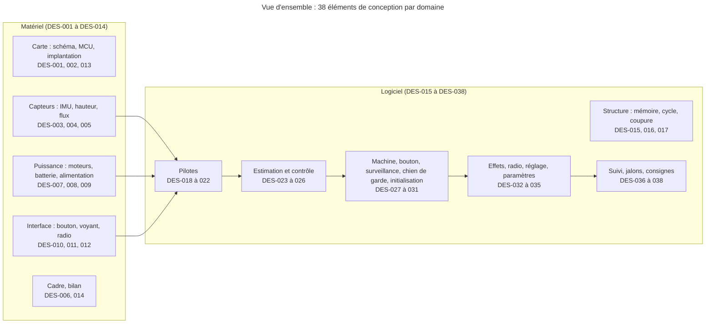

*Légende : un cadre par domaine, les numéros sont ceux des DES ; les éléments sans flèche (carte, cadre, bilan) sont des fondations transverses ; la flèche indique le sens des données ou des dépendances. Les titres complets sont dans la table de couverture et dans les éléments plus bas.*

## Cycle du logiciel

Le logiciel est une boucle à 1 kHz sans système d'exploitation temps réel ; le détail (interruptions, priorités, tâches de fond) est dans DES-016 « Tick de 1 kHz, cycle de contrôle et ordonnanceur de tâches de fond ».

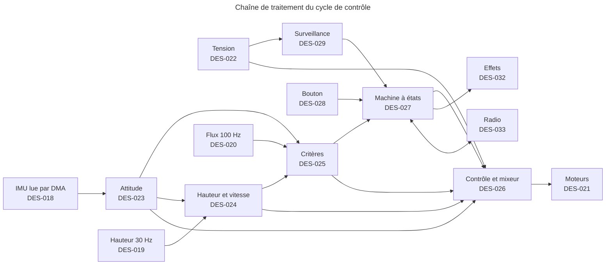

*Légende : une flèche = « produit une donnée consommée par ». Le chien de garde (DES-030 « Chien de garde matériel et règle de rafraîchissement ») est rafraîchi en fin de cycle.*

## Vue par bloc

Pour retrouver d'un coup d'œil tout ce qui concerne un bloc : sa conception matérielle, son logiciel, ses composants JLCPCB/LCSC (numéros de la nomenclature de « Architecture » — `projets/boomrone/03-architecture.md`, stocks à relire le jour de la commande) et son schéma. Un élément de conception peut servir plusieurs blocs ; il figure alors dans chacun. Tableau de lecture : les éléments de conception restent définis plus bas, dans « Éléments de conception ».

| Bloc | Conception matérielle | Logiciel | Composants (LCSC) | Schéma (`schemas/`) |
|---|---|---|---|---|
| Carte et fabrication JLCPCB | DES-001 « Schéma par blocs, réseaux et domaines de tension de la carte »<br>DES-013 « Implantation, routage et fichiers de fabrication pour JLCPCB » | — | carte double face 40 × 35 mm, assemblée par JLCPCB | `des-001-blocs-et-reseaux.svg` |
| Microcontrôleur | DES-002 « Microcontrôleur : brochage, horloges, découplage et octets d'option » | DES-015 « Arborescence du firmware, édition de liens et budget de mémoire »<br>DES-016 « Tick de 1 kHz, cycle de contrôle et ordonnanceur de tâches de fond »<br>DES-017 « Coupure des moteurs, démarrage unique et gestionnaires d'exception »<br>DES-030 « Chien de garde matériel et règle de rafraîchissement »<br>DES-031 « Séquence d'initialisation et échec d'initialisation »<br>DES-035 « Paramètres de vol, section d'origine et pilote de flash » | STM32G431CBT6 C529355 ; en-tête SWD PZ254V-11-05P C492404 ; passifs : voir la ligne « Passifs communs » | `des-002-microcontroleur.svg` |
| Centrale inertielle | DES-003 « Raccordement de la centrale inertielle LSM6DSO » | DES-018 « Pilote de la centrale inertielle »<br>DES-023 « Filtre d'attitude de Mahony » | LSM6DSOTR C2655100 | `des-003-centrale-inertielle.svg` |
| Capteur de hauteur | DES-004 « Raccordement du capteur de hauteur VL53L1X » | DES-019 « Pilote du capteur de hauteur non bloquant »<br>DES-024 « Observateur de hauteur et de vitesse verticale » | VL53L1CXV0FY/1 C190004 | `des-004-capteur-hauteur.svg` |
| Flux optique | DES-005 « Raccordement du flux optique PMW3901MB et régulateur de 2,0 V » | DES-020 « Pilote du flux optique »<br>DES-025 « Vitesse horizontale et critères d'immobilité, de platitude et de stationnaire » | PMW3901MB-TXQT C43496881 ; XC6206P202MR-G C2891260 | `des-005-flux-optique-regulateur-2v0.svg` |
| Moteurs et puissance | DES-006 « Cadre, anneaux, moteurs et hélices »<br>DES-007 « Circuit de puissance des moteurs » | DES-017 « Coupure des moteurs, démarrage unique et gestionnaires d'exception »<br>DES-021 « Pilotes des moteurs, du voyant, du buzzer et de la liaison série »<br>DES-026 « Contrôle de l'attitude et de la hauteur, mixeur et conversion en rapport cyclique » | AO3400A C20917 ; SS34 C8678 ; 22 µF C12891 ; moteurs, hélices et cadre hors catalogue | `des-007-puissance-moteurs.svg` |
| Batterie et alimentation | DES-008 « Batterie, connecteur XT30 et entrée de la carte »<br>DES-009 « Régulateur de 3,0 V et pont de mesure de la tension » | DES-022 « Pilote de la mesure de tension de la batterie »<br>DES-029 « Surveillance et coupures automatiques » | XT30PW-M30.G.Y C431092 ; MCP1700T-3002E/TT C62244 (repli ME6211C30M5G-N C403651) ; pont de mesure 100 kΩ C122538 et 150 kΩ C326734 (0,1 %) ; 22 µF C12891 (ligne VBATL et ligne moteurs) ; ferrite BLM18PG121SN1D C14709 ; batterie hors catalogue | `des-008-batterie-xt30-entree.svg`, `des-009-regulateur-3v0-pont-mesure.svg` |
| Bouton | DES-010 « Circuit du bouton » | DES-028 « Gestion logicielle du bouton » | TS-1088-AR02016 C720477 | `des-010-bouton.svg` |
| Voyant RGB et buzzer | DES-011 « Circuit du voyant RGB et du buzzer » | DES-021 « Pilotes des moteurs, du voyant, du buzzer et de la liaison série »<br>DES-032 « Effets locaux : table, séquenceur de lumière et de son » | SZYY1615RGB-B C3029071 ; SMD-9650-3327 C42420997 ; AO3400A C20917 ; SS34 C8678 ; 68 Ω C27592, 120 Ω C22787 | `des-011-voyant-buzzer.svg` |
| Radio Bluetooth | DES-012 « Raccordement du module Bluetooth E104-BT02 » | DES-021 « Pilotes des moteurs, du voyant, du buzzer et de la liaison série »<br>DES-033 « Trames du statut sans fil, automate de réception et file d'émission »<br>DES-034 « Mode réglage, filtrage des commandes et vol de réglage »<br>DES-036 « Logiciel de suivi en Python » | E104-BT02 C411314 | `des-012-module-bluetooth.svg` |
| Passifs communs (0603, type base sauf mention) | répartis dans les éléments de conception des blocs ci-dessus | — | résistances : 47 Ω C23182, 68 Ω C27592, 100 Ω C22775, 120 Ω C22787, 1 kΩ C21190, 4,7 kΩ C23162, 10 kΩ C25804, 100 kΩ 1 % C25803, 150 kΩ 1 % C22807 ; condensateurs : 10 nF C57112, 100 nF C14663, 1 µF C15849, 2,2 µF C23630, 4,7 µF C19666, 10 µF C19702 ; liste et quantités dans la nomenclature de « Architecture » | — |
| Sans bloc matériel propre | DES-014 « Feuille de calcul du bilan de masse, de poussée et d'autonomie » | DES-027 « Machine à états : données, événements et table de transitions »<br>DES-037 « Jalons de livraison et configurations de compilation »<br>DES-038 « Contenu de la page de consignes d'emploi » | — | — |

## Couverture des éléments d'architecture

Chaque élément d'architecture est cité par au moins un élément de conception (table générée à partir des lignes « Réfs amont » ci-dessous, vérifiée par `python tools/check_traceability_V2.py projets/boomrone --gate --phase conception`).

| Élément d'architecture | Éléments de conception |
|---|---|
| ARC-001 « Structure générale du drone » | DES-001 « Schéma par blocs, réseaux et domaines de tension de la carte » |
| ARC-002 « Microcontrôleur et programmation par liaison SWD » | DES-002 « Microcontrôleur : brochage, horloges, découplage et octets d'option » |
| ARC-003 « Centrale inertielle » | DES-003 « Raccordement de la centrale inertielle LSM6DSO » ; DES-018 « Pilote de la centrale inertielle » |
| ARC-004 « Capteur de hauteur à temps de vol » | DES-004 « Raccordement du capteur de hauteur VL53L1X » ; DES-019 « Pilote du capteur de hauteur non bloquant » |
| ARC-005 « Capteur de flux optique » | DES-005 « Raccordement du flux optique PMW3901MB et régulateur de 2,0 V » ; DES-020 « Pilote du flux optique » |
| ARC-006 « Moteurs, hélices et protège-hélices » | DES-006 « Cadre, anneaux, moteurs et hélices » |
| ARC-007 « Étage de puissance des moteurs coupés par défaut » | DES-007 « Circuit de puissance des moteurs » ; DES-017 « Coupure des moteurs, démarrage unique et gestionnaires d'exception » |
| ARC-008 « Batterie et connecteur débranchable » | DES-008 « Batterie, connecteur XT30 et entrée de la carte » |
| ARC-009 « Alimentation de la logique et mesure de la tension » | DES-009 « Régulateur de 3,0 V et pont de mesure de la tension » ; DES-022 « Pilote de la mesure de tension de la batterie » |
| ARC-010 « Bouton » | DES-010 « Circuit du bouton » |
| ARC-011 « Voyant RGB et avertisseur sonore » | DES-011 « Circuit du voyant RGB et du buzzer » |
| ARC-012 « Module radio Bluetooth à basse consommation » | DES-012 « Raccordement du module Bluetooth E104-BT02 » |
| ARC-013 « Carte électronique JLCPCB, câblage et assemblage » | DES-001 « Schéma par blocs, réseaux et domaines de tension de la carte » ; DES-013 « Implantation, routage et fichiers de fabrication pour JLCPCB » |
| ARC-014 « Bilan de masse, de poussée et d'autonomie » | DES-014 « Feuille de calcul du bilan de masse, de poussée et d'autonomie » |
| ARC-015 « Structure logicielle et ordonnancement » | DES-015 « Arborescence du firmware, édition de liens et budget de mémoire » ; DES-016 « Tick de 1 kHz, cycle de contrôle et ordonnanceur de tâches de fond » ; DES-017 « Coupure des moteurs, démarrage unique et gestionnaires d'exception » |
| ARC-016 « Pilotes des capteurs et des sorties » | DES-018 « Pilote de la centrale inertielle » ; DES-019 « Pilote du capteur de hauteur non bloquant » ; DES-020 « Pilote du flux optique » ; DES-021 « Pilotes des moteurs, du voyant, du buzzer et de la liaison série » ; DES-022 « Pilote de la mesure de tension de la batterie » |
| ARC-017 « Estimation de l'attitude, de la hauteur et de la vitesse » | DES-023 « Filtre d'attitude de Mahony » ; DES-024 « Observateur de hauteur et de vitesse verticale » ; DES-025 « Vitesse horizontale et critères d'immobilité, de platitude et de stationnaire » |
| ARC-018 « Boucle de contrôle du vol » | DES-026 « Contrôle de l'attitude et de la hauteur, mixeur et conversion en rapport cyclique » |
| ARC-019 « Machine à états du drone » | DES-027 « Machine à états : données, événements et table de transitions » |
| ARC-020 « Gestion logicielle du bouton » | DES-028 « Gestion logicielle du bouton » |
| ARC-021 « Surveillance et coupures automatiques » | DES-029 « Surveillance et coupures automatiques » |
| ARC-022 « Chien de garde » | DES-030 « Chien de garde matériel et règle de rafraîchissement » |
| ARC-023 « Initialisation et échec d'initialisation » | DES-031 « Séquence d'initialisation et échec d'initialisation » |
| ARC-024 « Effets locaux (logiciel) » | DES-032 « Effets locaux : table, séquenceur de lumière et de son » |
| ARC-025 « Protocole et service du statut sans fil » | DES-033 « Trames du statut sans fil, automate de réception et file d'émission » |
| ARC-026 « Mode réglage et vol de réglage » | DES-034 « Mode réglage, filtrage des commandes et vol de réglage » |
| ARC-027 « Paramètres de vol et stockage des réglages » | DES-035 « Paramètres de vol, section d'origine et pilote de flash » |
| ARC-028 « Logiciel d'essai de l'appareil de suivi » | DES-036 « Logiciel de suivi en Python » |
| ARC-029 « Plan de livraison par jalons » | DES-037 « Jalons de livraison et configurations de compilation » |
| ARC-030 « Page de consignes d'emploi » | DES-038 « Contenu de la page de consignes d'emploi » |

## Règles de lecture

- Les valeurs de composants et les constantes numériques marquées « de mémoire » ou « de départ » ne sont pas vérifiées : voir les doutes DOU-172 « Valeurs de configuration des périphériques à vérifier dans le manuel de référence », DOU-173 « Composants passifs et découplages à relever dans les fiches avant le routage », DOU-170 « Constantes de capteurs de départ : échelle du flux, retard du capteur de hauteur, filtres », DOU-171 « Gains de référence, poussée de sustentation et linéarisation de la poussée ».
- Chaque DES a un TU de même rang dans « Plans de test » — `projets/boomrone/05-plans-de-test.md` (section « Tests unitaires (TU) »).
- Les champs « Réalisé par » donnent des chemins prévus, relatifs à la racine du dépôt.

## Éléments de conception

Format :

```
### DES-001 — Titre du module ou du circuit
**Réfs amont :** ARC-001 « Titre de l'élément d'architecture »
**Description :** structures, algorithmes, brochage, budgets.
**Réalisé par :** fichier source ou schéma (chemin)
**Statut :** Proposé | Validé | Abandonné
```

### DES-001 — Schéma par blocs, réseaux et domaines de tension de la carte
**Réfs amont :** ARC-001 « Structure générale du drone » ; ARC-013 « Carte électronique JLCPCB, câblage et assemblage »
**Description :** schéma racine de la carte, saisi dans KiCad, avec trois domaines de tension et une table de réseaux (« net » = fil du schéma) qui sert de contrat entre le schéma, le logiciel et les essais.

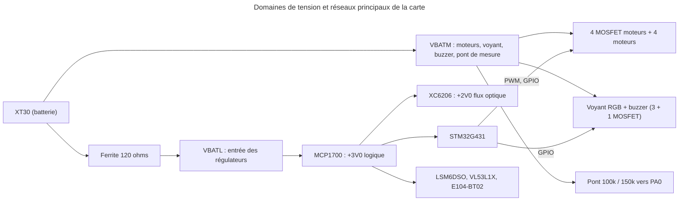

*Légende : VBATM = batterie vue au connecteur (3,1 à 4,2 V, 9,5 A en crête) ; VBATL = batterie filtrée pour les régulateurs ; +3V0 = rail logique (130 mA) ; +2V0 = rail du flux optique (environ 9 mA). Masse unique (plan plein).*

Réseaux de signaux (nom, broche du microcontrôleur, rôle) : M1_G à M4_G (PA8 à PA11, grilles moteurs), IMU_SCK, IMU_MISO, IMU_MOSI (PA5, PA6, PA7), IMU_CS (PA4), IMU_INT1 (PB0), FLX_SCK, FLX_MISO, FLX_MOSI (PB13, PB14, PB15), FLX_CS (PB12), I2C_SCL (PA15), I2C_SDA (PB7), TOF_GPIO1 (PB6), TOF_XSHUT (PB9), BLE_TX (PA2), BLE_RX (PA3), BLE_WKP (PA1, réveil du module radio), LED_R, LED_G, LED_B (PB1, PB2, PB10), BUZ (PB11), BTN (PB5), VBAT_SENSE (PA0), SWDIO (PA13), SWCLK (PA14), NRST, BOOT0 (PB8). Le détail électrique de chaque bloc est dans DES-002 « Microcontrôleur : brochage, horloges, découplage et octets d'option » à DES-012 « Raccordement du module Bluetooth E104-BT02 ».

Points d'essai (pastilles de 1 mm, face haute) : +3V0, +2V0, VBATM, VBATL, GND (deux), M1_D (drain du moteur 1), BLE_TX, BLE_RX, TOF_GPIO1. Six plots de repli du flux (3,0 V, masse, SCK, MOSI, MISO, CS) comme dans ARC-013 « Carte électronique JLCPCB, câblage et assemblage ».

Budget de courant : +3V0 130 mA (dimensionnement), VBATM 9,5 A en crête de 2 s. Règle de lecture : un réseau absent de cette liste ne doit pas exister au schéma ; un réseau de la liste doit avoir au moins deux broches (vérifié par TU-001 « Réseaux de la carte : table, ERC et broches uniques »).


*Légende : vue par blocs, le schéma de chaque bloc est dans le DES indiqué dans la boîte. Illustration de conception (DEC-275 « Schémas SVG des circuits de la carte dans la conception détaillée »), pas le schéma KiCad de fabrication ; repères provisoires : DOU-183 « Repères de composants provisoires des schémas SVG de la conception détaillée ».*

**Réalisé par :** `projets/boomrone/hardware/kicad/boomrone.kicad_sch` (page racine « Blocs »), `projets/boomrone/hardware/calculs/calculs.py`, `projets/boomrone/schemas/des-001-blocs-et-reseaux.svg`
**Statut :** Validé

### DES-002 — Microcontrôleur : brochage, horloges, découplage et octets d'option
**Réfs amont :** ARC-002 « Microcontrôleur et programmation par liaison SWD »
**Description :** brochage retenu (celui de ARC-002 « Microcontrôleur et programmation par liaison SWD », complété du réveil du module radio sur PA1 (DEC-277 « Module radio : 19200 bauds, réveil par PA1, broches du module et boîtier ») et des numéros de broches physiques du LQFP-48 relevés dans la fiche DS12589 Rev 6 : DOU-148 « Numéros de broches physiques du LQFP-48 à relever dans la fiche DS12589 » levé par DEC-283 « Relevé des fiches : doutes levés et doutes mis à jour ») ; toute broche non listée est configurée en entrée analogique à l'initialisation (pas de broche flottante en numérique).

| Fonction | Broche | Mode | Remarque |
|---|---|---|---|
| Moteurs 1 à 4 | PA8, PA9, PA10, PA11 | TIM1 CH1 à CH4 (AF6 pour PA8 à PA10, AF11 pour PA11 : confirmé par DS12589 tableau 13 p. 61 et 62, en AF6 PA11 serait TIM1_CH1N ; la fonction USB_DM de PA11 est sans effet tant que l'USB n'est pas activé), puis sortie basse en coupure | grille via 47 ohms, rappel 100 kohms à la masse |
| IMU SCK, MISO, MOSI | PA5, PA6, PA7 | SPI1 (AF5), mode 3 | diviseur 32 : 5,3125 MHz |
| IMU CS, INT1 | PA4, PB0 | sortie (niveau haut au repos), entrée | rappel de 10 kohms de CS au +3V0 |
| Flux SCK, MISO, MOSI | PB13, PB14, PB15 | SPI2 (AF5), mode 3 | diviseur 128 : 1,328125 MHz |
| Flux CS | PB12 | sortie (niveau haut au repos) | rappel de 10 kohms au +3V0 |
| I2C du capteur de hauteur | PA15 (SCL), PB7 (SDA) | I2C1 (AF4 et AF4), drain ouvert | 400 kHz, horloge HSI16, TIMINGR 0x10320309, rappels 4,7 kohms |
| Capteur de hauteur GPIO1, XSHUT | PB6, PB9 | entrée avec interruption externe (front descendant), sortie | rappels 10 kohms au +3V0 |
| Module radio | PA2 (TX), PA3 (RX) | USART2 (AF7) | 19200 bauds, débit par défaut du module, aucune commande envoyée |
| Réveil du module radio | PA1 | sortie, au niveau « éveillé » dès `board_early_init()` | liaison directe vers WKP (P06) du module, sans composant (DES-012 « Raccordement du module Bluetooth E104-BT02 ») |
| Voyant R, V, B ; buzzer | PB1, PB2, PB10 ; PB11 | sorties | grille via 100 ohms, rappel 100 kohms |
| Bouton | PB5 | entrée | rappel externe 10 kohms au +3V0 |
| Mesure de la batterie | PA0 | ADC1 IN1 (analogique) | pont 100 / 150 kohms, 100 nF à la masse obligatoire (DES-009 « Régulateur de 3,0 V et pont de mesure de la tension ») |
| SWD | PA13, PA14 | SWDIO, SWCLK | en-tête 1 x 5 : VTref, SWDIO, SWCLK, GND, NRST |
| BOOT0 | PB8 | entrée | 10 kohms à la masse |

Numéros de broches physiques du LQFP-48 (DS12589 Rev 6, figure 8 p. 45 et tableau 12 p. 51 à 56) : 1 VBAT ; 7 NRST ; 8 PA0 ; 9 PA1 ; 10 PA2 ; 11 PA3 ; 12 PA4 ; 13 PA5 ; 14 PA6 ; 15 PA7 ; 16 PB0 ; 17 PB1 ; 18 PB2 ; 19 VSSA ; 20 VREF+ ; 21 VDDA ; 22 PB10 ; 23, 35 et 47 VSS ; 24, 36 et 48 VDD ; 25 PB11 ; 26 PB12 ; 27 PB13 ; 28 PB14 ; 29 PB15 ; 30 PA8 ; 31 PA9 ; 32 PA10 ; 33 PA11 ; 34 PA12 ; 37 PA13 ; 38 PA14 ; 39 PA15 ; 40 PB3 ; 41 PB4 ; 42 PB5 ; 43 PB6 ; 44 PB7 ; 45 PB8-BOOT0 ; 46 PB9. PA12, PB3 et PB4 restent libres (entrées analogiques ; PB4 est NJTRST au reset) ; PA1 sert au réveil du module radio. Aucune broche n'est en double.

Horloges (valeurs de DEC-257 « Valeurs de configuration des horloges, timers, bus et convertisseur », corrigées d'après les fiches par DEC-278 « Microcontrôleur : états d'attente de la flash, séquence boost, USART2 et I2C1 d'après les fiches ») : HSI 16 MHz, PLL avec M = 4, N = 85, R = 2 donnant 170 MHz ; HCLK, PCLK1 et PCLK2 à 170 MHz (diviseurs 1) ; mode « boost » ; flash avec 4 états d'attente (FLASH_ACR, LATENCY = 4, soit 5 cycles du cœur : RM0440 Rev 9 tableau 29 p. 190, catégorie 2 du G431 ; les 8 états de DEC-257 « Valeurs de configuration des horloges, timers, bus et convertisseur » étaient de mémoire), prefetch (PRFTEN) et caches d'instructions et de données (ICEN, DCEN, actifs après le reset). Séquence de passage à 170 MHz (RM0440 p. 232 et 233), dans cet ordre : (1) LATENCY = 4, PRFTEN, ICEN et DCEN, puis relecture de LATENCY jusqu'à la prise en compte ; (2) PLL démarrée, attente de PLLRDY ; (3) diviseur AHB à 2 ; (4) R1MODE = 0 (PWR_CR5 bit 8 : mode boost ; valeur au reset 1 = mode normal) ; (5) horloge système sur la PLL, attente de SWS ; (6) attente d'au moins 1 µs (boucle non optimisée de 200 instructions, soit plus de 2 µs à 85 MHz) ; (7) diviseur AHB à 1. TIM2 : prédiviseur 169, compteur libre de 32 bits à 1 MHz ; TIM6 : prédiviseur 169, rechargement 999, tick de 1 kHz ; TIM1 : prédiviseur 0, rechargement 7082, soit 170 MHz / 7083 = 24,001 kHz, résolution 7083 pas ; SPI1 diviseur 32 et SPI2 diviseur 128 ; USART2 (horloge PCLK1) : BRR = 8854, soit 170 MHz / 8854 = 19200,4 bauds (erreur de calcul +0,002 %) ; l'erreur réelle est plus grande, l'horloge venant de la HSI16 (15,88 à 16,08 MHz à 30 °C et ±1 % de dérive entre 0 et 85 °C, DS12589 p. 103) : jusqu'à environ ±1,75 % avant la tolérance de l'horloge du module (non trouvée dans la fiche : DOU-194 « Fiche chinoise du E104-BT02 : relecture, tolérance d'horloge et niveaux d'entrée »), à vérifier sans erreur de trame à TI-010 « Liaison Bluetooth à basse consommation » ; I2C1 : horloge HSI16 (I2C1SEL = 10), TIMINGR = 0x10320309 pour 400 kHz (PRESC = 1, SCLDEL = 3, SDADEL = 2, SCLH = 3, SCLL = 9 : exemple du RM0440 tableau 360 p. 1657 pour 16 MHz, à contrôler avec l'outil de ST ; DOU-172 « Valeurs de configuration des périphériques à vérifier dans le manuel de référence »). Sortie du verrou moteurs : OSSI = 0 et OSSR = 0, les sorties sont libérées quand MOE = 0.

Découplage (relevé dans DS12589 Rev 6, figure 16 p. 68, DEC-279 « Microcontrôleur : découplage, BOR et chien de garde d'après les fiches ») : 100 nF sur chacune des trois broches VDD (24, 36, 48) et 4,7 µF commun ; VDDA (21) 10 nF + 1 µF ; VREF+ (20) reliée à VDDA avec 100 nF + 1 µF ; VSSA (19) à la masse ; VBAT (1) reliée au +3V0 (plage de 1,55 à 3,6 V) ; NRST (7) 100 nF à la masse, pas de bouton de reset (figure 27 p. 117). Octets d'option à programmer (procédure de ARC-002 « Microcontrôleur et programmation par liaison SWD ») : IWDG_SW = 0 (chien de garde matériel ; la valeur d'usine 0xFFEFF8AA donne un chien de garde logiciel, l'octet est donc à programmer), BOR_LEV = 3 (seuil descendant 2,47 / 2,52 / 2,57 V et montant 2,56 / 2,61 / 2,66 V : minimum, typique, maximum de DS12589 tableau 19 p. 72), protection en lecture niveau 0 (RDP = 0xAA), nSWBOOT0 laissé à 1 (BOOT0 lu sur la broche PB8). Le seuil descendant (jusqu'à 2,57 V) est sous le minimum de 2,6 V du capteur de hauteur : écart accepté par DEC-279 « Microcontrôleur : découplage, BOR et chien de garde d'après les fiches », car le rail +3V0 reste au-dessus de 2,91 V tant que la batterie dépasse 3,1 V (DES-009 « Régulateur de 3,0 V et pont de mesure de la tension ») et que le drone se coupe sous 3,3 V (DES-029 « Surveillance et coupures automatiques ») ; c'est l'hypothèse de DES-009 « Régulateur de 3,0 V et pont de mesure de la tension », non garantie par la fiche, et elle ne vaut qu'avec cette coupure : tout repli à 3,0 V sous charge est à réétudier avec le BOR. Le niveau 4 (descendant 2,76 à 2,86 V, montant jusqu'à 2,95 V) est écarté : son seuil montant dépasse le rail bas du MCP1700 (2,91 V), le microcontrôleur pourrait rester en reset (DOU-181 « Bilan d'erreur de la mesure de tension et niveau du BOR »). Règles : PB4 reste inutilisée et PA15 ne commande jamais une grille (JTAG au reset) ; SPI1 au plus 10 MHz, SPI2 au plus 2 MHz. Programmation : STM32CubeProgrammer en SWD, hélices démontées, sans relier le 3,3 V du ST-LINK.

Budgets : flash 128 kio, SRAM 32 kio dont 16 kio de SRAM1 utilisés (le détail est dans DES-015 « Arborescence du firmware, édition de liens et budget de mémoire »).


*Légende : brochage par groupe de fonctions, programmation SWD, découplage relevé dans la fiche. Illustration de conception (DEC-275 « Schémas SVG des circuits de la carte dans la conception détaillée »), pas le schéma KiCad de fabrication ; repères provisoires : DOU-183 « Repères de composants provisoires des schémas SVG de la conception détaillée ». En orange, éléments à vérifier : DOU-195 « Module E104-BT02 : niveau de WKP, état à la mise sous tension et mot de passe aérien » ; DOU-181 « Bilan d'erreur de la mesure de tension et niveau du BOR ».*

**Références JLCPCB/LCSC (composants actifs ; stocks relevés le 2026-10-29 dans « Architecture » — `projets/boomrone/03-architecture.md`, à relire le jour de la commande) :** microcontrôleur STM32G431CBT6, LQFP-48, LCSC C529355 (type étendu, 4,78 USD à l'unité).

**Références JLCPCB/LCSC des passifs reliés au microcontrôleur** (numéros de la nomenclature de « Architecture » — `projets/boomrone/03-architecture.md` ; tous de type base sauf mention ; à relire le jour de la commande) :

| Valeur | Boîtier | LCSC | Qté | Où |
|---|---|---|---|---|
| 47 Ω | 0603 | C23182 | 4 | grilles des moteurs (PA8 à PA11) |
| 100 Ω | 0603 | C22775 | 4 | grilles du voyant et du buzzer (PB1, PB2, PB10, PB11) |
| 1 kΩ | 0603 | C21190 | 1 | série du bouton (PB5) |
| 4,7 kΩ | 0603 | C23162 | 2 | rappels I2C (PA15, PB7) |
| 10 kΩ | 0603 | C25804 | 6 | rappels de PA4, PB12, PB6, PB9, PB5 ; BOOT0 (PB8) vers la masse |
| 100 kΩ 1 % | 0603 | C25803 | 8 | rappels des 8 grilles (moteurs, voyant, buzzer) |
| 100 kΩ 0,1 % | 0603 | C122538 (étendu) | 1 | pont de mesure de la batterie (PA0) |
| 150 kΩ 0,1 % | 0603 | C326734 (étendu) | 1 | pont de mesure de la batterie (PA0) |
| 10 nF | 0603 | C57112 | 2 | PB5 ; VDDA |
| 100 nF | 0603 | C14663 | 6 | VDD (3), VREF+, NRST, PA0 |
| 1 µF | 0603 | C15849 | 2 | VDDA, VREF+ |
| 4,7 µF | 0603 | C19666 | 1 | VDD, commun |

Total : 38 passifs, dont 2 de type étendu.
**Réalisé par :** `projets/boomrone/hardware/kicad/boomrone.kicad_sch` (feuille « MCU »), `projets/boomrone/firmware/src/board.c`, `projets/boomrone/firmware/src/board.h`, `projets/boomrone/firmware/src/board_pins.h`, `projets/boomrone/schemas/des-002-microcontroleur.svg`
**Statut :** Validé

### DES-003 — Raccordement de la centrale inertielle LSM6DSO
**Réfs amont :** ARC-003 « Centrale inertielle »
**Description :** LSM6DSOTR (LGA-14) au centre de la face basse. Liaison SPI à 4 fils sur SPI1 (SDO/SA0 vers MISO, SDI vers MOSI), CS sur PA4 avec un rappel de 10 kohms au +3V0 (le composant reste désélectionné pendant le reset du microcontrôleur), INT1 vers PB0, INT2 non raccordée (sortie forcée à la masse par défaut, p. 37), INT1 sans rappel haut (elle doit être à 0 ou non connectée pendant la mise sous tension, p. 38 note 2). Liaison auxiliaire (capteur externe) selon la fiche DS12140 Rev 3 (p. 8, 34 et 37) : SDx (broche 2) et SCx (broche 3) reliées à la masse, jamais flottantes ; OCS_Aux (broche 10) et SDO_Aux (broche 11) non connectées, soudées à la carte sans piste ; les deux broches GND (6 et 7) à la masse. Brochage LGA-14 (tableau 1 p. 8) : 1 SDO/SA0 (MISO), 2 SDx, 3 SCx, 4 INT1, 5 VDDIO, 6 GND, 7 GND, 8 VDD, 9 INT2, 10 OCS_Aux, 11 SDO_Aux, 12 CS, 13 SCL (SCK), 14 SDA (SDI, MOSI). VDD (broche 8) et VDDIO (broche 5) au +3V0, 100 nF au plus près de chacune (figure 21 p. 34) et 10 µF commun (ajout du projet, absent de la fiche). Pas de plan de masse coupé sous le composant.

Mise en route : le premier accès SPI attend `IMU_BOOT_WAIT_MS` = 40 ms (constante de `drv_imu_regs.h`) après la fin du reset du microcontrôleur, la fiche donnant un temps de mise en route (« turn-on time ») de 35 ms typique (tableau 3 p. 11) sans dire depuis quel événement il court (DOU-196 « LSM6DSO : durée du reset logiciel et départ du temps de mise en route non trouvés »). Registres écrits à l'initialisation (valeurs de ARC-003 « Centrale inertielle » et des notes d'architecture, confirmées dans la fiche DS12140 Rev 3 p. 47 à 52) : CTRL3_C = 0x44 (BDU et IF_INC, après SW_RESET et attente de fin de reset), CTRL4_C = 0x06 (liaison I2C coupée, filtre passe-bas du gyroscope actif), CTRL1_XL = 0x9C (3,33 kHz, ±8 g), CTRL2_G = 0x9C (3,33 kHz, ±2000 °/s), INT1_CTRL = 0x03 (données prêtes de l'accéléromètre et du gyroscope). Identité WHO_AM_I (0x0F) attendue 0x6C (valeur fixe, p. 48).

Échelles : gyroscope 70 m°/s par pas, accéléromètre 0,244 mg par pas. Axes : la puce est sur la face basse, face vers le bas : la matrice de passage du repère de la puce au repère du drone (x vers l'avant, y vers la gauche, z vers le haut) est une constante de `config_fixed.h`, par défaut une rotation de 180° autour de x (x inchangé, y et z inversés), à confirmer après le routage : DOU-167 « Orientation des axes de la centrale et sens de rotation des moteurs ». Fixation de la carte au cadre par de la mousse fine (DOU-154 « Vibrations des moteurs sur la centrale inertielle posée sur la carte rigide »).


*Légende : liaison SPI1, rappel de CS, alimentations et registres d'initialisation. Illustration de conception (DEC-275 « Schémas SVG des circuits de la carte dans la conception détaillée »), pas le schéma KiCad de fabrication ; repères provisoires : DOU-183 « Repères de composants provisoires des schémas SVG de la conception détaillée ». En orange, éléments à vérifier : DOU-167 « Orientation des axes de la centrale et sens de rotation des moteurs » ; DOU-196 « LSM6DSO : durée du reset logiciel et départ du temps de mise en route non trouvés ».*

**Références JLCPCB/LCSC (composants actifs ; stocks relevés le 2026-10-29 dans « Architecture » — `projets/boomrone/03-architecture.md`, à relire le jour de la commande) :** centrale inertielle LSM6DSOTR, LGA-14, LCSC C2655100 (type étendu).
**Réalisé par :** `projets/boomrone/hardware/kicad/boomrone.kicad_sch` (feuille « Capteurs »), `projets/boomrone/firmware/src/drv_imu_regs.h`, `projets/boomrone/schemas/des-003-centrale-inertielle.svg`
**Statut :** Validé

### DES-004 — Raccordement du capteur de hauteur VL53L1X
**Réfs amont :** ARC-004 « Capteur de hauteur à temps de vol »
**Description :** VL53L1CXV0FY/1 (LGA-12) en face basse, regardant le sol. Alimentations AVDD (broche 11) et AVDDVCSEL (broche 1) au +3V0 (le rail descend à environ 2,9 V, minimum 2,6 V du composant : fiche DS12385 Rev 8 tableau 13 p. 18, AVDD 2,6 / 2,8 / 3,5 V, maximum absolu 3,6 V). Le composant n'a aucune broche IOVDD (figure 2 et tableau 3 p. 5) : « IOVDD » de la fiche est la tension des rappels côté hôte (figure 3 p. 6), ici le +3V0. Découplage : 4,7 µF + 100 nF au plus près de AVDDVCSEL et AVSSVCSEL (figure 3 p. 6) et 100 nF sur AVDD (ajout du projet, absent de la fiche). Brochage LGA-12 (vue de dessous) : 1 AVDDVCSEL, 2 AVSSVCSEL, 3 GND, 4 GND2, 5 XSHUT, 6 GND3, 7 GPIO1, 8 DNC, 9 SDA, 10 SCL, 11 AVDD, 12 GND4 ; AVSSVCSEL et les quatre GND à la masse, DNC (broche 8) laissée flottante. Niveaux d'E/S : mode « 2V8 » de la fiche (E/S de 2,6 à 3,5 V) ; le mode par défaut du pilote est 1V8, le réglage est à vérifier dans l'ULD (DOU-149 « Valeurs de registres du VL53L1X à vérifier dans la bibliothèque ST (ULD) », DES-019 « Pilote du capteur de hauteur non bloquant »). I2C1 sur PA15 (SCL) et PB7 (SDA), rappels de 4,7 kohms au +3V0 (la fiche conseille 3,6 kohms pour 90 pF au plus, tableau 4 p. 6 : 4,7 kohms est conservé car le bus fait environ 30 pF), adresse 0x29 (0x52 en écriture sur 8 bits). GPIO1 (sortie à drain ouvert) vers PB6 (rappel 10 kohms au +3V0, conseillé p. 6), XSHUT vers PB9 (rappel 10 kohms : le capteur est actif dès la mise sous tension ; XSHUT est toujours piloté, p. 6). Le temps de montée de l'I2C reste sous les 300 ns exigés à 400 kHz tant que la capacité du bus est inférieure à 75 pF (calcul : 0,8473 x 4,7 kohms x C ; avec 30 pF on obtient 119 ns). Variante VL53L1CX : DOU-157 « VL53L1CX contre VL53L1X : identifiant, bibliothèque et registres ».

Mécanique : fenêtre optique dégagée, cône de 27° sans pièce dessous, capteur à 20 mm du plan de contact (voir DES-006 « Cadre, anneaux, moteurs et hélices ») : hauteur du drone = lecture brute moins 20 mm, coupure à 25 mm de hauteur = lecture brute de 45 mm.


*Légende : I2C1 avec rappels, GPIO1, XSHUT, alimentations et découplages. Illustration de conception (DEC-275 « Schémas SVG des circuits de la carte dans la conception détaillée »), pas le schéma KiCad de fabrication ; repères provisoires : DOU-183 « Repères de composants provisoires des schémas SVG de la conception détaillée ». En orange, éléments à vérifier : DOU-149 « Valeurs de registres du VL53L1X à vérifier dans la bibliothèque ST (ULD) » ; DOU-157 « VL53L1CX contre VL53L1X : identifiant, bibliothèque et registres ».*

**Références JLCPCB/LCSC (composants actifs ; stocks relevés le 2026-10-29 dans « Architecture » — `projets/boomrone/03-architecture.md`, à relire le jour de la commande) :** capteur de hauteur VL53L1CXV0FY/1 (référence ST du VL53L1X), LGA-12, LCSC C190004 (type étendu).
**Réalisé par :** `projets/boomrone/hardware/kicad/boomrone.kicad_sch` (feuille « Capteurs »), `projets/boomrone/schemas/des-004-capteur-hauteur.svg`
**Statut :** Validé

### DES-005 — Raccordement du flux optique PMW3901MB et régulateur de 2,0 V
**Réfs amont :** ARC-005 « Capteur de flux optique »
**Description :** puce PMW3901MB-TXQT (COB-28, face basse) alimentée en VDD par un XC6206P202MR-G (SOT-23, 2,0 V) lui-même alimenté par le +3V0 ; VDDIO au +3V0 (VDDIO au moins égale à VDD, respecté dès le démarrage). Régulateur (fiche Torex ETR0305_004b) : 1 µF en entrée (CIN = 1,0 µF céramique, p. 1) et 2,2 µF en sortie (la fiche donne CL = 1,0 µF céramique à faible ESR ; 2,2 µF est compatible, la fiche ne dit rien au-delà de 1,0 µF) ; brochage SOT-23 : 1 VSS, 2 VOUT, 3 VIN (p. 2). Bilan : charge 9 mA, pointe de 70 mA à la montée de l'alimentation ; chute du régulateur à 100 mA : 350 mV typique et 780 mV au maximum (p. 5), valeur à 70 mA non donnée (le 0,55 V de la première rédaction était une interpolation, il est retiré), marge disponible 1,0 V (rail à 3,0 V) ou 0,9 V (rail à 2,9 V) ; sortie 1,96 à 2,04 V (précision de 2 % de la version 2,0 V à 25 °C, p. 5), limite de la puce 1,8 à 2,1 V (tenue avec les dérives usuelles, environ 2,06 V au pire, coefficient de température typique de 100 ppm/°C à confirmer) ; dissipation moyenne 9 mW, 70 mW à la pointe (250 mW permis en SOT-23, p. 3). SPI2 sur PB13, PB14, PB15, CS sur PB12 avec un rappel de 10 kohms ; NRESET tirée au +3V0 par 10 kohms ; MOTION non câblée ; plot de masse central soudé à la masse. Condensateurs de la figure 8 de la fiche : empreintes 0603 prévues pour 1 µF et 100 nF sur VDD, 100 nF sur VDDIO et 2,2 µF sur VREG, valeurs finales à relever sur le dessin avant le routage, la fiche de la puce n'étant pas dans le dossier des fiches (DOU-185 « Fiche du capteur de flux PMW3901MB absente du dossier des fiches » ; DOU-165 « Flux optique : alimentation en 2,0 V, valeurs de fiche et mise sous tension »).

Optique : lentille LN03-ZSZ (fournie avec la puce, à confirmer : DOU-164 « PMW3901MB : lentille, assemblage par JLCPCB et refusion de la puce ») collée à la main sur la puce posée, au centre de l'ouverture, avec une colle époxy ou UV sans dégagement gazeux, sans toucher la fenêtre ; vérifier la hauteur de montage avec la lentille (DOU-166 « PMW3901MB : plage de température de 0 à 40 °C et hauteur de montage avec la lentille »). Six plots de repli de 1,5 x 1,5 mm au pas de 2,54 mm en bord de carte (3,0 V, masse, SCK, MOSI, MISO, CS), reliés aux réseaux du flux par des pistes de moins de 5 mm.


*Légende : régulateur XC6206 vers +2V0, VDDIO à +3V0, SPI2, NRESET et plots de repli. Illustration de conception (DEC-275 « Schémas SVG des circuits de la carte dans la conception détaillée »), pas le schéma KiCad de fabrication ; repères provisoires : DOU-183 « Repères de composants provisoires des schémas SVG de la conception détaillée ». En orange, éléments à vérifier : DOU-165 « Flux optique : alimentation en 2,0 V, valeurs de fiche et mise sous tension » ; DOU-164 « PMW3901MB : lentille, assemblage par JLCPCB et refusion de la puce » ; DOU-182 « Noms et numéros de broches des circuits intégrés des schémas SVG non relevés dans les fiches ».*

**Références JLCPCB/LCSC (composants actifs ; stocks relevés le 2026-10-29 dans « Architecture » — `projets/boomrone/03-architecture.md`, à relire le jour de la commande) :** puce du flux optique PMW3901MB-TXQT, COB-28, LCSC C43496881 (type étendu, 182 en stock, assemblage et lentille à confirmer) ; régulateur de 2,0 V XC6206P202MR-G, SOT-23, LCSC C2891260 (type étendu).
**Réalisé par :** `projets/boomrone/hardware/kicad/boomrone.kicad_sch` (feuille « Capteurs »), `projets/boomrone/schemas/des-005-flux-optique-regulateur-2v0.svg`
**Statut :** Validé

### DES-006 — Cadre, anneaux, moteurs et hélices
**Réfs amont :** ARC-006 « Moteurs, hélices et protège-hélices »
**Description :** cadre en un seul modèle paramétrique OpenSCAD (DEC-268 « Mécanique : anneaux tangents, modèle OpenSCAD et impression en ligne »). Quatre anneaux tangents (diamètre intérieur 47 mm, paroi 1,0 mm, donc diamètre extérieur 49 mm égal à l'entraxe) aux sommets d'un carré de 49 mm : encombrement 98 x 98 mm. Chaque moteur 8520 (diamètre 8,5 mm) est tenu dans une poche de 8,6 mm au centre de l'anneau par deux rayons de 1,0 x 1,5 mm situés sous le plan de l'hélice, qui ne coupent pas le disque des hélices de 45 mm. La carte repose sur quatre plots au centre, face haute vers le haut, le connecteur XT30 au bord accessible entre deux anneaux. Hauteur des anneaux 10 mm centrée sur le plan des hélices (le calibre de 12 mm de REQ-032 « Protège-hélices » ne touche aucune hélice).

Recouvrement : la carte de 40 x 35 mm au centre d'un carré de 49 mm déborde sur les disques des hélices (son coin est à 8 mm du centre d'une hélice dont le rayon est 22,5 mm) ; sa hauteur par rapport au plan des hélices et la poussée perdue sont à chiffrer sur le croquis (DOU-180 « Recouvrement de la carte et des disques d'hélice »).

Sens de rotation : moteurs 1 et 3 dans le sens horaire vu de dessus, moteurs 2 et 4 dans le sens antihoraire (deux paires, chaque hélice du bon pas : 2 hélices de chaque pas) ; numérotation vue de dessus : 1 avant droit, 2 arrière droit, 3 arrière gauche, 4 avant gauche. Cette convention alimente le mixeur de DES-026 « Contrôle de l'attitude et de la hauteur, mixeur et conversion en rapport cyclique » ; elle est à vérifier sur la potence (DOU-167 « Orientation des axes de la centrale et sens de rotation des moteurs »).

Cotes verticales : capteur de hauteur à 20 mm du plan de contact, hauteur totale environ 35 mm. Les pieds, la hauteur exacte des poches et la position verticale de la carte sont fixés par le croquis coté de DOU-162 « Implantation mécanique de la carte, du connecteur et de la batterie » avant la commande de la pièce. Matière et fabricant (DOU-169 « Matière, masse, délai et cotes verticales des pièces imprimées ») : impression en résine par un service en ligne, masse visée 9 g pour le cadre et les anneaux (DES-014 « Feuille de calcul du bilan de masse, de poussée et d'autonomie »).
**Réalisé par :** `projets/boomrone/hardware/mecanique/cadre.scad`, `projets/boomrone/hardware/mecanique/cadre.stl`, `projets/boomrone/hardware/mecanique/verif.py`
**Statut :** Validé

### DES-007 — Circuit de puissance des moteurs
**Réfs amont :** ARC-007 « Étage de puissance des moteurs coupés par défaut »
**Description :** par moteur : un AO3400A (SOT-23) côté bas, drain sur la borne négative du moteur, source à la masse, grille reliée à la sortie TIM1 par 47 ohms, rappel de 100 kohms grille-masse ; diode SS34 en roue libre (cathode côté VBATM, anode côté drain) ; 100 nF aux bornes du moteur ; sur la ligne moteurs, 2 x 22 µF (1206, 25 V) et 100 nF. La grille est pilotée en 3,0 V : le fabricant (fiche Alpha & Omega, rev 3) donne à VGS = 2,5 V et 3 A une résistance de 24 mohms typique et 48 mohms au maximum (p. 1 et 2), la valeur à 3,0 V n'étant pas trouvée (DOU-199 « AO3400A : résistance à 3,0 V et capacité d'entrée maximale non trouvées dans la fiche ») ; seuil de grille 0,65 / 1,05 / 1,45 V, donc 3,0 V suffit ; brochage SOT-23 : grille 1, source 2, drain 3.

Calculs de contrôle : constante de décharge de la grille au reset, tau = 100 kohms x Ciss ; avec Ciss = 630 pF (valeur typique de la fiche, p. 2, qui ne donne pas de maximum) elle vaut 63 µs et la grille passe sous 1 V en 69 µs, avec le double (1260 pF, marge du projet) en 138 µs, dans les deux cas très en dessous de 1 ms ; constante de commutation 47 ohms x 630 pF = 30 ns, négligeable devant la période de 41,7 µs ; perte par conduction à 2,4 A : 0,14 W par MOSFET avec 24 mohms et 0,28 W avec 48 mohms, soit une hausse de 14 à 41 K avec 100 à 150 K/W (100 K/W typique et 125 K/W au maximum selon la fiche, sur une carte de 645 mm2 en cuivre de 2 oz : la carte réelle est moins bien refroidie) ; à chaud la résistance est multipliée par environ 1,5 (rapport lu à 125 °C sur les valeurs à 10 V de la fiche), soit 0,41 W et 62 K au plus avec 150 K/W, cas de marge ; courant de crête de la ligne 9,5 A (le courant de calage d'un moteur n'est pas trouvé : DOU-190 « Fiche du moteur 8520 absente du dossier des fiches : courant de calage »). Pistes de puissance : voir DES-013 « Implantation, routage et fichiers de fabrication pour JLCPCB ».

Cas non couverts, testés par TI-005 « Moteurs coupés par le matériel » : MOSFET en court-circuit, pont de soudure, rappel ouvert.


*Légende : circuit d'une voie, identique pour les quatre moteurs ; le tableau donne les broches et les repères de chaque voie. Illustration de conception (DEC-275 « Schémas SVG des circuits de la carte dans la conception détaillée »), pas le schéma KiCad de fabrication ; repères provisoires : DOU-183 « Repères de composants provisoires des schémas SVG de la conception détaillée ». En orange, éléments à vérifier : DOU-199 « AO3400A : résistance à 3,0 V et capacité d'entrée maximale non trouvées dans la fiche ».*

**Références JLCPCB/LCSC (composants actifs ; stocks relevés le 2026-10-29 dans « Architecture » — `projets/boomrone/03-architecture.md`, à relire le jour de la commande) :** MOSFET AO3400A, SOT-23, LCSC C20917 (type de base) ; diode de roue libre SS34, SMA, LCSC C8678 (type de base).
**Réalisé par :** `projets/boomrone/hardware/kicad/boomrone.kicad_sch` (feuille « Puissance »), `projets/boomrone/schemas/des-007-puissance-moteurs.svg`
**Statut :** Validé

### DES-008 — Batterie, connecteur XT30 et entrée de la carte
**Réfs amont :** ARC-008 « Batterie et connecteur débranchable »
**Description :** batterie : LiPo 1S 850 mAh, décharge au moins 50C, sans protection, environ 19 g, résistance interne estimée 40 mohms (à mesurer), connecteur XT30 ; achetée, non conçue. XT30PW traversant sur le bord de carte, soudé à la main (désignation de la fiche Amass : XT30PW30-M.G.Y, hauteur de soudure 3,0 mm, 15 A en continu, 30 A pendant 1 min, 1,20 mohm de contact ; la nomenclature de « Architecture » — `projets/boomrone/03-architecture.md` écrit XT30PW-M30.G.Y pour C431092, à vérifier : DOU-198 « Écarts avec l'architecture à reporter à la prochaine révision : débit, réveil du module, boîtier, désignation du XT30 » ; empreinte dans DES-013 « Implantation, routage et fichiers de fabrication pour JLCPCB ») ; polarité marquée sur la carte (rouge au plus, noir à la masse), détrompage du connecteur seul, aucune protection contre l'inversion ni la surintensité (ARC-008 « Batterie et connecteur débranchable »). Le genre du connecteur de carte est le contraire de celui de la batterie achetée (DOU-155 « Connecteur XT30 : genre côté carte et surtension à la connexion ») ; à relever avant la commande. Deux branches à partir du connecteur : VBATM (moteurs, voyant, buzzer, pont de mesure) en polygone plein, et VBATL (régulateurs) à travers la ferrite BLM18PG121SN1D, pour que le courant des moteurs ne traverse jamais la ferrite (valeur nominale de 1 A seulement : DEC-269 « Matériel : ferrite hors du chemin des moteurs, mesure en amont, rappels des sélections de bus »). Sur VBATL, 22 µF (1206, 25 V) ; sur VBATM, 2 x 22 µF de DES-007 « Circuit de puissance des moteurs ».

Calculs de contrôle : chute dans la ferrite à 130 mA avec une résistance de 0,1 ohm (ordre de grandeur ; fiche de la ferrite absente du dossier : DOU-186 « Fiche de la ferrite BLM18PG121SN1D absente du dossier des fiches » ; DOU-173 « Composants passifs et découplages à relever dans les fiches avant le routage ») : 13 mV, sans effet sur la mesure puisque le pont lit VBATM ; résistance d'une piste de 4 mm en cuivre de 35 µm sur 30 mm : 3,7 mohms ; total connecteur, fils et pistes 15 mohms comme dans le bilan de DES-014 « Feuille de calcul du bilan de masse, de poussée et d'autonomie ». Surtension à la connexion : mesurée par TI-008 « Batterie, connecteur, chute de tension et mesure de tension ».


*Légende : deux branches VBATM et VBATL, ferrite hors du chemin des moteurs. Illustration de conception (DEC-275 « Schémas SVG des circuits de la carte dans la conception détaillée »), pas le schéma KiCad de fabrication ; repères provisoires : DOU-183 « Repères de composants provisoires des schémas SVG de la conception détaillée ». En orange, éléments à vérifier : DOU-155 « Connecteur XT30 : genre côté carte et surtension à la connexion » ; DOU-173 « Composants passifs et découplages à relever dans les fiches avant le routage ».*

**Réalisé par :** `projets/boomrone/hardware/kicad/boomrone.kicad_sch` (feuille « Alimentation »), `projets/boomrone/schemas/des-008-batterie-xt30-entree.svg`
**Statut :** Validé

### DES-009 — Régulateur de 3,0 V et pont de mesure de la tension
**Réfs amont :** ARC-009 « Alimentation de la logique et mesure de la tension »
**Description :** MCP1700T-3002E/TT (fiche Microchip DS20001826C) entre VBATL et +3V0 : 1 µF en entrée et 4,7 µF en sortie. En sortie, 1,0 µF céramique au minimum (ESR de 0 à 2 ohms, p. 1 et 12). En entrée, 1 µF céramique suffit jusqu'à 100 mA ; au-delà la valeur dépend de la source et une valeur plus grande est permise (p. 10 et 12) : à 130 mA, les 22 µF de DES-008 « Batterie, connecteur XT30 et entrée de la carte » en tête de VBATL complètent le 1 µF du composant, ce sont deux condensateurs distincts (DEC-281 « Puissance et alimentation : AO3400A, MCP1700, source de l'ADC et étalonnage »). Brochage SOT-23 : 1 GND, 2 VOUT, 3 VIN. Dimensionnement : 130 mA ; dissipation à 4,2 V : 1,2 V x 0,13 A = 0,16 W ; échauffement de 37 K avec 230 K/W (texte de la fiche, p. 13 et 14) et de 54 K avec 336 K/W (tableau p. 4, norme JESD51-7, SOT-23 sans cuivre), la jonction restant sous le maximum de 125 °C (p. 3) (40 à 55 °C annoncé, acceptable avec un petit polygone de cuivre) ; sortie réglée tant que la batterie dépasse 3,1 V : hypothèse, car la fiche garantit seulement VIN au moins égale à VR + 3 % + chute, soit 3,44 V à 250 mA (note 1 p. 3), et donne environ 0,12 V de chute à 130 mA pour la version 2,8 V en valeur typique (figure 2-12 p. 6), la valeur de la version 3,0 V à 130 mA n'étant pas trouvée. Surtension à la connexion : maximum absolu 6,5 V, fonctionnement de 2,3 à 6,0 V (p. 3), voir DOU-155 « Connecteur XT30 : genre côté carte et surtension à la connexion ». Régulateur du flux optique : DES-005 « Raccordement du flux optique PMW3901MB et régulateur de 2,0 V ».

Pont de mesure sur VBATM : 100 kohms 0,1 % (haut) et 150 kohms 0,1 % (bas), milieu vers PA0 avec 100 nF à la masse ; rapport 0,6 : 4,2 V donne 2,52 V ; courant 16,8 µA ; impédance de source 60 kohms (au-dessus du RAIN maximal de 50 kohms et des 39 kohms à 640,5 cycles à 60 MHz sur voie rapide de DS12589, tableaux 60 et 61 p. 119 et 121 : le condensateur de 100 nF de PA0 est donc obligatoire, il fournit la charge de la capacité d'échantillonnage de l'ADC, CADC au plus 5 pF, soit un écart de partage de charge de 5 pF / 100 nF, au plus 0,13 mV sur 2,52 V ou 0,17 pas ; la preuve est la mesure de TI-008 « Batterie, connecteur, chute de tension et mesure de tension », DOU-142 « Fuite d'entrée de l'ADC et marge de ±50 mV de la mesure de tension ») ; pas du convertisseur 3,0 V / 4095 = 0,73 mV sur la broche, soit 1,22 mV sur la batterie. Erreur du pont à 0,1 % : environ 3 mV à 3,7 V. Séquence de conversion et formule : DES-022 « Pilote de la mesure de tension de la batterie ». Étalonnage de gain au multimètre possible, sans obligation (constante `VBAT_GAIN_TRIM` de `config_fixed.h`).


*Légende : MCP1700 de VBATL vers +3V0 et pont 100 kΩ / 150 kΩ de VBATM vers PA0. Illustration de conception (DEC-275 « Schémas SVG des circuits de la carte dans la conception détaillée »), pas le schéma KiCad de fabrication ; repères provisoires : DOU-183 « Repères de composants provisoires des schémas SVG de la conception détaillée ». En orange, éléments à vérifier : DOU-173 « Composants passifs et découplages à relever dans les fiches avant le routage » ; DOU-182 « Noms et numéros de broches des circuits intégrés des schémas SVG non relevés dans les fiches ».*

**Références JLCPCB/LCSC (composants actifs ; stocks relevés le 2026-10-29 dans « Architecture » — `projets/boomrone/03-architecture.md`, à relire le jour de la commande) :** régulateur de 3,0 V MCP1700T-3002E/TT, SOT-23, LCSC C62244 (type étendu) ; repli ME6211C30M5G-N, SOT-23-5, LCSC C403651 (type étendu).
**Réalisé par :** `projets/boomrone/hardware/kicad/boomrone.kicad_sch` (feuille « Alimentation »), `projets/boomrone/schemas/des-009-regulateur-3v0-pont-mesure.svg`
**Statut :** Validé

### DES-010 — Circuit du bouton
**Réfs amont :** ARC-010 « Bouton »
**Description :** poussoir TS-1088-AR02016 entre un nœud et la masse ; le nœud va à PB5 par 1 kohm en série ; rappel externe de 10 kohms de PB5 au +3V0 ; 10 nF de PB5 à la masse. Constantes de temps : appui, tau = 1 kohm x 10 nF = 10 µs (le condensateur se décharge dans le contact) ; relâchement, tau = (10 kohms + 1 kohm) x 10 nF = 110 µs ; toutes deux très inférieures à l'antirebond logiciel de 10 ms (DES-028 « Gestion logicielle du bouton »). Niveau stable avant la fin du reset grâce au rappel externe (nécessaire pour l'entrée en mode réglage). Courant dans le contact : 0,27 mA. Placé sur la face haute, accessible sans retirer d'anneau.


*Légende : poussoir, 1 kΩ en série, rappel de 10 kΩ et 10 nF. Illustration de conception (DEC-275 « Schémas SVG des circuits de la carte dans la conception détaillée »), pas le schéma KiCad de fabrication ; repères provisoires : DOU-183 « Repères de composants provisoires des schémas SVG de la conception détaillée ».*

**Réalisé par :** `projets/boomrone/hardware/kicad/boomrone.kicad_sch` (feuille « Interface »), `projets/boomrone/schemas/des-010-bouton.svg`
**Statut :** Validé

### DES-011 — Circuit du voyant RGB et du buzzer
**Réfs amont :** ARC-011 « Voyant RGB et avertisseur sonore »
**Description :** voyant SZYY1615RGB-B à anode commune sur VBATM ; cathodes rouge, verte, bleue vers trois AO3400A par 120 ohms (rouge) et 68 ohms (vert et bleu) ; grilles sur PB1, PB2, PB10 par 100 ohms avec rappel de 100 kohms. Courants à 4,2 V : rouge (4,2 - 2,0) / 120 = 18,3 mA, vert et bleu (4,2 - 3,0) / 68 = 17,6 mA avec les tensions directes supposées ; avec celles du catalogue (2,4 V ; 3,4 V) 15 mA et 11,8 mA ; blanc (trois couleurs) au plus 61 mA avec les minima de la fiche (1,8 V ; 2,8 V ; 2,8 V : 20,0 + 20,6 + 20,6 mA) et 54 mA avec les valeurs supposées. Fiche SZYY1615RGB-B (p. 2 à 5) : anode commune (broche 4), 1 rouge, 2 vert, 3 bleu, 1,6 x 1,5 x 0,6 mm ; courant continu maximal 25 mA par couleur, puissance au plus 40 mW pour le rouge et 90 mW pour le vert et le bleu : le rouge, à 18,3 mA x 2,0 V = 37 mW, est à 8 % de sa limite (voie la plus proche), et son courant maximal admis baisse vers 17 à 18 mA autour de 45 à 50 °C (courbe p. 5) ; à 45 à 50 °C le courant nominal de 18,3 mA dépasse donc le courant admis (marge négative en courant) : ce risque de vieillissement du rouge est accepté pour la première version (DEC-282 « Voyant RGB, XC6206 et connecteur XT30 : valeurs de fiche »), la température du voyant se relève à TI-009 « Bouton, voyant RGB et avertisseur ». Si la tension directe du vert et du bleu vaut 3,4 V, ces couleurs deviennent faibles sous 3,7 V de batterie : DOU-161 « Tensions directes du voyant RGB : visibilité du vert et du bleu entre 3,4 et 3,7 V » ; la LED ou les résistances se changent avant la commande au vu des mesures de TI-009 « Bouton, voyant RGB et avertisseur ».

Buzzer actif SMD-9650-3327 entre VBATM et le drain d'un quatrième AO3400A (grille PB11, 100 ohms, rappel 100 kohms) ; diode SS34 en parallèle (cathode côté VBATM) ; courant environ 30 mA, fréquence propre 2,7 kHz, un seul timbre. Courant total le plus défavorable : 61 mA + 30 mA = 91 mA, très inférieur au courant admissible des MOSFET.


*Légende : voyant à anode commune sur VBATM, trois AO3400A, buzzer et diode de roue libre sur un quatrième AO3400A. Illustration de conception (DEC-275 « Schémas SVG des circuits de la carte dans la conception détaillée »), pas le schéma KiCad de fabrication ; repères provisoires : DOU-183 « Repères de composants provisoires des schémas SVG de la conception détaillée ». En orange, éléments à vérifier : DOU-161 « Tensions directes du voyant RGB : visibilité du vert et du bleu entre 3,4 et 3,7 V ».*

**Références JLCPCB/LCSC (composants actifs ; stocks relevés le 2026-10-29 dans « Architecture » — `projets/boomrone/03-architecture.md`, à relire le jour de la commande) :** voyant RGB à anode commune SZYY1615RGB-B, LCSC C3029071 (type étendu) ; MOSFET AO3400A, SOT-23, LCSC C20917 (type de base) ; diode SS34, LCSC C8678 (type de base) ; buzzer actif SMD-9650-3327, LCSC C42420997 (type étendu).
**Réalisé par :** `projets/boomrone/hardware/kicad/boomrone.kicad_sch` (feuille « Interface »), `projets/boomrone/schemas/des-011-voyant-buzzer.svg`
**Statut :** Validé

### DES-012 — Raccordement du module Bluetooth E104-BT02
**Réfs amont :** ARC-012 « Module radio Bluetooth à basse consommation »
**Description :** module E104-BT02 (fiche Ebyte en chinois, relecture souhaitable : DOU-194 « Fiche chinoise du E104-BT02 : relecture, tolérance d'horloge et niveaux d'entrée ») posé en face haute, boîtier 14,6 x 21,9 mm, pas de 1,27 mm, 20 broches (p. 4 du PDF), antenne en dépassement du bord de carte, sans cuivre ni piste ni batterie dessous. Alimentation VCC (broche 12) au +3V0 avec 10 µF + 100 nF au plus près (la fiche montre 1 µF + 0,1 µF, des valeurs plus grandes sont acceptables) : plage de 2,5 à 3,6 V, mais puissance de sortie garantie seulement à 3,3 V et plus ; le rail de 3,0 V (2,91 à 3,09 V) est dans la plage et sous 3,3 V, la portée est donc à mesurer à TI-010 « Liaison Bluetooth à basse consommation ». Broches (p. 5 et 6) : P04 (TXD, broche 7) vers PA3 (RX du microcontrôleur), P05 (RXD, broche 8) depuis PA2 (TX du microcontrôleur) ; niveaux de 3,0 V des deux côtés. WKP (P06, broche 9) est relié directement à PA1, sans composant (DEC-286 « WKP : PA1 directe, emplacements de 0 Ω supprimés »). Faits de la fiche anglaise du module (« E104-BT02 Datasheet v1.0 », `Datasheets/E104-BT02_EN.pdf`, p. 5 et 6) : WKP à l'état bas = module éveillé, à l'état haut = veille ; rappel interne vers le haut, donc veille par défaut si WKP est laissée libre ; en veille l'UART ne reçoit plus (les données Bluetooth reçues sortent encore) et entrer en veille coupe la connexion Bluetooth en cours ; réveil environ 25 ms après le passage à l'état bas. PA1 est donc une sortie mise à l'état bas (« éveillé ») dès `board_early_init()` et tenue ainsi (la constante du niveau est unique dans `board_pins.h`). PA1 est en haute impédance pendant un reset du microcontrôleur : le module passe brièvement en veille, puis `board_early_init()` remet PA1 à l'état bas et le module se réveille (environ 25 ms) ; seul effet, la connexion Bluetooth établie est coupée par un reset en vol (le téléphone doit se reconnecter), sans conséquence de sécurité puisque les moteurs sont coupés par le matériel (ARC-007 « Étage de puissance des moteurs coupés par défaut »). Reste à essayer sur le module seul (TI-010 « Liaison Bluetooth à basse consommation ») : niveau de WKP, comportement d'un WKP tenu bas dès la mise sous tension (non décrit), force du rappel interne (non donnée), mot de passe aérien 123456 (fiche chinoise seulement) : DOU-195 « Module E104-BT02 : niveau de WKP, état à la mise sous tension et mot de passe aérien ». MOD (P00, broche 3, rappel interne, transmission transparente par défaut) est laissée libre ; RESET_H (broche 13, reset actif à l'état haut) est reliée à la masse ; STA (P11, broche 15), APP (P03, broche 6), le rôle (P14, broche 17, esclave par défaut) et les autres broches ne sont pas connectés (DOU-146 « Broches d'état du module Bluetooth et de mouvement du capteur de flux »). Aucune commande n'est envoyée : le module a un jeu de commandes entre chevrons (<BAUDxxx>, <RESET>…, sans préfixe AT) que le projet n'utilise pas, le débit par défaut étant celui retenu ; le mot de passe aérien par défaut (123456) permet à toute personne à portée de reconfigurer le module (DOU-195 « Module E104-BT02 : niveau de WKP, état à la mise sous tension et mot de passe aérien »). Service 0xFFF0, caractéristique 0xFFF1 (notification, module vers téléphone) et 0xFFF2 (écriture, téléphone vers module), paquet de 20 octets par défaut : une trame de 14 octets y tient (options de DES-036 « Logiciel de suivi en Python »). Quatre pastilles de repli (3,0 V, masse, TX, RX) pour souder un autre module série. Débit : 19200 bauds, 8N1 sans parité (débit par défaut du module et maximum de la transmission continue selon la fiche, p. 3, 7, 9 et 10), soit 52,1 µs par bit et 0,52 ms par octet ; une trame de 14 octets dure 7,3 ms ; la charge utile du protocole (DES-033 « Trames du statut sans fil, automate de réception et file d'émission »), environ 138 octets par seconde, occupe 7 % des 1920 octets par seconde disponibles. Erreur de débit côté microcontrôleur : jusqu'à environ ±1,75 % avec la HSI16 (DES-002 « Microcontrôleur : brochage, horloges, découplage et octets d'option »).


*Légende : liaison série croisée avec PA2 et PA3, réveil par PA1 relié directement à WKP, alimentation 3,0 V et plots de repli. Illustration de conception (DEC-275 « Schémas SVG des circuits de la carte dans la conception détaillée »), pas le schéma KiCad de fabrication ; repères provisoires : DOU-183 « Repères de composants provisoires des schémas SVG de la conception détaillée ». En orange, éléments à vérifier : DOU-195 « Module E104-BT02 : niveau de WKP, état à la mise sous tension et mot de passe aérien » ; DOU-146 « Broches d'état du module Bluetooth et de mouvement du capteur de flux ».*

**Références JLCPCB/LCSC (composants actifs ; stocks relevés le 2026-10-29 dans « Architecture » — `projets/boomrone/03-architecture.md`, à relire le jour de la commande) :** module Bluetooth Ebyte E104-BT02 (DA14580), CMS, LCSC C411314 (type étendu, 649 en stock).
**Réalisé par :** `projets/boomrone/hardware/kicad/boomrone.kicad_sch` (feuille « Radio »), `projets/boomrone/schemas/des-012-module-bluetooth.svg`
**Statut :** Validé

### DES-013 — Implantation, routage et fichiers de fabrication pour JLCPCB
**Réfs amont :** ARC-013 « Carte électronique JLCPCB, câblage et assemblage » ; ARC-003 « Centrale inertielle » ; ARC-004 « Capteur de hauteur à temps de vol » ; ARC-005 « Capteur de flux optique »
**Description :** carte double face de 40 x 35 mm, épaisseur 1,0 mm, cuivre 1 oz, dessinée dans KiCad (DEC-255 « Conception détaillée : chaîne de développement et arborescence des fichiers »). Implantation : face haute, bouton, voyant, buzzer, module Bluetooth, microcontrôleur, régulateurs, XT30 et en-tête SWD ; face basse, centrale inertielle (au centre de la carte), capteur de hauteur et puce du flux, cônes de 27° et 42° non sécants (croquis coté de DOU-162 « Implantation mécanique de la carte, du connecteur et de la batterie » avant le routage). Règles de routage retenues, plus larges que le minimum de JLCPCB (0,10 mm) : pistes et espacements de signaux 0,15 mm, vias 0,3 / 0,6 mm, masse en plan plein sur les deux faces recousu par des vias, découplage à moins de 3 mm de la broche, polygones de VBATM et de masse avec au moins 8 vias entre faces, pistes de puissance de 4 mm au moins, antenne du module dégagée. Empreintes relevées dans les fiches : module E104-BT02 14,6 x 21,9 mm au pas de 1,27 mm, 20 broches (le 22,3 x 14 mm de la nomenclature est corrigé : DOU-198 « Écarts avec l'architecture à reporter à la prochaine révision : débit, réveil du module, boîtier, désignation du XT30 ») ; XT30PW : deux trous de puissance Ø 1,9 mm distants de 5,00 mm, deux trous de calage Ø 1,0 mm distants de 11,00 mm, boîtier 13,95 x 9,00 mm, hauteur 13,30 mm (orientation des cotes à lire sur le dessin de la fiche, p. 3) ; voyant SZYY1615RGB-B 1,6 x 1,5 x 0,6 mm, 4 broches (1 rouge, 2 vert, 3 bleu, 4 anode). Le module supporte un reflux sans plomb de crête 230 à 250 °C (p. 30 de sa fiche), à confronter au profil de JLCPCB.

Fichiers pour la commande : gerbers et perçages (greffon KiCad pour JLCPCB), nomenclature CSV avec une colonne « LCSC Part # » (une ligne par référence, numéros de « Architecture » — `projets/boomrone/03-architecture.md`, section « Nomenclature et catalogue JLCPCB/LCSC »), fichier de placement (CPL) dont les rotations sont vérifiées dans l'aperçu de JLCPCB, panneau (4 cartes), assemblage Standard double face. Liste de contrôle avant la commande : DOU-153 « Carte double face, assemblage Standard, frais d'extension et délais » (devis), DOU-164 « PMW3901MB : lentille, assemblage par JLCPCB et refusion de la puce » (puce du flux), DOU-155 « Connecteur XT30 : genre côté carte et surtension à la connexion » (genre du XT30), DOU-156 « Vérifications avant la commande de la carte » (vérifications préalables), stocks relus le jour de la commande.
**Références JLCPCB/LCSC des composants actifs (récapitulatif) :** STM32G431CBT6 C529355 ; LSM6DSOTR C2655100 ; VL53L1CXV0FY/1 C190004 ; PMW3901MB-TXQT C43496881 ; XC6206P202MR-G C2891260 ; MCP1700T-3002E/TT C62244 (repli ME6211C30M5G-N C403651) ; AO3400A C20917 ; SS34 C8678 ; SZYY1615RGB-B C3029071 ; E104-BT02 C411314. Les passifs, le XT30, le bouton, la ferrite et l'en-tête SWD restent dans la nomenclature de « Architecture » — `projets/boomrone/03-architecture.md`.
**Réalisé par :** `projets/boomrone/hardware/kicad/boomrone.kicad_pcb`, `projets/boomrone/hardware/fab/bom.csv`, `projets/boomrone/hardware/fab/cpl.csv`, `projets/boomrone/hardware/fab/verif_bom.py`
**Statut :** Validé

### DES-014 — Feuille de calcul du bilan de masse, de poussée et d'autonomie
**Réfs amont :** ARC-014 « Bilan de masse, de poussée et d'autonomie »
**Description :** script `bilan.py`, entrées dans un tableau en tête de fichier (masses et incertitudes, poussée par moteur, résistances internes, courants, tension d'armement), sorties : masse totale et incertitudes (cumulée et quadratique), rapport poussée/poids, tensions sous charge des quatre cas du bilan, énergie d'un vol de 30 s. Résultats attendus avec les entrées actuelles : masse 61,1 g, incertitude cumulée 10,1 g, quadratique 4,4 g ; rapport 88 / 61,1 = 1,44 ; tensions 3,36 V ; 3,17 V ; 3,23 V ; 2,83 V ; énergie environ 49 mAh. Le script sert à refaire le bilan après les mesures au banc et à confirmer ou infirmer R1 et R2 (DEC-253 « Seuils de batterie conservés, sans mesures au banc pour la première version » : seuils conservés pour la première version).
**Réalisé par :** `projets/boomrone/hardware/calculs/bilan.py`
**Statut :** Validé

### DES-015 — Arborescence du firmware, édition de liens et budget de mémoire
**Réfs amont :** ARC-015 « Structure logicielle et ordonnancement »
**Description :** arborescence (chemins relatifs à `projets/boomrone/firmware/`) : `src/` (`board`, `drv_*`, `est_*`, `ctl_*`, `app_*`, `main.c`, `config_fixed.h`), `src/hal/` (en-têtes de registres, accès matériel réservé à `board` et `drv_*`), `lib/uld/` (bibliothèque ST du capteur de hauteur), `linker/stm32g431cb.ld`, `startup/`, `test/` (tests unitaires du logiciel), `tools/` (scripts de vérification, DEC-270 « Vérifications par scripts : appels uniques, mémoire et jalons »), `Makefile`. Chaîne : arm-none-eabi-gcc, Cortex-M4 avec FPU simple précision matérielle, `-Os`, `-Wall -Wextra -Werror`, newlib-nano, aucun tas (le lien échoue si `malloc` est utilisé), pas de bibliothèque HAL de ST (registres CMSIS et pilotes LL, DEC-255 « Conception détaillée : chaîne de développement et arborescence des fichiers »).

Plan mémoire. Flash 128 kio à 0x08000000, 64 pages de 2 kio : code de l'application au plus 50 kio, bibliothèque du capteur de hauteur au plus 50 kio (taille à mesurer : DOU-174 « Séquence d'initialisation du flux et bibliothèque ULD : taille, appels bloquants, licence »), page 63 à 0x0801F800 réservée à la section `.settings` (8 octets utiles, DES-035 « Paramètres de vol, section d'origine et pilote de flash ») et jamais utilisée par le code. SRAM1 16 kio à 0x20000000 : `.data` et `.bss` au plus 8 kio, zone `.noinit` de 32 octets (causes de coupure, marqueur de mise sous tension), tampons DMA (IMU 2 x 16 octets, hauteur 20 octets, UART réception 128 octets circulaire, émission 8 x 14 octets) au plus 1 kio, pile de 2 kio en haut de SRAM1 avec motif de remplissage 0xDEADBEEF vérifié chaque seconde (marque haute de la pile) ; total des plafonds 11 kio, soit 69 % de SRAM1 ; SRAM2 et CCM non utilisées. Historique de hauteur de 64 cycles : 512 octets ; fenêtre d'immobilité : 200 octets.

Fichiers de constantes : `config_fixed.h` (les 29 valeurs fixes de REQ-026 « Paramètres de vol réglables », les macros d'origine des 4 paramètres, la matrice d'axes, `VBAT_GAIN_TRIM`, les constantes de capteurs de départ `K_FLOW`, `TOF_DELAY_MS`, `FLOW_SQUAL_MIN`, `TOF_SIGNAL_MIN`) et `config_ctl.h` (gains de référence de DES-026 « Contrôle de l'attitude et de la hauteur, mixeur et conversion en rapport cyclique ») ; ni l'un ni l'autre n'est adressable par la commande Modifier.

Séquence de démarrage : table de vecteurs, copie de `.data`, mise à zéro de `.bss` (pas de `.noinit`), appel de `board_early_init()` (moteurs coupés d'abord) puis `main()`. Le lien contient des assertions : `.settings` à 0x0801F800, fin de l'image avant cette page, `.noinit` et tampons DMA dans SRAM1.
**Réalisé par :** `projets/boomrone/firmware/Makefile`, `projets/boomrone/firmware/linker/stm32g431cb.ld`, `projets/boomrone/firmware/startup/startup_stm32g431xx.s`, `projets/boomrone/firmware/src/main.c`, `projets/boomrone/firmware/tools/check_map.py`, `projets/boomrone/firmware/test/` (fichiers `test_*.c`, `tu.h`, `mock/`)
**Statut :** Validé

### DES-016 — Tick de 1 kHz, cycle de contrôle et ordonnanceur de tâches de fond
**Réfs amont :** ARC-015 « Structure logicielle et ordonnancement »
**Description :** structure du cycle, décidée par DEC-267 « Ordonnancement : voyant dans l'interruption du tick, flux en deux pas, tâches de fond par priorité ».

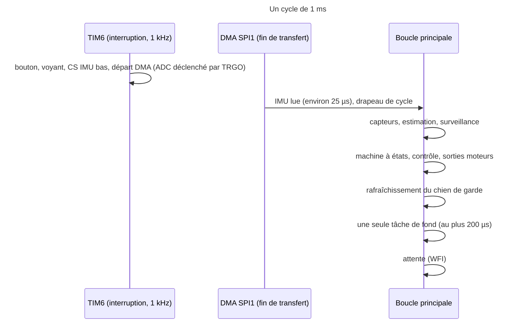

Interruptions (priorité NVIC, 0 la plus haute) : HardFault et NMI à priorité fixe, 0 réservée aux réglages futurs, 1 sur TIM6, 2 sur la fin du DMA SPI1, 3 sur la fin du DMA I2C1 (le SPI2 du flux est scruté), 4 sur l'interruption externe de PB6 (relève TIM2 et lève un drapeau, 1 µs), 5 sur l'USART2 (ligne au repos : drapeau « radio »). Durées en µs de TIM2 ; aucune attente active de plus de 100 µs hors initialisation (le pas B du flux scrute 72 µs).

Cycle sans dépendre du DMA : l'interruption TIM6 lève elle-même le drapeau de cycle si la lecture précédente n'est pas finie (le DMA est alors abandonné, une erreur de bus est comptée, trois erreurs de suite lèvent `imu_failed`), si bien que la surveillance et le chien de garde tournent même si la centrale ne répond plus (DEC-271 « Cycle indépendant du DMA de la centrale et lecture armée après l'initialisation »). La lecture automatique n'est armée (`imu_streaming`) qu'à la fin de l'initialisation de la centrale (DES-018 « Pilote de la centrale inertielle ») ; avant, l'interruption ne fait que le bouton et le voyant.

Boucle principale (pseudo-code) : attendre le drapeau de cycle ; si le drapeau précédent n'avait pas été consommé, incrémenter `missed_cycles` ; `t0` = TIM2 ; lire l'IMU et l'ADC (DES-018 « Pilote de la centrale inertielle », DES-022 « Pilote de la mesure de tension de la batterie ») ; estimation (DES-023 « Filtre d'attitude de Mahony » à DES-025 « Vitesse horizontale et critères d'immobilité, de platitude et de stationnaire ») ; surveillance (DES-029 « Surveillance et coupures automatiques ») ; machine à états (DES-027 « Machine à états : données, événements et table de transitions ») ; contrôle et sorties (DES-026 « Contrôle de l'attitude et de la hauteur, mixeur et conversion en rapport cyclique », DES-021 « Pilotes des moteurs, du voyant, du buzzer et de la liaison série ») ; marquer `cycle_ran` ; rafraîchissement du chien de garde (DES-030 « Chien de garde matériel et règle de rafraîchissement ») ; une tâche de fond ; durée = TIM2 - `t0` ; mise à jour du maximum, `overrun` si la durée dépasse 800 µs.

Tâches de fond, par priorité décroissante : 1 arrêt radio, 2 capteur de hauteur (drapeau levé par PB6, environ 30 Hz), 3 flux optique (drapeau levé tous les 10 cycles), 4 statut (toutes les 500 ms et à chaque changement d'état) et variables (toutes les 100 ms moteurs en marche), 5 effets (tous les 10 cycles). Chaque tâche est une petite machine à états dont un pas dure au plus 200 µs. Charge des pas par seconde : flux 100 x 2, hauteur 30 x 3, variables 10 x 2, statut 2 x 2, effets 100, soit environ 420 pas sur 1000 cycles : un pas de priorité inférieure attend au plus 20 cycles (critère de TU-016 « Ordonnanceur : choix de la tâche de fond, cycles manqués et durées »). Le voyant (modulation de luminosité) n'est pas une tâche : il tourne dans l'interruption TIM6 (moins de 1 µs). Budget du cycle repris de ARC-015 « Structure logicielle et ordonnancement » : contrôle environ 100 µs, plafond 300 µs, tâche de fond 200 µs, alarme à 800 µs.
**Réalisé par :** `projets/boomrone/firmware/src/main.c`, `projets/boomrone/firmware/src/app_sched.c`, `projets/boomrone/firmware/src/app_sched.h`
**Statut :** Validé

### DES-017 — Coupure des moteurs, démarrage unique et gestionnaires d'exception
**Réfs amont :** ARC-015 « Structure logicielle et ordonnancement » ; ARC-007 « Étage de puissance des moteurs coupés par défaut » ; ARC-019 « Machine à états du drone »
**Description :** `motors_cut()` exécute, dans cet ordre et sans attente : (1) effacer MOE de TIM1 (sorties libérées, les rappels de 100 kohms tiennent les grilles à l'état bas) ; (2) arrêter le compteur de TIM1 ; (3) reconfigurer PA8 à PA11 en sortie à l'état bas (écriture BSRR puis MODER) ; (4) enregistrer l'appel dans un compteur. Elle est idempotente, utilisable depuis une interruption, et dure environ 2 µs. `motors_start()` existe une seule fois, avec deux sites d'appel (ARC-019 « Machine à états du drone ») : le relâchement armé plus 200 ms, et la commande Décoller acceptée ; elle remet les broches en fonction alternative, charge les comparateurs à 0 et valide MOE et le compteur.

Gestionnaires : `HardFault_Handler`, `MemManage_Handler`, `BusFault_Handler`, `UsageFault_Handler` et `Default_Handler` appellent `motors_cut()`, inscrivent « défaut fatal » en `.noinit`, puis bouclent sans rafraîchir le chien de garde (reset environ 100 ms nominal, 112 ms au pire, DES-030 « Chien de garde matériel et règle de rafraîchissement »). `NMI_Handler` lit FLASH_ECCR : si le bit de double erreur ECCD est levé, il l'efface et lève le drapeau `flash_ecc_error` (non fatal, utile à la lecture des réglages, DES-035 « Paramètres de vol, section d'origine et pilote de flash ») ; sinon il traite l'exception comme fatale. Le contrôle des deux sites d'appel de `motors_start()` est fait par un script (DEC-270 « Vérifications par scripts : appels uniques, mémoire et jalons »).
**Réalisé par :** `projets/boomrone/firmware/src/drv_motor.c`, `projets/boomrone/firmware/src/fault.c`, `projets/boomrone/firmware/tools/check_calls.py`
**Statut :** Validé

### DES-018 — Pilote de la centrale inertielle
**Réfs amont :** ARC-016 « Pilotes des capteurs et des sorties » ; ARC-003 « Centrale inertielle » ; ARC-023 « Initialisation et échec d'initialisation »
**Description :** données : `imu_raw_t` (gyroscope x, y, z, accéléromètre x, y, z en `int16`, température, instant TIM2 de la fin de lecture) et `imu_sample_t` (vitesses angulaires en rad/s, accélérations en m/s², instant en µs, repère du drone). Lecture : à chaque tick, l'interruption TIM6 abaisse CS (PA4) et lance le DMA SPI1 de 15 octets (commande 0xA0 = 0x80 | 0x20, puis 14 octets de température, gyroscope et accéléromètre) ; la fin du DMA remonte CS, relève TIM2 et lève le drapeau de cycle ; durée 15 x 8 / 5,3125 MHz = 22,6 µs. Si le DMA n'est pas fini au tick suivant, l'interruption compte une erreur, abandonne la lecture et force le cycle (DES-016 « Tick de 1 kHz, cycle de contrôle et ordonnanceur de tâches de fond »). Une centrale figée est détectée par 10 lectures brutes identiques de suite, comptées comme une erreur par cycle suivant. La lecture n'est armée (`imu_streaming`) qu'après l'initialisation. Anti-repliement : DOU-179 « Anti-repliement de la centrale : sortie à 3,33 kHz lue à 1 kHz ». Conversion : vitesse angulaire = brut x 0,070 °/s x pi/180, moins le biais ; accélération = brut x 0,244 mg x 9,80665 ; matrice d'axes constante (DES-003 « Raccordement de la centrale inertielle LSM6DSO », DOU-167 « Orientation des axes de la centrale et sens de rotation des moteurs »). Échantillon répété : deux lectures identiques de suite incrémentent `repeat_count` (diagnostic, pas une erreur) ; trois erreurs consécutives lèvent `imu_failed` (consommé par DES-029 « Surveillance et coupures automatiques »), une lecture correcte (non figée) remet le compteur à zéro. Fonction `imu_calibrate_bias()` : moyenne de 1000 échantillons à l'initialisation (DES-031 « Séquence d'initialisation et échec d'initialisation »). Séquence d'initialisation : attente de `IMU_BOOT_WAIT_MS` (40 ms, au moins les 35 ms de mise en route de la fiche) après la fin du reset du microcontrôleur, aucun accès SPI avant ; reset logiciel, attente de la fin (au plus 20 ms, durée de la fiche non trouvée : DOU-196 « LSM6DSO : durée du reset logiciel et départ du temps de mise en route non trouvés »), contrôle de WHO_AM_I, écriture des registres de DES-003 « Raccordement de la centrale inertielle LSM6DSO ».
**Réalisé par :** `projets/boomrone/firmware/src/drv_imu.c`, `projets/boomrone/firmware/src/drv_imu.h`, `projets/boomrone/firmware/src/drv_imu_regs.h`
**Statut :** Validé

### DES-019 — Pilote du capteur de hauteur non bloquant
**Réfs amont :** ARC-004 « Capteur de hauteur à temps de vol » ; ARC-016 « Pilotes des capteurs et des sorties » ; ARC-023 « Initialisation et échec d'initialisation »
**Description :** machine à états du pilote, avec les niveaux de reprise de ARC-004 « Capteur de hauteur à temps de vol » :

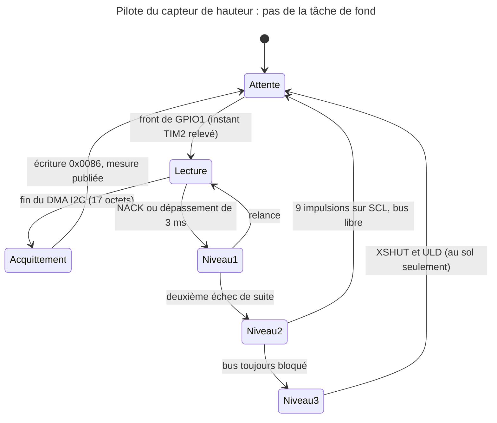

Données : `tof_meas_t` = distance brute en mm (`uint16`), code d'état de la mesure, taux de signal, instant TIM2 du front, drapeau `valid`. Pas 1 : la tâche voit le drapeau de PB6, lance en DMA l'écriture de l'index 0x0089 puis la lecture de 17 octets et rend la main (moins de 20 µs) ; pas 2 (fin du DMA) : décoder le bloc de résultat (état, distance, taux de signal, selon la structure de résultats de l'ULD, DOU-149 « Valeurs de registres du VL53L1X à vérifier dans la bibliothèque ST (ULD) »), puis lancer l'écriture de 1 dans 0x0086 (acquittement) en DMA ; pas 3 : publier. Mesure valide si le code d'état est « portée valide », le taux de signal au moins égal à `TOF_SIGNAL_MIN` (valeur de départ 0,5 Mcps, provisoire, DOU-160 « Mesure de hauteur valide et sols sombres ou brillants ») et la distance entre 40 et 3000 mm. Niveau 2 : 9 impulsions sur SCL, une par pas de tâche de fond (10 µs), puis réinitialisation du périphérique I2C. L'état Attente a un délai de garde de 100 ms : sans front de GPIO1 pendant ce temps, relecture du registre d'état puis niveau 1. Le niveau 3 (XSHUT et ULD, bloquant de 170 à 650 ms) n'est jamais lancé moteurs en marche ; il n'est lancé qu'à l'initialisation et au sol moteurs coupés, avec rafraîchissement du chien de garde entre les attentes (DOU-158 « Initialisation du capteur de hauteur plus longue que le chien de garde »). La bibliothèque ULD n'est appelée qu'à ces deux endroits (DOU-174 « Séquence d'initialisation du flux et bibliothèque ULD : taille, appels bloquants, licence »). À l'initialisation, les E/S du capteur sont réglées en mode 2V8 (niveaux de 2,6 à 3,5 V, fiche DS12385 tableau 13 p. 18) : le mode par défaut du pilote est 1V8, l'appel de l'ULD qui règle le mode 2V8 est à confirmer (DOU-149 « Valeurs de registres du VL53L1X à vérifier dans la bibliothèque ST (ULD) »). Pour la coupure d'atterrissage (DES-026 « Contrôle de l'attitude et de la hauteur, mixeur et conversion en rapport cyclique », état Atterrissage seulement), une lecture brute (valide ou non) d'au plus 45 mm, ou un état « hors portée » dont la dernière valeur valide était au plus 60 mm, vaut contact (la fenêtre de validité de 40 mm est étroite à 500 mm/s : DEC-272 « Coupure d'atterrissage tolérante à la fenêtre de validité du capteur de hauteur »). `tof_last_valid_us` alimente la coupure à 200 ms de DES-029 « Surveillance et coupures automatiques ».
**Réalisé par :** `projets/boomrone/firmware/src/drv_tof.c`, `projets/boomrone/firmware/src/drv_tof.h`, `projets/boomrone/firmware/lib/uld/`
**Statut :** Validé

### DES-020 — Pilote du flux optique
**Réfs amont :** ARC-005 « Capteur de flux optique » ; ARC-016 « Pilotes des capteurs et des sorties » ; ARC-023 « Initialisation et échec d'initialisation »
**Description :** initialisation (au sol, bloquante, avec rafraîchissement du chien de garde entre les écritures) : remise à zéro par écriture de 0x5A dans 0x3A, attente de 5 ms, lecture des registres 0x02 à 0x06 pour les vider, contrôle de l'identité (registre 0x00 égal à 0x49 et registre 0x5F égal à 0xB6, valeurs de mémoire à confirmer dans la fiche), suite d'écritures de réglage d'une cinquantaine de registres (provenance et licence à établir : DOU-174 « Séquence d'initialisation du flux et bibliothèque ULD : taille, appels bloquants, licence »), puis attente de 50 ms avant la première mesure valide ; entre deux écritures, 45 µs au moins (temporisation de la fiche). Échec d'identité : échec d'initialisation (DEC-264 « Initialisation : centrale inertielle ou flux optique absent vaut échec d'initialisation »).

Lecture en vol à 100 Hz en deux pas de tâche de fond : pas A : CS bas, envoi de l'adresse du registre de rafale (0x16), attente de 40 µs bornée par TIM2 (en tout moins de 60 µs) ; pas B : lecture de 12 octets (96 bits à 1,328 MHz, 72 µs), CS haut (au repos au moins 500 ns avant la lecture suivante). Les 12 octets (mouvement, observation, delta x et delta y sur 16 bits, qualité de surface SQUAL, somme des pixels, maximum, minimum, obturateur sur 2 octets) donnent `flow_meas_t` = delta x, delta y (`int16`), SQUAL, instant TIM2, drapeau `valid` (SQUAL au moins `FLOW_SQUAL_MIN`, 30 au départ ; l'absence de mouvement donne des deltas nuls, donc une vitesse nulle valide : un drone immobile ne rend pas le flux invalide, DEC-273 « Flux optique : l'absence de mouvement est une vitesse nulle valide »). Les deltas s'accumulent dans la puce entre deux lectures : aucune perte si une lecture est retardée ; le pas de temps est la différence des instants de deux lectures, et l'âge d'un échantillon se compte depuis la dernière lecture réussie, mouvement ou non. Un pas qui dépasse 200 µs est abandonné et compté en erreur.
**Réalisé par :** `projets/boomrone/firmware/src/drv_flow.c`, `projets/boomrone/firmware/src/drv_flow.h`, `projets/boomrone/firmware/src/drv_flow_init.h`
**Statut :** Validé

### DES-021 — Pilotes des moteurs, du voyant, du buzzer et de la liaison série
**Réfs amont :** ARC-016 « Pilotes des capteurs et des sorties »
**Description :** moteurs : `motor_set(const float duty[4])` limite chaque rapport cyclique à [0 ; 1] et charge TIM1->CCRx = rapport x 7083 (arrondi vers le bas) ; `motor_cmd8()` rend la commande sur 0 à 255 pour la télémétrie ; rapport 0 donne un comparateur à 0 (sortie à l'état bas). Voyant : `led_set(r, v, b)` avec des niveaux de 0 à 10 ; `led_tick()` (appelée par l'interruption TIM6, phase de 0 à 9) met chaque sortie à 1 quand son niveau est supérieur à la phase (écritures BSRR), soit une période de 10 ms et 100 Hz ; niveau 0 éteint, niveau 10 allumé en permanence. Buzzer : `buzzer_set(bool)` sur PB11. Liaison série : USART2 8N1 à 19200 bauds (BRR = 8854, DES-002 « Microcontrôleur : brochage, horloges, découplage et octets d'option »), réception en DMA circulaire de 128 octets avec interruption de ligne au repos, `uart_rx_pop()` qui rend l'octet suivant à partir de l'index de queue en lisant l'index de tête du DMA (128 - compteur), détection de dépassement (drapeau ORE effacé et compteur) et de rattrapage de la queue par la tête ; émission en DMA normal, `uart_tx_start(buf, n)` refusé si une émission est en cours (`uart_tx_busy()`).
**Réalisé par :** `projets/boomrone/firmware/src/drv_motor.c`, `projets/boomrone/firmware/src/drv_led.c`, `projets/boomrone/firmware/src/drv_buzzer.c`, `projets/boomrone/firmware/src/drv_uart.c`
**Statut :** Validé

### DES-022 — Pilote de la mesure de tension de la batterie
**Réfs amont :** ARC-009 « Alimentation de la logique et mesure de la tension » ; ARC-016 « Pilotes des capteurs et des sorties »
**Description :** ADC1 en 12 bits, horloge synchrone HCLK/4 (42,5 MHz), temps d'échantillonnage 640,5 cycles (15,1 µs, supérieur aux 6 µs exigés par l'impédance de source de 60 kohms ; la fiche limite RAIN à 50 kohms et à 39 kohms à 640,5 cycles à 60 MHz : le condensateur de 100 nF de PA0 de DES-009 « Régulateur de 3,0 V et pont de mesure de la tension » est donc obligatoire) ; séquence de 14 rangs déclenchée par le tick (TRGO de TIM6) : 10 conversions de PA0 (canal 1) puis 4 conversions de la référence interne VREFINT (canal 18), DMA vers un tampon de 14 mots ; durée 14 x 15,4 µs = 216 µs, résultats lus au tick suivant. Initialisation (étape 2 de DES-031 « Séquence d'initialisation et échec d'initialisation ») : DEEPPWD = 0, ADVREGEN = 1, attente de 100 µs bornée par TIM2 pour le démarrage du régulateur de l'ADC (tADCVREG_STUP, DS12589 p. 119 ; la valeur de l'extraction est ambiguë, DOU-197 « ADC : attente du régulateur à confirmer et comportement si l'étalonnage échoue »), étalonnage ADCAL = 1 en entrée simple (la fiche demande de calibrer après chaque mise sous tension, p. 118 ; durée de 116 cycles de l'horloge de l'ADC, soit 2,7 µs à 42,5 MHz), attente de ADCAL = 0 bornée à 1 ms par TIM2, puis VREFEN dans ADC12_CCR, ADEN et attente de ADRDY. Un étalonnage qui ne se termine pas laisse `vbat_valid` faux et incrémente `adc_cal_failed` (suite : DOU-197 « ADC : attente du régulateur à confirmer et comportement si l'étalonnage échoue »). Calcul : `vdda` = 3,0 V x VREFINT_CAL / moyenne des 4 mesures de VREFINT (VREFINT_CAL est la valeur d'usine à l'adresse 0x1FFF75AA, mesurée à 3,0 V) ; `vpin` = moyenne des 10 mesures x `vdda` / 4095 ; `vbat_V` = `vpin` x 250 / 150 x `VBAT_GAIN_TRIM` (rapport du pont de DES-009 « Régulateur de 3,0 V et pont de mesure de la tension »). Garde-fous : la tension utilisée pour normaliser les moteurs est limitée à [3,0 V ; 4,3 V] ; une moyenne de VREFINT nulle ou une tension brute hors [2,0 V ; 5,0 V] rend `vbat_valid` faux (pas de division par zéro) ; budget d'erreur estimé ±15 mV à 3,7 V, ondulation des moteurs non comprise, à confirmer à TI-008 « Batterie, connecteur, chute de tension et mesure de tension » (DOU-181 « Bilan d'erreur de la mesure de tension et niveau du BOR »). Sorties : `vbat_cycle` (par tick) et `vbat_100ms` (moyenne glissante de 100 valeurs). Drapeau `vbat_valid` faux jusqu'à la première séquence complète (environ 2 ms après le démarrage) ; si une séquence n'est pas terminée au tick suivant, la valeur précédente est conservée et `adc_stale` s'incrémente. Valeurs d'exemple : 4,2 V donne 2,52 V sur la broche, soit 3440 pas environ avec `vdda` = 3,0 V ; VREFINT nominale 1,212 V, soit environ 1654 pas à 3,0 V (VREFINT : 1,182 / 1,212 / 1,232 V, DS12589 tableau 20 p. 74 ; VREFINT_CAL mesurée à 30 °C et à VDDA = 3,0 V ±10 mV, tableau 6 p. 30, dont la tolérance compte dans DOU-181 « Bilan d'erreur de la mesure de tension et niveau du BOR »).
**Réalisé par :** `projets/boomrone/firmware/src/drv_adc.c`, `projets/boomrone/firmware/src/drv_adc.h`
**Statut :** Validé

### DES-023 — Filtre d'attitude de Mahony
**Réfs amont :** ARC-017 « Estimation de l'attitude, de la hauteur et de la vitesse »
**Description :** état : quaternion unitaire q = (w, x, y, z), vitesse angulaire filtrée. À chaque cycle, avec dt = écart des instants TIM2 de deux échantillons, borné à [0,5 ms ; 5 ms] : (1) poids de l'accéléromètre `wa` = max(0, 1 - |norme / g - 1| / 0,5), donc 1 à 1 g et 0 sous 0,5 g ou au-delà de 1,5 g ; (2) direction de la gravité estimée v = (2(x z - w y), 2(w x + y z), w² - x² - y² + z²) ; (3) erreur e = a_unitaire x v (produit vectoriel), nulle si la norme de a est nulle ; (4) vitesse corrigée = gyroscope + Kp x `wa` x e, avec Kp = 2,0 s⁻¹ au sol et 0,3 s⁻¹ moteurs en marche (en vol l'accéléromètre mesure la poussée, pas la gravité : DOU-177 « Filtre d'attitude : l'accéléromètre en vol mesure la poussée, pas la gravité »), sans terme intégral (le biais est mesuré à l'initialisation, DES-031 « Séquence d'initialisation et échec d'initialisation ») ; (5) q <- q + 0,5 q (0, vitesse corrigée) dt, puis normalisation par 1/racine (FPU). Initialisation : q déduit de l'accélération moyenne mesurée à l'initialisation (lacet nul). Sorties : cosinus d'inclinaison `tilt_cos` = w² - x² - y² + z² (inclinaison = arccos), vecteur de gravité dans le repère du drone v, vitesse angulaire filtrée par un filtre du premier ordre à 0,3 (environ 57 Hz à 1 kHz). Coût estimé 25 µs (budget de ARC-015 « Structure logicielle et ordonnancement »). Constantes de départ marquées provisoires (DEC-261 « Estimation : filtre de Mahony, observateur de hauteur et compensation du retard », DEC-260 « Gains de référence et constantes de départ provisoires »).
**Réalisé par :** `projets/boomrone/firmware/src/est_attitude.c`, `projets/boomrone/firmware/src/est_attitude.h`
**Statut :** Validé

### DES-024 — Observateur de hauteur et de vitesse verticale
**Réfs amont :** ARC-017 « Estimation de l'attitude, de la hauteur et de la vitesse »
**Description :** état (h, v) en m et m/s. Prédiction à chaque cycle : a_z = troisième ligne de la matrice de rotation du repère du drone vers le monde appliquée à l'accélération mesurée, moins g ; h <- h + v dt + 0,5 a_z dt² ; v <- v + a_z dt. À la fin de chaque cycle, après la correction éventuelle, l'état estimé est recopié dans un historique circulaire de 64 cycles. Mise à jour à chaque mesure valide du capteur de hauteur (30 Hz) : hauteur mesurée h_m = (distance brute - 20 mm) x `tilt_cos` (rejetée si `tilt_cos` < 0,5) ; retard k = (instant courant - instant du front) arrondi au ms, plus `TOF_DELAY_MS` (33 ms au départ, DOU-170 « Constantes de capteurs de départ : échelle du flux, retard du capteur de hauteur, filtres »), rejetée si k > 63 ; innovation e = h_m - h_historique(k) ; correction de l'état courant h <- h + 0,396 e et v <- v + 1,188 e (gains L1 = 12 s⁻¹ et L2 = 36 s⁻² multipliés par la période de 33 ms). Anomalies : si |e| > 0,5 m, la mesure est ignorée, sauf à la troisième de suite où l'état est recalé (h = h_m, v = 0 ; limite connue juste après un lancer rapide : DOU-170 « Constantes de capteurs de départ : échelle du flux, retard du capteur de hauteur, filtres »). État initial : première mesure valide, sinon 0. Résultat de simulation de contrôle (rampe de 1 m/s, bruit de 10 mm sur la hauteur et de 0,2 m/s² sur l'accélération, retard de 33 ms) : erreur maximale d'environ 9 cm pendant la rampe, 3 cm en régime (DEC-261 « Estimation : filtre de Mahony, observateur de hauteur et compensation du retard »).
**Réalisé par :** `projets/boomrone/firmware/src/est_hauteur.c`, `projets/boomrone/firmware/src/est_hauteur.h`
**Statut :** Validé

### DES-025 — Vitesse horizontale et critères d'immobilité, de platitude et de stationnaire
**Réfs amont :** ARC-017 « Estimation de l'attitude, de la hauteur et de la vitesse »
**Description :** vitesse horizontale : à chaque mesure valide du flux, vitesse angulaire apparente = delta x ou delta y x `K_FLOW` / pas de temps ; moins la vitesse angulaire du gyroscope sur l'axe correspondant (signes à vérifier à TI-004 « Flux optique et vitesse horizontale ») ; fois la distance le long de l'axe optique = h / `tilt_cos` ; filtre du premier ordre à 0,3 à 100 Hz. `K_FLOW` = 0,0021 rad par pas (valeur de départ de mémoire, à étalonner : DOU-170 « Constantes de capteurs de départ : échelle du flux, retard du capteur de hauteur, filtres »). La résolution d'un pas est d'environ 0,21 m/s à 1 m de hauteur et 100 Hz (DOU-175 « Résolution de la vitesse horizontale du flux face au seuil de 0,3 m/s »). La vitesse est invalide si h < 0,08 m, si la qualité du flux est faible, si l'inclinaison dépasse 30° ou si le dernier échantillon date de plus de 50 ms (DEC-262 « Vitesse horizontale invalide : stationnaire non déclaré »).

Critères (calculés à chaque cycle) : à plat si `tilt_cos` >= cos 15° = 0,9659 ; immobile si la norme de la vitesse angulaire filtrée est au plus 30 °/s (0,5236 rad/s) et si, dans une fenêtre de 50 échantillons de la norme de l'accélération pris à 100 Hz (0,5 s), le maximum et le minimum sont à moins de 0,5 m/s² de la moyenne (DEC-263 « Critère d'immobilité : fenêtre de 50 échantillons à 100 Hz ») ; stationnaire si à plat, hauteur h >= 0,3 m, vitesse horizontale valide d'au plus 0,3 m/s avec une vitesse verticale d'au plus 0,3 m/s (norme combinée : lecture de REQ-007 « Critère de vol stationnaire » à valider à la porte, DOU-175 « Résolution de la vitesse horizontale du flux face au seuil de 0,3 m/s »), et ceci pendant 10 cycles consécutifs. Vitesse horizontale invalide : le critère de stationnaire est faux.
**Réalisé par :** `projets/boomrone/firmware/src/est_vitesse.c`, `projets/boomrone/firmware/src/est_criteres.c`, `projets/boomrone/firmware/src/est_criteres.h`
**Statut :** Validé

### DES-026 — Contrôle de l'attitude et de la hauteur, mixeur et conversion en rapport cyclique
**Réfs amont :** ARC-018 « Boucle de contrôle du vol »
**Description :** commandes exprimées en fraction de poussée (1,0 = poussée maximale d'un moteur à 3,7 V). Valeurs de départ provisoires, non issues de mesures (DEC-260 « Gains de référence et constantes de départ provisoires », DOU-171 « Gains de référence, poussée de sustentation et linéarisation de la poussée ») :

| Constante | Valeur de départ | Rôle |
|---|---|---|
| `K_ANG` | 6 s⁻¹ (consigne de vitesse limitée à 12 rad/s) | erreur d'angle vers vitesse angulaire demandée |
| `KP_RATE`, `KI_RATE`, `KD_RATE` (roulis, tangage) | 0,04 ; 0,02 ; 0,0006 | PID de vitesse angulaire (intégrale limitée à 0,1) |
| `KP_YAW`, `KI_YAW` | 0,02 ; 0,01 | vitesse de lacet visée nulle |
| `T_HOVER` | 0,69 | poussée de sustentation (1 / 1,44 du bilan) |
| `KP_H`, `KD_H`, `KI_H` | 0,5 par m ; 0,3 par m/s ; 0,1 par (m·s) (intégrale limitée à 0,15) | hauteur |
| `K_V` | 0,2 rad par m/s (inclinaison limitée à 10°) | amortissement de la vitesse horizontale |
| `V_REF` | 3,7 V | normalisation par la tension |

Le gain d'inclinaison (paramètre réglable) multiplie `K_ANG` seul (borne haute 2,0 : la boucle d'angle double sans que la boucle de vitesse angulaire bouge) ; le gain de hauteur multiplie `KP_H`, `KD_H` et `KI_H`. Erreurs d'angle de roulis et de tangage tirées du vecteur de gravité dans le repère du drone (atan2 sur les composantes y, z et x, z, valable dans toute orientation, signes à vérifier sur la potence : TI-013 « Boucle de contrôle sur potence »). Hauteur : poussée collective = `T_HOVER` + `KP_H` (h_cible - h) - `KD_H` v + intégrale, divisée par max(`tilt_cos`, 0,5) ; cibles : hauteur visée en Stabilisation et Stationnaire, rampe descendante à la vitesse de descente en Atterrissage (départ à la hauteur estimée), coupure quand la lecture brute est au plus 45 mm ou selon la règle de contact de DES-019 « Pilote du capteur de hauteur non bloquant » (ARC-018 « Boucle de contrôle du vol »). Vitesse horizontale valide : consigne d'inclinaison = -`K_V` x vitesse sur chaque axe (repère du drone).

Mixeur en X (numérotation de DES-006 « Cadre, anneaux, moteurs et hélices ») : poussée du moteur i = collectif + a_i roulis + b_i tangage + c_i lacet, avec (a, b, c) = moteur 1 (-1, -1, +1), moteur 2 (-1, +1, -1), moteur 3 (+1, +1, +1), moteur 4 (+1, -1, -1). Si un moteur dépasse 1 ou passe sous 0, le collectif est décalé pour garder l'écart entre moteurs (priorité à l'attitude) ; si l'écart seul ne tient pas, il est réduit proportionnellement. Conversion : rapport cyclique = racine(poussée limitée à [0 ; 1]) x `V_REF` / `vbat_cycle`, limité à [0 ; 1] (DEC-259 « Contrôle : poussée linéarisée, mixeur en X et priorité à l'attitude »). Démarrage : rampe linéaire de 20 ms sur le rapport cyclique après `motors_start()`.
**Réalisé par :** `projets/boomrone/firmware/src/ctl_attitude.c`, `projets/boomrone/firmware/src/ctl_hauteur.c`, `projets/boomrone/firmware/src/ctl_mixer.c`, `projets/boomrone/firmware/src/ctl_phases.c`, `projets/boomrone/firmware/src/config_ctl.h`
**Statut :** Validé

### DES-027 — Machine à états : données, événements et table de transitions
**Réfs amont :** ARC-019 « Machine à états du drone » ; ARC-024 « Effets locaux (logiciel) » ; ARC-025 « Protocole et service du statut sans fil »
**Description :** `app_fsm.c`, fonction `fsm_step(const fsm_in_t*)` appelée une fois par cycle. États : énumération dont les valeurs sont les numéros de REQ-020 « Statut sans fil » (1 Allumé à 17 Délai de descente dépassé) plus `S_INIT` = 0. Données : `fsm_t` = état, instant d'entrée, instant de départ des moteurs, drapeau « vol de réglage », cause de refus, cause de coupure, instant du relâchement armé. Entrées `fsm_in_t` : événement du bouton (DES-028 « Gestion logicielle du bouton »), niveau filtré du bouton, événements de surveillance (DES-029 « Surveillance et coupures automatiques »), commande radio acceptée (DES-034 « Mode réglage, filtrage des commandes et vol de réglage »), critères (DES-025 « Vitesse horizontale et critères d'immobilité, de platitude et de stationnaire »), état de la batterie, instant courant. Ordre de traitement par cycle : sous-tension, bouton, commande Arrêt, le reste (ARC-019 « Machine à états du drone »). Les transitions sont exactement celles du tableau de « Architecture » — `projets/boomrone/03-architecture.md` (section « Machine à états : transitions »), codées en `switch` par état avec des gardes ; à chaque changement d'état, `btn_set_ignore_if_pressed()` pose le drapeau d'appui en cours. États événements (5, 7, 12, 13 à 17) : le code est publié à l'entrée (DES-033 « Trames du statut sans fil, automate de réception et file d'émission »), l'état suivant est pris au cycle d'après. Effets : états 1 vers effet 1, 3 vers 2, 6 vers 3, 8 à 11 vers 4, 2 vers 9, 4 vers 10 en effet de base ; événements 5 vers 6, 7 vers 7, 12 vers 5, 13 à 17 vers 8, superposés (DES-032 « Effets locaux : table, séquenceur de lumière et de son »). Actions : `motors_start()` aux deux sites d'appel, `motors_cut()` pour toute coupure (en premier), écriture de la cause en `.noinit`. Un Lancé de plus de 500 ms sans moteurs ne rafraîchit plus le chien de garde (DES-030 « Chien de garde matériel et règle de rafraîchissement »).
**Réalisé par :** `projets/boomrone/firmware/src/app_fsm.c`, `projets/boomrone/firmware/src/app_fsm.h`
**Statut :** Validé

### DES-028 — Gestion logicielle du bouton
**Réfs amont :** ARC-020 « Gestion logicielle du bouton »
**Description :** `btn_isr_sample(level)` appelée par l'interruption TIM6 : compteur d'échantillons identiques, niveau filtré modifié quand le compteur atteint 10 (10 ms). Événements dérivés du niveau filtré dans la boucle principale : appui, relâchement, passages à 1,0 s, 2,0 s et 10,0 s depuis l'appui initial (instants TIM2, constantes de `config_fixed.h`). Drapeau `ignore_until_release` : posé par `btn_set_ignore_if_pressed()` à chaque changement d'état, il supprime tous les événements jusqu'au premier relâchement filtré. Garde de 500 ms à partir du relâchement armé : les fronts sont supprimés, l'antirebond continue, et si le niveau filtré est bas à la fin de la garde l'événement `BTN_LOW_AFTER_GUARD` est émis (coupure au cycle suivant) ; pas de garde en vol de réglage. À l'initialisation : `btn_held_since_poweron()` est vrai si le niveau filtré est bas dès la première valeur filtrée (10 ms après le départ) et n'est jamais remonté pendant l'initialisation. Délai de l'arrêt d'urgence : antirebond de 10 ms plus un cycle, environ 12 ms.
**Réalisé par :** `projets/boomrone/firmware/src/app_button.c`, `projets/boomrone/firmware/src/app_button.h`
**Statut :** Validé

### DES-029 — Surveillance et coupures automatiques
**Réfs amont :** ARC-021 « Surveillance et coupures automatiques » ; ARC-015 « Structure logicielle et ordonnancement » ; ARC-016 « Pilotes des capteurs et des sorties »
**Description :** `safety_step()` à chaque cycle avant le contrôle, produit au plus un événement par cycle selon la priorité : sous-tension, coupure demandée par le bouton (via la machine à états), arrêt radio, puis les autres. Sous-tension : compteur de cycles ; sous 3,30 V le compteur augmente, entre 3,30 V et 3,35 V il est conservé, à 3,35 V et plus il est remis à zéro ; à 100 le compteur déclenche l'événement (coupure environ 105 ms après le début du creux) ; actif dans tous les états dès que `vbat_valid` est vrai (DEC-258 « Mesure de la tension : séquence de conversion et zone de maintien de la sous-tension »). Armement : `safety_ready()` évalue au moment des 2,0 s d'appui, par ordre de priorité des causes de refus : batterie (`vbat_100ms` < 3,70 V), mouvement (non immobile), pas à plat (inclinaison supérieure à 15°). Coupures en vol : « stationnaire non atteint » à 2,0 s du démarrage des moteurs sans critère de stationnaire vrai ; « basculement » si `tilt_cos` < 0,5 (60°) pendant 100 cycles, seulement après le stationnaire (états 10 et 11) ; « délai de descente » à 15,0 s après le début de l'atterrissage (en vol de réglage, après le décollage) ; « échec de stabilisation » si `imu_failed` ou si aucune mesure de hauteur valide depuis 200 ms moteurs en marche (DOU-140 « Défaut de capteur en vol : cause et effet rattachés à l'échec de stabilisation ») ; arrêt sans fil traité au cycle suivant la trame. Rattachement aux 17 états : « stationnaire non atteint », `imu_failed` et l'absence de mesure de hauteur donnent tous l'état 13 et le code de coupure 1 « échec de stabilisation ». Le délai de 2,0 s est le même en vol de réglage (seul le maintien du stationnaire passe de 10 s à 3 s). Chaque coupure appelle `motors_cut()`, écrit la cause en `.noinit` (avec contrôle de validité, DES-033 « Trames du statut sans fil, automate de réception et file d'émission ») puis signale l'événement à la machine à états.
**Réalisé par :** `projets/boomrone/firmware/src/app_safety.c`, `projets/boomrone/firmware/src/app_safety.h`
**Statut :** Validé

### DES-030 — Chien de garde matériel et règle de rafraîchissement
**Réfs amont :** ARC-022 « Chien de garde »
**Description :** IWDG avec prédiviseur 8 sur l'oscillateur LSI de 32 kHz (4 kHz) et rechargement 399, soit 100 ms nominal (±10 % de dispersion supposée) ; gelé quand le débogueur arrête le cœur (DBGMCU). Au reset, l'IWDG matériel démarre avec un prédiviseur 4 et un rechargement de 0xFFF, soit environ 512 ms (RM0440 p. 1559 à 1562) : `board_early_init()` écrit le prédiviseur (code 001, division par 8) et le rechargement 399 avant toute autre initialisation (DEC-279 « Microcontrôleur : découplage, BOR et chien de garde d'après les fiches ») en suivant la séquence de l'IWDG (clé 0x5555, attente de PVU et RVU, écritures, clé 0xAAAA). Le LSI va de 29,5 à 34 kHz (DS12589 p. 105), soit 94 à 108,5 ms : le pire cas de 112 ms est prudent. Une seule fonction écrit la clé de rafraîchissement : `wdg_refresh(reason)`. En fin de cycle, elle n'écrit que si (1) `cycle_ran` est vrai (puis il est remis à zéro) et (2) l'état Lancé dure moins de 500 ms (TIM2). Elle est aussi appelée avant et après une écriture de flash, et à chaque étape de l'initialisation (DES-031 « Séquence d'initialisation et échec d'initialisation ») et de l'initialisation du capteur de hauteur (DES-019 « Pilote du capteur de hauteur non bloquant »). Pire cas de détection : cycle manquant environ 112 ms après le dernier rafraîchissement ; phase Lancé coupée environ 612 ms après le relâchement. Cause du reset : lue dans RCC_CSR au démarrage (drapeaux IWDGRSTF bit 29, BORRSTF bit 27 et PINRSTF bit 26 ; il n'existe pas de drapeau de coupure d'alimentation distinct : la mise sous tension lève BORRSTF, valeur de reset 0x0C000000), mémorisée puis effacée ; elle sert à DES-031 « Séquence d'initialisation et échec d'initialisation ». Les HardFault ne rafraîchissent pas (DES-017 « Coupure des moteurs, démarrage unique et gestionnaires d'exception »).
**Réalisé par :** `projets/boomrone/firmware/src/drv_wdg.c`, `projets/boomrone/firmware/src/app_wdg.c`
**Statut :** Validé

### DES-031 — Séquence d'initialisation et échec d'initialisation
**Réfs amont :** ARC-023 « Initialisation et échec d'initialisation »
**Description :** `app_init()` exécute les étapes suivantes, chacune appelant `wdg_refresh(INIT)` ; durées estimées (somme 1,8 s typique et environ 2,3 s au pire avec 650 ms pour le capteur de hauteur, pour 3,0 s exigées par REQ-017 « Initialisation en 3 secondes ») :

```mermaid
---
title: "Séquence d'initialisation : durées estimées"
---
gantt
    dateFormat  X
    axisFormat %s
    section Étapes
    Horloges, moteurs coupés, cause de reset, ADC (1 ms) :a, 0, 1
    Centrale inertielle (45 ms dont 40 ms d'attente)     :b, 1, 46
    Capteur de hauteur ULD (170 ms, au plus 650 ms)      :c, 46, 216
    Flux optique (60 ms)                                 :d, 216, 276
    Attente (500 ms)                                     :e, 276, 776
    Biais du gyroscope et tests (1000 ms)                :f, 776, 1776
    Réglages et décision (5 ms)                          :g, 1776, 1781
```

*Légende : abscisse en millisecondes (axe gradué en secondes par le moteur de rendu).* Étapes : (1) lire la cause de reset et valider le marqueur `.noinit` (mise sous tension reconnue si le marqueur est absent ou invalide, ou si le drapeau BORRSTF de RCC_CSR est levé, la mise sous tension comme un brown-out le levant : mise sous tension, causes remises à zéro, marqueur posé) ; (2) chien de garde réglé en premier acte de `board_early_init()` (DES-030 « Chien de garde matériel et règle de rafraîchissement »), horloges (séquence de DES-002 « Microcontrôleur : brochage, horloges, découplage et octets d'option »), PA1 de réveil du module radio au niveau éveillé, broches moteurs à l'état bas, initialisation et étalonnage de l'ADC (DES-022 « Pilote de la mesure de tension de la batterie ») ; (3) pilote de la centrale, avec l'attente de 40 ms depuis la fin du reset avant le premier accès SPI (DES-018 « Pilote de la centrale inertielle ») ; (4) bouton lu ; (5) capteur de hauteur : au plus 2 tentatives de 300 ms avec remise à zéro par XSHUT, échec déclaré avant 1 s ; (6) flux optique ; (7) attente de 0,5 s (la première séquence de l'ADC se termine, `vbat_valid` devient vrai) ; (8) 1000 échantillons (biais accepté seulement s'il est au plus 3 °/s par axe, sinon échec « mouvement ») : biais du gyroscope, moyenne de l'accélération (attitude initiale), tests d'immobilité (norme angulaire sous 30 °/s et fenêtre d'accélération, DES-025 « Vitesse horizontale et critères d'immobilité, de platitude et de stationnaire ») et d'inclinaison (15°), norme de l'accélération entre 0,8 g et 1,2 g ; (9) charge des réglages (DES-035 « Paramètres de vol, section d'origine et pilote de flash ») ; (10) décision par priorité : échec (REQ-037 « Comportement en échec d'initialisation ») si absence de la centrale, du flux ou du capteur de hauteur (DEC-264 « Initialisation : centrale inertielle ou flux optique absent vaut échec d'initialisation »), mouvement, pas à plat, chute libre ou sous-tension (moins de 3,3 V pendant 100 cycles, DES-029 « Surveillance et coupures automatiques ») ; sinon mode réglage si `btn_held_since_poweron()` et mise sous tension reconnue (marqueur absent) ; sinon Allumé ; drapeau d'appui en cours posé si le bouton est enfoncé. En échec : moteurs jamais armés, bouton et commandes ignorés ; pour l'échec par sous-tension, capteurs en veille et voyant au niveau 1 sur 10, horloge inchangée à 170 MHz (DEC-274 « Échec par sous-tension : horloge conservée à 170 MHz », DOU-178 « Horloge à 16 MHz de l'échec par sous-tension abandonnée », DOU-118 « Seuil de protection et consommation résiduelle du drone laissé allumé »). Aucun statut radio avant la fin de l'étape 10.
Absence de la centrale ou du flux : DEC-264 « Initialisation : centrale inertielle ou flux optique absent vaut échec d'initialisation », DOU-168 « Centrale inertielle ou flux optique absent à l'initialisation ».
**Réalisé par :** `projets/boomrone/firmware/src/app_init.c`, `projets/boomrone/firmware/src/app_init.h`
**Statut :** Validé

### DES-032 — Effets locaux : table, séquenceur de lumière et de son
**Réfs amont :** ARC-024 « Effets locaux (logiciel) »
**Description :** table de 10 lignes en constantes (`effect_t` : niveaux R, V, B de 0 à 10, période de clignotement en ms (0 = fixe), rapport 50 %, motif sonore = nombre de bips, durée d'un bip, pause de 100 ms) : 1 Allumé (0, 10, 0 fixe, aucun son) ; 2 Appui validé (0, 10, 10 fixe, 1 bip de 100 ms) ; 3 Prêt (0, 10, 0 période 250 ms, 2 bips de 100 ms) ; 4 Lancé et vol (10, 10, 10 fixe, aucun son) ; 5 Posé (0, 0, 10 fixe, 1 bip de 250 ms) ; 6 Refus (10, 10, 0 période 250 ms, 3 bips de 100 ms) ; 7 Désarmement (10, 0, 10 fixe, 2 bips de 250 ms) ; 8 Coupure en vol (10, 0, 0 fixe, 1 bip de 500 ms) ; 9 Échec d'initialisation (1, 0, 0 période 1000 ms, 1 bip de 500 ms) ; 10 Mode réglage (0, 0, 10 période 1000 ms, 1 bip de 200 ms). Moteur : `effects_set_base(n)` fixe l'effet de base ; `effects_event(n)` superpose l'effet pendant 1,0 s (les événements 5, 6, 7, 8) puis revient à la base, un nouvel événement remplaçant l'ancien ; la tâche `effects_task()` tourne tous les 10 ms (ordonnanceur, DES-016 « Tick de 1 kHz, cycle de contrôle et ordonnanceur de tâches de fond ») et calcule les niveaux (clignotement, séquence de bips). Son : jamais moteurs en marche ; le son d'un événement est repoussé jusqu'à 300 ms après la coupure ; le son est joué une seule fois à l'entrée de l'effet. La teinte du blanc et du cyan varie avec la décharge (anode sur la batterie) : essai à 3,4 V (DOU-133 « Forme des dix effets locaux : lumière, son, distinction mesurable »).
**Réalisé par :** `projets/boomrone/firmware/src/app_effects.c`, `projets/boomrone/firmware/src/app_effects.h`
**Statut :** Validé

### DES-033 — Trames du statut sans fil, automate de réception et file d'émission
**Réfs amont :** ARC-025 « Protocole et service du statut sans fil »
**Description :** format commun : `0xA5`, type, charge (longueur fixe par type), CRC8 (polynôme 0x07, valeur initiale 0, sans inversion) calculé sur le type et la charge ; entiers de plus d'un octet en petit-boutiquier (poids faible d'abord). Types et charges : 0x01 statut = état (1 octet, 1 à 17), dernière cause de refus (1), dernière cause de coupure (1), 4 paramètres en `uint16` (gain d'inclinaison x 1000, gain de hauteur x 1000, hauteur visée en mm, vitesse de descente en mm/s) soit 14 octets de trame ; 0x02 variables = hauteur en mm (`int16`), inclinaison en 0,1° (`int16`), 4 commandes moteur (`uint8`, 0 à 255) soit 11 octets ; 0x10 Décoller, 0x11 Arrêt, 0x13 Sauvegarder = charge vide (3 octets) ; 0x12 Modifier = identifiant (0 à 3 : gain d'inclinaison, gain de hauteur, hauteur visée, vitesse de descente) et valeur `uint16` (6 octets). Causes de refus : 0 aucune, 1 batterie faible, 2 drone en mouvement, 3 drone pas à plat, 4 bouton enfoncé. Causes de coupure : 0 aucune, 1 échec de stabilisation, 2 arrêt par le bouton, 3 arrêt sans fil, 4 basculement, 5 délai de descente dépassé, 6 sous-tension. Vecteurs de référence (trames complètes en hexadécimal) : Arrêt `A5 11 77` ; Décoller `A5 10 70` ; Sauvegarder `A5 13 79` ; Modifier identifiant 0 valeur 1000 `A5 12 00 E8 03 A9` ; statut en état 1, sans cause, paramètres d'origine `A5 01 01 00 00 E8 03 E8 03 E8 03 C8 00 D5` ; variables hauteur 1000 mm, inclinaison 3,5°, moteurs à 179 `A5 02 E8 03 23 00 B3 B3 B3 B3 D4` ; CRC8 de la chaîne « 123456789 » égal à 0xF4. Ces vecteurs sont dans `firmware/test/vecteurs_trames.txt`, lus par le test C et par le script de suivi (DES-036 « Logiciel de suivi en Python »).

Automate de réception : états attente de 0xA5, type, charge, CRC ; un type inconnu ou un CRC faux fait rejouer les octets déjà reçus après le 0xA5 (le module peut couper ou fusionner les trames) ; une trame partielle est abandonnée après 50 ms de silence. Lecture déclenchée par l'interruption de ligne au repos, tâche de priorité 1 (DES-016 « Tick de 1 kHz, cycle de contrôle et ordonnanceur de tâches de fond »), commande Arrêt exécutée au cycle suivant (au plus 5 ms après la fin de la trame côté drone). Émission : file de 8 trames de 14 octets ; le statut remplace un statut déjà en attente ; si la file est pleine, la plus ancienne trame de variables est abandonnée ; une trame est lancée quand `uart_tx_busy()` est faux. Causes mémorisées dans `.noinit` : marqueur de 32 bits, deux octets de cause, CRC8 ; à la mise sous tension, RAM invalide donc causes à zéro ; après un reset du chien de garde, les causes sont conservées.
Choix de format : DEC-265 « Protocole sans fil : octets, codes de cause, file d'émission et réception ».
**Réalisé par :** `projets/boomrone/firmware/src/app_proto.c`, `projets/boomrone/firmware/src/app_proto.h`, `projets/boomrone/firmware/src/app_radio.c`, `projets/boomrone/firmware/test/vecteurs_trames.txt`
**Statut :** Validé

### DES-034 — Mode réglage, filtrage des commandes et vol de réglage
**Réfs amont :** ARC-026 « Mode réglage et vol de réglage » ; ARC-025 « Protocole et service du statut sans fil » ; ARC-027 « Paramètres de vol et stockage des réglages »
**Description :** `tuning_accept(etat, commande)` applique le tableau de REQ-023 « Commandes sans fil selon l'état du drone » (source unique, copié dans une table de 18 lignes (états 0 à 17) x 4 commandes ; état 2 : tout ignoré). Décoller : accepté en état 4 si `vbat_100ms` >= 3,70 V et si le niveau du bouton n'est pas bas (REQ-041 « Conditions d'acceptation de la commande Décoller ») ; sinon état 5 avec la cause (batterie, puis bouton), retour à l'état 4. Décoller accepté : drapeau « réglage » levé, `motors_start()` immédiat (sans délai de 200 ms ni état Lancé), état 9. Vol de réglage : mêmes critères et mêmes phases, stationnaire de 3,0 s, pas de garde du bouton, Arrêt et bouton coupent, Modifier acceptée, Sauvegarder ignorée ; la perte du lien n'a aucun effet. Fin du vol : retour à l'état 4 sans verrouillage, sauf sous-tension (état 2). Modifier avec un identifiant supérieur à 3 : trame ignorée, aucun effet (REQ-026 « Paramètres de vol réglables »). Modifier : `param_set(id, valeur)` (DES-035 « Paramètres de vol, section d'origine et pilote de flash ») saturée aux bornes, appliquée au cycle suivant. Sauvegarder : `param_save()` en état 4 seulement, batterie d'au moins 3,5 V ; en état 2 toute commande est ignorée (REQ-037 « Comportement en échec d'initialisation »).
**Réalisé par :** `projets/boomrone/firmware/src/app_tuning.c`, `projets/boomrone/firmware/src/app_tuning.h`
**Statut :** Validé

### DES-035 — Paramètres de vol, section d'origine et pilote de flash
**Réfs amont :** ARC-027 « Paramètres de vol et stockage des réglages »
**Description :** `params_t` = 4 `uint16` (gain d'inclinaison x 1000, gain de hauteur x 1000, hauteur visée en mm, vitesse de descente en mm/s) = un mot de 64 bits. Valeurs d'origine : 1000, 1000, 1000, 200 (macros `PARAM_ORIGIN_*` de `config_fixed.h`). Bornes : gains 500 à 2000, hauteur 500 à 1200, vitesse de descente 150 à 500. Les 29 valeurs fixes de REQ-026 « Paramètres de vol réglables » sont des `#define` de `config_fixed.h` (bouton : 10 ms, 1 s, 2 s, 10 s, 0,5 s, 50 ms, 200 ms ; départ : 30 °/s, 0,5 m/s², 15°, 3,7 V ; stationnaire : 15°, 0,3 m/s, 0,3 m ; coupures : 2,0 s, 60°, 0,1 s, 15,0 s, 100 ms ; batterie : 3,3 V, 100 ms, 250 ms ; blocages : 200 ms, 500 ms ; vol : 10 s, 3 s, 0,5 m/s, 2 à 3 cm ; initialisation 3 s), jamais adressables par `param_set` ; un script les compare à la liste de l'exigence (TU-035 « Paramètres et flash : bornes, valeurs d'origine, séquence de sauvegarde »). Section `.settings` (8 octets alignés) à 0x0801F800, initialisée par l'éditeur de liens avec les macros d'origine : le ST-LINK qui programme l'image écrit donc les valeurs d'origine (REQ-028 « Valeurs d'origine après la programmation »).

`param_load()` : met à zéro `flash_ecc_error`, lit le mot, vérifie le drapeau (le gestionnaire NMI de DES-017 « Coupure des moteurs, démarrage unique et gestionnaires d'exception » l'a peut-être levé), puis valide chaque champ ; un champ hors bornes devient sa valeur d'origine (une page vierge donne donc les valeurs d'origine, jamais un gain maximal) ; erreur ECC : les quatre valeurs d'origine (DEC-266 « Réglages : origine en double dans le code et lecture protégée contre l'erreur ECC »). `param_set(id, v)` : saturation aux bornes. `param_save()` : refusée si la batterie est sous 3,5 V ou si le drone n'est pas en mode réglage au sol ; sinon rafraîchir le chien de garde, déverrouiller la flash, effacer la page 63 (22,02 ms typique et 24,47 ms au maximum, DS12589 p. 107 ; 40 ms gardés comme borne prudente ; pendant l'effacement toute lecture de flash cale le bus, RM0440 p. 195 : le cœur et les interruptions sont gelés environ 25 ms), programmer le mot de 64 bits, attendre la fin, verrouiller, relire et comparer, rafraîchir ; durée environ 45 ms ; échec compté. Aucune somme de contrôle (DEC-035 « Pas de retour aux valeurs d'origine ; mémoire corrompue non traitée »).
**Réalisé par :** `projets/boomrone/firmware/src/app_params.c`, `projets/boomrone/firmware/src/app_params.h`, `projets/boomrone/firmware/src/drv_flash.c`, `projets/boomrone/firmware/src/config_fixed.h`, `projets/boomrone/firmware/tools/check_fixed.py`
**Statut :** Validé

### DES-036 — Logiciel de suivi en Python
**Réfs amont :** ARC-028 « Logiciel d'essai de l'appareil de suivi »
**Description :** script `suivi.py` (Python 3.11 ou plus, bibliothèque `bleak`). Modules internes : `Parser` (même automate que DES-033 « Trames du statut sans fil, automate de réception et file d'émission », mêmes vecteurs de test), `Link` (connexion au module par nom ou adresse ; identifiants de service et de caractéristique passés en options `--service` et `--char`, à relever sur le module : DOU-151 « Module E104-BT02 : débit par défaut, service, absence de commande AT » ; réception par notifications, envoi sans réponse découpé en morceaux de 20 octets), `Display` (affichage console rafraîchi cinq fois par seconde : état en code et nom, causes de refus et de coupure en clair, quatre paramètres, hauteur, inclinaison, commandes moteur, trames par seconde, erreurs de CRC), `Journal` (fichier CSV horodaté pour mesurer les fréquences de REQ-020 « Statut sans fil » et REQ-021 « Variables du vol »), `Keys` (d Décoller, a Arrêt, m Modifier avec saisie de l'identifiant et de la valeur, s Sauvegarder, q quitter). Option `--simu` : drone simulé en bouclage (envoie statuts et variables à 2 Hz et 10 Hz, répond aux commandes) pour tester le script sans module.
**Réalisé par :** `projets/boomrone/tools/suivi.py`, `projets/boomrone/tools/test_suivi.py`
**Statut :** Validé

### DES-037 — Jalons de livraison et configurations de compilation
**Réfs amont :** ARC-029 « Plan de livraison par jalons »
**Description :** option de compilation `JALON` = 1, 2 ou 3, utilisée dans le `Makefile` (cibles `j1`, `j2`, `j3`) et dans `config_jalon.h`. Jalon 1 (vol normal) : `main`, `board`, tous les pilotes sauf `drv_flash` en écriture, estimation, contrôle, bouton, surveillance, machine à états, effets, chien de garde, initialisation ; les quatre paramètres sont des constantes aux valeurs d'origine ; `motors_start()` a un seul site d'appel. Jalon 2 : ajoute `app_proto` et `app_radio` ; la machine à états ne reçoit que Arrêt, les autres commandes sont ignorées. Jalon 3 : ajoute `app_tuning`, `param_save()`, le vol de réglage et le second site d'appel de `motors_start()`. Chaque jalon compile sans les modules suivants (remplacés par des fonctions vides dans `stubs_jalon.c`) et a son test d'intégration (TI-025 « Livraison par jalons »).
**Réalisé par :** `projets/boomrone/firmware/Makefile`, `projets/boomrone/firmware/src/config_jalon.h`, `projets/boomrone/firmware/src/stubs_jalon.c`
**Statut :** Validé

### DES-038 — Contenu de la page de consignes d'emploi
**Réfs amont :** ARC-030 « Page de consignes d'emploi »
**Description :** la page « Consignes d'emploi » — `projets/boomrone/consignes-emploi.md` tient sur une face A4, 60 lignes au plus (48 aujourd'hui). À ajouter ou vérifier, une ligne ou deux chacune : (1) après un échec d'initialisation ou une sous-tension, débrancher la batterie ; (2) programmer hélices démontées et sans relier le 3,3 V du ST-LINK à la carte ; (3) hélices de 45 mm et anneaux obligatoires ; (4) un drone laissé branché se décharge en profondeur (consigne « débrancher ») ; (5) et (6), proposés et non exigés par l'architecture : mentionner la marge de batterie faible (DOU-135 « Faisabilité conjointe de la poussée, de la masse de 100 g, du capteur de hauteur, de la fabrication à la main et de la batterie ») et la hauteur minimale de lancer de 1,5 m (REQ-006 « Stabilisation après le lancer »). Les points (1) à (4) sont ceux de ARC-030 « Page de consignes d'emploi » ; aucune nouvelle exigence.
**Réalisé par :** `projets/boomrone/consignes-emploi.md`, `projets/boomrone/firmware/tools/check_consignes.py`
**Statut :** Validé

<!-- Ajouter les éléments ci-dessous, au même format, en dehors des blocs de code. -->
