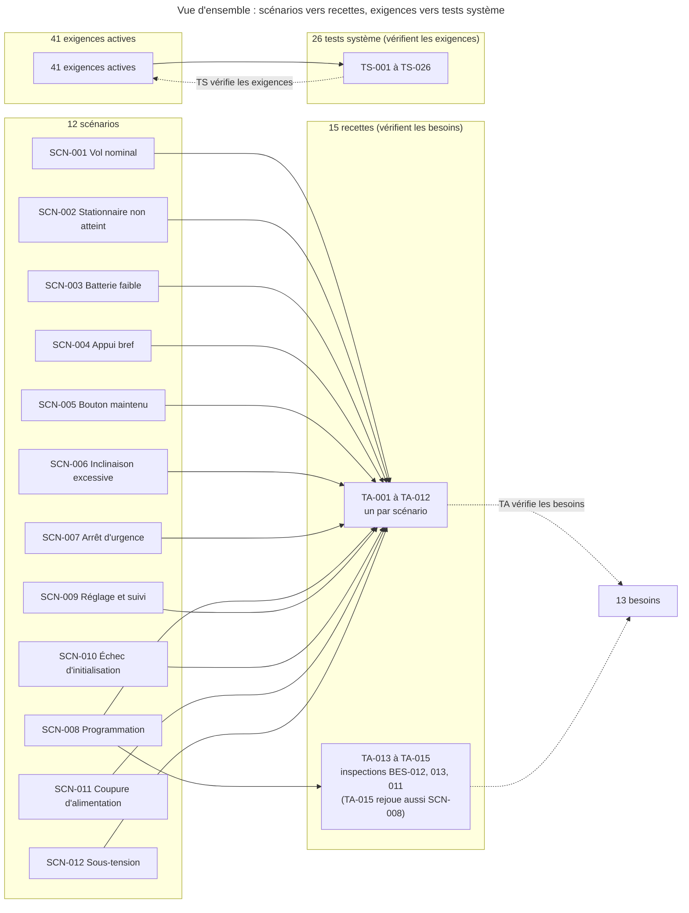

# Plans de test

> **Aperçu**
> - Trois niveaux définis à ce stade : 29 tests d'intégration (TI) qui vérifient les 30 éléments d'architecture (section « Tests d'intégration (TI) » en bas) ; 15 recettes (TA) qui vérifient les besoins en rejouant les 12 scénarios (celui de la mise en service par deux recettes) et en inspectant 3 besoins ; 26 tests système (TS) qui vérifient les 41 exigences actives.
> - Chaque exigence active a au moins un TS, chaque besoin au moins un TA ; les valeurs attendues sont celles de « Exigences système » — `projets/boomrone/02-exigences.md`.
> - Moyens simples : banc maison, alimentation de laboratoire, chronomètre ou caméra, oscilloscope ou analyseur logique, appareil de suivi, pièce d'essai.
> - Les tests unitaires (TU) viennent avec la conception détaillée (ordre d'exécution : TU, TI, TS, TA).
> - État : tous les tests sont écrits, aucun n'est exécuté (le prototype n'existe pas encore).

## Vue d'ensemble

*Légende : trait plein = « le scénario est rejoué par la recette » ou « l'exigence est vérifiée par le test » ; pointillé = « vérifie ». Les tests d'intégration (TI) et unitaires (TU) ne figurent pas ici : voir la section « Tests d'intégration (TI) » et la conception détaillée. Titres abrégés ; titres complets dans les tableaux de couverture.*

## Niveaux de test

| Niveau | Vérifie | Préfixe | Nombre | État |
|---|---|---|---|---|
| Recette | Besoins | TA | 15 | écrit |
| Système | Exigences | TS | 26 | écrit |
| Intégration | Architecture | TI | 29 | écrit |
| Unitaire | Conception détaillée | TU | 0 | après la conception détaillée |

## Moyens d'essai

| Moyen | Usage |
|---|---|
| Banc maison | drone fixé sur potence ou cadre, hélices démontées ou moteurs en charge factice, pour la logique et les délais |
| Alimentation de laboratoire | tension de batterie réglable par élément, creux de tension |
| Chronomètre, caméra à 120 ou 240 images par seconde | durées, hauteurs, vitesses de contact |
| Oscilloscope ou analyseur logique | délais entre le bouton, les commandes des moteurs et les effets ; déclenchement des commandes sans fil |
| Appareil de suivi | ordinateur ou téléphone avec le logiciel d'essai écrit par l'utilisateur (REQ-040 « Appareil de suivi ») |
| Pièce d'essai | pièce de 4 m × 4 m × 2,5 m, repères au sol, sol dégagé |
| Lieu plus grand | gymnase ou jardin, pour les lancers à plus de 1 m/s |
| Plateau tournant, plateau vibrant | rotation et secousses mesurées pour les conditions d'immobilité |
| Calibre de 12 mm, pied à coulisse, balance | protège-hélices, dimensions, masse |

## Couverture

### Scénarios vers recettes

| Scénario | Recette |
|---|---|
| SCN-001 « Vol nominal : de la batterie au posé » | TA-001 « Recette du vol nominal » |
| SCN-002 « Échec : stationnaire non atteint dans le délai » | TA-002 « Recette de l'échec de stationnaire » |
| SCN-003 « Échec : batterie faible à l'armement » | TA-003 « Recette du refus sur batterie faible » |
| SCN-004 « Appui normal : bouton relâché avant 2 secondes » | TA-004 « Recette de l'appui bref » |
| SCN-005 « Dégradé : bouton maintenu plus de 10 secondes » | TA-005 « Recette du bouton maintenu plus de 10 secondes » |
| SCN-006 « Échec : inclinaison excessive après le stationnaire » | TA-006 « Recette de l'inclinaison excessive » |
| SCN-007 « Dégradé : arrêt d'urgence par le bouton en vol » | TA-007 « Recette de l'arrêt d'urgence en vol » |
| SCN-008 « Mise en service : programmation du drone » | TA-008 « Recette de la mise en service par programmation » ; TA-015 « Inspection de la fabrication à la main » |
| SCN-009 « Réglage et suivi du drone par le sans fil » | TA-009 « Recette du réglage et du suivi sans fil » |
| SCN-010 « Échec : initialisation impossible au démarrage » | TA-010 « Recette de l'échec d'initialisation » |
| SCN-011 « Dégradé : coupure d'alimentation en vol » | TA-011 « Recette de la coupure d'alimentation en vol » |
| SCN-012 « Dégradé : sous-tension de la batterie » | TA-012 « Recette de la sous-tension de la batterie » |
| (aucun, inspection) | TA-013 « Inspection des consignes d'emploi » ; TA-014 « Inspection du drone de poche protégé » |

### Besoins vers recettes

| Besoin | Recettes |
|---|---|
| BES-001 « Lancer le drone à la main » | TA-001 « Recette du vol nominal » ; TA-002 « Recette de l'échec de stationnaire » |
| BES-002 « Ne pas armer ni lancer par erreur » | TA-004 « Recette de l'appui bref » ; TA-005 « Recette du bouton maintenu plus de 10 secondes » |
| BES-003 « Rester en vol stationnaire 10 s puis atterrir doucement » | TA-001 « Recette du vol nominal » |
| BES-004 « Ne pas voler quand le drone n'est pas prêt » | TA-003 « Recette du refus sur batterie faible » ; TA-010 « Recette de l'échec d'initialisation » ; TA-011 « Recette de la coupure d'alimentation en vol » |
| BES-005 « Couper les moteurs quand le vol ne peut pas continuer » | TA-001 « Recette du vol nominal » ; TA-002 « Recette de l'échec de stationnaire » ; TA-006 « Recette de l'inclinaison excessive » ; TA-011 « Recette de la coupure d'alimentation en vol » ; TA-012 « Recette de la sous-tension de la batterie » |
| BES-006 « Arrêter le drone en vol d'un geste » | TA-007 « Recette de l'arrêt d'urgence en vol » |
| BES-007 « Savoir où en est le drone sans autre appareil » | TA-001 « Recette du vol nominal » ; TA-002 « Recette de l'échec de stationnaire » ; TA-003 « Recette du refus sur batterie faible » ; TA-004 « Recette de l'appui bref » ; TA-005 « Recette du bouton maintenu plus de 10 secondes » ; TA-006 « Recette de l'inclinaison excessive » ; TA-007 « Recette de l'arrêt d'urgence en vol » ; TA-010 « Recette de l'échec d'initialisation » ; TA-011 « Recette de la coupure d'alimentation en vol » ; TA-012 « Recette de la sous-tension de la batterie » |
| BES-008 « Entrer en mode réglage et faire des vols de réglage » | TA-009 « Recette du réglage et du suivi sans fil » |
| BES-009 « Régler et sauvegarder les paramètres de vol » | TA-002 « Recette de l'échec de stationnaire » ; TA-008 « Recette de la mise en service par programmation » ; TA-009 « Recette du réglage et du suivi sans fil » |
| BES-010 « Suivre le drone sur un appareil de suivi » | TA-002 « Recette de l'échec de stationnaire » ; TA-003 « Recette du refus sur batterie faible » ; TA-006 « Recette de l'inclinaison excessive » ; TA-007 « Recette de l'arrêt d'urgence en vol » ; TA-009 « Recette du réglage et du suivi sans fil » |
| BES-011 « Fabriquer et programmer le drone soi-même » | TA-008 « Recette de la mise en service par programmation » ; TA-015 « Inspection de la fabrication à la main » |
| BES-012 « Disposer d'une page de consignes d'emploi » | TA-001 « Recette du vol nominal » ; TA-012 « Recette de la sous-tension de la batterie » ; TA-013 « Inspection des consignes d'emploi » |
| BES-013 « Voler en appartement avec un drone de poche protégé » | TA-001 « Recette du vol nominal » ; TA-014 « Inspection du drone de poche protégé » |

### Tests système vers exigences

| Test système | Exigences vérifiées |
|---|---|
| TS-001 « Anti-rebond et chronologie d'un appui » | REQ-002 « Chronologie d'un appui sur le bouton » |
| TS-002 « Conditions de départ et refus d'armement » | REQ-003 « Conditions de départ du drone » ; REQ-041 « Conditions d'acceptation de la commande Décoller » |
| TS-003 « Démarrage des moteurs : délai et geste volontaire » | REQ-004 « Démarrage des moteurs 200 ms après le relâchement » ; REQ-005 « Démarrage des moteurs sur geste volontaire seulement » |
| TS-004 « Stabilisation après le lancer » | REQ-006 « Stabilisation après le lancer » |
| TS-005 « Critère et tenue du vol stationnaire » | REQ-007 « Critère de vol stationnaire » ; REQ-008 « Tenue du vol stationnaire » |
| TS-006 « Atterrissage doux » | REQ-009 « Atterrissage doux » |
| TS-007 « Verrouillage après un posé, une coupure ou un redémarrage » | REQ-010 « Verrouillage après un posé, une coupure ou un redémarrage » ; REQ-035 « Appui en cours à un changement d'état » |
| TS-008 « Coupures automatiques en vol » | REQ-011 « Coupures automatiques en vol » |
| TS-009 « Coupure sur sous-tension et marge de batterie » | REQ-012 « Coupure sur sous-tension de la batterie » ; REQ-013 « Marge de batterie pour un vol complet » |
| TS-010 « Coupure sur logiciel bloqué ou phase Lancé trop longue » | REQ-014 « Coupure sur logiciel bloqué » ; REQ-036 « Coupure sur phase Lancé trop longue » |
| TS-011 « Garde et arrêt d'urgence par le bouton » | REQ-015 « Garde du bouton après le lancer » ; REQ-016 « Arrêt d'urgence par le bouton » |
| TS-012 « Initialisation et échec d'initialisation » | REQ-017 « Initialisation en 3 secondes » ; REQ-037 « Comportement en échec d'initialisation » |
| TS-013 « Effets locaux par situation » | REQ-018 « Effets locaux par situation » |
| TS-014 « Perceptibilité et distinction des effets » | REQ-019 « Perceptibilité et distinction des effets » |
| TS-015 « Statut sans fil et variables du vol » | REQ-020 « Statut sans fil » ; REQ-038 « Causes et paramètres dans le statut sans fil » ; REQ-021 « Variables du vol » |
| TS-016 « Arrêt sans fil » | REQ-022 « Arrêt sans fil » |
| TS-017 « Commandes sans fil selon l'état » | REQ-023 « Commandes sans fil selon l'état du drone » |
| TS-018 « Mode réglage et vol de réglage » | REQ-024 « Entrée en mode réglage par le bouton » ; REQ-025 « Vol de réglage » ; REQ-041 « Conditions d'acceptation de la commande Décoller » |
| TS-019 « Paramètres, sauvegarde et valeurs d'origine » | REQ-026 « Paramètres de vol réglables » ; REQ-027 « Sauvegarde et chargement des réglages » ; REQ-028 « Valeurs d'origine après la programmation » |
| TS-020 « Fabrication à la main » | REQ-029 « Composants disponibles à l'unité » ; REQ-044 « Assemblage à la main » |
| TS-021 « Programmation depuis l'ordinateur » | REQ-030 « Programmation depuis l'ordinateur » |
| TS-022 « Dimensions, masse et protège-hélices » | REQ-031 « Drone de poche » ; REQ-032 « Protège-hélices » |
| TS-023 « Vol dans une pièce d'appartement » | REQ-033 « Vol dans une pièce d'appartement » |
| TS-024 « Page de consignes d'emploi » | REQ-034 « Page de consignes d'emploi » |
| TS-025 « Appareil de suivi et logiciel d'essai » | REQ-040 « Appareil de suivi » |
| TS-026 « Batterie débranchable à la main » | REQ-045 « Batterie débranchable à la main » |

### Éléments d'architecture vers tests d'intégration

| Élément d'architecture | Tests d'intégration |
|---|---|
| ARC-001 « Structure générale du drone » | TI-026 « Intégration d'ensemble du prototype » |
| ARC-002 « Microcontrôleur et programmation par liaison SWD » | TI-001 « Alimentation, programmation SWD et octets d'option » ; TI-002 « Bus SPI, I2C et capteurs » ; TI-005 « Moteurs coupés par le matériel » ; TI-006 « Coupures par chien de garde et par sous-tension du microcontrôleur » ; TI-010 « Liaison Bluetooth à basse consommation » |
| ARC-003 « Centrale inertielle » | TI-002 « Bus SPI, I2C et capteurs » ; TI-004 « Flux optique et vitesse horizontale » |
| ARC-004 « Capteur de hauteur à temps de vol » | TI-002 « Bus SPI, I2C et capteurs » ; TI-003 « Hauteur du capteur à temps de vol et position de montage » ; TI-004 « Flux optique et vitesse horizontale » ; TI-028 « Pilote du capteur de hauteur : durée d'appel, bus bloqué, capteur muet » |
| ARC-005 « Capteur de flux optique » | TI-002 « Bus SPI, I2C et capteurs » ; TI-004 « Flux optique et vitesse horizontale » |
| ARC-006 « Moteurs, hélices et protège-hélices » | TI-007 « Moteurs, poussée, masse et dimensions » |
| ARC-007 « Étage de puissance des moteurs coupés par défaut » | TI-005 « Moteurs coupés par le matériel » ; TI-006 « Coupures par chien de garde et par sous-tension du microcontrôleur » |
| ARC-008 « Batterie et connecteur débranchable » | TI-008 « Batterie, connecteur, chute de tension et mesure de tension » |
| ARC-009 « Alimentation de la logique et mesure de la tension » | TI-001 « Alimentation, programmation SWD et octets d'option » ; TI-006 « Coupures par chien de garde et par sous-tension du microcontrôleur » ; TI-008 « Batterie, connecteur, chute de tension et mesure de tension » |
| ARC-010 « Bouton » | TI-009 « Bouton, voyant RGB et avertisseur » |
| ARC-011 « Voyant RGB et avertisseur sonore » | TI-009 « Bouton, voyant RGB et avertisseur » |
| ARC-012 « Module radio Bluetooth à basse consommation » | TI-010 « Liaison Bluetooth à basse consommation » |
| ARC-013 « Carte électronique JLCPCB, câblage et assemblage » | TI-001 « Alimentation, programmation SWD et octets d'option » ; TI-003 « Hauteur du capteur à temps de vol et position de montage » ; TI-007 « Moteurs, poussée, masse et dimensions » |
| ARC-014 « Bilan de masse, de poussée et d'autonomie » | TI-007 « Moteurs, poussée, masse et dimensions » ; TI-008 « Batterie, connecteur, chute de tension et mesure de tension » |
| ARC-015 « Structure logicielle et ordonnancement » | TI-011 « Cadence du cycle et temps de réponse de l'arrêt d'urgence » ; TI-017 « Chaîne chien de garde vers moteurs » ; TI-029 « Mémoire, écriture de flash pendant une mesure et chronomètres » |
| ARC-016 « Pilotes des capteurs et des sorties » | TI-012 « Chaîne capteurs vers estimation » ; TI-019 « Effets locaux sur les sorties » ; TI-020 « Trame radio de bout en bout » ; TI-028 « Pilote du capteur de hauteur : durée d'appel, bus bloqué, capteur muet » ; TI-029 « Mémoire, écriture de flash pendant une mesure et chronomètres » |
| ARC-017 « Estimation de l'attitude, de la hauteur et de la vitesse » | TI-012 « Chaîne capteurs vers estimation » ; TI-013 « Boucle de contrôle sur potence » |
| ARC-018 « Boucle de contrôle du vol » | TI-013 « Boucle de contrôle sur potence » ; TI-015 « Armement, lancer et démarrage des moteurs » ; TI-023 « Mode réglage et vol de réglage » |
| ARC-019 « Machine à états du drone » | TI-014 « Chaîne bouton, machine à états, effets » ; TI-015 « Armement, lancer et démarrage des moteurs » ; TI-016 « Coupures automatiques et sous-tension » ; TI-018 « Initialisation et échec d'initialisation » ; TI-021 « Arrêt sans fil et filtrage des commandes par état » ; TI-023 « Mode réglage et vol de réglage » |
| ARC-020 « Gestion logicielle du bouton » | TI-011 « Cadence du cycle et temps de réponse de l'arrêt d'urgence » ; TI-014 « Chaîne bouton, machine à états, effets » |
| ARC-021 « Surveillance et coupures automatiques » | TI-016 « Coupures automatiques et sous-tension » ; TI-021 « Arrêt sans fil et filtrage des commandes par état » |
| ARC-022 « Chien de garde » | TI-017 « Chaîne chien de garde vers moteurs » ; TI-024 « Paramètres, flash et programmation » |
| ARC-023 « Initialisation et échec d'initialisation » | TI-018 « Initialisation et échec d'initialisation » ; TI-028 « Pilote du capteur de hauteur : durée d'appel, bus bloqué, capteur muet » |
| ARC-024 « Effets locaux (logiciel) » | TI-014 « Chaîne bouton, machine à états, effets » ; TI-019 « Effets locaux sur les sorties » |
| ARC-025 « Protocole et service du statut sans fil » | TI-020 « Trame radio de bout en bout » ; TI-021 « Arrêt sans fil et filtrage des commandes par état » ; TI-022 « Logiciel d'essai relié au drone » |
| ARC-026 « Mode réglage et vol de réglage » | TI-023 « Mode réglage et vol de réglage » ; TI-024 « Paramètres, flash et programmation » |
| ARC-027 « Paramètres de vol et stockage des réglages » | TI-024 « Paramètres, flash et programmation » ; TI-029 « Mémoire, écriture de flash pendant une mesure et chronomètres » |
| ARC-028 « Logiciel d'essai de l'appareil de suivi » | TI-022 « Logiciel d'essai relié au drone » |
| ARC-029 « Plan de livraison par jalons » | TI-025 « Livraison par jalons » |
| ARC-030 « Page de consignes d'emploi » | TI-027 « Cohérence de la page de consignes avec le drone » |

## Recettes (TA)

Chaque recette vérifie des besoins en rejouant un scénario complet, avec un drone prototype, sans équipement de mesure sauf le chronomètre ; le champ `Scénario rejoué` nomme le scénario (l'outil de traçabilité n'accepte que des besoins en `Réfs amont` : DEC-192 « Outil de traçabilité inchangé : TA vers BES, scénario en champ texte, DEC en champ séparé »). Valeurs attendues : celles des exigences citées dans « Exigences système » — `projets/boomrone/02-exigences.md`. Trois recettes (TA-013 « Inspection des consignes d'emploi » à TA-015 « Inspection de la fabrication à la main ») sont des inspections de besoins ; la dernière rejoue aussi le scénario de mise en service.

### TA-001 — Recette du vol nominal
**Réfs amont :** BES-001 « Lancer le drone à la main » ; BES-003 « Rester en vol stationnaire 10 s puis atterrir doucement » ; BES-005 « Couper les moteurs quand le vol ne peut pas continuer » ; BES-007 « Savoir où en est le drone sans autre appareil » ; BES-012 « Disposer d'une page de consignes d'emploi » ; BES-013 « Voler en appartement avec un drone de poche protégé »
**Scénario rejoué :** SCN-001 « Vol nominal : de la batterie au posé »
**Préconditions :** prototype complet avec protège-hélices et batterie chargée, pièce d'essai de 4 m × 4 m × 2,5 m, page de consignes lue, sans appareil de suivi.
**Procédure :** poser le drone à plat, brancher la batterie, appuyer 2 s, relâcher en lançant doucement (au plus 1 m/s) vers le haut et l'avant ; observer jusqu'au posé.
**Résultat attendu :** effets Allumé, Appui validé, Prêt, Lancé et vol, Posé, puis Allumé ; stationnaire de 10,0 s ±0,5 s à 0,8 m à 1,2 m de hauteur de la 3e à la 10e seconde (REQ-008 « Tenue du vol stationnaire ») ; drone posé, moteurs arrêtés, intact, sans sortir de la pièce.
**Statut :** Écrit

### TA-002 — Recette de l'échec de stationnaire
**Réfs amont :** BES-001 « Lancer le drone à la main » ; BES-005 « Couper les moteurs quand le vol ne peut pas continuer » ; BES-007 « Savoir où en est le drone sans autre appareil » ; BES-009 « Régler et sauvegarder les paramètres de vol » ; BES-010 « Suivre le drone sur un appareil de suivi »
**Scénario rejoué :** SCN-002 « Échec : stationnaire non atteint dans le délai »
**Préconditions :** drone armé, appareil de suivi relié, hélices démontées ou drone posé au sol (hauteur de moins de 0,3 m, REQ-007 « Critère de vol stationnaire ») ; jamais tenu en main (limite assumée de REQ-007 « Critère de vol stationnaire »).
**Procédure :** poser le drone armé sur une table (hélices démontées) ou au sol, relâcher le bouton sans lancer, chronométrer depuis le démarrage des moteurs ; lire le statut sans fil.
**Résultat attendu :** moteurs coupés 2,0 s ±0,1 s après leur démarrage (REQ-011 « Coupures automatiques en vol »), effet Coupure en vol puis Allumé, cause « échec de stabilisation » lue sur l'appareil de suivi (REQ-038 « Causes et paramètres dans le statut sans fil »), drone verrouillé.
**Statut :** Écrit

### TA-003 — Recette du refus sur batterie faible
**Réfs amont :** BES-004 « Ne pas voler quand le drone n'est pas prêt » ; BES-007 « Savoir où en est le drone sans autre appareil » ; BES-010 « Suivre le drone sur un appareil de suivi »
**Scénario rejoué :** SCN-003 « Échec : batterie faible à l'armement »
**Préconditions :** batterie sous le seuil d'armement (3,7 V par élément), appareil de suivi relié.
**Procédure :** appuyer sur le bouton et le maintenir plus de 2 s.
**Résultat attendu :** effets Appui validé puis Refus puis Allumé ; au relâchement, moteurs non démarrés ; cause « batterie faible » sur l'appareil de suivi.
**Statut :** Écrit

### TA-004 — Recette de l'appui bref
**Réfs amont :** BES-002 « Ne pas armer ni lancer par erreur » ; BES-007 « Savoir où en est le drone sans autre appareil »
**Scénario rejoué :** SCN-004 « Appui normal : bouton relâché avant 2 secondes »
**Préconditions :** drone allumé, hélices démontées par prudence.
**Procédure :** recette de non-régression, sans valeur nouvelle (les durées sont mesurées par TS-001 « Anti-rebond et chronologie d'un appui ») : appuyer 0,5 s, puis trois fois 1,5 s de suite.
**Résultat attendu :** aucun effet pour 0,5 s ; effet Appui validé pour chaque appui de 1,5 s, sans effet cumulé ; moteurs jamais démarrés ; le drone reste en mode normal.
**Statut :** Écrit

### TA-005 — Recette du bouton maintenu plus de 10 secondes
**Réfs amont :** BES-002 « Ne pas armer ni lancer par erreur » ; BES-007 « Savoir où en est le drone sans autre appareil »
**Scénario rejoué :** SCN-005 « Dégradé : bouton maintenu plus de 10 secondes »
**Préconditions :** drone allumé, hélices démontées par prudence.
**Procédure :** maintenir le bouton 12 s, relâcher, puis appuyer de nouveau 2 s.
**Résultat attendu :** effets Appui validé, Prêt, puis Désarmement à 10,0 s ±0,2 s puis Allumé ; au relâchement, moteurs non démarrés ; le second appui donne l'effet Prêt.
**Statut :** Écrit

### TA-006 — Recette de l'inclinaison excessive
**Réfs amont :** BES-005 « Couper les moteurs quand le vol ne peut pas continuer » ; BES-007 « Savoir où en est le drone sans autre appareil » ; BES-010 « Suivre le drone sur un appareil de suivi »
**Scénario rejoué :** SCN-006 « Échec : inclinaison excessive après le stationnaire »
**Préconditions :** vol en stationnaire sur potence protégée ou en vol libre dans la pièce, appareil de suivi relié.
**Procédure :** pendant le stationnaire, pousser le drone pour l'incliner à plus de 65°.
**Résultat attendu :** moteurs coupés, effet Coupure en vol puis Allumé ; cause « basculement » sur l'appareil de suivi ; drone verrouillé.
**Statut :** Écrit

### TA-007 — Recette de l'arrêt d'urgence en vol
**Réfs amont :** BES-006 « Arrêter le drone en vol d'un geste » ; BES-007 « Savoir où en est le drone sans autre appareil » ; BES-010 « Suivre le drone sur un appareil de suivi »
**Scénario rejoué :** SCN-007 « Dégradé : arrêt d'urgence par le bouton en vol »
**Préconditions :** deux vols, appareil de suivi relié pour le second.
**Procédure :** vol 1 : appuyer sur le bouton en stationnaire (appui tenu au moins 0,5 s). Vol 2 : envoyer la commande Arrêt depuis l'appareil de suivi.
**Résultat attendu :** moteurs coupés dans les deux cas, effet Coupure en vol puis Allumé ; causes « arrêt par le bouton » puis « arrêt sans fil » lues ; drone verrouillé.
**Statut :** Écrit

### TA-008 — Recette de la mise en service par programmation
**Réfs amont :** BES-009 « Régler et sauvegarder les paramètres de vol » ; BES-011 « Fabriquer et programmer le drone soi-même »
**Scénario rejoué :** SCN-008 « Mise en service : programmation du drone »
**Préconditions :** carte neuve, ordinateur, programmateur, batterie chargée, hélices démontées.
**Procédure :** relier le programmateur, programmer, débrancher, brancher la batterie ; puis reprogrammer une carte dont les réglages ont été sauvegardés.
**Résultat attendu :** effet Allumé après la programmation ; après la reprogrammation, les quatre paramètres de vol sont aux valeurs d'origine (REQ-026 « Paramètres de vol réglables »).
**Statut :** Écrit

### TA-009 — Recette du réglage et du suivi sans fil
**Réfs amont :** BES-008 « Entrer en mode réglage et faire des vols de réglage » ; BES-009 « Régler et sauvegarder les paramètres de vol » ; BES-010 « Suivre le drone sur un appareil de suivi »
**Scénario rejoué :** SCN-009 « Réglage et suivi du drone par le sans fil »
**Préconditions :** drone programmé, appareil de suivi relié, sol plat et dégagé, protège-hélices en place.
**Procédure :** bouton tenu en branchant la batterie ; envoyer Décoller ; modifier un paramètre ; envoyer Sauvegarder ; débrancher et rebrancher ; relire.
**Résultat attendu :** effet Mode réglage ; vol de réglage de 3,0 s ±0,5 s de stationnaire puis retour en mode réglage ; variables du vol reçues ; paramètre modifié relu dans le statut puis retrouvé après redémarrage ; le redémarrage sans bouton revient en mode normal.
**Statut :** Écrit

### TA-010 — Recette de l'échec d'initialisation
**Réfs amont :** BES-004 « Ne pas voler quand le drone n'est pas prêt » ; BES-007 « Savoir où en est le drone sans autre appareil »
**Scénario rejoué :** SCN-010 « Échec : initialisation impossible au démarrage »
**Préconditions :** drone hors tension, hélices démontées par prudence.
**Procédure :** brancher la batterie en secouant le drone ; essayer le bouton et une commande sans fil ; débrancher, poser à plat, rebrancher.
**Résultat attendu :** effet Échec d'initialisation ; bouton et commandes sans effet ; après le rebranchement posé à plat, effet Allumé.
**Statut :** Écrit

### TA-011 — Recette de la coupure d'alimentation en vol
**Réfs amont :** BES-004 « Ne pas voler quand le drone n'est pas prêt » ; BES-005 « Couper les moteurs quand le vol ne peut pas continuer » ; BES-007 « Savoir où en est le drone sans autre appareil »
**Scénario rejoué :** SCN-011 « Dégradé : coupure d'alimentation en vol »
**Préconditions :** drone en stationnaire sur potence protégée ou en vol libre dans la pièce.
**Procédure :** couper la batterie en vol ; la rebrancher drone posé à plat ; recommencer en la rebranchant drone en mouvement.
**Résultat attendu :** moteurs arrêtés dès la coupure, jamais de reprise du vol seul ; effet Allumé si le drone est immobile et à plat, Échec d'initialisation sinon.
**Statut :** Écrit

### TA-012 — Recette de la sous-tension de la batterie
**Réfs amont :** BES-005 « Couper les moteurs quand le vol ne peut pas continuer » ; BES-007 « Savoir où en est le drone sans autre appareil » ; BES-012 « Disposer d'une page de consignes d'emploi »
**Scénario rejoué :** SCN-012 « Dégradé : sous-tension de la batterie »
**Préconditions :** alimentation de laboratoire à la place de la batterie, drone au banc.
**Procédure :** drone allumé puis moteurs en marche : abaisser la tension sous 3,3 V par élément pendant plus de 120 ms ; remonter la tension, redémarrer ; refaire en mode réglage.
**Résultat attendu :** moteurs coupés au plus 250 ms après le passage sous 3,3 V (REQ-012 « Coupure sur sous-tension de la batterie »), puis effet Échec d'initialisation, y compris en mode réglage : bouton et commandes sans effet, il faut débrancher la batterie ; au retour de l'alimentation, effet Allumé ou Échec d'initialisation selon l'état ; la page de consignes dit de débrancher la batterie après usage.
**Statut :** Écrit

### TA-013 — Inspection des consignes d'emploi
**Réfs amont :** BES-012 « Disposer d'une page de consignes d'emploi »
**Scénario rejoué :** (aucun, inspection du besoin sans scénario propre)
**Préconditions :** « Consignes d'emploi » — `projets/boomrone/consignes-emploi.md` et « Risques acceptés » — `projets/boomrone/risques-acceptes.md`.
**Procédure :** lire la page ; compter les lignes et les mots ; contrôle croisé avec chaque ligne du registre des risques.
**Résultat attendu :** une face A4, 60 lignes au plus, une consigne à l'infinitif par ligne de 15 mots au plus (REQ-034 « Page de consignes d'emploi »), quatre réflexes en tête ; tout risque majeur repris, ou écart justifié par écrit.
**Statut :** Écrit

### TA-014 — Inspection du drone de poche protégé
**Réfs amont :** BES-013 « Voler en appartement avec un drone de poche protégé »
**Scénario rejoué :** (aucun, inspection du besoin sans scénario propre)
**Préconditions :** prototype complet avec protège-hélices.
**Procédure :** mesurer l'encombrement et la masse (REQ-031 « Drone de poche ») ; passer le calibre de 12 mm dans le plan des hélices (REQ-032 « Protège-hélices ») ; poser le drone dans une poche de pantalon ordinaire.
**Résultat attendu :** mesures conformes à REQ-031 « Drone de poche » et REQ-032 « Protège-hélices » ; verdict de l'utilisateur, oui ou non, noté : « le drone tient dans la poche sans gêne ».
**Statut :** Écrit

### TA-015 — Inspection de la fabrication à la main
**Réfs amont :** BES-011 « Fabriquer et programmer le drone soi-même »
**Scénario rejoué :** SCN-008 « Mise en service : programmation du drone » (partie fabrication ; la partie programmation et reprogrammation est rejouée par TA-008 « Recette de la mise en service par programmation »)
**Préconditions :** nomenclature complète, outillage courant de l'utilisateur, sans appareil de suivi ; la carte est livrée fabriquée et assemblée par JLCPCB ; la partie « à la main » est limitée aux moteurs, au XT30, à l'en-tête SWD et à la lentille du flux optique, collée sur la puce posée par JLCPCB (DEC-245 « REQ-044 réécrite : carte fabriquée et assemblée par JLCPCB, raccordements à la main » ; DEC-246 « Flux optique : puce PMW3901MB-TXQT achetée et posée par JLCPCB »). En cas de repli sur la carte achetée du flux (DEC-248 « Flux optique : lentille collée à la main et repli sur carte achetée »), la carte du flux est raccordée par 6 fils.
**Procédure :** raccorder à la main, d'après la nomenclature, les moteurs, le XT30 et l'en-tête SWD sur la carte livrée, et coller la lentille du flux sur sa puce ; la programmer ; la mettre sous tension.
**Résultat attendu :** raccordements terminés avec l'outillage courant seulement (REQ-044 « Assemblage à la main »), lentille du flux collée sans colle sur la surface du capteur, centrée et propre à l'inspection visuelle, puce du flux lue sans erreur (TI-002 « Bus SPI, I2C et capteurs »), chaque composant trouvé à l'unité chez au moins un revendeur ou en stock chez JLCPCB (REQ-029 « Composants disponibles à l'unité »), le drone démarre normalement (effet Allumé).
**Statut :** Écrit

## Tests système (TS)

### TS-001 — Anti-rebond et chronologie d'un appui
**Réfs amont :** REQ-002 « Chronologie d'un appui sur le bouton »
**Préconditions :** drone au banc, hélices démontées ; générateur d'impulsions ; chronomètre ; alimentation de laboratoire à 3,8 V par élément (drone prêt) puis à 3,6 V (non prêt).
**Procédure :** impulsions de 6 ms puis de 14 ms sur le bouton ; appuis de 0,5 s, 1,5 s, 2,5 s (drone prêt), 2,5 s (drone non prêt) et 11 s.
**Résultat attendu :** 6 ms ignorée, 14 ms prise en compte ; 0,5 s sans effet ; Appui validé à 1,0 s ±0,1 s ; Prêt à 2,0 s ±0,1 s ; Refus pour le drone non prêt ; Désarmement à 10,0 s ±0,2 s, moteurs non démarrés au relâchement.
**Statut :** Écrit

### TS-002 — Conditions de départ et refus d'armement
**Réfs amont :** REQ-003 « Conditions de départ du drone » ; REQ-041 « Conditions d'acceptation de la commande Décoller »
**Préconditions :** drone au banc, alimentation de laboratoire, plateau tournant, plateau vibrant ou mouvement répété mesuré.
**Procédure :** armer dans chacun des cas suivants : tension de 3,6 V puis 3,8 V par élément ; inclinaison de 20° puis 10° ; rotation à 40 °/s puis 20 °/s ; secousse de ±0,8 m/s² puis ±0,3 m/s². En mode réglage : Décoller à 3,6 V, à 3,8 V bouton enfoncé, puis à 3,8 V bouton relâché.
**Résultat attendu :** Refus à 3,6 V, à 20°, à 40 °/s et à ±0,8 m/s² ; Prêt à 3,8 V, à 10°, à 20 °/s et à ±0,3 m/s² ; Décoller refusé (effet Refus, le drone reste en mode réglage) à 3,6 V et bouton enfoncé, accepté à 3,8 V bouton relâché.
**Statut :** Écrit

### TS-003 — Démarrage des moteurs : délai et geste volontaire
**Réfs amont :** REQ-004 « Démarrage des moteurs 200 ms après le relâchement » ; REQ-005 « Démarrage des moteurs sur geste volontaire seulement »
**Préconditions :** drone au banc, hélices démontées, oscilloscope ou analyseur logique sur le bouton et la commande des moteurs.
**Procédure :** armer et relâcher entre 2 s et 10 s ; puis 10 mises sous tension, 10 coupures d'alimentation suivies d'un redémarrage, 10 appuis de moins de 2 s et une commande Décoller hors mode réglage.
**Résultat attendu :** effet Lancé et vol au plus 50 ms après le relâchement ; moteurs démarrés 200 ms ±50 ms après ; dans les 31 autres cas, moteurs jamais démarrés (0 sur 31).
**Statut :** Écrit

### TS-004 — Stabilisation après le lancer
**Réfs amont :** REQ-006 « Stabilisation après le lancer »
**Préconditions :** pièce d'essai de 4 m × 4 m × 2,5 m pour les lancers à 1 m/s au plus ; gymnase ou jardin pour les lancers plus rapides ; caméra ; drone avec protège-hélices.
**Procédure :** 20 lancers variés (orientations à plat, tête en bas, sur la tranche ; vitesses de 0,5 et 1 m/s dans la pièce, de 2 et 4 m/s dans le lieu plus grand ; rotation jusqu'à 1 tour par seconde ; hauteur de 1,5 à 2 m).
**Résultat attendu :** au moins 18 lancers sur 20 avec stationnaire déclaré 2,0 s au plus après le démarrage des moteurs ; sinon, résultats consignés et plage à revoir.
**Statut :** Écrit

### TS-005 — Critère et tenue du vol stationnaire
**Réfs amont :** REQ-007 « Critère de vol stationnaire » ; REQ-008 « Tenue du vol stationnaire »
**Préconditions :** banc et pièce d'essai, règle graduée ou quadrillage, caméra, appareil de suivi.
**Procédure :** moteurs en marche drone posé ; puis suspendu à 0,2 m, immobile et à plat ; suspendu à 0,5 m immobile et à plat ; suspendu à 0,5 m incliné à 20° ; suspendu à 0,5 m déplacé à 0,5 m/s ; puis 5 vols filmés.
**Résultat attendu :** stationnaire jamais déclaré posé, ni à 0,2 m, ni incliné à 20°, ni à 0,5 m/s ; déclaré à 0,5 m immobile et à plat ; vol : 10,0 s ±0,5 s, hauteur entre 0,8 m et 1,2 m de la 3e à la 10e seconde, dérive d'au plus 0,5 m ; dérive vers l'objectif de 0,3 m consignée.
**Statut :** Écrit

### TS-006 — Atterrissage doux
**Réfs amont :** REQ-009 « Atterrissage doux »
**Préconditions :** pièce d'essai, caméra à 120 images par seconde.
**Procédure :** 5 vols complets filmés de côté.
**Résultat attendu :** vitesse au contact d'au plus 0,5 m/s ; moteurs coupés à 2 à 3 cm du sol ; effet Posé ; Posé atteint avant la coupure sur délai d'atterrissage de REQ-011 « Coupures automatiques en vol » (15,0 s ±0,5 s).
**Statut :** Écrit

### TS-007 — Verrouillage après un posé, une coupure ou un redémarrage
**Réfs amont :** REQ-010 « Verrouillage après un posé, une coupure ou un redémarrage » ; REQ-035 « Appui en cours à un changement d'état »
**Préconditions :** banc ou pièce d'essai, hélices démontées par prudence ; logiciel d'essai pour bloquer le logiciel.
**Procédure :** après chacune des causes (posé, échec de stabilisation, arrêt par le bouton, arrêt sans fil, basculement, délai d'atterrissage, coupure d'alimentation, sous-tension, logiciel bloqué), tenir le bouton enfoncé puis le relâcher, puis faire un appui complet ; refaire en mode réglage ; tenir aussi le bouton au retour à l'attente après un Refus et un Désarmement.
**Résultat attendu :** moteurs arrêtés tant qu'aucun appui complet n'a eu lieu ; l'appui en cours au changement d'état est ignoré jusqu'au relâchement ; après un appui complet, le drone peut s'armer ; en mode réglage, retour au mode réglage sans verrouillage, sauf après une sous-tension (échec d'initialisation : bouton et commandes sans effet jusqu'au débranchement).
**Statut :** Écrit

### TS-008 — Coupures automatiques en vol
**Réfs amont :** REQ-011 « Coupures automatiques en vol »
**Préconditions :** banc avec potence, caméra ou analyseur logique, appareil de suivi.
**Procédure :** (1) drone armé posé sur une table, hélices démontées, bouton relâché sans lancer ; (2) en stationnaire, le retourner à plus de 60° ; l'incliner à 55° pendant 1 s ; l'incliner à 65° pendant 1 s ; (3) retenir le drone pendant l'atterrissage.
**Résultat attendu :** (1) moteurs coupés 2,0 s ±0,1 s après leur démarrage ; (2) aucune coupure à 55° ; coupure à 65° et au retournement, après plus de 0,1 s ; (3) coupure à 15,0 s ±0,5 s ; dans chaque cas coupure 100 ms au plus après la détection, effet Coupure en vol et cause lue sur l'appareil de suivi.
**Statut :** Écrit

### TS-009 — Coupure sur sous-tension et marge de batterie
**Réfs amont :** REQ-012 « Coupure sur sous-tension de la batterie » ; REQ-013 « Marge de batterie pour un vol complet »
**Préconditions :** alimentation de laboratoire ; batterie choisie à l'architecture ; banc avec moteurs en charge.
**Procédure :** abaisser la tension lentement puis par des creux de 50 ms et de 150 ms, dans quatre états (attente, armé, moteurs en marche, mode réglage) ; puis amener la batterie à 3,7 V par élément à vide et faire tourner les moteurs 30 s en enregistrant la tension.
**Résultat attendu :** coupure au plus 250 ms après le passage sous 3,3 V par élément quand la tension y reste 100 ms ±20 ms, puis effet Échec d'initialisation, bouton sans effet jusqu'au débranchement ; aucune coupure sur le creux de 50 ms ; coupure sur celui de 150 ms ; pendant les 30 s, la tension ne reste pas sous 3,3 V par élément pendant 100 ms.
**Statut :** Écrit

### TS-010 — Coupure sur logiciel bloqué ou phase Lancé trop longue
**Réfs amont :** REQ-014 « Coupure sur logiciel bloqué » ; REQ-036 « Coupure sur phase Lancé trop longue »
**Préconditions :** logiciel d'essai capable de se bloquer et de retarder le démarrage des moteurs ; analyseur logique ; banc.
**Procédure :** bloquer le logiciel moteurs en marche ; retarder le démarrage des moteurs de plus de 500 ms après le relâchement.
**Résultat attendu :** moteurs arrêtés 200 ms au plus après la dernière exécution correcte du logiciel ; moteurs restés arrêtés et drone verrouillé 200 ms au plus après les 500 ms ; aucun démarrage seul des moteurs.
**Statut :** Écrit

### TS-011 — Garde et arrêt d'urgence par le bouton
**Réfs amont :** REQ-015 « Garde du bouton après le lancer » ; REQ-016 « Arrêt d'urgence par le bouton »
**Préconditions :** banc, oscilloscope ou caméra à 240 images par seconde, appareil de suivi.
**Procédure :** appui bref pendant la garde ; appui maintenu jusqu'à la fin de la garde ; appui après la garde en vol normal ; appui en vol de réglage juste après le décollage de réglage.
**Résultat attendu :** appui bref sans effet ; appui maintenu : arrêt à la fin de la garde de 0,5 s ±0,1 s, moteurs coupés 50 ms au plus après cette fin (délai mesuré) ; appui après la garde : moteurs coupés 50 ms au plus après l'anti-rebond ; vol de réglage : arrêt sans garde.
**Statut :** Écrit

### TS-012 — Initialisation et échec d'initialisation
**Réfs amont :** REQ-017 « Initialisation en 3 secondes » ; REQ-037 « Comportement en échec d'initialisation »
**Préconditions :** drone au banc, chronomètre.
**Procédure :** mise sous tension à plat ; secouée ; inclinée à 20° ; coupure d'alimentation puis redémarrage drone posé, puis drone en mouvement ; bouton et commandes sans fil après l'échec ; appui commencé pendant l'initialisation et maintenu au-delà de sa fin.
**Résultat attendu :** initialisation en 3 s au plus ; Allumé à plat et immobile ; Échec d'initialisation sinon, moteurs jamais démarrés, bouton et commandes sans effet, échec maintenu jusqu'au débranchement ; l'appui maintenu à la fin de l'initialisation est ignoré jusqu'au relâchement ; la batterie n'est pas contrôlée à l'initialisation (seulement à l'armement : TS-002 « Conditions de départ et refus d'armement »).
**Statut :** Écrit

### TS-013 — Effets locaux par situation
**Réfs amont :** REQ-018 « Effets locaux par situation »
**Préconditions :** banc et pièce d'essai, appareil de suivi.
**Procédure :** provoquer les situations des 10 effets (dont les cinq causes de coupure en vol et le Lancé), une coupure d'alimentation et une sous-tension.
**Résultat attendu :** chaque situation donne son effet ; les dix effets sont distincts ; la coupure d'alimentation ne donne aucun effet propre et la sous-tension (drone encore alimenté) donne l'effet Échec d'initialisation ; le statut sans fil porte l'état correspondant.
**Statut :** Écrit

### TS-014 — Perceptibilité et distinction des effets
**Réfs amont :** REQ-019 « Perceptibilité et distinction des effets »
**Préconditions :** pièce éclairée (environ 300 lux), un observateur, une fiche des dix effets, chronomètre.
**Procédure :** présenter les dix effets dans un ordre aléatoire à 1,0 m, moteurs arrêtés, en une passe ; mesurer la durée des effets d'événement ; refaire la lumière moteurs en marche.
**Résultat attendu :** 10 effets identifiés sur 10 ; effets d'événement visibles ou audibles au moins 0,5 s ; lumière visible moteurs en marche.
**Statut :** Écrit

### TS-015 — Statut sans fil et variables du vol
**Réfs amont :** REQ-020 « Statut sans fil » ; REQ-038 « Causes et paramètres dans le statut sans fil » ; REQ-021 « Variables du vol »
**Préconditions :** appareil de suivi à 5 m, pièce d'essai.
**Procédure :** provoquer chaque état, chaque cause de refus et chaque cause de coupure ; relever le nombre de statuts reçus par seconde ; enregistrer 10 s de vol.
**Résultat attendu :** code d'état exact pour chacun des dix-sept états, reçu à chaque changement d'état ; au moins 2 statuts par seconde ; dernières causes conservées jusqu'à la mise hors tension ; au moins 100 valeurs de hauteur, d'inclinaison et de commandes des moteurs reçues sur 10 s.
**Statut :** Écrit

### TS-016 — Arrêt sans fil
**Réfs amont :** REQ-022 « Arrêt sans fil »
**Préconditions :** banc, appareil de suivi, analyseur logique ou caméra.
**Procédure :** commande Arrêt en vol normal sur banc, en vol de réglage, puis au sol.
**Résultat attendu :** moteurs coupés 200 ms au plus après la commande en vol, effet Coupure en vol, cause « arrêt sans fil » ; au sol, commande sans effet.
**Statut :** Écrit

### TS-017 — Commandes sans fil selon l'état
**Réfs amont :** REQ-023 « Commandes sans fil selon l'état du drone »
**Préconditions :** banc, appareil de suivi, hélices démontées par prudence ; analyseur logique sur le bouton et la commande des moteurs, ou logiciel d'essai du drone qui force l'état Lancé (moins de 500 ms) pendant l'envoi de la commande ; à défaut, le cas « état Lancé » est vérifié par inspection du logiciel.
**Procédure :** pour chaque case du tableau des commandes (4 états × 4 commandes), mettre le drone dans l'état et envoyer la commande ; refaire Décoller en mode réglage après une sous-tension.
**Résultat attendu :** les cases « acceptée » ou « coupe les moteurs » produisent leur effet ; les autres n'ont aucun effet (moteurs, valeurs, mémoire inchangés) ; Décoller ignorée après une sous-tension.
**Statut :** Écrit

### TS-018 — Mode réglage et vol de réglage
**Réfs amont :** REQ-024 « Entrée en mode réglage par le bouton » ; REQ-025 « Vol de réglage » ; REQ-041 « Conditions d'acceptation de la commande Décoller »
**Préconditions :** pièce d'essai, appareil de suivi, protège-hélices en place.
**Procédure :** bouton tenu en branchant ; appuis au sol ; Décoller ×4 (un avec batterie insuffisante, un avec le bouton enfoncé, un avec le lien coupé en vol, un nominal) ; appui sur le bouton pendant un vol de réglage ; débranchement et redémarrage sans bouton.
**Résultat attendu :** effet Mode réglage, bouton sans effet au sol ; vol de 3,0 s ±0,5 s de stationnaire, retour en mode réglage sans verrouillage ; Refus avec batterie insuffisante et avec le bouton enfoncé ; le vol se termine malgré le lien coupé ; appui en vol : moteurs coupés sans garde ; redémarrage en mode normal.
**Statut :** Écrit

### TS-019 — Paramètres, sauvegarde et valeurs d'origine
**Réfs amont :** REQ-026 « Paramètres de vol réglables » ; REQ-027 « Sauvegarde et chargement des réglages » ; REQ-028 « Valeurs d'origine après la programmation »
**Préconditions :** appareil de suivi, drone en mode réglage au sol.
**Procédure :** modifier chacun des quatre paramètres et relire dans le statut ; tenter d'en modifier un cinquième et chacune des 29 valeurs fixes de REQ-026 « Paramètres de vol réglables » ; sauvegarder, débrancher, rebrancher, relire ; modifier sans sauvegarder, débrancher, rebrancher, relire ; reprogrammer, relire.
**Résultat attendu :** valeur appliquée en 100 ms au plus et relue dans le statut ; cinquième paramètre et 29 valeurs fixes inchangés ; valeur sauvegardée retrouvée (sauvegarde en 1 s au plus) ; valeur non sauvegardée perdue ; après reprogrammation, les quatre valeurs d'origine (1,0 ; 1,0 ; 1,0 m ; 0,2 m/s).
**Statut :** Écrit

### TS-020 — Fabrication à la main
**Réfs amont :** REQ-029 « Composants disponibles à l'unité » ; REQ-044 « Assemblage à la main »
**Préconditions :** nomenclature du prototype ; la recette TA-015 « Inspection de la fabrication à la main » porte les raccordements à la main (moteurs, XT30, en-tête SWD, lentille du flux optique) ; la carte est livrée fabriquée et assemblée par JLCPCB (DEC-245 « REQ-044 réécrite : carte fabriquée et assemblée par JLCPCB, raccordements à la main »).
**Procédure :** pour chaque ligne, relever le boîtier, le stock chez JLCPCB (numéro LCSC) ou, pour les exceptions (moteurs, hélices, batterie, pièces mécaniques, lentille du flux optique si elle n'est pas dans le lot de la puce, carte achetée du flux en cas de repli), le revendeur en ligne grand public et la quantité minimale de commande.
**Résultat attendu :** chaque composant est en stock chez JLCPCB ou a au moins un revendeur sans commande minimale ; aucun composant à souder à la main n'est un BGA ni n'a un pas de moins de 0,5 mm.
**Statut :** Écrit

### TS-021 — Programmation depuis l'ordinateur
**Réfs amont :** REQ-030 « Programmation depuis l'ordinateur »
**Préconditions :** ordinateur, programmateur, carte neuve et carte déjà programmée, chronomètre.
**Procédure :** trois programmations chronométrées ; mise sous tension après chacune.
**Résultat attendu :** chaque programmation dure 5 minutes au plus ; effet Allumé à la mise sous tension suivante.
**Statut :** Écrit

### TS-022 — Dimensions, masse et protège-hélices
**Réfs amont :** REQ-031 « Drone de poche » ; REQ-032 « Protège-hélices »
**Préconditions :** drone complet, pied à coulisse, balance, calibre de 12 mm.
**Procédure :** mesurer l'encombrement et la masse ; passer le calibre autour des quatre hélices, dans le plan des hélices, par tous les côtés.
**Résultat attendu :** au plus 100 mm × 100 mm × 50 mm et 100 g ; le calibre ne touche aucune hélice ; dessus et dessous non contrôlés (limite assumée).
**Statut :** Écrit

### TS-023 — Vol dans une pièce d'appartement
**Réfs amont :** REQ-033 « Vol dans une pièce d'appartement »
**Préconditions :** pièce balisée de 4 m × 4 m × 2,5 m, caméra.
**Procédure :** 10 vols complets lancés doucement (vitesse horizontale d'au plus 1 m/s) depuis le centre.
**Résultat attendu :** au moins 9 vols sur 10 sans qu'aucune partie du drone sorte du volume de la pièce.
**Statut :** Écrit

### TS-024 — Page de consignes d'emploi
**Réfs amont :** REQ-034 « Page de consignes d'emploi »
**Préconditions :** « Consignes d'emploi » — `projets/boomrone/consignes-emploi.md`, « Risques acceptés » — `projets/boomrone/risques-acceptes.md`.
**Procédure :** compter les lignes et les mots ; vérifier l'infinitif, les quatre réflexes en tête ; contrôle croisé avec le registre.
**Résultat attendu :** une face A4 au plus et 60 lignes au plus ; 15 mots au plus par ligne ; aucun risque majeur non repris sans justification écrite.
**Statut :** Écrit

### TS-025 — Appareil de suivi et logiciel d'essai
**Réfs amont :** REQ-040 « Appareil de suivi »
**Préconditions :** ordinateur ou téléphone, logiciel d'essai de l'utilisateur, drone au banc.
**Procédure :** relier le logiciel au drone par la liaison sans fil ; lire le statut et les variables du vol ; envoyer chacune des quatre commandes.
**Résultat attendu :** statut (état, causes, valeurs des paramètres) et variables du vol affichés ; chaque commande atteint le drone et produit l'effet prévu par REQ-023 « Commandes sans fil selon l'état du drone ».
**Statut :** Écrit

### TS-026 — Batterie débranchable à la main
**Réfs amont :** REQ-045 « Batterie débranchable à la main »
**Préconditions :** drone complet avec protège-hélices et batterie, moteurs arrêtés, chronomètre.
**Procédure :** débrancher la batterie à la main, sans outil.
**Résultat attendu :** batterie débranchée en 10 s au plus, connecteur accessible malgré les protège-hélices.
**Statut :** Écrit

## Tests d'intégration (TI)

Chaque test d'intégration vérifie un ou plusieurs éléments de « Architecture » — `projets/boomrone/03-architecture.md` (interfaces, chaînes complètes), défini en même temps que l'élément (29 TI pour 30 éléments). Ils s'exécutent avant les tests système, sur le banc ou le prototype ; aucun n'est exécuté. Les dix premiers sont matériels, les quinze suivants logiciels (et interfaces), TI-026 « Intégration d'ensemble du prototype » et TI-027 « Cohérence de la page de consignes avec le drone » couvrent l'ensemble et les consignes ; TI-028 « Pilote du capteur de hauteur : durée d'appel, bus bloqué, capteur muet » et TI-029 « Mémoire, écriture de flash pendant une mesure et chronomètres », ajoutés à la révision JLCPCB (DEC-239 « Capteur de hauteur : pilote non bloquant, reprise, échec d'initialisation, mesure horodatée », DEC-241 « Mémoire et ordonnancement : règles de robustesse »), vérifient le pilote du capteur de hauteur et la mémoire.

### TI-001 — Alimentation, programmation SWD et octets d'option
**Réfs amont :** ARC-002 « Microcontrôleur et programmation par liaison SWD » ; ARC-009 « Alimentation de la logique et mesure de la tension » ; ARC-013 « Carte électronique JLCPCB, câblage et assemblage »
**Préconditions :** carte livrée assemblée par JLCPCB (XT30 et en-tête SWD soudés à la main ; puce du flux optique posée par JLCPCB, lentille non encore collée), alimentation de laboratoire 0 à 5 V limitée à 200 mA, multimètre, ST-LINK, STM32CubeProgrammer, nomenclature de « Architecture » — `projets/boomrone/03-architecture.md` (section « Nomenclature et catalogue JLCPCB/LCSC »).
**Procédure :** contrôler à la loupe la présence et l'orientation des composants (LQFP-48, LGA de la centrale et du capteur de hauteur, COB-28 du flux optique et son plot de masse central) et comparer à la nomenclature ; alimenter à 3,7 V et à 4,2 V et mesurer le rail logique, le rail de 2,0 V du flux optique (à vide puis puce active) et le courant de la logique ; programmer en SWD (NRST câblée), chronométrer, lire les octets d'option ; lire VDDA par VREFINT ; redémarrer.
**Résultat attendu :** carte conforme à la nomenclature, aucun composant manquant ni inversé ; rail 3,0 V ±2 % ; rail du flux optique entre 1,8 et 2,1 V (limites de la fiche de la puce) à 4,2 V comme à 3,2 V de batterie, et à la mise sous tension (montée entre 0,15 et 20 ms) ; courant du flux optique d'environ 9 mA (fiche) et d'au plus 12 mA en régime établi, pointe d'au plus 70 mA à la mise sous tension ; essai de coupure et de remise sous tension 3 fois à 0,1 s d'intervalle : le flux est relu à chaque fois (DOU-165 « Flux optique : alimentation en 2,0 V, valeurs de fiche et mise sous tension ») ; courant de la logique avec tous les capteurs d'au plus 130 mA (typique attendu 76 mA) ; programmation en moins de 5 min, 3 fois de suite ; IWDG_SW = 0 et BOR_LEV = 3 ; VDDA calculé à ±1 % du multimètre ; démarrage normal à chaque cycle.
**Statut :** Écrit

### TI-002 — Bus SPI, I2C et capteurs
**Réfs amont :** ARC-002 « Microcontrôleur et programmation par liaison SWD » ; ARC-003 « Centrale inertielle » ; ARC-004 « Capteur de hauteur à temps de vol » ; ARC-005 « Capteur de flux optique »
**Préconditions :** carte avec IMU, ToF et puce du flux optique posés par JLCPCB, lentille du flux collée, programme d'essai qui lit des registres, analyseur logique.
**Procédure :** lire l'identifiant du LSM6DSO sur SPI1, du VL53L1X sur I2C1, du PMW3901 sur SPI2 ; mesurer les horloges ; vérifier l'affectation des broches (INT1, GPIO1, XSHUT, bouton, voyant, buzzer) contre « Notes d'architecture » — `projets/boomrone/notes-architecture.md` ; mesurer la période de lecture de la centrale et la durée d'un transfert ; faire fonctionner les trois bus ensemble 1 min.
**Résultat attendu :** identifiants conformes aux fiches techniques (valeurs à relever dans les fiches, non encore consultées) ; plage de ±2000 °/s, ±8 g et débit de 3,33 kHz relus dans la centrale ; aucune erreur de bus sur 1 min ; SPI1 à 5,3 MHz au plus (pas 8 MHz), SPI2 à 1,33 MHz au plus (pas 2,66 MHz), niveaux de SPI2 à 3,0 V lus sans erreur par la puce du flux (VDDIO à 3,0 V, pas de décalage de niveau) et MISO du flux à 2,55 V au moins à 1 mA (VDDIO − 0,45 V), au-dessus du seuil d'entrée du microcontrôleur, identifiant de la puce lu (0x49 de mémoire, à confirmer dans la fiche), I2C à 400 kHz ; période de lecture 1,000 ms ±5 µs, dt mesuré par TIM2 ; transfert de la centrale d'environ 23 µs ; INT1 observée à 3,33 kHz ; broches conformes aux notes.
**Statut :** Écrit

### TI-003 — Hauteur du capteur à temps de vol et position de montage
**Réfs amont :** ARC-004 « Capteur de hauteur à temps de vol » ; ARC-013 « Carte électronique JLCPCB, câblage et assemblage »
**Préconditions :** drone monté, sol clair uni, règle, ToF en mode long.
**Procédure :** mesurer à 5, 10, 20, 50, 100 et 150 cm au-dessus du sol ; tenir le drone à 2,5 cm du sol et lire la valeur, puis le poser et lire la valeur au contact ; incliner à 15° et 30° ; vérifier que rien ne coupe le cône.
**Résultat attendu :** erreur d'au plus 2 cm de 5 à 100 cm ; lecture brute de 45 à 50 mm quand le drone est tenu à 2,5 cm du sol (coupure), soit hauteur = lecture moins 20 mm ; hauteur corrigée à ±1 cm à 15° ; cône libre.
**Statut :** Écrit

### TI-004 — Flux optique et vitesse horizontale
**Réfs amont :** ARC-005 « Capteur de flux optique » ; ARC-004 « Capteur de hauteur à temps de vol » ; ARC-003 « Centrale inertielle »
**Préconditions :** drone sur chariot ou potence ; essai sans lentille d'abord, puis lentille collée (un collage ne s'ôte pas) ; sol texturé puis sol uni (sans texture), éclairage 300 lux, règle, thermomètre, multimètre.
**Procédure :** déplacer le drone de 0,5 m à 0,3 m/s à 0,5 m puis 1 m de hauteur ; répéter sur sol uni (sans texture) ; comparer à la vitesse réelle ; moteurs en marche 30 s, relever la température de la puce du flux (plage de 0 à 40 °C de la fiche) et le rail de 2,0 V ; faire d'abord l'essai sans lentille, puis coller la lentille et recommencer (la lentille est une pièce séparée d'après la fiche).
**Résultat attendu :** vitesse mesurée à ±0,1 m/s sur sol texturé ; qualité faible détectée sur sol uni (vitesse déclarée invalide) ; aucune valeur à moins de 80 mm ; puce du flux à au plus 40 °C et rail de 2,0 V stable pendant les 30 s ; sans lentille, qualité de mesure sous le seuil de validité du flux ou vitesse hors de ±0,1 m/s (confirme la nécessité de la lentille). Critère de repli : si la mesure sur sol texturé est hors de ±0,1 m/s avec la puce et sa lentille, essayer la carte achetée du flux avant de conclure sur le capteur (DEC-248 « Flux optique : lentille collée à la main et repli sur carte achetée »; DOU-164 « PMW3901MB : lentille, assemblage par JLCPCB et refusion de la puce »).
**Statut :** Écrit

### TI-005 — Moteurs coupés par le matériel
**Réfs amont :** ARC-007 « Étage de puissance des moteurs coupés par défaut » ; ARC-002 « Microcontrôleur et programmation par liaison SWD »
**Préconditions :** hélices démontées, oscilloscope sur une grille et un drain, alimentation de laboratoire, programme d'essai qui lance un PWM à 50 %.
**Procédure :** lancer le PWM puis appuyer sur NRST ; couper l'alimentation ; descendre la tension sous le BOR ; mesurer le rappel de chaque grille hors tension ; rebrancher plusieurs fois (rebond).
**Résultat attendu :** grille sous 1 V en moins de 100 µs après le reset ; aucun moteur ne tourne après un reset ou un rebranchement ; rappels de 100 kΩ ±5 % sur les 4 grilles ; aucune impulsion de grille supérieure à 1 V au démarrage.
**Statut :** Écrit

### TI-006 — Coupures par chien de garde et par sous-tension du microcontrôleur
**Réfs amont :** ARC-002 « Microcontrôleur et programmation par liaison SWD » ; ARC-007 « Étage de puissance des moteurs coupés par défaut » ; ARC-009 « Alimentation de la logique et mesure de la tension »
**Préconditions :** hélices démontées, analyseur logique, alimentation de laboratoire programmable, programme d'essai qui se bloque ou retarde le démarrage des moteurs.
**Procédure :** bloquer le logiciel moteurs en marche (20 essais) ; dépasser 500 ms en phase Lancé ; abaisser la batterie de 4,2 V à 2,4 V lentement puis par creux de 50 ms et de 150 ms ; écrire une page de flash.
**Résultat attendu :** PWM coupé en moins de 130 ms après le dernier rafraîchissement (jamais plus de 200 ms) ; phase Lancé coupée en 700 ms au plus après le relâchement ; BOR à 2,5 V ±0,1 V à la descente ; aucun redémarrage de moteur ; pas de reset parasite pendant l'écriture de flash.
**Statut :** Écrit

### TI-007 — Moteurs, poussée, masse et dimensions
**Réfs amont :** ARC-006 « Moteurs, hélices et protège-hélices » ; ARC-014 « Bilan de masse, de poussée et d'autonomie » ; ARC-013 « Carte électronique JLCPCB, câblage et assemblage »
**Préconditions :** 4 moteurs, hélices, anneaux, batterie, balance de cuisine, wattmètre, pied à coulisse, calibre de 12 mm, drone monté.
**Procédure :** mesurer poussée et courant par moteur à 50, 75 et 100 % de PWM ; mesurer la poussée totale et le courant à poussée égale au poids ; peser le drone ; mesurer l'encombrement ; passer le calibre sur le pourtour.
**Résultat attendu :** poussée par moteur d'au moins 20 g à 100 % (sinon repli du bilan) ; poussée totale d'au moins 1,3 fois la masse ; masse d'au plus 100 g ; volume d'au plus 100 × 100 × 50 mm ; calibre sans contact avec une hélice ; courant de stationnaire relevé et comparé à l'estimation de 5,5 A (écart supérieur à 30 % : bilan à refaire).
**Statut :** Écrit

### TI-008 — Batterie, connecteur, chute de tension et mesure de tension
**Réfs amont :** ARC-008 « Batterie et connecteur débranchable » ; ARC-009 « Alimentation de la logique et mesure de la tension » ; ARC-014 « Bilan de masse, de poussée et d'autonomie »
**Préconditions :** batterie à 3,7 V puis 3,9 V à vide, moteurs sur banc avec hélices, oscilloscope sur la batterie, multimètre étalon, chronomètre.
**Procédure :** brancher la batterie plusieurs fois à 4,2 V et mesurer le dépassement de tension sur l'entrée du régulateur ; mesurer la résistance interne (chute à 5 A) ; faire 30 s de moteurs depuis 3,7 V puis 3,9 V avec une crête de 2 s et tracer la tension ; comparer la mesure ADC au multimètre de 3,0 à 4,2 V ; débrancher à la main.
**Résultat attendu :** résistance totale d'au plus 60 mΩ (estimation 55 mΩ) ; tension sous charge restant sous 3,3 V moins de 100 ms depuis 3,7 V, sinon repli R1 + R2 proposé à l'utilisateur (DEC-229 « Faisabilité conjointe : bilan, verdict marginal, mesures au banc avant la commande de la carte ») ; écart ADC / multimètre d'au plus ±40 mV (critère de réussite, REQ-003 « Conditions de départ du drone » : ±50 mV ; objectif ±25 mV) ; débranchement en moins de 10 s sans outil ; connecteur à moins de 10 °C d'échauffement après 30 s à 5,5 A ; dépassement à la connexion inférieur à 5 V (maximum absolu du régulateur environ 6 V, DOU-155 « Connecteur XT30 : genre côté carte et surtension à la connexion ») ; fuite d'entrée relevée (DOU-142 « Fuite d'entrée de l'ADC et marge de ±50 mV de la mesure de tension »).
**Statut :** Écrit

### TI-009 — Bouton, voyant RGB et avertisseur
**Réfs amont :** ARC-010 « Bouton » ; ARC-011 « Voyant RGB et avertisseur sonore »
**Préconditions :** carte avec bouton, LED et buzzer, générateur d'impulsions, sonomètre, luxmètre, oscilloscope.
**Procédure :** envoyer des impulsions de 6 ms et de 14 ms au bouton ; mesurer le délai bouton vers coupure du PWM ; allumer chaque couleur, mesurer courant et luminosité à 1 m à 300 lux ; mesurer le niveau du buzzer à 1 m.
**Résultat attendu :** 6 ms ignorée, 14 ms prise en compte ; délai d'au plus 15 ms depuis l'appui ; courant de chaque couleur d'au plus 20 mA à 4,2 V (rouge 120 Ω, vert et bleu 68 Ω), couleurs relevées aussi à 3,4 V et à 3,3 V (DOU-144 « Courant du buzzer, diode et tensions directes du voyant RGB ») ; couleurs distinguables à 1 m ; buzzer d'au moins 55 dB à 1 m (fond d'au plus 45 dB).
**Statut :** Écrit

### TI-010 — Liaison Bluetooth à basse consommation
**Réfs amont :** ARC-012 « Module radio Bluetooth à basse consommation » ; ARC-002 « Microcontrôleur et programmation par liaison SWD »
**Préconditions :** module E104-BT02 (d'abord seul, relié à l'ordinateur par un adaptateur USB-UART, avant la commande de la carte ; puis câblé sur USART2), ordinateur avec adaptateur BLE et logiciel d'essai, mètre, drone moteurs coupés puis moteurs en marche sur banc.
**Procédure :** se connecter sans appairage ; émettre 2 trames par seconde pendant 5 min puis 10 par seconde ; mesurer la perte à 1, 3 et 5 m moteurs coupés puis en marche ; envoyer la commande Arrêt moteurs en marche et mesurer le délai ; mesurer le courant du module.
**Résultat attendu :** débit par défaut, service, caractéristique et absence de commande AT relevés (DOU-151 « Module E104-BT02 : débit par défaut, service, absence de commande AT ») ; connexion sans configuration ; perte d'au plus 1 % jusqu'à 5 m ; délai de bout en bout de l'arrêt d'au plus 200 ms, sinon DOU-137 « Latence de bout en bout de l'arrêt sans fil sur Bluetooth » est traité ; courant du module relevé (estimation 4 à 10 mA).
**Statut :** Écrit

### TI-011 — Cadence du cycle et temps de réponse de l'arrêt d'urgence
**Réfs amont :** ARC-015 « Structure logicielle et ordonnancement » ; ARC-020 « Gestion logicielle du bouton »
**Préconditions :** carte réelle, analyseur logique sur le bouton, le tick et la commande des moteurs, compteur de cycles DWT activé.
**Procédure :** moteurs en marche sur le banc, hélices démontées ; 20 appuis hors garde ; relever la période du tick et le temps de calcul sur 60 s.
**Résultat attendu :** période 1,000 ms ±5 µs ; cycle de moins de 300 µs sans dépassement ; arrêt en 15 ms au plus après le début de l'appui (front brut) ; tension de grille sous 1 V après `motors_cut()` forcé pendant une phase PWM à l'état haut.
**Statut :** Écrit

### TI-012 — Chaîne capteurs vers estimation
**Réfs amont :** ARC-016 « Pilotes des capteurs et des sorties » ; ARC-017 « Estimation de l'attitude, de la hauteur et de la vitesse »
**Préconditions :** table tournante ou potence, règle graduée, trace série, ST-LINK.
**Procédure :** incliner à 0°, 15°, 30° et 60° ; élever le drone sous le ToF de 0,3 à 1,5 m ; défiler une surface sous le flux à 0,3 m/s ; provoquer trois erreurs de bus d'affilée.
**Résultat attendu :** inclinaison à ±2° ; hauteur à ±3 cm ; vitesse à ±0,1 m/s ; stationnaire déclaré seulement avec 15°, 0,3 m/s et 0,3 m tenus 10 cycles ; trois erreurs de bus d'affilée, ou capteur de hauteur débranché 200 ms moteurs en marche (banc), coupent les moteurs.
**Statut :** Écrit

### TI-013 — Boucle de contrôle sur potence
**Réfs amont :** ARC-017 « Estimation de l'attitude, de la hauteur et de la vitesse » ; ARC-018 « Boucle de contrôle du vol »
**Préconditions :** potence à deux axes, batterie d'au moins 3,8 V, protège-hélices montés ou hélices démontées, journal des commandes.
**Procédure :** incliner le drone de 10° sur chaque axe ; changer la hauteur visée ; observer les 4 commandes moteur ; relever le bruit de la centrale moteurs en marche à 50 % (DOU-154 « Vibrations des moteurs sur la centrale inertielle posée sur la carte rigide »).
**Résultat attendu :** les commandes s'opposent à l'inclinaison ; saturation de 0 à 100 % ; aucune oscillation de plus de 5° ; réponse en hauteur stable en 3 s ; mêmes résultats avec les gains aux coins des bornes (0,5 et 2,0).
**Statut :** Écrit

### TI-014 — Chaîne bouton, machine à états, effets
**Réfs amont :** ARC-019 « Machine à états du drone » ; ARC-020 « Gestion logicielle du bouton » ; ARC-024 « Effets locaux (logiciel) »
**Préconditions :** carte réelle avec voyant et buzzer, logiciel d'essai, chronomètre ou analyseur logique.
**Procédure :** appuis de 0,5 s, 1,5 s, 2,5 s (prêt, puis non prêt) et 11 s ; après le relâchement armé, appuis brefs pendant les 0,5 s de garde puis appui maintenu au-delà ; impulsions de 6 ms et de 14 ms ; appui tenu à chaque retour à l'attente.
**Résultat attendu :** chaque effet attendu au bon seuil (±0,1 s) ; appuis brefs pendant la garde sans effet, appui maintenu à la fin de la garde coupe en 50 ms au plus ; impulsion de 6 ms ignorée, de 14 ms prise en compte ; appui en cours ignoré jusqu'au relâchement.
**Statut :** Écrit

### TI-015 — Armement, lancer et démarrage des moteurs
**Réfs amont :** ARC-018 « Boucle de contrôle du vol » ; ARC-019 « Machine à états du drone »
**Préconditions :** banc moteurs, analyseur logique sur le bouton et une sortie moteur.
**Procédure :** armer puis relâcher ; 10 mises sous tension, 10 coupures suivies de redémarrages, 10 appuis de moins de 2 s.
**Résultat attendu :** moteurs à 200 ms ±50 ms du relâchement ; effet Lancé et vol en moins de 50 ms ; aucun démarrage hors des deux cas autorisés.
**Statut :** Écrit

### TI-016 — Coupures automatiques et sous-tension
**Réfs amont :** ARC-019 « Machine à états du drone » ; ARC-021 « Surveillance et coupures automatiques »
**Préconditions :** alimentation de laboratoire programmable, banc, analyseur logique.
**Procédure :** forcer chaque cause (stationnaire absent, basculement à 55° et 65°, atterrissage retenu) ; baisser la tension lentement puis par creux de 50 ms et de 150 ms dans quatre états.
**Résultat attendu :** coupure en 100 ms au plus après chaque cause ; sous-tension coupée en 250 ms au plus ; creux de 50 ms sans coupure ; échec d'initialisation après sous-tension, bouton sans effet.
**Statut :** Écrit

### TI-017 — Chaîne chien de garde vers moteurs
**Réfs amont :** ARC-015 « Structure logicielle et ordonnancement » ; ARC-022 « Chien de garde »
**Préconditions :** version d'essai avec boucle infinie commandée, banc moteurs, analyseur logique, mesure de la tension des grilles.
**Procédure :** bloquer la boucle moteurs en marche ; retarder le démarrage au-delà de 500 ms en phase Lancé ; lire la cause de reset.
**Résultat attendu :** moteurs coupés en 200 ms au plus après le dernier cycle correct ; phase Lancé coupée en 700 ms au plus après le relâchement ; après le reset, drone verrouillé et cause « chien de garde » lue ; délai réel du chien de garde relevé.
**Statut :** Écrit

### TI-018 — Initialisation et échec d'initialisation
**Réfs amont :** ARC-019 « Machine à états du drone » ; ARC-023 « Initialisation et échec d'initialisation »
**Préconditions :** carte, table plate, plateau incliné à 20°, ST-LINK, logiciel d'essai.
**Procédure :** mise sous tension à plat, secouée, inclinée, bouton tenu ; reset du chien de garde en mouvement ; bouton enfoncé pendant l'initialisation ; commandes radio après l'échec ; redémarrage en chute libre simulée.
**Résultat attendu :** initialisation complète en 3 s au plus sans reset du chien de garde (cause de reset = mise sous tension seule) ; reset par brown-out avec le bouton tenu : pas de mode réglage ; échec si mouvement ou inclinaison de plus de 15° ; capteur de hauteur débranché ou maintenu en reset : échec d'initialisation avant 1 s ; mode réglage seulement après une mise sous tension ; aucun effet des commandes après l'échec ; moteurs jamais armés.
**Statut :** Écrit

### TI-019 — Effets locaux sur les sorties
**Réfs amont :** ARC-016 « Pilotes des capteurs et des sorties » ; ARC-024 « Effets locaux (logiciel) »
**Préconditions :** voyant RGB, buzzer, oscilloscope, fiche des 10 effets, pièce à 300 lux.
**Procédure :** jouer les 10 effets sur le banc, moteurs arrêtés puis en marche ; mesurer durées et rythmes.
**Résultat attendu :** événements d'au moins 0,5 s (1,0 s attendu) ; son inhibé moteurs en marche ; rythmes à ±5 % ; 10 effets reconnus à 1 m, aussi avec la batterie à 3,4 V ; son d'un effet d'événement émis au plus 300 ms après la coupure.
**Statut :** Écrit

### TI-020 — Trame radio de bout en bout
**Réfs amont :** ARC-016 « Pilotes des capteurs et des sorties » ; ARC-025 « Protocole et service du statut sans fil »
**Préconditions :** module E104-BT02, ordinateur avec le logiciel d'essai, analyseur logique sur l'UART.
**Procédure :** enregistrer 60 s de statut et de variables ; injecter des octets parasites et un CRC faux ; connecter deux appareils.
**Résultat attendu :** statut à 2 Hz au moins et à chaque changement ; variables à 10 Hz au moins ; trame de 14 octets au plus ; trames altérées rejetées, resynchronisation en moins de 2 trames.
**Statut :** Écrit

### TI-021 — Arrêt sans fil et filtrage des commandes par état
**Réfs amont :** ARC-019 « Machine à états du drone » ; ARC-021 « Surveillance et coupures automatiques » ; ARC-025 « Protocole et service du statut sans fil »
**Préconditions :** banc moteurs, logiciel d'essai, analyseur logique sur l'UART et les moteurs.
**Procédure :** envoyer chacune des 4 commandes dans chacune des 4 familles d'états ; mesurer le délai entre la fin de la trame Arrêt et la coupure.
**Résultat attendu :** les 16 cases du tableau de REQ-023 « Commandes sans fil selon l'état du drone » respectées ; coupure en 5 ms au plus après la fin de la trame côté drone ; délai de bout en bout d'au plus 200 ms, sinon DOU-137 « Latence de bout en bout de l'arrêt sans fil sur Bluetooth » est traité.
**Statut :** Écrit

### TI-022 — Logiciel d'essai relié au drone
**Réfs amont :** ARC-025 « Protocole et service du statut sans fil » ; ARC-028 « Logiciel d'essai de l'appareil de suivi »
**Préconditions :** module E104-BT02 sur le drone, ordinateur avec bleak, simulateur de drone.
**Procédure :** lancer le script ; lire statut et variables ; envoyer chaque commande ; couper la liaison puis reconnecter.
**Résultat attendu :** affichage des 17 codes, des causes, des 4 paramètres et des variables ; commandes reçues ; reconnexion en 10 s au plus ; vecteurs CRC8 identiques en C et en Python.
**Statut :** Écrit

### TI-023 — Mode réglage et vol de réglage
**Réfs amont :** ARC-018 « Boucle de contrôle du vol » ; ARC-019 « Machine à états du drone » ; ARC-026 « Mode réglage et vol de réglage »
**Préconditions :** banc ou potence, logiciel d'essai, batterie à 3,6 V puis 3,8 V.
**Procédure :** bouton tenu au branchement ; Décoller avec batterie basse, bouton enfoncé, puis valide ; liaison coupée en vol ; appui du bouton en vol.
**Résultat attendu :** refus avec cause ; moteurs immédiats ; stationnaire de réglage 3,0 s ±0,5 s ; vol terminé malgré le lien perdu ; bouton coupe sans garde ; retour au mode réglage sans verrouillage.
**Statut :** Écrit

### TI-024 — Paramètres, flash et programmation
**Réfs amont :** ARC-022 « Chien de garde » ; ARC-026 « Mode réglage et vol de réglage » ; ARC-027 « Paramètres de vol et stockage des réglages »
**Préconditions :** ST-LINK, ordinateur, alimentation de laboratoire, analyseur logique, logiciel d'essai.
**Procédure :** Modifier chaque paramètre dans et hors des bornes ; Sauvegarder à 3,4 V et à 3,8 V ; débrancher en cours d'écriture ; reprogrammer ; relire.
**Résultat attendu :** valeur de Modifier relue dans le statut en 100 ms au plus ; valeurs saturées aux bornes ; sauvegarde refusée sous 3,5 V ; durée de 100 ms au plus, chien de garde rafraîchi ; après une coupure en cours d'écriture, valeurs lues dans les bornes (sinon valeurs d'origine) ; valeurs d'origine après programmation, en 5 min au plus.
**Statut :** Écrit

### TI-025 — Livraison par jalons
**Réfs amont :** ARC-029 « Plan de livraison par jalons »
**Préconditions :** trois images produites (J1, J2, J3), carte, ST-LINK.
**Procédure :** programmer chaque jalon ; rejouer le vol normal ; vérifier l'effet des commandes radio ; en J1, tenir le bouton au branchement.
**Résultat attendu :** J1 vole sans radio ; J2 ajoute statut, variables et Arrêt et ignore les autres commandes ; J3 apporte le mode réglage ; en J1 le bouton tenu au branchement donne l'état Allumé (mode réglage inaccessible) ; aucun démarrage des moteurs hors du premier cas en J1 et J2.
**Statut :** Écrit

### TI-026 — Intégration d'ensemble du prototype
**Réfs amont :** ARC-001 « Structure générale du drone »
**Préconditions :** prototype assemblé, banc, batterie à 3,9 V, logiciel d'essai, jalon J1 puis J3.
**Procédure :** brancher, armer, lancer sur le banc (hélices démontées) puis en vol de réglage ; débrancher la batterie à chaque état de la machine.
**Résultat attendu :** les moteurs ne tournent que dans les deux cas autorisés ; débranchement ou reset coupent toujours les moteurs ; le drone rebranché est verrouillé en Allumé ou en échec d'initialisation.
**Statut :** Écrit

### TI-027 — Cohérence de la page de consignes avec le drone
**Réfs amont :** ARC-030 « Page de consignes d'emploi »
**Préconditions :** page de consignes, prototype, chronomètre.
**Procédure :** exécuter chaque consigne de la page (quatre réflexes, débrancher après un échec, programmer hélices démontées) sur le prototype.
**Résultat attendu :** chaque consigne est réalisable et son résultat décrit est observé ; la page tient en une face A4 et 60 lignes.
**Statut :** Écrit

### TI-028 — Pilote du capteur de hauteur : durée d'appel, bus bloqué, capteur muet
**Réfs amont :** ARC-004 « Capteur de hauteur à temps de vol » ; ARC-016 « Pilotes des capteurs et des sorties » ; ARC-023 « Initialisation et échec d'initialisation »
**Préconditions :** carte réelle avec le capteur de hauteur, hélices démontées, analyseur logique sur SCL, SDA, GPIO1, XSHUT et sur une sortie de test levée pendant chaque appel du pilote, compteur de cycles DWT, moyen de forcer SDA à la masse et XSHUT à la masse.
**Procédure :** (1) moteurs commandés en vol simulé, relever sur 60 s la durée de chaque appel du pilote ; (2) provoquer un NACK (mauvaise adresse) puis bloquer SDA à la masse 50 ms moteurs en marche ; (3) maintenir XSHUT à la masse à la mise sous tension, puis débrancher le capteur ; (4) couper le capteur 100 ms puis 250 ms moteurs en marche (banc), puis poser le drone sur un sol noir mat et sur un sol brillant (statut de mesure invalide, DOU-160 « Mesure de hauteur valide et sols sombres ou brillants ») ; (5) mesurer la durée de la ré-initialisation par la bibliothèque ST au sol ; (6) relever le retard entre le front de GPIO1 et la mise à jour de l'estimation.
**Résultat attendu :** appel du pilote d'au plus 200 µs, sans attente active sur le bus, cycle de contrôle d'au plus 300 µs ; NACK : relance sans coupure ; bus bloqué 50 ms : déblocage par 9 impulsions sur SCL et reprise ; capteur muet 250 ms en marche : coupure à 200 ms avec la cause « échec de stabilisation » (DOU-140 « Défaut de capteur en vol : cause et effet rattachés à l'échec de stabilisation ») ; capteur absent ou muet à la mise sous tension : 2 tentatives de 300 ms avec remise à zéro par XSHUT, échec d'initialisation déclaré avant 1 s, initialisation totale sous 3 s ; ré-initialisation relevée (110 à 170 ms estimés) ; retard de 33 ms compensé (erreur de hauteur d'au plus 1 cm sur un mouvement vertical à 0,3 m/s) ; comportement du vol entre la dernière mesure et la coupure relevé (DOU-145 « Vol entre la dernière mesure de hauteur et la coupure à 200 ms »).
**Statut :** Écrit

### TI-029 — Mémoire, écriture de flash pendant une mesure et chronomètres
**Réfs amont :** ARC-015 « Structure logicielle et ordonnancement » ; ARC-016 « Pilotes des capteurs et des sorties » ; ARC-027 « Paramètres de vol et stockage des réglages »
**Préconditions :** carte réelle, ST-LINK, fichier de carte mémoire (`.map`), analyseur logique sur une sortie moteur et une sortie de test, hélices démontées.
**Procédure :** (1) écrire la page des réglages (effacement et écriture, 22 à 40 ms) pendant une mesure de hauteur puis pendant une lecture de la centrale, au sol, moteurs coupés ; (2) provoquer un HardFault (accès invalide) moteurs commandés ; (3) vérifier dans le fichier de carte mémoire que `.noinit` et les tampons DMA sont en SRAM1, relire la zone `.noinit` après un reset par le chien de garde, un brown-out et une mise sous tension ; relever le comportement de la SRAM2 au reset ; (4) mesurer avec TIM2 la garde du bouton et la phase Lancé pendant une écriture de flash ; (5) compter les tâches de fond exécutées par cycle.
**Résultat attendu :** aucune erreur de bus non comptée, mesure suivante valide, chien de garde rafraîchi ; HardFault : moteurs coupés en moins de 1 ms ; `.noinit` et tampons DMA en SRAM1, causes conservées après un reset du chien de garde et remises à zéro à la mise sous tension ; durées mesurées à ±1 ms malgré le gel de la flash ; au plus une tâche de fond par cycle.
**Statut :** Écrit
