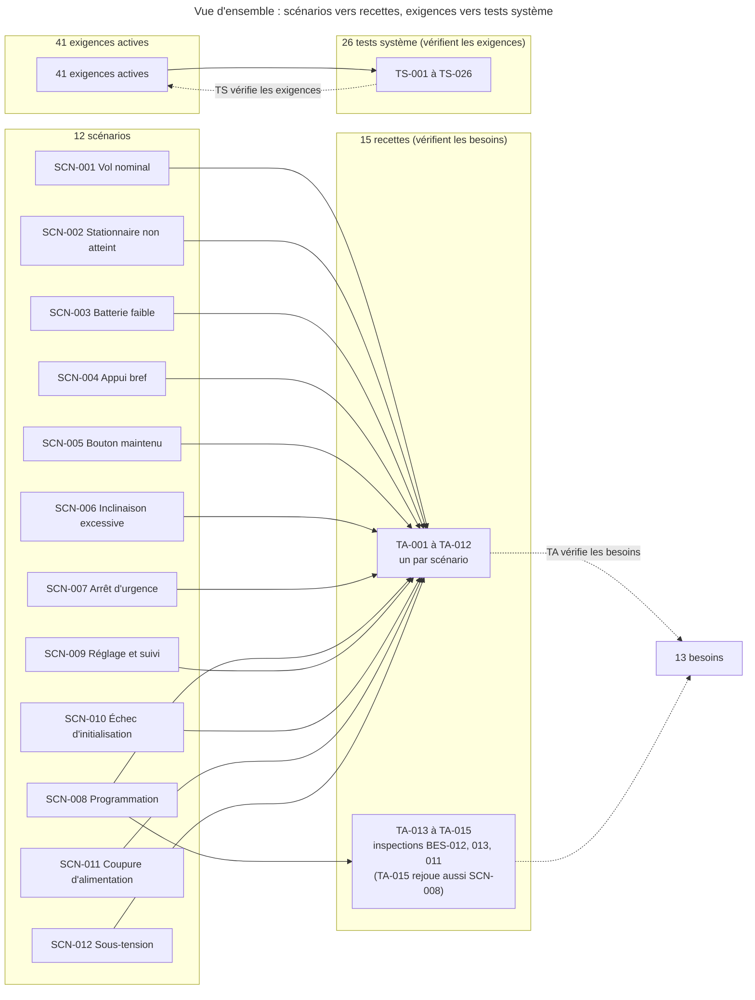

# Plans de test

> **Aperçu**
> - Deux niveaux définis à ce stade : 15 recettes (TA) qui vérifient les besoins en rejouant les 12 scénarios (celui de la mise en service par deux recettes) et en inspectant 3 besoins ; 26 tests système (TS) qui vérifient les 41 exigences actives.
> - Chaque exigence active a au moins un TS, chaque besoin au moins un TA ; les valeurs attendues sont celles de « Exigences système » — `projets/boomrone/02-exigences.md`.
> - Moyens simples : banc maison, alimentation de laboratoire, chronomètre ou caméra, oscilloscope ou analyseur logique, appareil de suivi, pièce d'essai.
> - Les tests d'intégration (TI) et unitaires (TU) viennent avec l'architecture et la conception détaillée (dans l'ordre d'exécution, TU puis TI précèdent TS puis TA).
> - État : tous les tests sont écrits, aucun n'est exécuté (le prototype n'existe pas encore).

## Vue d'ensemble

*Légende : trait plein = « le scénario est rejoué par la recette » ou « l'exigence est vérifiée par le test » ; pointillé = « vérifie ». Les tests d'intégration (TI) et unitaires (TU) ne figurent pas ici : ils viennent avec l'architecture et la conception détaillée. Titres abrégés ; titres complets dans les tableaux de couverture.*

## Niveaux de test

| Niveau | Vérifie | Préfixe | Nombre | État |
|---|---|---|---|---|
| Recette | Besoins | TA | 15 | écrit |
| Système | Exigences | TS | 26 | écrit |
| Intégration | Architecture | TI | 0 | après l'architecture |
| Unitaire | Conception détaillée | TU | 0 | après la conception détaillée |

## Moyens d'essai

| Moyen | Usage |
|---|---|
| Banc maison | drone fixé sur potence ou cadre, hélices démontées ou moteurs en charge factice, pour la logique et les délais |
| Alimentation de laboratoire | tension de batterie réglable par élément, creux de tension |
| Chronomètre, caméra à 120 ou 240 images par seconde | durées, hauteurs, vitesses de contact |
| Oscilloscope ou analyseur logique | délais entre le bouton, les commandes des moteurs et les effets ; déclenchement des commandes sans fil |
| Appareil de suivi | ordinateur ou téléphone avec le logiciel d'essai écrit par l'utilisateur (REQ-040 « Appareil de suivi ») |
| Pièce d'essai | pièce de 4 m × 4 m × 2,5 m, repères au sol, sol dégagé |
| Lieu plus grand | gymnase ou jardin, pour les lancers à plus de 1 m/s |
| Plateau tournant, plateau vibrant | rotation et secousses mesurées pour les conditions d'immobilité |
| Calibre de 12 mm, pied à coulisse, balance | protège-hélices, dimensions, masse |

## Couverture

### Scénarios vers recettes

| Scénario | Recette |
|---|---|
| SCN-001 « Vol nominal : de la batterie au posé » | TA-001 « Recette du vol nominal » |
| SCN-002 « Échec : stationnaire non atteint dans le délai » | TA-002 « Recette de l'échec de stationnaire » |
| SCN-003 « Échec : batterie faible à l'armement » | TA-003 « Recette du refus sur batterie faible » |
| SCN-004 « Appui normal : bouton relâché avant 2 secondes » | TA-004 « Recette de l'appui bref » |
| SCN-005 « Dégradé : bouton maintenu plus de 10 secondes » | TA-005 « Recette du bouton maintenu plus de 10 secondes » |
| SCN-006 « Échec : inclinaison excessive après le stationnaire » | TA-006 « Recette de l'inclinaison excessive » |
| SCN-007 « Dégradé : arrêt d'urgence par le bouton en vol » | TA-007 « Recette de l'arrêt d'urgence en vol » |
| SCN-008 « Mise en service : programmation du drone » | TA-008 « Recette de la mise en service par programmation » ; TA-015 « Inspection de la fabrication à la main » |
| SCN-009 « Réglage et suivi du drone par le sans fil » | TA-009 « Recette du réglage et du suivi sans fil » |
| SCN-010 « Échec : initialisation impossible au démarrage » | TA-010 « Recette de l'échec d'initialisation » |
| SCN-011 « Dégradé : coupure d'alimentation en vol » | TA-011 « Recette de la coupure d'alimentation en vol » |
| SCN-012 « Dégradé : sous-tension de la batterie » | TA-012 « Recette de la sous-tension de la batterie » |
| (aucun, inspection) | TA-013 « Inspection des consignes d'emploi » ; TA-014 « Inspection du drone de poche protégé » |

### Besoins vers recettes

| Besoin | Recettes |
|---|---|
| BES-001 « Lancer le drone à la main » | TA-001 « Recette du vol nominal » ; TA-002 « Recette de l'échec de stationnaire » |
| BES-002 « Ne pas armer ni lancer par erreur » | TA-004 « Recette de l'appui bref » ; TA-005 « Recette du bouton maintenu plus de 10 secondes » |
| BES-003 « Rester en vol stationnaire 10 s puis atterrir doucement » | TA-001 « Recette du vol nominal » |
| BES-004 « Ne pas voler quand le drone n'est pas prêt » | TA-003 « Recette du refus sur batterie faible » ; TA-010 « Recette de l'échec d'initialisation » ; TA-011 « Recette de la coupure d'alimentation en vol » |
| BES-005 « Couper les moteurs quand le vol ne peut pas continuer » | TA-001 « Recette du vol nominal » ; TA-002 « Recette de l'échec de stationnaire » ; TA-006 « Recette de l'inclinaison excessive » ; TA-011 « Recette de la coupure d'alimentation en vol » ; TA-012 « Recette de la sous-tension de la batterie » |
| BES-006 « Arrêter le drone en vol d'un geste » | TA-007 « Recette de l'arrêt d'urgence en vol » |
| BES-007 « Savoir où en est le drone sans autre appareil » | TA-001 « Recette du vol nominal » ; TA-002 « Recette de l'échec de stationnaire » ; TA-003 « Recette du refus sur batterie faible » ; TA-004 « Recette de l'appui bref » ; TA-005 « Recette du bouton maintenu plus de 10 secondes » ; TA-006 « Recette de l'inclinaison excessive » ; TA-007 « Recette de l'arrêt d'urgence en vol » ; TA-010 « Recette de l'échec d'initialisation » ; TA-011 « Recette de la coupure d'alimentation en vol » ; TA-012 « Recette de la sous-tension de la batterie » |
| BES-008 « Entrer en mode réglage et faire des vols de réglage » | TA-009 « Recette du réglage et du suivi sans fil » |
| BES-009 « Régler et sauvegarder les paramètres de vol » | TA-002 « Recette de l'échec de stationnaire » ; TA-008 « Recette de la mise en service par programmation » ; TA-009 « Recette du réglage et du suivi sans fil » |
| BES-010 « Suivre le drone sur un appareil de suivi » | TA-002 « Recette de l'échec de stationnaire » ; TA-003 « Recette du refus sur batterie faible » ; TA-006 « Recette de l'inclinaison excessive » ; TA-007 « Recette de l'arrêt d'urgence en vol » ; TA-009 « Recette du réglage et du suivi sans fil » |
| BES-011 « Fabriquer et programmer le drone soi-même » | TA-008 « Recette de la mise en service par programmation » ; TA-015 « Inspection de la fabrication à la main » |
| BES-012 « Disposer d'une page de consignes d'emploi » | TA-001 « Recette du vol nominal » ; TA-012 « Recette de la sous-tension de la batterie » ; TA-013 « Inspection des consignes d'emploi » |
| BES-013 « Voler en appartement avec un drone de poche protégé » | TA-001 « Recette du vol nominal » ; TA-014 « Inspection du drone de poche protégé » |

### Tests système vers exigences

| Test système | Exigences vérifiées |
|---|---|
| TS-001 « Anti-rebond et chronologie d'un appui » | REQ-002 « Chronologie d'un appui sur le bouton » |
| TS-002 « Conditions de départ et refus d'armement » | REQ-003 « Conditions de départ du drone » ; REQ-041 « Conditions d'acceptation de la commande Décoller » |
| TS-003 « Démarrage des moteurs : délai et geste volontaire » | REQ-004 « Démarrage des moteurs 200 ms après le relâchement » ; REQ-005 « Démarrage des moteurs sur geste volontaire seulement » |
| TS-004 « Stabilisation après le lancer » | REQ-006 « Stabilisation après le lancer » |
| TS-005 « Critère et tenue du vol stationnaire » | REQ-007 « Critère de vol stationnaire » ; REQ-008 « Tenue du vol stationnaire » |
| TS-006 « Atterrissage doux » | REQ-009 « Atterrissage doux » |
| TS-007 « Verrouillage après un posé, une coupure ou un redémarrage » | REQ-010 « Verrouillage après un posé, une coupure ou un redémarrage » ; REQ-035 « Appui en cours à un changement d'état » |
| TS-008 « Coupures automatiques en vol » | REQ-011 « Coupures automatiques en vol » |
| TS-009 « Coupure sur sous-tension et marge de batterie » | REQ-012 « Coupure sur sous-tension de la batterie » ; REQ-013 « Marge de batterie pour un vol complet » |
| TS-010 « Coupure sur logiciel bloqué ou phase Lancé trop longue » | REQ-014 « Coupure sur logiciel bloqué » ; REQ-036 « Coupure sur phase Lancé trop longue » |
| TS-011 « Garde et arrêt d'urgence par le bouton » | REQ-015 « Garde du bouton après le lancer » ; REQ-016 « Arrêt d'urgence par le bouton » |
| TS-012 « Initialisation et échec d'initialisation » | REQ-017 « Initialisation en 3 secondes » ; REQ-037 « Comportement en échec d'initialisation » |
| TS-013 « Effets locaux par situation » | REQ-018 « Effets locaux par situation » |
| TS-014 « Perceptibilité et distinction des effets » | REQ-019 « Perceptibilité et distinction des effets » |
| TS-015 « Statut sans fil et variables du vol » | REQ-020 « Statut sans fil » ; REQ-038 « Causes et paramètres dans le statut sans fil » ; REQ-021 « Variables du vol » |
| TS-016 « Arrêt sans fil » | REQ-022 « Arrêt sans fil » |
| TS-017 « Commandes sans fil selon l'état » | REQ-023 « Commandes sans fil selon l'état du drone » |
| TS-018 « Mode réglage et vol de réglage » | REQ-024 « Entrée en mode réglage par le bouton » ; REQ-025 « Vol de réglage » ; REQ-041 « Conditions d'acceptation de la commande Décoller » |
| TS-019 « Paramètres, sauvegarde et valeurs d'origine » | REQ-026 « Paramètres de vol réglables » ; REQ-027 « Sauvegarde et chargement des réglages » ; REQ-028 « Valeurs d'origine après la programmation » |
| TS-020 « Fabrication à la main » | REQ-029 « Composants disponibles à l'unité » ; REQ-044 « Assemblage à la main » |
| TS-021 « Programmation depuis l'ordinateur » | REQ-030 « Programmation depuis l'ordinateur » |
| TS-022 « Dimensions, masse et protège-hélices » | REQ-031 « Drone de poche » ; REQ-032 « Protège-hélices » |
| TS-023 « Vol dans une pièce d'appartement » | REQ-033 « Vol dans une pièce d'appartement » |
| TS-024 « Page de consignes d'emploi » | REQ-034 « Page de consignes d'emploi » |
| TS-025 « Appareil de suivi et logiciel d'essai » | REQ-040 « Appareil de suivi » |
| TS-026 « Batterie débranchable à la main » | REQ-045 « Batterie débranchable à la main » |

## Recettes (TA)

Chaque recette vérifie des besoins en rejouant un scénario complet, avec un drone prototype, sans équipement de mesure sauf le chronomètre ; le champ `Scénario rejoué` nomme le scénario (l'outil de traçabilité n'accepte que des besoins en `Réfs amont` : DEC-192 « Outil de traçabilité inchangé : TA vers BES, scénario en champ texte, DEC en champ séparé »). Valeurs attendues : celles des exigences citées dans « Exigences système » — `projets/boomrone/02-exigences.md`. Trois recettes (TA-013 « Inspection des consignes d'emploi » à TA-015 « Inspection de la fabrication à la main ») sont des inspections de besoins ; la dernière rejoue aussi le scénario de mise en service.

### TA-001 — Recette du vol nominal
**Réfs amont :** BES-001 « Lancer le drone à la main » ; BES-003 « Rester en vol stationnaire 10 s puis atterrir doucement » ; BES-005 « Couper les moteurs quand le vol ne peut pas continuer » ; BES-007 « Savoir où en est le drone sans autre appareil » ; BES-012 « Disposer d'une page de consignes d'emploi » ; BES-013 « Voler en appartement avec un drone de poche protégé »
**Scénario rejoué :** SCN-001 « Vol nominal : de la batterie au posé »
**Préconditions :** prototype complet avec protège-hélices et batterie chargée, pièce d'essai de 4 m × 4 m × 2,5 m, page de consignes lue, sans appareil de suivi.
**Procédure :** poser le drone à plat, brancher la batterie, appuyer 2 s, relâcher en lançant doucement (au plus 1 m/s) vers le haut et l'avant ; observer jusqu'au posé.
**Résultat attendu :** effets Allumé, Appui validé, Prêt, Lancé et vol, Posé, puis Allumé ; stationnaire de 10,0 s ±0,5 s à 0,8 m à 1,2 m de hauteur de la 3e à la 10e seconde (REQ-008 « Tenue du vol stationnaire ») ; drone posé, moteurs arrêtés, intact, sans sortir de la pièce.
**Statut :** Écrit

### TA-002 — Recette de l'échec de stationnaire
**Réfs amont :** BES-001 « Lancer le drone à la main » ; BES-005 « Couper les moteurs quand le vol ne peut pas continuer » ; BES-007 « Savoir où en est le drone sans autre appareil » ; BES-009 « Régler et sauvegarder les paramètres de vol » ; BES-010 « Suivre le drone sur un appareil de suivi »
**Scénario rejoué :** SCN-002 « Échec : stationnaire non atteint dans le délai »
**Préconditions :** drone armé, appareil de suivi relié, hélices démontées ou drone posé au sol (hauteur de moins de 0,3 m, REQ-007 « Critère de vol stationnaire ») ; jamais tenu en main (limite assumée de REQ-007 « Critère de vol stationnaire »).
**Procédure :** poser le drone armé sur une table (hélices démontées) ou au sol, relâcher le bouton sans lancer, chronométrer depuis le démarrage des moteurs ; lire le statut sans fil.
**Résultat attendu :** moteurs coupés 2,0 s ±0,1 s après leur démarrage (REQ-011 « Coupures automatiques en vol »), effet Coupure en vol puis Allumé, cause « échec de stabilisation » lue sur l'appareil de suivi (REQ-038 « Causes et paramètres dans le statut sans fil »), drone verrouillé.
**Statut :** Écrit

### TA-003 — Recette du refus sur batterie faible
**Réfs amont :** BES-004 « Ne pas voler quand le drone n'est pas prêt » ; BES-007 « Savoir où en est le drone sans autre appareil » ; BES-010 « Suivre le drone sur un appareil de suivi »
**Scénario rejoué :** SCN-003 « Échec : batterie faible à l'armement »
**Préconditions :** batterie sous le seuil d'armement (3,7 V par élément), appareil de suivi relié.
**Procédure :** appuyer sur le bouton et le maintenir plus de 2 s.
**Résultat attendu :** effets Appui validé puis Refus puis Allumé ; au relâchement, moteurs non démarrés ; cause « batterie faible » sur l'appareil de suivi.
**Statut :** Écrit

### TA-004 — Recette de l'appui bref
**Réfs amont :** BES-002 « Ne pas armer ni lancer par erreur » ; BES-007 « Savoir où en est le drone sans autre appareil »
**Scénario rejoué :** SCN-004 « Appui normal : bouton relâché avant 2 secondes »
**Préconditions :** drone allumé, hélices démontées par prudence.
**Procédure :** recette de non-régression, sans valeur nouvelle (les durées sont mesurées par TS-001 « Anti-rebond et chronologie d'un appui ») : appuyer 0,5 s, puis trois fois 1,5 s de suite.
**Résultat attendu :** aucun effet pour 0,5 s ; effet Appui validé pour chaque appui de 1,5 s, sans effet cumulé ; moteurs jamais démarrés ; le drone reste en mode normal.
**Statut :** Écrit

### TA-005 — Recette du bouton maintenu plus de 10 secondes
**Réfs amont :** BES-002 « Ne pas armer ni lancer par erreur » ; BES-007 « Savoir où en est le drone sans autre appareil »
**Scénario rejoué :** SCN-005 « Dégradé : bouton maintenu plus de 10 secondes »
**Préconditions :** drone allumé, hélices démontées par prudence.
**Procédure :** maintenir le bouton 12 s, relâcher, puis appuyer de nouveau 2 s.
**Résultat attendu :** effets Appui validé, Prêt, puis Désarmement à 10,0 s ±0,2 s puis Allumé ; au relâchement, moteurs non démarrés ; le second appui donne l'effet Prêt.
**Statut :** Écrit

### TA-006 — Recette de l'inclinaison excessive
**Réfs amont :** BES-005 « Couper les moteurs quand le vol ne peut pas continuer » ; BES-007 « Savoir où en est le drone sans autre appareil » ; BES-010 « Suivre le drone sur un appareil de suivi »
**Scénario rejoué :** SCN-006 « Échec : inclinaison excessive après le stationnaire »
**Préconditions :** vol en stationnaire sur potence protégée ou en vol libre dans la pièce, appareil de suivi relié.
**Procédure :** pendant le stationnaire, pousser le drone pour l'incliner à plus de 65°.
**Résultat attendu :** moteurs coupés, effet Coupure en vol puis Allumé ; cause « basculement » sur l'appareil de suivi ; drone verrouillé.
**Statut :** Écrit

### TA-007 — Recette de l'arrêt d'urgence en vol
**Réfs amont :** BES-006 « Arrêter le drone en vol d'un geste » ; BES-007 « Savoir où en est le drone sans autre appareil » ; BES-010 « Suivre le drone sur un appareil de suivi »
**Scénario rejoué :** SCN-007 « Dégradé : arrêt d'urgence par le bouton en vol »
**Préconditions :** deux vols, appareil de suivi relié pour le second.
**Procédure :** vol 1 : appuyer sur le bouton en stationnaire (appui tenu au moins 0,5 s). Vol 2 : envoyer la commande Arrêt depuis l'appareil de suivi.
**Résultat attendu :** moteurs coupés dans les deux cas, effet Coupure en vol puis Allumé ; causes « arrêt par le bouton » puis « arrêt sans fil » lues ; drone verrouillé.
**Statut :** Écrit

### TA-008 — Recette de la mise en service par programmation
**Réfs amont :** BES-009 « Régler et sauvegarder les paramètres de vol » ; BES-011 « Fabriquer et programmer le drone soi-même »
**Scénario rejoué :** SCN-008 « Mise en service : programmation du drone »
**Préconditions :** carte neuve, ordinateur, programmateur, batterie chargée, hélices démontées.
**Procédure :** relier le programmateur, programmer, débrancher, brancher la batterie ; puis reprogrammer une carte dont les réglages ont été sauvegardés.
**Résultat attendu :** effet Allumé après la programmation ; après la reprogrammation, les quatre paramètres de vol sont aux valeurs d'origine (REQ-026 « Paramètres de vol réglables »).
**Statut :** Écrit

### TA-009 — Recette du réglage et du suivi sans fil
**Réfs amont :** BES-008 « Entrer en mode réglage et faire des vols de réglage » ; BES-009 « Régler et sauvegarder les paramètres de vol » ; BES-010 « Suivre le drone sur un appareil de suivi »
**Scénario rejoué :** SCN-009 « Réglage et suivi du drone par le sans fil »
**Préconditions :** drone programmé, appareil de suivi relié, sol plat et dégagé, protège-hélices en place.
**Procédure :** bouton tenu en branchant la batterie ; envoyer Décoller ; modifier un paramètre ; envoyer Sauvegarder ; débrancher et rebrancher ; relire.
**Résultat attendu :** effet Mode réglage ; vol de réglage de 3,0 s ±0,5 s de stationnaire puis retour en mode réglage ; variables du vol reçues ; paramètre modifié relu dans le statut puis retrouvé après redémarrage ; le redémarrage sans bouton revient en mode normal.
**Statut :** Écrit

### TA-010 — Recette de l'échec d'initialisation
**Réfs amont :** BES-004 « Ne pas voler quand le drone n'est pas prêt » ; BES-007 « Savoir où en est le drone sans autre appareil »
**Scénario rejoué :** SCN-010 « Échec : initialisation impossible au démarrage »
**Préconditions :** drone hors tension, hélices démontées par prudence.
**Procédure :** brancher la batterie en secouant le drone ; essayer le bouton et une commande sans fil ; débrancher, poser à plat, rebrancher.
**Résultat attendu :** effet Échec d'initialisation ; bouton et commandes sans effet ; après le rebranchement posé à plat, effet Allumé.
**Statut :** Écrit

### TA-011 — Recette de la coupure d'alimentation en vol
**Réfs amont :** BES-004 « Ne pas voler quand le drone n'est pas prêt » ; BES-005 « Couper les moteurs quand le vol ne peut pas continuer » ; BES-007 « Savoir où en est le drone sans autre appareil »
**Scénario rejoué :** SCN-011 « Dégradé : coupure d'alimentation en vol »
**Préconditions :** drone en stationnaire sur potence protégée ou en vol libre dans la pièce.
**Procédure :** couper la batterie en vol ; la rebrancher drone posé à plat ; recommencer en la rebranchant drone en mouvement.
**Résultat attendu :** moteurs arrêtés dès la coupure, jamais de reprise du vol seul ; effet Allumé si le drone est immobile et à plat, Échec d'initialisation sinon.
**Statut :** Écrit

### TA-012 — Recette de la sous-tension de la batterie
**Réfs amont :** BES-005 « Couper les moteurs quand le vol ne peut pas continuer » ; BES-007 « Savoir où en est le drone sans autre appareil » ; BES-012 « Disposer d'une page de consignes d'emploi »
**Scénario rejoué :** SCN-012 « Dégradé : sous-tension de la batterie »
**Préconditions :** alimentation de laboratoire à la place de la batterie, drone au banc.
**Procédure :** drone allumé puis moteurs en marche : abaisser la tension sous 3,3 V par élément pendant plus de 120 ms ; remonter la tension, redémarrer ; refaire en mode réglage.
**Résultat attendu :** moteurs coupés au plus 250 ms après le passage sous 3,3 V (REQ-012 « Coupure sur sous-tension de la batterie »), puis effet Échec d'initialisation, y compris en mode réglage : bouton et commandes sans effet, il faut débrancher la batterie ; au retour de l'alimentation, effet Allumé ou Échec d'initialisation selon l'état ; la page de consignes dit de débrancher la batterie après usage.
**Statut :** Écrit

### TA-013 — Inspection des consignes d'emploi
**Réfs amont :** BES-012 « Disposer d'une page de consignes d'emploi »
**Scénario rejoué :** (aucun, inspection du besoin sans scénario propre)
**Préconditions :** « Consignes d'emploi » — `projets/boomrone/consignes-emploi.md` et « Risques acceptés » — `projets/boomrone/risques-acceptes.md`.
**Procédure :** lire la page ; compter les lignes et les mots ; contrôle croisé avec chaque ligne du registre des risques.
**Résultat attendu :** une face A4, 60 lignes au plus, une consigne à l'infinitif par ligne de 15 mots au plus (REQ-034 « Page de consignes d'emploi »), quatre réflexes en tête ; tout risque majeur repris, ou écart justifié par écrit.
**Statut :** Écrit

### TA-014 — Inspection du drone de poche protégé
**Réfs amont :** BES-013 « Voler en appartement avec un drone de poche protégé »
**Scénario rejoué :** (aucun, inspection du besoin sans scénario propre)
**Préconditions :** prototype complet avec protège-hélices.
**Procédure :** mesurer l'encombrement et la masse (REQ-031 « Drone de poche ») ; passer le calibre de 12 mm dans le plan des hélices (REQ-032 « Protège-hélices ») ; poser le drone dans une poche de pantalon ordinaire.
**Résultat attendu :** mesures conformes à REQ-031 « Drone de poche » et REQ-032 « Protège-hélices » ; verdict de l'utilisateur, oui ou non, noté : « le drone tient dans la poche sans gêne ».
**Statut :** Écrit

### TA-015 — Inspection de la fabrication à la main
**Réfs amont :** BES-011 « Fabriquer et programmer le drone soi-même »
**Scénario rejoué :** SCN-008 « Mise en service : programmation du drone » (partie fabrication ; la partie programmation et reprogrammation est rejouée par TA-008 « Recette de la mise en service par programmation »)
**Préconditions :** nomenclature complète, outillage courant de l'utilisateur, sans appareil de suivi.
**Procédure :** monter une carte à la main d'après la nomenclature ; la programmer ; la mettre sous tension.
**Résultat attendu :** montage terminé avec l'outillage courant seulement (REQ-044 « Assemblage à la main »), chaque composant trouvé à l'unité chez au moins un revendeur (REQ-029 « Composants disponibles à l'unité »), le drone démarre normalement (effet Allumé).
**Statut :** Écrit

## Tests système (TS)

### TS-001 — Anti-rebond et chronologie d'un appui
**Réfs amont :** REQ-002 « Chronologie d'un appui sur le bouton »
**Préconditions :** drone au banc, hélices démontées ; générateur d'impulsions ; chronomètre ; alimentation de laboratoire à 3,8 V par élément (drone prêt) puis à 3,6 V (non prêt).
**Procédure :** impulsions de 6 ms puis de 14 ms sur le bouton ; appuis de 0,5 s, 1,5 s, 2,5 s (drone prêt), 2,5 s (drone non prêt) et 11 s.
**Résultat attendu :** 6 ms ignorée, 14 ms prise en compte ; 0,5 s sans effet ; Appui validé à 1,0 s ±0,1 s ; Prêt à 2,0 s ±0,1 s ; Refus pour le drone non prêt ; Désarmement à 10,0 s ±0,2 s, moteurs non démarrés au relâchement.
**Statut :** Écrit

### TS-002 — Conditions de départ et refus d'armement
**Réfs amont :** REQ-003 « Conditions de départ du drone » ; REQ-041 « Conditions d'acceptation de la commande Décoller »
**Préconditions :** drone au banc, alimentation de laboratoire, plateau tournant, plateau vibrant ou mouvement répété mesuré.
**Procédure :** armer dans chacun des cas suivants : tension de 3,6 V puis 3,8 V par élément ; inclinaison de 20° puis 10° ; rotation à 40 °/s puis 20 °/s ; secousse de ±0,8 m/s² puis ±0,3 m/s². En mode réglage : Décoller à 3,6 V, à 3,8 V bouton enfoncé, puis à 3,8 V bouton relâché.
**Résultat attendu :** Refus à 3,6 V, à 20°, à 40 °/s et à ±0,8 m/s² ; Prêt à 3,8 V, à 10°, à 20 °/s et à ±0,3 m/s² ; Décoller refusé (effet Refus, le drone reste en mode réglage) à 3,6 V et bouton enfoncé, accepté à 3,8 V bouton relâché.
**Statut :** Écrit

### TS-003 — Démarrage des moteurs : délai et geste volontaire
**Réfs amont :** REQ-004 « Démarrage des moteurs 200 ms après le relâchement » ; REQ-005 « Démarrage des moteurs sur geste volontaire seulement »
**Préconditions :** drone au banc, hélices démontées, oscilloscope ou analyseur logique sur le bouton et la commande des moteurs.
**Procédure :** armer et relâcher entre 2 s et 10 s ; puis 10 mises sous tension, 10 coupures d'alimentation suivies d'un redémarrage, 10 appuis de moins de 2 s et une commande Décoller hors mode réglage.
**Résultat attendu :** effet Lancé et vol au plus 50 ms après le relâchement ; moteurs démarrés 200 ms ±50 ms après ; dans les 31 autres cas, moteurs jamais démarrés (0 sur 31).
**Statut :** Écrit

### TS-004 — Stabilisation après le lancer
**Réfs amont :** REQ-006 « Stabilisation après le lancer »
**Préconditions :** pièce d'essai de 4 m × 4 m × 2,5 m pour les lancers à 1 m/s au plus ; gymnase ou jardin pour les lancers plus rapides ; caméra ; drone avec protège-hélices.
**Procédure :** 20 lancers variés (orientations à plat, tête en bas, sur la tranche ; vitesses de 0,5 et 1 m/s dans la pièce, de 2 et 4 m/s dans le lieu plus grand ; rotation jusqu'à 1 tour par seconde ; hauteur de 1,5 à 2 m).
**Résultat attendu :** au moins 18 lancers sur 20 avec stationnaire déclaré 2,0 s au plus après le démarrage des moteurs ; sinon, résultats consignés et plage à revoir.
**Statut :** Écrit

### TS-005 — Critère et tenue du vol stationnaire
**Réfs amont :** REQ-007 « Critère de vol stationnaire » ; REQ-008 « Tenue du vol stationnaire »
**Préconditions :** banc et pièce d'essai, règle graduée ou quadrillage, caméra, appareil de suivi.
**Procédure :** moteurs en marche drone posé ; puis suspendu à 0,2 m, immobile et à plat ; suspendu à 0,5 m immobile et à plat ; suspendu à 0,5 m incliné à 20° ; suspendu à 0,5 m déplacé à 0,5 m/s ; puis 5 vols filmés.
**Résultat attendu :** stationnaire jamais déclaré posé, ni à 0,2 m, ni incliné à 20°, ni à 0,5 m/s ; déclaré à 0,5 m immobile et à plat ; vol : 10,0 s ±0,5 s, hauteur entre 0,8 m et 1,2 m de la 3e à la 10e seconde, dérive d'au plus 0,5 m ; dérive vers l'objectif de 0,3 m consignée.
**Statut :** Écrit

### TS-006 — Atterrissage doux
**Réfs amont :** REQ-009 « Atterrissage doux »
**Préconditions :** pièce d'essai, caméra à 120 images par seconde.
**Procédure :** 5 vols complets filmés de côté.
**Résultat attendu :** vitesse au contact d'au plus 0,5 m/s ; moteurs coupés à 2 à 3 cm du sol ; effet Posé ; Posé atteint avant la coupure sur délai d'atterrissage de REQ-011 « Coupures automatiques en vol » (15,0 s ±0,5 s).
**Statut :** Écrit

### TS-007 — Verrouillage après un posé, une coupure ou un redémarrage
**Réfs amont :** REQ-010 « Verrouillage après un posé, une coupure ou un redémarrage » ; REQ-035 « Appui en cours à un changement d'état »
**Préconditions :** banc ou pièce d'essai, hélices démontées par prudence ; logiciel d'essai pour bloquer le logiciel.
**Procédure :** après chacune des causes (posé, échec de stabilisation, arrêt par le bouton, arrêt sans fil, basculement, délai d'atterrissage, coupure d'alimentation, sous-tension, logiciel bloqué), tenir le bouton enfoncé puis le relâcher, puis faire un appui complet ; refaire en mode réglage ; tenir aussi le bouton au retour à l'attente après un Refus et un Désarmement.
**Résultat attendu :** moteurs arrêtés tant qu'aucun appui complet n'a eu lieu ; l'appui en cours au changement d'état est ignoré jusqu'au relâchement ; après un appui complet, le drone peut s'armer ; en mode réglage, retour au mode réglage sans verrouillage, sauf après une sous-tension (échec d'initialisation : bouton et commandes sans effet jusqu'au débranchement).
**Statut :** Écrit

### TS-008 — Coupures automatiques en vol
**Réfs amont :** REQ-011 « Coupures automatiques en vol »
**Préconditions :** banc avec potence, caméra ou analyseur logique, appareil de suivi.
**Procédure :** (1) drone armé posé sur une table, hélices démontées, bouton relâché sans lancer ; (2) en stationnaire, le retourner à plus de 60° ; l'incliner à 55° pendant 1 s ; l'incliner à 65° pendant 1 s ; (3) retenir le drone pendant l'atterrissage.
**Résultat attendu :** (1) moteurs coupés 2,0 s ±0,1 s après leur démarrage ; (2) aucune coupure à 55° ; coupure à 65° et au retournement, après plus de 0,1 s ; (3) coupure à 15,0 s ±0,5 s ; dans chaque cas coupure 100 ms au plus après la détection, effet Coupure en vol et cause lue sur l'appareil de suivi.
**Statut :** Écrit

### TS-009 — Coupure sur sous-tension et marge de batterie
**Réfs amont :** REQ-012 « Coupure sur sous-tension de la batterie » ; REQ-013 « Marge de batterie pour un vol complet »
**Préconditions :** alimentation de laboratoire ; batterie choisie à l'architecture ; banc avec moteurs en charge.
**Procédure :** abaisser la tension lentement puis par des creux de 50 ms et de 150 ms, dans quatre états (attente, armé, moteurs en marche, mode réglage) ; puis amener la batterie à 3,7 V par élément à vide et faire tourner les moteurs 30 s en enregistrant la tension.
**Résultat attendu :** coupure au plus 250 ms après le passage sous 3,3 V par élément quand la tension y reste 100 ms ±20 ms, puis effet Échec d'initialisation, bouton sans effet jusqu'au débranchement ; aucune coupure sur le creux de 50 ms ; coupure sur celui de 150 ms ; pendant les 30 s, la tension ne reste pas sous 3,3 V par élément pendant 100 ms.
**Statut :** Écrit

### TS-010 — Coupure sur logiciel bloqué ou phase Lancé trop longue
**Réfs amont :** REQ-014 « Coupure sur logiciel bloqué » ; REQ-036 « Coupure sur phase Lancé trop longue »
**Préconditions :** logiciel d'essai capable de se bloquer et de retarder le démarrage des moteurs ; analyseur logique ; banc.
**Procédure :** bloquer le logiciel moteurs en marche ; retarder le démarrage des moteurs de plus de 500 ms après le relâchement.
**Résultat attendu :** moteurs arrêtés 200 ms au plus après la dernière exécution correcte du logiciel ; moteurs restés arrêtés et drone verrouillé 200 ms au plus après les 500 ms ; aucun démarrage seul des moteurs.
**Statut :** Écrit

### TS-011 — Garde et arrêt d'urgence par le bouton
**Réfs amont :** REQ-015 « Garde du bouton après le lancer » ; REQ-016 « Arrêt d'urgence par le bouton »
**Préconditions :** banc, oscilloscope ou caméra à 240 images par seconde, appareil de suivi.
**Procédure :** appui bref pendant la garde ; appui maintenu jusqu'à la fin de la garde ; appui après la garde en vol normal ; appui en vol de réglage juste après le décollage de réglage.
**Résultat attendu :** appui bref sans effet ; appui maintenu : arrêt à la fin de la garde de 0,5 s ±0,1 s, moteurs coupés 50 ms au plus après cette fin (délai mesuré) ; appui après la garde : moteurs coupés 50 ms au plus après l'anti-rebond ; vol de réglage : arrêt sans garde.
**Statut :** Écrit

### TS-012 — Initialisation et échec d'initialisation
**Réfs amont :** REQ-017 « Initialisation en 3 secondes » ; REQ-037 « Comportement en échec d'initialisation »
**Préconditions :** drone au banc, chronomètre.
**Procédure :** mise sous tension à plat ; secouée ; inclinée à 20° ; coupure d'alimentation puis redémarrage drone posé, puis drone en mouvement ; bouton et commandes sans fil après l'échec ; appui commencé pendant l'initialisation et maintenu au-delà de sa fin.
**Résultat attendu :** initialisation en 3 s au plus ; Allumé à plat et immobile ; Échec d'initialisation sinon, moteurs jamais démarrés, bouton et commandes sans effet, échec maintenu jusqu'au débranchement ; l'appui maintenu à la fin de l'initialisation est ignoré jusqu'au relâchement ; la batterie n'est pas contrôlée à l'initialisation (seulement à l'armement : TS-002 « Conditions de départ et refus d'armement »).
**Statut :** Écrit

### TS-013 — Effets locaux par situation
**Réfs amont :** REQ-018 « Effets locaux par situation »
**Préconditions :** banc et pièce d'essai, appareil de suivi.
**Procédure :** provoquer les situations des 10 effets (dont les cinq causes de coupure en vol et le Lancé), une coupure d'alimentation et une sous-tension.
**Résultat attendu :** chaque situation donne son effet ; les dix effets sont distincts ; la coupure d'alimentation ne donne aucun effet propre et la sous-tension (drone encore alimenté) donne l'effet Échec d'initialisation ; le statut sans fil porte l'état correspondant.
**Statut :** Écrit

### TS-014 — Perceptibilité et distinction des effets
**Réfs amont :** REQ-019 « Perceptibilité et distinction des effets »
**Préconditions :** pièce éclairée (environ 300 lux), un observateur, une fiche des dix effets, chronomètre.
**Procédure :** présenter les dix effets dans un ordre aléatoire à 1,0 m, moteurs arrêtés, en une passe ; mesurer la durée des effets d'événement ; refaire la lumière moteurs en marche.
**Résultat attendu :** 10 effets identifiés sur 10 ; effets d'événement visibles ou audibles au moins 0,5 s ; lumière visible moteurs en marche.
**Statut :** Écrit

### TS-015 — Statut sans fil et variables du vol
**Réfs amont :** REQ-020 « Statut sans fil » ; REQ-038 « Causes et paramètres dans le statut sans fil » ; REQ-021 « Variables du vol »
**Préconditions :** appareil de suivi à 5 m, pièce d'essai.
**Procédure :** provoquer chaque état, chaque cause de refus et chaque cause de coupure ; relever le nombre de statuts reçus par seconde ; enregistrer 10 s de vol.
**Résultat attendu :** code d'état exact pour chacun des dix-sept états, reçu à chaque changement d'état ; au moins 2 statuts par seconde ; dernières causes conservées jusqu'à la mise hors tension ; au moins 100 valeurs de hauteur, d'inclinaison et de commandes des moteurs reçues sur 10 s.
**Statut :** Écrit

### TS-016 — Arrêt sans fil
**Réfs amont :** REQ-022 « Arrêt sans fil »
**Préconditions :** banc, appareil de suivi, analyseur logique ou caméra.
**Procédure :** commande Arrêt en vol normal sur banc, en vol de réglage, puis au sol.
**Résultat attendu :** moteurs coupés 200 ms au plus après la commande en vol, effet Coupure en vol, cause « arrêt sans fil » ; au sol, commande sans effet.
**Statut :** Écrit

### TS-017 — Commandes sans fil selon l'état
**Réfs amont :** REQ-023 « Commandes sans fil selon l'état du drone »
**Préconditions :** banc, appareil de suivi, hélices démontées par prudence ; analyseur logique sur le bouton et la commande des moteurs, ou logiciel d'essai du drone qui force l'état Lancé (moins de 500 ms) pendant l'envoi de la commande ; à défaut, le cas « état Lancé » est vérifié par inspection du logiciel.
**Procédure :** pour chaque case du tableau des commandes (4 états × 4 commandes), mettre le drone dans l'état et envoyer la commande ; refaire Décoller en mode réglage après une sous-tension.
**Résultat attendu :** les cases « acceptée » ou « coupe les moteurs » produisent leur effet ; les autres n'ont aucun effet (moteurs, valeurs, mémoire inchangés) ; Décoller ignorée après une sous-tension.
**Statut :** Écrit

### TS-018 — Mode réglage et vol de réglage
**Réfs amont :** REQ-024 « Entrée en mode réglage par le bouton » ; REQ-025 « Vol de réglage » ; REQ-041 « Conditions d'acceptation de la commande Décoller »
**Préconditions :** pièce d'essai, appareil de suivi, protège-hélices en place.
**Procédure :** bouton tenu en branchant ; appuis au sol ; Décoller ×4 (un avec batterie insuffisante, un avec le bouton enfoncé, un avec le lien coupé en vol, un nominal) ; appui sur le bouton pendant un vol de réglage ; débranchement et redémarrage sans bouton.
**Résultat attendu :** effet Mode réglage, bouton sans effet au sol ; vol de 3,0 s ±0,5 s de stationnaire, retour en mode réglage sans verrouillage ; Refus avec batterie insuffisante et avec le bouton enfoncé ; le vol se termine malgré le lien coupé ; appui en vol : moteurs coupés sans garde ; redémarrage en mode normal.
**Statut :** Écrit

### TS-019 — Paramètres, sauvegarde et valeurs d'origine
**Réfs amont :** REQ-026 « Paramètres de vol réglables » ; REQ-027 « Sauvegarde et chargement des réglages » ; REQ-028 « Valeurs d'origine après la programmation »
**Préconditions :** appareil de suivi, drone en mode réglage au sol.
**Procédure :** modifier chacun des quatre paramètres et relire dans le statut ; tenter d'en modifier un cinquième et chacune des 29 valeurs fixes de REQ-026 « Paramètres de vol réglables » ; sauvegarder, débrancher, rebrancher, relire ; modifier sans sauvegarder, débrancher, rebrancher, relire ; reprogrammer, relire.
**Résultat attendu :** valeur appliquée en 100 ms au plus et relue dans le statut ; cinquième paramètre et 29 valeurs fixes inchangés ; valeur sauvegardée retrouvée (sauvegarde en 1 s au plus) ; valeur non sauvegardée perdue ; après reprogrammation, les quatre valeurs d'origine (1,0 ; 1,0 ; 1,0 m ; 0,2 m/s).
**Statut :** Écrit

### TS-020 — Fabrication à la main
**Réfs amont :** REQ-029 « Composants disponibles à l'unité » ; REQ-044 « Assemblage à la main »
**Préconditions :** nomenclature du prototype ; la recette TA-015 « Inspection de la fabrication à la main » porte le montage d'une carte à la main.
**Procédure :** pour chaque ligne, relever le boîtier, le revendeur en ligne grand public et la quantité minimale de commande.
**Résultat attendu :** chaque composant a au moins un revendeur sans commande minimale ; aucun BGA, brasage en four ni pas de moins de 0,5 mm (hors modules).
**Statut :** Écrit

### TS-021 — Programmation depuis l'ordinateur
**Réfs amont :** REQ-030 « Programmation depuis l'ordinateur »
**Préconditions :** ordinateur, programmateur, carte neuve et carte déjà programmée, chronomètre.
**Procédure :** trois programmations chronométrées ; mise sous tension après chacune.
**Résultat attendu :** chaque programmation dure 5 minutes au plus ; effet Allumé à la mise sous tension suivante.
**Statut :** Écrit

### TS-022 — Dimensions, masse et protège-hélices
**Réfs amont :** REQ-031 « Drone de poche » ; REQ-032 « Protège-hélices »
**Préconditions :** drone complet, pied à coulisse, balance, calibre de 12 mm.
**Procédure :** mesurer l'encombrement et la masse ; passer le calibre autour des quatre hélices, dans le plan des hélices, par tous les côtés.
**Résultat attendu :** au plus 100 mm × 100 mm × 50 mm et 100 g ; le calibre ne touche aucune hélice ; dessus et dessous non contrôlés (limite assumée).
**Statut :** Écrit

### TS-023 — Vol dans une pièce d'appartement
**Réfs amont :** REQ-033 « Vol dans une pièce d'appartement »
**Préconditions :** pièce balisée de 4 m × 4 m × 2,5 m, caméra.
**Procédure :** 10 vols complets lancés doucement (vitesse horizontale d'au plus 1 m/s) depuis le centre.
**Résultat attendu :** au moins 9 vols sur 10 sans qu'aucune partie du drone sorte du volume de la pièce.
**Statut :** Écrit

### TS-024 — Page de consignes d'emploi
**Réfs amont :** REQ-034 « Page de consignes d'emploi »
**Préconditions :** « Consignes d'emploi » — `projets/boomrone/consignes-emploi.md`, « Risques acceptés » — `projets/boomrone/risques-acceptes.md`.
**Procédure :** compter les lignes et les mots ; vérifier l'infinitif, les quatre réflexes en tête ; contrôle croisé avec le registre.
**Résultat attendu :** une face A4 au plus et 60 lignes au plus ; 15 mots au plus par ligne ; aucun risque majeur non repris sans justification écrite.
**Statut :** Écrit

### TS-025 — Appareil de suivi et logiciel d'essai
**Réfs amont :** REQ-040 « Appareil de suivi »
**Préconditions :** ordinateur ou téléphone, logiciel d'essai de l'utilisateur, drone au banc.
**Procédure :** relier le logiciel au drone par la liaison sans fil ; lire le statut et les variables du vol ; envoyer chacune des quatre commandes.
**Résultat attendu :** statut (état, causes, valeurs des paramètres) et variables du vol affichés ; chaque commande atteint le drone et produit l'effet prévu par REQ-023 « Commandes sans fil selon l'état du drone ».
**Statut :** Écrit

### TS-026 — Batterie débranchable à la main
**Réfs amont :** REQ-045 « Batterie débranchable à la main »
**Préconditions :** drone complet avec protège-hélices et batterie, moteurs arrêtés, chronomètre.
**Procédure :** débrancher la batterie à la main, sans outil.
**Résultat attendu :** batterie débranchée en 10 s au plus, connecteur accessible malgré les protège-hélices.
**Statut :** Écrit
