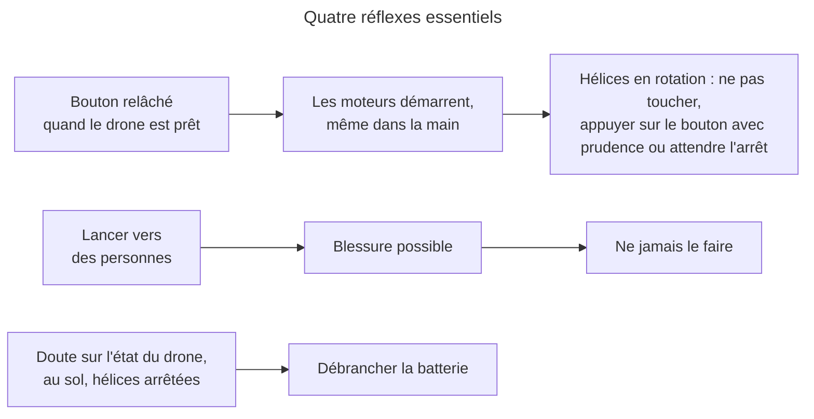

# Consignes d'emploi

> **Aperçu** : une page de rappels pour l'utilisateur de Boomrone, qui accepte les risques. Une consigne par ligne, à l'infinitif, 15 mots au plus par ligne, 48 lignes (une face A4 au plus : 60 lignes). Les quatre réflexes essentiels sont en tête. La page rappelle les risques majeurs et ceux qui demandent un geste de l'utilisateur ; elle ne reprend pas chaque ligne de « Risques acceptés ». Sources : « Risques acceptés » — `projets/boomrone/risques-acceptes.md` et « Besoins » — `projets/boomrone/01-besoins.md` (BES-012 « Disposer d'une page de consignes d'emploi »). Le drone n'affiche rien de plus.

## Quatre réflexes essentiels
- Savoir que relâcher le bouton d'un drone prêt démarre les moteurs, même en main.
- Ne jamais lancer le drone vers des personnes ni au-dessus d'elles.
- Hélices en rotation : ne rien toucher, sauf le bouton pour arrêter, avec prudence.
- Drone au sol, hélices arrêtées : au moindre doute, débrancher la batterie.

## Avant le vol
- Programmer le drone sans les hélices.
- Essayer les moteurs avec prudence avant le premier vol.
- Vérifier un drone neuf ou reprogrammé : il part des valeurs d'origine.
- Charger et ranger la batterie comme le demande son fabricant.
- Brancher la batterie dans le bon sens.
- Changer la batterie si elle est abîmée.
- Regarder capteurs, moteurs et hélices avant chaque vol.
- Vérifier que le bouton n'est pas coincé : au branchement, il donne le mode réglage.
- Garder les protège-hélices en place.
- Ne pas approcher les mains du dessus ni du dessous des hélices : non protégés.
- Choisir un lieu dégagé, loin des personnes et des obstacles.
- Éviter vitres et escaliers sous le drone : il mesure mal sa hauteur.
- Adapter la force du lancer au lieu : le drone ne le connaît pas.

## Au lancer
- Tenir le drone loin du visage au relâchement du bouton.
- Pour renoncer au lancer, maintenir le bouton jusqu'au désarmement (10 secondes).
- Pour arrêter après le lancer, maintenir le bouton ; un appui bref est ignoré.
- Accepter que des parasites sur le bouton coupent parfois les moteurs en vol.
- Pour arrêter un drone en vol, appuyer sur le bouton ; hélices tournantes.
- Ne pas attraper le drone en vol.
- Sans appareil de suivi, arrêter le drone avec le bouton seulement.
- Sans appareil de suivi, ne pas compter connaître la cause d'une chute.
- Charger la batterie : trop basse, elle arrête le drone en vol sans prévenir.
- Ne pas compter sur le drone pour détecter panne, choc ou dérive.
- Ne pas tenir le drone en main à plus de 0,3 m.
- Savoir que, au-delà, le drone peut se croire en vol stationnaire.

## Réglage
- Pour entrer en mode réglage, maintenir le bouton en branchant la batterie.
- Pour sortir du mode réglage, débrancher la batterie.
- Après un échec d'initialisation, débrancher puis rebrancher la batterie avant tout réglage.
- Ne pas tenir le drone en mode réglage.
- Écarter les mains des hélices pendant un vol de réglage.
- Pendant un vol de réglage, toucher le bouton seulement pour arrêter.
- Rester à portée en vol de réglage : sans lien, seul le bouton arrête.
- Régler loin d'autres appareils de suivi : le drone obéit à tous.
- Relire les valeurs dans le statut après chaque modification : seules quatre sont réglables.
- Enregistrer les réglages seulement en mode réglage, drone posé.
- Ne pas débrancher la batterie pendant l'enregistrement des réglages.
- Laisser refroidir moteurs, électronique et batterie entre deux vols de réglage.
- Reprogrammer le drone si les réglages sont faussés ou perdus : seul recours.
- Après une coupure sur batterie basse, même en mode réglage, rebrancher une batterie chargée.

## Après le vol
- Débrancher la batterie : un drone laissé allumé vide la batterie.
- Ne pas laisser la batterie se vider : elle peut être abîmée pour de bon.
- Après une chute ou un posé, ne rien rebrancher : un nouvel appui relance.
- Après un échec d'initialisation, poser le drone à plat, débrancher puis rebrancher la batterie.
- Inspecter le drone après un vol raté : il repart sans contrôle.
