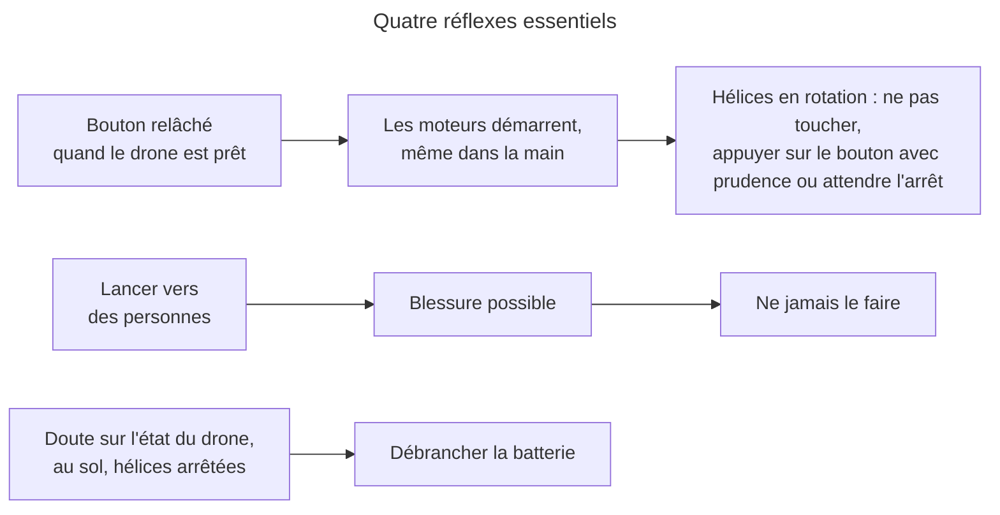

# Consignes d'emploi

> **Aperçu** : une page de rappels pour l'utilisateur de Boomrone, qui accepte les risques. Une consigne par ligne. Les quatre réflexes essentiels sont en tête. La page rappelle les risques majeurs et ceux qui demandent un geste de l'utilisateur ; elle ne reprend pas chaque ligne de « Risques acceptés ». Sources : « Risques acceptés » — `projets/boomrone/risques-acceptes.md` et « Besoins » — `projets/boomrone/01-besoins.md` (BES-012 « Disposer d'une page de consignes d'emploi »). Le drone n'affiche rien de plus.

## Quatre réflexes essentiels
- Relâcher le bouton, quand le drone est prêt, démarre les moteurs, même dans la main.
- Ne jamais lancer le drone vers des personnes ni au-dessus d'elles.
- Hélices en rotation : ne pas toucher le drone, sauf pour l'arrêter par le bouton (avec prudence) ; sinon attendre l'arrêt.
- Drone au sol et hélices arrêtées : en cas de doute, débrancher la batterie, sauf pendant l'enregistrement des réglages.

## Avant le vol
- Programmer le drone sans les hélices.
- Essayer les moteurs avec prudence avant le premier vol.
- Vérifier un drone neuf ou reprogrammé avant l'usage normal : il part des valeurs d'origine.
- Charger et ranger la batterie comme le demande son fabricant.
- Brancher la batterie dans le bon sens.
- Changer la batterie si elle est abîmée.
- Regarder les capteurs, les moteurs et les hélices avant chaque vol.
- Vérifier que le bouton ne reste pas coincé : le drone ne s'arme pas et ne le dit pas.
- Garder les protège-hélices en place.
- Choisir un lieu dégagé, loin des personnes et des obstacles.
- Éviter vitres et escaliers sous le drone : il mesure mal sa hauteur.
- Le drone ne connaît pas le lieu : adapter la force du lancer.

## Au lancer
- Tenir le drone loin du visage quand on relâche le bouton.
- Pour renoncer au lancer, maintenir le bouton jusqu'au désarmement (10 secondes).
- Pour arrêter après le lancer, maintenir le bouton un instant : un appui bref est ignoré.
- Des parasites sur le bouton peuvent couper les moteurs en vol.
- Pour arrêter un drone en vol, appuie sur le bouton ; fais-le avec prudence, les hélices tournent. Sinon, ne pas attraper le drone en vol.
- Sans appareil de suivi, seul le bouton arrête le drone.
- Sans appareil de suivi, la cause d'une chute reste inconnue.
- Une batterie trop basse arrête le drone en vol, sans prévenir.
- Le drone ne détecte ni panne de moteur ou de capteur, ni choc.

## Réglage
- Trois appuis de suite mènent au mode réglage : seul débrancher la batterie en sort.
- Pas de réglage après un échec d'initialisation : débrancher puis rebrancher d'abord.
- Ne pas tenir le drone en mode réglage.
- Écarter les mains des hélices pendant un vol de réglage.
- Pendant un vol de réglage, toucher le bouton seulement pour arrêter.
- Rester à portée du sans fil en vol de réglage : sans lien, seul le bouton arrête.
- Régler loin d'autres appareils de suivi : le drone obéit à tous.
- Relire les valeurs après chaque modification : les bornes ne protègent que les seuils de sécurité.
- Ne pas enregistrer les réglages juste avant de préparer le lancer.
- Ne pas débrancher la batterie pendant l'enregistrement des réglages.
- Laisser refroidir moteurs, électronique et batterie entre deux vols de réglage.
- Réglages faussés ou perdus : reprogrammer le drone, c'est le seul recours.

## Après le vol
- Débrancher la batterie : un drone laissé allumé vide la batterie.
- Une batterie trop vide peut être abîmée pour de bon.
- Après une chute ou un posé, le drone reste allumé et verrouillé : rien à rebrancher, un nouvel appui relance.
- Après un démarrage raté (échec d'initialisation) : poser le drone à plat et immobile, débrancher puis rebrancher la batterie.
- Regarder le drone après un vol raté : il peut repartir abîmé, sans contrôle.
