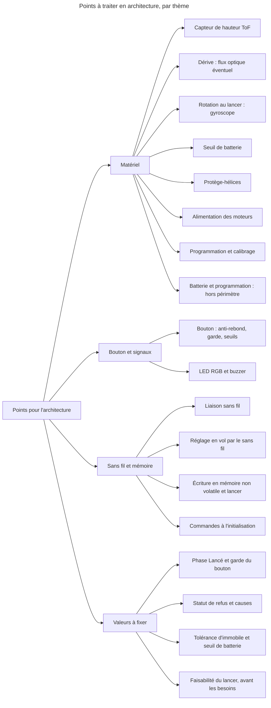

# Notes pour l'architecture

> **Aperçu** : points techniques apparus pendant la phase scénarios. Ce ne sont pas des doutes sur les scénarios : ils sont à traiter à la phase « Architecture », avec les décisions DEC-001 « Information de l'utilisateur par signaux lumineux, sonores et suivi sur un autre appareil », DEC-011 « Dérive de 30 cm sur 10 s en objectif à valider par essais » et DEC-019 « Hauteur au-dessus du sol mesurée en vol », qui sont des intentions de l'utilisateur à reprendre.

- **Capteur de hauteur ToF** (proposition pour DEC-019 « Hauteur au-dessus du sol mesurée en vol », voir la section ci-dessous) : portée utile souvent 2 à 4 m, moins en plein soleil ; hauteur fausse tant que le drone n'est pas redressé après un lancer dans toute orientation ; sol non réfléchissant, vitre, escalier. À confronter à DEC-010 « Plage de lancer : toute orientation, 0,5 à 4 m/s, au moins 1,5 m du sol ».
- **Dérive horizontale** (DEC-011 « Dérive de 30 cm sur 10 s en objectif à valider par essais ») : si l'objectif n'est pas tenu, ajouter un capteur de flux optique ; prévoir dès la carte JLCPCB (service de fabrication de cartes électroniques) une empreinte ou un connecteur pour l'éviter une nouvelle carte.
- **Rotation au lancer** : dimensionne le gyroscope, à partir de la valeur de DOU-010 « Quelle rotation au lancer le drone doit-il rattraper ? ».
- **Seuil de batterie** : tension d'armement à marge large (mesure à vide, DEC-018 « Jamais de réarmement automatique ; batterie mesurée à vide à l'armement »), dépend de la batterie choisie ; à partir de DOU-013 « Quelle durée de vol garantit-on après un armement accepté ? ».
- **Bouton** : anti-rebond très court en vol, de quelques millisecondes, sans durée minimale ni validation de 1 s (DEC-087 « Arrêt d'urgence par le bouton en vol : anti-rebond très court seulement, arrêt quasi immédiat »), et garde après le lancer de l'ordre de 0,5 s, qui commence au relâchement, ignore les fronts mais pas le niveau (DEC-092 « Garde du bouton après le lancer : fronts ignorés, niveau pris en compte, démarrage au relâchement »), valeurs à fixer ; statut sans fil « bouton maintenu » (DEC-088 « Bouton coincé ou maintenu en permanence au démarrage : statut sans fil seulement, aucun signal local ») ; seuils de 1 s, 2 s, 10 s et délai d'environ 2 s entre appuis d'affilée à fixer (DOU-080 « Seuils de temps du bouton : 1 s, 2 s, 10 s et délai entre appuis »), avec un compteur d'appuis validés (remise à zéro par un appui de moins de 1 s : DEC-089 « Appui de moins de 1 s au milieu d'une série d'appuis : compteur remis à zéro ») et un statut sans fil distinct selon la cause d'un refus d'armement ou de mode réglage (signal « Refus » : DEC-091 « Un seul signal Refus pour tout refus, armement ou mode réglage ») (causes précises dans le statut sans fil, liste à fixer : DEC-101 « Statut sans fil d'un refus : cause précise, liste exacte à fixer en architecture »).
- **Liaison sans fil** : technologie (Bluetooth ou Wi-Fi) et contenu transmis, à partir de DEC-025 « Suivi et réglage du drone par le sans fil, y compris en vol » ; sans appairage (DEC-037 « Pas d'appairage : le drone obéit à tout appareil de suivi à portée ») : commandes de tiers, plusieurs drones à portée, plus de définition ni de délai de perte du lien : aucune action particulière si le lien est perdu en vol de réglage (DEC-106 « Lien sans fil perdu en vol de réglage : aucune action particulière ») ; l'arrêt sans fil n'atteint alors plus le drone, seul le bouton l'arrête.
- **LED RGB et buzzer** (proposition, voir la section ci-dessous) : motifs et nombre de signaux, à partir de DEC-099 « Un statut sans fil distinct par état, effets locaux regroupables par catégorie » : un statut sans fil distinct par état, effets locaux regroupables par catégorie, liste des effets à définir ; après une coupure des moteurs en vol, « Allumé » prend le relais tout de suite et la cause reste sur le statut sans fil (DEC-104 « Cause d'une coupure en vol : signal local non conservé, Allumé prend le relais, cause conservée sur le statut sans fil ») ; aucune durée minimale d'effet de la cause, la cause ne se lit ensuite que sur le statut sans fil, risque accepté pour l'utilisateur sans appareil de suivi (DEC-113 « Cause d'une coupure en vol : confirmation, Allumé tout de suite, aucune durée minimale, risque accepté ») ; en test, le signal de la cause se vérifie à son émission (événement et statut sans fil), pas à sa perception.
- **Protège-hélices** (DEC-016 « Public adulte, protège-hélices obligatoires ») : masse et poussée à compter dans le dimensionnement des moteurs et de la batterie.
- **Programmation** (DEC-024 « Mise en service par programmation avec un programmateur ST-LINK ») : si la proposition ST-LINK est retenue (voir la section ci-dessous ; c'est le seul programmateur que possède l'utilisateur), tout microcontrôleur du drone doit être programmable en JTAG ou SWD avec lui. À vérifier pour un éventuel module sans fil, et prévoir l'accès à ces broches sur la carte.
- **Batterie et programmation hors périmètre** : le drone ne gère ni la charge, ni le remplacement, ni le stockage de la batterie, ni un drone laissé allumé, ni les cas d'échec de la programmation (hélices démontées, programmation interrompue, essai des moteurs) : limites d'emploi, pas de besoin à écrire (DEC-111 « Batterie et programmation : hors périmètre des scénarios, limites d'emploi à documenter »). Reste pour l'architecture la vérification de la batterie à l'armement et au décollage de réglage.
- **Faisabilité du lancer (avant les besoins)** : analyse de la mesure de vitesse horizontale, du stationnaire en 2 s depuis 1,5 m et de la plage de lancer à faire avant de rédiger les besoins (DEC-114 « Faisabilité du stationnaire en 2 secondes depuis 1,5 m : analyse avant les besoins, plage de lancer à revoir » ; DOU-050 « Mesure de vitesse horizontale et faisabilité du stationnaire en 2 s depuis 1,5 m »).
- **Calibrage** (DEC-026 « Mise en service : calibrage éventuel renvoyé à l'architecture, réglage du vol par un scénario dédié ») : à décider selon les capteurs choisis ; s'il existe, il se place dans la mise en service (SCN-008 « Mise en service : programmation du drone »).
- **Réglage en vol par le sans fil** (DEC-025 « Suivi et réglage du drone par le sans fil, y compris en vol ») : débit et latence suffisants pour renvoyer commandes des moteurs, hauteur et données de position ; paramètres modifiables en vol ; décollage depuis le sol en mode réglage (poussée supérieure au poids, avec les protège-hélices de DEC-016 « Public adulte, protège-hélices obligatoires »).
- **Valeurs et listes à fixer (réponses du 2026-10-28)** : durée maximale de la phase « Lancé », de l'ordre de quelques centaines de millisecondes, au moins 200 ms, provisoire, et son articulation avec la garde du bouton de l'ordre de 0,5 s (DEC-096 « Chien de garde sur tout état où les moteurs peuvent être alimentés, phase Lancé de durée maximale » ; DEC-052 « Valeurs provisoires retenues pour les scénarios, à confirmer avant les exigences »)  ; au dépassement, le chien de garde coupe et redémarre le drone (DEC-103 « Phase Lancé trop longue : coupure et redémarrage par le chien de garde, sans nouvel état ni signal ») ; liste des effets locaux regroupés par catégorie (DEC-099 « Un statut sans fil distinct par état, effets locaux regroupables par catégorie ») ; liste exacte des causes de refus dans le statut sans fil, pour l'armement, le mode réglage et le décollage de réglage, avec la durée de conservation du statut, lisible jusqu'à la commande suivante (DEC-101 « Statut sans fil d'un refus : cause précise, liste exacte à fixer en architecture » ; DEC-102 « Décollage de réglage refusé : signal Refus, statut de refus lisible jusqu'à la commande suivante »), et son extension éventuelle aux refus d'armement et de mode réglage ; tolérance de mouvement (vitesse, rotation) de « immobile » ; seuil de batterie du décollage de réglage (DEC-074 « Décollage en mode réglage : la batterie est vérifiée, rien d'autre ») ; dire si le délai de 15 s après le décollage de réglage est le délai de descente réglable (DEC-107 « Vol de réglage : signaux des phases du vol normal, acquittement des commandes par le statut sans fil seulement ») ; valeurs rassemblées dans DOU-058 « Valeurs d'origine, bornes numériques, tolérance d'immobile et durées à fixer en architecture ». Le signal du lien perdu n'existe plus (DEC-106 « Lien sans fil perdu en vol de réglage : aucune action particulière »).
- **Écriture en mémoire non volatile et lancer** : « Sauvegarder » est ignorée à l'état armé (DEC-112 « Sauvegarder ignorée à l'état armé, avant le lancer », qui modifie DEC-095 « Commande Sauvegarder à l'état armé : acceptée, retard possible du lancer accepté comme risque ») ; l'architecture doit encore traiter une écriture commencée avant l'armement et encore en cours au relâchement du bouton, qui pourrait dépasser la durée maximale de la phase « Lancé » (DOU-059 « Sauvegarde des réglages : écriture en vol, coupure pendant l'écriture, mémoire jamais écrite » ; limite d'emploi : DOU-062 « Où l'utilisateur est-il informé des limites d'emploi ? »).
- **Commandes sans fil à l'initialisation** : Modifier et Sauvegarder sont acceptées pendant l'initialisation et après un échec d'initialisation, Décoller et Arrêt ignorées (DEC-105 « Initialisation en cours et échec d'initialisation : Modifier et Sauvegarder acceptées, Décoller et Arrêt ignorées ») ; l'architecture doit traiter le risque d'écrire des réglages sur un drone non initialisé (réglages enregistrés pas encore chargés, valeurs d'origine ou incomplètes sauvegardées par erreur) ; limite d'emploi : DOU-062 « Où l'utilisateur est-il informé des limites d'emploi ? ».
- **Alimentation des moteurs (hypothèse à valider par l'architecture matérielle)** : lors d'un redémarrage ou d'une chute de tension, y compris en phase « Lancé », les moteurs doivent s'arrêter et le drone être verrouillé (DEC-097 « Redémarrage ou chute de tension, même en phase Lancé : moteurs arrêtés, drone verrouillé »). Le chien de garde, indépendant du logiciel, couvre tout état où les moteurs peuvent être alimentés (DEC-096 « Chien de garde sur tout état où les moteurs peuvent être alimentés, phase Lancé de durée maximale »).

## Propositions de solution issues des scénarios (DEC-053 « Solutions techniques déplacées en propositions d'architecture, seule l'intention reste décidée »)

Ces solutions avaient été écrites dans des décisions de la phase scénarios. Depuis DEC-053 « Solutions techniques déplacées en propositions d'architecture, seule l'intention reste décidée », le journal n'en garde que l'intention : chacune ci-dessous est une **proposition**, pas une contrainte imposée par l'utilisateur. Elles sont à arbitrer en architecture, avec leurs alternatives.

| Proposition | Décision d'intention d'origine | Intention seule retenue | Statut |
|---|---|---|---|
| LED RGB et buzzer (avec le suivi sans fil) | DEC-001 « Information de l'utilisateur par signaux lumineux, sonores et suivi sur un autre appareil » | Informer l'utilisateur par des signaux lumineux, des signaux sonores et un suivi sur un appareil de suivi relié sans fil | Proposition, à arbitrer en architecture |
| Centrale inertielle seule, sans capteur de position (flux optique écarté à l'époque) | DEC-011 « Dérive de 30 cm sur 10 s en objectif à valider par essais » | Dérive horizontale de 30 cm au plus sur 10 s, objectif à valider par essais, sans préjuger du moyen de mesure | Proposition, à arbitrer en architecture |
| Capteur de distance de type ToF orienté vers le bas (baromètre écarté à l'époque) | DEC-019 « Hauteur au-dessus du sol mesurée en vol » | La hauteur au-dessus du sol est mesurée en vol | Proposition, à arbitrer en architecture |
| Programmateur ST-LINK, via JTAG ou SWD (seul programmateur que possède l'utilisateur) | DEC-024 « Mise en service par programmation avec un programmateur ST-LINK » | La mise en service commence par la programmation du drone | Proposition, à arbitrer en architecture |
