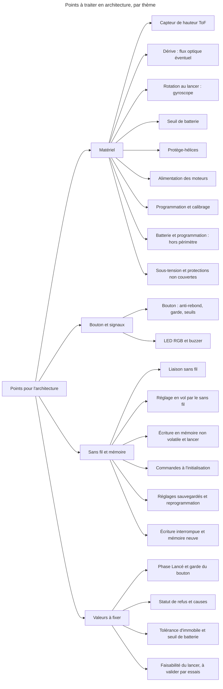
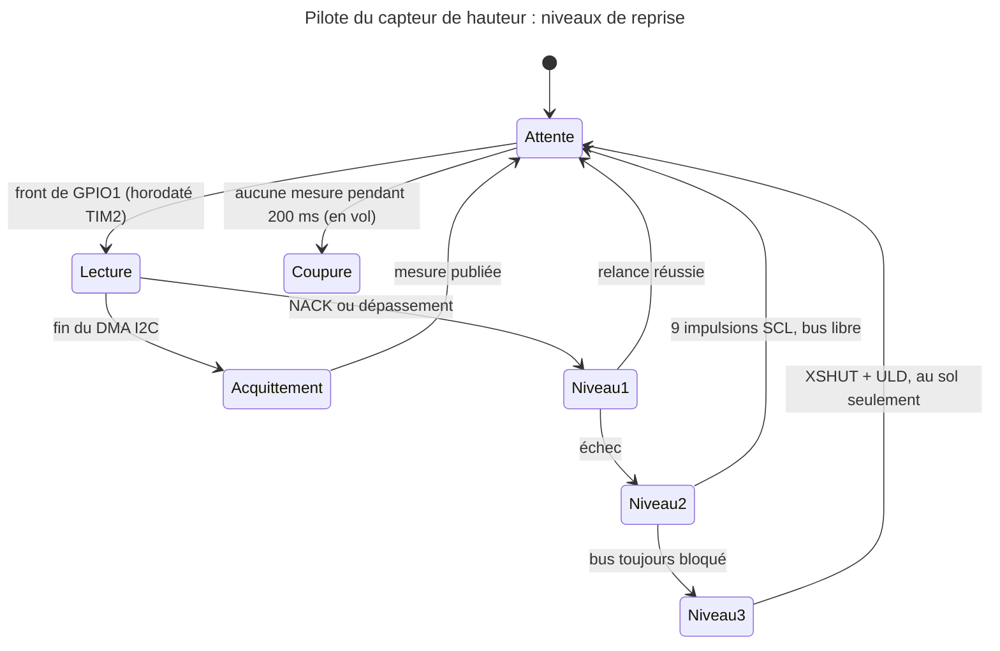

# Notes pour l'architecture

> **Aperçu** : points techniques apparus pendant la phase scénarios ; la section « Révision JLCPCB du 2026-10-29 », en bas, porte les détails de conception détaillée de la révision de l'architecture. Ce ne sont pas des doutes sur les scénarios : ils sont à traiter à la phase « Architecture », avec les décisions DEC-001 « Information de l'utilisateur par signaux lumineux, sonores et suivi sur un autre appareil », DEC-011 « Dérive de 30 cm sur 10 s en objectif à valider par essais » et DEC-019 « Hauteur au-dessus du sol mesurée en vol », qui sont des intentions de l'utilisateur à reprendre.

- **Capteur de hauteur ToF** (proposition pour DEC-019 « Hauteur au-dessus du sol mesurée en vol », voir la section ci-dessous) : portée utile souvent 2 à 4 m, moins en plein soleil ; hauteur fausse tant que le drone n'est pas redressé après un lancer dans toute orientation ; sol non réfléchissant, vitre, escalier. À confronter à DEC-010 « Plage de lancer : toute orientation, 0,5 à 4 m/s, au moins 1,5 m du sol ».
- **Dérive horizontale** (DEC-011 « Dérive de 30 cm sur 10 s en objectif à valider par essais ») : si l'objectif n'est pas tenu, ajouter un capteur de flux optique ; prévoir dès la carte JLCPCB (service de fabrication de cartes électroniques) une empreinte ou un connecteur pour éviter une nouvelle carte.
- **Rotation au lancer** : dimensionne le gyroscope, à partir de la valeur de DOU-010 « Quelle rotation au lancer le drone doit-il rattraper ? ».
- **Seuil de batterie** : tension d'armement à marge large (mesure à vide, DEC-018 « Jamais de réarmement automatique ; batterie mesurée à vide à l'armement »), dépend de la batterie choisie ; à partir de DOU-013 « Quelle durée de vol garantit-on après un armement accepté ? », au-dessus du seuil de sous-tension (DEC-134 « Coupure sur sous-tension en vol assumée par le logiciel : le drone surveille la tension » ; DOU-108 « Rapport entre le seuil d'armement et le seuil de sous-tension, affaissement de tension au démarrage des moteurs »).
- **Bouton** :
  - anti-rebond très court en vol, de quelques millisecondes, sans durée minimale ni validation de 1 s (DEC-087 « Arrêt d'urgence par le bouton en vol : anti-rebond très court seulement, arrêt quasi immédiat ») ;
  - garde après le lancer de l'ordre de 0,5 s, qui commence au relâchement, ignore les fronts mais pas le niveau (DEC-092 « Garde du bouton après le lancer : fronts ignorés, niveau pris en compte, démarrage au relâchement »), valeurs à fixer ;
  - statut sans fil « bouton maintenu » (DEC-088 « Bouton coincé ou maintenu en permanence au démarrage : statut sans fil seulement, aucun signal local ») ;
  - seuils de 1 s, 2 s, 10 s et délai d'environ 2 s entre appuis d'affilée à fixer (DOU-080 « Seuils de temps du bouton : 1 s, 2 s, 10 s et délai entre appuis »), avec un compteur d'appuis validés (remise à zéro par un appui de moins de 1 s : DEC-089 « Appui de moins de 1 s au milieu d'une série d'appuis : compteur remis à zéro ») ;
  - statut sans fil distinct selon la cause d'un refus d'armement ou de mode réglage (signal « Refus » : DEC-091 « Un seul signal Refus pour tout refus, armement ou mode réglage » ; causes précises, liste à fixer : DEC-101 « Statut sans fil d'un refus : cause précise, liste exacte à fixer en architecture ») ;
  - points ouverts : bouton enfoncé jusqu'à la fin de l'initialisation (DOU-112 « Bouton enfoncé jusqu'à la fin de l'initialisation : état et signal ») ; niveau ou front du bouton à l'acceptation de Décoller (DOU-111 « Niveau ou front du bouton à l'acceptation de Décoller »).
- **Liaison sans fil** : technologie (Bluetooth ou Wi-Fi) et contenu transmis, à partir de DEC-025 « Suivi et réglage du drone par le sans fil, y compris en vol » ; sans appairage (DEC-037 « Pas d'appairage : le drone obéit à tout appareil de suivi à portée ») : commandes de tiers, plusieurs drones à portée, plus de définition ni de délai de perte du lien : aucune action particulière si le lien est perdu en vol de réglage (DEC-106 « Lien sans fil perdu en vol de réglage : aucune action particulière ») ; l'arrêt sans fil n'atteint alors plus le drone, seul le bouton l'arrête.
- **LED RGB et buzzer** (proposition, voir la section ci-dessous) : motifs et nombre de signaux, à partir de DEC-099 « Un statut sans fil distinct par état, effets locaux regroupables par catégorie » : un statut sans fil distinct par état, effets locaux regroupables par catégorie, liste des effets à définir ; après une coupure des moteurs en vol, « Allumé » prend le relais tout de suite et la cause reste sur le statut sans fil (DEC-104 « Cause d'une coupure en vol : signal local non conservé, Allumé prend le relais, cause conservée sur le statut sans fil ») ; aucune durée minimale d'effet de la cause, la cause ne se lit ensuite que sur le statut sans fil, risque accepté pour l'utilisateur sans appareil de suivi (DEC-113 « Cause d'une coupure en vol : confirmation, Allumé tout de suite, aucune durée minimale, risque accepté ») ; en test, le signal de la cause se vérifie à son émission (événement et statut sans fil), pas à sa perception.
- **Protège-hélices** (DEC-016 « Public adulte, protège-hélices obligatoires ») : masse et poussée à compter dans le dimensionnement des moteurs et de la batterie.
- **Programmation** (DEC-024 « Mise en service par programmation avec un programmateur ST-LINK ») : si la proposition ST-LINK est retenue (voir la section ci-dessous ; c'est le seul programmateur que possède l'utilisateur), tout microcontrôleur du drone doit être programmable en JTAG ou SWD avec lui. À vérifier pour un éventuel module sans fil, et prévoir l'accès à ces broches sur la carte.
- **Batterie et programmation hors périmètre** : le drone ne gère ni la charge, ni le remplacement, ni le stockage de la batterie, ni les cas d'échec de la programmation (hélices démontées, programmation interrompue, essai des moteurs) : limites d'emploi, pas de besoin à écrire (DEC-111 « Batterie et programmation : hors périmètre des scénarios, limites d'emploi à documenter »). Le drone laissé allumé n'en fait plus partie : sa sous-tension est dans le périmètre (DEC-133 « SCN-012 inclut le drone laissé allumé en attente d'un appui : sous-tension dans le périmètre »). Reste pour l'architecture la vérification de la batterie à l'armement et au décollage de réglage.
- **Faisabilité du lancer (à valider par essais sur prototype)** : mesure de vitesse horizontale, stationnaire en 2 s depuis 1,5 m et plage de lancer, jalon déplacé aux essais (DEC-137 « Faisabilité du stationnaire en 2 secondes depuis 1,5 m : jalon déplacé aux essais, plage de lancer inchangée » et DEC-138 « Tolérance d'immobile et part de DOU-058 liée à la faisabilité : jalon déplacé aux essais », qui modifient DEC-114 « Faisabilité du stationnaire en 2 secondes depuis 1,5 m : analyse avant les besoins, plage de lancer à revoir » ; DOU-050 « Mesure de vitesse horizontale et faisabilité du stationnaire en 2 s depuis 1,5 m »).
- **Sous-tension de la batterie** (SCN-012 « Dégradé : sous-tension de la batterie » ; DEC-126 « Protection de sous-tension de la batterie : scénario court, coupure sans signal propre » ; DEC-133 « SCN-012 inclut le drone laissé allumé en attente d'un appui : sous-tension dans le périmètre ») :
  - la coupure sur sous-tension, y compris en vol, est assumée par le logiciel (DEC-134 « Coupure sur sous-tension en vol assumée par le logiciel : le drone surveille la tension », qui modifie DEC-013 « Pas de contrôle de la batterie en vol ») ;
  - seuil de sous-tension à fixer (DOU-058 « Valeurs d'origine, bornes numériques, tolérance d'immobile et durées à fixer en architecture »), le seuil d'armement restant au-dessus (DEC-004 « Batterie vérifiée à l'armement : pas d'armement si batterie faible ») ; rapport des deux seuils et affaissement de tension au démarrage des moteurs : DOU-108 « Rapport entre le seuil d'armement et le seuil de sous-tension, affaissement de tension au démarrage des moteurs » ;
  - état du drone après une coupure faite par le logiciel, redémarrage avec une batterie encore déchargée, branchement d'une batterie déjà sous le seuil : DOU-109 « Batterie déjà déchargée : redémarrages répétés, décharge profonde et état après une coupure logicielle » ;
  - la chute en vol sur sous-tension est un risque accepté (DEC-135 « Chute en vol sur sous-tension, sans signal, avec des personnes dessous : risque accepté ») ;
  - non couvertes, à voir en architecture : surintensité, inversion de polarité, surchauffe de la batterie, CEM ; le brown-out du microcontrôleur n'est couvert que par la chute de tension de DEC-097 « Redémarrage ou chute de tension, même en phase Lancé : moteurs arrêtés, drone verrouillé ».
- **Réglages sauvegardés et reprogrammation** (DEC-121 « Paramètres de vol aberrants envoyés et sauvegardés par un tiers : risque accepté, reprogrammation seule ») : la reprogrammation réécrit la zone des réglages avec les valeurs d'origine (DEC-139 « Reprogrammation : réécriture de la zone des réglages avec les valeurs d'origine » ; DOU-110 « La reprogrammation efface-t-elle la zone des réglages sauvegardés ? » levé) ; mécanisme à traiter en architecture ; quatre risques de « Risques acceptés » — `projets/boomrone/risques-acceptes.md` (lignes 20, 24, 33 et 34) n'ont pas d'autre recours ; contenu de la zone et interruption : DOU-115 « Contenu et interruption de la réécriture de la zone des réglages par la reprogrammation ».
- **Calibrage** (DEC-026 « Mise en service : calibrage éventuel renvoyé à l'architecture, réglage du vol par un scénario dédié ») : à décider selon les capteurs choisis ; s'il existe, il se place dans la mise en service (SCN-008 « Mise en service : programmation du drone »).
- **Réglage en vol par le sans fil** (DEC-025 « Suivi et réglage du drone par le sans fil, y compris en vol ») : débit et latence suffisants pour renvoyer commandes des moteurs, hauteur et données de position ; paramètres modifiables en vol ; décollage depuis le sol en mode réglage (poussée supérieure au poids, avec les protège-hélices de DEC-016 « Public adulte, protège-hélices obligatoires »).
- **Valeurs et listes à fixer (réponses du 2026-10-28)**, toutes rassemblées dans DOU-058 « Valeurs d'origine, bornes numériques, tolérance d'immobile et durées à fixer en architecture » :
  - durée maximale de la phase « Lancé », de l'ordre de quelques centaines de millisecondes, au moins 200 ms, provisoire, et son articulation avec la garde du bouton de l'ordre de 0,5 s (DEC-096 « Chien de garde sur tout état où les moteurs peuvent être alimentés, phase Lancé de durée maximale » ; DEC-052 « Valeurs provisoires retenues pour les scénarios, à confirmer avant les exigences ») ; au dépassement, le chien de garde coupe et redémarre le drone (DEC-103 « Phase Lancé trop longue : coupure et redémarrage par le chien de garde, sans nouvel état ni signal ») ;
  - liste des effets locaux regroupés par catégorie (DEC-099 « Un statut sans fil distinct par état, effets locaux regroupables par catégorie ») ;
  - liste exacte des causes de refus dans le statut sans fil, pour l'armement, le mode réglage et le décollage de réglage, avec la durée de conservation du statut, lisible jusqu'à la commande suivante, et son extension éventuelle aux refus d'armement et de mode réglage (DEC-101 « Statut sans fil d'un refus : cause précise, liste exacte à fixer en architecture » ; DEC-102 « Décollage de réglage refusé : signal Refus, statut de refus lisible jusqu'à la commande suivante ») ;
  - tolérance de mouvement (vitesse, rotation) de « immobile » ; seuil de batterie du décollage de réglage (DEC-074 « Décollage en mode réglage : la batterie est vérifiée, rien d'autre ») ;
  - dire si le délai de 15 s après le décollage de réglage est le délai de descente réglable (DEC-107 « Vol de réglage : signaux des phases du vol normal, acquittement des commandes par le statut sans fil seulement ») ;
  - seuil de sous-tension de la batterie (DEC-126 « Protection de sous-tension de la batterie : scénario court, coupure sans signal propre ») ;
  - durée minimale de perception du signal de l'événement avant le relais du signal « Allumé » après un posé, un refus ou un désarmement (DEC-118 « Signal Allumé au retour à l'attente après un posé, un refus ou un désarmement »).
  - Le signal du lien perdu n'existe plus (DEC-106 « Lien sans fil perdu en vol de réglage : aucune action particulière »).
- **Écriture en mémoire non volatile et lancer** : « Sauvegarder » n'est pas acceptée à partir de l'appui validé (états « Série d'appuis en cours », « Premier appui validé », armé, initialisation en cours, vol : DEC-128 « Sauvegarder ignorée aussi à l'état Série d'appuis en cours », DEC-123 « Sauvegarder ignorée aussi à l'état Premier appui validé », DEC-112 « Sauvegarder ignorée à l'état armé, avant le lancer », DEC-120 « Sauvegarder ignorée pendant l'initialisation en cours, Modifier acceptée ; cas de l'échec d'initialisation non tranché », DEC-131 « Sauvegarder ignorée en vol : confirmation du tableau des commandes »). Une écriture commencée à l'état « Allumé » (par exemple pendant un appui de moins de 1 s) et encore en cours au relâchement du lancer est un risque accepté (DEC-136 « Écriture de réglages commencée à l'état Allumé et encore en cours au relâchement du lancer : risque accepté ») : elle peut dépasser la durée maximale de la phase « Lancé » ; la durée d'écriture, liée à la mémoire choisie, est à connaître en architecture pour la limite d'emploi (DEC-125 « Limites d'emploi informées par une notice écrite à la phase besoins, le drone n'affiche rien »).
- **Coupure de la batterie pendant l'écriture des réglages et mémoire jamais écrite** (DEC-129 « Coupure de la batterie pendant l'écriture des réglages : risque accepté, traité en architecture » ; DEC-130 « Mémoire jamais écrite : aucune détection, valeurs d'origine fixes du logiciel, risque accepté ») :
  - choisir la mémoire ou la séquence d'écriture sans contrôle d'intégrité (DEC-035 « Pas de retour aux valeurs d'origine ; mémoire corrompue non traitée ») ;
  - qualifier si une séquence à indicateur de validité ou à double copie reste compatible avec cette décision ;
  - définir comment le drone utilise les valeurs d'origine fixes du logiciel (DEC-036 « Drone neuf : valeurs d'origine fixes du logiciel, sans signal ») sans détecter la mémoire jamais écrite ;
  - la coupure de la batterie dans chaque état reste dans DOU-060 « Coupure de la batterie dans chaque état du drone, et alimentation des moteurs à valider en architecture matérielle ».
- **Commandes sans fil à l'initialisation** (tableau « Commandes sans fil acceptées selon l'état du drone » de `projets/boomrone/00-scenarios.md`, source unique) :
  - pendant l'initialisation en cours, Sauvegarder est ignorée et Modifier acceptée (DEC-120 « Sauvegarder ignorée pendant l'initialisation en cours, Modifier acceptée ; cas de l'échec d'initialisation non tranché ») ; après un échec d'initialisation, Modifier et Sauvegarder sont acceptées, Décoller et Arrêt ignorées (DEC-105 « Initialisation en cours et échec d'initialisation : Modifier et Sauvegarder acceptées, Décoller et Arrêt ignorées » ; DEC-127 « Sauvegarder acceptée à l'état Échec d'initialisation : écrasement des réglages par un tiers, risque accepté ») ;
  - points à dire en architecture : les réglages enregistrés sont-ils chargés à l'état d'échec ? (DOU-114 « Réglages enregistrés chargés ou non à l'état d'échec d'initialisation ») ; quelle valeur l'emporte entre une modification reçue pendant l'initialisation et le chargement des réglages ? (DOU-113 « Ordre entre Modifier pendant l'initialisation et chargement des réglages enregistrés ») ;
  - limite d'emploi : DEC-125 « Limites d'emploi informées par une notice écrite à la phase besoins, le drone n'affiche rien ».
- **Alimentation des moteurs (hypothèse à valider par l'architecture matérielle)** : lors d'un redémarrage ou d'une chute de tension, y compris en phase « Lancé », les moteurs doivent s'arrêter et le drone être verrouillé (DEC-097 « Redémarrage ou chute de tension, même en phase Lancé : moteurs arrêtés, drone verrouillé »). Le chien de garde, indépendant du logiciel, couvre tout état où les moteurs peuvent être alimentés (DEC-096 « Chien de garde sur tout état où les moteurs peuvent être alimentés, phase Lancé de durée maximale »).

## Propositions de solution issues des scénarios (DEC-053 « Solutions techniques déplacées en propositions d'architecture, seule l'intention reste décidée »)

Ces solutions avaient été écrites dans des décisions de la phase scénarios. Depuis DEC-053 « Solutions techniques déplacées en propositions d'architecture, seule l'intention reste décidée », le journal n'en garde que l'intention : chacune ci-dessous est une **proposition**, pas une contrainte imposée par l'utilisateur. Elles sont à arbitrer en architecture, avec leurs alternatives.

| Proposition | Décision d'intention d'origine | Intention seule retenue | Statut |
|---|---|---|---|
| LED RGB et buzzer (avec le suivi sans fil) | DEC-001 « Information de l'utilisateur par signaux lumineux, sonores et suivi sur un autre appareil » | Informer l'utilisateur par des signaux lumineux, des signaux sonores et un suivi sur un appareil de suivi relié sans fil | Proposition, à arbitrer en architecture |
| Centrale inertielle seule, sans capteur de position (flux optique écarté à l'époque) | DEC-011 « Dérive de 30 cm sur 10 s en objectif à valider par essais » | Dérive horizontale de 30 cm au plus sur 10 s, objectif à valider par essais, sans préjuger du moyen de mesure | Proposition, à arbitrer en architecture |
| Capteur de distance de type ToF orienté vers le bas (baromètre écarté à l'époque) | DEC-019 « Hauteur au-dessus du sol mesurée en vol » | La hauteur au-dessus du sol est mesurée en vol | Proposition, à arbitrer en architecture |
| Programmateur ST-LINK, via JTAG ou SWD (seul programmateur que possède l'utilisateur) | DEC-024 « Mise en service par programmation avec un programmateur ST-LINK » | La mise en service commence par la programmation du drone | Proposition, à arbitrer en architecture |

## Révision JLCPCB du 2026-10-29 : détails pour la conception détaillée

> **Aperçu** : cette section reçoit les détails que « Architecture » — `projets/boomrone/03-architecture.md` ne porte pas (brochage broche par broche, machine d'états du pilote du capteur de hauteur, registres à vérifier, mémoire). Tout ce qui est écrit ici « de mémoire » doit être confirmé dans les fiches techniques (DS12589 pour le STM32G431, DS12093 pour le VL53L1X, fiche PixArt pour le PMW3901, fiche ST du LSM6DSO) avant d'être codé : DOU-148 « Numéros de broches physiques du LQFP-48 à relever dans la fiche DS12589 », DOU-149 « Valeurs de registres du VL53L1X à vérifier dans la bibliothèque ST (ULD) ». Décisions : DEC-238 « Fréquences SPI et lecture de la centrale inertielle », DEC-239 « Capteur de hauteur : pilote non bloquant, reprise, échec d'initialisation, mesure horodatée », DEC-240 « Brochage, timers, voyant et bouton », DEC-241 « Mémoire et ordonnancement : règles de robustesse ».

*Légende : en vol, seuls les niveaux 1 et 2 sont tentés ; le niveau 3 (110 à 170 ms estimés) est réservé au sol et à l'initialisation. Chaque pas de la machine est une tâche de fond d'au plus 200 µs, jamais une attente.*

### Brochage proposé, broche par broche (à confirmer, DOU-148 « Numéros de broches physiques du LQFP-48 à relever dans la fiche DS12589 »)

| Fonction | Broche | Mode | Remarque |
|---|---|---|---|
| Moteurs 1 à 4 | PA8, PA9, PA10, PA11 | TIM1 CH1 à CH4, 24 kHz | rappel 100 kΩ, grille via 47 Ω ; PA11 a une fonction USB selon la référence (à vérifier), non utilisée |
| IMU : SCK, MISO, MOSI | PA5, PA6, PA7 | SPI1, 5,3125 MHz (diviseur 32 sur 170 MHz) | mode 0 ou 3 selon la fiche |
| IMU : CS, INT1 | PA4, PB0 | sortie, entrée | INT1 sans timer : PB0 n'est donc pas pris par TIM3 |
| Flux : SCK, MISO, MOSI | PB13, PB14, PB15 | SPI2, 1,328 MHz (diviseur 128) | mode 3 pour le PMW3901 |
| Flux : CS | PB12 | sortie | MOTION non câblée (DOU-146 « Broches d'état du module Bluetooth et de mouvement du capteur de flux ») |
| I2C du capteur de hauteur | PA15 (SCL), PB7 (SDA) | I2C1, 400 kHz | rappels de 4,7 kΩ au 3,0 V ; PA15 est JTDI (rappel haut au reset), sans conséquence ici |
| Capteur de hauteur : GPIO1, XSHUT | PB6, PB9 | entrée avec interruption externe, sortie | GPIO1 (drain ouvert, de mémoire) et XSHUT rappelés au 3,0 V par 10 kΩ |
| Radio | PA2 (TX), PA3 (RX) | USART2, DMA circulaire | pas de TIM15 : PA2 et PA3 en sont les canaux, d'où le choix de ne pas l'utiliser |
| Voyant R, V, B | PB1, PB2, PB10 | sorties, modulation logicielle au tick | grilles via 100 Ω, rappel 100 kΩ |
| Buzzer | PB11 | sortie | grille via 100 Ω, rappel 100 kΩ ; diode SS34 en parallèle |
| Bouton | PB5 | entrée | rappel externe 10 kΩ au 3,0 V, 1 kΩ en série, 10 nF |
| Mesure de la batterie | PA0 | ADC1 IN1 | pont 100 kΩ / 150 kΩ à 0,1 %, 100 nF, échantillonnage d'au moins 6 µs |
| SWD | PA13, PA14 | SWDIO, SWCLK | PB3 (SWO) et PB4 (NJTRST) inutilisées ; PA15 et PB4 jamais sur une grille |
| BOOT0 | PB8 | entrée | 10 kΩ à la masse, jamais utilisée pour un bus |

Conflits résolus : TIM3 (PB0 est TIM3 CH3, mais PB0 sert d'entrée INT1) ; TIM15 (PA2 et PA3, déjà USART2) ; le voyant n'a donc aucun timer. Timers utilisés : TIM1 (moteurs), TIM2 (compteur libre de 32 bits, prescaler 169 pour 1 MHz, chronomètres de tout le logiciel), TIM6 (tick de 1 kHz). Repli STM32G474 : même empreinte LQFP-48, à confirmer (DOU-147 « Compatibilité de l'empreinte avec le STM32G474 »).

### Centrale inertielle LSM6DSO (registres de mémoire, à vérifier)

| Registre | Adresse | Valeur visée | Rôle |
|---|---|---|---|
| WHO_AM_I | 0x0F | 0x6C | identification |
| CTRL3_C | 0x12 | BDU = 1, IF_INC = 1 | lecture cohérente et adresse incrémentale |
| CTRL1_XL | 0x10 | 0x9C | 3,33 kHz, ±8 g |
| CTRL2_G | 0x11 | 0x9C | 3,33 kHz, ±2000 °/s |
| INT1_CTRL | 0x0D | bits donnée prête accéléromètre et gyroscope | INT1 sur PB0 |
| Lecture | 0x20 à 0x2D | 14 octets : température, gyroscope, accéléromètre | un transfert DMA de 15 octets par tick, environ 23 µs |

Le bit de lecture (0x80) s'ajoute à l'adresse en SPI. Le pas de temps du filtre est la différence de deux lectures de TIM2, non la constante de 1 ms.

### Capteur de hauteur VL53L1X (de mémoire, à vérifier dans l'ULD, DOU-149 « Valeurs de registres du VL53L1X à vérifier dans la bibliothèque ST (ULD) »)

- Identification : registre 0x010F, valeur attendue 0xEACC.
- Interruption : polarité et masque de GPIO1 (registres 0x0030 et 0x0031), acquittement par écriture de 1 dans 0x0086 après chaque lecture.
- Résultat : bloc de 17 octets à partir de 0x0089 (état, distance, taux de signal) lu par un seul DMA I2C ; le statut de mesure est testé avant de publier.
- Mode LONG, budget 33 ms, intervalle entre mesures 33 à 40 ms ; ces réglages sont ceux de la fonction d'initialisation de l'ULD, copiés sans modification.
- Horodatage : valeur de TIM2 relevée dans le gestionnaire de GPIO1 ; le recalage de l'observateur utilise l'estimation de hauteur gardée pour les 64 derniers cycles.
- Initialisation : au plus 2 tentatives de 300 ms avec remise à zéro par XSHUT entre elles ; échec = échec d'initialisation (déclaré avant 1 s).

### Flux optique PMW3901 sur sa carte (de mémoire, à vérifier)

Identifiant 0x00 = 0x49 et son complément 0x5F = 0xB6 ; remise à zéro par 0x3A = 0x5A ; lecture en rafale du mouvement par le registre 0x16 ; SPI en mode 3 ; temporisations d'environ 35 µs entre l'adresse et la donnée, découpées en pas de tâche de fond de moins de 200 µs. La suite de réglages d'initialisation (une cinquantaine d'écritures) vient d'un pilote publié (Bitcraze ou PixArt) et se joue au sol.

### Mémoire et reset

- STM32G431 : 32 kio de RAM répartis en SRAM1, SRAM2 et CCM SRAM (tailles à vérifier dans le manuel de référence). `.noinit` et tampons DMA en SRAM1 ; la CCM SRAM n'est pas accessible au DMA.
- SRAM2 : son contenu est effacé par un reset système si l'option SRAM2_RST est à 0 (valeur par défaut, à vérifier) ; elle ne sert donc pas aux causes conservées.
- Chronomètres : TIM2 pour tous ; le tick de TIM6 ne sert qu'au rythme du cycle (un gel de flash de 22 à 40 ms fait perdre des ticks).
- HardFault : `motors_cut()` puis boucle sans rafraîchir le chien de garde.
- `motors_cut()` : MOE = 0 (OSSI = 0), arrêt de TIM1, PA8 à PA11 reconfigurées en sortie à l'état bas.
- Une tâche de fond par cycle, tournante : effets, radio, hauteur, flux, statut, variables.

### Voyant, buzzer, régulateur

- Voyant : 120 Ω pour le rouge, 68 Ω pour le vert et le bleu (courant à 4,2 V d'environ 18 mA avec les tensions directes supposées 2,0 V et 3,0 V ; si les tensions du catalogue sont vraies, 15 mA et 12 mA) ; à confirmer aux mesures de TI-009 « Bouton, voyant RGB et avertisseur ».
- Régulateur : 130 mA, 0,16 W à 4,2 V ; ferrite 120 Ω + 22 µF 1206 en entrée ; surtension à la connexion mesurée à TI-008 « Batterie, connecteur, chute de tension et mesure de tension ».
- Découplage du microcontrôleur de mémoire : 100 nF par broche VDD, 4,7 µF commun, VDDA 100 nF + 1 µF, NRST 100 nF (à confirmer dans DS12589).
