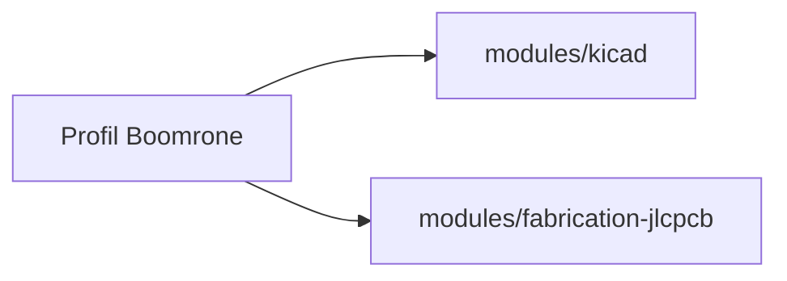

# Profil du projet

> **Aperçu** : profil de Boomrone (drone de poche lancé à la main), avec ses modules actifs du framework. Lu par tous les agents avant d'agir sur ce projet.

| Rubrique | Valeur | Décision ou doute |
|---|---|---|
| Nom | Boomrone | |
| But en une phrase | Drone de poche lancé à la main qui se stabilise, tient 10 s en stationnaire et se pose seul | « Scénarios d'utilisation » — `projets/boomrone/00-scenarios.md` |
| Domaines | Électronique, logiciel, mécanique (cadre et protège-hélices) | |
| Cible matérielle (MCU, SoC) | STM32G431CBT6 | DEC-219 « Structure générale : carte maison unique, microcontrôleur STM32G431, boucle sans système temps réel » ; ARC-002 « Microcontrôleur et programmation par liaison SWD » |
| Carte électronique | Carte conçue pour le projet | DEC-219 « Structure générale : carte maison unique, microcontrôleur STM32G431, boucle sans système temps réel » |
| Langage et chaîne de compilation | C sans système temps réel, arm-none-eabi-gcc, Makefile, CMSIS et pilotes LL de ST ; programmation par ST-LINK | DEC-255 « Conception détaillée : chaîne de développement et arborescence des fichiers » ; DEC-024 « Mise en service par programmation avec un programmateur ST-LINK » |
| Outil de CAO électronique | KiCad 10 | DEC-290 « Schéma KiCad proj_boomrone : bibliothèque locale, feuilles hiérarchiques, validation page par page » |
| Fabrication et assemblage de la carte | JLCPCB, composants du catalogue LCSC, carte double face | DEC-234 « JLCPCB, fabricant de la carte : contrainte de début de projet » ; DEC-236 « Assemblage par JLCPCB : puces nues, carte double face, flux acheté » |
| Modules actifs | `kicad`, `fabrication-jlcpcb` | DEC-294 « Framework rendu générique : modules kicad et fabrication-jlcpcb activés pour Boomrone » |
| Dossiers propres au projet | `hardware/kicad/proj_boomrone/` (schéma, PCB, notes KiCad du projet), `firmware/` (prévu), `tools/` (scripts du projet : synoptique, essais de placement ; logiciel de suivi prévu) | DEC-255 « Conception détaillée : chaîne de développement et arborescence des fichiers » |
