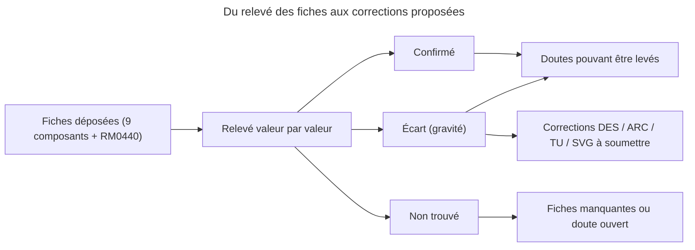

# Relevé des fiches techniques

> **Corrections appliquées le 2026-10-30, voir DEC-277 « Module radio : 19200 bauds, réveil par PA1, broches du module et boîtier » à DEC-283 « Relevé des fiches : doutes levés et doutes mis à jour ».**

> **Aperçu**
> - But : confronter les valeurs « de mémoire » de la conception détaillée aux fiches déposées dans `projets/boomrone/Datasheets/` (neuf fiches de composants et le manuel de référence RM0440).
> - Périmètre : STM32G431CBT6, LSM6DSO, VL53L1X, XC6206, MCP1700, E104-BT02, SZYY1615RGB-B, AO3400A, XT30PW. Lecture seule : aucun DES, ARC, REQ, TU, schéma SVG ni registre n'a été modifié.
> - Résultat : 3 écarts de gravité élevée (débit et veille du module radio, états d'attente de la flash), 9 de gravité moyenne, le reste en précisions. 3 doutes peuvent être levés, 9 restent ouverts.
> - Fiches absentes : PMW3901MB, ferrite BLM18PG121SN1D, diode SS34, buzzer, bouton, moteur 8520, batterie, VL53L1CX.
> - État : relevé initial (lecture seule, corrections non appliquées à sa rédaction) ; corrections appliquées le 2026-10-30, voir la ligne en tête.

*Légende : un écart est une valeur du projet que la fiche contredit ; « non trouvé » = la fiche ne donne pas la valeur (aucune valeur inventée).*

## 1. Méthode et limites

- Les numéros de page sont ceux du PDF (pied de page de la fiche, sauf RM0440 : page du PDF, qui coïncide avec le pied de page). Fiche STM32 : DS12589 Rev 6, couvre les G431x6, x8 et xB ; le CBT6 est dans le périmètre (128 kio, boîtier LQFP48, -40 à 85 °C : tableau 1 p. 2, tableau 2 p. 14, schéma de commande p. 194). Le RM0440 Rev 9 traite la **catégorie 2** pour le G431 (chapitre flash p. 188 et suivantes) : les chapitres « catégorie 3 » (p. 94) donnent le même tableau d'états d'attente mais ne sont pas ceux du G431.
- Les tableaux ambigus à l'extraction du texte ont été relus sur image (LSM6DSO p. 50, XC6206 p. 1, 2 et 5, MCP1700 p. 1 et 6, SZYY1615RGB p. 2 à 5, XT30PW p. 1 à 3, STM32 p. 68, E104-BT02 p. 6). La fiche E104-BT02 est en chinois : lecture faite par le relevé, relecture par une personne lisant le chinois souhaitable pour les points marqués (Ebyte).
- Page de la fiche E104-BT02 : numéro du PDF ; le numéro imprimé est inférieur de 1.
- Gravité : **élevée** = le DES ou le schéma contredit la fiche d'une façon qui casse une fonction ou impose un changement matériel ; **moyenne** = écart de dimensionnement, omission ou hypothèse non tenue ; **faible** = précision, formulation ou marge.

## 2. STM32G431CBT6 (DS12589 Rev 6 et RM0440 Rev 9)

### 2.1 Brochage LQFP48 et fonctions alternatives de la conception du microcontrôleur

Numéros de broches physiques : figure 8 p. 45 et tableau 12 p. 51 à 56 ; fonctions alternatives : tableau 13 p. 61 et 62. Ce relevé répond à DOU-148 « Numéros de broches physiques du LQFP-48 à relever dans la fiche DS12589 ».

| Broche | Nom | Usage dans DES-002 « Microcontrôleur : brochage, horloges, découplage et octets d'option » | Verdict |
|---|---|---|---|
| 1 | VBAT | non cité | Omission : à relier au +3V0 (usage courant ; la fiche p. 21 donne seulement 1,55 à 3,6 V). Voir correction C9 |
| 7 | PG10-NRST | NRST | Confirmé : 100 nF vers la masse, figure 27 p. 117 |
| 8 | PA0 | VBAT_SENSE, ADC1 IN1 | Confirmé : ADC12_IN1, entrée « TT_a », voie rapide (IN1 à IN5, p. 121) |
| 10, 11 | PA2, PA3 | USART2 TX, RX en AF7 | Confirmé |
| 12 | PA4 | IMU_CS, sortie | Confirmé (SPI1_NSS en AF5 non utilisé, chip select par logiciel) |
| 13, 14, 15 | PA5, PA6, PA7 | SPI1 SCK, MISO, MOSI en AF5 | Confirmé |
| 16 | PB0 | IMU_INT1, entrée | Confirmé (sans rappel interne : voir 3.2) |
| 17, 18 | PB1, PB2 | LED_R, LED_G | Confirmé (GPIO) |
| 19 | VSSA | non cité | Omission mineure |
| 20 | VREF+ | non cité | Omission : à relier à VDDA (tampon de référence inutilisé) ; p. 22 et schéma p. 68 |
| 21 | VDDA | VDDA 100 nF + 1 µF | **Écart** : la fiche prescrit 10 nF + 1 µF (p. 68). Voir C9 |
| 22 | PB10 | LED_B | Confirmé (GPIO) |
| 23, 35, 47 | VSS | masse | Confirmé |
| 24, 36, 48 | VDD | 100 nF par broche + 4,7 µF | Confirmé : « n x 100 nF + 1 x 4,7 µF » p. 68 |
| 25 | PB11 | BUZ | Confirmé (GPIO) |
| 26 | PB12 | FLX_CS, sortie | Confirmé (SPI2_NSS en AF5 non utilisé) |
| 27, 28, 29 | PB13, PB14, PB15 | SPI2 SCK, MISO, MOSI en AF5 | Confirmé |
| 30, 31, 32 | PA8, PA9, PA10 | TIM1 CH1, CH2, CH3 en AF6 | Confirmé |
| 33 | PA11 | TIM1 CH4 | **Confirmé en AF11** (« de mémoire » levé). En AF6, PA11 est TIM1_CH1N et non CH4. PA11 porte aussi USB_DM comme fonction supplémentaire (type « FT_u ») : sans activer l'USB, la broche se comporte en GPIO ou en sortie de timer |
| 34 | PA12 | non utilisée | Confirmé (USB_DP en fonction supplémentaire ; reste en entrée analogique) |
| 37, 38 | PA13, PA14 | SWDIO, SWCLK | Confirmé (AF0, JTMS et JTCK) |
| 39 | PA15 | I2C1 SCL en AF4 | Confirmé (JTDI au reset, jamais une grille : règle de DES-002 « Microcontrôleur : brochage, horloges, découplage et octets d'option ») |
| 40, 41 | PB3, PB4 | non utilisées | PB4 est NJTRST au reset : règle de DES-002 « Microcontrôleur : brochage, horloges, découplage et octets d'option » confirmée |
| 42 | PB5 | BTN | Confirmé |
| 43 | PB6 | TOF_GPIO1, interruption externe | Confirmé (GPIO) |
| 44 | PB7 | I2C1 SDA en AF4 | Confirmé |
| 45 | PB8-BOOT0 | BOOT0, 10 kΩ vers la masse | Confirmé : avec les octets d'option d'usine, BOOT0 est lu sur la broche (voir 2.3) |
| 46 | PB9 | TOF_XSHUT, sortie | Confirmé (GPIO) |

Aucune broche du DES n'est en double ; PA1, PA12, PB3 et PB4 restent libres. Le dessin de la figure 8 donne l'ordre des broches ; les schémas SVG ne portent aucun numéro de broche du microcontrôleur (voir 11).

### 2.2 Configuration des périphériques

Ce relevé traite DOU-172 « Valeurs de configuration des périphériques à vérifier dans le manuel de référence ».

| Valeur du DES | Fiche (page) | Verdict | Gravité | Conséquence |
|---|---|---|---|---|
| Flash à **8 états d'attente** à 170 MHz, mode boost | Tableau 29 p. 190 (catégorie 2) : 4 états d'attente (LATENCY = 0100, 5 cycles CPU) jusqu'à 170 MHz en boost ; registre FLASH_ACR p. 215 (LATENCY, PRFTEN bit 8, ICEN bit 9, DCEN bit 10) | **Écart** | Élevée | Corriger DES-002 « Microcontrôleur : brochage, horloges, découplage et octets d'option », DEC-257 « Valeurs de configuration des horloges, timers, bus et convertisseur », le schéma `des-002-microcontroleur.svg` ; ajouter la valeur à TU-002 « Microcontrôleur : horloges, diviseurs, broches et octets d'option ». Les budgets de temps de DES-016 « Tick de 1 kHz, cycle de contrôle et ordonnanceur de tâches de fond » supposent l'accélérateur de mémoire : à ré-estimer si besoin |
| Prefetch et caches d'instructions et de données | p. 192 à 194 : le prefetch s'active (PRFTEN) ; les deux caches sont actifs après le reset | Confirmé | Info | Néant |
| Mode boost (R1MODE) | p. 232 et 233, PWR_CR5 bit 8 (p. 267) : boost si R1MODE = 0 (valeur au reset : 1, mode normal) ; passage à plus de 150 MHz : diviseur AHB à 2, effacer R1MODE, commuter sur la PLL, attendre au moins 1 µs, remettre le diviseur à 1 | Confirmé, séquence absente du DES | Faible | Ajouter la séquence à DES-002 « Microcontrôleur : brochage, horloges, découplage et octets d'option » (ordre d'initialisation) |
| HSI 16 MHz, PLL M = 4, N = 85, R = 2 donne 170 MHz | p. 293 et 294 (PLLM = 0011, PLLN = 85, PLLR = 00) ; p. 106 : entrée de PLL 2,66 à 16 MHz (4 MHz), VCO 96 à 344 MHz (340 MHz, marge de 1,2 %), sortie R jusqu'à 170 MHz en boost | Confirmé | Info | Néant |
| HCLK, PCLK1, PCLK2 à 170 MHz | p. 106 et RM p. 232 | Confirmé | Info | Néant |
| TIM2 32 bits, prédiviseur 169 (1 MHz) ; TIM6 prédiviseur 169, rechargement 999 | p. 33 et 34 : TIM2 en 32 bits, TIM6 de base ; calcul 170 MHz / 170 = 1 MHz | Confirmé | Info | Néant |
| TIM1 : rechargement 7082, 24,001 kHz | Calcul 170 MHz / 7083 = 24 001 Hz ; TIM1 16 bits (p. 14, 32) | Confirmé | Info | Néant |
| OSSI = 0, OSSR = 0, MOE = 0 libère les sorties | RM p. 1271 et 1272 : OSSI = 0 et MOE = 0 : le timer rend la broche au GPIO, qui impose un état haute impédance ; les rappels de 100 kΩ tiennent la grille | Confirmé | Info | Néant |
| SPI1 diviseur 32 (5,3125 MHz) et SPI2 diviseur 128 (1,328125 MHz) | Calcul sur 170 MHz ; LSM6DSO : 10 MHz au plus (p. 12) ; PMW3901 2 MHz : fiche absente | Confirmé (calcul), limite du flux non vérifiable | Info | Néant |
| USART2 BRR = 17708 donne 9600 bauds, erreur < 0,01 % | Calcul : 170 MHz / 17708 = 9600,2 bauds. Horloge de l'USART2 : PCLK1 par défaut (RM p. 325). **Mais** la HSI16 est à 15,88 à 16,08 MHz à 30 °C et dérive de ±1 % entre 0 et 85 °C (p. 103) | Calcul exact, erreur réelle sous-estimée | Moyenne | Reformuler l'erreur dans DES-002 « Microcontrôleur : brochage, horloges, découplage et octets d'option », DES-012 « Raccordement du module Bluetooth PB-03F » et TU-002 « Microcontrôleur : horloges, diviseurs, broches et octets d'option » : jusqu'à environ ±1,75 % avec la HSI, avant la tolérance du module |
| I2C1 400 kHz, registre de timing « à relever » | RM p. 1657 à 1659 : exemples de TIMINGR pour 8, 16 et 48 MHz seulement (tableaux 359 à 361), outil CubeMX recommandé ; horloge I2C1 : PCLK par défaut (p. 325) | **Non trouvé** pour 170 MHz | Moyenne | Calculer avec CubeMX ou choisir HSI16 comme horloge de l'I2C (I2C1SEL = 10) pour reprendre une valeur du tableau 360 |
| ADC1 : horloge synchrone HCLK/4 = 42,5 MHz | RM p. 708 (CKMODE = 11) ; maximum 52 MHz avec tous les ADC en plage 1 (p. 118) | Confirmé | Info | Néant |
| Temps d'échantillonnage 640,5 cycles (15,1 µs) ; 14 x 15,4 µs = 216 µs | RM p. 611 (SMP = 111) ; conversion de 12 bits = échantillonnage + 12,5 cycles = 653 cycles (15,37 µs, p. 119) ; 14 rangs permis (16 au plus) | Confirmé | Info | Néant |
| Déclenchement par TRGO de TIM6 | RM p. 619 : tim6_trgo = adc_ext_trg13, code EXTSEL 01101 | Confirmé | Info | Néant |
| VREFINT sur le canal 18 de l'ADC1 | p. 30 et RM p. 675 (activer VREFEN dans ADC12_CCR, p. 708) | Confirmé | Info | Néant |
| VREFINT_CAL à l'adresse 0x1FFF75AA, mesurée à 3,0 V | Tableau 6 p. 30 : 0x1FFF75AA et 75AB, à 30 °C (±5 °C) et VDDA = VREF+ = 3,0 V (±10 mV) | Confirmé (la tolérance de ±10 mV compte dans le budget) | Info | Voir le doute sur le BOR et la mesure de tension en section 12 |
| VREFINT nominale 1,212 V (1654 pas à 3,0 V) | Tableau 20 p. 74 : 1,182 / 1,212 / 1,232 V sur -40 à 130 °C | Confirmé (valeur typique) | Info | Néant |
| Temps d'échantillonnage minimal de VREFINT | p. 74 : au moins 4 µs ; 15,07 µs donnés par le DES | Confirmé | Info | Néant |
| Impédance de source 60 kΩ | Tableau 60 p. 119 : RAIN au plus 50 kΩ ; tableau 61 p. 121 : 39 kΩ pour 12 bits, 640,5 cycles, voie rapide, à 60 MHz | **Écart** (60 kΩ dépasse les deux) | Moyenne | Le condensateur de 100 nF sur PA0 atténue le problème mais la fiche ne le dit pas : vérifier à TI-008 « Batterie, connecteur, chute de tension et mesure de tension » ; sinon réduire le pont ou ajouter un tampon. Voir DOU-142 « Fuite d'entrée de l'ADC et marge de ±50 mV de la mesure de tension » |
| Calibration de l'ADC | p. 118 : calibrer après chaque mise sous tension ; temps de démarrage du régulateur de l'ADC p. 119 | **Omission** dans DES-022 « Pilote de la mesure de tension de la batterie » | Moyenne | Ajouter l'étalonnage (ADCAL) et l'attente à la séquence de DES-022 « Pilote de la mesure de tension de la batterie » et DES-031 « Séquence d'initialisation et échec d'initialisation » |

### 2.3 Octets d'option, BOR, chien de garde, flash

| Valeur du DES | Fiche (page) | Verdict | Gravité | Conséquence |
|---|---|---|---|---|
| IWDG_SW = 0 donne un chien de garde matériel | RM p. 200 à 202 : FLASH_OPTR, bit 16, 0 = matériel ; valeur d'usine 0xFFEFF8AA (bit 16 à 1 : logiciel) | Confirmé | Info | À programmer explicitement (valeur d'usine = logiciel) |
| BOR_LEV = 3, « environ 2,5 V » | RM p. 202 : niveau 3 « autour de 2,5 V » ; valeur d'usine niveau 0 (environ 1,7 V). DS tableau 19 p. 72 : niveau 3 : descendant 2,47 / 2,52 / 2,57 V, montant 2,56 / 2,61 / 2,66 V (min / typ / max) | Confirmé | Moyenne | Le seuil descendant (au plus 2,57 V) est **sous** le minimum de 2,6 V du VL53L1X (p. 18 de sa fiche). Niveau 4 : descendant 2,76 à 2,86 V, montant 2,85 à 2,95 V : le seuil montant maximal dépasse le rail bas du MCP1700 (2,91 V), donc le microcontrôleur pourrait rester en reset : niveau 4 déconseillé. Voir DOU-181 « Bilan d'erreur de la mesure de tension et niveau du BOR » |
| Protection en lecture niveau 0 | RM p. 202 : RDP = 0xAA | Confirmé | Info | Néant |
| BOOT0 sur PB8 avec 10 kΩ à la masse | RM p. 201 : nSWBOOT0 = 1 (valeur d'usine) : BOOT0 pris sur la broche | Confirmé | Info | Néant |
| IWDG : prédiviseur 8, rechargement 399, 100 ms nominal | RM p. 1561 (PR = 001 : division par 8). Fiche p. 105 : LSI de 29,5 à 34 kHz (31,04 à 32,96 kHz à 30 °C) soit 94 à 108,5 ms ; le pire cas de 112 ms du DES est prudent | Confirmé | Info | Néant |
| Chien de garde matériel dès la mise sous tension | RM p. 1559 à 1562 : au reset PR = 0 (division par 4) et RLR = 0xFFF, soit environ 512 ms jusqu'à l'écriture de PR et RLR | Précision | Faible | Écrire PR et RLR dès `board_early_init()` ; l'ajouter à DES-030 « Chien de garde matériel et règle de rafraîchissement » |
| Gel de l'IWDG par le débogueur (DBGMCU) | RM p. 2111 : bit DBG_IWDG_STOP | Confirmé | Info | Néant |
| Cause du reset dans RCC_CSR : IWDG, BOR, broche NRST | RM p. 328 : IWDGRSTF (bit 29), BORRSTF (27), PINRSTF (26) ; il n'y a **pas** de drapeau de coupure d'alimentation distinct, la mise sous tension lève BORRSTF (valeur de reset 0x0C000000) | Précision | Faible | Reformuler « drapeau de coupure d'alimentation » dans DES-031 « Séquence d'initialisation et échec d'initialisation » |
| Flash : 128 kio, 64 pages de 2 kio, page 63 à 0x0801F800 | RM p. 189 | Confirmé | Info | Néant |
| Écriture de 64 bits, effacement de page de 22 à 40 ms | RM p. 196 et 197 : mots doubles ; DS p. 107 : effacement de page typique 22,02 ms, maximum 24,47 ms ; écriture de 64 bits 81,7 µs | Confirmé (40 ms est prudent) | Info | Néant |
| Lecture de flash bloquée pendant l'effacement | RM p. 195 : toute lecture de flash cale le bus pendant une écriture ou un effacement (le code s'exécute en flash) | Précision | Faible | Noter dans DES-035 « Paramètres de vol, section d'origine et pilote de flash » que le cœur et les interruptions sont gelés environ 25 ms ; le DES rafraîchit déjà le chien de garde avant et après |
| NMI sur erreur ECC double, FLASH_ECCR, ECCD | RM p. 190 et 220 : ECCD bit 31, NMI générée ; donnée vierge : une erreur détectée et corrigée, pas de détection de double erreur | Confirmé | Info | Cohérent avec DES-017 « Coupure des moteurs, démarrage unique et gestionnaires d'exception » et DES-035 « Paramètres de vol, section d'origine et pilote de flash » |
| SRAM1 16 kio à 0x20000000 ; SRAM2 et CCM inutilisées | RM p. 88 et 89 : catégorie 2 = SRAM1 16 kio, SRAM2 6 kio à 0x20004000, CCM 10 kio à 0x10000000 ; contrôle de parité désactivé par défaut (SRAM_PE = 1) | Confirmé | Info | Néant |

### 2.4 Alimentation et niveaux logiques

| Valeur du DES | Fiche (page) | Verdict | Gravité | Conséquence |
|---|---|---|---|---|
| NRST : 100 nF, pas de bouton | Figure 27 p. 117 : 0,1 µF ; rappel interne 25 à 55 kΩ (p. 116) | Confirmé | Info | Néant |
| VDD 3,0 V | p. 21 : 1,71 à 3,6 V | Confirmé | Info | Néant |
| Niveaux logiques 3,0 V face au flux optique | p. 111 : VIH minimal = 0,7 x VDD = 2,1 V ; la sortie MISO du flux donne au moins VDDIO - 0,45 V = 2,55 V (valeur du doute, fiche PixArt absente) | Confirmé côté STM32 | Info | Marge de 0,45 V, voir DOU-165 « Flux optique : alimentation en 2,0 V, valeurs de fiche et mise sous tension » |
| Consommation du microcontrôleur | p. 76 et 78 : environ 23 à 44 mA à 170 MHz en boost selon la température et le programme | Info | Info | Le budget de 130 mA de DES-001 « Schéma par blocs, réseaux et domaines de tension de la carte » reste large |

## 3. LSM6DSO (DS12140 Rev 3)

| Valeur du DES | Fiche (page) | Verdict | Gravité | Conséquence |
|---|---|---|---|---|
| Boîtier LGA-14 | p. 1 : LGA-14L, 2,5 x 3 x 0,83 mm | Confirmé | Info | Néant |
| VDD et VDDIO au +3V0 | p. 11 : VDD 1,71 à 3,6 V, VDDIO 1,62 à 3,6 V | Confirmé | Info | Néant |
| 100 nF au plus près de chaque broche | Figure 21 p. 34 : 100 nF sur VDD (broche 8) et 100 nF sur VDDIO (broche 5) | Confirmé | Info | Néant |
| 10 µF commun | Non trouvé (la fiche ne montre pas de condensateur plus grand) | Ajout du projet, acceptable | Faible | Néant ; à garder si le routage le permet |
| SPI 4 fils, mode 3, 5,3125 MHz | p. 12 : modes 0 et 3 (p. 16), 10 MHz au plus | Confirmé | Info | Néant |
| CS avec rappel de 10 kΩ | p. 37 : CS a un rappel interne de 30 à 50 kΩ ; le rappel externe est sans conflit | Confirmé | Info | Néant |
| INT1 vers PB0 sans rappel | p. 38 note 2 : INT1 doit être à 0 ou non connectée pendant la mise sous tension | Confirmé | Info | Ne jamais activer de rappel haut sur PB0 |
| INT2 non raccordée | p. 37 : sortie forcée à la masse par défaut ; non raccordée admise | Confirmé | Info | Néant |
| Entrées de la liaison auxiliaire « à la masse ou laissées » | p. 8, 34 et 37 : SDx (broche 2) et SCx (broche 3) à relier à VDDIO **ou** à la masse (jamais flottantes) ; OCS_Aux (10) et SDO_Aux (11) non connectées | **Précision** | Moyenne | Corriger DES-003 « Raccordement de la centrale inertielle LSM6DSO » et le schéma `des-003-centrale-inertielle.svg` : deux broches à la masse, deux laissées libres (soudées à la carte) |
| WHO_AM_I (0x0F) = 0x6C | p. 48 : valeur fixe 6Ch | Confirmé | Info | Néant |
| CTRL3_C = 0x44 | p. 51 : BDU (bit 6) et IF_INC (bit 2) ; valeur au reset 0x04 | Confirmé | Info | Néant |
| CTRL4_C = 0x06 | p. 52 : I2C_disable (bit 2) et LPF1_SEL_G (bit 1) | Confirmé | Info | La fiche précise aussi I3C_disable dans CTRL9_XL (p. 38) : sans effet pour l'usage en SPI |
| CTRL1_XL = 0x9C | p. 49 : ODR_XL = 1001 (3,33 kHz, haute performance), FS = 11 donne ±8 g | Confirmé | Info | Néant |
| CTRL2_G = 0x9C | p. 50 (image) : ODR_G = 1001 (3,33 kHz), FS = 11 donne ±2000 °/s | Confirmé | Info | Néant |
| INT1_CTRL = 0x03 | p. 47 : bit 0 INT1_DRDY_XL, bit 1 INT1_DRDY_G | Confirmé | Info | Néant |
| Lecture de 14 octets à partir de 0x20 (commande 0xA0) | p. 65 et 67 : OUT_TEMP_L à 20h, gyroscope 22h à 27h, accéléromètre 28h à 2Dh | Confirmé | Info | Néant |
| Échelles 70 m°/s et 0,244 mg par pas | Tableau 2 p. 9 : 70 mdps/LSB à ±2000 °/s, 0,244 mg/LSB à ±8 g | Confirmé | Info | Néant |
| Étape « centrale inertielle » de 30 ms à l'initialisation | Tableau 3 p. 11 : « Turn-on time » 35 ms typique (la fiche ne dit pas s'il court depuis VDD ou depuis un changement d'ODR) | **Écart possible** | Moyenne | DES-031 « Séquence d'initialisation et échec d'initialisation » et DES-018 « Pilote de la centrale inertielle » : attendre au moins 35 ms (avec marge) après la mise sous tension avant le premier accès SPI ; le reset logiciel envoyé trop tôt peut être ignoré. Durée du reset logiciel : non trouvée |
| Adresse I2C | Sans objet (SPI) | Sans objet | Info | Néant |

Brochage LGA-14 (tableau 1 p. 8) : 1 SDO/SA0, 2 SDx, 3 SCx, 4 INT1, 5 VDDIO, 6 GND, 7 GND, 8 VDD, 9 INT2, 10 OCS_Aux, 11 SDO_Aux, 12 CS, 13 SCL (SPC), 14 SDA (SDI). Comparaison avec `des-003-centrale-inertielle.svg` : les noms SCL (SCK), SDA/SDI (MOSI), SDO/SA0 (MISO), CS, INT1, INT2, VDD, VDDIO sont exacts ; manquent les deux masses (6 et 7) et le traitement de SDx, SCx, OCS_Aux, SDO_Aux ; aucun numéro n'est affiché.

## 4. VL53L1X (DS12385 Rev 8)

| Valeur du DES | Fiche (page) | Verdict | Gravité | Conséquence |
|---|---|---|---|---|
| Fiche citée : DS12093 | Le fichier déposé porte DS12385 Rev 8 en pied de page | Référence à corriger | Faible | Corriger DES-004 « Raccordement du capteur de hauteur VL53L1X » et le schéma `des-004-capteur-hauteur.svg` |
| Adresse I2C 0x29 | p. 13 à 15 : adresse par défaut 0x52 en écriture (0x53 en lecture), soit 0x29 sur 7 bits | Confirmé | Info | Néant |
| AVDD, AVDDVCSEL et **IOVDD** au +3V0 | Figure 2 et tableau 3 p. 5 : **aucune broche IOVDD**. « IOVDD » est la tension des rappels côté hôte (figure 3 p. 6) | **Écart** | Moyenne | Retirer IOVDD de DES-004 « Raccordement du capteur de hauteur VL53L1X » et du schéma ; 100 nF « sur IOVDD » sans objet |
| AVDD de 2,6 V minimum (rail à 2,9 V) | Tableau 13 p. 18 : AVDD 2,6 / 2,8 / 3,5 V ; maximum absolu 3,6 V (p. 18) | Confirmé | Info | Voir BOR plus haut |
| Niveaux d'E/S en 3,0 V | Tableau 13 p. 18 : mode « 2V8 » (IO 2,6 à 3,5 V, niveaux hauts égaux à AVDD) ; **le mode par défaut du pilote est 1V8**, le mode 2V8 se programme par les réglages du pilote | **Précision** | Moyenne | Vérifier dans l'ULD que l'initialisation règle le mode 2V8 ; à ajouter à DOU-149 « Valeurs de registres du VL53L1X à vérifier dans la bibliothèque ST (ULD) » et à DES-019 « Pilote du capteur de hauteur non bloquant » |
| 4,7 µF + 100 nF sur AVDDVCSEL | Figure 3 p. 6 : 100 nF et 4,7 µF sur l'alimentation, au plus près des broches AVDDVCSEL et AVSSVCSEL | Confirmé | Info | Les 100 nF supplémentaires sur AVDD ne figurent pas dans la fiche (acceptable) |
| Rappels de 4,7 kΩ sur l'I2C | Tableau 4 p. 6 : 3,6 kΩ pour une capacité de bus de 90 pF au plus (conseil donné pour AVDD de 1,8 à 2,8 V) ; capacité de charge typique 125 pF, maximum 400 pF (tableau 7 p. 15) | Écart faible | Faible | 4,7 kΩ reste acceptable pour 30 pF (calcul du DES) ; à justifier |
| Temps de montée sous 300 ns | Tableau 7 p. 15 : 300 ns au plus | Confirmé | Info | Néant |
| GPIO1 en drain ouvert, rappel de 10 kΩ | Tableau 3 p. 5 : sortie d'interruption à drain ouvert ; p. 6 : rappel recommandé de 10 kΩ | Confirmé | Info | Réponse à DOU-163 « Valeurs de fiche à relever : rappel de GPIO1, résistance de l'AO3400A, USB du G431 » |
| XSHUT : rappel de 10 kΩ, piloté par le microcontrôleur | p. 6 : doit toujours être piloté, rappel de 10 kΩ ; p. 11 : option 2 (XSHUT non piloté) ou 1 ; XSHUT ne monte qu'une fois l'alimentation présente ; démarrage 1,2 ms au plus | Confirmé | Info | Néant |
| Registres 0x0089 et 0x0086, structure de résultats | p. 16 : la fiche n'expose pas les registres (renvoi à la note UM2356) ; seuls l'identifiant (0x010F = 0xEA), le type de module (0x0110 = 0xCC) et la révision (0x0111 = 0x10) sont donnés | **Non trouvé** | Info | DOU-149 « Valeurs de registres du VL53L1X à vérifier dans la bibliothèque ST (ULD) » reste ouvert ; l'identifiant du VL53L1CX n'est pas dans cette fiche (DOU-157 « VL53L1CX contre VL53L1X : identifiant, bibliothèque et registres ») |
| Courant | Tableau 15 p. 19 : moyenne 16 à 18 mA, pic de 40 mA | Info | Info | Compatible avec 130 mA |

Brochage LGA-12 (figures 2 et 3 p. 5 et 6, vue de dessous) : 1 AVDDVCSEL, 2 AVSSVCSEL, 3 GND, 4 GND2, 5 XSHUT, 6 GND3, 7 GPIO1, 8 DNC, 9 SDA, 10 SCL, 11 AVDD, 12 GND4. DNC (broche 8) reste **flottante**. Les broches GND, GND2, GND3, GND4 et AVSSVCSEL sont reliées à la masse (p. 5). Le schéma `des-004-capteur-hauteur.svg` nomme SCL, SDA, GPIO1, XSHUT, AVDD, AVDDVCSEL (exacts) et IOVDD (inexistante) ; il ne montre ni les masses ni DNC.

## 5. XC6206 et MCP1700

### 5.1 XC6206P202MR-G (Torex ETR0305_004b)

| Valeur du DES | Fiche (page) | Verdict | Gravité | Conséquence |
|---|---|---|---|---|
| Sortie 2,0 V, tolérance 2 % (1,96 à 2,04 V) | Tableau p. 5 : code de précision 2 pour la version 2,0 V : 1,960 à 2,040 V (à 25 °C, VIN = VOUT + 1 V, 30 mA) ; coefficient de température typique 100 ppm/°C (lecture à confirmer, p. 4) | Confirmé | Info | La plage de 1,8 à 2,1 V de la puce reste tenue avec les dérives usuelles (calcul : environ 2,06 V au pire) ; reste lié à DOU-165 « Flux optique : alimentation en 2,0 V, valeurs de fiche et mise sous tension » |
| Courant de sortie 120 mA | p. 5 : minimum 120 mA pour la version 2,0 V | Confirmé | Info | Néant |
| Chute de tension « 0,55 à 0,78 V à 70 à 100 mA » | p. 5 : chute à 100 mA typique 350 mV, **maximum 780 mV** ; à 30 mA typique 100 mV, maximum 370 mV | 0,78 V confirmé ; 0,55 V non dans la fiche (interpolation) | Faible | Remplacer 0,55 V par « non donné à 70 mA » ; marge de 1,0 V du rail de 3,0 V conservée |
| Condensateur d'entrée 1 µF | p. 1 : CIN = 1,0 µF céramique | Confirmé | Info | Néant |
| Condensateur de sortie 2,2 µF | p. 1 : CL = 1,0 µF céramique (compatible faible ESR) | Compatible | Info | 2,2 µF acceptable ; la fiche ne dit rien au-delà de 1,0 µF |
| Tension d'entrée | p. 3 et 4 : 1,8 à 6,0 V, maximum absolu 7,0 V | Confirmé | Info | Néant |
| Dissipation 9 mW moyenne, 70 mW en pointe | p. 3 : 250 mW pour le SOT-23 | Confirmé | Info | Néant |
| Brochage SOT-23 « VIN 3, VOUT 2, VSS 1 » (schéma) | p. 2 : 1 VSS, 2 VOUT, 3 VIN | Confirmé | Info | Le schéma `des-005-flux-optique-regulateur-2v0.svg` est correct |

### 5.2 MCP1700T-3002E/TT (Microchip DS20001826C)

| Valeur du DES | Fiche (page) | Verdict | Gravité | Conséquence |
|---|---|---|---|---|
| Sortie 3,0 V, 130 mA | p. 3 : 250 mA minimum pour 2,5 V et plus ; sortie VR ±3 % sur toute la plage de température (2,91 à 3,09 V), ±0,4 % typique à 25 °C | Confirmé (le rail « environ 2,9 V » correspond à -3 %) | Info | Néant |
| 1 µF en entrée | p. 10 et 12 : 1 µF céramique suffit « jusqu'à 100 mA » ; au-delà la valeur dépend de la source, une valeur plus grande est permise | Précision | Faible | 130 mA dépasse 100 mA : les 22 µF de DES-008 « Batterie, connecteur XT30 et entrée de la carte » en tête de VBATL en plus de 1 µF au composant sont justifiés. Cela répond à DOU-184 « Condensateurs d'entrée du régulateur de 3,0 V : 22 µF sur VBATL et 1 µF sur l'entrée du composant » |
| 4,7 µF en sortie | p. 12 : 1,0 µF minimum, ESR de 0 à 2 Ω ; stable avec 1 µF céramique (p. 1) | Confirmé | Info | Néant |
| « Sortie réglée tant que la batterie dépasse 3,1 V » | p. 3 : chute maximale 350 mV à 250 mA ; figure 2-12 p. 6 : environ 0,12 V à 130 mA pour la version 2,8 V (typique, 125 °C) ; valeur tabulée à 130 mA : non trouvée | Plausible, non garanti | Faible | La fiche garantit seulement VIN supérieur ou égal à VR + 3 % + chute (3,44 V à 250 mA, note 1) ; à garder comme hypothèse dans DES-009 « Régulateur de 3,0 V et pont de mesure de la tension » |
| 230 K/W en SOT-23 sans cuivre | p. 13 et 14 : 230 °C/W dans le texte ; tableau p. 4 : **336 °C/W** (JESD51-7) | Écart de source | Faible | Avec 336 °C/W : 54 K à 0,16 W au lieu de 37 K ; Tj reste sous le maximum de 125 °C (p. 3) ; ajouter à DES-009 « Régulateur de 3,0 V et pont de mesure de la tension » et TU-009 « Régulateur de 3,0 V et pont de mesure : dissipation, rapport et erreur » (qui attend 36 K ±2 K) |
| Tension d'entrée maximale (surtension à la connexion) | p. 3 : 6,5 V maximum absolu ; fonctionnement 2,3 à 6,0 V ; ESD 4 kV | Confirmé | Info | Dépassement calculé de 4,7 V : marge de 1,8 V ; voir DOU-155 « Connecteur XT30 : genre côté carte et surtension à la connexion » |
| Courant de repos 1,6 µA | p. 3 | Info | Info | Néant |

Brochage SOT-23 (figure p. 1, tableau 3-1 p. 10) : 1 GND, 2 VOUT, 3 VIN. Le schéma `des-009-regulateur-3v0-pont-mesure.svg` (VIN 3, VOUT 2, GND 1) est correct. Le brochage est identique à celui du XC6206.

## 6. E104-BT02 (Ebyte, en chinois)

| Valeur du DES ou de l'ARC | Fiche (page du PDF) | Verdict | Gravité | Conséquence |
|---|---|---|---|---|
| 9600 bauds visés, « aucune configuration par commandes AT » | p. 9 et 10 : débit **par défaut 19200 bauds**, 8N1 sans parité ; 9600 exige la commande `<BAUD9600>` en mode configuration (MOD à l'état bas, UART à 19200) ou par la voie aérienne (caractéristique 0xFFF3, mot de passe 123456) ; la fiche indique 19200 bauds comme maximum de la transmission continue (p. 3 et 7) | **Écart** | Élevée | La liaison à 9600 ne fonctionne pas sans configuration. Proposition : passer l'USART2 à 19200 bauds (BRR = 8854, 170 MHz / 8854 = 19200,4) : plus aucune commande, conforme à ARC-012 « Module radio Bluetooth à basse consommation » (refuser tout module à commandes). Corriger DES-012 « Raccordement du module Bluetooth PB-03F », DES-002 « Microcontrôleur : brochage, horloges, découplage et octets d'option », DES-021 « Pilotes des moteurs, du voyant, du buzzer et de la liaison série », TU-002 « Microcontrôleur : horloges, diviseurs, broches et octets d'option », TU-012 « Module Bluetooth : débit et occupation de la liaison » et les schémas SVG ; charge de 138 octets par seconde = 7 % de 1920 ; trame de 14 octets = 7,3 ms |
| Commandes AT absentes (doute) | p. 9 à 24 : jeu de commandes entre chevrons (`<RESET>`, `<BAUDxxx>`, `<COMBAUD>`, `<RESTORE>`, `<PWDxxx>`...), pas de préfixe AT ; configuration par la broche MOD ou par l'air | **Écart avec le doute** | Moyenne | Le module a des commandes ; le projet peut ne jamais les utiliser à 19200 bauds. Mot de passe aérien par défaut 123456 : une personne à portée peut reconfigurer le module (voir DOU-151 « Module E104-BT02 : débit par défaut, service, absence de commande AT ») ; proposer `<UPDPWDxxx>` au premier essai |
| Autres broches « selon la fiche » | p. 5 : P06 = WKP (broche 9, rappel interne, **défaut = mode veille**) ; P00 = MOD (3, rappel interne, défaut transmission transparente) ; RESET_H (13, reset actif à l'état haut) ; P11 = STA (15, bas si connecté) ; P03 = APP (6, bas pendant l'envoi des données) ; P14 = rôle (17, rappel interne, esclave par défaut) | **Omission** | Élevée | En veille, **l'UART ne reçoit plus** (p. 6 : « la réception série s'arrête ») : les trames du microcontrôleur vers le téléphone seraient perdues. La fiche relie WKP, MOD, STA, rôle, AUX et RESET_H au microcontrôleur (schéma p. 6). Proposer : WKP piloté par une broche libre (PA1 par exemple) ou relié selon un essai à TI-010 « Liaison Bluetooth à basse consommation » ; MOD à 1 (rappel interne suffit) ; RESET_H à la masse ou piloté ; le comportement exact d'un WKP tenu bas dès la mise sous tension n'est **pas** décrit |
| TX du module vers PA3, RX du module depuis PA2 | p. 5 : P04 = sortie série (broche 7), P05 = entrée série (broche 8) | Confirmé (la fiche nomme ces broches P04 et P05, pas TXD et RXD) | Faible | Renommer sur `des-012-module-bluetooth.svg` : P04 (TXD) broche 7, P05 (RXD) broche 8 |
| VCC au +3V0, 10 µF + 100 nF | p. 4 : 2,5 à 3,6 V, typique 3,3 V, **puissance de sortie garantie seulement à 3,3 V et plus**, maximum absolu 3,6 V ; schéma p. 6 : 1 µF + 0,1 µF | Précision | Moyenne | Le rail de 3,0 V (2,91 à 3,09 V) est dans la plage mais sous 3,3 V : portée à mesurer à TI-010 « Liaison Bluetooth à basse consommation » ; condensateurs plus gros acceptables |
| Niveaux de 3,0 V des deux côtés | p. 4 : niveau de communication 3,3 V ; entrées VIL/VIH lisibles de façon ambiguë (0,84 V et 0,36 x VCC cités) | Non trouvé de façon sûre | Faible | VOH du STM32 (au moins VDD - 0,4 V) très supérieur au seuil ; non critique |
| Courant 4 à 10 mA (ARC) | p. 4 : émission 3,4 mA, réception 3,7 mA, connecté éveillé environ 0,8 mA | Estimation prudente | Info | Néant |
| Boîtier 22,3 x 14 mm (nomenclature) | p. 4 : 14,6 x 21,9 mm, pas de 1,27 mm, 20 broches | **Écart** | Faible | Mettre à jour l'empreinte de DES-013 « Implantation, routage et fichiers de fabrication pour JLCPCB » et la nomenclature de ARC-012 « Module radio Bluetooth à basse consommation » |
| Antenne dégagée, rien dessous | p. 28 : antenne exposée, éloignée du métal ; rien de haute fréquence dessous | Confirmé | Info | Néant |
| Service et caractéristique (doute) | p. 24 : service 0xFFF0 ; 0xFFF1 « BLE DATA BUFF » (lecture, notification, module vers téléphone) ; 0xFFF2 « CENTER DATA BUFF » (lecture, écriture, téléphone vers module) ; 0xFFF3 configuration ; paquet de 20 octets par défaut (MTU réglable de 20 à 128) | Trouvé | Info | Options `--service` et `--char` de DES-036 « Logiciel de suivi en Python » ; une trame de 14 octets tient dans 20 |
| Version Bluetooth (doute) | p. 3 : la fiche annonce BLE 5.1 (le 4.2 cité par le doute n'apparaît pas) | Trouvé | Info | Néant |
| Reflux | p. 30 : sans plomb, crête 230 à 250 °C | Info | Info | À confronter au profil de JLCPCB |

## 7. SZYY1615RGB-B (Yongyu, 12 pages)

| Valeur du DES | Fiche (page) | Verdict | Gravité | Conséquence |
|---|---|---|---|---|
| Anode commune, boîtier 1,6 x 1,5 mm | p. 2 : broche 4 = COM (anode), 1 = rouge, 2 = vert, 3 = bleu ; 1,6 x 1,5 x 0,6 mm | Confirmé | Info | Brochage à reporter dans le schéma KiCad |
| Tension directe du rouge 2,0 V supposée, 2,4 V au catalogue | p. 4 (20 mA) : rouge 1,8 à 2,4 V ; courbe p. 5 : environ 2,05 V à 20 mA | Confirmé (2,4 V = maximum de la fiche) | Info | Néant |
| Tension directe du vert et du bleu 3,0 V supposée, 3,4 V au catalogue | p. 4 (20 mA) : vert et bleu 2,8 à 3,4 V ; pas de valeur typique ; courbe p. 5 : vert environ 3,1 V, bleu environ 3,2 V à 20 mA, environ 2,75 V (vert) et 2,85 V (bleu) à 5 mA | Confirmé (plage) | Moyenne | À 3,7 V de batterie, courants d'environ 10 mA (courbe typique) ; un échantillon à 3,4 V maximum serait très faible : décision à prendre avant la commande ; voir DOU-161 « Tensions directes du voyant RGB : visibilité du vert et du bleu entre 3,4 et 3,7 V » |
| Courant de 18,3 mA (rouge) et 17,6 mA (vert, bleu) à 4,2 V | p. 3 : courant continu maximal 25 mA par couleur, pointe 60 mA ; courbe p. 5 : courant maximal décroît de 25 mA à 25 °C vers environ 17 à 18 mA à 50 °C (lecture de la courbe) | Confirmé à froid | Faible | Rouge à 18,3 mA : au-dessus de la limite de température vers 45 à 50 °C ; marge à noter |
| Blanc « au plus 54 mA » | Avec les minima de la fiche (1,8 / 2,8 / 2,8 V) et 4,2 V : 20,0 + 20,6 + 20,6 = 61 mA | **Écart** | Faible | Corriger en 61 mA dans DES-011 « Circuit du voyant RGB et du buzzer » ; avec le buzzer 91 mA : toujours très inférieur au courant des MOSFET |
| Puissance du rouge | p. 3 : 40 mW au maximum pour le rouge (90 mW vert et bleu) ; 18,3 mA x 2,0 V = 37 mW | Marge de 8 % | Faible | À signaler : le rouge est la voie la plus proche de sa limite |
| 120 Ω et 68 Ω | Calculs ci-dessus | Cohérents | Info | Néant |

## 8. AO3400A (Alpha & Omega, rev 3, 5 pages)

| Valeur du DES | Fiche (page) | Verdict | Gravité | Conséquence |
|---|---|---|---|---|
| « Le fabricant donne 33 mΩ à 2,5 V » | p. 1 et 2 : RDS(on) à VGS = 2,5 V et 3 A : **24 mΩ typique, 48 mΩ maximum** ; 32 mΩ maximum à 4,5 V ; à 125 °C le rapport est d'environ 1,5 (28 / 18 mΩ typique à 10 V) ; valeur à VGS = 3,0 V : non trouvée | **Écart** | Moyenne | Reprendre le calcul de DES-007 « Circuit de puissance des moteurs » : à 2,4 A, 0,14 W (24 mΩ) à 0,28 W (48 mΩ), soit 14 à 41 K avec 100 à 150 K/W ; corriger TU-007 « Circuit de puissance : constantes de temps, pertes et courants » (0,19 W et 19 à 29 K) et le schéma `des-007-puissance-moteurs.svg` |
| Seuil de grille | p. 2 : VGS(th) 0,65 / 1,05 / 1,45 V (250 µA) | Confirmé : 3,0 V suffit largement | Info | Néant |
| Ciss 300 pF (valeur typique) et 630 pF (valeur haute) | p. 2 : Ciss = **630 pF typique**, pas de maximum ; 300 pF n'apparaît pas ; figure 8 p. 4 : plus grande à faible VDS | **Écart** | Faible | Le cas 630 pF (69 µs) est le cas typique ; le pire cas est un peu plus haut (encore très sous 1 ms) ; corriger le libellé |
| Charge de grille | p. 2 : Qg 6 nC typique, 7 nC maximum à VGS = 4,5 V (à 3,0 V : non trouvée) | Info | Info | Courant moyen de grille négligeable à 24 kHz (environ 0,15 mA par voie) |
| VGS maximal | p. 1 : ±12 V ; VDS 30 V ; courant continu 5,7 A (25 °C) | Confirmé | Info | Néant |
| Résistance thermique 100 à 150 K/W | p. 1 : 100 K/W typique, 125 K/W maximum sur carte de 645 mm2 en cuivre de 2 oz | Cohérent (la carte réelle sera moins bien refroidie) | Faible | Néant |
| Brochage SOT-23 | p. 1 (vue de dessus) : grille 1, source 2, drain 3 | Confirmé | Info | Néant |

## 9. XT30PW-M30 (Amass, 3 pages)

| Valeur du DES ou de l'ARC | Fiche (page) | Verdict | Gravité | Conséquence |
|---|---|---|---|---|
| Genre : mâle (nomenclature, C431092) | p. 1 : « M » = mâle (plug) ; p. 2 : XT30PW20-M.G.* et XT30PW30-M.G.* | Confirmé | Info | Le genre de la batterie achetée reste à vérifier (DOU-155 « Connecteur XT30 : genre côté carte et surtension à la connexion ») |
| Désignation « XT30PW-M30.G.Y » | p. 2 : la désignation de la fiche est XT30PW30-M.G.Y (hauteur de soudure 3,0 mm) ; la variante 20 est à 2,0 mm | Écart de désignation | Faible | Aligner ARC-008 « Batterie et connecteur débranchable » et la nomenclature ; vérifier que C431092 est la version 30 |
| Tenue en courant | p. 2 : 15 A en continu (élévation de 60 °C à 15 A pendant 4 h), 30 A pendant 1 min ; résistance de contact 1,20 mΩ ; 500 V ; -20 à 120 °C | Confirmé : 9,5 A crête et 5,5 A moyen passent | Info | Néant |
| Empreinte | p. 3 : deux trous de puissance Ø 1,9 mm à 5,00 mm, deux trous de calage Ø 1,0 mm à 11,00 mm, boîtier 13,95 x 9,00 mm, hauteur 13,30 mm (orientation des cotes à lire sur le dessin) | Trouvé | Info | À reporter dans DES-013 « Implantation, routage et fichiers de fabrication pour JLCPCB » et le croquis de DOU-162 « Implantation mécanique de la carte, du connecteur et de la batterie » |
| Avertissement | p. 3 : connecter et déconnecter hors tension | Info | Info | Lié à DOU-155 « Connecteur XT30 : genre côté carte et surtension à la connexion » (connexion sous tension de la batterie) |

## 10. Autres éléments cités sans fiche

PMW3901MB (brochage, figure 8, séquence d'alimentation, VIL, fréquence maximale de SPI2), ferrite BLM18PG121SN1D (résistance continue), diode SS34, buzzer SMD-9650-3327, bouton TS-1088-AR02016, moteur 8520 (courant de calage), batterie, VL53L1CX (identifiant) : **non trouvé**, aucune fiche déposée.

## 11. Cohérence des schémas SVG avec les fiches

| Schéma | Constat | Gravité |
|---|---|---|
| `des-002-microcontroleur.svg` | « flash 8 états d'attente » à corriger en 4 ; « AF11 de mémoire ? » de PA11 à confirmer (orange à retirer) ; VDDA 100 nF + 1 µF à corriger en 10 nF + 1 µF, VREF+ et VBAT absents ; pas de numéros de broches (relevés en 2.1) | Élevée (flash), moyenne (découplage) |
| `des-003-centrale-inertielle.svg` | noms exacts ; « liaison auxiliaire à la masse ou laissée » à remplacer par SDx et SCx à la masse, OCS_Aux et SDO_Aux libres ; ajouter les deux masses | Moyenne |
| `des-004-capteur-hauteur.svg` | IOVDD inexistante ; ajouter AVSSVCSEL, masses (3, 4, 6, 12) et DNC libre ; numéros de broches (12 broches) | Moyenne |
| `des-005-flux-optique-regulateur-2v0.svg` | brochage du XC6206 exact (VIN 3, VOUT 2, VSS 1) ; puce PMW3901MB non vérifiable (fiche absente) | Faible |
| `des-007-puissance-moteurs.svg` | 33 mΩ à 2,5 V et Ciss de 300 pF à corriger ; AF11 de PA11 à confirmer | Moyenne |
| `des-008-batterie-xt30-entree.svg` | genre « à confirmer » toujours valable ; ferrite : résistance non trouvée | Faible |
| `des-009-regulateur-3v0-pont-mesure.svg` | brochage du MCP1700 exact (VIN 3, VOUT 2, GND 1) ; 60 kΩ de source au-dessus de la limite de l'ADC | Moyenne |
| `des-011-voyant-buzzer.svg` | « au plus 54 mA » à corriger en 61 mA ; ajouter le brochage du voyant (1 R, 2 V, 3 B, 4 anode) | Faible |
| `des-012-module-bluetooth.svg` | RXD et TXD à renommer P05 et P04 ; ajouter WKP, MOD, RESET_H ; débit à corriger | Élevée |
| `des-001-blocs-et-reseaux.svg`, `des-010-bouton.svg` | rien à corriger par rapport aux fiches déposées | Info |

## 12. Doutes concernés (le registre n'est pas modifié)

| Doute | Verdict | Raison |
|---|---|---|
| DOU-146 « Broches d'état du module Bluetooth et de mouvement du capteur de flux » | Reste ouvert | Choix de conception, pas une valeur de fiche. La fiche donne STA (P11, broche 15) mais surtout montre que WKP (P06, broche 9) n'est pas optionnel (voir correction C2) ; élargir le doute à WKP, MOD et RESET_H |
| DOU-148 « Numéros de broches physiques du LQFP-48 à relever dans la fiche DS12589 » | **Peut être levé** | Numéros de broches et fonctions alternatives relevés (2.1) ; il reste à les reporter dans DES-002 « Microcontrôleur : brochage, horloges, découplage et octets d'option », les schémas et KiCad |
| DOU-151 « Module E104-BT02 : débit par défaut, service, absence de commande AT » | **Peut être levé** | Débit par défaut 19200, service 0xFFF0 (notification 0xFFF1, écriture 0xFFF2), commandes entre chevrons présentes, BLE 5.1 selon la fiche. Condition : décision de l'utilisateur sur le débit (19200 ou configuration de 9600) ; l'essai de TI-010 « Liaison Bluetooth à basse consommation » reste à faire pour WKP |
| DOU-155 « Connecteur XT30 : genre côté carte et surtension à la connexion » | Reste ouvert | Genre mâle confirmé pour le XT30PW ; le genre de la batterie achetée reste à vérifier ; surtension : maximum absolu de 6,5 V pour le MCP1700 (4,7 V calculés), la mesure de TI-008 « Batterie, connecteur, chute de tension et mesure de tension » reste nécessaire |
| DOU-161 « Tensions directes du voyant RGB : visibilité du vert et du bleu entre 3,4 et 3,7 V » | Reste ouvert | Plage de 2,8 à 3,4 V confirmée, courbe typique favorable (environ 3,1 V et 3,2 V à 20 mA) ; la décision sur la LED ou les résistances dépend d'un échantillon : mesure de TI-009 « Bouton, voyant RGB et avertisseur » |
| DOU-163 « Valeurs de fiche à relever : rappel de GPIO1, résistance de l'AO3400A, USB du G431 » | Reste ouvert (partiel) | GPIO1 en drain ouvert (VL53L1X p. 5), AO3400A 24 typique et 48 maximum à 2,5 V (p. 2), USB de PA11 sans effet en AF11 : trois points levés. Le courant de calage du moteur 8520 : aucune fiche, non trouvé. Proposition : détacher ce point dans un nouveau doute |
| DOU-165 « Flux optique : alimentation en 2,0 V, valeurs de fiche et mise sous tension » | Reste ouvert (partiel) | Côté XC6206 : tolérance, chute à 100 mA, condensateurs, côté STM32 : VIH de 2,1 V, tout est relevé. Manquent la fiche PMW3901MB (figure 8, ordre de mise sous tension, réponse à la pointe de 70 mA, NRESET) |
| DOU-172 « Valeurs de configuration des périphériques à vérifier dans le manuel de référence » | Reste ouvert | Presque tout confirmé (PA11 en AF11, boost, ADC, VREFINT) ; **états d'attente à corriger (4 et non 8)** ; registre de timing de l'I2C non trouvé pour 170 MHz |
| DOU-173 « Composants passifs et découplages à relever dans les fiches avant le routage » | Reste ouvert (partiel) | Relevés : centrale, capteur de hauteur, microcontrôleur, MCP1700, XC6206, liaison auxiliaire. Manquent la résistance de la ferrite (pas de fiche) et la figure 8 du PMW3901MB ; découplage de VDDA à corriger |
| DOU-181 « Bilan d'erreur de la mesure de tension et niveau du BOR » | Reste ouvert | Niveau du BOR relevé (2,47 à 2,57 V descendant) et incompatible avec les 2,6 V du VL53L1X. Budget d'erreur : conversion à 6,9 LSB maximum (p. 123), tolérance de VREFINT_CAL de ±10 mV soit ±12 mV sur 3,7 V, pont de ±3,7 mV : somme arithmétique d'environ 24 mV, somme quadratique d'environ 15 mV (cohérent avec ±15 mV), hors dérive et ondulation ; la mesure de TI-008 « Batterie, connecteur, chute de tension et mesure de tension » reste la preuve |
| DOU-182 « Noms et numéros de broches des circuits intégrés des schémas SVG non relevés dans les fiches » | Reste ouvert (partiel) | Noms et numéros relevés pour le STM32, la centrale, le capteur de hauteur, les deux régulateurs et le module radio (voir 2 à 6) ; manquent les broches du PMW3901MB (fiche absente) ; les SVG sont à corriger |
| DOU-184 « Condensateurs d'entrée du régulateur de 3,0 V : 22 µF sur VBATL et 1 µF sur l'entrée du composant » | **Peut être levé** | Les deux condensateurs sont distincts et justifiés : 1 µF minimum au composant, 22 µF en tête de branche (charge de 130 mA au-dessus de 100 mA) ; décision à consigner |

Bilan : 3 doutes pouvant être levés (DOU-148 « Numéros de broches physiques du LQFP-48 à relever dans la fiche DS12589 », DOU-151 « Module E104-BT02 : débit par défaut, service, absence de commande AT », DOU-184 « Condensateurs d'entrée du régulateur de 3,0 V : 22 µF sur VBATL et 1 µF sur l'entrée du composant »), 9 ouverts.

## 13. Corrections proposées, classées (à soumettre à l'utilisateur)

| N° | Gravité | Correction | Éléments à rectifier |
|---|---|---|---|
| C1 | Élevée | Débit du module : le défaut est 19200 bauds ; proposer l'USART2 à 19200 (BRR = 8854) pour n'envoyer aucune commande, ou documenter la configuration de 9600 | DES-012 « Raccordement du module Bluetooth PB-03F », DES-002 « Microcontrôleur : brochage, horloges, découplage et octets d'option », DES-021 « Pilotes des moteurs, du voyant, du buzzer et de la liaison série », ARC-012 « Module radio Bluetooth à basse consommation », ARC-016 « Pilotes des capteurs et des sorties », ARC-025 « Protocole et service du statut sans fil », TU-002 « Microcontrôleur : horloges, diviseurs, broches et octets d'option », TU-012 « Module Bluetooth : débit et occupation de la liaison », SVG des-002 et des-012, DEC-257 « Valeurs de configuration des horloges, timers, bus et convertisseur » |
| C2 | Élevée | Broche WKP du module (veille par défaut, UART muet) : la traiter (broche pilotée ou strap), MOD et RESET_H selon la fiche ; à essayer sur module seul | DES-012 « Raccordement du module Bluetooth PB-03F », DES-002 « Microcontrôleur : brochage, horloges, découplage et octets d'option » (une broche de plus), SVG des-012, TI-010 « Liaison Bluetooth à basse consommation », DOU-146 « Broches d'état du module Bluetooth et de mouvement du capteur de flux » |
| C3 | Élevée | États d'attente de la flash : 4 à 170 MHz en boost ; ajouter la séquence de passage en boost | DES-002 « Microcontrôleur : brochage, horloges, découplage et octets d'option », DEC-257 « Valeurs de configuration des horloges, timers, bus et convertisseur », SVG des-002, TU-002 « Microcontrôleur : horloges, diviseurs, broches et octets d'option » |
| C4 | Moyenne | VL53L1X : retirer IOVDD, ajouter masses et DNC libre, mode 2V8 à vérifier dans l'ULD, corriger la référence de fiche | DES-004 « Raccordement du capteur de hauteur VL53L1X », SVG des-004, DES-019 « Pilote du capteur de hauteur non bloquant », DOU-149 « Valeurs de registres du VL53L1X à vérifier dans la bibliothèque ST (ULD) » |
| C5 | Moyenne | AO3400A : RDS(on) de 24 à 48 mΩ à 2,5 V, Ciss typique de 630 pF ; recalculer pertes et échauffement | DES-007 « Circuit de puissance des moteurs », TU-007 « Circuit de puissance : constantes de temps, pertes et courants », SVG des-007 |
| C6 | Moyenne | LSM6DSO : attendre au moins 35 ms après la mise sous tension ; SDx et SCx à la masse, OCS_Aux et SDO_Aux libres | DES-003 « Raccordement de la centrale inertielle LSM6DSO », DES-018 « Pilote de la centrale inertielle », DES-031 « Séquence d'initialisation et échec d'initialisation », SVG des-003, TU-003 « Centrale inertielle : registres, échelles et durée de lecture » |
| C7 | Moyenne | BOR niveau 3 (2,47 à 2,57 V) sous le minimum du capteur de hauteur : accepter par décision explicite ou signaler le capteur ; niveau 4 déconseillé | DES-002 « Microcontrôleur : brochage, horloges, découplage et octets d'option », DOU-181 « Bilan d'erreur de la mesure de tension et niveau du BOR » |
| C8 | Moyenne | Source de 60 kΩ au-dessus des limites de l'ADC (39 et 50 kΩ) : décider entre pont plus faible, tampon, ou mesure à TI-008 « Batterie, connecteur, chute de tension et mesure de tension » | DES-009 « Régulateur de 3,0 V et pont de mesure de la tension », DES-022 « Pilote de la mesure de tension de la batterie », TU-022 « Mesure de tension : formule, référence interne et valeur périmée », SVG des-009, DOU-142 « Fuite d'entrée de l'ADC et marge de ±50 mV de la mesure de tension » |
| C9 | Moyenne | Découplage du microcontrôleur : VDDA 10 nF + 1 µF, VREF+ relié à VDDA avec 100 nF + 1 µF, VBAT relié au +3V0 | DES-002 « Microcontrôleur : brochage, horloges, découplage et octets d'option », SVG des-002 |
| C10 | Moyenne | Erreur de débit de l'UART : environ ±1,75 % avec la HSI16, pas 0,01 % ; module : 3,0 V sous le 3,3 V de la puissance garantie | DES-002 « Microcontrôleur : brochage, horloges, découplage et octets d'option », DES-012 « Raccordement du module Bluetooth PB-03F », TU-002 « Microcontrôleur : horloges, diviseurs, broches et octets d'option », TI-010 « Liaison Bluetooth à basse consommation » |
| C11 | Moyenne | Étalonnage de l'ADC à ajouter à l'initialisation ; temps d'attente du régulateur de l'ADC | DES-022 « Pilote de la mesure de tension de la batterie », DES-031 « Séquence d'initialisation et échec d'initialisation » |
| C12 | Moyenne | Registre de timing de l'I2C à 170 MHz : à calculer (CubeMX) ou à reprendre d'un tableau du RM en choisissant HSI16 comme horloge | DES-002 « Microcontrôleur : brochage, horloges, découplage et octets d'option », DOU-172 « Valeurs de configuration des périphériques à vérifier dans le manuel de référence » |
| C13 | Faible | Chien de garde matériel : 512 ms jusqu'à l'écriture des registres ; drapeau « coupure d'alimentation » = BORRSTF ; gel de 25 ms pendant l'effacement | DES-030 « Chien de garde matériel et règle de rafraîchissement », DES-031 « Séquence d'initialisation et échec d'initialisation », DES-035 « Paramètres de vol, section d'origine et pilote de flash » |
| C14 | Faible | SZYY : blanc au plus 61 mA ; rouge à 37 mW pour 40 mW permis ; limite de température | DES-011 « Circuit du voyant RGB et du buzzer », SVG des-011, DOU-161 « Tensions directes du voyant RGB : visibilité du vert et du bleu entre 3,4 et 3,7 V » |
| C15 | Faible | MCP1700 : 336 K/W de la fiche à côté de 230 K/W ; chute à 130 mA non garantie | DES-009 « Régulateur de 3,0 V et pont de mesure de la tension », TU-009 « Régulateur de 3,0 V et pont de mesure : dissipation, rapport et erreur » |
| C16 | Faible | XC6206 : retirer 0,55 V (non donné à 70 mA) ; XT30 : désignation XT30PW30-M.G.Y ; module radio : 14,6 x 21,9 mm | DES-005 « Raccordement du flux optique PMW3901MB et régulateur de 2,0 V », ARC-008 « Batterie et connecteur débranchable », ARC-012 « Module radio Bluetooth à basse consommation », DES-013 « Implantation, routage et fichiers de fabrication pour JLCPCB » |

Le relevé n'a modifié aucun document du projet ; l'extraction de texte a été faite dans le répertoire temporaire de la session.
