# Reprise du projet Boomrone — état au 2026-10-29

> **Aperçu**
> - Phase « exigences » rédigée par délégation (DEC-172 « Délégation de la phase exigences à l'architecte »), ligne « simplicité » (DEC-173 « Ligne directrice de la phase exigences : simplicité, valeurs chiffrées, aucune solution »), puis corrigée après les trois relectures de porte (DEC-195 « Relecture de porte exigences : corrections décidées par délégation, identifiants conservés ») : 41 exigences actives (45 numéros, quatre fusionnées et abandonnées : DEC-216 « Fusions de simplicité et sous-tension en échec d'initialisation : retouches finales de la porte exigences »), 26 tests système, 15 recettes, statut « Proposé » ; exigences rédigées et relues, porte « exigences » à franchir sur accord explicite de l'utilisateur.
> - Livrables : « Exigences système » — `projets/boomrone/02-exigences.md` et « Plans de test » — `projets/boomrone/05-plans-de-test.md`.
> - Les six simplifications n°2 à n°7 sont adoptées (DEC-181 « Simplifications de l'annexe B tranchées : DOU-126 levé ») ; les scénarios sont corrigés a minima.
> - 0 doute bloquant, 12 non bloquants ouverts ; valeurs provisoires à valider aux essais sur prototype.
> - Prochain pas : nouvelle relecture de porte si l'utilisateur la demande, accord de l'utilisateur, puis architecture.

```mermaid
---
title: "Avancement du cycle en V"
---
flowchart LR
    S["Scénarios : validés"] --> PS{{"Porte scénarios : franchie"}}
    PS --> B["Besoins : validés"]
    B --> PB{{"Porte besoins : franchie"}}
    PB --> R["Exigences : rédigées, Proposé"]
    R --> PR{{"Porte exigences : à franchir"}}
    PR --> A["Architecture"]
    A --> PA{{"Porte architecture"}}
    PA --> D["Conception détaillée"]
    D --> I["Implémentation et tests"]
    classDef fait fill:#c8e6c9,stroke:#2e7d32
    classDef cours fill:#ffe9a8,stroke:#c90
    class S,PS,B,PB fait
    class R,PR cours
```

## Où on en est
- Décisions de la phase : de DEC-172 « Délégation de la phase exigences à l'architecte » à DEC-216 « Fusions de simplicité et sous-tension en échec d'initialisation : retouches finales de la porte exigences » dans `journal-decisions.md` (délégation, regroupements, simplifications, valeurs, tests, corrections de la relecture de porte).
- Vérification : `python tools/check_traceability.py projets/boomrone` ne donne aucune erreur de titre ni de référence. Restent les trous attendus : 41 « REQ sans ARC » (avant l'architecture) et 12 « SCN sans BES » (le lien besoin vers scénario n'est pas compté : DEC-156 « Couverture des scénarios vérifiée à la main, outil de traçabilité inchangé »). Aucun « BES sans REQ », « BES sans TA » ni « REQ sans TS ».
- Les scénarios ont été modifiés a minima (encart « Modifications de la phase exigences » en tête de « Scénarios d'utilisation » — `projets/boomrone/00-scenarios.md`) ; le glossaire, les consignes d'emploi et les risques acceptés ont suivi (DEC-193 « Documents liés mis à jour : scénarios, glossaire, consignes, risques acceptés », DEC-214 « Documents liés recomptés et alignés après les corrections de la porte exigences »). Aucun besoin modifié ; trois énoncés sont partiellement périmés (BES-007 « Savoir où en est le drone sans autre appareil », BES-008 « Entrer en mode réglage et faire des vols de réglage », BES-009 « Régler et sauvegarder les paramètres de vol »), notés dans « Besoins » — `projets/boomrone/01-besoins.md`.

## Valeurs provisoires (à valider aux essais sur prototype)
- Lancer : 0,5 à 4 m/s, 1,5 m du sol, 1 tour par seconde, stationnaire en 2,0 s dans 90 % de 20 lancers (REQ-006 « Stabilisation après le lancer »).
- Bouton : 10 ms, garde 0,5 s, tolérances des appuis de 1 s, 2 s et 10 s (REQ-002 « Chronologie d'un appui sur le bouton », REQ-015 « Garde du bouton après le lancer »).
- Vol : 15° ; 0,3 m/s ; 0,3 m ; 10 s à 1,0 m (0,8 à 1,2 m) ; dérive 0,5 m ; atterrissage 0,5 m/s (REQ-007 « Critère de vol stationnaire », REQ-008 « Tenue du vol stationnaire », REQ-009 « Atterrissage doux »).
- Batterie : 3,7 V et 3,3 V par élément, 100 ms, délai total 250 ms, vol de 30 s (REQ-012 « Coupure sur sous-tension de la batterie », REQ-013 « Marge de batterie pour un vol complet »).
- Liste complète : annexe B de « Exigences système » (DOU-131 « Valeurs provisoires des exigences, à valider aux essais sur prototype »).

## Doutes ouverts (tous non bloquants)
- Essais sur prototype : DOU-050 « Mesure de vitesse horizontale et faisabilité du stationnaire en 2 s depuis 1,5 m » ; DOU-101 « Tolérance d'immobile à l'armement sur un drone tenu en main : faisabilité du cas nominal » ; DOU-116 « Échéance et circularité du report aux essais, comportement de SCN-002 sur la partie infaisable de la plage » ; DOU-131 « Valeurs provisoires des exigences, à valider aux essais sur prototype ».
- Architecture : DOU-060 « Coupure de la batterie dans chaque état du drone, et alimentation des moteurs à valider en architecture matérielle » ; DOU-109 « Batterie déjà déchargée : redémarrages répétés, décharge profonde et état après une coupure logicielle » ; DOU-115 « Contenu et interruption de la réécriture de la zone des réglages par la reprogrammation » ; DOU-118 « Seuil de protection et consommation résiduelle du drone laissé allumé » ; DOU-120 « Écriture en mémoire sous tension basse ou pendant une phase de vol » ; DOU-133 « Forme des dix effets locaux : lumière, son, distinction mesurable » ; DOU-135 « Faisabilité conjointe de la poussée, de la masse de 100 g, du capteur de hauteur, de la fabrication à la main et de la batterie » ; DOU-136 « Ordre de livraison : exigence essentielle dépendant du mode réglage souhaitable ».
- Levés pendant la relecture de porte : DOU-132 « Liste des paramètres de vol réglables et leurs valeurs d'origine » et DOU-134 « Drone tenu en main au-dessus de la hauteur minimale et critère de stationnaire » (DEC-215 « Doutes de la relecture de porte : levés, ouverts et déplacés »).

## Risques acceptés
Consolidés dans « Risques acceptés » — `projets/boomrone/risques-acceptes.md` : 34 risques en vigueur (39 numéros, cinq levés ou fusionnés, deux ajoutés à la relecture de porte). Leur essentiel est dans « Consignes d'emploi » — `projets/boomrone/consignes-emploi.md`.

## À faire ensuite
1. Accord explicite de l'utilisateur sur la porte « exigences » (relectures faites), à consigner en DEC.
2. Phase « architecture » : éléments ARC dérivés des 41 exigences actives, avec les tests d'intégration (TI) en face ; traiter les doutes d'architecture ci-dessus.
3. Historique : `journal-decisions.md` (DEC-001 « Information de l'utilisateur par signaux lumineux, sonores et suivi sur un autre appareil » à DEC-216 « Fusions de simplicité et sous-tension en échec d'initialisation : retouches finales de la porte exigences ») et l'historique git.
