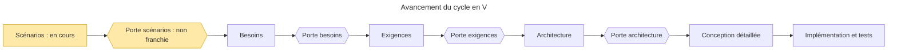

# Reprise du projet Boomrone — état au 2026-10-29

> **Aperçu**
> - **Porte « scénarios » franchie le 2026-10-29** (DEC-142 « Porte scénarios franchie : accord explicite de l'utilisateur ») ; prochaine phase : « besoins » (`01-besoins.md`), en commençant par la notice des limites d'emploi (DEC-125 « Limites d'emploi informées par une notice écrite à la phase besoins, le drone n'affiche rien »). Les paragraphes ci-dessous décrivent l'état avant le franchissement.
- Phase « scénarios » (`00-scenarios.md`) : SCN-001 « Vol nominal : de la batterie au posé » à SCN-012 « Dégradé : sous-tension de la batterie » (douze scénarios).
> - 0 doute bloquant ouvert, 25 non bloquants (19, plus DOU-115 « Contenu et interruption de la réécriture de la zone des réglages par la reprogrammation » à DOU-120 « Écriture en mémoire sous tension basse ou pendant une phase de vol », ouverts le 2026-10-29 par la 5e relecture de porte ; DOU-110 « La reprogrammation efface-t-elle la zone des réglages sauvegardés ? » levé le 2026-10-28 ; hors le modèle d'exemple en tête de `registre-doutes.md`).
> - Les décisions de DEC-054 « Chrono de 10 secondes compté depuis l'appui initial » à DEC-141 « Reprogrammation : propagation de DEC-139 aux scénarios et au registre des risques » (2026-10-28 et 2026-10-29) ont fixé le modèle du bouton, le mode réglage, les coupures, les signaux, les risques acceptés, la protection de sous-tension et les cas de la commande Sauvegarder.
> - Série du 2026-10-29 : DEC-140 « Chute brutale sur sous-tension maintenue en connaissance de cause, sans seuil d'alerte » (DEC-135 « Chute en vol sur sous-tension, sans signal, avec des personnes dessous : risque accepté » maintenue après rappel que DEC-013 « Pas de contrôle de la batterie en vol » est modifiée) et DEC-141 « Reprogrammation : propagation de DEC-139 aux scénarios et au registre des risques » ; cinq relectures de porte faites. Série précédente (réponses de l'utilisateur en chat, 2026-10-28) : quatre décisions, de DEC-133 « SCN-012 inclut le drone laissé allumé en attente d'un appui : sous-tension dans le périmètre » à DEC-136 « Écriture de réglages commencée à l'état Allumé et encore en cours au relâchement du lancer : risque accepté » ; elles font entrer le drone laissé allumé dans SCN-012 « Dégradé : sous-tension de la batterie », assument par le logiciel la coupure sur sous-tension en vol, et acceptent deux risques (chute sur sous-tension, écriture en cours au lancer).
> - Séries précédentes : DEC-132 « Revue d'ensemble de Sauvegarder : états acceptés confirmés, aucun acquittement ni contrôle d'intégrité ajoutés » (revue d'ensemble de Sauvegarder, une décision) ; cinq décisions de DEC-127 « Sauvegarder acceptée à l'état Échec d'initialisation : écrasement des réglages par un tiers, risque accepté » à DEC-131 « Sauvegarder ignorée en vol : confirmation du tableau des commandes » (Sauvegarder, écriture, mémoire neuve), qui lèvent DOU-098 « Commande Sauvegarder après un échec d'initialisation : acceptée ou ignorée » et DOU-059 « Sauvegarde des réglages : écriture en vol, coupure pendant l'écriture, mémoire jamais écrite » ; douze décisions de DEC-115 « Troisième appui encore maintenu à l'entrée en mode réglage : maintien ignoré jusqu'au premier relâchement » à DEC-126 « Protection de sous-tension de la batterie : scénario court, coupure sans signal propre », dont le registre « Risques acceptés » — `projets/boomrone/risques-acceptes.md`.
> - Reste avant la porte « scénarios » : l'accord explicite de l'utilisateur. Plus aucun doute n'a l'échéance « avant les besoins » : DEC-137 « Faisabilité du stationnaire en 2 secondes depuis 1,5 m : jalon déplacé aux essais, plage de lancer inchangée » et DEC-138 « Tolérance d'immobile et part de DOU-058 liée à la faisabilité : jalon déplacé aux essais » reportent DOU-050 « Mesure de vitesse horizontale et faisabilité du stationnaire en 2 s depuis 1,5 m », DOU-101 « Tolérance d'immobile à l'armement sur un drone tenu en main : faisabilité du cas nominal » et la part de DOU-058 « Valeurs d'origine, bornes numériques, tolérance d'immobile et durées à fixer en architecture » liée à DEC-114 « Faisabilité du stationnaire en 2 secondes depuis 1,5 m : analyse avant les besoins, plage de lancer à revoir » aux essais sur prototype (modifient DEC-114 « Faisabilité du stationnaire en 2 secondes depuis 1,5 m : analyse avant les besoins, plage de lancer à revoir » et DEC-122 « Jalon avant les besoins : promesse de l'architecte, sans modification de l'outil de porte ») ; DEC-139 « Reprogrammation : réécriture de la zone des réglages avec les valeurs d'origine » lève DOU-110 « La reprogrammation efface-t-elle la zone des réglages sauvegardés ? ».

## Où on en est
- Phase « scénarios » (`00-scenarios.md`), porte non franchie : toutes les décisions demandées à l'utilisateur sur les scénarios sont prises ; il reste son accord explicite pour franchir la porte, que l'architecte inscrira dans le journal de décisions.
- Doutes : décompte dans l'aperçu. Douze doutes ont été levés dans les deux dernières séries :
  - DOU-097 « Bouton encore maintenu à l'entrée en mode réglage (3e appui) » (DEC-115 « Troisième appui encore maintenu à l'entrée en mode réglage : maintien ignoré jusqu'au premier relâchement »)
  - DOU-105 « Bouton en mode réglage, moteurs coupés : comportement autre que ne jamais armer » (DEC-116 « Bouton en mode réglage, moteurs coupés : aucun effet et aucun signal, il ne sert qu'en vol de réglage »)
  - DOU-106 « Bouton en échec d'initialisation après un premier relâchement » (DEC-117 « Bouton en échec d'initialisation : ignoré pour toujours après le premier relâchement, aucun effet ni signal »)
  - DOU-103 « Signal Allumé après Posé, Refus et Désarmement : donné au retour à l'attente ou silencieux ? » (DEC-118 « Signal Allumé au retour à l'attente après un posé, un refus ou un désarmement »)
  - DOU-100 « Appui bref pendant la garde du bouton, relâché avant la fin, hélices tournantes en main » (DEC-119 « Appui bref pendant la garde du bouton, relâché avant la fin : risque accepté et documenté »)
  - DOU-099 « Paramètres de vol sans borne : modification en vol et sauvegarde par un tiers » (DEC-121 « Paramètres de vol aberrants envoyés et sauvegardés par un tiers : risque accepté, reprogrammation seule »)
  - DOU-104 « Jalon avant les besoins non contrôlé par l'outil de porte » (DEC-122 « Jalon avant les besoins : promesse de l'architecte, sans modification de l'outil de porte »)
  - DOU-102 « Registre consolidé des risques acceptés » (DEC-124 « Registre consolidé des risques acceptés dans un fichier dédié »)
  - DOU-062 « Où l'utilisateur est-il informé des limites d'emploi ? » (DEC-125 « Limites d'emploi informées par une notice écrite à la phase besoins, le drone n'affiche rien »)
  - DOU-107 « Exigences sans scénario amont : protections de la batterie, sous-tension, brown-out, CEM » (DEC-126 « Protection de sous-tension de la batterie : scénario court, coupure sans signal propre »)
  - DOU-098 « Commande Sauvegarder après un échec d'initialisation : acceptée ou ignorée » (DEC-127 « Sauvegarder acceptée à l'état Échec d'initialisation : écrasement des réglages par un tiers, risque accepté »)
  - DOU-059 « Sauvegarde des réglages : écriture en vol, coupure pendant l'écriture, mémoire jamais écrite » (DEC-128 « Sauvegarder ignorée aussi à l'état Série d'appuis en cours », DEC-129 « Coupure de la batterie pendant l'écriture des réglages : risque accepté, traité en architecture », DEC-130 « Mémoire jamais écrite : aucune détection, valeurs d'origine fixes du logiciel, risque accepté » et DEC-131 « Sauvegarder ignorée en vol : confirmation du tableau des commandes »)
  - Les décisions DEC-132 « Revue d'ensemble de Sauvegarder : états acceptés confirmés, aucun acquittement ni contrôle d'intégrité ajoutés » et DEC-133 « SCN-012 inclut le drone laissé allumé en attente d'un appui : sous-tension dans le périmètre » à DEC-136 « Écriture de réglages commencée à l'état Allumé et encore en cours au relâchement du lancer : risque accepté » ne lèvent aucun doute ; six doutes cachés sont restés ouverts (DOU-108 « Rapport entre le seuil d'armement et le seuil de sous-tension, affaissement de tension au démarrage des moteurs », DOU-109 « Batterie déjà déchargée : redémarrages répétés, décharge profonde et état après une coupure logicielle », DOU-111 « Niveau ou front du bouton à l'acceptation de Décoller », DOU-112 « Bouton enfoncé jusqu'à la fin de l'initialisation : état et signal », DOU-113 « Ordre entre Modifier pendant l'initialisation et chargement des réglages enregistrés » et DOU-114 « Réglages enregistrés chargés ou non à l'état d'échec d'initialisation ») ; le septième, DOU-110 « La reprogrammation efface-t-elle la zone des réglages sauvegardés ? », est levé par DEC-139 « Reprogrammation : réécriture de la zone des réglages avec les valeurs d'origine ». La 5e relecture (2026-10-29) ouvre six doutes de plus, DOU-115 « Contenu et interruption de la réécriture de la zone des réglages par la reprogrammation » à DOU-120 « Écriture en mémoire sous tension basse ou pendant une phase de vol ».
- Vérification : `check_traceability` ne donne aucune erreur de titre ni de référence ; seuls restent les trous « SCN sans BES » (douze, normaux avant la phase besoins).
- Doutes ouverts, tous non bloquants (décompte dans l'aperçu) :
  - Reportés aux essais sur prototype (DEC-137 « Faisabilité du stationnaire en 2 secondes depuis 1,5 m : jalon déplacé aux essais, plage de lancer inchangée » ; DEC-138 « Tolérance d'immobile et part de DOU-058 liée à la faisabilité : jalon déplacé aux essais »), n'empêchent plus la phase « besoins » :
    - DOU-050 « Mesure de vitesse horizontale et faisabilité du stationnaire en 2 s depuis 1,5 m »
    - DOU-101 « Tolérance d'immobile à l'armement sur un drone tenu en main : faisabilité du cas nominal »
    - DOU-058 « Valeurs d'origine, bornes numériques, tolérance d'immobile et durées à fixer en architecture » (tolérance de « immobile » et plage de lancer ; le reste en architecture)
  - DOU-110 « La reprogrammation efface-t-elle la zone des réglages sauvegardés ? » est levé par DEC-139 « Reprogrammation : réécriture de la zone des réglages avec les valeurs d'origine » (voir « Levés » plus bas) ; il n'est plus ouvert.
  - Valeurs chiffrées (exigences, essais) :
    - DOU-009 « Quelle tolérance d'altitude pendant les 10 secondes de stationnaire ? »
    - DOU-010 « Quelle rotation au lancer le drone doit-il rattraper ? »
    - DOU-011 « Quelle dérive horizontale reste acceptable si 30 cm n'est pas tenu ? »
    - DOU-012 « Quel angle limite et quelles autres valeurs de coupure retenir ? »
    - DOU-013 « Quelle durée de vol garantit-on après un armement accepté ? »
    - DOU-028 « Faut-il une limite de dérive avant la coupure, entre 10° et 60° d'inclinaison ? »
    - DOU-029 « Quelle altitude maximale et quel plafond le drone doit-il tolérer ? »
    - DOU-035 « Quelle hauteur de stationnaire vise-t-on ? »
  - À traiter en architecture ou avant les exigences :
    - DOU-060 « Coupure de la batterie dans chaque état du drone, et alimentation des moteurs à valider en architecture matérielle » (échéance : porte « architecture »)
    - DOU-080 « Seuils de temps du bouton : 1 s, 2 s, 10 s et délai entre appuis »
    - DOU-108 « Rapport entre le seuil d'armement et le seuil de sous-tension, affaissement de tension au démarrage des moteurs »
    - DOU-109 « Batterie déjà déchargée : redémarrages répétés, décharge profonde et état après une coupure logicielle »
    - DOU-111 « Niveau ou front du bouton à l'acceptation de Décoller »
    - DOU-112 « Bouton enfoncé jusqu'à la fin de l'initialisation : état et signal »
    - DOU-113 « Ordre entre Modifier pendant l'initialisation et chargement des réglages enregistrés »
    - DOU-114 « Réglages enregistrés chargés ou non à l'état d'échec d'initialisation »

Règle de méthode (`CLAUDE.md` §5) : si une réponse contredit une décision antérieure, reposer la question, rappeler la réponse précédente, nommer la contradiction, demander si l'utilisateur change sa réponse.

## Modèle du bouton en vigueur (résumé)
- Appui validé = bouton maintenu 1 s, signal « Appui validé » ; moins de 1 s : rien (DEC-070 « Appui validé : bouton maintenu 1 seconde, rien en dessous, plus de signal Appui trop court »). Signal « Appui trop court » supprimé ; SCN-004 « Appui normal : bouton relâché avant 2 secondes » refondu.
- Appuis d'affilée (écart d'environ 2 s au plus) ; trois appuis validés, drone immobile et à plat, non armé : mode réglage dès la 3e validation (DEC-085 « Entrée en mode réglage : drone immobile et à plat, non armé, sans condition de posé »), sans armement ; en mode réglage le bouton n'arme jamais (DEC-071 « Appuis validés d'affilée : trois appuis entrent en mode réglage sans armer, le bouton n'arme jamais en mode réglage »). DEC-058 « Trois appuis : fenêtre courte, sans signal parasite » et DEC-007 « Bouton relâché avant 2 secondes : retour en attente » sont marquées remplacées.
- 2 s d'appui : signal « Prêt » (batterie suffisante, drone immobile et à plat) ou signal unique « Refus », cause sur le statut sans fil (DEC-072 « Armement à 2 secondes d'appui : signal Prêt, ou signal unique Armement refusé selon l'état du drone »).
- Armé entre 2 s et 10 s : relâchement = signal « Lancé », moteurs 200 ms plus tard, même sans lancer, risque accepté ; plus de 10 s : désarmement (DEC-073 « Armé entre 2 et 10 secondes d'appui : le relâchement donne le signal Lancé, les moteurs démarrent 200 ms plus tard »).
- Décollage de réglage : batterie seulement (DEC-074 « Décollage en mode réglage : la batterie est vérifiée, rien d'autre »). Initialisation en échec : définitive jusqu'au débranchement (DEC-075 « Initialisation en échec : définitive jusqu'au débranchement de la batterie »).
- Armement seulement depuis le premier appui d'une série ; 2e appui maintenu au-delà de 2 s, rien ; 2 s sans nouvel appui, compteur à zéro (DEC-076 « Armement possible seulement depuis le premier appui d'une série, sans effet du maintien pendant la série »).
- Nouveau (réponses de l'utilisateur, 2026-10-28) :
  - Bouton appuyé en vol de réglage : arrêt d'urgence, moteurs coupés, le drone reste en mode réglage (DEC-077 « Bouton appuyé en vol de réglage : arrêt d'urgence, moteurs coupés, le drone reste en mode réglage »). La garde de DEC-055 « Bouton ignoré pendant une courte garde après le lancer » ne vaut qu'après un lancer au relâchement (DEC-078 « Garde du bouton après le lancer : attachée au lancer au relâchement, pas décidée pour le décollage de réglage ») ; après le décollage de réglage, pas de garde : DOU-084 « Garde du bouton après le décollage de réglage ? » est levé par DEC-094 « Bouton appuyé après un décollage de réglage : pris en compte tout de suite, sans garde ».
  - Sortie du mode réglage : uniquement en enlevant la batterie (DEC-079 « Sortie du mode réglage : uniquement en enlevant la batterie »).
  - Après un armement refusé ou un désarmement : retour à « Allumé, en attente d'un appui », compteur à zéro, l'appui long n'est pas compté (DEC-080 « Armement refusé ou désarmement : retour à l'attente, compteur à zéro, l'appui long n'est pas compté ») ; bouton encore enfoncé ignoré jusqu'au premier relâchement, puis nouvel appui possible tout de suite (DEC-081 « Bouton encore enfoncé après un refus ou un désarmement : ignoré jusqu'au premier relâchement, puis nouvel appui possible tout de suite »).
  - Entrée en mode réglage : drone immobile et à plat, non armé, « posé » n'est plus une condition (DEC-085 « Entrée en mode réglage : drone immobile et à plat, non armé, sans condition de posé »). Décollage de réglage : batterie seulement, risque cumulé accepté (DEC-086 « Décollage de réglage : batterie seulement, risque cumulé avec les décisions sans appairage et sans verrouillage accepté »). Annulation d'un armement : seul le maintien jusqu'à 10 s (DEC-083 « Annulation d'un armement : le maintien jusqu'au désarmement à 10 s reste la seule annulation »). Appui ignoré dans une série : aucun signal (DEC-084 « Appui ignoré pendant une série d'appuis : aucun signal, risque accepté et documenté »).
  - Même logique après le posé ou une coupure des moteurs, déduite de DEC-023 « Après le posé ou une coupure : drone verrouillé, nouvel appui pour revoler », DEC-047 « L'état verrouillé est le même que l'état allumé, en attente d'un appui » et DEC-050 « Appui en cours lors d'une coupure des moteurs ignoré jusqu'au relâchement » (DEC-082 « Retours à l'attente après le posé ou une coupure des moteurs : compteur à zéro, appui en cours ni pris en compte ni compté ») ; le lancer n'est pas un retour à l'attente. Déduction de l'architecte, validée explicitement par l'utilisateur le 2026-10-28 (ainsi que la conséquence de DEC-081 « Bouton encore enfoncé après un refus ou un désarmement : ignoré jusqu'au premier relâchement, puis nouvel appui possible tout de suite »).
- Réponses de l'utilisateur en chat, 2026-10-28 (arrêt d'urgence, bouton coincé, refus) :
  - En vol, arrêt d'urgence par le bouton filtré par un anti-rebond de quelques millisecondes seulement, sans durée minimale ni validation de 1 s ; parasite plus long que l'anti-rebond : risque connu (DEC-087 « Arrêt d'urgence par le bouton en vol : anti-rebond très court seulement, arrêt quasi immédiat »).
  - Bouton coincé ou maintenu au démarrage : statut sans fil « bouton maintenu » seulement, aucun signal local (DEC-088 « Bouton coincé ou maintenu en permanence au démarrage : statut sans fil seulement, aucun signal local »).
  - Appui de moins de 1 s au milieu d'une série : compteur à zéro (DEC-089 « Appui de moins de 1 s au milieu d'une série d'appuis : compteur remis à zéro »).
  - 3e appui validé sur un drone non immobile ou pas à plat : mode réglage refusé, signal « Refus » (DEC-090 « Troisième appui validé sur un drone non immobile ou pas à plat : mode réglage refusé avec le signal Refus »). Le signal 5 s'appelle « Refus », unique pour tout refus d'armement, de mode réglage ou de décollage de réglage ; l'ancien nom « Armement refusé » n'est conservé que dans les titres des décisions antérieures, non modifiés (DEC-091 « Un seul signal Refus pour tout refus, armement ou mode réglage »). Écart assumé avec DEC-005 « Un signal distinct pour chaque information » (déjà assoupli par DEC-072 « Armement à 2 secondes d'appui : signal Prêt, ou signal unique Armement refusé selon l'état du drone ») ; DOU-027 « Un signal distinct par information, ou par catégorie ? » est levé par DEC-099 « Un statut sans fil distinct par état, effets locaux regroupables par catégorie ».
  - Garde du bouton : ignore les fronts, pas le niveau ; bouton encore enfoncé à sa fin = arrêt d'urgence ; commence au relâchement, couvre « Lancé » (200 ms) puis le démarrage des moteurs ; de l'ordre de 0,5 s à fixer en architecture ; le réflexe de ré-appui reste efficace avec au plus la durée de la garde de retard (DEC-092 « Garde du bouton après le lancer : fronts ignorés, niveau pris en compte, démarrage au relâchement »).
  - Déduction de l'architecte, confirmée par l'utilisateur le 2026-10-28 (DEC-093 « Mode réglage refusé : retour à l'attente, compteur à zéro, bouton encore enfoncé ignoré ») : après le mode réglage refusé, retour à l'attente, compteur à zéro, bouton encore enfoncé ignoré jusqu'au premier relâchement, par analogie avec DEC-080 « Armement refusé ou désarmement : retour à l'attente, compteur à zéro, l'appui long n'est pas compté » (DOU-091 « Compteur d'appuis après un mode réglage refusé : retour à l'attente, compteur à zéro ? »).
- Tableau des signaux : toujours 17 événements (un signal = un événement distinct avec un statut sans fil distinct ; effets locaux regroupables : DEC-099 « Un statut sans fil distinct par état, effets locaux regroupables par catégorie ») ; le signal « Arrêt par le bouton » en vol de réglage est confirmé (DEC-100 « Issues du vol de réglage : signaux du vol normal réutilisés, signal du lien perdu à définir »).

- Réponses de l'utilisateur en chat, 2026-10-28 (suite : garde du vol de réglage, sauvegarde, coupures, signaux, refus) :
  - Bouton après un décollage de réglage : pris en compte tout de suite comme arrêt d'urgence, sans garde (DEC-094 « Bouton appuyé après un décollage de réglage : pris en compte tout de suite, sans garde »).
  - « Sauvegarder » était acceptée à l'état armé (DEC-095 « Commande Sauvegarder à l'état armé : acceptée, retard possible du lancer accepté comme risque ») ; elle est désormais IGNORÉE à l'état armé (DEC-112 « Sauvegarder ignorée à l'état armé, avant le lancer », qui modifie DEC-095 « Commande Sauvegarder à l'état armé : acceptée, retard possible du lancer accepté comme risque » et DEC-043 « Commandes sans fil acceptées selon l'état du drone » : l'utilisateur avait répondu « acceptée comme aujourd'hui », puis a changé sa réponse après rappel de l'interaction avec le chien de garde de DEC-096 « Chien de garde sur tout état où les moteurs peuvent être alimentés, phase Lancé de durée maximale » et DEC-103 « Phase Lancé trop longue : coupure et redémarrage par le chien de garde, sans nouvel état ni signal »). Pour l'initialisation en cours et l'échec d'initialisation, DOU-078 « Initialisation en cours et échec d'initialisation : quelles commandes sans fil sont acceptées ? » est levé par DEC-105 « Initialisation en cours et échec d'initialisation : Modifier et Sauvegarder acceptées, Décoller et Arrêt ignorées ».
  - Chien de garde sur tout état où les moteurs peuvent être alimentés, donc aussi la phase « Lancé », qui a une durée maximale de l'ordre de quelques centaines de millisecondes, à fixer en architecture, provisoire (DEC-096 « Chien de garde sur tout état où les moteurs peuvent être alimentés, phase Lancé de durée maximale »).
  - Redémarrage ou chute de tension, y compris en phase « Lancé » : moteurs arrêtés, drone verrouillé, puis « Éteint, moteurs arrêtés » et redémarrage ; hypothèse à valider par l'architecture matérielle (DEC-097 « Redémarrage ou chute de tension, même en phase Lancé : moteurs arrêtés, drone verrouillé »).
  - Redémarrage après une coupure en vol : « Allumé » seulement si immobile et à plat, sinon échec d'initialisation définitif (DEC-098 « Redémarrage après une coupure en vol : Allumé seulement si immobile et à plat, sinon échec d'initialisation »).
  - Un statut sans fil distinct par état ; effets locaux regroupables par catégorie, liste à définir en architecture (DEC-099 « Un statut sans fil distinct par état, effets locaux regroupables par catégorie »).
  - Issues du vol de réglage avec les signaux du vol normal ; lien sans fil perdu à définir en architecture (DEC-100 « Issues du vol de réglage : signaux du vol normal réutilisés, signal du lien perdu à définir »).
  - Statut sans fil : cause précise du refus, liste à fixer en architecture (DEC-101 « Statut sans fil d'un refus : cause précise, liste exacte à fixer en architecture »).
- Réponses de l'utilisateur en chat, 2026-10-28 (dernière série : neuf décisions, une par idée) :
  - Décollage de réglage refusé : même signal « Refus » ; statut de refus lisible sur le sans fil jusqu'à la commande suivante, durée exacte à fixer en architecture (DEC-102 « Décollage de réglage refusé : signal Refus, statut de refus lisible jusqu'à la commande suivante »).
  - Phase « Lancé » dépassant sa durée maximale sans démarrage des moteurs : le chien de garde coupe et redémarre comme pour un logiciel bloqué, puis redémarrage selon DEC-098 « Redémarrage après une coupure en vol : Allumé seulement si immobile et à plat, sinon échec d'initialisation » ; aucun nouvel état ni signal (DEC-103 « Phase Lancé trop longue : coupure et redémarrage par le chien de garde, sans nouvel état ni signal »).
  - Après une coupure en vol, le signal local de la cause ne persiste pas : « Allumé » prend le relais tout de suite, la cause reste sur le statut sans fil (DEC-104 « Cause d'une coupure en vol : signal local non conservé, Allumé prend le relais, cause conservée sur le statut sans fil »), confirmée telle quelle, sans durée minimale, risque accepté (DEC-113 « Cause d'une coupure en vol : confirmation, Allumé tout de suite, aucune durée minimale, risque accepté ») ; tension nommée avec DEC-033 « Signal Arrêt sans fil distinct du signal Arrêt par le bouton » et DEC-046 « Délai de descente dépassé : signal distinct, moteurs coupés, drone verrouillé ».
  - Initialisation en cours et échec d'initialisation : Modifier et Sauvegarder acceptées, Décoller et Arrêt ignorées ; deux lignes ajoutées au tableau des commandes de `00-scenarios.md` (complète DEC-043 « Commandes sans fil acceptées selon l'état du drone » ; DEC-105 « Initialisation en cours et échec d'initialisation : Modifier et Sauvegarder acceptées, Décoller et Arrêt ignorées »).
  - Lien sans fil perdu en vol de réglage : aucune action particulière, le vol suit son cours. Dit d'abord, confirmé « Oui, aucune action spéciale » après rappel de la contradiction. MODIFIE DEC-029 « Vol de réglage : stationnaire de 3 secondes, atterrissage sur place si le lien est perdu » et DEC-100 « Issues du vol de réglage : signaux du vol normal réutilisés, signal du lien perdu à définir » (mention « Modifiée par », titres inchangés) ; l'état « Atterrissage sur place », le signal du lien sans fil perdu et le délai de perte du lien disparaissent (DEC-106 « Lien sans fil perdu en vol de réglage : aucune action particulière »).
  - Signaux des phases du vol de réglage = ceux du vol normal ; acquittement des commandes sans fil par le statut sans fil seulement, sans signal local (DEC-107 « Vol de réglage : signaux des phases du vol normal, acquittement des commandes par le statut sans fil seulement »).
  - Vols de réglage : aucune limite de nombre ni contrôle de chauffe ; batterie vérifiée à chaque décollage (DEC-108 « Vols de réglage répétés : aucune limite de nombre ni contrôle de chauffe, risque accepté »).
  - Lancer hors plage ou hauteur impossible à mesurer : échec de stabilisation, même signal et même coupure (DEC-109 « Lancer hors plage ou hauteur non mesurable : échec de stabilisation, limite d'emploi »).
  - Appui de 2 s sur un drone en mouvement, pas à plat ou à batterie faible : tous les tests faits, un seul signal « Refus », causes listées sur le sans fil, ordre sans importance, pas d'attente de l'immobilité (DEC-110 « Armement refusé à 2 secondes d'appui : tous les tests faits, un seul signal Refus, sans attente de l'immobilité »).
- Réponses de l'utilisateur en chat, 2026-10-28 (série finale : quatre décisions) :
  - Batterie et programmation : hors périmètre des scénarios, limites d'emploi (notice) ; le drone ne gère rien de la batterie (charge, remplacement, stockage, drone laissé allumé) ni des cas d'échec de la programmation ; pas de scénario dédié, aucun cas ajouté à SCN-008 « Mise en service : programmation du drone ». Aucun besoin ne pourra porter sur la gestion de la batterie (règle de la phase 0 : chaque besoin cite un scénario amont) ; reste en périmètre la vérification de la batterie à l'armement et au décollage de réglage (DEC-111 « Batterie et programmation : hors périmètre des scénarios, limites d'emploi à documenter »).
  - Sauvegarder ignorée à l'état armé (DEC-112 « Sauvegarder ignorée à l'état armé, avant le lancer »).
  - Cause d'une coupure en vol : DEC-104 « Cause d'une coupure en vol : signal local non conservé, Allumé prend le relais, cause conservée sur le statut sans fil » confirmée telle quelle, « Allumé » tout de suite, aucune durée minimale, risque accepté (DEC-113 « Cause d'une coupure en vol : confirmation, Allumé tout de suite, aucune durée minimale, risque accepté »).
  - Jalon : DOU-050 « Mesure de vitesse horizontale et faisabilité du stationnaire en 2 s depuis 1,5 m » à lever avant les besoins, plage de lancer à revoir après analyse de faisabilité ; SCN-001 « Vol nominal : de la batterie au posé » et SCN-002 « Échec : stationnaire non atteint dans le délai » gardent les valeurs provisoires (DEC-114 « Faisabilité du stationnaire en 2 secondes depuis 1,5 m : analyse avant les besoins, plage de lancer à revoir »).
- Réponses de l'utilisateur en chat, 2026-10-28 (série de douze décisions, une par idée) :
  - Troisième appui encore maintenu à l'entrée en mode réglage : maintien ignoré jusqu'au premier relâchement, ne peut ni armer ni déclencher d'arrêt après un Décoller (DEC-115 « Troisième appui encore maintenu à l'entrée en mode réglage : maintien ignoré jusqu'au premier relâchement »).
  - En « Mode réglage, moteurs coupés » (au sol), le bouton n'a aucun effet et ne donne aucun signal ; il ne sert qu'en vol de réglage (DEC-116 « Bouton en mode réglage, moteurs coupés : aucun effet et aucun signal, il ne sert qu'en vol de réglage »).
  - En « Échec d'initialisation », après un premier relâchement, le bouton est ignoré pour toujours, sans effet ni signal (DEC-117 « Bouton en échec d'initialisation : ignoré pour toujours après le premier relâchement, aucun effet ni signal »).
  - Signal « Allumé » donné au retour à l'attente après un posé, un refus ou un désarmement, après le signal de l'événement (DEC-118 « Signal Allumé au retour à l'attente après un posé, un refus ou un désarmement »).
  - Appui bref pendant la garde, relâché avant la fin : risque accepté et documenté, DEC-092 « Garde du bouton après le lancer : fronts ignorés, niveau pris en compte, démarrage au relâchement » inchangée ; limite d'emploi : tenir le bouton jusqu'à la fin de la garde (DEC-119 « Appui bref pendant la garde du bouton, relâché avant la fin : risque accepté et documenté »).
  - Sauvegarder ignorée pendant l'initialisation en cours, Modifier acceptée ; MODIFIE DEC-105 « Initialisation en cours et échec d'initialisation : Modifier et Sauvegarder acceptées, Décoller et Arrêt ignorées » pour cet état ; le cas de l'échec d'initialisation reste non tranché (DEC-120 « Sauvegarder ignorée pendant l'initialisation en cours, Modifier acceptée ; cas de l'échec d'initialisation non tranché » ; DOU-098 « Commande Sauvegarder après un échec d'initialisation : acceptée ou ignorée »).
  - Paramètres de vol aberrants sauvegardés par un tiers : risque accepté, seule la reprogrammation rétablit les valeurs (DEC-121 « Paramètres de vol aberrants envoyés et sauvegardés par un tiers : risque accepté, reprogrammation seule »).
  - Jalon avant les besoins : promesse de l'architecte, outil de porte non modifié (DEC-122 « Jalon avant les besoins : promesse de l'architecte, sans modification de l'outil de porte »).
  - Sauvegarder aussi ignorée à l'état « Premier appui validé » ; ÉTEND DEC-112 « Sauvegarder ignorée à l'état armé, avant le lancer » ; l'état « Série d'appuis en cours » n'est pas tranché (DEC-123 « Sauvegarder ignorée aussi à l'état Premier appui validé »).
  - Registre consolidé des risques acceptés dans un fichier dédié (DEC-124 « Registre consolidé des risques acceptés dans un fichier dédié ») : « Risques acceptés » — `projets/boomrone/risques-acceptes.md` ; `reprise.md` y renvoie.
  - Limites d'emploi informées par une notice écrite à la phase besoins, qui reprend le registre ; le drone n'affiche rien lui-même (DEC-125 « Limites d'emploi informées par une notice écrite à la phase besoins, le drone n'affiche rien »).
  - Scénario court de protection de sous-tension de la batterie, SCN-012 « Dégradé : sous-tension de la batterie » : le drone se coupe sans signal propre, comme pour une coupure d'alimentation ; MODIFIE DEC-111 « Batterie et programmation : hors périmètre des scénarios, limites d'emploi à documenter » pour cette seule protection ; surintensité, inversion de polarité et surchauffe non retenues, à voir en architecture (DEC-126 « Protection de sous-tension de la batterie : scénario court, coupure sans signal propre »).

- Réponses de l'utilisateur en chat, 2026-10-28 (série sur la commande Sauvegarder : cinq décisions, une par idée) :
  - À l'état « Échec d'initialisation », Sauvegarder reste ACCEPTÉE ; risque d'écrasement des réglages enregistrés par un tiers à portée, accepté explicitement ; l'utilisateur avait vu l'option « Ignorée (recommandée) » (DEC-127 « Sauvegarder acceptée à l'état Échec d'initialisation : écrasement des réglages par un tiers, risque accepté »).
  - Sauvegarder aussi IGNORÉE à l'état « Série d'appuis en cours » ; tableau des commandes mis à jour (DEC-128 « Sauvegarder ignorée aussi à l'état Série d'appuis en cours »).
  - Coupure de la batterie pendant l'écriture des réglages : risque accepté, à traiter en architecture (mémoire ou séquence d'écriture), sans contrôle d'intégrité (DEC-129 « Coupure de la batterie pendant l'écriture des réglages : risque accepté, traité en architecture »).
  - Mémoire jamais écrite : aucune détection, valeurs d'origine fixes du logiciel, risque accepté (DEC-130 « Mémoire jamais écrite : aucune détection, valeurs d'origine fixes du logiciel, risque accepté »).
  - Sauvegarder ignorée en vol : déjà dans le tableau de DEC-043 « Commandes sans fil acceptées selon l'état du drone », vérifié (DEC-131 « Sauvegarder ignorée en vol : confirmation du tableau des commandes »).

- Réponses de l'utilisateur en chat, 2026-10-28 (série sur la sous-tension et l'écriture : quatre décisions, une par idée) :
  - Le scénario SCN-012 « Dégradé : sous-tension de la batterie » inclut le drone laissé allumé en attente d'un appui ; l'option « Non, retirer ce cas (recommandée) » avait été vue ; MODIFIE DEC-111 « Batterie et programmation : hors périmètre des scénarios, limites d'emploi à documenter » et DEC-126 « Protection de sous-tension de la batterie : scénario court, coupure sans signal propre » (DEC-133 « SCN-012 inclut le drone laissé allumé en attente d'un appui : sous-tension dans le périmètre »).
  - Coupure sur sous-tension en vol assumée par le logiciel ; l'option « Protection matérielle hors logiciel (recommandée) » avait été vue ; MODIFIE DEC-013 « Pas de contrôle de la batterie en vol », précise DEC-004 « Batterie vérifiée à l'armement : pas d'armement si batterie faible » et DOU-013 « Quelle durée de vol garantit-on après un armement accepté ? » (DEC-134 « Coupure sur sous-tension en vol assumée par le logiciel : le drone surveille la tension »).
  - Risque accepté : un drone en vol chute sur sous-tension, sans signal, avec des personnes dessous, y compris pendant le lancer (DEC-135 « Chute en vol sur sous-tension, sans signal, avec des personnes dessous : risque accepté »).
  - Risque accepté : une écriture de réglages commencée à l'état Allumé et encore en cours au relâchement du lancer (DEC-136 « Écriture de réglages commencée à l'état Allumé et encore en cours au relâchement du lancer : risque accepté »).

- Réponses de l'utilisateur en chat, 2026-10-29 (suite de la 5e relecture de porte : deux décisions) :
  - DEC-140 « Chute brutale sur sous-tension maintenue en connaissance de cause, sans seuil d'alerte » : DEC-135 « Chute en vol sur sous-tension, sans signal, avec des personnes dessous : risque accepté » maintenue après rappel que DEC-134 « Coupure sur sous-tension en vol assumée par le logiciel : le drone surveille la tension » a modifié DEC-013 « Pas de contrôle de la batterie en vol » ; l'option « Seuil d'alerte + atterrissage (recommandée) » avait été vue.
  - DEC-141 « Reprogrammation : propagation de DEC-139 aux scénarios et au registre des risques » : DEC-139 « Reprogrammation : réécriture de la zone des réglages avec les valeurs d'origine » propagée à SCN-008 « Mise en service : programmation du drone » et à `risques-acceptes.md` (option recommandée).
- Avant 2026-10-29, sans entrée détaillée plus haut (2026-10-28) : DEC-137 « Faisabilité du stationnaire en 2 secondes depuis 1,5 m : jalon déplacé aux essais, plage de lancer inchangée » et DEC-138 « Tolérance d'immobile et part de DOU-058 liée à la faisabilité : jalon déplacé aux essais » (la faisabilité du stationnaire, de la tolérance d'immobile et de la plage de lancer est validée aux essais sur prototype ; plage inchangée) ; DEC-139 « Reprogrammation : réécriture de la zone des réglages avec les valeurs d'origine » (la reprogrammation réécrit la zone des réglages avec les valeurs d'origine ; DOU-110 « La reprogrammation efface-t-elle la zone des réglages sauvegardés ? » levé).
## Doutes nouveaux ou restés ouverts
- Ouverts le 2026-10-28 (4e relecture de porte, doutes cachés, non bloquants) : DOU-108 « Rapport entre le seuil d'armement et le seuil de sous-tension, affaissement de tension au démarrage des moteurs », DOU-109 « Batterie déjà déchargée : redémarrages répétés, décharge profonde et état après une coupure logicielle », DOU-111 « Niveau ou front du bouton à l'acceptation de Décoller », DOU-112 « Bouton enfoncé jusqu'à la fin de l'initialisation : état et signal », DOU-113 « Ordre entre Modifier pendant l'initialisation et chargement des réglages enregistrés », DOU-114 « Réglages enregistrés chargés ou non à l'état d'échec d'initialisation ». Rattachés à des doutes existants, sans doute nouveau : la durée de perception des signaux d'événement avant le relais d'« Allumé » à DOU-058 « Valeurs d'origine, bornes numériques, tolérance d'immobile et durées à fixer en architecture » ; la condition « au sol » au redémarrage après une coupure en vol à DOU-060 « Coupure de la batterie dans chaque état du drone, et alimentation des moteurs à valider en architecture matérielle » ; l'influence de DOU-010 « Quelle rotation au lancer le drone doit-il rattraper ? » et DOU-035 « Quelle hauteur de stationnaire vise-t-on ? » sur la plage de lancer à DOU-050 « Mesure de vitesse horizontale et faisabilité du stationnaire en 2 s depuis 1,5 m » et DOU-101 « Tolérance d'immobile à l'armement sur un drone tenu en main : faisabilité du cas nominal » (jalon de DEC-122 « Jalon avant les besoins : promesse de l'architecte, sans modification de l'outil de porte » modifié ensuite par DEC-137 « Faisabilité du stationnaire en 2 secondes depuis 1,5 m : jalon déplacé aux essais, plage de lancer inchangée » et DEC-138 « Tolérance d'immobile et part de DOU-058 liée à la faisabilité : jalon déplacé aux essais »).
- Levés le 2026-10-28 (série finale, réponses explicites en chat) : DOU-048 « Batterie : charge, remplacement, drone laissé allumé » (DEC-111 « Batterie et programmation : hors périmètre des scénarios, limites d'emploi à documenter »), DOU-049 « Programmation : cas d'échec, hélices démontées, essai des moteurs avant le premier vol » (DEC-111 « Batterie et programmation : hors périmètre des scénarios, limites d'emploi à documenter »), DOU-095 « Commande Sauvegarder à l'état armé : écriture en mémoire non volatile et durée maximale de la phase Lancé » (DEC-112 « Sauvegarder ignorée à l'état armé, avant le lancer »), DOU-096 « Durée minimale perceptible du signal de cause d'une coupure en vol » (DEC-113 « Cause d'une coupure en vol : confirmation, Allumé tout de suite, aucune durée minimale, risque accepté »).
- Levés le 2026-10-28 (série précédente, réponses explicites en chat) :
  - DOU-021 « Que se passe-t-il pour un lancer hors plage ? » (DEC-109 « Lancer hors plage ou hauteur non mesurable : échec de stabilisation, limite d'emploi »)
  - DOU-036 « Après quel délai le lien sans fil est-il considéré comme perdu ? » (sans objet : DEC-106 « Lien sans fil perdu en vol de réglage : aucune action particulière »)
  - DOU-039 « La batterie est-elle vérifiée à chaque décollage de réglage ? » (DEC-108 « Vols de réglage répétés : aucune limite de nombre ni contrôle de chauffe, risque accepté »)
  - DOU-053 « Vols de réglage : signaux des phases, signal du lien perdu, acquittement des commandes » (DEC-107 « Vol de réglage : signaux des phases du vol normal, acquittement des commandes par le statut sans fil seulement » et DEC-106 « Lien sans fil perdu en vol de réglage : aucune action particulière »)
  - DOU-073 « Que veut dire immobile pour armer un drone tenu en main, et quel signal si l'armement est refusé ? » (DEC-110 « Armement refusé à 2 secondes d'appui : tous les tests faits, un seul signal Refus, sans attente de l'immobilité » ; la tolérance de « immobile » est fusionnée dans DOU-058 « Valeurs d'origine, bornes numériques, tolérance d'immobile et durées à fixer en architecture »)
  - DOU-078 « Initialisation en cours et échec d'initialisation : quelles commandes sans fil sont acceptées ? » (DEC-105 « Initialisation en cours et échec d'initialisation : Modifier et Sauvegarder acceptées, Décoller et Arrêt ignorées »)
  - DOU-092 « Décollage de réglage refusé : quel signal local, et combien de temps le statut de refus est-il conservé ? » (DEC-102 « Décollage de réglage refusé : signal Refus, statut de refus lisible jusqu'à la commande suivante »)
  - DOU-093 « Dépassement de la durée maximale de la phase Lancé : que fait le drone ? » (DEC-103 « Phase Lancé trop longue : coupure et redémarrage par le chien de garde, sans nouvel état ni signal »)
  - DOU-094 « Signal de la cause d'une coupure : combien de temps persiste-t-il après le retour à l'attente ? » (DEC-104 « Cause d'une coupure en vol : signal local non conservé, Allumé prend le relais, cause conservée sur le statut sans fil »)
- DOU-058 « Valeurs d'origine, bornes numériques, tolérance d'immobile et durées à fixer en architecture » (retitré, doute fusionné) :
  - Contenu : valeurs d'origine, bornes numériques, tolérance de mouvement de « immobile », durée de conservation du statut de refus (et son extension aux refus d'armement et de mode réglage), seuil de batterie du décollage de réglage, durée de la garde du bouton et durée maximale de la phase « Lancé », délai de 15 s de vol de réglage et délai de descente réglable, seuil de sous-tension de la batterie (DEC-126 « Protection de sous-tension de la batterie : scénario court, coupure sans signal propre ») et durée du signal de l'événement avant le relais d'« Allumé » (DEC-118 « Signal Allumé au retour à l'attente après un posé, un refus ou un désarmement »).
  - La tolérance d'immobile pour l'armement sur un drone tenu en main en est extraite dans DOU-101 « Tolérance d'immobile à l'armement sur un drone tenu en main : faisabilité du cas nominal » (échéance : essais sur prototype, DEC-138 « Tolérance d'immobile et part de DOU-058 liée à la faisabilité : jalon déplacé aux essais »).
  - Part qui conditionne la faisabilité (tolérance de « immobile », plage de lancer) : reportée aux essais par DEC-138 « Tolérance d'immobile et part de DOU-058 liée à la faisabilité : jalon déplacé aux essais », qui modifie DEC-114 « Faisabilité du stationnaire en 2 secondes depuis 1,5 m : analyse avant les besoins, plage de lancer à revoir » et DEC-122 « Jalon avant les besoins : promesse de l'architecte, sans modification de l'outil de porte ».
  - La durée perceptible de la cause d'une coupure en vol est supprimée de ce doute (DEC-113 « Cause d'une coupure en vol : confirmation, Allumé tout de suite, aucune durée minimale, risque accepté »).
- Levés le 2026-10-28 (série de douze décisions, réponses explicites en chat) : DOU-097 « Bouton encore maintenu à l'entrée en mode réglage (3e appui) », DOU-105 « Bouton en mode réglage, moteurs coupés : comportement autre que ne jamais armer », DOU-106 « Bouton en échec d'initialisation après un premier relâchement », DOU-103 « Signal Allumé après Posé, Refus et Désarmement : donné au retour à l'attente ou silencieux ? », DOU-100 « Appui bref pendant la garde du bouton, relâché avant la fin, hélices tournantes en main », DOU-099 « Paramètres de vol sans borne : modification en vol et sauvegarde par un tiers », DOU-104 « Jalon avant les besoins non contrôlé par l'outil de porte », DOU-102 « Registre consolidé des risques acceptés », DOU-062 « Où l'utilisateur est-il informé des limites d'emploi ? », DOU-107 « Exigences sans scénario amont : protections de la batterie, sous-tension, brown-out, CEM » (décisions : voir « Où on en est »).
- Levés après la série de douze décisions (réponses explicites en chat, 2026-10-28) :
  - DOU-098 « Commande Sauvegarder après un échec d'initialisation : acceptée ou ignorée » (DEC-127 « Sauvegarder acceptée à l'état Échec d'initialisation : écrasement des réglages par un tiers, risque accepté »)
  - DOU-059 « Sauvegarde des réglages : écriture en vol, coupure pendant l'écriture, mémoire jamais écrite » (DEC-128 « Sauvegarder ignorée aussi à l'état Série d'appuis en cours », DEC-129 « Coupure de la batterie pendant l'écriture des réglages : risque accepté, traité en architecture », DEC-130 « Mémoire jamais écrite : aucune détection, valeurs d'origine fixes du logiciel, risque accepté », DEC-131 « Sauvegarder ignorée en vol : confirmation du tableau des commandes »)
- Levés plus tôt le 2026-10-28 (détail dans `registre-doutes.md`, archive, et `journal-decisions.md`) :
  - DOU-085 « Entrée en mode réglage : exiger drone immobile seulement, ou aussi à plat ? »
  - DOU-086 « Décollage de réglage commandé par un tiers, drone en main ou retourné : risque cumulé accepté ? »
  - DOU-087 « Appui ignoré en silence pendant une série d'appuis : faut-il un signal ? »
  - DOU-088 « Annulation d'un armement : comment renoncer après le signal Prêt ? »
  - DOU-089 « Arrêt d'urgence par le bouton en vol : filtrage du rebond et des parasites »
  - DOU-090 « Bouton coincé ou maintenu en permanence au démarrage : faut-il un signal ? »
  - DOU-076 « Garde du bouton après le lancer : front ou niveau, et quelle origine par rapport à la phase Lancé ? »
  - DOU-079 « Compteur d'appuis validés : remise à zéro par un appui de moins de 1 s, cas limites »
  - DOU-091 « Compteur d'appuis après un mode réglage refusé : retour à l'attente, compteur à zéro ? »
  - DOU-084 « Garde du bouton après le décollage de réglage ? »
  - DOU-075 « Le chien de garde couvre-t-il la phase Lancé, et cette phase a-t-elle une durée maximale ? »
  - DOU-074 « Une initialisation en échec est-elle définitive jusqu'au débranchement, et la condition à plat vaut-elle aussi après une coupure en vol ? »
  - DOU-027 « Un signal distinct par information, ou par catégorie ? »
  - DOU-083 « Contenu du statut sans fil d'un armement ou d'un décollage refusé »
  - DOU-081 « Bouton appuyé en vol de réglage : arrêt d'urgence ou non ? »
  - DOU-082 « Sortie du mode réglage : coupure de la batterie seulement, non rediscutée »
  - DOU-077 « Séquence de trois appuis : cas incomplets et ambigus »
- Restent ouverts, avec une partie répondue :
  - DOU-060 « Coupure de la batterie dans chaque état du drone, et alimentation des moteurs à valider en architecture matérielle » : reste la coupure de la batterie dans chaque état ; l'état des moteurs lors d'un redémarrage est répondu par DEC-097 « Redémarrage ou chute de tension, même en phase Lancé : moteurs arrêtés, drone verrouillé ».
  - DOU-080 « Seuils de temps du bouton : 1 s, 2 s, 10 s et délai entre appuis » : valeurs provisoires (DEC-052 « Valeurs provisoires retenues pour les scénarios, à confirmer avant les exigences »).
  - DOU-050 « Mesure de vitesse horizontale et faisabilité du stationnaire en 2 s depuis 1,5 m » : reporté aux essais sur prototype (DEC-137 « Faisabilité du stationnaire en 2 secondes depuis 1,5 m : jalon déplacé aux essais, plage de lancer inchangée »).
- Contradictions et écarts nommés sans être tranchés (cette série) :
  - DEC-106 « Lien sans fil perdu en vol de réglage : aucune action particulière » MODIFIE DEC-029 « Vol de réglage : stationnaire de 3 secondes, atterrissage sur place si le lien est perdu » et DEC-100 « Issues du vol de réglage : signaux du vol normal réutilisés, signal du lien perdu à définir » : leurs titres parlent encore du lien sans fil perdu (non réécrits) ; l'alternative « poursuite du vol si le lien est perdu », écartée dans DEC-029 « Vol de réglage : stationnaire de 3 secondes, atterrissage sur place si le lien est perdu », est de fait adoptée. L'arrêt sans fil n'atteint plus le drone sans lien : seul le bouton l'arrête. DEC-025 « Suivi et réglage du drone par le sans fil, y compris en vol », DEC-032 « Vol libre : le drone vole sans appareil de suivi » et DEC-037 « Pas d'appairage : le drone obéit à tout appareil de suivi à portée » : aucun écart.
  - DEC-113 « Cause d'une coupure en vol : confirmation, Allumé tout de suite, aucune durée minimale, risque accepté » confirme DEC-104 « Cause d'une coupure en vol : signal local non conservé, Allumé prend le relais, cause conservée sur le statut sans fil » : l'effet local de la cause est écrasé par « Allumé », sans durée minimale, écart assumé par l'utilisateur, y compris avec la raison de DEC-005 « Un signal distinct pour chaque information » (« l'utilisateur doit toujours savoir de quoi il s'agit ») ; en test, la cause se vérifie à l'émission (événement et statut sans fil), pas à la perception. Rappel de l'écart (écart de forme avec DEC-005 « Un signal distinct pour chaque information », DEC-033 « Signal Arrêt sans fil distinct du signal Arrêt par le bouton » et DEC-046 « Délai de descente dépassé : signal distinct, moteurs coupés, drone verrouillé », lus comme événement et statut sans fil distincts : DEC-099 « Un statut sans fil distinct par état, effets locaux regroupables par catégorie ») ; les « l'utilisateur sait que… » de SCN-002 « Échec : stationnaire non atteint dans le délai », SCN-006 « Échec : inclinaison excessive après le stationnaire » et SCN-007 « Dégradé : arrêt d'urgence par le bouton en vol » ont été reformulés (informé à la coupure, puis statut sans fil) ; le signal « Posé » n'est pas concerné.
  - DEC-112 « Sauvegarder ignorée à l'état armé, avant le lancer » modifie DEC-095 « Commande Sauvegarder à l'état armé : acceptée, retard possible du lancer accepté comme risque » et DEC-043 « Commandes sans fil acceptées selon l'état du drone » (ligne « Armé, avant le lancer ») : la dernière phrase de DEC-105 « Initialisation en cours et échec d'initialisation : Modifier et Sauvegarder acceptées, Décoller et Arrêt ignorées » (sa mention de cohérence avec la décision sur Sauvegarder à l'état armé) n'est plus exacte pour l'état armé ; l'alternative écartée de DEC-095 « Commande Sauvegarder à l'état armé : acceptée, retard possible du lancer accepté comme risque » est de fait adoptée ; une écriture commencée avant l'armement et encore en cours au lancer reste à traiter en architecture (DEC-129 « Coupure de la batterie pendant l'écriture des réglages : risque accepté, traité en architecture »).
  - DEC-114 « Faisabilité du stationnaire en 2 secondes depuis 1,5 m : analyse avant les besoins, plage de lancer à revoir » avait avancé l'échéance de DEC-052 « Valeurs provisoires retenues pour les scénarios, à confirmer avant les exigences » à « avant les besoins » pour la plage de lancer et le stationnaire de 2 s ; DOU-050 « Mesure de vitesse horizontale et faisabilité du stationnaire en 2 s depuis 1,5 m » reste non bloquant pour la porte « scénarios » (contrôle du jalon par l'outil de porte : DOU-104 « Jalon avant les besoins non contrôlé par l'outil de porte »). DEC-137 « Faisabilité du stationnaire en 2 secondes depuis 1,5 m : jalon déplacé aux essais, plage de lancer inchangée » et DEC-138 « Tolérance d'immobile et part de DOU-058 liée à la faisabilité : jalon déplacé aux essais » abandonnent ce jalon (modifient DEC-114 « Faisabilité du stationnaire en 2 secondes depuis 1,5 m : analyse avant les besoins, plage de lancer à revoir » et DEC-122 « Jalon avant les besoins : promesse de l'architecte, sans modification de l'outil de porte ») : validation par essais sur prototype, plage de lancer inchangée, avec le risque nommé de besoins à reprendre si les essais contredisent la plage.
  - DEC-111 « Batterie et programmation : hors périmètre des scénarios, limites d'emploi à documenter » : la reprogrammation et le contrôle de version (cités dans DOU-049 « Programmation : cas d'échec, hélices démontées, essai des moteurs avant le premier vol ») ne sont pas nommés dans la réponse ; lecture de l'architecte (hors périmètre), à confirmer à la porte. DEC-126 « Protection de sous-tension de la batterie : scénario court, coupure sans signal propre » MODIFIE DEC-111 « Batterie et programmation : hors périmètre des scénarios, limites d'emploi à documenter » pour la seule protection de sous-tension : la phrase « pas de douzième scénario » ne vaut plus (SCN-012 « Dégradé : sous-tension de la batterie »). DEC-133 « SCN-012 inclut le drone laissé allumé en attente d'un appui : sous-tension dans le périmètre » la MODIFIE aussi : le drone laissé allumé n'est plus hors périmètre (SCN-012 « Dégradé : sous-tension de la batterie ») ; charge, remplacement, stockage et programmation restent hors périmètre.
  - DEC-127 « Sauvegarder acceptée à l'état Échec d'initialisation : écrasement des réglages par un tiers, risque accepté » : DEC-105 « Initialisation en cours et échec d'initialisation : Modifier et Sauvegarder acceptées, Décoller et Arrêt ignorées » est confirmée pour l'état d'échec, alors que DEC-120 « Sauvegarder ignorée pendant l'initialisation en cours, Modifier acceptée ; cas de l'échec d'initialisation non tranché » ignore Sauvegarder pendant l'initialisation en cours pour éviter d'écraser des réglages non chargés : le même risque est accepté à l'état d'échec, avec un traitement opposé de Sauvegarder entre les deux états ; il n'est pas dit si les réglages sont chargés à l'état d'échec (architecture).
  - DEC-128 « Sauvegarder ignorée aussi à l'état Série d'appuis en cours » : la phrase de DEC-112 « Sauvegarder ignorée à l'état armé, avant le lancer » (Sauvegarder « reste acceptée en attente d'un appui ») et le point (1) de DEC-123 « Sauvegarder ignorée aussi à l'état Premier appui validé » (Série d'appuis non tranchée) ne sont plus exacts (décisions non réécrites, notes « Étendue par »). Une écriture commencée pendant un appui de moins de 1 s ou à l'état « Allumé » peut encore être en cours à l'armement : renvoyée à l'architecture (DEC-129 « Coupure de la batterie pendant l'écriture des réglages : risque accepté, traité en architecture »), sans réponse propre de l'utilisateur.
  - DEC-129 « Coupure de la batterie pendant l'écriture des réglages : risque accepté, traité en architecture » et DEC-130 « Mémoire jamais écrite : aucune détection, valeurs d'origine fixes du logiciel, risque accepté » : frontière avec DEC-035 « Pas de retour aux valeurs d'origine ; mémoire corrompue non traitée » (une séquence d'écriture à indicateur de validité ou à double copie est-elle un contrôle d'intégrité exclu ?) et avec DEC-036 « Drone neuf : valeurs d'origine fixes du logiciel, sans signal » (utiliser les valeurs d'origine suppose de savoir que la mémoire est vierge, alors qu'aucune détection n'est faite) : à qualifier en architecture. DEC-131 « Sauvegarder ignorée en vol : confirmation du tableau des commandes » : aucune contradiction, le tableau de DEC-043 « Commandes sans fil acceptées selon l'état du drone » donne déjà Sauvegarder ignorée en vol normal, en vol de réglage et (DEC-069 « Commandes sans fil reçues pendant la phase Lancé : ignorées ») en phase « Lancé ».
  - DEC-107 « Vol de réglage : signaux des phases du vol normal, acquittement des commandes par le statut sans fil seulement » : « sans signal local supplémentaire » pour l'acquittement, mais un décollage de réglage refusé donne le signal « Refus » (DEC-102 « Décollage de réglage refusé : signal Refus, statut de refus lisible jusqu'à la commande suivante »), seule exception ; le signal « Lancé » n'a pas d'équivalent en vol de réglage.
  - DEC-102 « Décollage de réglage refusé : signal Refus, statut de refus lisible jusqu'à la commande suivante » : la durée de conservation du statut de refus (« jusqu'à la commande suivante ») n'a été répondue que pour le décollage de réglage ; pour les refus d'armement et de mode réglage, la « commande suivante » est à définir (reportée dans DOU-058 « Valeurs d'origine, bornes numériques, tolérance d'immobile et durées à fixer en architecture »).
  - DEC-117 « Bouton en échec d'initialisation : ignoré pour toujours après le premier relâchement, aucun effet ni signal » : le titre de DEC-059 « Bouton déjà enfoncé : ignoré jusqu'au premier relâchement » (« ignoré jusqu'au premier relâchement ») ne vaut plus pour l'échec d'initialisation (ignoré pour toujours) ; titre non réécrit, note « Précisée par » ajoutée.
  - DEC-116 « Bouton en mode réglage, moteurs coupés : aucun effet et aucun signal, il ne sert qu'en vol de réglage » précise DEC-071 « Appuis validés d'affilée : trois appuis entrent en mode réglage sans armer, le bouton n'arme jamais en mode réglage » (« le bouton n'arme jamais » devient « aucun effet au sol ») ; DEC-115 « Troisième appui encore maintenu à l'entrée en mode réglage : maintien ignoré jusqu'au premier relâchement » : un maintien hérité de l'entrée en mode réglage ne peut pas couper les moteurs après un Décoller.
  - DEC-118 « Signal Allumé au retour à l'attente après un posé, un refus ou un désarmement » : un refus du mode réglage donne « Allumé » (lecture de l'architecte), un décollage de réglage refusé ne le donne pas ; la durée du signal d'événement avant le relais d'« Allumé » n'est pas fixée par les scénarios.
  - DEC-126 « Protection de sous-tension de la batterie : scénario court, coupure sans signal propre » : la tension avec DEC-013 « Pas de contrôle de la batterie en vol » est tranchée par DEC-134 « Coupure sur sous-tension en vol assumée par le logiciel : le drone surveille la tension » (la coupure sur sous-tension en vol est assumée par le logiciel : l'alternative écartée « couper les moteurs en vol » de DEC-013 « Pas de contrôle de la batterie en vol » est de fait adoptée pour la sous-tension, titre non réécrit). La relation avec DEC-004 « Batterie vérifiée à l'armement : pas d'armement si batterie faible » reste à fixer (le seuil d'armement doit rester au-dessus du seuil de sous-tension : DOU-108 « Rapport entre le seuil d'armement et le seuil de sous-tension, affaissement de tension au démarrage des moteurs »). Un redémarrage avec une batterie encore déchargée n'est pas décrit (DOU-109 « Batterie déjà déchargée : redémarrages répétés, décharge profonde et état après une coupure logicielle »), de même que l'état du drone après une coupure faite par le logiciel (SCN-012 « Dégradé : sous-tension de la batterie » et DEC-126 « Protection de sous-tension de la batterie : scénario court, coupure sans signal propre » disent « comme une coupure d'alimentation », vers « Éteint », alors que le microcontrôleur peut rester alimenté). Surintensité, inversion de polarité, surchauffe et CEM non couvertes, à voir en architecture. DEC-135 « Chute en vol sur sous-tension, sans signal, avec des personnes dessous : risque accepté » accepte la chute en vol sans signal, avec des personnes dessous.
  - DEC-121 « Paramètres de vol aberrants envoyés et sauvegardés par un tiers : risque accepté, reprogrammation seule » : précisée par DEC-139 « Reprogrammation : réécriture de la zone des réglages avec les valeurs d'origine » (la reprogrammation réécrit la zone des réglages, DOU-110 « La reprogrammation efface-t-elle la zone des réglages sauvegardés ? » levé) ; quatre risques de « Risques acceptés » — `projets/boomrone/risques-acceptes.md` (lignes 20, 24, 33 et 34) n'ont pas d'autre recours ; contenu de la zone et interruption : DOU-115 « Contenu et interruption de la réécriture de la zone des réglages par la reprogrammation ».
  - DEC-136 « Écriture de réglages commencée à l'état Allumé et encore en cours au relâchement du lancer : risque accepté » : la raison de DEC-112 « Sauvegarder ignorée à l'état armé, avant le lancer » (ne pas retarder le lancer) n'est pas atteinte pour une écriture commencée avant l'appui validé ; DEC-112 « Sauvegarder ignorée à l'état armé, avant le lancer » est conservée, le résiduel est accepté ; la durée d'écriture dépend de la mémoire choisie en architecture. Les textes des scénarios « aucune écriture en mémoire pendant l'armement ni le lancer » sont corrigés.
  - DEC-125 « Limites d'emploi informées par une notice écrite à la phase besoins, le drone n'affiche rien » : la notice est un livrable ; si elle donne lieu à des besoins, leur scénario amont reste à choisir.
- Écarts antérieurs restant nommés : DEC-028 « Mode réglage : décollage depuis le sol sur commande sans fil » et DEC-038 « Mode réglage : décollage sans protection supplémentaire » parlent de décollage « depuis le sol », alors que DEC-086 « Décollage de réglage : batterie seulement, risque cumulé avec les décisions sans appairage et sans verrouillage accepté » accepte un drone retourné ou tenu en main ; l'arrêt « immédiat » de DEC-015 « Bouton appuyé en vol : arrêt d'urgence » devient quasi immédiat après l'anti-rebond (DEC-087 « Arrêt d'urgence par le bouton en vol : anti-rebond très court seulement, arrêt quasi immédiat ») ; DEC-061 « Redémarrage immobile au sol : allumé mais jamais armé » est précisée par DEC-098 « Redémarrage après une coupure en vol : Allumé seulement si immobile et à plat, sinon échec d'initialisation » ; la durée maximale de la phase « Lancé » (DEC-096 « Chien de garde sur tout état où les moteurs peuvent être alimentés, phase Lancé de durée maximale ») doit couvrir les 200 ms de DEC-073 « Armé entre 2 et 10 secondes d'appui : le relâchement donne le signal Lancé, les moteurs démarrent 200 ms plus tard » et s'articuler avec la garde de l'ordre de 0,5 s de DEC-092 « Garde du bouton après le lancer : fronts ignorés, niveau pris en compte, démarrage au relâchement » (architecture).

## Risques acceptés

Les risques acceptés et leurs limites d'emploi sont consolidés dans « Risques acceptés » — `projets/boomrone/risques-acceptes.md` (DEC-124 « Registre consolidé des risques acceptés dans un fichier dédié »), au nombre de 35 à ce jour (36 numéros : la ligne 34 est fusionnée dans la ligne 21). Ils sont informés à l'utilisateur par une notice écrite à la phase besoins (DEC-125 « Limites d'emploi informées par une notice écrite à la phase besoins, le drone n'affiche rien »). Cette section ne les liste plus.

## À faire ensuite
1. Diagrammes, glossaire et relectures de porte : faits le 2026-10-28 (diagrammes a, b et c alignés sur DEC-115 « Troisième appui encore maintenu à l'entrée en mode réglage : maintien ignoré jusqu'au premier relâchement » à DEC-126 « Protection de sous-tension de la batterie : scénario court, coupure sans signal propre » ; glossaire avec « Sous-tension » ; relectures `critique` et `coherence-clarte` faites cinq fois, la 5e le 2026-10-29 sur SCN-012 « Dégradé : sous-tension de la batterie » et les décisions de DEC-133 « SCN-012 inclut le drone laissé allumé en attente d'un appui : sous-tension dans le périmètre » à DEC-139 « Reprogrammation : réécriture de la zone des réglages avec les valeurs d'origine »). Restes de la 5e passe faits le 2026-10-29 : notes de légende des diagrammes a et c (la sous-tension mène à « Éteint » depuis tout état sous tension), définitions « Seuil d'armement » et « Seuil de sous-tension » déjà au glossaire, lignes 21 et 34 de « Risques acceptés » — `projets/boomrone/risques-acceptes.md` fusionnées (numéro 34 conservé comme renvoi).
2. Décisions (faites) : de DEC-111 « Batterie et programmation : hors périmètre des scénarios, limites d'emploi à documenter » à DEC-126 « Protection de sous-tension de la batterie : scénario court, coupure sans signal propre », de DEC-127 « Sauvegarder acceptée à l'état Échec d'initialisation : écrasement des réglages par un tiers, risque accepté » à DEC-131 « Sauvegarder ignorée en vol : confirmation du tableau des commandes », DEC-132 « Revue d'ensemble de Sauvegarder : états acceptés confirmés, aucun acquittement ni contrôle d'intégrité ajoutés »; puis de DEC-133 « SCN-012 inclut le drone laissé allumé en attente d'un appui : sous-tension dans le périmètre » à DEC-136 « Écriture de réglages commencée à l'état Allumé et encore en cours au relâchement du lancer : risque accepté ». ; puis DEC-140 « Chute brutale sur sous-tension maintenue en connaissance de cause, sans seuil d'alerte » et DEC-141 « Reprogrammation : propagation de DEC-139 aux scénarios et au registre des risques » (2026-10-29).
3. Restent ouverts, non bloquants : liste dans « Où on en est » et dans `registre-doutes.md`.
   - Reportés aux essais (plus aucun doute « avant les besoins ») : DOU-050 « Mesure de vitesse horizontale et faisabilité du stationnaire en 2 s depuis 1,5 m », DOU-101 « Tolérance d'immobile à l'armement sur un drone tenu en main : faisabilité du cas nominal », DOU-058 « Valeurs d'origine, bornes numériques, tolérance d'immobile et durées à fixer en architecture » (en partie) ; DOU-110 « La reprogrammation efface-t-elle la zone des réglages sauvegardés ? » est levé.
   - Architecture ou avant les exigences : DOU-108 « Rapport entre le seuil d'armement et le seuil de sous-tension, affaissement de tension au démarrage des moteurs », DOU-109 « Batterie déjà déchargée : redémarrages répétés, décharge profonde et état après une coupure logicielle », DOU-111 « Niveau ou front du bouton à l'acceptation de Décoller », DOU-112 « Bouton enfoncé jusqu'à la fin de l'initialisation : état et signal », DOU-113 « Ordre entre Modifier pendant l'initialisation et chargement des réglages enregistrés », DOU-114 « Réglages enregistrés chargés ou non à l'état d'échec d'initialisation », DOU-060 « Coupure de la batterie dans chaque état du drone, et alimentation des moteurs à valider en architecture matérielle » (échéance : porte « architecture »), DOU-080 « Seuils de temps du bouton : 1 s, 2 s, 10 s et délai entre appuis ».
   - À traiter en architecture sans doute ouvert (points nommés dans DEC-129 « Coupure de la batterie pendant l'écriture des réglages : risque accepté, traité en architecture » et DEC-130 « Mémoire jamais écrite : aucune détection, valeurs d'origine fixes du logiciel, risque accepté ») : mémoire ou séquence d'écriture, écriture encore en cours à l'armement, frontière avec le contrôle d'intégrité exclu ; voir `notes-architecture.md`.
   - Valeurs chiffrées : DOU-009 « Quelle tolérance d'altitude pendant les 10 secondes de stationnaire ? » à DOU-035 « Quelle hauteur de stationnaire vise-t-on ? » (liste dans « Où on en est »).
4. Accord explicite de l'utilisateur pour la porte « scénarios » (aucun doute bloquant ouvert) ; l'architecte l'inscrira dans le journal de décisions. Plus aucun jalon n'interdit d'ouvrir la phase « besoins » : DEC-137 « Faisabilité du stationnaire en 2 secondes depuis 1,5 m : jalon déplacé aux essais, plage de lancer inchangée » et DEC-138 « Tolérance d'immobile et part de DOU-058 liée à la faisabilité : jalon déplacé aux essais » ont déplacé la faisabilité aux essais (modifient DEC-122 « Jalon avant les besoins : promesse de l'architecte, sans modification de l'outil de porte »). Risque nommé : si les essais contredisent la plage de lancer, les besoins seront à reprendre (DOU-116 « Échéance et circularité du report aux essais, comportement de SCN-002 sur la partie infaisable de la plage »).
5. À la phase besoins : écrire la notice des limites d'emploi à partir de « Risques acceptés » — `projets/boomrone/risques-acceptes.md` (DEC-125 « Limites d'emploi informées par une notice écrite à la phase besoins, le drone n'affiche rien »).
