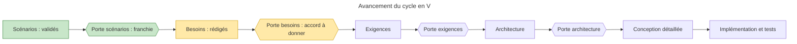

# Reprise du projet Boomrone — état au 2026-10-29

> **Aperçu**
> - Phase « besoins » rédigée : treize besoins (7 essentiels, 3 importants, 3 souhaitables), statut « Proposé », dans « Besoins » — `projets/boomrone/01-besoins.md`.
> - Rédigée par délégation (DEC-143 « Délégation de la phase besoins à l'architecte »), ligne « simplicité » (DEC-144 « Ligne directrice : simplicité, un seul utilisateur qui accepte les risques »).
> - Reste : l'accord explicite de l'utilisateur pour la porte « besoins » et son choix sur les six simplifications restantes (DOU-126 « Simplifications possibles des scénarios : choix de l'utilisateur », n°1 écartée par DEC-163 « Communication sans fil conservée : simplification n°1 écartée ») ; 0 doute bloquant, 29 non bloquants ouverts. Dossier définitif, prêt pour la porte ; accord explicite de l'utilisateur requis.

## Où on en est
- Livrables de la phase : « Besoins » — `projets/boomrone/01-besoins.md` (treize besoins, parcours, couverture des douze scénarios, six simplifications possibles recommandées, n°2 à n°7) et « Consignes d'emploi » — `projets/boomrone/consignes-emploi.md` (une page de 42 consignes, une par ligne : DEC-154 « Notice des limites d'emploi : une page de consignes d'emploi », DEC-162 « Consignes d'emploi : une consigne par ligne, les dangers en tête »).
- Décisions de la phase : de DEC-143 « Délégation de la phase besoins à l'architecte » à DEC-169 « Trois priorités définies : Essentiel, Important, Souhaitable », dans `journal-decisions.md` ; la seconde relecture de porte est reprise par DEC-164 « Seconde relecture de porte : énoncés des besoins repris » à DEC-169 « Trois priorités définies : Essentiel, Important, Souhaitable », après DEC-163 « Communication sans fil conservée : simplification n°1 écartée ». BES-011 « Fabriquer et programmer le drone soi-même » a changé de titre (DEC-166 « BES-011 retitré : fabriquer et programmer le drone soi-même »).
- Vérification : `python tools/check_traceability.py projets/boomrone` ne donne aucune erreur de titre ni de référence ; restent les trous attendus « BES sans REQ », « BES sans TA » et « SCN sans BES » (le lien besoin vers scénario n'est pas compté par l'outil : DEC-156 « Couverture des scénarios vérifiée à la main, outil de traçabilité inchangé »).
- Les scénarios restent inchangés ; l'utilisateur a écarté la simplification n°1 (retirer le sans fil) : sans fil conservé (DEC-163 « Communication sans fil conservée : simplification n°1 écartée »). Il reste six simplifications (n°2 à n°7, toutes recommandées) à décider (DOU-126 « Simplifications possibles des scénarios : choix de l'utilisateur »).

## Valeurs provisoires (à confirmer, aux exigences et aux essais)
- Stationnaire en 2 s au plus après le démarrage des moteurs, lancer de 0,5 à 4 m/s depuis au moins 1,5 m du sol, angle limite de 60° : validés par essais sur prototype (DEC-137 « Faisabilité du stationnaire en 2 secondes depuis 1,5 m : jalon déplacé aux essais, plage de lancer inchangée »).
- Seuils du bouton (1 s, 2 s, 10 s, écart d'environ 2 s entre appuis), moteurs 200 ms après le relâchement, garde du bouton de l'ordre de 0,5 s, atterrissage en 15 s au plus, vol de réglage de 3 s : valeurs provisoires (DOU-080 « Seuils de temps du bouton : 1 s, 2 s, 10 s et délai entre appuis » ; DOU-058 « Valeurs d'origine, bornes numériques, tolérance d'immobile et durées à fixer en architecture »).

## Doutes ouverts (tous non bloquants)
- Choix de l'utilisateur à la porte « besoins » : DOU-126 « Simplifications possibles des scénarios : choix de l'utilisateur » (réponse partielle : n°1 écartée ; six restantes).
- À traiter aux exigences : DOU-130 « Arrêt d'un drone en vol par le bouton sans le toucher » (option d'arrêt sans fil via BES-010 « Suivre le drone sur un appareil de suivi ») ; DOU-128 « Durée minimale perceptible des signaux » ; DOU-129 « Plage de lancer et hauteur d'un appartement (plafond) » (aussi aux essais). DOU-127 « Couverture ligne à ligne des risques acceptés par les consignes d'emploi » est levé par DEC-167 « BES-012 : contrôle croisé, consignes complétées, DOU-127 levé ».
- Reportés aux essais sur prototype : DOU-050 « Mesure de vitesse horizontale et faisabilité du stationnaire en 2 s depuis 1,5 m » ; DOU-101 « Tolérance d'immobile à l'armement sur un drone tenu en main : faisabilité du cas nominal » ; DOU-116 « Échéance et circularité du report aux essais, comportement de SCN-002 sur la partie infaisable de la plage » (si les essais contredisent la plage de lancer, les besoins sont à reprendre).
- Valeurs chiffrées, aux exigences :
  - DOU-009 « Quelle tolérance d'altitude pendant les 10 secondes de stationnaire ? »
  - DOU-010 « Quelle rotation au lancer le drone doit-il rattraper ? »
  - DOU-011 « Quelle dérive horizontale reste acceptable si 30 cm n'est pas tenu ? »
  - DOU-012 « Quel angle limite et quelles autres valeurs de coupure retenir ? »
  - DOU-013 « Quelle durée de vol garantit-on après un armement accepté ? »
  - DOU-028 « Faut-il une limite de dérive avant la coupure, entre 10° et 60° d'inclinaison ? »
  - DOU-029 « Quelle altitude maximale et quel plafond le drone doit-il tolérer ? »
  - DOU-035 « Quelle hauteur de stationnaire vise-t-on ? »
  - DOU-058 « Valeurs d'origine, bornes numériques, tolérance d'immobile et durées à fixer en architecture »
  - DOU-080 « Seuils de temps du bouton : 1 s, 2 s, 10 s et délai entre appuis »
- À traiter en architecture :
  - DOU-060 « Coupure de la batterie dans chaque état du drone, et alimentation des moteurs à valider en architecture matérielle »
  - DOU-108 « Rapport entre le seuil d'armement et le seuil de sous-tension, affaissement de tension au démarrage des moteurs »
  - DOU-109 « Batterie déjà déchargée : redémarrages répétés, décharge profonde et état après une coupure logicielle »
  - DOU-111 « Niveau ou front du bouton à l'acceptation de Décoller »
  - DOU-112 « Bouton enfoncé jusqu'à la fin de l'initialisation : état et signal »
  - DOU-113 « Ordre entre Modifier pendant l'initialisation et chargement des réglages enregistrés »
  - DOU-114 « Réglages enregistrés chargés ou non à l'état d'échec d'initialisation »
  - DOU-115 « Contenu et interruption de la réécriture de la zone des réglages par la reprogrammation »
  - DOU-118 « Seuil de protection et consommation résiduelle du drone laissé allumé »
  - DOU-119 « Filtrage, hystérésis et mesure sous charge de la tension »
  - DOU-120 « Écriture en mémoire sous tension basse ou pendant une phase de vol »
  - DOU-117 « Cause de sous-tension sur le statut sans fil »

## Risques acceptés
Consolidés dans « Risques acceptés » — `projets/boomrone/risques-acceptes.md` (DEC-124 « Registre consolidé des risques acceptés dans un fichier dédié ») ; leur essentiel est repris dans « Consignes d'emploi » — `projets/boomrone/consignes-emploi.md`.

## À faire ensuite
1. Accord explicite de l'utilisateur pour la porte « besoins » (relectures `critique`, `coherence-clarte`, `exigences-tracabilite` à lancer avant), inscrit au journal de décisions.
2. Phase « exigences » : exigences chiffrées dérivées des treize besoins, avec leur niveau de test système en face ; lever les doutes de valeurs.
3. Historique détaillé de la phase « scénarios » : `journal-decisions.md` (de DEC-001 « Information de l'utilisateur par signaux lumineux, sonores et suivi sur un autre appareil » à DEC-142 « Porte scénarios franchie : accord explicite de l'utilisateur ») et l'historique git.
