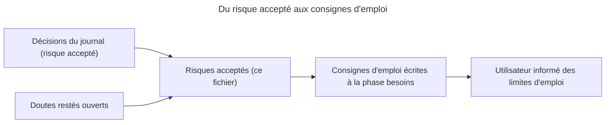

# Risques acceptés

> **Aperçu** : registre unique des risques acceptés du projet Boomrone, consolidé le 2026-10-28 (DEC-124 « Registre consolidé des risques acceptés dans un fichier dédié »).
> - Un risque par ligne : numéro, décision ou doute d'origine, scénario, limite d'emploi à documenter.
> - Les limites d'emploi sont informées par les consignes d'emploi écrites à la phase « besoins », qui reprennent l'essentiel de ce registre ; le drone n'affiche rien lui-même, hors statut sans fil (DEC-125 « Limites d'emploi informées par une notice écrite à la phase besoins, le drone n'affiche rien »).
> - Reprend les quinze risques historiques (listés à l'origine dans `reprise.md`, regroupés et complétés) et les risques acceptés du journal qui n'y figuraient pas.
> - État : 35 risques (36 numéros, la ligne 34 étant fusionnée dans la ligne 21), chacun est une décision de l'utilisateur ; aucune levée (ajouts du 2026-10-28 : voir les Notes).

## Registre

| N° | Risque accepté | Décision ou doute d'origine | Scénario | Limite d'emploi à documenter |
|---|---|---|---|---|
| 1 | Relâcher le bouton armé démarre les moteurs 200 ms plus tard, y compris dans la main ; renoncer demande de rester appuyé jusqu'au désarmement à 10 s, soit environ 8 s après le signal Prêt. | DEC-006 « Le relâchement du bouton armé suffit à démarrer les moteurs » ; DEC-073 « Armé entre 2 et 10 secondes d'appui : le relâchement donne le signal Lancé, les moteurs démarrent 200 ms plus tard » ; DEC-083 « Annulation d'un armement : le maintien jusqu'au désarmement à 10 s reste la seule annulation » | SCN-001 « Vol nominal : de la batterie au posé » ; SCN-005 « Dégradé : bouton maintenu plus de 10 secondes » | Ne relâcher le bouton armé que pour lancer ; pour renoncer, rester appuyé jusqu'au désarmement. |
| 2 | Hélices en rotation si le bouton est relâché en main ou le drone posé, sans lancer ; aucune coupure rapide. | DEC-017 « Pas de protection supplémentaire contre les hélices en rotation sans lancer » | SCN-002 « Échec : stationnaire non atteint dans le délai » | Protège-hélices obligatoires ; tenir le drone à l'écart des mains et du visage au relâchement. |
| 3 | Appui bref relâché avant la fin de la garde du bouton : sans effet, les hélices continuent de tourner. | DEC-119 « Appui bref pendant la garde du bouton, relâché avant la fin : risque accepté et documenté » ; DEC-092 « Garde du bouton après le lancer : fronts ignorés, niveau pris en compte, démarrage au relâchement » | SCN-002 « Échec : stationnaire non atteint dans le délai » | Tenir le bouton jusqu'à la fin de la garde (de l'ordre de 0,5 s) pour obtenir l'arrêt d'urgence. |
| 4 | Appui maintenu au-delà de 2 s pendant une série d'appuis : aucun signal ; l'utilisateur peut retaper jusqu'à entrer en mode réglage par erreur, dont la seule sortie est d'enlever la batterie. | DEC-084 « Appui ignoré pendant une série d'appuis : aucun signal, risque accepté et documenté » ; DEC-079 « Sortie du mode réglage : uniquement en enlevant la batterie » | SCN-004 « Appui normal : bouton relâché avant 2 secondes » | Expliquer la série d'appuis et la sortie du mode réglage (enlever la batterie). |
| 5 | Mode réglage : un appareil de suivi à portée peut faire décoller un drone retourné ou tenu en main, hélices contre le sol ou dans une main. | DEC-086 « Décollage de réglage : batterie seulement, risque cumulé avec les décisions sans appairage et sans verrouillage accepté » ; DEC-064 « Main près des hélices en mode réglage : risque accepté et documenté » ; DEC-037 « Pas d'appairage : le drone obéit à tout appareil de suivi à portée » | SCN-009 « Réglage et suivi du drone par le sans fil » | Ne pas tenir le drone en mode réglage ; écarter les mains des hélices. |
| 6 | Sans appairage, tout appareil de suivi à portée peut envoyer arrêt, décollage de réglage, modification ou sauvegarde ; une commande peut atteindre plusieurs drones. | DEC-037 « Pas d'appairage : le drone obéit à tout appareil de suivi à portée » | SCN-009 « Réglage et suivi du drone par le sans fil » | Régler le drone hors de portée d'autres appareils de suivi. |
| 7 | Arrêt d'urgence en vol par le bouton : anti-rebond de quelques millisecondes seulement ; un parasite plus long peut couper les moteurs en vol. | DEC-087 « Arrêt d'urgence par le bouton en vol : anti-rebond très court seulement, arrêt quasi immédiat » | SCN-007 « Dégradé : arrêt d'urgence par le bouton en vol » | Signaler que des parasites sur le bouton peuvent couper les moteurs. |
| 8 | Bouton coincé ou maintenu au démarrage : le drone ne s'arme pas et n'en dit rien en local ; seul le statut sans fil indique « bouton maintenu ». | DEC-088 « Bouton coincé ou maintenu en permanence au démarrage : statut sans fil seulement, aucun signal local » | SCN-010 « Échec : initialisation impossible au démarrage » | Vérifier le bouton ; utiliser un appareil de suivi pour le diagnostic. |
| 9 | Sauvegarder ignorée aux états Série d'appuis en cours, Premier appui validé, Armé, Initialisation en cours, en phase Lancé et en vol : aucune écriture, aucun signal local ; l'acquittement se lit sur le statut sans fil. | DEC-128 « Sauvegarder ignorée aussi à l'état Série d'appuis en cours » ; DEC-123 « Sauvegarder ignorée aussi à l'état Premier appui validé » ; DEC-112 « Sauvegarder ignorée à l'état armé, avant le lancer » ; DEC-120 « Sauvegarder ignorée pendant l'initialisation en cours, Modifier acceptée ; cas de l'échec d'initialisation non tranché » ; DEC-131 « Sauvegarder ignorée en vol : confirmation du tableau des commandes » | SCN-009 « Réglage et suivi du drone par le sans fil » | Relire le statut sans fil pour vérifier qu'une sauvegarde a eu lieu. |
| 10 | Vol de réglage : le bouton est pris en compte tout de suite après le décollage, sans garde ; une main proche du bouton peut couper les moteurs sans le vouloir. | DEC-094 « Bouton appuyé après un décollage de réglage : pris en compte tout de suite, sans garde » | SCN-007 « Dégradé : arrêt d'urgence par le bouton en vol » ; SCN-009 « Réglage et suivi du drone par le sans fil » | Ne pas toucher le bouton pendant un vol de réglage sauf pour arrêter. |
| 11 | Échec d'initialisation : Sauvegarder acceptée, un tiers à portée peut écraser par des valeurs non chargées les réglages enregistrés (perte persistante, seule la reprogrammation les rétablit) ; Modifier acceptée aussi. Choix explicite de l'utilisateur, l'option « Ignorée (recommandée) » ayant été écartée. | DEC-127 « Sauvegarder acceptée à l'état Échec d'initialisation : écrasement des réglages par un tiers, risque accepté » ; DEC-105 « Initialisation en cours et échec d'initialisation : Modifier et Sauvegarder acceptées, Décoller et Arrêt ignorées » ; DEC-037 « Pas d'appairage : le drone obéit à tout appareil de suivi à portée » ; DEC-035 « Pas de retour aux valeurs d'origine ; mémoire corrompue non traitée » | SCN-010 « Échec : initialisation impossible au démarrage » ; SCN-009 « Réglage et suivi du drone par le sans fil » | Ne pas envoyer de réglages à un drone en échec d'initialisation ; régler le drone hors de portée d'autres appareils de suivi. |
| 12 | Vols de réglage répétés : aucune limite de nombre, aucun contrôle de chauffe ; seule la batterie est vérifiée. | DEC-108 « Vols de réglage répétés : aucune limite de nombre ni contrôle de chauffe, risque accepté » | SCN-009 « Réglage et suivi du drone par le sans fil » | Laisser refroidir moteurs, électronique et batterie entre les vols de réglage. |
| 13 | Lancer hors plage ou hauteur impossible à mesurer (sol non réfléchissant, vitre, escalier) : échec de stabilisation, sans signal propre ; mêmes causes en stationnaire et à l'atterrissage. | DEC-109 « Lancer hors plage ou hauteur non mesurable : échec de stabilisation, limite d'emploi » | SCN-002 « Échec : stationnaire non atteint dans le délai » ; SCN-001 « Vol nominal : de la batterie au posé » | Lancer dans la plage prévue, au-dessus d'un sol réfléchissant. |
| 14 | Lien sans fil perdu en vol de réglage : aucune action, le vol suit son cours ; l'arrêt sans fil n'atteint plus le drone, seul le bouton l'arrête. | DEC-106 « Lien sans fil perdu en vol de réglage : aucune action particulière » | SCN-009 « Réglage et suivi du drone par le sans fil » | Garder la main près du bouton ; rester à portée du sans fil. |
| 15 | Cause d'une coupure en vol : le signal local ne persiste pas, « Allumé » prend le relais ; sans appareil de suivi, l'utilisateur ne connaît pas la cause. | DEC-113 « Cause d'une coupure en vol : confirmation, Allumé tout de suite, aucune durée minimale, risque accepté » ; DEC-104 « Cause d'une coupure en vol : signal local non conservé, Allumé prend le relais, cause conservée sur le statut sans fil » | SCN-002 « Échec : stationnaire non atteint dans le délai » ; SCN-006 « Échec : inclinaison excessive après le stationnaire » ; SCN-007 « Dégradé : arrêt d'urgence par le bouton en vol » | Utiliser un appareil de suivi pour connaître la cause d'une chute. |
| 16 | Batterie lithium : charge et stockage hors périmètre, à la charge de l'utilisateur. | DEC-111 « Batterie et programmation : hors périmètre des scénarios, limites d'emploi à documenter » | SCN-008 « Mise en service : programmation du drone » | Charger et stocker la batterie selon les consignes de son fabricant. |
| 17 | Drone laissé allumé en attente d'un appui : la batterie se décharge jusqu'au seuil de sous-tension, où le drone se coupe ; la protection n'est pas garantie suffisante contre la décharge profonde (batterie déjà déchargée, redémarrages). | DEC-133 « SCN-012 inclut le drone laissé allumé en attente d'un appui : sous-tension dans le périmètre » ; DEC-126 « Protection de sous-tension de la batterie : scénario court, coupure sans signal propre » ; DEC-111 « Batterie et programmation : hors périmètre des scénarios, limites d'emploi à documenter » (modifiée par DEC-133 « SCN-012 inclut le drone laissé allumé en attente d'un appui : sous-tension dans le périmètre ») | SCN-012 « Dégradé : sous-tension de la batterie » | Débrancher la batterie après usage. |
| 18 | Programmation : hélices à démonter, programmation interrompue, essai des moteurs avant le premier vol non couverts. | DEC-111 « Batterie et programmation : hors périmètre des scénarios, limites d'emploi à documenter » | SCN-008 « Mise en service : programmation du drone » | Démonter les hélices pendant la programmation ; essayer prudemment les moteurs. |
| 19 | Vol normal sans appareil de suivi : seul le bouton arrête le drone, pas d'arrêt sans fil. | DEC-032 « Vol libre : le drone vole sans appareil de suivi » | SCN-001 « Vol nominal : de la batterie au posé » ; SCN-007 « Dégradé : arrêt d'urgence par le bouton en vol » | Savoir arrêter le drone avec le bouton. |
| 20 | Pas de retour aux valeurs d'origine ; mémoire de réglages corrompue non traitée : drone possiblement instable ou imprévisible, sans signal. | DEC-035 « Pas de retour aux valeurs d'origine ; mémoire corrompue non traitée » | SCN-009 « Réglage et suivi du drone par le sans fil » | Seul recours : reprogrammer le drone. |
| 21 | Drone neuf, mémoire de réglages jamais écrite : aucune détection, valeurs d'origine fixes du logiciel, sans signal. | DEC-036 « Drone neuf : valeurs d'origine fixes du logiciel, sans signal » ; DEC-130 « Mémoire jamais écrite : aucune détection, valeurs d'origine fixes du logiciel, risque accepté » ; DEC-139 « Reprogrammation : réécriture de la zone des réglages avec les valeurs d'origine » (la programmation écrit la zone) | SCN-009 « Réglage et suivi du drone par le sans fil » | Vérifier le comportement d'un drone neuf avant usage normal. |
| 22 | Armement sans autotest : un drone abîmé après un vol raté peut être réarmé sans vérification. | DEC-056 « Armement : drone immobile, sans autotest » | SCN-001 « Vol nominal : de la batterie au posé » | Inspecter le drone et les hélices avant chaque vol. |
| 23 | Réglages hors seuils de sécurité sans borne, modifiables en vol normal ; les seuils de sécurité sont bornés par le logiciel (une décision antérieure sans borne est remplacée, citée pour mémoire). | DEC-039 « Réglages : coupures valables en vol de réglage, aucune borne, modifiables aussi en vol normal » ; DEC-051 « Seuils de sécurité réglables dans des bornes fixées par le logiciel » ; DEC-045 « Seuils de sécurité réglables comme le reste, sans borne » | SCN-009 « Réglage et suivi du drone par le sans fil » | Régler avec prudence ; les bornes ne limitent que les seuils de sécurité. |
| 24 | Paramètres de vol aberrants envoyés et sauvegardés par un tiers : rechargés à chaque démarrage ; seule la reprogrammation rétablit les valeurs. | DEC-121 « Paramètres de vol aberrants envoyés et sauvegardés par un tiers : risque accepté, reprogrammation seule » ; DEC-066 « Commande sans fil corrompue : aucun contrôle d'intégrité » ; DEC-037 « Pas d'appairage : le drone obéit à tout appareil de suivi à portée » | SCN-009 « Réglage et suivi du drone par le sans fil » ; SCN-008 « Mise en service : programmation du drone » | Reprogrammer le drone pour rétablir les valeurs d'origine. |
| 25 | Commande sans fil corrompue : aucun contrôle d'intégrité, une valeur aberrante peut être appliquée puis sauvegardée. | DEC-066 « Commande sans fil corrompue : aucun contrôle d'intégrité » | SCN-009 « Réglage et suivi du drone par le sans fil » | Relire les valeurs du drone après une modification. |
| 26 | Drone attrapé ou posé sur un obstacle : aucune détection dédiée, des hélices en rotation peuvent blesser une main. | DEC-057 « Pas de détection dédiée d'un drone attrapé ou posé sur un obstacle » | SCN-001 « Vol nominal : de la batterie au posé » | Ne pas attraper le drone en vol ; tenir les mains à l'écart des hélices. |
| 27 | Défaillance d'un capteur ou d'un moteur en vol : non détectée. | DEC-060 « Défaillance d'un capteur ou d'un moteur en vol : hors périmètre » | SCN-001 « Vol nominal : de la batterie au posé » | Inspecter capteurs, moteurs et protège-hélices avant chaque vol. |
| 28 | Choc contre un obstacle ou un plafond : aucune réaction dédiée, pas de coupure sur choc. | DEC-063 « Choc contre un obstacle ou un plafond : aucune réaction dédiée » ; DEC-014 « Pas de coupure sur choc en vol » | SCN-001 « Vol nominal : de la batterie au posé » | Voler loin des obstacles et des personnes. |
| 29 | Contrôle de la batterie en vol limité à la coupure sous le seuil de sous-tension : si le seuil d'armement est mal choisi, la batterie peut lâcher en vol ou la coupure peut survenir en vol (voir ligne 35). | DEC-013 « Pas de contrôle de la batterie en vol » (modifiée par DEC-134 « Coupure sur sous-tension en vol assumée par le logiciel : le drone surveille la tension ») | SCN-003 « Échec : batterie faible à l'armement » ; SCN-012 « Dégradé : sous-tension de la batterie » | Utiliser une batterie en bon état et chargée. |
| 30 | Lancer trop rapide pour la zone : responsabilité de l'utilisateur. | DEC-041 « Lancer hors plage ou trop rapide pour la zone : responsabilité de l'utilisateur » | SCN-001 « Vol nominal : de la batterie au posé » | Adapter la vitesse de lancer au lieu. |
| 31 | Aucune zone libre ni distance aux personnes ; le drone ne connaît pas le lieu (appartement, gymnase, jardin). | DEC-042 « Plage de lancer inchangée, aucune zone libre ni distance aux personnes, le drone ne connaît pas le lieu » ; DEC-040 « Périmètre d'emploi visé : l'appartement ; gymnase et jardin en essais complémentaires » | SCN-001 « Vol nominal : de la batterie au posé » | Choisir un lieu dégagé, loin des personnes. |
| 32 | Sous-tension : surintensité, inversion de polarité, surchauffe de la batterie et CEM non couvertes. | DEC-126 « Protection de sous-tension de la batterie : scénario court, coupure sans signal propre » | SCN-012 « Dégradé : sous-tension de la batterie » | Brancher la batterie avec la bonne polarité ; surveiller la chauffe. |
| 33 | Coupure de la batterie pendant l'écriture des réglages : mémoire possiblement corrompue, chargée au démarrage suivant sans détection ; pas de contrôle d'intégrité. | DEC-129 « Coupure de la batterie pendant l'écriture des réglages : risque accepté, traité en architecture » ; DEC-035 « Pas de retour aux valeurs d'origine ; mémoire corrompue non traitée » | SCN-009 « Réglage et suivi du drone par le sans fil » | Ne pas débrancher la batterie pendant une sauvegarde ; seul recours, la reprogrammation. |
| 34 | Fusionné dans la ligne 21 (même risque, mêmes décisions) ; numéro conservé pour les renvois du journal. | DEC-130 « Mémoire jamais écrite : aucune détection, valeurs d'origine fixes du logiciel, risque accepté » | SCN-009 « Réglage et suivi du drone par le sans fil » | Voir la ligne 21. |
| 35 | Un drone en vol chute sur sous-tension, sans signal, avec des personnes dessous, y compris pendant le lancer (phase « Lancé », moteurs non démarrés) : la coupure sous le seuil est assumée par le logiciel. | DEC-135 « Chute en vol sur sous-tension, sans signal, avec des personnes dessous : risque accepté » ; DEC-140 « Chute brutale sur sous-tension maintenue en connaissance de cause, sans seuil d'alerte » ; DEC-134 « Coupure sur sous-tension en vol assumée par le logiciel : le drone surveille la tension » ; DEC-126 « Protection de sous-tension de la batterie : scénario court, coupure sans signal propre » | SCN-012 « Dégradé : sous-tension de la batterie » ; SCN-001 « Vol nominal : de la batterie au posé » | Ne pas voler au-dessus de personnes ni près d'elles ; utiliser une batterie en bon état et chargée ; le drone tombe sans signal si la batterie passe sous le seuil. |
| 36 | Une écriture de réglages commencée à l'état Allumé (par exemple pendant un appui de moins de 1 s) et encore en cours au relâchement du lancer peut dépasser la durée maximale de la phase « Lancé » : coupure et redémarrage par le chien de garde, moteurs non démarrés, mémoire possiblement interrompue. | DEC-136 « Écriture de réglages commencée à l'état Allumé et encore en cours au relâchement du lancer : risque accepté » ; DEC-103 « Phase Lancé trop longue : coupure et redémarrage par le chien de garde, sans nouvel état ni signal » ; DEC-129 « Coupure de la batterie pendant l'écriture des réglages : risque accepté, traité en architecture » ; DEC-112 « Sauvegarder ignorée à l'état armé, avant le lancer » | SCN-009 « Réglage et suivi du drone par le sans fil » ; SCN-001 « Vol nominal : de la batterie au posé » | Ne pas envoyer Sauvegarder juste avant d'armer ou de lancer ; relire le statut sans fil pour vérifier la fin de l'écriture. |

## Notes

- Les quinze risques historiques (listés à l'origine dans `reprise.md`) sont regroupés et complétés ici ; les autres lignes viennent du journal des décisions.
- Ajouts du 2026-10-28 : lignes 33 et 34 (DEC-129 « Coupure de la batterie pendant l'écriture des réglages : risque accepté, traité en architecture » ; DEC-130 « Mémoire jamais écrite : aucune détection, valeurs d'origine fixes du logiciel, risque accepté ») ; ligne 11 mise à jour par DEC-127 « Sauvegarder acceptée à l'état Échec d'initialisation : écrasement des réglages par un tiers, risque accepté » ; lignes 17 et 29 mises à jour par DEC-133 « SCN-012 inclut le drone laissé allumé en attente d'un appui : sous-tension dans le périmètre » et DEC-134 « Coupure sur sous-tension en vol assumée par le logiciel : le drone surveille la tension » ; lignes 35 (DEC-135 « Chute en vol sur sous-tension, sans signal, avec des personnes dessous : risque accepté ») et 36 (DEC-136 « Écriture de réglages commencée à l'état Allumé et encore en cours au relâchement du lancer : risque accepté »).
- DEC-045 « Seuils de sécurité réglables comme le reste, sans borne » est remplacée par DEC-051 « Seuils de sécurité réglables dans des bornes fixées par le logiciel » : elle n'est citée que pour mémoire (ligne 23).
- DOU-062 « Où l'utilisateur est-il informé des limites d'emploi ? » et DOU-102 « Registre consolidé des risques acceptés » sont levés par DEC-125 « Limites d'emploi informées par une notice écrite à la phase besoins, le drone n'affiche rien » ; DEC-124 « Registre consolidé des risques acceptés dans un fichier dédié ».
